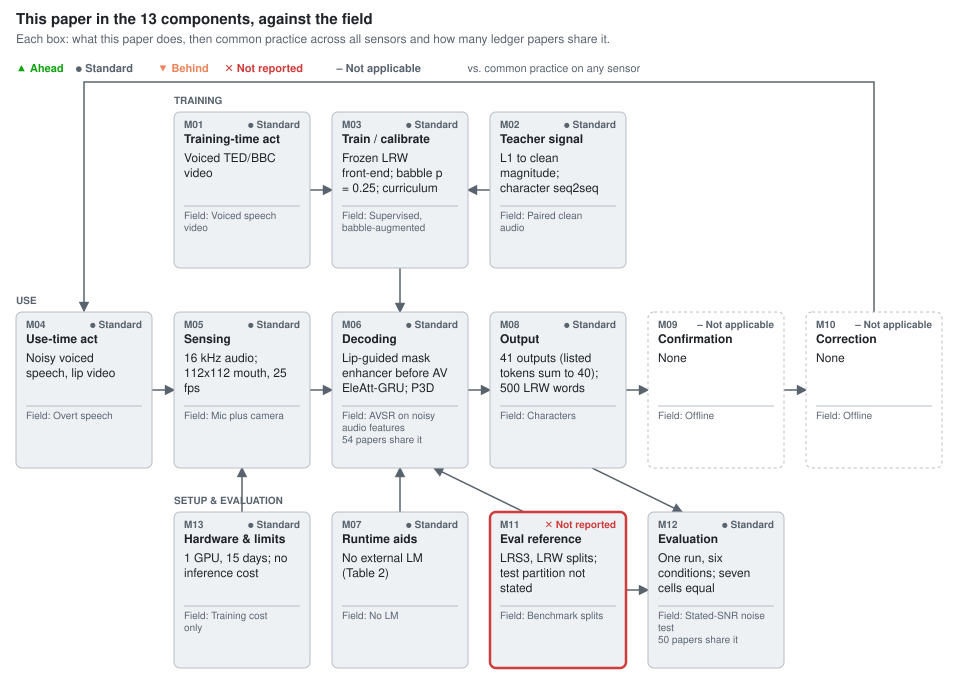

# Discriminative Multi-modality Speech Recognition

Xu, B., Lu, C., Guo, Y., Wang, J. · CVPR 2020 · [doi:10.1109/CVPR42600.2020.01444](https://doi.org/10.1109/CVPR42600.2020.01444) · [arXiv:2005.05592](https://arxiv.org/abs/2005.05592)

**Section:** [Other sensors](../../README.md#other-sensors)

## Figures

### This paper in the 13 components, against the field

<picture><source media="(prefers-color-scheme: dark)" srcset="figures/components-dark.svg"></picture>

Verdicts compare the paper's choice for each component with common practice across 8,995 ledger entries on any sensor (silent speech, brain-to-text, lip reading).

Data

| Component | This paper | Common practice | Papers with this practice | Verdict |
| --- | --- | --- | --- | --- |
| M01 Training-time act | Voiced TED/BBC video | Voiced speech video |  | ● Standard (Inherited.) |
| M02 Teacher signal | L1 to clean magnitude; character seq2seq | Paired clean audio |  | ● Standard (Inherited (Afouras et al. 2018a, 2018b).) |
| M03 Train / calibrate | Frozen LRW front-end; babble p = 0.25; curriculum | Supervised, babble-augmented |  | ● Standard (Inherited (Afouras et al. 2018b); no seeds.) |
| M04 Use-time act | Noisy voiced speech, lip video | Overt speech |  | ● Standard (Inherited.) |
| M05 Sensing | 16 kHz audio; 112x112 mouth, 25 fps | Mic plus camera |  | ● Standard (Inherited.) |
| M06 Decoding | Lip-guided mask enhancer before AV EleAtt-GRU; P3D front-end | AVSR on noisy audio features | 54 of 86 | ● Standard (Enhance-then-AV-recognise predates it (2002, 2013); LRW result holds over priors only without word boundaries, which is unstated.) |
| M07 Runtime aids | No external LM (Table 2) | No LM |  | ● Standard (Table 3 decoding conditions not stated.) |
| M08 Output | 41 outputs (listed tokens sum to 40); 500 LRW words | Characters |  | ● Standard (Target inconsistency: 26 letters, 10 digits and 4 tokens listed against 41 outputs (§4.3).) |
| M09 Confirmation | None | Offline |  | – Not applicable (Offline study.) |
| M10 Correction | None | Offline |  | – Not applicable (Offline study.) |
| M11 Eval reference | LRS3, LRW splits; test partition not stated | Benchmark splits |  | ✕ Not reported (Test partition, utterance count and test-noise recipe not stated.) |
| M12 Evaluation | One run, six conditions; seven cells equal published values | Stated-SNR noise test | 50 of 86 | ● Standard (No variability; 0 dB rows mix test noise and training data.) |
| M13 Hardware & limits | 1 GPU, 15 days; no inference cost | Training cost only |  | ● Standard (Inherited.) |

## Verdict

AE-MSR [[1]](#ref-1) changes processing (M06): a lip-guided mask enhancer before an audio-visual EleAtt-GRU recogniser, and a pseudo-3D (P3D) front-end; both standard. Using the video to enhance and then to recognise was done with HMMs in 2002 and 2013 [[2]](#ref-2), [[3]](#ref-3). The authors credit the enhancer's 1D ResNet block to My Lips Are Concealed [[4]](#ref-4) and claim the TCN upgrade (§1, §3.1). At 0 dB the second visual pass takes VA 32.5% to VAV 25.5% WER (Table 3), but each system runs once and seven baseline cells equal published values [[5]](#ref-5) from other data and babble (inference). The LRW result clears the closest boundary-free prior, 84.33% [[6]](#ref-6), only if no word boundaries were used, which is unstated; [concurrent] work reports 85.3% [[7]](#ref-7).

## Against the field, component by component

### M06 Processing: lip-guided enhancement before audio-visual recognition

**Usual approach:** Of 86 AVSR decoders public before 2019-11 (pattern match, Appendix), 54 mention MFCC or filterbank input and 19 any audio enhancement; on reading, 2 feed a visually enhanced signal to an audio-visual recogniser [[2]](#ref-2), [[3]](#ref-3). AE-MSR inserts a separately trained, frozen mask estimator (§3.1, §4.3).

**State of the art:** [Later] Shi and colleagues (2022) build LRS3 babble from 30 clips following AE-MSR and list AV-HuBERT (433 h labelled, self-supervised pre-training, noise-augmented fine-tuning, no enhancer) at 5.8% WER at 0 dB beside AE-MSR's 25.5% [[8]](#ref-8); the noise draws differ. CMA's 4.4% is tabulated second-hand [[9]](#ref-9).

Read precedents: AVCDCN with audio-visual decoding on connected digits [[2]](#ref-2), twin-HMM enhancement before a speaker-dependent GRID recogniser [[3]](#ref-3), and an audio-visual enhancer feeding an audio-only LSTM phone recogniser [[10]](#ref-10). The AE design (upsampled video, recurrent fusion, sigmoid mask) follows [[4]](#ref-4), not the convolutional fusion of [[11]](#ref-11). Adding the enhancer takes AV 41.1% to VAV 25.5% at 0 dB (Table 3). For retrained HMMs on matched-noise digits, Deligne et al. find audio-visual ASR without enhancement and with AVCDCN "become very similar" [[2]](#ref-2); its transfer to AE-MSR is untested (inference). §4.3 trains the MSR sub-network on clean magnitudes, and the AV column rises from 6.8% clean to 32.2% at 10 dB (Table 3), so no noise-trained AV model is run on AE-MSR's noise. Verdict: standard.

### M06 Processing: P3D front-end and EleAtt-GRU decoder

**Usual approach:** Of 17 LRW decoders public before 2019-11 (pattern match, Appendix), 13 mention both a 3D convolution and a ResNet; pseudo-3D appears in 2, neither as the front-end used. AE-MSR uses a 50-layer P3D (§3.1).

**State of the art:** [Later] SyncVSR (2024) reaches 93.2% LRW top-1 without word boundaries (95.0% with), from 157 h of LRW video with vq-wav2vec audio-token targets, mean of three runs [[12]](#ref-12); AE-MSR reaches 84.8% (Table 1).

Table 1 cites 83.0% as the state of the art (§5.1), yet 84.07% [[13]](#ref-13) and 84.33% without word boundaries (88.08% with) [[6]](#ref-6) came earlier. AE-MSR does not state word-boundary use; 84.8% clears 84.33% by half a point in one run (inference). The EleAtt-GRU claim (§3.2) sets EG-seq2seq (LRW-pretrained P3D, LRS3) against TM-seq2seq values pre-trained on MV-LRS, LRS2 and LRS3 [[5]](#ref-5); the visual-only gap (59.9% to 57.8%, Table 2) mixes front-end, data and decoder, and no ablation swaps P3D. Verdict: standard.

### M12 Evaluation: noisy-test protocol and baselines

**Usual approach:** Of the 86 prior AVSR decoders (pattern match, Appendix), 50 mention stated-SNR tests and 32 babble; 5 mention run variability or significance, 3 on reading, all on small-vocabulary corpora. AE-MSR gives one WER per system per condition (§5).

**State of the art:** [Later] USR 2.0 (2026) reports mean and standard deviation over three seeds on LRS3 [[14]](#ref-14).

Seven baseline cells in Tables 2–3 (TM-seq2seq 9.0%, 59.9%, 8.0%, 60.5%, 44.3%; Google 10.4%, 70.3%) equal the values of [[5]](#ref-5), whose noisy models were fine-tuned with 0 dB babble from 20 LRS2 utterances; AE-MSR says it reproduced and evaluated that model "at different noise levels" (§4.3) and mixes 30 LRS3 utterances, so the 0 dB cells appear reused (inference). Verdict: standard, not behind: the 3 prior variability reports all use small-vocabulary corpora (Appendix).

## The 13 components

| Component | This paper | Usual approach (count) | State of the art | Verdict |
|---|---|---|---|---|
| M01 Training-time action | Voiced TED/BBC video | Voiced speech video | – | standard |
| M02 Training-only supervision | L1 to clean magnitude; character seq2seq | Paired clean audio | – | standard |
| M03 Training and adaptation | Frozen LRW front-end; babble p = 0.25; curriculum | Supervised, babble-augmented | – | standard |
| M04 Use-time action | Noisy voiced speech, lip video | Overt speech | – | standard |
| M05 Sensors | 16 kHz audio; 112x112 mouth, 25 fps | Mic plus camera | – | standard |
| M06 Processing and decoding | Lip-guided mask enhancer before AV EleAtt-GRU; P3D front-end | No enhancer; MFCC or filterbank, mentions of 86 prior AVSR (pattern match 54) | [[8]](#ref-8) (2022): 5.8% AV WER, LRS3 0 dB babble | standard |
| M07 Lexicon and LM | No external LM (Table 2) | No LM | – | standard |
| M08 Output | 41 outputs (listed tokens sum to 40); 500 LRW words | Characters | – | standard |
| M09 Confirmation | None | Offline | – | not applicable |
| M10 Correction | None | Offline | – | not applicable |
| M11 Reference construction | LRS3, LRW splits; test partition not stated | Benchmark splits | – | not reported |
| M12 Evaluation | One run, six conditions; seven cells equal published values | Stated-SNR test, mentions of 86 prior AVSR (pattern match 50) | [[14]](#ref-14) (2026): three seeds | standard |
| M13 Device and cost | 1 GPU, 15 days; no inference cost | Training cost only | – | standard |

## Where the claims outrun the evidence

- "More advantageous in terms of robustness and accuracy" than single visual awareness (§1): the double use predates it [[2]](#ref-2), [[3]](#ref-3), and no noise-trained audio-visual model is run under its own noise (M06).
- "Ablation study ... demonstrates the effectiveness of each of the above sub-modules" (§1): Table 3 varies the enhancer, VA/VAV and the recogniser together; P3D and EleAtt-GRU are not ablated.
- "Consistently achieves the state-of-the-art performance by a significant margin" (Abstract): Table 2 and Table 3 give no test or variability.
- Clean rows are empty for enhanced systems (Table 3): the enhancer's clean-audio cost is unknown.

## What the field needs next

- M06: add the enhancer to an audio-visual model trained on the same noise, clean rows included.
- M06: swap P3D for a 3D-convolution ResNet in one LRW pipeline, three or more seeds.
- M12: re-run all baselines under one released noise file and report seed variability.

## Questions for the authors

- Was the single-awareness audio-visual model trained on noisy audio?
- Which TM-seq2seq cells were re-run, and with which test noise?
- Is the decoder output 40 or 41 classes (§4.3)?
- Does the LRW model use word boundaries?

## Appendix: literature search

- Shared population for all topics. Inclusion rule: lip-reading, VSR and AVSR decoders named in title or ledger; surveys, datasets, perception, neuroimaging, education, enhancement or separation without own recognition, synthesis, talking-head, forgery, synchronisation and keyword-spotting studies removed by title and on reading; versions merged; target excluded. Dated by first public month against 2020-05: prior before 2019-11, [concurrent] 2019-11 to 2020-11. Two audio-visual enhancement studies that also run a recogniser were added on reading [[2]](#ref-2), [[10]](#ref-10). 608 unique studies: prior 196, [concurrent] 27, date unresolved 4, [later] 381. All design counts below are full-text mention counts (pattern match, reference lists removed, upper bounds) with their denominators.
- M06, avsr-audio-feature-denoising (published table, reused). Inclusion rule: AVSR decoders of the shared population, classified by MFCC or filterbank input, any audio enhancement, learned audio-only denoisers and audio-visual enhancement or separation, then on reading for a visually guided enhancer feeding an audio-visual recogniser. Ledger: 7,345 unique studies slot-filled for M06, 349 pattern match (published); this review 256 AVSR decoders (prior 86, [concurrent] 9, [later] 161). Prior counts of 86: MFCC or filterbank 54, any audio enhancement 19, learned audio-only denoiser 4, audio-visual enhancement or separation 5 (on reading 2 feed an audio-visual recogniser, [[2]](#ref-2) and [[3]](#ref-3); 1 an audio-only recogniser, [[10]](#ref-10)). Outside the population, enhancement scored with an off-the-shelf recogniser: [[11]](#ref-11), [[4]](#ref-4). [Concurrent] 9: separation front-end then recogniser 2 ([[15]](#ref-15) and its multi-channel sequel). Read in full: [[2]](#ref-2), [[3]](#ref-3), [[10]](#ref-10), [[11]](#ref-11), [[4]](#ref-4), [[5]](#ref-5), [[8]](#ref-8), [[9]](#ref-9). Known-item recall 0.8 (published); 1.0 for this review (4 seeds).
- M06, word-lipreading-visual-frontend (published table, reused). Inclusion rule: LRW and LRW-1000 word-level decoders of the shared population, classified by 3D convolution, ResNet, both, I3D or two-stream, pseudo-3D or factorised 3D convolution, and TCN back-end; pseudo-3D hits read. Ledger: 156 unique studies pattern match (published); this review 99 LRW decoders (prior 17, [concurrent] 12, date unresolved 1, [later] 69). Prior counts of 17: 3D convolution and ResNet 13, I3D or two-stream 6, pseudo-3D 2 (0 as the front-end used). [Concurrent] 12: 3D convolution and ResNet 10, TCN back-end 5, pseudo-3D 1 (citation). Read in full: [[13]](#ref-13), [[6]](#ref-6), [[7]](#ref-7), [[12]](#ref-12). Known-item recall 1.0 (published and this review, 6 seeds).
- M12, avsr-noise-and-run-variability-protocol (published table, reused). Inclusion rule: the same 256 AVSR decoders, classified by stated-SNR tests, babble noise, SNRs at or below -5 dB, a language-model statement and run variability or significance; variability hits read. Ledger: 6,960 unique studies slot-filled for M12, 349 pattern match (published). Prior counts of 86: stated SNR 50, babble 32, SNR at or below -5 dB 17, language model 15, run variability or significance 5 (3 on reading). [Concurrent] 9: run variability 4 (3 on reading). Read in full: [[5]](#ref-5), [[3]](#ref-3), [[14]](#ref-14). Known-item recall 1.0 (published).

## References

Numbered by first citation. BibTeX in the same order and keys: [refs.bib](refs.bib).

1. Xu, B., Lu, C., Guo, Y., Wang, J. “Discriminative Multi-modality Speech Recognition.” *Proceedings of the IEEE/CVF Conference on Computer Vision and Pattern Recognition (CVPR)*, 2020, 14421-14430. doi:[10.1109/CVPR42600.2020.01444](https://doi.org/10.1109/CVPR42600.2020.01444). arXiv:[2005.05592](https://arxiv.org/abs/2005.05592). Target. Read as the CVF Open Access version (same text as arXiv v1); pages are the IEEE Xplore numbering (the CVF PDF shows 14433-14442). [wiki: cvf-xu20-aemsr](https://github.com/supernaiter/deep-research-wiki-for-silent-speech/blob/main/papers/cvf-xu20-aemsr/article.md) [wiki: cvf-xu20-msr](https://github.com/supernaiter/deep-research-wiki-for-silent-speech/blob/main/papers/cvf-xu20-msr/article.md)
2. Deligne, S., Potamianos, G., Neti, C. “Audio-Visual Speech Enhancement with AVCDCN (Audio-Visual Codebook Dependent Cepstral Normalization).” *Proc. 7th International Conference on Spoken Language Processing (ICSLP 2002)*, 2002, 1449-1452. doi:[10.21437/ICSLP.2002-421](https://doi.org/10.21437/ICSLP.2002-421). Prior; deciding prior for M06 (audio-visual enhancement with audio-only and audio-visual recognisers). Not cited by the target. [wiki: isca-deligne02_icslp](https://github.com/supernaiter/deep-research-wiki-for-silent-speech/blob/main/papers/isca-deligne02_icslp/article.md)
3. Abdelaziz, A. H., Zeiler, S., Kolossa, D. “Using Twin-HMM-Based Audio-Visual Speech Enhancement as a Front-End for Robust Audio-Visual Speech Recognition.” *Interspeech 2013*, 2013, 867-871. doi:[10.21437/Interspeech.2013-257](https://doi.org/10.21437/Interspeech.2013-257). Prior; deciding prior for M06 (audio-visual enhancement front-end for an audio-visual recogniser). Not cited by the target. [wiki: isca-abdelaziz13-twinhmm](https://github.com/supernaiter/deep-research-wiki-for-silent-speech/blob/main/papers/isca-abdelaziz13-twinhmm/article.md) [wiki: isca-abdelaziz13_interspeech](https://github.com/supernaiter/deep-research-wiki-for-silent-speech/blob/main/papers/isca-abdelaziz13_interspeech/article.md)
4. Afouras, T., Chung, J. S., Zisserman, A. “My Lips Are Concealed: Audio-Visual Speech Enhancement Through Obstructions.” *Interspeech 2019*, 2019, 4295-4299. doi:[10.21437/Interspeech.2019-3114](https://doi.org/10.21437/Interspeech.2019-3114). arXiv:[1907.04975](https://arxiv.org/abs/1907.04975). Prior; cited by the target as [6]; BLSTM-fusion mask network closest to the AE sub-network (M06). [wiki: arxiv-1907.04975](https://github.com/supernaiter/deep-research-wiki-for-silent-speech/blob/main/papers/arxiv-1907.04975/article.md) [wiki: isca-afouras19-concealed](https://github.com/supernaiter/deep-research-wiki-for-silent-speech/blob/main/papers/isca-afouras19-concealed/article.md) [wiki: isca-afouras19_lipsconcealed](https://github.com/supernaiter/deep-research-wiki-for-silent-speech/blob/main/papers/isca-afouras19_lipsconcealed/article.md)
5. Afouras, T., Chung, J. S., Senior, A., Vinyals, O., Zisserman, A. “Deep Audio-Visual Speech Recognition.” *IEEE Transactions on Pattern Analysis and Machine Intelligence*, 2022, 44(12), 8717-8727. doi:[10.1109/TPAMI.2018.2889052](https://doi.org/10.1109/TPAMI.2018.2889052). arXiv:[1809.02108](https://arxiv.org/abs/1809.02108). Prior (online 2018); TM-seq2seq baseline whose Table 2 values reappear in the target's Tables 2-3 (M06, M12). [review](https://github.com/supernaiter/silent-speech-review/tree/main/reviews/deep-audio-visual-speech-recognition) [wiki: arxiv-1809.02108](https://github.com/supernaiter/deep-research-wiki-for-silent-speech/blob/main/papers/arxiv-1809.02108/article.md) [wiki: doi-10.1109-tpami.2018.2889052](https://github.com/supernaiter/deep-research-wiki-for-silent-speech/blob/main/papers/doi-10.1109-tpami.2018.2889052/article.md)
6. Stafylakis, T., Khan, M. H., Tzimiropoulos, G. “Pushing the boundaries of audiovisual word recognition using Residual Networks and LSTMs.” *Computer Vision and Image Understanding*, 2018, 176-177, 22-32. doi:[10.1016/j.cviu.2018.10.003](https://doi.org/10.1016/j.cviu.2018.10.003). arXiv:[1811.01194](https://arxiv.org/abs/1811.01194). Prior; LRW results with and without word boundaries (M06). [wiki: arxiv-1811.01194](https://github.com/supernaiter/deep-research-wiki-for-silent-speech/blob/main/papers/arxiv-1811.01194/article.md)
7. Martinez, B., Ma, P., Petridis, S., Pantic, M. “Lipreading using Temporal Convolutional Networks.” *IEEE International Conference on Acoustics, Speech and Signal Processing (ICASSP)*, 2020, 6319-6323. doi:[10.1109/ICASSP40776.2020.9053841](https://doi.org/10.1109/ICASSP40776.2020.9053841). arXiv:[2001.08702](https://arxiv.org/abs/2001.08702). [concurrent]; LRW result above the target (M06). [concurrent] [review](https://github.com/supernaiter/silent-speech-review/tree/main/reviews/lipreading-using-temporal-convolutional-networks) [wiki: arxiv-2001.08702](https://github.com/supernaiter/deep-research-wiki-for-silent-speech/blob/main/papers/arxiv-2001.08702/article.md)
8. Shi, B., Hsu, W., Mohamed, A. “Robust Self-Supervised Audio-Visual Speech Recognition.” *Interspeech 2022*, 2022, 2118-2122. doi:[10.21437/Interspeech.2022-99](https://doi.org/10.21437/Interspeech.2022-99). arXiv:[2201.01763](https://arxiv.org/abs/2201.01763). [later]; babble test following the target's recipe, AV-HuBERT beside the target (Table 2); state of the art for M06. [later] [review](https://github.com/supernaiter/silent-speech-review/tree/main/reviews/robust-self-supervised-audio-visual-speech-recognition) [wiki: isca-shi22-robustav](https://github.com/supernaiter/deep-research-wiki-for-silent-speech/blob/main/papers/isca-shi22-robustav/article.md) [wiki: isca-shi22_interspeech](https://github.com/supernaiter/deep-research-wiki-for-silent-speech/blob/main/papers/isca-shi22_interspeech/article.md)
9. Rouditchenko, A., Gong, Y., Thomas, S., Karlinsky, L., Kuehne, H., Feris, R., et al. “Whisper-Flamingo: Integrating Visual Features into Whisper for Audio-Visual Speech Recognition and Translation.” *Interspeech 2024*, 2024, 2420-2424. doi:[10.21437/Interspeech.2024-322](https://doi.org/10.21437/Interspeech.2024-322). arXiv:[2406.10082](https://arxiv.org/abs/2406.10082). [later]; tabulates noisy LRS3 AVSR results (Table 3); state of the art for M06. [later] [review](https://github.com/supernaiter/silent-speech-review/tree/main/reviews/whisper-flamingo-integrating-visual-features-into-whisper-for-audio-visual-speech-recognition-and-tr) [wiki: arxiv-2406.10082](https://github.com/supernaiter/deep-research-wiki-for-silent-speech/blob/main/papers/arxiv-2406.10082/article.md) [wiki: isca-rouditchenko24-whisperflamingo](https://github.com/supernaiter/deep-research-wiki-for-silent-speech/blob/main/papers/isca-rouditchenko24-whisperflamingo/article.md) [wiki: in24-whisperflamingo](https://github.com/supernaiter/deep-research-wiki-for-silent-speech/blob/main/papers/in24-whisperflamingo/article.md) [wiki: isca-rouditchenko24_interspeech](https://github.com/supernaiter/deep-research-wiki-for-silent-speech/blob/main/papers/isca-rouditchenko24_interspeech/article.md)
10. Pasa, L., Morrone, G., Badino, L. “An Analysis of Speech Enhancement and Recognition Losses in Limited Resources Multi-Talker Single Channel Audio-Visual ASR.” *IEEE International Conference on Acoustics, Speech and Signal Processing (ICASSP)*, 2020, 7309-7313. doi:[10.1109/ICASSP40776.2020.9054697](https://doi.org/10.1109/ICASSP40776.2020.9054697). arXiv:[1904.08248](https://arxiv.org/abs/1904.08248). Prior; deep audio-visual enhancement feeding an audio-only phone recogniser (M06). [wiki: arxiv-1904.08248](https://github.com/supernaiter/deep-research-wiki-for-silent-speech/blob/main/papers/arxiv-1904.08248/article.md)
11. Afouras, T., Chung, J. S., Zisserman, A. “The Conversation: Deep Audio-Visual Speech Enhancement.” *Interspeech 2018*, 2018, 3244-3248. doi:[10.21437/Interspeech.2018-1400](https://doi.org/10.21437/Interspeech.2018-1400). arXiv:[1804.04121](https://arxiv.org/abs/1804.04121). Prior; cited by the target as [3]; AV soft-mask magnitude enhancement with a convolutional fusion stack (M06). [wiki: arxiv-1804.04121](https://github.com/supernaiter/deep-research-wiki-for-silent-speech/blob/main/papers/arxiv-1804.04121/article.md) [wiki: isca-afouras18-conversation](https://github.com/supernaiter/deep-research-wiki-for-silent-speech/blob/main/papers/isca-afouras18-conversation/article.md)
12. Ahn, Y. J., Park, J., Park, S., Choi, J., Kim, K. “SyncVSR: Data-Efficient Visual Speech Recognition with End-to-End Crossmodal Audio Token Synchronization.” *Interspeech 2024*, 2024, 867-871. doi:[10.21437/Interspeech.2024-432](https://doi.org/10.21437/Interspeech.2024-432). arXiv:[2406.12233](https://arxiv.org/abs/2406.12233). [later]; state of the art for the LRW front-end (M06). [later] [wiki: arxiv-2406.12233](https://github.com/supernaiter/deep-research-wiki-for-silent-speech/blob/main/papers/arxiv-2406.12233/article.md)
13. Weng, X., Kitani, K. “Learning Spatio-Temporal Features with Two-Stream Deep 3D CNNs for Lipreading.” *British Machine Vision Conference (BMVC)*, 2019. arXiv:[1905.02540](https://arxiv.org/abs/1905.02540). Prior; higher LRW result than the target's cited state of the art (M06). [wiki: arxiv-1905.02540](https://github.com/supernaiter/deep-research-wiki-for-silent-speech/blob/main/papers/arxiv-1905.02540/article.md)
14. Haliassos, A., Mira, R., Petridis, S. “Pay Attention to CTC: Fast and Robust Pseudo-Labelling for Unified Speech Recognition.” *International Conference on Learning Representations (ICLR)*, 2026. arXiv:[2602.19316](https://arxiv.org/abs/2602.19316). [later]; seed-level variability on LRS3 (M12 protocol yardstick). [later] [wiki: arxiv-2602.19316](https://github.com/supernaiter/deep-research-wiki-for-silent-speech/blob/main/papers/arxiv-2602.19316/article.md)
15. Yu, J., Zhang, S., Wu, J., Ghorbani, S., Wu, B., Kang, S., et al. “Audio-Visual Recognition of Overlapped Speech for the LRS2 Dataset.” *IEEE International Conference on Acoustics, Speech and Signal Processing (ICASSP)*, 2020, 6984-6988. doi:[10.1109/ICASSP40776.2020.9054127](https://doi.org/10.1109/ICASSP40776.2020.9054127). arXiv:[2001.01656](https://arxiv.org/abs/2001.01656). [concurrent]; integrated AVSR against a pipelined separation-plus-recognition system (M06). [concurrent] [wiki: arxiv-2001.01656](https://github.com/supernaiter/deep-research-wiki-for-silent-speech/blob/main/papers/arxiv-2001.01656/article.md)

## Materials

Data behind this review. Full texts of the papers are not included.

- [`review.md`](review.md): the review text (source)
- [`refs.bib`](refs.bib): references (BibTeX)
- [`slots.json`](slots.json): for each of the 13 components: this paper's choice, field practice, number of matching papers, verdict
- [`figures.json`](figures.json): figure definitions
- [`evaluation.md`](evaluation.md): independent evaluation by a second reviewer
- [`process/log.json`](process/log.json): process record: each step, who did it (reader, script, writer, evaluator), when, the checks run and the input versions
- [`process/notes.json`](process/notes.json): reading notes on the target and comparator papers: claims, numbers, conditions and what is not stated, with locations
- [`process/plan.json`](process/plan.json): plan: which components the paper changes and the topics it is compared on
- [`process/draft.md`](process/draft.md): the review as first written, before the independent evaluation
- [`process/claims-draft.md`](process/claims-draft.md): claim table of the draft: every claim mapped to a note or a count
- [`process/claims.md`](process/claims.md): claim table of the published review
- [`components/M06/avsr-audio-feature-denoising.csv`](../../components/M06/avsr-audio-feature-denoising.csv): M06 topic "avsr-audio-feature-denoising", every candidate paper with its decision (7345 slot-filled, 349 pattern match, usual design in 29, 2 read in full)
- [`components/M06/word-lipreading-visual-frontend.csv`](../../components/M06/word-lipreading-visual-frontend.csv): M06 topic "word-lipreading-visual-frontend", every candidate paper with its decision (7345 slot-filled, 156 pattern match, usual design in 106, 6 read in full)
- [`components/M12/avsr-noise-and-run-variability-protocol.csv`](../../components/M12/avsr-noise-and-run-variability-protocol.csv): M12 topic "avsr-noise-and-run-variability-protocol", every candidate paper with its decision (6960 slot-filled, 349 pattern match, usual design in 183, 3 read in full)

## More reviews in Other sensors

- [ASR is all you need: cross-modal distillation for lip reading](../asr-is-all-you-need-cross-modal-distillation-for-lip-reading/) (2020). ASR-teacher labels (M02) replaced transcribed-data alignment targets; standard: LRS2 parity holds, but effects differ across datasets, one WER each, and distillation is not isolated.
- [Audio-Visual Recognition of Overlapped Speech for the LRS2 Dataset](../audio-visual-recognition-of-overlapped-speech-for-the-lrs2-dataset/) (2020). Gated AV fusion for overlapped speech (M06) is standard: AV-driven fusion weights (2006) and mixture recognition with lips (2016) came first; 15.20% to 10.31% WER, no seeds; test interferers unstated.
- [Can We Read Speech Beyond the Lips? Rethinking RoI Selection for Deep Visual Speech Recognition](../can-we-read-speech-beyond-the-lips-rethinking-roi-selection-for-deep-visual-speech-recognition/) (2020). Face Cutout (M03) is ahead but untested on mouth crops; the face RoI (M05) is standard, as face and mouth were compared before; the GRID 2.9% claim relies on an LM.
- [Decoding Imagined and Spoken Phrases From Non-invasive Neural (MEG) Signals](../decoding-imagined-and-spoken-phrases-from-non-invasive-neural-meg-signals/) (2020). Scalogram CNNs (M06) and ImageNet weights (M03) were new for imagined speech but standard: effects not isolated; 93% imagination sits on a 43.77% pre-stimulus floor (Table 1).
- [Decoding spoken English from intracortical electrode arrays in dorsal precentral gyrus](../decoding-spoken-english-from-intracortical-electrode-arrays-in-dorsal-precentral-gyrus/) (2020). 39-phoneme decoding from dorsal Utah arrays (M06) and overt-speech confound controls (M12) are standard: both have read priors, T5 alone carries them, and folds share words.
- [Hearing Lips: Improving Lip Reading by Distilling Speech Recognizers](../hearing-lips-improving-lip-reading-by-distilling-speech-recognizers/) (2020). Recognizer-to-lip-reader distillation (M02) is ahead of the prior record and repeats over two datasets and three teachers; the audio rationale is untested and the LRS2 state-of-the-art claim fails.

---

Part of the [Silent Speech Interface Review](https://github.com/supernaiter/silent-speech-review). Found an error? [Open an issue](https://github.com/supernaiter/silent-speech-review/issues/new?template=correction.yml).
