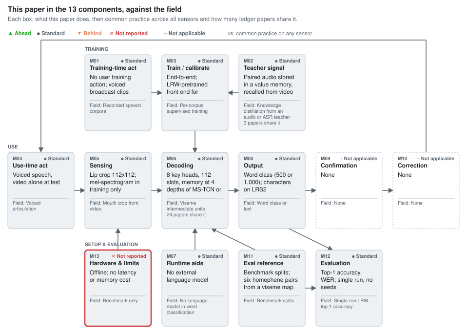

# Distinguishing Homophenes Using Multi-Head Visual-Audio Memory for Lip Reading

Minsu Kim, Jeong Hun Yeo, Yong Man Ro. AAAI 2022 (arXiv April 2022). [arXiv:2204.01725](https://arxiv.org/abs/2204.01725)

**Section:** [Other sensors](../../README.md#other-sensors)

## Figures

### This paper in the 13 components, against the field

<picture><source media="(prefers-color-scheme: dark)" srcset="figures/components-dark.svg"></picture>

Verdicts compare the paper's choice for each component with common practice across 8,995 ledger entries on any sensor (silent speech, brain-to-text, lip reading).

Data

| Component | This paper | Common practice | Papers with this practice | Verdict |
| --- | --- | --- | --- | --- |
| M01 Training-time act | No user training action; voiced broadcast clips | Recorded speech corpora |  | ● Standard (Inherited.) |
| M02 Teacher signal | Paired audio stored in a value memory, recalled from video | Knowledge distillation from an audio or ASR teacher | 3 of 4 | ● Standard (Memory recall from the same group's ICCV memory, the paper's baseline.) |
| M03 Train / calibrate | End-to-end; LRW-pretrained front end for sentences | Per-corpus supervised training |  | ● Standard (Inherited; no seeds or validation rule.) |
| M04 Use-time act | Voiced speech, video alone at test | Voiced articulation |  | ● Standard (Inherited.) |
| M05 Sensing | Lip crop 112x112; mel-spectrogram in training only | Mouth crop from video |  | ● Standard (Inherited.) |
| M06 Decoding | 8 key heads, 112 slots, memory at 4 depths of MS-TCN or Transformer | Viseme intermediate units | 24 of 41 | ● Standard (Heads +0.3 at one depth, +0.98 at four; one dataset, single runs.) |
| M07 Runtime aids | No external language model | No language model in word classification |  | ● Standard (LRS2 without LM only.) |
| M08 Output | Word class (500 or 1,000); characters on LRS2 | Word class or text |  | ● Standard (Inherited.) |
| M09 Confirmation | None | None |  | – Not applicable (Offline study.) |
| M10 Correction | None | None |  | – Not applicable (Offline study.) |
| M11 Eval reference | Benchmark splits; six homophene pairs from a viseme map | Benchmark splits |  | ● Standard (No per-word counts for Table 6.) |
| M12 Evaluation | Top-1 accuracy, WER; single run, no seeds | Single-run LRW top-1 accuracy |  | ● Standard (SOTA margin 0.1 points over DC-TCN; single runs.) |
| M13 Hardware & limits | Offline; no latency or memory cost | Benchmark only |  | ✕ Not reported (Authors state memory parameters remain similar (Sec. 4.2); no absolute cost.) |

## Verdict

The paper [[1]](#ref-1) changes training-only supervision (M02), recalling stored audio from video, and processing (M06), addressing the memory with eight heads at four depths; both are standard. The audio memory comes from the same group's ICCV paper [[2]](#ref-2) ([concurrent] by date), which the authors use as their single-memory baseline (Table 1). Heads add 0.3 LRW points at one depth and 0.98 at four, depths 1.29 with eight heads (Table 2), all single runs on one dataset. The LRW state-of-the-art claim is a 0.1-point margin over DC-TCN; the 3-point LRW-1000 gain over the earlier memory also swaps Bi-GRU for MS-TCN.

## Against the field, component by component

### M02 Training-only supervision: audio recalled from a memory

**Usual approach:** Of 4 earlier decoders that transfer audio into a video-only lip reader (Appendix), 3 distil an audio or ASR teacher, as in [[3]](#ref-3), and LiRA [[4]](#ref-4) regresses PASE+ audio features. The paper stores audio in a value memory recalled from video, the design of the same group's ICCV memory [[2]](#ref-2), which it uses as its baseline.

**State of the art:** At the time LiRA (2021) reached 88.1% on LRW after self-supervised pre-training on unlabelled LRS3 (590 h of video in all) [[4]](#ref-4), [[5]](#ref-5), 0.4 points below the paper's 88.5% (inference). Today SyncVSR (2024) [[5]](#ref-5) [later], supervising frames with quantized audio tokens, reaches 93.2% on LRW without word boundaries, LRW video only, mean of three runs: 4.7 points higher, 41% less error (inference). On LRS2 without a language model it gives 22.0% WER from 661 h of video, against the paper's 44.5% from 818 h [[5]](#ref-5).

The single memory moves LRW from 86.1% to 86.9% (+0.8, 6% less error), full MVM to 88.5% (17%) (Table 1; inference). Verdict: standard; memory recall is inherited from [[2]](#ref-2), and the new value-memory contrastive loss (Sec. 3.2) has no ablation.

### M06 Processing: multi-head keys and multi-depth memory for homophenes

**Usual approach:** Of 41 prior lip-reading decoders whose ledger names homophenes, visemes or one-to-many mapping (mention count, Appendix), 24 name viseme units and 19 a language model, and 0 an audio or multi-head memory; selection by these words favours viseme designs, and the paper's word-level peers (Table 3) vary only the back end. A typical prior resolves viseme ambiguity by language-model perplexity [[6]](#ref-6).

**State of the art:** SyncVSR (2024) scores all LRW word pairs by grapheme edit distance, with close pairs classified better than by a no-audio model (Fig. 3), where the paper scored six [[5]](#ref-5); overall it reaches 93.2% on LRW and 58.2% on LRW-1000 (word boundaries not stated) without a memory.

Heads and depths interact: heads add 0.3 points at one depth (Table 1) and 0.98 at four (87.53% to 88.51%), depths add 1.29 with eight heads (87.22% to 88.51%, Table 2). The authors present both as homophene mechanisms (Sec. 3.1, 3.3). Verdict: standard; no prior in the Appendix count has the design, but its effect rests on single LRW runs.

### M12 Evaluation: LRW and LRW-1000 claims

**Usual approach:** Of 45 prior LRW decoders, 16 mention repeated runs or standard deviations (mention count, Appendix); the paper reports single runs (Tables 1-3, 6).

**State of the art:** At the time the best single LRW model was DC-TCN at 88.4% (Table 3); a self-distilled ensemble had reached 88.5% (2020) [[7]](#ref-7); without word boundaries Feng et al. reached 48.0% on LRW-1000 (2020) [[8]](#ref-8), below the paper's 53.82%. Today the best like-for-like LRW figure is 93.2% (2024) [[5]](#ref-5). Verdict: standard.

## The 13 components

| Component | This paper | Usual approach (count) | State of the art | Verdict |
|---|---|---|---|---|
| M01 Training-time action | No user training action; voiced broadcast clips | Recorded speech corpora | – | standard |
| M02 Training-only supervision | Paired audio stored in a value memory, recalled from video | Knowledge distillation from an audio or ASR teacher (pattern match 3) | LRW 93.2%, audio-token supervision [[5]](#ref-5) | standard |
| M03 Training and adaptation | End-to-end; LRW-pretrained front end for sentences | Per-corpus supervised training | – | standard |
| M04 Use-time action | Voiced speech, video alone at test | Voiced articulation | – | standard |
| M05 Sensors | Lip crop 112x112; mel-spectrogram in training only | Mouth crop from video | – | standard |
| M06 Processing and decoding | 8 key heads, 112 slots, memory at 4 depths of MS-TCN or Transformer | Viseme intermediate units (pattern match 24) | All-pair homophene analysis by edit distance, audio-token supervision [[5]](#ref-5) | standard |
| M07 Lexicon and LM | No external language model | No language model in word classification | – | standard |
| M08 Output | Word class (500 or 1,000); characters on LRS2 | Word class or text | – | standard |
| M09 Confirmation | None | None | – | not applicable |
| M10 Correction | None | None | – | not applicable |
| M11 Reference construction | Benchmark splits; six homophene pairs from a viseme map | Benchmark splits | – | standard |
| M12 Evaluation | Top-1 accuracy, WER; single run, no seeds | Single-run LRW top-1 accuracy | LRW 93.2%, no word boundaries, three runs [[5]](#ref-5) | standard |
| M13 Device and cost | Offline; no latency or memory cost | Benchmark only | – | not reported |

## Where the claims outrun the evidence

- "Sets a new state-of-the-art" (Sec. 4.2) rests on 88.5% against 88.4% for DC-TCN (Table 3), 0.9% less error, one run (inference); Table 3 lists that self-distillation work's single model (87.9%, not its 88.5% ensemble), but Table 4 its LRW-1000 ensemble (46.60%, single 45.3%) [[7]](#ref-7).
- The 3% LRW-1000 lead over [[2]](#ref-2) (Sec. 4.2) compares an MS-TCN model with a Bi-GRU one, whose memory added 5.89 points over its own baseline [[2]](#ref-2); the paper has no LRW-1000 baseline without memory.
- The LRS2 baseline is described as the proposed model without MVM (Sec. 4.2), yet Table 5 labels it Afouras et al. 2018 at 49.8%, the value listed for that work's TM-seq2seq [[3]](#ref-3); a prior conformer gives 42.4% with an RNN language model [[9]](#ref-9).
- Table 6 gives 12 words without denominators (Sec. 4.3); LRW has at least 40 test clips per word [[10]](#ref-10) and all values are even, so +2% is about one clip (inference); two words gain 0 points.
- Slots, heads and depths each take their ablation's best score (Table 2); no validation data are named (Sec. 4.1).

## What the field needs next

- M06: heads and depths ablated jointly on LRW and LRW-1000 over seeds, with accuracy on all viseme-identical word pairs and clip counts.
- M02: memory recall, audio-feature regression [[4]](#ref-4) and audio-token supervision [[5]](#ref-5) on one back end and data budget.
- M12: a no-memory MS-TCN baseline on LRW-1000 and a retrained LRS2 baseline.

## Questions for the authors

- Which data selected N, h and the depths, and what is the run-to-run spread of Tables 1-6?
- How many homophene pairs did the viseme map yield in LRW, and how were the six reported chosen?
- Was the LRS2 baseline retrained with your pre-training and loss, or taken from Afouras et al.?

## Appendix: literature search

- M02 audio-knowledge-transfer-to-video (published topic table, appended). Inclusion rule: lip-reading and video-to-speech studies that take only lip or face video at test and use paired audio or a speech model during training to enrich the visual model, by distillation, audio-feature regression or a memory of audio representations; for this review dated against 2022-02 and restricted to decoders that transfer audio (perception studies, audio-visual recognizers needing audio at test, video-to-speech systems with audio only as output, and distillation between video models excluded); versions counted once. Slot-filled 31 unique studies; pattern match 54 unique studies (67 folders). Prior (before 2021-08): 3 pattern-match studies, all knowledge distillation, plus LiRA [[4]](#ref-4) (read, missed by the pattern): 4 decoders, knowledge distillation 3, audio-feature regression 1, memory recall 0. Same-group precedent: [[2]](#ref-2) (ICCV, October 2021, [concurrent] by the window), the target's own baseline. [Concurrent] (2021-08 to 2022-08): 6 studies, knowledge distillation 4, memory recall 1 ([[2]](#ref-2)), audio-feature regression 1. Usual design: knowledge distillation, 3 of 4 prior. Read in full: [[2]](#ref-2) [concurrent], [[3]](#ref-3), [[4]](#ref-4), [[5]](#ref-5) [later], target. Known-item recall 0.75 (3 of 4 seeds).
- M06 homophene-disambiguation-in-lip-reading (new topic table). Inclusion rule: lip-reading decoders, video only at test, whose ledger names homophenes, visemes, visually similar words or one-to-many mapping, classified by the mechanism their full text names; perception studies, surveys, talking heads, audio-visual recognizers and video-to-speech excluded; full-text counts are mentions (pattern match, upper bounds); versions counted once. Slot-filled 7,345 unique studies; pattern match 128 unique studies (164 folders) before filtering. Prior (before 2021-08): 41 decoders (video-to-speech, cued-speech and audio-visual studies removed); viseme intermediate units 24, language model 19, audio supervision 5, homophene named 7, audio memory 0, multi-head memory 0. [Concurrent]: 3 decoders, multi-head memory 1. Date unresolved: 11. Usual design: viseme intermediate units, 24 of 41 (mention count; the population is selected by viseme and homophene words). Read in full: [[6]](#ref-6), [[2]](#ref-2) [concurrent], [[5]](#ref-5) [later], target. Known-item recall 0.67 (2 of 3 seeds).
- M12 lrw-word-accuracy (published topic table, appended). Inclusion rule: visual-only word-level lip reading on LRW with top-1 test accuracy; word-boundary results labelled; versions counted once. Slot-filled 6,960 unique studies; pattern match 155 unique studies (191 folders). Prior (before 2021-08), datasets, synchronisation, keyword-spotting, forgery and video-to-speech studies removed: 45 decoders; repeated runs or standard deviation mentioned 16, word boundaries 16 (mention counts). Read in full: [[7]](#ref-7), [[8]](#ref-8), [[4]](#ref-4), [[9]](#ref-9), [[5]](#ref-5) [later], target. Known-item recall 1.0 (4 of 4 seeds).

## References

Numbered by first citation. BibTeX in the same order and keys: [refs.bib](refs.bib).

1. Kim, M., Yeo, J. H., Ro, Y. M. “Distinguishing Homophenes Using Multi-Head Visual-Audio Memory for Lip Reading.” *Proceedings of the AAAI Conference on Artificial Intelligence*, 2022, 1174-1182. arXiv:[2204.01725](https://arxiv.org/abs/2204.01725). [wiki: arxiv-2204.01725](https://github.com/supernaiter/deep-research-wiki-for-silent-speech/blob/main/papers/arxiv-2204.01725/article.md)
2. Kim, M., Hong, J., Park, S. J., Ro, Y. M. “Multi-modality Associative Bridging through Memory: Speech Sound Recollected from Face Video.” *Proceedings of the IEEE/CVF International Conference on Computer Vision (ICCV)*, 2021. arXiv:[2204.01265](https://arxiv.org/abs/2204.01265). [concurrent] [review](https://github.com/supernaiter/silent-speech-review/tree/main/reviews/multi-modality-associative-bridging-through-memory-speech-sound-recollected-from-face-video) [wiki: arxiv-2204.01265](https://github.com/supernaiter/deep-research-wiki-for-silent-speech/blob/main/papers/arxiv-2204.01265/article.md) [wiki: cvf-kim21-mabm](https://github.com/supernaiter/deep-research-wiki-for-silent-speech/blob/main/papers/cvf-kim21-mabm/article.md)
3. Zhao, Y., Xu, R., Wang, X., Hou, P., Tang, H., Song, M. “Hearing Lips: Improving Lip Reading by Distilling Speech Recognizers.” *Proceedings of the AAAI Conference on Artificial Intelligence*, 2020, 34(04). doi:[10.1609/aaai.v34i04.6174](https://doi.org/10.1609/aaai.v34i04.6174). arXiv:[1911.11502](https://arxiv.org/abs/1911.11502). [wiki: arxiv-1911.11502](https://github.com/supernaiter/deep-research-wiki-for-silent-speech/blob/main/papers/arxiv-1911.11502/article.md) [wiki: doi-10.1609-aaai.v34i04.6174](https://github.com/supernaiter/deep-research-wiki-for-silent-speech/blob/main/papers/doi-10.1609-aaai.v34i04.6174/article.md)
4. Ma, P., Mira, R., Petridis, S., Schuller, B. W., Pantic, M. “LiRA: Learning Visual Speech Representations from Audio through Self-supervision.” *Interspeech*, 2021. doi:[10.21437/Interspeech.2021-1360](https://doi.org/10.21437/Interspeech.2021-1360). arXiv:[2106.09171](https://arxiv.org/abs/2106.09171). [review](https://github.com/supernaiter/silent-speech-review/tree/main/reviews/lira-learning-visual-speech-representations-from-audio-through-self-supervision) [wiki: isca-ma21c-lira](https://github.com/supernaiter/deep-research-wiki-for-silent-speech/blob/main/papers/isca-ma21c-lira/article.md)
5. Ahn, Y. J., Park, J., Park, S., Choi, J., Kim, K. “SyncVSR: Data-Efficient Visual Speech Recognition with End-to-End Crossmodal Audio Token Synchronization.” *Interspeech 2024*, 2024. arXiv:[2406.12233](https://arxiv.org/abs/2406.12233). [later] [wiki: arxiv-2406.12233](https://github.com/supernaiter/deep-research-wiki-for-silent-speech/blob/main/papers/arxiv-2406.12233/article.md)
6. Fenghour, S., Chen, D., Guo, K., Xiao, P. “Disentangling Homophemes in Lip Reading using Perplexity Analysis.” *arXiv preprint*, 2020. arXiv:[2012.07528](https://arxiv.org/abs/2012.07528). [wiki: arxiv-2012.07528](https://github.com/supernaiter/deep-research-wiki-for-silent-speech/blob/main/papers/arxiv-2012.07528/article.md)
7. Ma, P., Martinez, B., Petridis, S., Pantic, M. “Towards Practical Lipreading with Distilled and Efficient Models.” *2021 IEEE International Conference on Acoustics, Speech and Signal Processing (ICASSP)*, 2021, 7608-7612. doi:[10.1109/ICASSP39728.2021.9415063](https://doi.org/10.1109/ICASSP39728.2021.9415063). arXiv:[2007.06504](https://arxiv.org/abs/2007.06504). [wiki: arxiv-2007.06504](https://github.com/supernaiter/deep-research-wiki-for-silent-speech/blob/main/papers/arxiv-2007.06504/article.md)
8. Feng, D., Yang, S., Shan, S., Chen, X. “Learn an Effective Lip Reading Model without Pains.” *arXiv preprint*, 2020. arXiv:[2011.07557](https://arxiv.org/abs/2011.07557). [wiki: arxiv-2011.07557](https://github.com/supernaiter/deep-research-wiki-for-silent-speech/blob/main/papers/arxiv-2011.07557/article.md)
9. Ma, P., Petridis, S., Pantic, M. “End-to-End Audio-Visual Speech Recognition with Conformers.” *IEEE International Conference on Acoustics, Speech and Signal Processing (ICASSP)*, 2021, 7613-7617. arXiv:[2102.06657](https://arxiv.org/abs/2102.06657). [review](https://github.com/supernaiter/silent-speech-review/tree/main/reviews/end-to-end-audio-visual-speech-recognition-with-conformers) [wiki: arxiv-2102.06657](https://github.com/supernaiter/deep-research-wiki-for-silent-speech/blob/main/papers/arxiv-2102.06657/article.md)
10. Chung, J. S., Zisserman, A. “Lip Reading in the Wild.” *Asian Conference on Computer Vision (ACCV)*, 2016. <https://www.robots.ox.ac.uk/~vgg/publications/2016/Chung16/chung16.pdf> [wiki: w2594690981-lrw](https://github.com/supernaiter/deep-research-wiki-for-silent-speech/blob/main/papers/w2594690981-lrw/article.md)

## Materials

Data behind this review. Full texts of the papers are not included.

- [`review.md`](review.md): the review text (source)
- [`refs.bib`](refs.bib): references (BibTeX)
- [`slots.json`](slots.json): for each of the 13 components: this paper's choice, field practice, number of matching papers, verdict
- [`figures.json`](figures.json): figure definitions
- [`evaluation.md`](evaluation.md): independent evaluation by a second reviewer
- [`triage.md`](triage.md): how each evaluation finding was checked against the sources and resolved
- [`process/log.json`](process/log.json): process record: each step, who did it (reader, script, writer, evaluator), when, the checks run and the input versions
- [`process/notes.json`](process/notes.json): reading notes on the target and comparator papers: claims, numbers, conditions and what is not stated, with locations
- [`process/plan.json`](process/plan.json): plan: which components the paper changes and the topics it is compared on
- [`process/draft.md`](process/draft.md): the review as first written, before the independent evaluation
- [`process/claims-draft.md`](process/claims-draft.md): claim table of the draft: every claim mapped to a note or a count
- [`process/claims.md`](process/claims.md): claim table of the published review
- [`components/M02/audio-knowledge-transfer-to-video.csv`](../../components/M02/audio-knowledge-transfer-to-video.csv): M02 topic "audio-knowledge-transfer-to-video", every candidate paper with its decision (31 slot-filled, 54 pattern match, usual design in 40, 8 read in full)
- [`components/M06/homophene-disambiguation-in-lip-reading.csv`](../../components/M06/homophene-disambiguation-in-lip-reading.csv): M06 topic "homophene-disambiguation-in-lip-reading", every candidate paper with its decision (7345 slot-filled, 128 pattern match, usual design in 24, 3 read in full)
- [`components/M12/lrw-word-accuracy.csv`](../../components/M12/lrw-word-accuracy.csv): M12 topic "lrw-word-accuracy", every candidate paper with its decision (6960 slot-filled, 155 pattern match, usual design in 90, 2 read in full)

## More reviews in Other sensors

- [Generalizable spelling using a speech neuroprosthesis in an individual with severe limb and vocal paralysis](../generalizable-spelling-using-a-speech-neuroprosthesis-in-an-individual-with-severe-limb-and-vocal-pa/) (2022). Silent NATO code-word spelling (M04), closed-lexicon beam search (M07) and a hand-squeeze stop (M09) are standard; one participant, and >9,000 words only offline.
- [Imagined speech can be decoded from low- and cross-frequency intracranial EEG features](../imagined-speech-can-be-decoded-from-low-and-cross-frequency-intracranial-eeg-features/) (2022). Adds low-frequency power (precedent: Pei 2011, Ikeda 2014) and phase-amplitude coupling (new) to imagined-speech ECoG decoding (M06); CFC effect unshown: 12 of 144 uncorrected tests.
- [Robust Self-Supervised Audio-Visual Speech Recognition](../robust-self-supervised-audio-visual-speech-recognition/) (2022). Noise-augmented self-supervised AVSR training (M03) was new in 2022 but rests on one test set with no run count; the 49.6% babble gain mixes data and model size with pre-training.
- [Jointly Learning Visual and Auditory Speech Representations from Raw Data](../jointly-learning-visual-and-auditory-speech-representations-from-raw-data/) (2023). RAVEn's asymmetric momentum-teacher objective (M03) ties AV-HuBERT at Large with 30 h (32.5%); its lead comes with self-training (M02), whose pseudo-label decoding is not stated.
- [Semantic reconstruction of continuous language from non-invasive brain recordings](../semantic-reconstruction-of-continuous-language-from-non-invasive-brain-recordings/) (2023). LM candidates scored by encoding-model likelihood (M06) were ahead in 2022, as the authors claim; the scorer is now overtaken. GPT prior (M07) is standard; one pilot-touched test story limits M12.
- [End-to-End Audio-Visual Speech Recognition with Conformers](../end-to-end-audio-visual-speech-recognition-with-conformers/) (2021). Conformer back-end on raw inputs (M06) and Transformer LM (M07) are standard: raw-input AVSR predates it, and the Conformer gain is one unrepeated step confounded with a decoder swap.

---

Part of the [Silent Speech Interface Review](https://github.com/supernaiter/silent-speech-review). Found an error? [Open an issue](https://github.com/supernaiter/silent-speech-review/issues/new?template=correction.yml).
