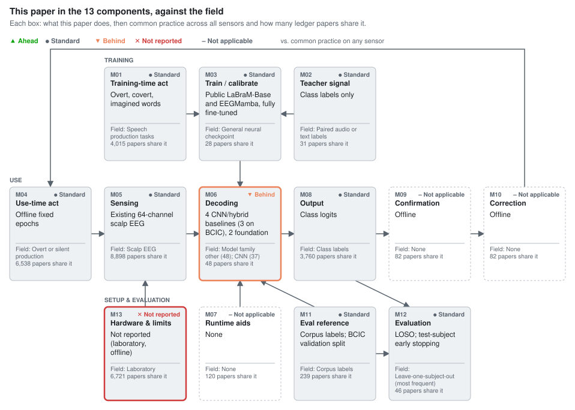

# Do EEG Foundation Models Transfer to Speech? A Benchmark on Overt and Imagined Speech Decoding

Khanday OM, Ben Ticha MB, Belfrouh S, Ouellet M, Gonzalez-Lopez JA. arXiv, 2026. [arXiv:2607.27268](https://arxiv.org/abs/2607.27268)

**Section:** [Brain signals (EEG, MEG, intracortical)](../../README.md#brain-signals-eeg-meg-intracortical)

## Figures

### This paper in the 13 components, against the field

<picture><source media="(prefers-color-scheme: dark)" srcset="figures/components-dark.svg"></picture>

Verdicts compare the paper's choice for each component with common practice across 8,995 ledger entries on any sensor (silent speech, brain-to-text, lip reading).

Data

| Component | This paper | Common practice | Papers with this practice | Verdict |
| --- | --- | --- | --- | --- |
| M01 Training-time act | Overt, covert, imagined words | Speech production tasks | 4,015 of 8,995 | ● Standard (Inherited corpora.) |
| M02 Teacher signal | Class labels only | Paired audio or text labels | 31 of 8,995 | ● Standard (None beyond labels.) |
| M03 Train / calibrate | Public LaBraM-Base and EEGMamba, fully fine-tuned | General neural checkpoint | 28 of 8,995 | ● Standard (Earlier LaBraM results repeated [@zhou2025lblm; @wang2025neurottt].) |
| M04 Use-time act | Offline fixed epochs | Overt or silent production | 6,538 of 8,995 | ● Standard (No online use.) |
| M05 Sensing | Existing 64-channel scalp EEG | Scalp EEG | 8,898 of 8,995 | ● Standard (Inherited corpora.) |
| M06 Decoding | 4 CNN/hybrid baselines (3 on BCIC), 2 foundation models | Model family other (48); CNN (37) | 48 of 8,995 | ▼ Behind (Best within-subject 30.2% vs 48.10% [@lee2021dml].) |
| M07 Runtime aids | None | None | 120 of 8,995 | – Not applicable (Closed-set.) |
| M08 Output | Class logits | Class labels | 3,760 of 8,995 | ● Standard (No text or speech.) |
| M09 Confirmation | Offline | None | 82 of 8,995 | – Not applicable (Offline study.) |
| M10 Correction | Offline | None | 82 of 8,995 | – Not applicable (Offline study.) |
| M11 Eval reference | Corpus labels; BCIC validation split | Corpus labels | 239 of 8,995 | ● Standard (30 vs 60 word classes.) |
| M12 Evaluation | LOSO; test-subject early stopping | Leave-one-subject-out (most frequent) | 46 of 8,995 | ● Standard (No seed repetition.) |
| M13 Hardware & limits | Not reported (laboratory, offline) | Laboratory | 6,721 of 8,995 | ✕ Not reported (No latency or compute.) |

## Verdict

The paper [[1]](#ref-1) fine-tunes the public LaBraM and EEGMamba checkpoints against CNN baselines on two speech corpora (M03, M06). Its negative result holds for these checkpoints but is not new: uncited work had found LaBraM below EEGNet on silent-speech EEG [[2]](#ref-2), and, on the same BCIC2020-T3 data, near 25% balanced accuracy within subject with a linear head and chance across subjects [[3]](#ref-3). M03 is standard, and the claim of a first systematic benchmark fails against the Appendix. The conclusion that general-purpose EEG pretraining does not transfer overreaches: CBraMod reached 0.3976 balanced accuracy with a linear head on the competition's per-subject splits [[3]](#ref-3), above every model here. M06 is behind: the best within-subject score, 30.2%, is 17.9 points below deep metric learning on the same corpus (inference) [[4]](#ref-4), pointing to under-trained models (inference). M12 uses the most frequent design, held-out subjects, but stops training on the test subject (Sec. 2.4).

## Against the field, component by component

### M03 Training: general EEG checkpoint fine-tuned for speech

**Usual approach:** Of 40 unique ledger studies on neural foundation models for speech (pattern match, Appendix), 28 name a general neural checkpoint and 6 a speech-specific pretraining. The paper follows the majority design (Sec. 2.2).

**State of the art:** On BCIC2020-III within subject (2025, prior), with test-time training, CBraMod reaches 0.5898 balanced accuracy and LaBraM-Base 0.2742 [[3]](#ref-3). The paper's LaBraM, fully fine-tuned, scores 27.7% (Table 3): level with that LaBraM figure, 31.3 points below CBraMod (inference).

On 24-word silent speech, LaBraM-Base scored 20.6% against 30.5% for EEGNet, the worst baseline in its authors' words [[2]](#ref-2). On BCIC2020-III, both checkpoints were at chance across subjects [[3]](#ref-3), as all models are here under LOSO (18.9–20.2%, Table 3). The remedy the authors point to, speech-specific pretraining (Sec. 4), was tested before: 39.6% against 30.5% for EEGNet [[2]](#ref-2). Verdict: standard; it confirms earlier reports.

### M06 Decoding: closed-set imagined-speech classification

**Usual approach:** Among 167 unique ledger studies of imagined-speech EEG word classification (pattern match, Appendix), the decoder is coded other in 48 and CNN, the most common named family, in 37 (slot-filled). The paper shares loss, batch and stopping rule across all models but gives the foundation models a ten-fold lower learning rate on BCIC2020-T3 (Sec. 2.4).

**State of the art:** On BCIC2020-T3 (2022, prior), the competition winner reached 82.6% and the runner-up 75.5% with final models scored on the test set [[5]](#ref-5). The paper's best within-subject score is 30.2% against 20.0% chance on the validation split (Table 3).

Three earlier works exceed it on the same corpus: the competition entries [[5]](#ref-5), deep metric learning at 48.10% with 5-fold cross-validation [[4]](#ref-4), and CBraMod at 0.3976 (linear head) to 0.5898 (test-time training) balanced accuracy on the competition splits [[3]](#ref-3). Splits differ; subjects, classes and recordings do not. Verdict: behind the best comparable work, on the 48.10% and 0.3976 results alone. A recipe this close to chance cannot separate pretrained from compact models (inference).

### M12 Evaluation: held-out-subject testing

**Usual approach:** Leave-one-subject-out over all subjects is the most frequent design (46 of 153 unique studies, pattern match, Appendix; fixed held-out subjects 41), as here.

**State of the art:** Speech-EEG work (2025) selects models on one held-out session and tests on another [[2]](#ref-2).

On UGR-MINDVOICE the held-out subject decides early stopping and gives the score (Sec. 2.4). The lexical results it touches sit just above chance: kappa below 0.04 (Sec. 3.1), word accuracy at most 2.9% against 1.7% chance (Table 2). Verdict: standard, weakened by test-subject selection.

## The 13 components

| Component | This paper | Usual approach (count) | State of the art | Verdict |
|---|---|---|---|---|
| M01 Training-time action | Overt, covert, imagined words | Speech production tasks (slot-filled 4,015) | – | standard |
| M02 Training-only supervision | Class labels only | Paired audio or text labels (slot-filled 31) | – | standard |
| M03 Training and adaptation | Public LaBraM-Base and EEGMamba, fully fine-tuned | General neural checkpoint (pattern match 28) | 0.5898 balanced accuracy, CBraMod with test-time training [[3]](#ref-3) | standard |
| M04 Use-time action | Offline fixed epochs | Overt or silent production (slot-filled 6,538) | – | standard |
| M05 Sensors | Existing 64-channel scalp EEG | Scalp EEG (slot-filled 8,898) | – | standard |
| M06 Processing and decoding | 4 CNN/hybrid baselines (3 on BCIC), 2 foundation models | Model family other (48); CNN (37) (slot-filled 48) | 82.6%, competition winner [[5]](#ref-5) | behind |
| M07 Lexicon and LM | None | None (slot-filled 120) | – | not applicable |
| M08 Output | Class logits | Class labels (slot-filled 3,760) | – | standard |
| M09 Confirmation | Offline | None (slot-filled 82) | – | not applicable |
| M10 Correction | Offline | None (slot-filled 82) | – | not applicable |
| M11 Reference construction | Corpus labels; BCIC validation split | Corpus labels (slot-filled 239) | – | standard |
| M12 Evaluation | LOSO; test-subject early stopping | Leave-one-subject-out (most frequent) (pattern match 46) | Separate validation data [[2]](#ref-2) | standard |
| M13 Device and cost | Not reported (laboratory, offline) | Laboratory (slot-filled 6,721) | – | not reported |

## Where the claims outrun the evidence

- "Remains untested" and "first systematic benchmark" (Abstract): two prior studies did this for LaBraM [[2]](#ref-2), [[3]](#ref-3) (Appendix); neither is cited.
- "General-purpose EEG pretraining does not yet transfer" (Abstract; Sec. 4) rests on two checkpoints; CBraMod exceeds every model here [[3]](#ref-3).
- Sec. 2.1 calls the 82.6% a validation score with "far lower" test accuracy; the cited review reports it as the best competition result and scores final models on the test set [[5]](#ref-5).
- Above-chance lexical results (p < 0.05, Sec. 3.1) rest on runs stopped on the test subject (Sec. 2.4), which biases them upward (inference).
- Table 1 lists 30 word classes, Table 2 uses 60; with 30, chance is 3.3% and the best word accuracy (2.9%) falls below it (inference).
- No seed repetition; multi-seed runs are left to future work (Sec. 4).

## What the field needs next

- M03: CBraMod and a speech-pretrained model [[2]](#ref-2) under one protocol, over several seeds.
- M06: baselines that first reproduce published same-corpus accuracies [[4]](#ref-4), [[5]](#ref-5).
- M12: nested leave-one-subject-out with separate validation subjects.

## Questions for the authors

- Which data selected checkpoints and learning rates on BCIC2020-T3?
- How many seeds were run per fold, and how much do scores vary?
- Were UGR-MINDVOICE participants in the LaBraM or EEGMamba pretraining corpora?
- Were z-score statistics fitted on training data only?
- Does word identity use 30 or 60 classes?

## Appendix: literature search

- M03 neural-foundation-model-speech-transfer (new). Inclusion rule: speech or language decoders from EEG, MEG or intracranial recordings that initialize from a checkpoint pretrained on large neural corpora and fine-tune it for word, phrase, sentence or speech-feature decoding; speech-audio and video foundation models excluded; reviews and dataset papers remain as pattern matches (upper bound); versions counted once. Ledger counts: slot-filled 1,526 unique studies (M03); pattern match 40 unique studies (47 folders). Design counts (pattern match, full text): general neural checkpoint 28, speech-specific self-supervised pretraining 6. Read in full: [[2]](#ref-2) (prior), [[3]](#ref-3) (prior; state of the art). Known-item recall 1.0 (1 seed).
- M06 imagined-speech-eeg-word-classification (published table, reused). Inclusion rule: studies that classify imagined, covert or inner speech from scalp EEG into a closed set of words, syllables or commands and report accuracy. Ledger counts: slot-filled 7,345 unique studies (M06); pattern match 167 unique studies (256 folders). Usual design: model family other 48, CNN 37 (slot-filled). Read in full: [[5]](#ref-5), [[4]](#ref-4), [[3]](#ref-3) (prior). Known-item recall 1.0 (4 seeds).
- M12 eeg-held-out-subject-test (published table, reused). Inclusion rule: EEG decoding studies that report accuracy on subjects whose data were not used to train the decoder. Ledger counts: slot-filled 6,960 unique studies (M12); pattern match 153 unique studies (195 folders). Usual design: leave-one-subject-out over all subjects 46, fixed held-out subjects 41 (pattern match). Read in full: [[2]](#ref-2), [[3]](#ref-3) (prior).

## References

Numbered by first citation. BibTeX in the same order and keys: [refs.bib](refs.bib).

1. Khanday, O. M., Ben Ticha, M. B., Belfrouh, S., Ouellet, M., Gonzalez-Lopez, J. A. “Do EEG Foundation Models Transfer to Speech? A Benchmark on Overt and Imagined Speech Decoding.” *arXiv*, 2026. doi:[10.48550/arXiv.2607.27268](https://doi.org/10.48550/arXiv.2607.27268). arXiv:[2607.27268](https://arxiv.org/abs/2607.27268). Target. arXiv:2607.27268 v2 (2026-09-07) read. [review](https://github.com/supernaiter/silent-speech-review/tree/main/reviews/do-eeg-foundation-models-transfer-to-speech-a-benchmark-on-overt-and-imagined-speech-decoding) [wiki: arxiv-2607-27268-eegfm](https://github.com/supernaiter/deep-research-wiki-for-silent-speech/blob/main/papers/arxiv-2607-27268-eegfm/article.md) [wiki: arxiv-2607.27268](https://github.com/supernaiter/deep-research-wiki-for-silent-speech/blob/main/papers/arxiv-2607.27268/article.md) [wiki: arxiv-2607.27268-eegf](https://github.com/supernaiter/deep-research-wiki-for-silent-speech/blob/main/papers/arxiv-2607.27268-eegf/article.md) [wiki: arxiv-2607-27268-eegfmspeech](https://github.com/supernaiter/deep-research-wiki-for-silent-speech/blob/main/papers/arxiv-2607-27268-eegfmspeech/article.md)
2. Zhou, J., Cao, Z., Duan, Y., Barkley, C., Leong, D., Jiang, X., et al. “Pretraining Large Brain Language Model for Active BCI: Silent Speech.” *arXiv*, 2025. arXiv:[2504.21214](https://arxiv.org/abs/2504.21214). [review](https://github.com/supernaiter/silent-speech-review/tree/main/reviews/pretraining-large-brain-language-model-for-active-bci-silent-speech) [wiki: arxiv-2504.21214](https://github.com/supernaiter/deep-research-wiki-for-silent-speech/blob/main/papers/arxiv-2504.21214/article.md)
3. Wang, S., Deng, Y., Bao, Z., Zhan, X., Duan, Y. “NeuroTTT: Bridging Pretrain-Downstream Task Misalignment in EEG Foundation Models via Test-Time Training.” *arXiv*, 2025. arXiv:[2509.26301](https://arxiv.org/abs/2509.26301). [review](https://github.com/supernaiter/silent-speech-review/tree/main/reviews/neurottt-bridging-pretraining-downstream-task-misalignment-in-eeg-foundation-models-via-test-tim) [wiki: arxiv-2509-26301-neurottt](https://github.com/supernaiter/deep-research-wiki-for-silent-speech/blob/main/papers/arxiv-2509-26301-neurottt/article.md) [wiki: arxiv-2509.26301](https://github.com/supernaiter/deep-research-wiki-for-silent-speech/blob/main/papers/arxiv-2509.26301/article.md)
4. Lee, D., Lee, M., Lee, S. “Decoding Imagined Speech Based on Deep Metric Learning for Intuitive BCI Communication.” *IEEE Transactions on Neural Systems and Rehabilitation Engineering*, 2021, 29, 1363–1374. doi:[10.1109/TNSRE.2021.3096874](https://doi.org/10.1109/TNSRE.2021.3096874). [wiki: doi-10.1109-tnsre.2021.3096874](https://github.com/supernaiter/deep-research-wiki-for-silent-speech/blob/main/papers/doi-10.1109-tnsre.2021.3096874/article.md)
5. Jeong, J., Cho, J., Lee, Y., Lee, S., Shin, G., Kweon, Y., et al. “2020 International Brain-Computer Interface Competition: A Review.” *Frontiers in Human Neuroscience*, 2022, 16, 898300. doi:[10.3389/fnhum.2022.898300](https://doi.org/10.3389/fnhum.2022.898300). [wiki: doi-10.3389-fnhum.2022.898300](https://github.com/supernaiter/deep-research-wiki-for-silent-speech/blob/main/papers/doi-10.3389-fnhum.2022.898300/article.md) [wiki: pmc-9354666-bci2020](https://github.com/supernaiter/deep-research-wiki-for-silent-speech/blob/main/papers/pmc-9354666-bci2020/article.md) [wiki: pmc-9354666-bcicomp](https://github.com/supernaiter/deep-research-wiki-for-silent-speech/blob/main/papers/pmc-9354666-bcicomp/article.md)

## Materials

Data behind this review. Full texts of the papers are not included.

- [`review.md`](review.md): the review text (source)
- [`refs.bib`](refs.bib): references (BibTeX)
- [`slots.json`](slots.json): for each of the 13 components: this paper's choice, field practice, number of matching papers, verdict
- [`figures.json`](figures.json): figure definitions
- [`evaluation.md`](evaluation.md): independent evaluation by a second reviewer
- [`triage.md`](triage.md): how each evaluation finding was checked against the sources and resolved
- [`components/M03/neural-foundation-model-speech-transfer.csv`](../../components/M03/neural-foundation-model-speech-transfer.csv): M03 topic "neural-foundation-model-speech-transfer", every candidate paper with its decision (1526 slot-filled, 40 pattern match, usual design in 28, 2 read in full)
- [`components/M06/imagined-speech-eeg-word-classification.csv`](../../components/M06/imagined-speech-eeg-word-classification.csv): M06 topic "imagined-speech-eeg-word-classification", every candidate paper with its decision (7345 slot-filled, 167 pattern match, usual design in 48, 2 read in full)
- [`components/M12/eeg-held-out-subject-test.csv`](../../components/M12/eeg-held-out-subject-test.csv): M12 topic "eeg-held-out-subject-test", every candidate paper with its decision (6960 slot-filled, 153 pattern match, usual design in 46, 2 read in full)

## More reviews in Brain signals (EEG, MEG, intracortical)

- [A cross-species neural foundation model for end-to-end speech decoding](../a-cross-species-neural-foundation-model-for-end-to-end-speech-decoding/) (2026). Cascaded decoding with the pretrained encoder is a strong standard result; the end-to-end audio-LLM path beats the prior end-to-end entry but trails RNN cascades, and the cross-species gain is small.
- [Brain-to-Speech: Prosody Feature Engineering and Transformer-Based Reconstruction](../brain-to-speech-prosody-feature-engineering-and-transformer-based-reconstruction/) (2026). Same three parts and same Table 1 values as MiSTR (2025, same first two authors), not cited. Features (M06) and phase vocoder (M08) standard, unablated; no listener test (M12, behind).
- [Brain2Speech-Net: Fast and Intelligible Brain-to-Speech Synthesis Without Text Decoding](../brain2speech-net-intelligible-real-time-brain-to-speech-synthesis-without-text-decoding/) (2026). Text-free synthesis is shown, but its real time is throughput, not causal synthesis, unseen-sentence WER is 2.3 times the cascade, and intelligibility rests on ratings and ASR.
- [EEG-Based Imagined Speech Decoding Using a Hybrid CNN-SNN Architecture](../eeg-based-imagined-speech-decoding-using-a-hybrid-cnn-snn-architecture/) (2026). CNN-to-LIF decoder (M06) is standard: a 2024 SNN-CNN inner-speech decoder precedes it; 80.13% on the validation subset is not comparable with the 82.6% competition test score (M12); no SNN ablation.
- [iPhoneme: Brain-to-Text Communication for ALS Using ConformerXL Decoding](../iphoneme-brain-to-text-communication-for-als-using-conformerxl-decoding/) (2026). Behind: 26.61% WER is four times the 6.67% holdout baseline on the same recordings; the T15 best-result claim fails, the scoring split is unnamed and the gaze interface is untested.
- [Mechanistic Interpretability of Brain-to-Speech Models Across Speech Modes](../mechanistic-interpretability-of-brain-to-speech-models-across-speech-modes/) (2026). Patching shows the decoder depends on donor activations, not that transfer runs through a compact subspace: kept regions score below the unpatched decoder, with no null and no held-out split.

---

Part of the [Silent Speech Interface Review](https://github.com/supernaiter/silent-speech-review). Found an error? [Open an issue](https://github.com/supernaiter/silent-speech-review/issues/new?template=correction.yml).
