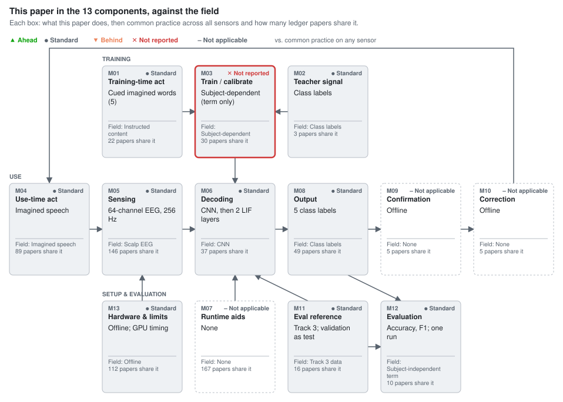

# EEG-Based Imagined Speech Decoding Using a Hybrid CNN-SNN Architecture

Shalhoub, Al Mawla, Chaccour, López-Espejo, Fares. arXiv (cs.SD), 2026. [arXiv:2607.03844](https://arxiv.org/abs/2607.03844)

**Section:** [Brain signals (EEG, MEG, intracortical)](../../README.md#brain-signals-eeg-meg-intracortical)

## Figures

### This paper in the 13 components, against the field

<picture><source media="(prefers-color-scheme: dark)" srcset="figures/components-dark.svg"></picture>

Verdicts compare the paper's choice for each component with common practice across 8,995 ledger entries on any sensor (silent speech, brain-to-text, lip reading).

Data

| Component | This paper | Common practice | Papers with this practice | Verdict |
| --- | --- | --- | --- | --- |
| M01 Training-time act | Cued imagined words (5) | Instructed content | 22 of 8,995 | ● Standard (Public Track 3 protocol [@jeong2022bci].) |
| M02 Teacher signal | Class labels | Class labels | 3 of 8,995 | ● Standard (Supervised cross-entropy only.) |
| M03 Train / calibrate | Subject-dependent (term only) | Subject-dependent | 30 of 8,995 | ✕ Not reported (Term stated (Sec. IV); per-subject or pooled model not stated.) |
| M04 Use-time act | Imagined speech | Imagined speech | 89 of 8,995 | ● Standard (Inherited dataset task.) |
| M05 Sensing | 64-channel EEG, 256 Hz | Scalp EEG | 146 of 8,995 | ● Standard (Public dataset; 64 channels in 29 studies (pattern match).) |
| M06 Decoding | CNN, then 2 LIF layers | CNN | 37 of 8,995 | ● Standard (Prior SNN-CNN inner-speech decoder [@sun2024smallworld]; no dense-head ablation.) |
| M07 Runtime aids | None | None | 167 of 8,995 | – Not applicable (Five-way classification; no ledger LM mention among 167 studies.) |
| M08 Output | 5 class labels | Class labels | 49 of 8,995 | ● Standard (Hello, Help me, Stop, Thank you, Yes.) |
| M09 Confirmation | Offline | None | 5 of 8,995 | – Not applicable (Offline study.) |
| M10 Correction | Offline | None | 5 of 8,995 | – Not applicable (Offline study.) |
| M11 Eval reference | Track 3; validation as test | Track 3 data | 16 of 8,995 | ● Standard (Competition test trials not used (Sec. III-A).) |
| M12 Evaluation | Accuracy, F1; one run | Subject-independent term | 10 of 8,995 | ● Standard (Validation-as-test also in [@lee2020lengthwise]; no chance level, ablation or spread.) |
| M13 Hardware & limits | Offline; GPU timing | Offline | 112 of 8,995 | ● Standard (No energy or neuromorphic measurement.) |

## Verdict

The paper [[1]](#ref-1) changes the decoder (M06): a temporal CNN feeds two leaky integrate-and-fire (LIF) layers trained with surrogate gradients. M06 is standard: a 2024 hybrid of a spiking network and a CNN already classified inner-speech EEG [[2]](#ref-2), so that study refutes the authors' first-use claim (Abstract; Section V), and no CNN-only ablation shows that the spiking layers add accuracy (Section IV). Evaluation (M12) is standard in protocol, but the benchmark claim is not shown: 80.13% on the public validation subset is not comparable with the 82.6% that won the 2020 competition on its test trials [[3]](#ref-3), a result missing from Table II. The low-power and real-time framing (M13) rests on a GPU timing, with no energy or neuromorphic measurement. Any advantage of spiking computation remains unshown.

## Against the field, component by component

### M06 Decoder: spiking classifier after a CNN

**Usual approach:** Among 167 imagined-speech EEG studies (pattern match, unique), the commonest ledger decoder families are "other" (48) and CNNs (37, slot-filled); among 29 spiking-network pattern matches, 4 prior studies decode speech: 3 lip reading or audio-visual, 1 inner-speech EEG [[2]](#ref-2) (Appendix). The paper swaps the CNN's dense head for LIF layers with rate decoding.

**State of the art:** The best imagined-speech EEG classification in the Appendix table is 96.4% on four classes (2018) [[4]](#ref-4), with each recording run holding one class, so class and run coincide. The nearest spiking prior reached 27.66% on four words (2024; 10 participants, 128 channels, chance 25%, inference) [[2]](#ref-2); spiking networks have also decoded non-speech scalp EEG, e.g. limb kinematics (2021) [[5]](#ref-5). The paper's 80.13% on five classes comes from another dataset and split, so neither gap isolates the design.

The real difference from the 2024 prior is order and training: there a spiking layer encodes and a CNN classifies; here a CNN encodes and a surrogate-gradient LIF network classifies (Sec. III-C). The prior is uncited. One run without seeds (Sec. IV), no dense-head control and an unstated spike-encoding rule (Sec. III-C.2) leave the difference untested. Verdict: standard.

### M12 Evaluation: the 2020 BCI Competition Track 3 data

**Usual approach:** 16 unique studies (pattern match) report on these data; 10 use a subject-independent term and 4 k-fold cross-validation (upper bounds, Appendix). Validation-as-test has precedent: a 2020 study did it with 5-fold cross-validation inside the training subset and per-subject spread, 59.47 ± 6.86% against 58.27 ± 9.62% for EEGNet [[6]](#ref-6). The paper scores the 750 validation trials with neither (Sec. III-A; Sec. IV).

**State of the art:** The competition winner reached 82.6% on the released test trials, second place 75.5% (2022 review) [[3]](#ref-3). The paper is 2.47 points, 3.0% relative, below the winner (inference), but on validation rather than test trials, so the ranking is unknown. Over its best listed comparator, 70.19%, it gains 9.94 points, 14.2% relative (inference), but Table II gives no comparator protocols. Verdict: standard; the protocol has precedent, and the claim of "surpassing existing methods" (Abstract) is not shown.

### M13 Device: offline timing and the low-power claim

**Usual approach:** 112 of 167 imagined-speech EEG studies (pattern match) are offline (Appendix); so is this one, as the authors state (Sec. IV).

**State of the art:** For online operation, syllable-imagery control over 20 participants reached 55.7% with an adaptive classifier against 52.3% static, chance 50% (2024) [[7]](#ref-7). The paper has no online run. For energy, no measured comparator exists in the paper: low power is a property Table I lists for neuromorphic methods, not a measurement. Verdict: standard.

## The 13 components

| Component | This paper | Usual approach (count) | State of the art | Verdict |
|---|---|---|---|---|
| M01 Training-time action | Cued imagined words (5) | Instructed content (slot-filled 22) | – | standard |
| M02 Training-only supervision | Class labels | Class labels (slot-filled 3) | – | standard |
| M03 Training and adaptation | Subject-dependent (term only) | Subject-dependent (pattern match 30) | – | not reported |
| M04 Use-time action | Imagined speech | Imagined speech (slot-filled 89) | – | standard |
| M05 Sensors | 64-channel EEG, 256 Hz | Scalp EEG (slot-filled 146) | – | standard |
| M06 Processing and decoding | CNN, then 2 LIF layers | CNN (slot-filled 37) | 96.4%, 4 classes, one class per run (2018) [[4]](#ref-4); nearest spiking prior 27.66% (2024) [[2]](#ref-2) | standard |
| M07 Lexicon and LM | None | None (pattern match 167) | – | not applicable |
| M08 Output | 5 class labels | Class labels (slot-filled 49) | – | standard |
| M09 Confirmation | Offline | None (slot-filled 5) | – | not applicable |
| M10 Correction | Offline | None (slot-filled 5) | – | not applicable |
| M11 Reference construction | Track 3; validation as test | Track 3 data (pattern match 16) | – | standard |
| M12 Evaluation | Accuracy, F1; one run | Subject-independent term (pattern match 10) | 82.6%, test trials (2022) [[3]](#ref-3) | standard |
| M13 Device and cost | Offline; GPU timing | Offline (pattern match 112) | 55.7% online (2024) [[7]](#ref-7) | standard |

## Where the claims outrun the evidence

- Novelty: the first-use claim (Abstract; Sec. V) is contradicted by [[2]](#ref-2); 1 prior spiking EEG speech study among 29 pattern matches (Appendix).
- Attribution: Sec. IV credits spike-based temporal dynamics for the gain over Table II, with no matched dense-head model [[1]](#ref-1).
- Selection: the 750 validation trials are the only held-out data (Sec. III-A) and Sec. IV gives no checkpoint or hyperparameter rule for 350 epochs, so the test data may have steered choices [[1]](#ref-1) (inference).
- Reporting: Sec. IV gives no chance level (20%, inference), per-subject scores, run variance or F1 averaging rule [[1]](#ref-1).
- Benchmark: Table II omits the competition test ranking [[3]](#ref-3).
- Naming: the paper calls the 2020 Track 3 data the "2020 BCI Competition III dataset" (Sec. III-A; Sec. IV), a different, earlier competition [[1]](#ref-1).
- Efficiency: 98 ± 3 ms per trial is GPU inference (Sec. IV); no energy or operation count supports power-constrained use (Sec. V) [[1]](#ref-1).

## What the field needs next

- M06: the same CNN with a dense head against the LIF head, over seeds, with per-subject paired tests.
- M12: scores on the competition test trials, ranked against 82.6% [[3]](#ref-3), plus a held-out-subject split.
- M13: measured energy or synaptic operations for the spiking head against a dense head.

## Questions for the authors

- How many runs and seeds stand behind 80.13%, and what is the spread?
- Is one model trained per subject or on pooled subjects?
- Which data chose the epochs, learning rates and LIF thresholds?
- Which algorithm turns CNN features into spikes, and over how many time steps?
- Is F1 macro- or micro-averaged?

## Appendix: literature search

- M06, spiking-neural-network-decoder. Inclusion rule: studies that decode speech, language or other neural or articulatory signals with a spiking neural network as classifier or encoder; Siamese networks and the SNNS simulator are pattern matches only; reviews excluded. Ledger: 7,345 slot-filled, 29 unique studies by pattern match. Usual design: spiking decoders in lip reading and audio-visual speech, 3 prior studies (pattern match); 1 prior on scalp-EEG inner speech; 2 Siamese false positives. Read in full: [[2]](#ref-2), [[5]](#ref-5). Known-item recall: 1.0 (1 of 1).
- M06, imagined-speech-eeg-word-classification (reused table). Inclusion rule: closed-set classification of imagined, covert or inner speech from scalp EEG with accuracy reported. Ledger: 167 unique studies by pattern match; usual design model_family=other 48 and cnn 37 (slot-filled). State of the art in the table: 96.4%, four classes, 2018 [[4]](#ref-4). Known-item recall: 1.0 (4 of 4).
- M12, bci2020-imagined-speech-benchmark. Inclusion rule: studies reporting results on the 2020 International BCI Competition Track 3 imagined-speech data; dataset citations only are pattern matches. Ledger: 6,960 slot-filled, 16 unique studies by pattern match; subject-independent term 10, k-fold cross-validation 4 (pattern match). Read in full: [[3]](#ref-3), [[6]](#ref-6). Known-item recall: 0.33 (1 of 3).
- M13, online-imagined-speech-eeg (reused table). Inclusion rule: the M06 imagined-speech EEG population, classified by online closed-loop versus offline decoding. Ledger: 6,075 slot-filled, 167 unique studies by pattern match; offline 112 (pattern match). State of the art: [[7]](#ref-7). Known-item recall: 0.5 (1 of 2).

## References

Numbered by first citation. BibTeX in the same order and keys: [refs.bib](refs.bib).

1. Shalhoub, F., Al Mawla, M., Chaccour, K., López-Espejo, I., Fares, H. “EEG-Based Imagined Speech Decoding Using a Hybrid CNN-SNN Architecture.” *arXiv preprint (cs.SD)*, 2026. arXiv:[2607.03844](https://arxiv.org/abs/2607.03844). Target. arXiv:2607.03844 v1 read. [review](https://github.com/supernaiter/silent-speech-review/tree/main/reviews/eeg-based-imagined-speech-decoding-using-a-hybrid-cnn-snn-architecture) [wiki: arxiv-2607-03844-cnnsnn](https://github.com/supernaiter/deep-research-wiki-for-silent-speech/blob/main/papers/arxiv-2607-03844-cnnsnn/article.md) [wiki: arxiv-2607.03844](https://github.com/supernaiter/deep-research-wiki-for-silent-speech/blob/main/papers/arxiv-2607.03844/article.md) [wiki: arxiv-2607.03844-cnnsnn](https://github.com/supernaiter/deep-research-wiki-for-silent-speech/blob/main/papers/arxiv-2607.03844-cnnsnn/article.md)
2. Sun, S. “A hybrid neural network based on the small-world network for inner speech recognition.” *Applied and Computational Engineering 42 (Proceedings of the 2023 International Conference on Machine Learning and Automation)*, 2024. doi:[10.54254/2755-2721/42/20230786](https://doi.org/10.54254/2755-2721/42/20230786). [wiki: doi-10.54254-2755-2721-42-20230786](https://github.com/supernaiter/deep-research-wiki-for-silent-speech/blob/main/papers/doi-10.54254-2755-2721-42-20230786/article.md)
3. Jeong, J., Cho, J., Lee, Y., Lee, S., Shin, G., Kweon, Y., et al. “2020 International brain-computer interface competition: A review.” *Frontiers in Human Neuroscience*, 2022, 16, 898300. doi:[10.3389/fnhum.2022.898300](https://doi.org/10.3389/fnhum.2022.898300). [wiki: pmc-9354666-bcicomp](https://github.com/supernaiter/deep-research-wiki-for-silent-speech/blob/main/papers/pmc-9354666-bcicomp/article.md) [wiki: pmc-9354666-bci2020](https://github.com/supernaiter/deep-research-wiki-for-silent-speech/blob/main/papers/pmc-9354666-bci2020/article.md) [wiki: doi-10.3389-fnhum.2022.898300](https://github.com/supernaiter/deep-research-wiki-for-silent-speech/blob/main/papers/doi-10.3389-fnhum.2022.898300/article.md)
4. Jahangiri, A., Sepulveda, F. “The Relative Contribution of High-Gamma Linguistic Processing Stages of Word Production, and Motor Imagery of Articulation in Class Separability of Covert Speech Tasks in EEG Data.” *Journal of Medical Systems*, 2019, 43(2), 20. doi:[10.1007/s10916-018-1137-9](https://doi.org/10.1007/s10916-018-1137-9). [wiki: doi-10.1007-s10916-018-1137-9](https://github.com/supernaiter/deep-research-wiki-for-silent-speech/blob/main/papers/doi-10.1007-s10916-018-1137-9/article.md)
5. Kumarasinghe, K., Kasabov, N., Taylor, D. “Brain-inspired spiking neural networks for decoding and understanding muscle activity and kinematics from electroencephalography signals during hand movements.” *Scientific Reports*, 2021, 11, 2486. doi:[10.1038/s41598-021-81805-4](https://doi.org/10.1038/s41598-021-81805-4). [wiki: pmc-7844055-spikingkinematics](https://github.com/supernaiter/deep-research-wiki-for-silent-speech/blob/main/papers/pmc-7844055-spikingkinematics/article.md)
6. Lee, B., Lee, D., Kwon, B., Jeong, J. “Speech Imagery Classification using Length-Wise Training based on Deep Learning.” *arXiv preprint*, 2020. arXiv:[2012.03632](https://arxiv.org/abs/2012.03632). [wiki: arxiv-2012.03632](https://github.com/supernaiter/deep-research-wiki-for-silent-speech/blob/main/papers/arxiv-2012.03632/article.md)
7. Wu, S., Bhadra, K., Giraud, A., Marchesotti, S. “Adaptive LDA Classifier Enhances Real-Time Control of an EEG Brain–Computer Interface for Decoding Imagined Syllables.” *Brain Sciences*, 2024, 14(3), 196. doi:[10.3390/brainsci14030196](https://doi.org/10.3390/brainsci14030196). Preprint: bioRxiv, doi:10.1101/2023.12.12.571206. [wiki: doi-10.3390-brainsci14030196](https://github.com/supernaiter/deep-research-wiki-for-silent-speech/blob/main/papers/doi-10.3390-brainsci14030196/article.md) [wiki: pmc-10968180-adaptlda](https://github.com/supernaiter/deep-research-wiki-for-silent-speech/blob/main/papers/pmc-10968180-adaptlda/article.md) [wiki: doi-10.1101-2023.12.12.571206](https://github.com/supernaiter/deep-research-wiki-for-silent-speech/blob/main/papers/doi-10.1101-2023.12.12.571206/article.md)

## Materials

Data behind this review. Full texts of the papers are not included.

- [`review.md`](review.md): the review text (source)
- [`refs.bib`](refs.bib): references (BibTeX)
- [`slots.json`](slots.json): for each of the 13 components: this paper's choice, field practice, number of matching papers, verdict
- [`figures.json`](figures.json): figure definitions
- [`evaluation.md`](evaluation.md): independent evaluation by a second reviewer
- [`triage.md`](triage.md): how each evaluation finding was checked against the sources and resolved
- [`components/M06/imagined-speech-eeg-word-classification.csv`](../../components/M06/imagined-speech-eeg-word-classification.csv): M06 topic "imagined-speech-eeg-word-classification", every candidate paper with its decision (7345 slot-filled, 167 pattern match, usual design in 48, 2 read in full)
- [`components/M06/spiking-neural-network-decoder.csv`](../../components/M06/spiking-neural-network-decoder.csv): M06 topic "spiking-neural-network-decoder", every candidate paper with its decision (7345 slot-filled, 29 pattern match, usual design in 3, 3 read in full)
- [`components/M12/bci2020-imagined-speech-benchmark.csv`](../../components/M12/bci2020-imagined-speech-benchmark.csv): M12 topic "bci2020-imagined-speech-benchmark", every candidate paper with its decision (6960 slot-filled, 16 pattern match, usual design in 10, 2 read in full)
- [`components/M13/online-imagined-speech-eeg.csv`](../../components/M13/online-imagined-speech-eeg.csv): M13 topic "online-imagined-speech-eeg", every candidate paper with its decision (6075 slot-filled, 167 pattern match, usual design in 112, 3 read in full)

## More reviews in Brain signals (EEG, MEG, intracortical)

- [A cross-species neural foundation model for end-to-end speech decoding](../a-cross-species-neural-foundation-model-for-end-to-end-speech-decoding/) (2026). Cascaded decoding with the pretrained encoder is a strong standard result; the end-to-end audio-LLM path beats the prior end-to-end entry but trails RNN cascades, and the cross-species gain is small.
- [Brain-to-Speech: Prosody Feature Engineering and Transformer-Based Reconstruction](../brain-to-speech-prosody-feature-engineering-and-transformer-based-reconstruction/) (2026). Same three parts and same Table 1 values as MiSTR (2025, same first two authors), not cited. Features (M06) and phase vocoder (M08) standard, unablated; no listener test (M12, behind).
- [Brain2Speech-Net: Fast and Intelligible Brain-to-Speech Synthesis Without Text Decoding](../brain2speech-net-intelligible-real-time-brain-to-speech-synthesis-without-text-decoding/) (2026). Text-free synthesis is shown, but its real time is throughput, not causal synthesis, unseen-sentence WER is 2.3 times the cascade, and intelligibility rests on ratings and ASR.
- [Do EEG Foundation Models Transfer to Speech? A Benchmark on Overt and Imagined Speech Decoding](../do-eeg-foundation-models-transfer-to-speech-a-benchmark-on-overt-and-imagined-speech-decoding/) (2026). Benchmark (M03) confirms earlier reports that LaBraM gains nothing on speech EEG; decoders (M06) sit far below same-corpus results; test-subject early stopping (M12).
- [iPhoneme: Brain-to-Text Communication for ALS Using ConformerXL Decoding](../iphoneme-brain-to-text-communication-for-als-using-conformerxl-decoding/) (2026). ConformerXL-based intracortical brain-to-text decoding for ALS with a proposed gaze-confirmation interface; WFST decoding reaches 7.86% phoneme error rate retrospectively in one participant.
- [Mechanistic Interpretability of Brain-to-Speech Models Across Speech Modes](../mechanistic-interpretability-of-brain-to-speech-models-across-speech-modes/) (2026). Patching shows the decoder depends on donor activations, not that transfer runs through a compact subspace: kept regions score below the unpatched decoder, with no null and no held-out split.

---

Part of the [Silent Speech Interface Review](https://github.com/supernaiter/silent-speech-review). Found an error? [Open an issue](https://github.com/supernaiter/silent-speech-review/issues/new?template=correction.yml).
