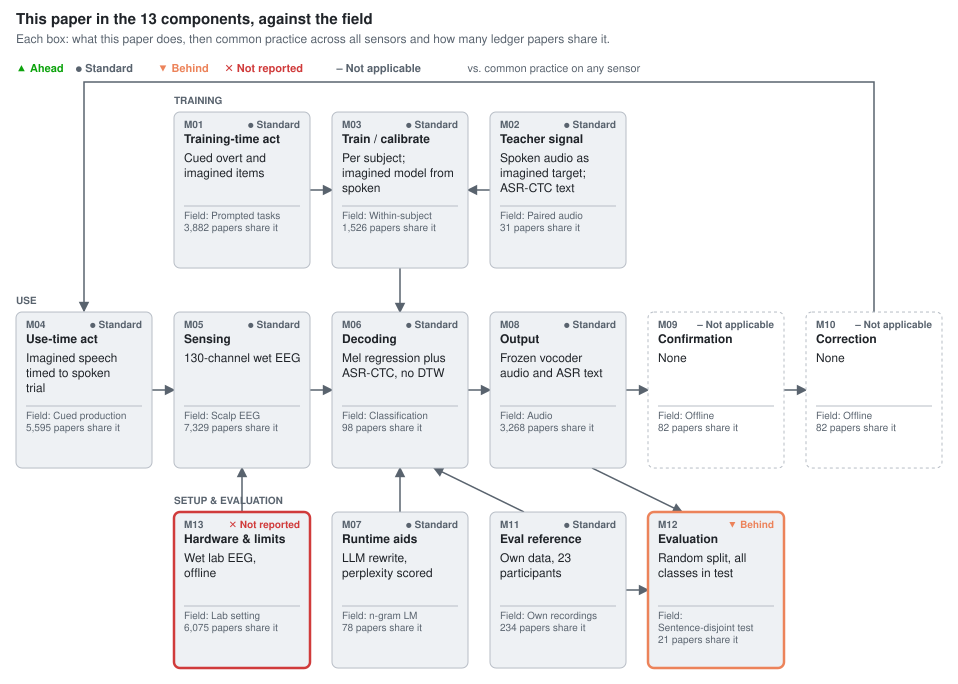

# EEG-to-Voice Decoding of Spoken and Imagined speech Using Non-Invasive EEG

Hanbeot Park, Yunjeong Cho, Hunhee Kim. arXiv preprint, 2025. [arXiv:2512.22146](https://arxiv.org/abs/2512.22146)

**Section:** [Brain signals (EEG, MEG, intracortical)](../../README.md#brain-signals-eeg-meg-intracortical)

## Figures

### This paper in the 13 components, against the field

<picture><source media="(prefers-color-scheme: dark)" srcset="figures/components-dark.svg"></picture>

Verdicts compare the paper's choice for each component with common practice across 8,995 ledger entries on any sensor (silent speech, brain-to-text, lip reading).

Data

| Component | This paper | Common practice | Papers with this practice | Verdict |
| --- | --- | --- | --- | --- |
| M01 Training-time act | Cued overt and imagined items | Prompted tasks | 3,882 of 8,995 | ● Standard (NeuroTalk-style paradigm.) |
| M02 Teacher signal | Spoken audio as imagined target; ASR-CTC text | Paired audio | 31 of 8,995 | ● Standard (Inherited from NeuroTalk [@lee2023neurotalk].) |
| M03 Train / calibrate | Per subject; imagined model from spoken | Within-subject | 1,526 of 8,995 | ● Standard (Spoken-to-imagined transfer as in NeuroTalk.) |
| M04 Use-time act | Imagined speech timed to spoken trial | Cued production | 5,595 of 8,995 | ● Standard (Timing fixed by protocol.) |
| M05 Sensing | 130-channel wet EEG | Scalp EEG | 7,329 of 8,995 | ● Standard (Lab acquisition.) |
| M06 Decoding | Mel regression plus ASR-CTC, no DTW | Classification | 98 of 8,995 | ● Standard (DTW removal not ablated.) |
| M07 Runtime aids | LLM rewrite, perplexity scored | n-gram LM | 78 of 8,995 | ● Standard (Pooled gain 2.9% and 4.4% relative (inference).) |
| M08 Output | Frozen vocoder audio and ASR text | Audio | 3,268 of 8,995 | ● Standard (Optional LLM and personalised TTS.) |
| M09 Confirmation | None | Offline | 82 of 8,995 | – Not applicable (Offline study.) |
| M10 Correction | None | Offline | 82 of 8,995 | – Not applicable (No user correction.) |
| M11 Eval reference | Own data, 23 participants | Own recordings | 234 of 8,995 | ● Standard (Spoken recording reused as imagined reference.) |
| M12 Evaluation | Random split, all classes in test | Sentence-disjoint test | 21 of 8,995 | ▼ Behind (WER inversion at 2 s; same ASR trains and scores.) |
| M13 Hardware & limits | Wet lab EEG, offline | Lab setting | 6,075 of 8,995 | ✕ Not reported (No latency or real-time use.) |

## Verdict

The paper [[1]](#ref-1) changes the decoder (M06): it regresses Mel spectrograms from trial-locked EEG without the DTW alignment and discriminator of its closest prior, NeuroTalk [[2]](#ref-2), whose spoken-audio targets, HuBERT-CTC loss, HiFi-GAN vocoder and spoken-to-imagined transfer it keeps. Regression is common, 71 of 569 EEG and MEG studies by full-text pattern (Appendix), so M06 is standard. Voice reconstruction from imagined speech is shown only for the ten trained classes under a random split, so the evaluation (M12) is behind: NeuroTalk already held out a word. The strongest confound: one frozen HuBERT recognizer supplies the CTC training loss and scores the output, so the Generator is optimised against its judge (§Pretrained Components). With reproduction of trained class templates (inference), this fits the 2-s result of WER 0.4586 for EEG output against 0.6375 for the recorded speech (Table 4); on CER the inversion vanishes (0.2618 against 0.2566). The DTW-free claim is untested: no run with DTW is reported and timing is fixed by the protocol.

## Against the field, component by component

### M06 Decoder: EEG-to-Mel generator without DTW

**Usual approach:** Of 569 unique EEG and MEG speech decoding studies counted by full-text pattern (538 by ledger pattern match; Appendix), 98 train a classifier, 71 regress an acoustic or feature target and 64 are contrastive. The paper regresses Mel spectrograms with an ASR-CTC loss, as NeuroTalk did [[2]](#ref-2), and removes DTW and the adversarial loss (§Training Loss Term).

**State of the art:** NeuroTalk (2023, prior) reached imagined CER 68.26% on 11 trained words and 83.06% on a held-out word, with 64 channels and six participants (Table 1) [[2]](#ref-2). The paper reports imagined CER 27.10% at 2 s and 24.74% at 4 s (inference) with 130 channels and no held-out content. Channels, classes and test content all differ, so the gap is no evidence for the design change.

Alignment moves into the protocol: participants imagined each item by recalling the onset and rate of their spoken trial (§Introduction), the target is that spoken recording (§Dataset), and MCD is scored after DTW (§Evaluation Metrics). Verdict: standard.

### M12 Evaluation: closed classes, random split

**Usual approach:** Of 145 unique neural text-decoding studies (pattern match, Appendix), 21 name a sentence-disjoint test and 10 repeat training sentences. The paper splits trials 2:1:1 at random and builds every split to include all ten classes "to avoid the presence of unseen classes" (§Dataset).

**State of the art:** Intracortical decoding reached 23.8% WER online on sentences never in training (2023, prior) [[3]](#ref-3), and 2.5% online WER with a 125,000-word vocabulary (2024, prior) [[4]](#ref-4). In EEG, NeuroTalk tested a held-out word, and its authors concede that with few words the model may be classifying EEG into training classes [[2]](#ref-2).

Here, at 2 s the EEG output beats ASR on the recorded speech by 0.18 WER, 28% relative (inference), but not on CER. The authors blame words stretched to fill 2 s (§Evaluation language model correction), but the Generator learns the same stretched targets (inference). At 4 s imagined WER (0.4346) is below spoken WER (0.4893) (Table 2). No chance level or shuffled-EEG baseline is given. Verdict: behind, against the best comparable work.

### M07 Language prior: LLM rewrite

**Usual approach:** Of 382 unique decoders with a use-time language prior (pattern match, Appendix), 78 use an n-gram model and 50 an LLM. The paper scores five Llama-3.2-1B candidates by CER similarity and perplexity (§Language Model setting).

**State of the art:** An LLM over an ensemble reached 12.2% WER on silent EMG (2024, prior) [[5]](#ref-5).

Correction lowers pooled WER from 0.4586 to 0.4451 at 2 s and from 0.4870 to 0.4658 at 4 s (Tables 4 and 5), 2.9% and 4.4% relative (inference), with spoken and imagined trials pooled and meaning preservation unmeasured. Verdict: standard.

## The 13 components

| Component | This paper | Usual approach (count) | State of the art | Verdict |
|---|---|---|---|---|
| M01 Training-time action | Cued overt and imagined items | Prompted tasks (slot-filled 3,882) | – | standard |
| M02 Training-only supervision | Spoken audio as imagined target; ASR-CTC text | Paired audio (slot-filled 31) | – | standard |
| M03 Training and adaptation | Per subject; imagined model from spoken | Within-subject (slot-filled 1,526) | – | standard |
| M04 Use-time action | Imagined speech timed to spoken trial | Cued production (slot-filled 5,595) | – | standard |
| M05 Sensors | 130-channel wet EEG | Scalp EEG (slot-filled 7,329) | – | standard |
| M06 Processing and decoding | Mel regression plus ASR-CTC, no DTW | Classification (pattern match 98) | Imagined CER 68.26% (2023) [[2]](#ref-2) | standard |
| M07 Lexicon and LM | LLM rewrite, perplexity scored | n-gram LM (pattern match 78) | Silent-EMG WER 12.2% (2024) [[5]](#ref-5) | standard |
| M08 Output | Frozen vocoder audio and ASR text | Audio (slot-filled 3,268) | – | standard |
| M09 Confirmation | None | Offline (slot-filled 82) | – | not applicable |
| M10 Correction | None | Offline (slot-filled 82) | – | not applicable |
| M11 Reference construction | Own data, 23 participants | Own recordings (slot-filled 234) | – | standard |
| M12 Evaluation | Random split, all classes in test | Sentence-disjoint test (pattern match 21) | WER 23.8%, unseen sentences (2023) [[3]](#ref-3); online WER 2.5%, 125,000 words (2024) [[4]](#ref-4) | behind |
| M13 Device and cost | Wet lab EEG, offline | Lab setting (slot-filled 6,075) | – | not reported |

## Where the claims outrun the evidence

- "Comparable linguistic accuracy" across modes (Abstract) has no statistical test (§Trial-level accurate EEG-to-voice).
- The 2-s and 4-s conditions differ in participants, stimuli and per-subject loss weights (§Generator Training), so the imagined PCC drop from 0.7484 to 0.5834 (Tables 1 and 2) cannot be attributed to duration.
- Methods enrol 11 participants for 2 s; Table 1 reports 10.
- Table 5's pooled 4-s WER before correction (0.4870) differs from the mean of Table 2's per-mode WERs (0.4620), while Table 4 matches Table 1 at 2 s (inference).
- Test-split use, seeds and the fit of the min-max extrema are not stated (§Dataset, §Neural signal processing).

## What the field needs next

- M12: held-out sentences and words, with chance-level and shuffled-EEG baselines.
- M06: the same Generator with and without DTW, and imagined trials not timed to the spoken trial.
- M07: imagined-only correction gains and a check of meaning preservation.

## Questions for the authors

- Are Tables 1 to 5 test-split results, and from how many seeds?
- Why does Table 1 report 10 of 11 enrolled 2-s participants?
- Why is ASR WER on recorded speech (0.6375 at 2 s) worse than on the EEG output, and which HuBERT checkpoint was used?
- What were the per-subject loss weights, and which data chose them?
- Are normalization extrema fitted on training data only?

## Appendix: literature search

**M06 noninvasive-speech-decoding-objective.** Inclusion rule: speech or language decoding from scalp EEG or MEG (perceived, imagined, attempted or overt); design compared is the training objective (contrastive, regression of an acoustic or feature target, classification); reviews excluded, versions once. Ledger: 7,345 slot-filled unique studies; 538 pattern match (unique studies); full-text pattern counts over 569 unique studies: classification 98, regression 71, contrastive 64. Read in full: [[2]](#ref-2). Known-item recall 1.0.

**M12 neural-text-unseen-sentence-test.** Inclusion rule: neural text-decoding studies; design compared is whether WER is measured on sentences absent from training or on repeats of training sentences. Ledger: 6,960 slot-filled unique studies; 145 pattern match (unique studies); sentence-disjoint test 21, repeated training sentences 10 (pattern match). Read in full: [[3]](#ref-3), [[2]](#ref-2); results section: [[4]](#ref-4). Known-item recall 0.8.

**M07 llm-transcript-correction.** Inclusion rule: text-producing decoders from non-acoustic or neural signals with a use-time language model, lexicon, beam search or rescoring; design compared is n-gram or lexicon beam search, neural LM rescoring, or LLM rescoring or rewrite; language models used only for training data excluded. Ledger: 119 slot-filled unique studies; 382 pattern match (unique studies); n-gram 78, LLM rescoring or correction 50 (pattern match). Read in full: [[5]](#ref-5). Known-item recall 0.5.

## References

Numbered by first citation. BibTeX in the same order and keys: [refs.bib](refs.bib).

1. Park, H., Cho, Y., Kim, H. “EEG-to-Voice Decoding of Spoken and Imagined speech Using Non-Invasive EEG.” *arXiv preprint*, 2025. arXiv:[2512.22146](https://arxiv.org/abs/2512.22146). Target. Read as arXiv v1. [review](https://github.com/supernaiter/silent-speech-review/tree/main/reviews/eeg-to-voice-decoding-of-spoken-and-imagined-speech-using-non-invasive-eeg) [wiki: arxiv-2512-22146-eeg2voice](https://github.com/supernaiter/deep-research-wiki-for-silent-speech/blob/main/papers/arxiv-2512-22146-eeg2voice/article.md) [wiki: arxiv-2512-22146-eegvoice](https://github.com/supernaiter/deep-research-wiki-for-silent-speech/blob/main/papers/arxiv-2512-22146-eegvoice/article.md) [wiki: arxiv-2512.22146](https://github.com/supernaiter/deep-research-wiki-for-silent-speech/blob/main/papers/arxiv-2512.22146/article.md) [wiki: arxiv-2512.22146-e2voice](https://github.com/supernaiter/deep-research-wiki-for-silent-speech/blob/main/papers/arxiv-2512.22146-e2voice/article.md)
2. Lee, Y., Lee, S., Kim, S., Lee, S. “Towards Voice Reconstruction from EEG during Imagined Speech.” *Proceedings of the AAAI Conference on Artificial Intelligence*, 2023, 37(5). doi:[10.1609/aaai.v37i5.25745](https://doi.org/10.1609/aaai.v37i5.25745). arXiv:[2301.07173](https://arxiv.org/abs/2301.07173). NeuroTalk. [wiki: arxiv-2301-07173-neurotalk](https://github.com/supernaiter/deep-research-wiki-for-silent-speech/blob/main/papers/arxiv-2301-07173-neurotalk/article.md) [wiki: doi-10.1609-aaai.v37i5.25745](https://github.com/supernaiter/deep-research-wiki-for-silent-speech/blob/main/papers/doi-10.1609-aaai.v37i5.25745/article.md)
3. Willett, F. R., Kunz, E. M., Fan, C., Avansino, D. T., Wilson, G. H., Choi, E. Y., et al. “A high-performance speech neuroprosthesis.” *Nature*, 2023, 620, 1031-1036. doi:[10.1038/s41586-023-06377-x](https://doi.org/10.1038/s41586-023-06377-x). [review](https://github.com/supernaiter/silent-speech-review/tree/main/reviews/a-high-performance-speech-neuroprosthesis) [wiki: doi-10.1038-s41586-023-06377-x](https://github.com/supernaiter/deep-research-wiki-for-silent-speech/blob/main/papers/doi-10.1038-s41586-023-06377-x/article.md)
4. Card, N. S., Wairagkar, M., Iacobacci, C., Hou, X., Singer-Clark, T., Willett, F. R., et al. “An accurate and rapidly calibrating speech neuroprosthesis.” *New England Journal of Medicine*, 2024, 391(7), 609-618. doi:[10.1056/NEJMoa2314132](https://doi.org/10.1056/NEJMoa2314132). [review](https://github.com/supernaiter/silent-speech-review/tree/main/reviews/an-accurate-and-rapidly-calibrating-speech-neuroprosthesis) [wiki: doi-10.1056-nejmoa2314132](https://github.com/supernaiter/deep-research-wiki-for-silent-speech/blob/main/papers/doi-10.1056-nejmoa2314132/article.md)
5. Benster, T., Wilson, G., Elisha, R., Willett, F. R., Druckmann, S. “A Cross-Modal Approach to Silent Speech with LLM-Enhanced Recognition.” *arXiv preprint*, 2024. arXiv:[2403.05583](https://arxiv.org/abs/2403.05583). [wiki: arxiv-2403.05583](https://github.com/supernaiter/deep-research-wiki-for-silent-speech/blob/main/papers/arxiv-2403.05583/article.md)

## Materials

Data behind this review. Full texts of the papers are not included.

- [`review.md`](review.md): the review text (source)
- [`refs.bib`](refs.bib): references (BibTeX)
- [`slots.json`](slots.json): for each of the 13 components: this paper's choice, field practice, number of matching papers, verdict
- [`figures.json`](figures.json): figure definitions
- [`evaluation.md`](evaluation.md): independent evaluation by a second reviewer
- [`triage.md`](triage.md): how each evaluation finding was checked against the sources and resolved
- [`components/M06/noninvasive-speech-decoding-objective.csv`](../../components/M06/noninvasive-speech-decoding-objective.csv): M06 topic "noninvasive-speech-decoding-objective", every candidate paper with its decision (7345 slot-filled, 538 pattern match, usual design in 98, 6 read in full)
- [`components/M07/llm-transcript-correction.csv`](../../components/M07/llm-transcript-correction.csv): M07 topic "llm-transcript-correction", every candidate paper with its decision (119 slot-filled, 382 pattern match, usual design in 78, 4 read in full)
- [`components/M12/neural-text-unseen-sentence-test.csv`](../../components/M12/neural-text-unseen-sentence-test.csv): M12 topic "neural-text-unseen-sentence-test", every candidate paper with its decision (6960 slot-filled, 145 pattern match, usual design in 21, 4 read in full)

## More reviews in Brain signals (EEG, MEG, intracortical)

- [A Convolutional Framework for Mapping Imagined Auditory MEG into Listened Brain Responses](../a-convolutional-framework-for-mapping-imagined-auditory-meg-into-listened-brain-responses/) (2025). Mapping imagined onto listened MEG (M06) is ahead in design, but the subject-calibrated CNN gain is unproven: no ablation, a channel-shuffling null, and r 0.0113 against 0.0063.
- [An instantaneous voice-synthesis neuroprosthesis](../an-instantaneous-voice-synthesis-neuroprosthesis/) (2025). Closed-loop sentence voice from intracortical arrays holds for one participant; the design is standard, forced-choice and proxy-target metrics overstate intelligibility.
- [Brain-to-Text Decoding: A Non-invasive Approach via Typing](../brain-to-text-decoding-a-non-invasive-approach-via-typing/) (2025). Executed typing as the decoded action (M04) was ahead for MEG/EEG in 2025; keystroke-locked decoding (M06) and an n-gram LM (M07) are standard, and decoding needs known keystroke times.
- [Distinct Theta Synchrony across Speech Modes: Perceived, Spoken, Whispered, and Imagined](../distinct-theta-synchrony-across-speech-modes-perceived-spoken-whispered-and-imagined/) (2025). Exploratory comparison of EEG theta-band functional connectivity across perceived, spoken, whispered and imagined speech in ten healthy subjects; no recognition performance is measured.
- [Lightweight Diffusion-based Framework for Online Imagined Speech Decoding in Aphasia](../lightweight-diffusion-based-framework-for-online-imagined-speech-decoding-in-aphasia/) (2025). Diffusion EEG decoder (M06) standard: Diff-E lineage, no ablation, not smaller. Online use (M13) standard: one patient, 20 trials. M12: Table I overall row disagrees with class rows.
- [MultiDiffNet: A Multi-Objective Diffusion Framework for Generalizable Brain Decoding](../multidiffnet-a-multi-objective-diffusion-framework-for-generalizable-brain-decoding/) (2025). Diff-E-style decoder (M06) whose own ablation does not show diffusion helping; 1.01-point imagined-speech gain over EEGNet on two held-out subjects, normalized on scored trials (M03).

---

Part of the [Silent Speech Interface Review](https://github.com/supernaiter/silent-speech-review). Found an error? [Open an issue](https://github.com/supernaiter/silent-speech-review/issues/new?template=correction.yml).
