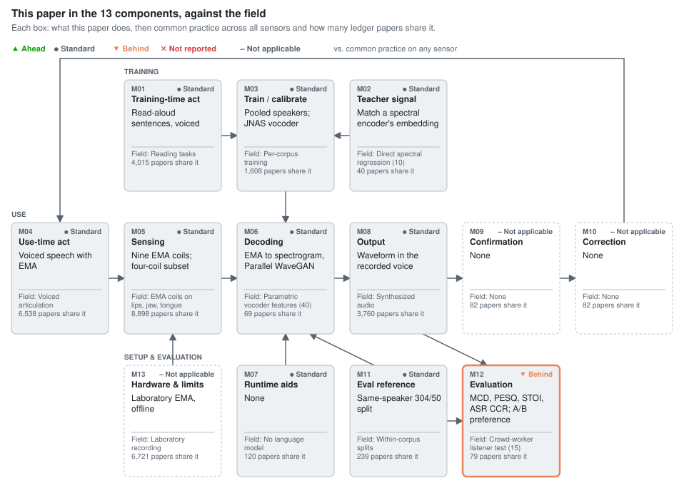

# EMA2S: An End-to-End Multimodal Articulatory-to-Speech System

Yu-Wen Chen, Kuo-Hsuan Hung, Shang-Yi Chuang, Jonathan Sherman, Wen-Chin Huang, Xugang Lu, Yu Tsao. IEEE ISCAS, 2021. [doi:10.1109/ISCAS51556.2021.9401485](https://doi.org/10.1109/ISCAS51556.2021.9401485) · [arXiv:2102.03786](https://arxiv.org/abs/2102.03786)

**Section:** [Brain signals (EEG, MEG, intracortical)](../../README.md#brain-signals-eeg-meg-intracortical)

## Figures

### This paper in the 13 components, against the field

<picture><source media="(prefers-color-scheme: dark)" srcset="figures/components-dark.svg"></picture>

Verdicts compare the paper's choice for each component with common practice across 8,995 ledger entries on any sensor (silent speech, brain-to-text, lip reading).

Data

| Component | This paper | Common practice | Papers with this practice | Verdict |
| --- | --- | --- | --- | --- |
| M01 Training-time act | Read-aloud sentences, voiced | Reading tasks | 4,015 of 8,995 | ● Standard (Inherited.) |
| M02 Teacher signal | Match a spectral encoder's embedding | Direct spectral regression (10) | 40 of 8,995 | ● Standard (2017 precedent [@akbari2018lip2audspec]; mixed.) |
| M03 Train / calibrate | Pooled speakers; JNAS vocoder | Per-corpus training | 1,608 of 8,995 | ● Standard (Inherited.) |
| M04 Use-time act | Voiced speech with EMA | Voiced articulation | 6,538 of 8,995 | ● Standard (Inherited.) |
| M05 Sensing | Nine EMA coils; four-coil subset | EMA coils on lips, jaw, tongue | 8,898 of 8,995 | ● Standard (Subset as Fig. 5 bars only.) |
| M06 Decoding | EMA to spectrogram, Parallel WaveGAN | Parametric vocoder features (40) | 69 of 8,995 | ● Standard (Spectrogram-only system loses to WORLD.) |
| M07 Runtime aids | None | No language model | 120 of 8,995 | ● Standard (Inherited.) |
| M08 Output | Waveform in the recorded voice | Synthesized audio | 3,760 of 8,995 | ● Standard (Inherited.) |
| M09 Confirmation | None | None | 82 of 8,995 | – Not applicable (Offline study.) |
| M10 Correction | None | None | 82 of 8,995 | – Not applicable (Offline study.) |
| M11 Eval reference | Same-speaker 304/50 split | Within-corpus splits | 239 of 8,995 | ● Standard (No reference row.) |
| M12 Evaluation | MCD, PESQ, STOI, ASR CCR; A/B preference | Crowd-worker listener test (15) | 79 of 8,995 | ▼ Behind (No listener transcription.) |
| M13 Hardware & limits | Laboratory EMA, offline | Laboratory recording | 6,721 of 8,995 | – Not applicable (Offline study.) |

## Verdict

EMA2S [[1]](#ref-1) changes two components: a training-only spectral encoder whose embedding the EMA encoder must match (M02), and an end-to-end mapping voiced by a pretrained Parallel WaveGAN instead of WORLD (M06). Both are standard. The speech-latent target already existed in lip-to-speech [[2]](#ref-2), and its increment over the mel-loss variant is 2.2% in MCD and 3.2% in CCR from single training runs (Table I, inference). With spectrogram loss only, the end-to-end system loses to the WORLD baseline on all four metrics; adding either the mel loss or the deep feature loss lifts PESQ, STOI and CCR past the baseline, and only the mel loss also lowers MCD below it (Table I). The evaluation (M12) is behind: the baseline paper scored listener transcription [[3]](#ref-3), while EMA2S reports a two-way preference test and an unnamed ASR on a same-speaker split.

## Against the field, component by component

### M02 Training-only supervision: speech-latent target

**Usual approach:** Of 40 unique non-acoustic-to-speech studies with latent or bottleneck wording (pattern match, Appendix), 10 regress spectral targets from paired audio, 4 use a deep feature loss and 3 a speech-autoencoder latent. EMA2S matches a speech encoder's embedding plus spectral losses (§III-B).

**State of the art:** For this loss, the reference point is a [later] 2024 reuse with an ablation [[4]](#ref-4): tri-modal EMG-to-speech reaches 18.091% WER with it against 18.866% without (Table 4).

Lip2AudSpec (2017) already trained a lip network to predict a spectrogram autoencoder's bottleneck for the pre-trained decoder [[2]](#ref-2). EMA2S claims the cross-modal loss as its contribution (§III-B) and its 44 references do not cite this precedent. Within EMA2S the effect is mixed: S III (deep feature loss, no mel loss) beats S I on PESQ, STOI and CCR (1.303/0.697/0.831 vs 1.259/0.679/0.796) but not MCD (8.445 vs 8.264 dB); added to the mel-loss system it moves MCD from 7.334 to 7.176 dB (-2.2%) and CCR from 0.841 to 0.868 (+3.2%) (inference). In [[4]](#ref-4) it lowers WER in three of four pairs and raises it for tri-modal MRI-to-speech (41.326% vs 39.005%, Table 3). Verdict: standard.

### M06 Processing: end-to-end spectrogram with a neural vocoder

**Usual approach:** Of 69 unique articulography-to-speech studies (pattern match, Appendix), 40 mention parametric vocoder features and 20 a neural vocoder; the baseline lineage drives WORLD from a BLSTM [[3]](#ref-3). EMA2S uses Parallel WaveGAN pre-trained on Japanese JNAS, with no adaptation described (§IV-A).

**State of the art:** A [later] 2022 HiFi-GAN-based model reaches 18.5% listener transcription WER on MNGU0 [[5]](#ref-5), against 30.1% for the BLSTM-WORLD lineage [[3]](#ref-3); EMA2S gives no comparable number.

S I (spectrogram loss only) is worse than the WORLD baseline on MCD (8.264 vs 7.815 dB, 5.7% worse), PESQ, STOI and CCR (Table I) (inference). Adding the mel loss (S II) beats the baseline on all four (MCD 11.3% lower, CCR 5.7% higher than S I) (inference). Targets, normalization and vocoder all differ from the baseline (§IV-B), so the final 8.2% MCD gain is not the end-to-end design's (inference). Verdict: standard.

### M12 Evaluation: preference test instead of transcription

**Usual approach:** Of 79 unique studies scoring synthesized speech with listeners (pattern match, Appendix), 15 use crowd workers and 10 open transcription; the baseline paper had 10 listeners transcribe 65 MNGU0 sentences, with an analysis-synthesis ceiling (30.1% vs 14.3% WER) [[3]](#ref-3).

**State of the art:** For EMA input, 18.5% WER from 70 listeners, 2022 [[5]](#ref-5).

EMA2S offers only an A/B choice against the baseline (10 listeners, 15 pairs each, §IV-C.3) and an ASR character rate from an unnamed recognizer (§IV-A), with no natural or resynthesized reference (Table I). Preference is not intelligibility: in the [later] study listeners agreed on only 28 of 60 A/B pairs, and the authors turned to transcription [[5]](#ref-5). Verdict: behind the 16 prior studies in the topic table that ran a listener intelligibility test (confirmed in text, Appendix), including the baseline paper [[3]](#ref-3).

## The 13 components

| Component | This paper | Usual approach (count) | State of the art | Verdict |
|---|---|---|---|---|
| M01 Training-time action | Read-aloud sentences, voiced | Reading tasks (slot-filled 4,015) | – | standard |
| M02 Training-only supervision | Match a spectral encoder's embedding | Direct spectral regression (10) (pattern match 40) | 18.09% WER, EMG, loss reused [[4]](#ref-4) | standard |
| M03 Training and adaptation | Pooled speakers; JNAS vocoder | Per-corpus training (slot-filled 1,608) | – | standard |
| M04 Use-time action | Voiced speech with EMA | Voiced articulation (slot-filled 6,538) | – | standard |
| M05 Sensors | Nine EMA coils; four-coil subset | EMA coils on lips, jaw, tongue (slot-filled 8,898) | – | standard |
| M06 Processing and decoding | EMA to spectrogram, Parallel WaveGAN | Parametric vocoder features (40) (pattern match 69) | 18.5% listener WER, MNGU0 [[5]](#ref-5) | standard |
| M07 Lexicon and LM | None | No language model (slot-filled 120) | – | standard |
| M08 Output | Waveform in the recorded voice | Synthesized audio (slot-filled 3,760) | – | standard |
| M09 Confirmation | None | None (slot-filled 82) | – | not applicable |
| M10 Correction | None | None (slot-filled 82) | – | not applicable |
| M11 Reference construction | Same-speaker 304/50 split | Within-corpus splits (slot-filled 239) | – | standard |
| M12 Evaluation | MCD, PESQ, STOI, ASR CCR; A/B preference | Crowd-worker listener test (15) (pattern match 79) | 18.5% listener WER, EMA [[5]](#ref-5) | behind |
| M13 Device and cost | Laboratory EMA, offline | Laboratory recording (slot-filled 6,721) | – | not applicable |

## Where the claims outrun the evidence

- The preference result, 83% vs 17% (§IV-C.3), has no chance level, test or interval.
- "Multimodal jointly training" as the source of improvement (§IV-C.2) rests on single runs without variance (Table I), so 2-3% increments over S II cannot be separated from run-to-run variation (inference).
- S III adds both a pre-trained spectral encoder and the deep feature loss to S I (§IV-C.2), so its gains cannot be attributed to the loss.
- The four-sensor result is shown only as bars (§IV-C.4, Fig. 5).
- The same three speakers appear in training and test (304/50 utterances each), sessions and sentence overlap unstated (§IV-A).

## What the field needs next

- M02: the latent-target ablation over several seeds, with a frozen-decoder variant as in [[2]](#ref-2).
- M06: the baseline's features voiced by the same neural vocoder, to separate mapping from vocoder.
- M12: listener transcription with an analysis-synthesis ceiling, as in [[3]](#ref-3).

## Questions for the authors

- Which ASR engine computed CCR, and what CCR does natural speech reach?
- How were the 50 test utterances per speaker chosen, and do their sentences occur in training?
- How many training runs were used, and over which data was the EMA maximum for normalization computed?

## Appendix: literature search

- M02 speech-latent-target. Inclusion rule: studies that synthesize speech from a non-acoustic signal (articulography, ultrasound, video, EMG, neural recordings) and supervise the encoder with paired speech, by direct spectral regression or by matching the latent of a speech encoder or autoencoder unused at test time; acoustic-input conversion, recognition-only studies and self-generated targets excluded; versions counted once. Slot-filled 31 unique studies; pattern match 40 unique studies. Usual design: direct spectral regression, 10 (pattern match, full text). Design counts (pattern match, full text): direct spectral regression 10, deep feature loss 4, speech-autoencoder latent 3; M03 supervision_kind=paired_audio 9 of 16 (slot-filled). Read in full: [[2]](#ref-2), [[4]](#ref-4), target. Known-item recall 1.0.
- M06 articulography-to-speech-synthesis. Inclusion rule: studies that synthesize speech audio from measured articulatory kinematics (EMA, PMA or other magnetic tracking) and state how acoustic features become a waveform; acoustic-to-articulatory inversion, talking-head animation and parameter-driven articulatory synthesizers excluded; versions counted once. Slot-filled 7,345 unique studies; pattern match 69 unique studies. Usual design: parametric vocoder features, 40 (pattern match, full text). Design counts: parametric vocoder 40, neural vocoder 20, Griffin-Lim 1. Read in full: [[5]](#ref-5), [[3]](#ref-3), target. Known-item recall 1.0.
- M12 listener-intelligibility-test (published topic table, appended). Inclusion rule: studies that evaluate speech synthesized from non-acoustic signals with human listeners who transcribe or identify words or sentences; naturalness-, preference- or MOS-only ratings, ASR-only scoring and acoustic-input conversion excluded. Slot-filled 6,960 unique studies; pattern match 79 unique studies. Usual design: crowd workers, 15 (pattern match). Design counts: crowd workers 15, closed-set identification 13, open transcription 10. Prior to the target (first public before 2020-08): 16 unique studies (confirmed in text). Read in full for this review: [[3]](#ref-3), [[5]](#ref-5). Known-item recall 1.0.

## References

Numbered by first citation. BibTeX in the same order and keys: [refs.bib](refs.bib).

1. Chen, Y., Hung, K., Chuang, S., Sherman, J., Huang, W., Lu, X., et al. “EMA2S: An End-to-End Multimodal Articulatory-to-Speech System.” *2021 IEEE International Symposium on Circuits and Systems (ISCAS)*, 2021, 1-5. doi:[10.1109/ISCAS51556.2021.9401485](https://doi.org/10.1109/ISCAS51556.2021.9401485). arXiv:[2102.03786](https://arxiv.org/abs/2102.03786). Target. Read as arXiv v2 (first page dated 9 Jun 2021). [review](https://github.com/supernaiter/silent-speech-review/tree/main/reviews/ema2s-an-end-to-end-multimodal-articulatory-to-speech-system) [wiki: arxiv-2102.03786](https://github.com/supernaiter/deep-research-wiki-for-silent-speech/blob/main/papers/arxiv-2102.03786/article.md)
2. Akbari, H., Arora, H., Cao, L., Mesgarani, N. “Lip2AudSpec: Speech Reconstruction from Silent Lip Movements Video.” *arXiv preprint*, 2017. arXiv:[1710.09798](https://arxiv.org/abs/1710.09798). [review](https://github.com/supernaiter/silent-speech-review/tree/main/reviews/lip2audspec-speech-reconstruction-from-silent-lip-movements-video) [wiki: arxiv-1710.09798](https://github.com/supernaiter/deep-research-wiki-for-silent-speech/blob/main/papers/arxiv-1710.09798/article.md)
3. Taguchi, F., Kaburagi, T. “Articulatory-to-Speech Conversion Using Bi-directional Long Short-term Memory.” *Interspeech*, 2018. doi:[10.21437/Interspeech.2018-999](https://doi.org/10.21437/Interspeech.2018-999). [wiki: isca-taguchi18_interspeech](https://github.com/supernaiter/deep-research-wiki-for-silent-speech/blob/main/papers/isca-taguchi18_interspeech/article.md)
4. Wu, P., Yu, B., Scheck, K., Black, A. W., Krishnapriyan, A. S., Chen, I. Y., et al. “Deep Speech Synthesis from Multimodal Articulatory Representations.” *arXiv preprint*, 2024. arXiv:[2412.13387](https://arxiv.org/abs/2412.13387). [later] [wiki: arxiv-2412.13387](https://github.com/supernaiter/deep-research-wiki-for-silent-speech/blob/main/papers/arxiv-2412.13387/article.md)
5. Wu, P., Watanabe, S., Goldstein, L., Black, A. W., Anumanchipalli, G. K. “Deep Speech Synthesis from Articulatory Representations.” *Interspeech 2022*, 2022, 779-783. doi:[10.21437/Interspeech.2022-10892](https://doi.org/10.21437/Interspeech.2022-10892). arXiv:[2209.06337](https://arxiv.org/abs/2209.06337). [later] [wiki: arxiv-2209.06337](https://github.com/supernaiter/deep-research-wiki-for-silent-speech/blob/main/papers/arxiv-2209.06337/article.md)

## Materials

Data behind this review. Full texts of the papers are not included.

- [`review.md`](review.md): the review text (source)
- [`refs.bib`](refs.bib): references (BibTeX)
- [`slots.json`](slots.json): for each of the 13 components: this paper's choice, field practice, number of matching papers, verdict
- [`figures.json`](figures.json): figure definitions
- [`evaluation.md`](evaluation.md): independent evaluation by a second reviewer
- [`triage.md`](triage.md): how each evaluation finding was checked against the sources and resolved
- [`components/M02/speech-latent-target.csv`](../../components/M02/speech-latent-target.csv): M02 topic "speech-latent-target", every candidate paper with its decision (31 slot-filled, 40 pattern match, usual design in 10, 3 read in full)
- [`components/M06/articulography-to-speech-synthesis.csv`](../../components/M06/articulography-to-speech-synthesis.csv): M06 topic "articulography-to-speech-synthesis", every candidate paper with its decision (7345 slot-filled, 69 pattern match, usual design in 40, 3 read in full)
- [`components/M12/listener-intelligibility-test.csv`](../../components/M12/listener-intelligibility-test.csv): M12 topic "listener-intelligibility-test", every candidate paper with its decision (6960 slot-filled, 37 pattern match, usual design in 15, 5 read in full)

## More reviews in Brain signals (EEG, MEG, intracortical)

- [Neuroprosthesis for decoding speech in a paralyzed person with anarthria](../neuroprosthesis-for-decoding-speech-in-a-paralyzed-person-with-anarthria/) (2021). Sentence decoding from a person who cannot speak holds for 50 words and one participant; the decoder is standard for 2021, and an LM restricted to the test vocabulary drives the gain.
- [Silent Speech and Emotion Recognition from Vocal Tract Shape Dynamics in Real-Time MRI](../silent-speech-and-emotion-recognition-from-vocal-tract-shape-dynamics-in-real-time-mri/) (2021). Sentence-level speech recognition from real-time MRI of the vocal tract, plus emotion and gender articulation analysis; reaches 40.6% PER on USC-TIMIT with a language model, beating earlier rtMRI baselines.
- [Towards Neural Decoding of Imagined Speech based on Spoken Speech](../towards-neural-decoding-of-imagined-speech-based-on-spoken-speech/) (2022). Transfers CSP+SVM models trained on spoken-speech EEG to imagined speech decoding; accuracy is slightly lower but not significantly different from direct training in a 5-class, 7-subject offline task.
- [A comparison of oscillatory characteristics in covert speech and speech perception](../a-comparison-of-oscillatory-characteristics-in-covert-speech-and-speech-perception/) (2020). EEG analysis comparing oscillatory activity in covert speech and speech perception in eight participants; finds stronger low-gamma for covert speech, stronger delta/theta for perception, and theta-gamma coupling.
- [Continuous Silent Speech Recognition using EEG](../continuous-silent-speech-recognition-using-eeg/) (2020). Decodes continuous sentences from 31-channel scalp EEG recorded during silent reading using CTC and a 4-gram language model; WER is very high (about 75-84%), showing feasibility only.
- [A high-performance neuroprosthesis for speech decoding and avatar control](../a-high-performance-neuroprosthesis-for-speech-decoding-and-avatar-control/) (2023). Text, voice and avatar from ECoG in one participant hold as a demonstration; sensor and decoder are standard, and an LM trained on the test pool inflates the text result.

---

Part of the [Silent Speech Interface Review](https://github.com/supernaiter/silent-speech-review). Found an error? [Open an issue](https://github.com/supernaiter/silent-speech-review/issues/new?template=correction.yml).
