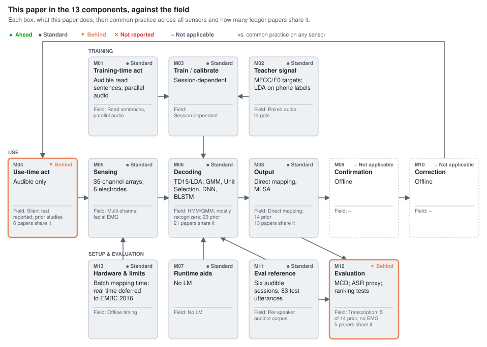

# EMG-to-Speech: Direct Generation of Speech from Facial Electromyographic Signals

Matthias Janke, Lorenz Diener. IEEE/ACM Transactions on Audio, Speech, and Language Processing, 2017. [doi:10.1109/TASLP.2017.2738568](https://doi.org/10.1109/TASLP.2017.2738568)

**Section:** [Other sensors](../../README.md#other-sensors)

## Figures

### This paper in the 13 components, against the field

<picture><source media="(prefers-color-scheme: dark)" srcset="figures/components-dark.svg"></picture>

Verdicts compare the paper's choice for each component with common practice across 8,995 ledger entries on any sensor (silent speech, brain-to-text, lip reading).

Data

| Component | This paper | Common practice | Papers with this practice | Verdict |
| --- | --- | --- | --- | --- |
| M01 Training-time act | Audible read sentences, parallel audio | Read sentences, parallel audio |  | ● Standard (Group corpus lineage.) |
| M02 Teacher signal | MFCC/F0 targets; LDA on phone labels | Paired audio targets |  | ● Standard (Labels feed the LDA despite the label-free claim (Sec. III-A).) |
| M03 Train / calibrate | Session-dependent | Session-dependent |  | ● Standard (No cross-session or cross-speaker test.) |
| M04 Use-time act | Audible only | Silent test reported; prior studies | 6 of 8,995 | ▼ Behind (6 prior studies (Appendix); best comparable [@hueber2016statistical] (EMA).) |
| M05 Sensing | 35-channel arrays; 6 electrodes | Multi-channel facial EMG |  | ● Standard (Array from the group's earlier work.) |
| M06 Decoding | TD15/LDA; GMM, Unit Selection, DNN, BLSTM | HMM/GMM, mostly recognizers; 29 prior | 21 of 29 | ● Standard (21 of 29 prior EMG decoders (Appendix); new: BLSTM and the four-way comparison.) |
| M07 Runtime aids | No LM | No LM |  | ● Standard (Trigram LM only inside the ASR evaluation.) |
| M08 Output | Direct mapping, MLSA | Direct mapping; 14 prior | 13 of 14 | ● Standard (13 of 14 indexed prior synthesis studies; route inherited from the group.) |
| M09 Confirmation | Offline | – |  | – Not applicable (No interaction.) |
| M10 Correction | Offline | – |  | – Not applicable (No interaction.) |
| M11 Eval reference | Six audible sessions, 83 test utterances | Per-speaker audible corpus |  | ● Standard (Evaluation sets of 10 to 20 utterances.) |
| M12 Evaluation | MCD; ASR proxy; ranking tests | Transcription: 5 of 14 prior, no EMG | 5 of 14 | ▼ Behind (Minority practice; behind on best comparable work [@hueber2016statistical] (EMA).) |
| M13 Hardware & limits | Batch mapping time; real time deferred to EMBC 2016 | Offline timing |  | ● Standard (Real-time output deferred to the group's EMBC 2016 paper (§V-A).) |

## Verdict

The paper [[1]](#ref-1) changes one component, the mapping model (M06), only by adding a BLSTM and ranking four mappings, three of them the group's earlier work, on 83 evaluation utterances and single runs (Table I). Its direct route (M08) is inherited: 13 of 14 indexed prior synthesis studies mapped directly (Appendix); the design argued against, EMG recognition to text, was the majority output and had not been paired with synthesis from EMG. Two incidental components are behind on the best comparable work: no silent articulation is tested (M04), as six prior studies did, including the group's own [[2]](#ref-2), and no listener transcription is run (M12), a minority practice (5 of 14) that no prior EMG study used. The strongest overreach is the Abstract's claim that speaker identity and mood are retained, which no experiment measures (Abstract; §VI; Table III). The label-free claim (§I) fails for the LDA-based GMM and LSTM, not the DNN (§III-A).

## Against the field, component by component

### M06 Decoder: EMG-to-acoustic mapping model

**Usual approach:** 21 of 29 prior surface-EMG speech decoders used HMM or GMM models, mostly as recognizers, and 14 used TD or E4 features (pattern match, Appendix); GMM regression to speech came from Toth et al. [[2]](#ref-2) and the group's 2012 study (§III-C), Unit Selection from [[3]](#ref-3), [[4]](#ref-4), the DNN from 2015 (§III-E). New here are the BLSTM and the four-way comparison.

**State of the art:** GETS (2026) [[5]](#ref-5) [later] reaches 11.89% WER on the Gaddy single-subject silent test (Whisper) only with EMG-to-text and GPT-4 guidance; without it 32.78%, against 25.74% for Gaddy and Klein's direct mapping under the same scorer.

The DNN's mean MCD of 5.21 against 5.42, 5.46 and 5.69 (§V-B) rests on 10 to 20 test utterances per session. Inputs differ: 32 LDA dimensions for GMM and one LSTM, up to 5,425 for the DNN (§V-A); Fig. 5 does not say which LSTM is scored. MCD and the ASR proxy disagree on the GMM, worst in MCD and second in WER (§V-C). The authors give Toth et al.'s five channels and 380 utterances themselves (§I); on the like-for-like single-electrode sessions the DNN reaches 5.29 and 5.61 (Fig. 5) against 6.37. Verdict standard.

### M08 Output: direct mapping and vocoder

**Usual approach:** direct mapping in 13 of 14 indexed prior synthesis studies, recognition then synthesis in one [[6]](#ref-6) (pattern match, Appendix); the article itself cites further direct work, Lam et al. 2006, Tsuji et al. 2008 and Toda et al. (§I).

**State of the art:** Tongue2Speech (2026) [[7]](#ref-7) [later], ultrasound to mel with a neural vocoder, 15.93% WER (single TaL speaker, Whisper Medium); the best EMG system adds recognition-derived guidance to direct synthesis [[5]](#ref-5).

The claimed vocabulary freedom (§VI) is scored by an ASR with a trigram LM and 108 to 2,111-word vocabularies (§V-C; Fig. 6). The one prosody test keeps reference MFCCs: EMG-derived F0 scores 28 against 22 for zero F0 and 41 for resynthesis (Table III). Verdict standard.

### M04 Articulation mode: audible speech only

**Usual approach:** six prior studies tested overt-trained decoders on silent articulation (confirmed, Appendix); the only EMG synthesis among them is Toth et al.'s audible-trained EMG-to-whisper variant, 79.8% to 94.90% ASR WER over 27 sessions from 14 speakers [[2]](#ref-2), cited by the authors as 20.2% word accuracy (§I). Hueber and Bailly (EMA) reach about 30% listener word accuracy [[8]](#ref-8). The article is audible only (Table I).

**State of the art:** GETS (2026) [[5]](#ref-5) [later], 11.89% WER on single-subject silent EMG with text guidance. Verdict behind, best comparable work [[8]](#ref-8).

### M12 Evaluation: intelligibility of the output

**Usual approach:** 9 of 14 indexed prior synthesis studies ran no listener transcription; 5 did, none from EMG (confirmed, Appendix). Behind holds on the best-comparable yardstick: five earlier studies meet it, the best read being Hueber and Bailly (EMA), ten naive listeners, 60.4% word accuracy [[8]](#ref-8). The paper has 10 listeners rank 10 utterances (§V-E).

**State of the art:** Wairagkar et al. (2025) [[9]](#ref-9) [later], 43.75% median open-transcription WER (intracortical, one participant, naive listeners).

The authors find intelligibility too low for transcription (§V-E); a low score is still a result. The ASR proxy is trained on synthesized training-set output (§V-C), for two speakers (Fig. 6); its mean 7.3% against 10.9% for an EMG recognizer on 160 utterances is, the authors concede, not direct and partly a training-data effect (§V-C). Verdict behind.

## The 13 components

| Component | This paper | Usual approach (count) | State of the art | Verdict |
|---|---|---|---|---|
| M01 Training-time action | Audible read sentences, parallel audio | Read sentences, parallel audio | – | standard |
| M02 Training-only supervision | MFCC/F0 targets; LDA on phone labels | Paired audio targets | – | standard |
| M03 Training and adaptation | Session-dependent | Session-dependent | – | standard |
| M04 Use-time action | Audible only | Silent test reported; prior studies (confirmed 6) | 11.89% WER with text guidance [[5]](#ref-5) | behind |
| M05 Sensors | 35-channel arrays; 6 electrodes | Multi-channel facial EMG | – | standard |
| M06 Processing and decoding | TD15/LDA; GMM, Unit Selection, DNN, BLSTM | HMM/GMM, mostly recognizers; 29 prior (pattern match 21) | 11.89% WER with text guidance [[5]](#ref-5) | standard |
| M07 Lexicon and LM | No LM | No LM | – | standard |
| M08 Output | Direct mapping, MLSA | Direct mapping; 14 prior (pattern match 13) | 15.93% WER, TaL [[7]](#ref-7) | standard |
| M09 Confirmation | Offline | – | – | not applicable |
| M10 Correction | Offline | – | – | not applicable |
| M11 Reference construction | Six audible sessions, 83 test utterances | Per-speaker audible corpus | – | standard |
| M12 Evaluation | MCD; ASR proxy; ranking tests | Transcription: 5 of 14 prior, no EMG (confirmed 5) | 43.75% median WER [[9]](#ref-9) | behind |
| M13 Device and cost | Batch mapping time; real time deferred to EMBC 2016 | Offline timing | – | standard |

## Where the claims outrun the evidence

- Speaker identity and mood "retained" (Abstract), not measured (§V-D).
- "Label-free" (§I) against LDA on force-aligned phone sub-states for GMM and LSTM (§III-A).
- Best "4.51" (§V-B) against a best evaluation session of 4.56 (Fig. 5).
- DNN "best in naturalness" (§VI), while the naturalness test varies only F0 (§V-D).

## What the field needs next

- M04: the four mappings on silent EMG, drop per session.
- M12: open transcription of all test utterances.
- M06: repeated runs, one shared input, cross-session tests.
- M08: speaker and emotion recognition on converted speech.

## Questions for the authors

- Which tests give p < 0.01 (§V-B, §V-D), and which run gives 4.51?
- Which LSTM input is scored in Fig. 5, and is the LDA fitted on training data only?
- §V-E names four mappings and two references but "5 variations": which is missing?
- Which mapping produced the F0 in Table III, with four speakers in a three-speaker corpus?

## Appendix: literature search

Setting for every count: speech decoding or synthesis from non-acoustic speech-production signals measured on the speaker; lip-video-only systems excluded; M06 uses its surface-EMG subset. Prior = first public before 2017-05, [concurrent] = 2017-05 to 2018-05. The group's earlier papers [[2]](#ref-2), [[3]](#ref-3), [[4]](#ref-4) count as prior designs.

- M06, emg-speech-encoder-input-and-sequence-model. Inclusion rule: surface-EMG speech decoders (synthesis or recognition) classified by input representation and sequence model; auxiliary-EMG, non-speech EMG and reviews excluded; versions once. Ledger counts (published table): slot-filled 7,345, pattern match 83 unique studies. At the target's time: 29 prior unique studies; full-text pattern counts HMM or GMM 21 (mostly recognizers), TD or E4 features 14, neural-network mention 9 (upper bound). Read in full: [[2]](#ref-2). Known-item recall (published table): 0.5.
- M08, non-acoustic-signal-to-speech-output-route. Inclusion rule: studies producing audible speech from non-acoustic production signals, classified as direct mapping or recognition then synthesis; face animation, acoustic input and reviews excluded. Ledger counts (published table): slot-filled 3,268, pattern match 144 unique studies. At the target's time: 14 prior unique indexed studies, direct mapping 13, recognition then synthesis 1 [[6]](#ref-6); pattern match checked by title and ledger text. Cited by the article and not indexed, all direct: Lam 2006, Tsuji 2008, Toda 2004/2008, Janke 2012, Diener 2015 (IJCNN), Diener 2016 (EMBC). Read in full also: [[4]](#ref-4). Read in full: [[2]](#ref-2), [[7]](#ref-7). Known-item recall (published table): 0.17.
- M04, overt-to-silent-transfer. Inclusion rule: a decoder trained on overt speech applied to silent or covert speech without retraining, results reported; any signal; versions once. Published table: 33 unique candidates. At the target's time: 6 prior unique studies (confirmed), including two read additions [[2]](#ref-2), [[8]](#ref-8) (Toth et al. EMG synthesis; Hueber and Bailly EMA); the TASLP article does not meet the rule. Read in full: [[2]](#ref-2), [[8]](#ref-8), [[5]](#ref-5). Known-item recall (published table): 1.0.
- M12, listener-intelligibility-test. Inclusion rule: synthesized speech from non-acoustic signals evaluated by listeners who transcribe or identify words or sentences; naturalness, preference or MOS only excluded. Ledger counts (published table): slot-filled 6,960, pattern match 37 unique studies. At the target's time: 5 of the 14 indexed prior synthesis studies of the M08 count (numerator confirmed, denominator pattern match), none from EMG; the target does not meet the rule. Read in full: [[8]](#ref-8), [[9]](#ref-9). Known-item recall (published table): 1.0.

## References

Numbered by first citation. BibTeX in the same order and keys: [refs.bib](refs.bib).

1. Janke, M., Diener, L. “EMG-to-Speech: Direct Generation of Speech from Facial Electromyographic Signals.” *IEEE/ACM Transactions on Audio, Speech, and Language Processing*, 2017, 25(12), 2375. doi:[10.1109/TASLP.2017.2738568](https://doi.org/10.1109/TASLP.2017.2738568). Target, reviewed as the TASLP article (author-hosted manuscript). The linked wiki folder holds the 2016 KIT dissertation, a different version. [wiki: doi-10.1109-taslp-2017-2738568](https://github.com/supernaiter/deep-research-wiki-for-silent-speech/blob/main/papers/doi-10.1109-taslp-2017-2738568/article.md)
2. Toth, A. R., Wand, M., Schultz, T. “Synthesizing Speech from Electromyography using Voice Transformation Techniques.” *Proc. Interspeech 2009*, 2009. <https://www.isca-archive.org/interspeech_2009/toth09_interspeech.html> Prior design of the same group. [wiki: isca-toth09_interspeech](https://github.com/supernaiter/deep-research-wiki-for-silent-speech/blob/main/papers/isca-toth09_interspeech/article.md)
3. Zahner, M., Janke, M., Wand, M., Schultz, T. “Conversion from Facial Myoelectric Signals to Speech: A Unit Selection Approach.” *Proc. Interspeech 2014*, 2014. doi:[10.21437/Interspeech.2014-164](https://doi.org/10.21437/Interspeech.2014-164). Prior design of the same group. [wiki: isca-zahner14_interspeech](https://github.com/supernaiter/deep-research-wiki-for-silent-speech/blob/main/papers/isca-zahner14_interspeech/article.md)
4. Diener, L., Janke, M., Schultz, T. “Codebook Clustering for Unit Selection based EMG-to-Speech Conversion.” *Proc. Interspeech 2015*, 2015. <https://www.isca-archive.org/interspeech_2015/diener15_interspeech.pdf> Prior design of the same group. [wiki: isca-diener15_interspeech](https://github.com/supernaiter/deep-research-wiki-for-silent-speech/blob/main/papers/isca-diener15_interspeech/article.md)
5. Lee, J., Lee, J., Lee, K. “GETS: Guiding EMG-to-Speech Synthesis via Silent Speech Recognition.” *Proc. Interspeech 2026*, 2026. doi:[10.21437/Interspeech.2026-1938](https://doi.org/10.21437/Interspeech.2026-1938). State of the art. [later] [wiki: isca-lee26r_interspeech](https://github.com/supernaiter/deep-research-wiki-for-silent-speech/blob/main/papers/isca-lee26r_interspeech/article.md)
6. Hueber, T., Benaroya, E., Chollet, G., Denby, B., Dreyfus, G., Stone, M. “Development of a Silent Speech Interface Driven by Ultrasound and Optical Images of the Tongue and Lips.” *Speech Communication*, 2010, 52(4), 288. doi:[10.1016/j.specom.2009.11.004](https://doi.org/10.1016/j.specom.2009.11.004). Prior. [review](https://github.com/supernaiter/silent-speech-review/tree/main/reviews/development-of-a-silent-speech-interface-driven-by-ultrasound-and-optical-images-of-the-tongue-and-l) [wiki: doi-10.1016-j.specom.2009.11.004](https://github.com/supernaiter/deep-research-wiki-for-silent-speech/blob/main/papers/doi-10.1016-j.specom.2009.11.004/article.md)
7. Sonkar, Y., Kilaru, Y., Yelimeli, S., Shah, N., Gandhi, V. “Tongue2Speech: Real-Time Speech Synthesis from Tongue Ultrasound Videos via Spatiotemporal Transformers.” *Proc. Interspeech 2026*, 2026, 6856–6860. doi:[10.21437/Interspeech.2026-3023](https://doi.org/10.21437/Interspeech.2026-3023). State of the art. [later] [wiki: isca-sonkar26_interspeech](https://github.com/supernaiter/deep-research-wiki-for-silent-speech/blob/main/papers/isca-sonkar26_interspeech/article.md)
8. Hueber, T., Bailly, G. “Statistical Conversion of Silent Articulation into Audible Speech using Full-Covariance HMM.” *Computer Speech & Language*, 2016, 36, 274–293. doi:[10.1016/j.csl.2015.09.008](https://doi.org/10.1016/j.csl.2015.09.008). Prior (EMA). [wiki: doi-10.1016-j.csl.2015.09.008](https://github.com/supernaiter/deep-research-wiki-for-silent-speech/blob/main/papers/doi-10.1016-j.csl.2015.09.008/article.md)
9. Wairagkar, M., Card, N. S., Singer-Clark, T., Hou, X., Iacobacci, C., Miller, L. M., et al. “An instantaneous voice-synthesis neuroprosthesis.” *Nature*, 2025. doi:[10.1038/s41586-025-09127-3](https://doi.org/10.1038/s41586-025-09127-3). State of the art. [later] [review](https://github.com/supernaiter/silent-speech-review/tree/main/reviews/an-instantaneous-voice-synthesis-neuroprosthesis) [wiki: doi-10.1038-s41586-025-09127-3](https://github.com/supernaiter/deep-research-wiki-for-silent-speech/blob/main/papers/doi-10.1038-s41586-025-09127-3/article.md) [wiki: doi-10.1101-2024.08.14.607690](https://github.com/supernaiter/deep-research-wiki-for-silent-speech/blob/main/papers/doi-10.1101-2024.08.14.607690/article.md) [wiki: pmc-12369848-voicesynth](https://github.com/supernaiter/deep-research-wiki-for-silent-speech/blob/main/papers/pmc-12369848-voicesynth/article.md) [wiki: pmc-12369848-voice-synth-np](https://github.com/supernaiter/deep-research-wiki-for-silent-speech/blob/main/papers/pmc-12369848-voice-synth-np/article.md) [wiki: pmc-11370360-instvoice](https://github.com/supernaiter/deep-research-wiki-for-silent-speech/blob/main/papers/pmc-11370360-instvoice/article.md)

## Materials

Data behind this review. Full texts of the papers are not included.

- [`review.md`](review.md): the review text (source)
- [`refs.bib`](refs.bib): references (BibTeX)
- [`slots.json`](slots.json): for each of the 13 components: this paper's choice, field practice, number of matching papers, verdict
- [`figures.json`](figures.json): figure definitions
- [`evaluation.md`](evaluation.md): independent evaluation by a second reviewer
- [`triage.md`](triage.md): how each evaluation finding was checked against the sources and resolved
- [`process/log.json`](process/log.json): process record: each step, who did it (reader, script, writer, evaluator), when, the checks run and the input versions
- [`process/notes.json`](process/notes.json): reading notes on the target and comparator papers: claims, numbers, conditions and what is not stated, with locations
- [`process/plan.json`](process/plan.json): plan: which components the paper changes and the topics it is compared on
- [`process/draft.md`](process/draft.md): the review as first written, before the independent evaluation
- [`process/claims-draft.md`](process/claims-draft.md): claim table of the draft: every claim mapped to a note or a count
- [`process/claims.md`](process/claims.md): claim table of the published review
- [`components/M04/overt-to-silent-transfer.csv`](../../components/M04/overt-to-silent-transfer.csv): M04 topic "overt-to-silent-transfer", every candidate paper with its decision (5595 slot-filled, 33 pattern match, usual design in 23, 104 read in full)
- [`components/M06/emg-speech-encoder-input-and-sequence-model.csv`](../../components/M06/emg-speech-encoder-input-and-sequence-model.csv): M06 topic "emg-speech-encoder-input-and-sequence-model", every candidate paper with its decision (7345 slot-filled, 83 pattern match, usual design in 18, 3 read in full)
- [`components/M08/non-acoustic-signal-to-speech-output-route.csv`](../../components/M08/non-acoustic-signal-to-speech-output-route.csv): M08 topic "non-acoustic-signal-to-speech-output-route", every candidate paper with its decision (3268 slot-filled, 144 pattern match, usual design in 3, 7 read in full)
- [`components/M12/listener-intelligibility-test.csv`](../../components/M12/listener-intelligibility-test.csv): M12 topic "listener-intelligibility-test", every candidate paper with its decision (6960 slot-filled, 37 pattern match, usual design in 15, 5 read in full)

## More reviews in Other sensors

- [Combining Residual Networks with LSTMs for Lipreading](../combining-residual-networks-with-lstms-for-lipreading/) (2017). 3D-conv + ResNet + Bi-LSTM (M06), which became the field default, and per-step training (M03) are standard only for lack of run counts; 83.0% trails audio-supervised 93.2% today.
- [High performance communication by people with paralysis using an intracortical brain-computer interface](../high-performance-communication-by-people-with-paralysis-using-an-intracortical-brain-computer-interf/) (2017). ReFIT-KF + HMM click (M06) and ccpm/bitrate protocol (M12) are standard for 2017; 1.4-4.2x record gains are cross-study and the HMM is never isolated; later decoders reach 110 chars/min.
- [Audio-Visual Speech Recognition with a Hybrid CTC/Attention Architecture](../audio-visual-speech-recognition-with-a-hybrid-ctc-attention-architecture/) (2018). No earlier sentence-level AVSR study in the ledger trains hybrid CTC/attention (0 of 32), but no CTC- or attention-only result, LRW under the no-external-data claim, one run: standard.
- [Decoding spoken phonemes from sensorimotor cortex with High-Density ECoG grids](../decoding-spoken-phonemes-from-sensorimotor-cortex-with-high-density-ecog-grids/) (2018). Spatiotemporal templates on HD-ECoG (M06, M05) reuse the group's gesture decoder; the density claim is untested: standard. Voice-onset and rest anchoring confound the temporal gain.
- [End-to-End Audiovisual Speech Recognition](../end-to-end-audiovisual-speech-recognition/) (2018). Raw-waveform front end and BGRU fusion (M06) depart from the usual approach but are standard: they tie MFCC in clean LRW audio (97.7%); noise gains lack repeated runs and use matched babble.
- [Inferring imagined speech using EEG signals: a new approach using Riemannian manifold features](../inferring-imagined-speech-using-eeg-signals-a-new-approach-using-riemannian-manifold-features/) (2018). Covariance tangent-space + RVM (M06) is new to imagined-speech EEG but beats only at-chance baselines; evaluation is behind: no test against chance, which 3 of 7 priors ran.

---

Part of the [Silent Speech Interface Review](https://github.com/supernaiter/silent-speech-review). Found an error? [Open an issue](https://github.com/supernaiter/silent-speech-review/issues/new?template=correction.yml).
