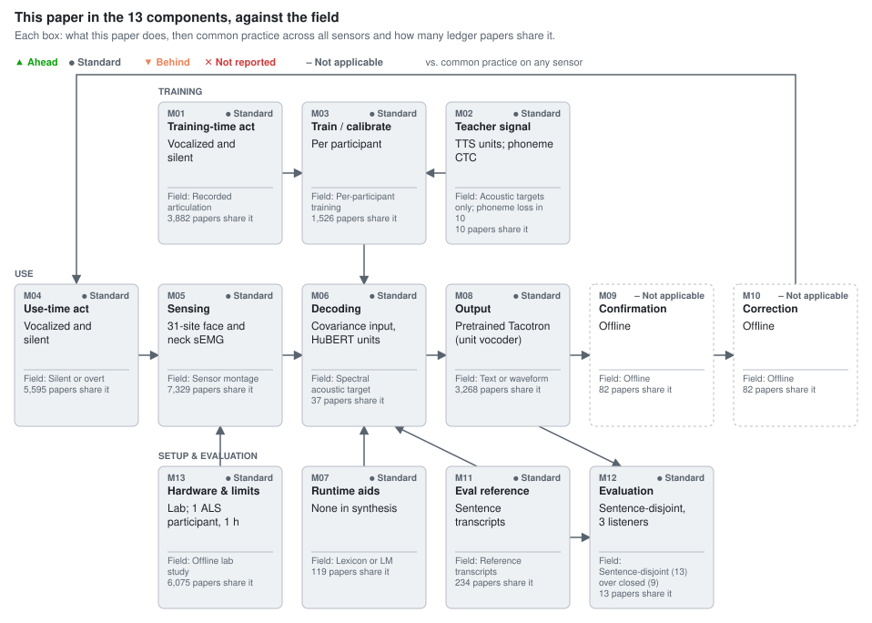

# emg2speech: Synthesizing speech from electromyography using self-supervised speech models

Gowda, H. T., Comstock, D. C., Miller, L. M. · arXiv preprint · 2025 · [arXiv:2510.23969](https://arxiv.org/abs/2510.23969)

**Section:** [Surface EMG](../../README.md#surface-emg)

## Figures

### This paper in the 13 components, against the field

<picture><source media="(prefers-color-scheme: dark)" srcset="figures/components-dark.svg"></picture>

Verdicts compare the paper's choice for each component with common practice across 8,995 ledger entries on any sensor (silent speech, brain-to-text, lip reading).

Data

| Component | This paper | Common practice | Papers with this practice | Verdict |
| --- | --- | --- | --- | --- |
| M01 Training-time act | Vocalized and silent | Recorded articulation | 3,882 of 8,995 | ● Standard (Inherited.) |
| M02 Teacher signal | TTS units; phoneme CTC | Acoustic targets only; phoneme loss in 10 | 10 of 8,995 | ● Standard (Metzger 2023 recipe.) |
| M03 Train / calibrate | Per participant | Per-participant training | 1,526 of 8,995 | ● Standard (Inherited.) |
| M04 Use-time act | Vocalized and silent | Silent or overt | 5,595 of 8,995 | ● Standard (Inherited.) |
| M05 Sensing | 31-site face and neck sEMG | Sensor montage | 7,329 of 8,995 | ● Standard (Inherited.) |
| M06 Decoding | Covariance input, HuBERT units | Spectral acoustic target | 37 of 8,995 | ● Standard (Units untested vs mel.) |
| M07 Runtime aids | None in synthesis | Lexicon or LM | 119 of 8,995 | ● Standard (Inherited.) |
| M08 Output | Pretrained Tacotron (unit vocoder) | Text or waveform | 3,268 of 8,995 | ● Standard (Inherited.) |
| M09 Confirmation | Offline | Offline | 82 of 8,995 | – Not applicable (Offline.) |
| M10 Correction | Offline | Offline | 82 of 8,995 | – Not applicable (Offline.) |
| M11 Eval reference | Sentence transcripts | Reference transcripts | 234 of 8,995 | ● Standard (Inherited.) |
| M12 Evaluation | Sentence-disjoint, 3 listeners | Sentence-disjoint (13) over closed (9) | 13 of 8,995 | ● Standard (One participant per corpus.) |
| M13 Hardware & limits | Lab; 1 ALS participant, 1 h | Offline lab study | 6,075 of 8,995 | ● Standard (No session or day test.) |

## Verdict

The paper [[1]](#ref-1) ports to surface EMG the ECoG synthesis pipeline it says it adopts [[2]](#ref-2): HuBERT units from text-to-speech audio, learned with CTC (§5.3) and voiced by a pretrained Tacotron "vocoder" (§2). Its own changes, an auxiliary phoneme CTC head with a consistency loss (M02) and a covariance input from the same group's earlier work (M06) [[3]](#ref-3), are standard; auxiliary phoneme losses for EMG voicing date from 2021 [[4]](#ref-4). The strongest confound is the paper's Table 6: its text route reports 51.17% WER (decoder output) against 61.02% for direct synthesis (listener transcripts, 460 sentences, Appendix D.3), but the scoring differs and the text decoder was trained "on all 460 sentences" (Appendix D.4), so the table ranks neither route, and the "more fluid, natural interaction" claimed for direct synthesis is untested. Listener WERs of 62.55% (healthy, vocalized) and 50.82% (one ALS participant, silent) stay far above 11.89% to 12.2% for silent EMG on the Gaddy benchmark [[5]](#ref-5), [[6]](#ref-6), with other corpora and scoring.

## Against the field, component by component

### M02 Training-only supervision: synthetic units, phoneme guidance

**Usual approach:** Synthesis usually uses acoustic targets only: of 34 studies matching an auxiliary phoneme, phone-state or CTC loss (pattern match, recognition and synthesis), 10 are synthesis studies; among 32 slot-filled studies on synthetic or reference-speaker targets, supervision is "other" in 8 and paired audio in 7 (Appendix). The paper uses TTS units and phoneme CTC.

**State of the art:** Intracortical synthesis on a benchmark with text-synthesized targets [[7]](#ref-7) reaches 5.24% listener WER for one ALS participant in 2026 [[8]](#ref-8) [later], against 50.82% here. On silent EMG with an added training loss, the best is 25.14% WER (ASR-scored, Gaddy split, 10 seeds) [[9]](#ref-9) [later]; GETS (11.89%) [[5]](#ref-5) guides only at inference.

Synthetic targets are prior practice: WaveNet text-to-speech waveforms turned into HuBERT units [[2]](#ref-2), and text-to-speech audio from cued text aligned to neural activity [[7]](#ref-7). The auxiliary phoneme loss for EMG voicing used forced-aligned frame labels [[4]](#ref-4); CTC removes that alignment. The gain holds over five seeds: 56.08% to 51.81% UER (healthy, p < 10^-6, Table 3 caption) and 52.29% to 46.98% (ALS), 4.27 and 5.31 points or 7.6% and 10.2% relative (inference) (Tables 3, 4), but on units only. The healthy participant vocalized (footnote 3), but no table compares TTS units with units from that audio (Tables 1 to 5). They map to phonemes at 0% PER (App. B), so the target carries text in a synthetic voice and timing (inference). Verdict: standard.

### M06 Intermediate representation: HuBERT units from covariance input

**Usual approach:** Of 54 surface-EMG synthesis studies (pattern match, Appendix), 37 predict spectral features and 19 self-supervised units; the paper takes units.

**State of the art:** 11.89% WER for silent EMG in 2026 (ASR-scored, Gaddy test split, one speaker) [[5]](#ref-5) [later]; the paper's 62.55% (listeners, vocalized EMG) shows only the direction of the gap (other corpus and scoring).

Units are not shown to help: on the Gaddy benchmark, one method gave 26.55% WER with soft-unit targets ("Ours (SU)") against 25.14% with mel targets ("Ours (Mel)", Table 1) over 10 seeds [[9]](#ref-9) [later], and the paper has no spectral-target baseline. The covariance input fed the group's EMG-to-text decoder [[3]](#ref-3); here it beats EMG spectrogram input, 56.08% against 62.71% UER (Table 1). Verdict: standard.

### M12 Evaluation: unseen sentences, one participant per corpus

**Usual approach:** Of 64 surface-EMG studies scored with WER or CER (pattern match), 13 name a sentence-disjoint test against 9 a closed set (Appendix); held-out speakers (21) are another axis. Both corpora here are sentence-disjoint (§3).

**State of the art:** 12.2% WER for one speaker's open-vocabulary silent EMG, decoded to text, in 2024 [[6]](#ref-6); here 50.82% (listeners, 60 ALS sentences).

The group's silent large-vocabulary corpus gave 73.53% mean WER on 1,970 test sentences absent from training [[3]](#ref-3); here the 6,800-word corpus is vocalized, so silent speech is tested only at about 300 words. Vocabulary size, not the ALS condition, may explain 50.82% against 62.55% (inference). One participant per corpus, sessions unstated (§3), and no seed named for the listener audio (Table 5). Verdict: standard.

## The 13 components

| Component | This paper | Usual approach (count) | State of the art | Verdict |
|---|---|---|---|---|
| M01 Training-time action | Vocalized and silent | Recorded articulation (slot-filled 3,882) | – | standard |
| M02 Training-only supervision | TTS units; phoneme CTC | Acoustic targets only; phoneme loss in 10 (pattern match 10) | 25.14% WER [[9]](#ref-9) (2026) | standard |
| M03 Training and adaptation | Per participant | Per-participant training (slot-filled 1,526) | – | standard |
| M04 Use-time action | Vocalized and silent | Silent or overt (slot-filled 5,595) | – | standard |
| M05 Sensors | 31-site face and neck sEMG | Sensor montage (slot-filled 7,329) | – | standard |
| M06 Processing and decoding | Covariance input, HuBERT units | Spectral acoustic target (pattern match 37) | 11.89% WER [[5]](#ref-5) (2026) | standard |
| M07 Lexicon and LM | None in synthesis | Lexicon or LM (slot-filled 119) | – | standard |
| M08 Output | Pretrained Tacotron (unit vocoder) | Text or waveform (slot-filled 3,268) | – | standard |
| M09 Confirmation | Offline | Offline (slot-filled 82) | – | not applicable |
| M10 Correction | Offline | Offline (slot-filled 82) | – | not applicable |
| M11 Reference construction | Sentence transcripts | Reference transcripts (slot-filled 234) | – | standard |
| M12 Evaluation | Sentence-disjoint, 3 listeners | Sentence-disjoint (13) over closed (9) (pattern match 13) | 12.2% WER [[6]](#ref-6) (2024) | standard |
| M13 Device and cost | Lab; 1 ALS participant, 1 h | Offline lab study (slot-filled 6,075) | – | standard |

## Where the claims outrun the evidence

- Phoneme guidance "improves the quality of the generated audio" (§2.1) rests on UER alone; listeners heard only the guided model's audio (§5.3.1, Table 5).
- EMG2TEXT is trained "on all 460 sentences" (Appendix D.4), the number of test sentences; if those entered training, Table 6 compares unlike conditions.
- The 3.79 mean opinion score covers 35 sentences and, the authors note, can stay moderate at high WER (Appendix D.3).

## What the field needs next

- M02: own-audio against TTS units on the healthy split, scored by listeners.
- M06: a spectral-target baseline with the same input and seeds.
- M12, M13: silent large-vocabulary speech, more impaired participants, tests across days (§7).

## Questions for the authors

- Which sentences trained the EMG2TEXT model, and did they include the 460 test sentences?
- How many sessions per corpus, and do test and training sentences share them?
- Which seed produced the listener audio, and what does ± denote in Tables 1 to 5?

## Appendix: literature search

- M02, synthetic-speech-target (published table, reused). Inclusion rule: studies that train a decoder of speech acoustics or speech units from a non-acoustic signal using target speech the user did not produce (text-to-speech output, a reference speaker's recording, or a converted or pre-injury voice); targets recorded from the same user in the same or a paired vocalized trial and text-only targets are excluded; versions count once. Ledger: 31 unique studies slot-filled for M02; 56 unique studies pattern match (63 folders). Usual design: supervision recorded as other, 8 of 32 (slot-filled, design slot M03); paired audio 7. Read in full: [[2]](#ref-2), [[7]](#ref-7), [[8]](#ref-8). Known-item recall 0.0 (0 of 4 seeds).
- M02, auxiliary-phoneme-loss-in-speech-synthesis (published table, reused). Inclusion rule: speech synthesis from a non-acoustic signal whose training adds a phoneme, phone-state, CTC or text classification loss on a shared encoder that is discarded or used only as guidance at synthesis time; recognition-only models, cascaded recognize-then-synthesize systems and regression-only auxiliary targets are excluded; versions count once. Ledger: 31 unique studies slot-filled for M02; 34 unique studies pattern match (38 folders). Usual design: acoustic targets only; of the 34 (recognition and synthesis), 10 are synthesis studies with such a loss (pattern match). Read in full: [[4]](#ref-4), [[9]](#ref-9). Known-item recall 1.0 for the published seeds (2 of 2); 0.25 for this review's seeds (1 of 4).
- M06, emg-to-speech-intermediate-target (published table, reused). Inclusion rule: surface-EMG speech synthesis or voicing studies classified by the intermediate target the EMG model predicts before the waveform (spectral features, self-supervised units, articulatory features, or text and phonemes); EMG-to-text recognition only, EMG as an auxiliary channel to audio, non-speech EMG and reviews are excluded; a study can use several targets; versions count once. Ledger: 7,345 unique studies slot-filled for M06; 54 unique studies pattern match (69 folders). Designs (full-text pattern counts over the 54): spectral 37, text or phoneme 26, articulatory 22 (upper bound), self-supervised units 19. Read in full: [[5]](#ref-5), [[9]](#ref-9), [[3]](#ref-3), [[2]](#ref-2). Known-item recall 1.0 for the published seeds (3 of 3); 0.25 for this review's seeds (4 of 16).
- M12, emg-text-unseen-sentence-test (published table, reused). Inclusion rule: surface-EMG decoders scored with WER or CER (recognition, or ASR on synthesized speech); the design compared is whether the headline error is measured on sentences absent from all training or on repeats of training sentences; each protocol a paper names is counted; reviews count as pattern matches only; versions count once. Ledger: 6,960 unique studies slot-filled for M12; 64 unique studies pattern match (79 folders). Designs (pattern match): held-out speaker 21, sentence-disjoint or open vocabulary 13, closed or repeated sentences 9. Read in full: [[6]](#ref-6), [[4]](#ref-4), [[3]](#ref-3). Known-item recall 1.0 for the published seeds (3 of 3); 0.31 for this review's seeds (5 of 16).

## References

Numbered by first citation. BibTeX in the same order and keys: [refs.bib](refs.bib).

1. Gowda, H. T., Comstock, D. C., Miller, L. M. “emg2speech: Synthesizing speech from electromyography using self-supervised speech models.” *arXiv preprint*, 2025. doi:[10.48550/arXiv.2510.23969](https://doi.org/10.48550/arXiv.2510.23969). arXiv:[2510.23969](https://arxiv.org/abs/2510.23969). Target. Read as arXiv v2 (April 2026). [review](https://github.com/supernaiter/silent-speech-review/tree/main/reviews/emg2speech-synthesizing-speech-from-electromyography-using-self-supervised-speech-models) [wiki: arxiv-2510.23969](https://github.com/supernaiter/deep-research-wiki-for-silent-speech/blob/main/papers/arxiv-2510.23969/article.md)
2. Metzger, S. L., Littlejohn, K. T., Silva, A. B., Moses, D. A., Seaton, M. P., Wang, R., et al. “A high-performance neuroprosthesis for speech decoding and avatar control.” *Nature*, 2023, 620, 1037–1046. doi:[10.1038/s41586-023-06443-4](https://doi.org/10.1038/s41586-023-06443-4). Prior; text-to-speech HuBERT-unit target pipeline (M02, M06). [review](https://github.com/supernaiter/silent-speech-review/tree/main/reviews/a-high-performance-neuroprosthesis-for-speech-decoding-and-avatar-control) [wiki: doi-10.1038-s41586-023-06443-4](https://github.com/supernaiter/deep-research-wiki-for-silent-speech/blob/main/papers/doi-10.1038-s41586-023-06443-4/article.md) [wiki: pmc-10826467-avatarnp](https://github.com/supernaiter/deep-research-wiki-for-silent-speech/blob/main/papers/pmc-10826467-avatarnp/article.md)
3. Gowda, H. T., Miller, L. M. “Non-invasive electromyographic speech neuroprosthesis: a geometric perspective.” *arXiv preprint*, 2025. arXiv:[2502.05762](https://arxiv.org/abs/2502.05762). Prior; same group, covariance input (M06), silent large-vocabulary corpus (M12). [review](https://github.com/supernaiter/silent-speech-review/tree/main/reviews/non-invasive-electromyographic-speech-neuroprosthesis-a-geometric-perspective) [wiki: arxiv-2502.05762](https://github.com/supernaiter/deep-research-wiki-for-silent-speech/blob/main/papers/arxiv-2502.05762/article.md)
4. Gaddy, D., Klein, D. “An Improved Model for Voicing Silent Speech.” *Proceedings of the 59th Annual Meeting of the Association for Computational Linguistics and the 11th International Joint Conference on Natural Language Processing (Volume 2: Short Papers)*, 2021. doi:[10.18653/v1/2021.acl-short.23](https://doi.org/10.18653/v1/2021.acl-short.23). arXiv:[2106.01933](https://arxiv.org/abs/2106.01933). Prior; deciding prior for the auxiliary phoneme loss (M02). [review](https://github.com/supernaiter/silent-speech-review/tree/main/reviews/an-improved-model-for-voicing-silent-speech) [wiki: arxiv-2106.01933](https://github.com/supernaiter/deep-research-wiki-for-silent-speech/blob/main/papers/arxiv-2106.01933/article.md) [wiki: doi-10.18653-v1-2021.acl-short.23](https://github.com/supernaiter/deep-research-wiki-for-silent-speech/blob/main/papers/doi-10.18653-v1-2021.acl-short.23/article.md)
5. Lee, J., Lee, J., Lee, K. “GETS: Guiding EMG-to-Speech Synthesis via Silent Speech Recognition.” *Proc. Interspeech 2026*, 2026. doi:[10.21437/Interspeech.2026-1938](https://doi.org/10.21437/Interspeech.2026-1938). Later; state of the art for M06. [later] [wiki: isca-lee26r_interspeech](https://github.com/supernaiter/deep-research-wiki-for-silent-speech/blob/main/papers/isca-lee26r_interspeech/article.md)
6. Benster, T., Wilson, G., Elisha, R., Willett, F. R., Druckmann, S. “A Cross-Modal Approach to Silent Speech with LLM-Enhanced Recognition.” *arXiv preprint*, 2024. arXiv:[2403.05583](https://arxiv.org/abs/2403.05583). Prior; state of the art for M12. [wiki: arxiv-2403.05583](https://github.com/supernaiter/deep-research-wiki-for-silent-speech/blob/main/papers/arxiv-2403.05583/article.md)
7. Wairagkar, M., Card, N. S., Singer-Clark, T., Hou, X., Iacobacci, C., Miller, L. M., et al. “An instantaneous voice-synthesis neuroprosthesis.” *Nature*, 2025. doi:[10.1038/s41586-025-09127-3](https://doi.org/10.1038/s41586-025-09127-3). Prior (bioRxiv 2024-08); synthetic text-to-speech target (M02). [review](https://github.com/supernaiter/silent-speech-review/tree/main/reviews/an-instantaneous-voice-synthesis-neuroprosthesis) [wiki: doi-10.1038-s41586-025-09127-3](https://github.com/supernaiter/deep-research-wiki-for-silent-speech/blob/main/papers/doi-10.1038-s41586-025-09127-3/article.md) [wiki: doi-10.1101-2024.08.14.607690](https://github.com/supernaiter/deep-research-wiki-for-silent-speech/blob/main/papers/doi-10.1101-2024.08.14.607690/article.md) [wiki: pmc-12369848-voicesynth](https://github.com/supernaiter/deep-research-wiki-for-silent-speech/blob/main/papers/pmc-12369848-voicesynth/article.md) [wiki: pmc-12369848-voice-synth-np](https://github.com/supernaiter/deep-research-wiki-for-silent-speech/blob/main/papers/pmc-12369848-voice-synth-np/article.md) [wiki: pmc-11370360-instvoice](https://github.com/supernaiter/deep-research-wiki-for-silent-speech/blob/main/papers/pmc-11370360-instvoice/article.md)
8. Wairagkar, M., Srinivasan, A., Card, N. S., Singer-Clark, T., Hou, X., Iacobacci, C., et al. “Brain2voice 2.0: High-performance voice synthesis brain-computer interface.” *bioRxiv*, 2026. doi:[10.64898/2026.06.30.735633](https://doi.org/10.64898/2026.06.30.735633). Later; state of the art for the M02 synthetic-target topic. [later] [wiki: doi-10.64898-2026.06.30.735633](https://github.com/supernaiter/deep-research-wiki-for-silent-speech/blob/main/papers/doi-10.64898-2026.06.30.735633/article.md)
9. Lee, J., Hwang, I., Lee, J., Kim, E., Han, D., Lee, K. “Enhancing EMG-to-Speech via Silent-Voiced Representation Alignment.” *Proc. Interspeech 2026*, 2026. doi:[10.21437/Interspeech.2026-2931](https://doi.org/10.21437/Interspeech.2026-2931). Later; state of the art for the M02 auxiliary-loss topic; unit versus mel targets (M06). [later] [wiki: isca-lee26v_interspeech](https://github.com/supernaiter/deep-research-wiki-for-silent-speech/blob/main/papers/isca-lee26v_interspeech/article.md)

## Materials

Data behind this review. Full texts of the papers are not included.

- [`review.md`](review.md): the review text (source)
- [`refs.bib`](refs.bib): references (BibTeX)
- [`slots.json`](slots.json): for each of the 13 components: this paper's choice, field practice, number of matching papers, verdict
- [`figures.json`](figures.json): figure definitions
- [`evaluation.md`](evaluation.md): independent evaluation by a second reviewer
- [`triage.md`](triage.md): how each evaluation finding was checked against the sources and resolved
- [`process/log.json`](process/log.json): process record: each step, who did it (reader, script, writer, evaluator), when, the checks run and the input versions
- [`process/notes.json`](process/notes.json): reading notes on the target and comparator papers: claims, numbers, conditions and what is not stated, with locations
- [`process/plan.json`](process/plan.json): plan: which components the paper changes and the topics it is compared on
- [`process/draft.md`](process/draft.md): the review as first written, before the independent evaluation
- [`process/claims-draft.md`](process/claims-draft.md): claim table of the draft: every claim mapped to a note or a count
- [`process/claims.md`](process/claims.md): claim table of the published review
- [`components/M02/auxiliary-phoneme-loss-in-speech-synthesis.csv`](../../components/M02/auxiliary-phoneme-loss-in-speech-synthesis.csv): M02 topic "auxiliary-phoneme-loss-in-speech-synthesis", every candidate paper with its decision (31 slot-filled, 34 pattern match, usual design in 10, 3 read in full)
- [`components/M02/synthetic-speech-target.csv`](../../components/M02/synthetic-speech-target.csv): M02 topic "synthetic-speech-target", every candidate paper with its decision (31 slot-filled, 56 pattern match, usual design in 8, 2 read in full)
- [`components/M06/emg-to-speech-intermediate-target.csv`](../../components/M06/emg-to-speech-intermediate-target.csv): M06 topic "emg-to-speech-intermediate-target", every candidate paper with its decision (7345 slot-filled, 54 pattern match, usual design in 37, 4 read in full)
- [`components/M12/emg-text-unseen-sentence-test.csv`](../../components/M12/emg-text-unseen-sentence-test.csv): M12 topic "emg-text-unseen-sentence-test", every candidate paper with its decision (6960 slot-filled, 64 pattern match, usual design in 13, 3 read in full)

## More reviews in Surface EMG

- [A Parallel Ultra-Low Power Silent Speech Interface based on a Wearable, Fully-dry EMG Neckband](../a-parallel-ultra-low-power-silent-speech-interface-based-on-a-wearable-fully-dry-emg-neckband/) (2025). A fully dry wearable EMG neckband with ultra-low-power BioGAP-Ultra classifies 8 silently articulated words for one healthy user at 68% accuracy, dropping to 54% on an unseen re-wearing session; acquisition plus BLE uses 22.2 mW.
- [A Silent Speech Decoding System from EEG and EMG with Heterogenous Electrode Configurations](../a-silent-speech-decoding-system-from-eeg-and-emg-with-heterogenous-electrode-configurations/) (2025). Pooled EEG/EMG pretraining lifts 64-word accuracy, but each test subject's training sessions, the patient's included, are in pretraining; the coordinate kernel is neither new nor best.
- [Articulatory Feature Prediction from Surface EMG during Speech Production](../articulatory-feature-prediction-from-surface-emg-during-speech-production/) (2025). Articulatory route works on vocalized EMG but trails the mel baseline on WER; it exists for ECoG since 2019, and the electrode subset is never tested against equal-size alternatives.
- [CAT-Net: A Cross-Attention Tone Network for Cross-Subject EEG-EMG Fusion Tone Decoding](../cat-net-a-cross-attention-tone-network-for-cross-subject-eeg-emg-fusion-tone-decoding/) (2025). CAT-Net fuses EEG and surface EMG with cross-attention to classify Mandarin lexical tones in silent articulation, reporting 85.10% leave-one-subject-out accuracy over 4 tones.
- [Confidence-Based Self-Training for EMG-to-Speech: Leveraging Synthetic EMG for Robust Modeling](../confidence-based-self-training-for-emg-to-speech-leveraging-synthetic-emg-for-robust-modeling/) (2025). Synthetic EMG with confidence filtering (M03, standard) gives a small real-EMG gain, 23.30% to 21.87% WER on one speaker; large gains appear only on synthetic test EMG.
- [From Silent Signals to Natural Language: A Dual-Stage Transformer-LLM Approach](../from-silent-signals-to-natural-language-a-dual-stage-transformer-llm-approach/) (2025). GPT-2 correction of one ASR transcript is neither first nor near the field: LLM correction of silent-EMG hypotheses already reached 12.2% WER on this benchmark; here 30% on ~100 utterances, one run.

---

Part of the [Silent Speech Interface Review](https://github.com/supernaiter/silent-speech-review). Found an error? [Open an issue](https://github.com/supernaiter/silent-speech-review/issues/new?template=correction.yml).
