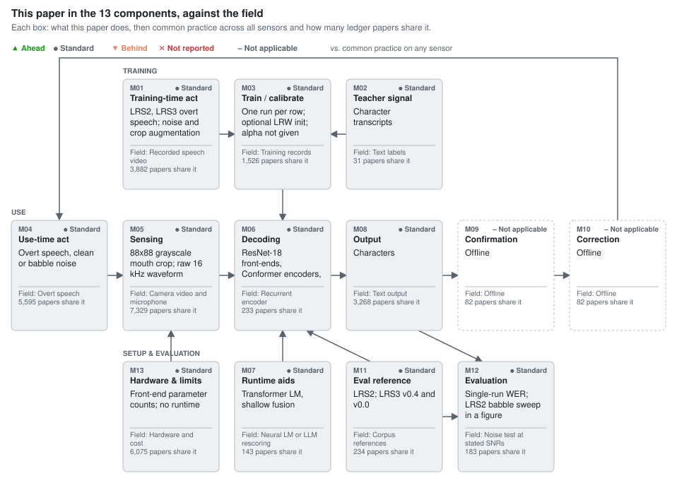

# End-to-End Audio-Visual Speech Recognition with Conformers

Pingchuan Ma, Stavros Petridis, Maja Pantic. IEEE ICASSP, 2021. [arXiv:2102.06657](https://arxiv.org/abs/2102.06657)

**Section:** [Other sensors](../../README.md#other-sensors)

## Figures

### This paper in the 13 components, against the field

<picture><source media="(prefers-color-scheme: dark)" srcset="figures/components-dark.svg"></picture>

Verdicts compare the paper's choice for each component with common practice across 8,995 ledger entries on any sensor (silent speech, brain-to-text, lip reading).

Data

| Component | This paper | Common practice | Papers with this practice | Verdict |
| --- | --- | --- | --- | --- |
| M01 Training-time act | LRS2, LRS3 overt speech; noise and crop augmentation | Recorded speech video | 3,882 of 8,995 | ● Standard (Inherited.) |
| M02 Teacher signal | Character transcripts | Text labels | 31 of 8,995 | ● Standard (Inherited (hybrid CTC/attention lineage).) |
| M03 Train / calibrate | One run per row; optional LRW init; alpha not given | Training records | 1,526 of 8,995 | ● Standard (No seeds; CTC weight alpha unstated.) |
| M04 Use-time act | Overt speech, clean or babble noise | Overt speech | 5,595 of 8,995 | ● Standard (Inherited.) |
| M05 Sensing | 88x88 grayscale mouth crop; raw 16 kHz waveform | Camera video and microphone | 7,329 of 8,995 | ● Standard (Inherited.) |
| M06 Decoding | ResNet-18 front-ends, Conformer encoders, MLP fusion, end-to-end | Recurrent encoder | 233 of 8,995 | ● Standard (No dated Conformer prior in the ledger; effect shown once, confounded with the decoder swap.) |
| M07 Runtime aids | Transformer LM, shallow fusion | Neural LM or LLM rescoring | 143 of 8,995 | ● Standard (Recurrent LMs in the deciding priors; gain measured on one visual-only row.) |
| M08 Output | Characters | Text output | 3,268 of 8,995 | ● Standard (Inherited.) |
| M09 Confirmation | Offline | Offline | 82 of 8,995 | – Not applicable (Offline study.) |
| M10 Correction | Offline | Offline | 82 of 8,995 | – Not applicable (Offline study.) |
| M11 Eval reference | LRS2; LRS3 v0.4 and v0.0 | Corpus references | 234 of 8,995 | ● Standard (v0.0 speaker overlap conceded by the authors.) |
| M12 Evaluation | Single-run WER; LRS2 babble sweep in a figure | Noise test at stated SNRs | 183 of 8,995 | ● Standard (Comparison rows mix data budgets and LRS3 test versions.) |
| M13 Hardware & limits | Front-end parameter counts; no runtime | Hardware and cost | 6,075 of 8,995 | ● Standard (Offline benchmark study.) |

## Verdict

The paper [[1]](#ref-1) changes the recognition back-end (M06: Conformer encoders trained jointly with ResNet-18 front-ends on raw pixels and waveforms) and the language model (M07: Transformer instead of recurrent). Both are standard. Raw-input end-to-end audio-visual training predates it [[2]](#ref-2), and the Conformer, absent from every dated ledger study before it (Appendix), is credited from one LRS2 visual-only ablation step that also swaps the decoder (Table 2). The recipe became a template: the same group's [later] revision cut LRS3 visual-only WER from 43.3% to 35.1% (best of ten runs) on the same 595 h by changing the recipe [[3]](#ref-3), and [later] Auto-AVSR reached 19.1% from 3,448 h [[4]](#ref-4), so both recipe and data moved the number (inference). The main overreach is crediting the Conformer while the largest measured step is end-to-end training (Table 2); no result reports repeated runs (§4).

## Against the field, component by component

### M06 Processing: Conformer encoder and raw-input end-to-end training

**Usual approach:** among 633 sentence-level lip-reading and AVSR studies (pattern match, unique studies), a recurrent encoder is named most often (233), then the Conformer (200), a Transformer encoder (125) and temporal convolution (123); AVSR audio inputs are usually filterbank or MFCC (182 of 349, pattern match).

**State of the art:** the best LRS3 visual-only WER is 12.8%, from the [later] LP Conformer on 100k h of non-public video (2024; 0.9% audio-visual) [[5]](#ref-5); the best audio-visual LRS3 WER is 0.76%, from [later] Whisper-Flamingo, initialised from Whisper (2024) [[6]](#ref-6).

None of the 200 Conformer matches is dated before February 2021, and the three deciding priors read use BLSTMs [[7]](#ref-7), a Transformer encoder on frozen visual features [[8]](#ref-8) and LSTMs [[9]](#ref-9) (Appendix). The `ahead` rule also needs the effect repeated across seeds, subjects or datasets, and it is not: the "+ Conformer encoder" step (46.2% to 42.4%, 8.2% relative (inference)) replaces encoder and decoder at once (§5), runs once, on LRS2 visual-only only (Table 2). The larger step is end-to-end training (63.5% to 50.9%, Table 2), shown earlier on LRW words [[2]](#ref-2). Raw waveform ties log-Mel filterbanks on clean LRS2 (4.3% each, Table 3) and leads by at most 7.5 points at -5 dB babble (Fig. 2). Verdict: standard.

### M07 Use-time language model: Transformer LM

**Usual approach:** a neural LM or LLM rescoring is the most common use-time design in the same population (143 of 633, against 28 n-gram and 21 explicit no-LM, pattern match; Appendix); the deciding priors decode with a character RNN-LM [[7]](#ref-7) or a 4-layer LSTM LM [[8]](#ref-8).

**State of the art:** [later] USR 2.0 reaches 17.6% LRS3 visual-only WER without an external LM (2026) [[10]](#ref-10)

The LM is credited with 4.5 points (42.4% to 37.9%, 10.6% relative (inference)) on LRS2 visual-only only, and Tables 3 and 4 do not mark which rows use it; the Table 2 end point equals the LRW-initialised Table 3 row (37.9%), so that row likely includes it (inference). The "6× fewer training data" comparison (§5) uses the LRS2-only 39.1% against TM-seq2seq's with-LM 48.3% [[8]](#ref-8), without stating the LM status of 39.1%. Verdict: standard.

### M12 Evaluation: comparison rows and noise protocol (incidental)

**Usual approach:** an additive-noise test at stated SNRs appears in 183 of 349 AVSR studies, babble noise in 128, run-to-run variability in 33 (pattern match; Appendix). The paper follows the majority.

**State of the art:** 0.76% LRS3 audio-visual WER (2024) [[6]](#ref-6); the closest prior, RNN-T, gives 95% confidence intervals for its YouTube test WERs [[9]](#ref-9), and the [later] revision reports ten-run means [[3]](#ref-3).

The RNN-T rows sit in the LRS3 v0.4 table (Table 4), yet RNN-T was scored on an LRS3-TED test set of 1,436 utterances [[9]](#ref-9), while the target's test has 1,321 (§2). The 2.5- and 2.2-point gains over RNN-T (4.8% and 4.5%) cross test-set versions. Verdict: standard.

## The 13 components

| Component | This paper | Usual approach (count) | State of the art | Verdict |
|---|---|---|---|---|
| M01 Training-time action | LRS2, LRS3 overt speech; noise and crop augmentation | Recorded speech video (slot-filled 3,882) | – | standard |
| M02 Training-only supervision | Character transcripts | Text labels (slot-filled 31) | – | standard |
| M03 Training and adaptation | One run per row; optional LRW init; alpha not given | Training records (slot-filled 1,526) | – | standard |
| M04 Use-time action | Overt speech, clean or babble noise | Overt speech (slot-filled 5,595) | – | standard |
| M05 Sensors | 88x88 grayscale mouth crop; raw 16 kHz waveform | Camera video and microphone (slot-filled 7,329) | – | standard |
| M06 Processing and decoding | ResNet-18 front-ends, Conformer encoders, MLP fusion, end-to-end | Recurrent encoder (pattern match 233) | [[5]](#ref-5) (2024): LRS3 VSR WER 12.8% | standard |
| M07 Lexicon and LM | Transformer LM, shallow fusion | Neural LM or LLM rescoring (pattern match 143) | [[10]](#ref-10) (2026): LRS3 VSR WER 17.6%, no external LM | standard |
| M08 Output | Characters | Text output (slot-filled 3,268) | – | standard |
| M09 Confirmation | Offline | Offline (slot-filled 82) | – | not applicable |
| M10 Correction | Offline | Offline (slot-filled 82) | – | not applicable |
| M11 Reference construction | LRS2; LRS3 v0.4 and v0.0 | Corpus references (slot-filled 234) | – | standard |
| M12 Evaluation | Single-run WER; LRS2 babble sweep in a figure | Noise test at stated SNRs (pattern match 183) | [[6]](#ref-6) (2024): LRS3 AVSR WER 0.76% | standard |
| M13 Device and cost | Front-end parameter counts; no runtime | Hardware and cost (slot-filled 6,075) | – | standard |

## Where the claims outrun the evidence

- "Outperforms other methods by a large margin while using fewer training data" (§5) is not scoped to public data, yet Table 4 lists RNN-T at 33.6% against 43.3%, a 29% relative WER deficit (inference); the 52× data remark (§5) is attached only to the audio-only and audio-visual rows.
- The claim that deep speech representations are more robust to noise than log-Mel features (§5) rests on one figure and one noise type also used in training (NOISEX babble, §4).
- The v0.0 rows (30.4%, 1.3%, 1.2%, Table 4) are called "new state-of-the-art" though the authors concede speaker overlap drives them (§5).
- LM use per row and the clean or noisy status of results are not stated (Table 3, Table 4).

## What the field needs next

- M06: separate encoder and decoder swaps on LRS2 and LRS3 at fixed data, with at least three seeds per row.
- M07: each LRS3 row with and without the external LM.
- M12: all comparison rows re-scored on one LRS3 test version with confidence intervals, as RNN-T did [[9]](#ref-9).

## Questions for the authors

- Which rows of Tables 3 and 4 use the Transformer LM, with what beam settings?
- What value of the training CTC weight alpha (Eq. 1) was used, given only the decoding weight 0.1 (§4)?
- On which LRS3 test version was the RNN-T comparison run?

## Appendix: literature search

- M06 / sentence-lipreading-encoder-architecture. Inclusion rule: sentence-level or open-vocabulary lip reading or AVSR studies (ledger names lip reading, VSR, AVSR or LRS2/LRS3 with sentence-level recognition), classified by the temporal encoder named in the full text; a study counts under every encoder it names; versions once. Ledger: 7,345 slot-filled; 633 pattern match (unique studies). Pattern counts: recurrent 233, Conformer 200, Transformer encoder 125, temporal convolution 123. Conformer matches dated before 2021-02: 0. Read in full: [[7]](#ref-7), [[8]](#ref-8), [[9]](#ref-9) (prior); [[5]](#ref-5), [[4]](#ref-4), [[3]](#ref-3) (state of the art and [later] comparators). Known-item recall 0.83.
- M06 / avsr-audio-stream-input-representation. Inclusion rule: studies whose ledger names AVSR, classified by audio input (raw waveform to a learned front-end, or filterbank/MFCC/spectrogram); a study counts under each it names; versions once. Ledger: 7,345 slot-filled; 349 pattern match (unique studies). Pattern counts: filterbank or MFCC 182, raw waveform 45. Read in full: [[2]](#ref-2), [[7]](#ref-7), [[9]](#ref-9) (prior); [[6]](#ref-6) (state of the art). Known-item recall 0.8.
- M07 / use-time-language-model-visual-speech (published table, reused). Inclusion rule: the same 633-study population, classified by use-time language information (n-gram LM, neural LM or LLM rescoring, explicit no external LM). Ledger: 119 slot-filled; 633 pattern match (unique studies). Usual: neural LM or LLM rescoring 143, n-gram LM 28, explicit no external LM 21 (pattern match). Read in full for this review: [[7]](#ref-7), [[8]](#ref-8) (prior); [[10]](#ref-10) (state of the art). Known-item recall 1.0.
- M12 / avsr-noise-and-run-variability-protocol. Inclusion rule: the 349-study AVSR population, classified by additive-noise test at stated SNRs, babble noise, and run variability (seeds, repeated runs, confidence intervals); a study counts under each it names. Ledger: 6,960 slot-filled; 349 pattern match (unique studies). Pattern counts: noise at stated SNR 183, babble 128, run variability 33. Read in full: [[9]](#ref-9), [[8]](#ref-8) (prior); [[6]](#ref-6) (state of the art).

## References

Numbered by first citation. BibTeX in the same order and keys: [refs.bib](refs.bib).

1. Ma, P., Petridis, S., Pantic, M. “End-to-End Audio-Visual Speech Recognition with Conformers.” *IEEE International Conference on Acoustics, Speech and Signal Processing (ICASSP)*, 2021, 7613-7617. doi:[10.48550/arXiv.2102.06657](https://doi.org/10.48550/arXiv.2102.06657). arXiv:[2102.06657](https://arxiv.org/abs/2102.06657). Target. Read as arXiv v1; venue and pages from the reference list of arXiv:2202.13084. [wiki: arxiv-2102.06657](https://github.com/supernaiter/deep-research-wiki-for-silent-speech/blob/main/papers/arxiv-2102.06657/article.md)
2. Petridis, S., Stafylakis, T., Ma, P., Cai, F., Tzimiropoulos, G., Pantic, M. “End-to-End Audiovisual Speech Recognition.” *Proc. IEEE ICASSP 2018*, 2018. doi:[10.1109/ICASSP.2018.8461326](https://doi.org/10.1109/ICASSP.2018.8461326). arXiv:[1802.06424](https://arxiv.org/abs/1802.06424). Prior; deciding prior for M06 (raw pixels and waveforms, LRW words). [wiki: arxiv-1802.06424](https://github.com/supernaiter/deep-research-wiki-for-silent-speech/blob/main/papers/arxiv-1802.06424/article.md)
3. Ma, P., Petridis, S., Pantic, M. “Visual Speech Recognition for Multiple Languages in the Wild.” *Nature Machine Intelligence*, 2022, 930-939. doi:[10.1038/s42256-022-00550-z](https://doi.org/10.1038/s42256-022-00550-z). arXiv:[2202.13084](https://arxiv.org/abs/2202.13084). [later]; same group's revision of the target recipe (ten-run means). Read as arXiv v2. [later] [review](https://github.com/supernaiter/silent-speech-review/tree/main/reviews/visual-speech-recognition-for-multiple-languages-in-the-wild) [wiki: arxiv-2202.13084](https://github.com/supernaiter/deep-research-wiki-for-silent-speech/blob/main/papers/arxiv-2202.13084/article.md) [wiki: doi-10.1038-s42256-022-00550-z](https://github.com/supernaiter/deep-research-wiki-for-silent-speech/blob/main/papers/doi-10.1038-s42256-022-00550-z/article.md)
4. Ma, P., Haliassos, A., Fernandez-Lopez, A., Chen, H., Petridis, S., Pantic, M. “Auto-AVSR: Audio-Visual Speech Recognition with Automatic Labels.” *IEEE International Conference on Acoustics, Speech and Signal Processing (ICASSP)*, 2023. doi:[10.1109/ICASSP49357.2023.10096889](https://doi.org/10.1109/ICASSP49357.2023.10096889). arXiv:[2303.14307](https://arxiv.org/abs/2303.14307). [later]; same group, same Conformer recipe at 3,448 h. [later] [review](https://github.com/supernaiter/silent-speech-review/tree/main/reviews/auto-avsr-audio-visual-speech-recognition-with-automatic-labels) [wiki: arxiv-2303.14307](https://github.com/supernaiter/deep-research-wiki-for-silent-speech/blob/main/papers/arxiv-2303.14307/article.md)
5. Chang, O., Liao, H., Serdyuk, D., Shah, A., Siohan, O. “Conformers are All You Need for Visual Speech Recognition.” *IEEE International Conference on Acoustics, Speech and Signal Processing (ICASSP)*, 2024, 10136-10140. arXiv:[2302.10915](https://arxiv.org/abs/2302.10915). [later]; best LRS3 visual-only WER (non-public data). [later] [wiki: arxiv-2302.10915](https://github.com/supernaiter/deep-research-wiki-for-silent-speech/blob/main/papers/arxiv-2302.10915/article.md)
6. Rouditchenko, A., Gong, Y., Thomas, S., Karlinsky, L., Kuehne, H., Feris, R., et al. “Whisper-Flamingo: Integrating Visual Features into Whisper for Audio-Visual Speech Recognition and Translation.” *Interspeech 2024*, 2024. arXiv:[2406.10082](https://arxiv.org/abs/2406.10082). [later]; LRS3 AVSR state of the art. [later] [wiki: arxiv-2406.10082](https://github.com/supernaiter/deep-research-wiki-for-silent-speech/blob/main/papers/arxiv-2406.10082/article.md) [wiki: isca-rouditchenko24-whisperflamingo](https://github.com/supernaiter/deep-research-wiki-for-silent-speech/blob/main/papers/isca-rouditchenko24-whisperflamingo/article.md) [wiki: in24-whisperflamingo](https://github.com/supernaiter/deep-research-wiki-for-silent-speech/blob/main/papers/in24-whisperflamingo/article.md) [wiki: isca-rouditchenko24_interspeech](https://github.com/supernaiter/deep-research-wiki-for-silent-speech/blob/main/papers/isca-rouditchenko24_interspeech/article.md)
7. Petridis, S., Stafylakis, T., Ma, P., Tzimiropoulos, G., Pantic, M. “Audio-Visual Speech Recognition with a Hybrid CTC/Attention Architecture.” *Proc. IEEE Spoken Language Technology Workshop (SLT)*, 2018. doi:[10.1109/SLT.2018.8639643](https://doi.org/10.1109/SLT.2018.8639643). arXiv:[1810.00108](https://arxiv.org/abs/1810.00108). Prior; the target's baseline lineage (BLSTM encoder, RNN-LM). [wiki: arxiv-1810.00108](https://github.com/supernaiter/deep-research-wiki-for-silent-speech/blob/main/papers/arxiv-1810.00108/article.md) [wiki: doi-10.1109-slt.2018.8639643](https://github.com/supernaiter/deep-research-wiki-for-silent-speech/blob/main/papers/doi-10.1109-slt.2018.8639643/article.md)
8. Afouras, T., Chung, J. S., Senior, A., Vinyals, O., Zisserman, A. “Deep Audio-Visual Speech Recognition.” *IEEE Transactions on Pattern Analysis and Machine Intelligence*, 2018. doi:[10.1109/TPAMI.2018.2889052](https://doi.org/10.1109/TPAMI.2018.2889052). arXiv:[1809.02108](https://arxiv.org/abs/1809.02108). Prior; Transformer encoder on frozen visual features, LSTM language model. [review](https://github.com/supernaiter/silent-speech-review/tree/main/reviews/deep-audio-visual-speech-recognition) [wiki: arxiv-1809.02108](https://github.com/supernaiter/deep-research-wiki-for-silent-speech/blob/main/papers/arxiv-1809.02108/article.md) [wiki: doi-10.1109-tpami.2018.2889052](https://github.com/supernaiter/deep-research-wiki-for-silent-speech/blob/main/papers/doi-10.1109-tpami.2018.2889052/article.md)
9. Makino, T., Liao, H., Assael, Y., Shillingford, B., Garcia, B., Braga, O., et al. “Recurrent Neural Network Transducer for Audio-Visual Speech Recognition.” *IEEE Automatic Speech Recognition and Understanding Workshop (ASRU)*, 2019. doi:[10.1109/ASRU46091.2019.9004036](https://doi.org/10.1109/ASRU46091.2019.9004036). arXiv:[1911.04890](https://arxiv.org/abs/1911.04890). Prior; LSTM RNN-T on 31k h YouTube, LRS3 comparison row. [wiki: arxiv-1911.04890](https://github.com/supernaiter/deep-research-wiki-for-silent-speech/blob/main/papers/arxiv-1911.04890/article.md) [wiki: doi-10.1109-asru46091.2019.9004036](https://github.com/supernaiter/deep-research-wiki-for-silent-speech/blob/main/papers/doi-10.1109-asru46091.2019.9004036/article.md)
10. Haliassos, A., Mira, R., Petridis, S. “Pay Attention to CTC: Fast and Robust Pseudo-Labelling for Unified Speech Recognition.” *International Conference on Learning Representations (ICLR)*, 2026. arXiv:[2602.19316](https://arxiv.org/abs/2602.19316). [later]; LRS3 VSR without an external language model. [later] [wiki: arxiv-2602.19316](https://github.com/supernaiter/deep-research-wiki-for-silent-speech/blob/main/papers/arxiv-2602.19316/article.md)

## Materials

Data behind this review. Full texts of the papers are not included.

- [`review.md`](review.md): the review text (source)
- [`refs.bib`](refs.bib): references (BibTeX)
- [`slots.json`](slots.json): for each of the 13 components: this paper's choice, field practice, number of matching papers, verdict
- [`figures.json`](figures.json): figure definitions
- [`evaluation.md`](evaluation.md): independent evaluation by a second reviewer
- [`triage.md`](triage.md): how each evaluation finding was checked against the sources and resolved
- [`process/log.json`](process/log.json): process record: each step, who did it (reader, script, writer, evaluator), when, the checks run and the input versions
- [`process/notes.json`](process/notes.json): reading notes on the target and comparator papers: claims, numbers, conditions and what is not stated, with locations
- [`process/plan.json`](process/plan.json): plan: which components the paper changes and the topics it is compared on
- [`process/draft.md`](process/draft.md): the review as first written, before the independent evaluation
- [`process/claims-draft.md`](process/claims-draft.md): claim table of the draft: every claim mapped to a note or a count
- [`process/claims.md`](process/claims.md): claim table of the published review
- [`components/M06/avsr-audio-stream-input-representation.csv`](../../components/M06/avsr-audio-stream-input-representation.csv): M06 topic "avsr-audio-stream-input-representation", every candidate paper with its decision (7345 slot-filled, 349 pattern match, usual design in 182, 4 read in full)
- [`components/M06/sentence-lipreading-encoder-architecture.csv`](../../components/M06/sentence-lipreading-encoder-architecture.csv): M06 topic "sentence-lipreading-encoder-architecture", every candidate paper with its decision (7345 slot-filled, 633 pattern match, usual design in 233, 6 read in full)
- [`components/M07/use-time-language-model-visual-speech.csv`](../../components/M07/use-time-language-model-visual-speech.csv): M07 topic "use-time-language-model-visual-speech", every candidate paper with its decision (119 slot-filled, 633 pattern match, usual design in 143, 4 read in full)
- [`components/M12/avsr-noise-and-run-variability-protocol.csv`](../../components/M12/avsr-noise-and-run-variability-protocol.csv): M12 topic "avsr-noise-and-run-variability-protocol", every candidate paper with its decision (6960 slot-filled, 349 pattern match, usual design in 183, 3 read in full)

## More reviews in Other sensors

- [Real-time synthesis of imagined speech processes from minimally invasive recordings of neural activity](../real-time-synthesis-of-imagined-speech-processes-from-minimally-invasive-recordings-of-neural-activi/) (2021). Closed-loop sEEG word synthesis (M06) and audible-to-imagined transfer (M04) are standard; one participant; imagined output gets no word-content test (M12 behind Martin 2014).
- [Imagined speech can be decoded from low- and cross-frequency intracranial EEG features](../imagined-speech-can-be-decoded-from-low-and-cross-frequency-intracranial-eeg-features/) (2022). Adds low-frequency power (precedent: Pei 2011, Ikeda 2014) and phase-amplitude coupling (new) to imagined-speech ECoG decoding (M06); CFC effect unshown: 12 of 144 uncorrected tests.
- [Robust Self-Supervised Audio-Visual Speech Recognition](../robust-self-supervised-audio-visual-speech-recognition/) (2022). Noise-augmented self-supervised AVSR training (M03) was new in 2022 but rests on one test set with no run count; the 49.6% babble gain mixes data and model size with pre-training.
- [Lipreading using Temporal Convolutional Networks](../lipreading-using-temporal-convolutional-networks/) (2020). Multi-scale TCN (M06) and variable-length cropping (M03) are standard: head and augmentation are not separated, no run counts, robustness comes from the cropping; 85.3% LRW trails 93.2% today.
- [Machine translation of cortical activity to text with an encoder-decoder framework](../machine-translation-of-cortical-activity-to-text-with-an-encoder-decoder-framework/) (2020). Word-level ECoG encoder-decoder; all changed components standard. 3% WER is on repeats of 50 sentences; unseen sentences and participants were never tested.
- [Semantic reconstruction of continuous language from non-invasive brain recordings](../semantic-reconstruction-of-continuous-language-from-non-invasive-brain-recordings/) (2023). LM candidates scored by encoding-model likelihood (M06) were ahead in 2022, as the authors claim; the scorer is now overtaken. GPT prior (M07) is standard; one pilot-touched test story limits M12.

---

Part of the [Silent Speech Interface Review](https://github.com/supernaiter/silent-speech-review). Found an error? [Open an issue](https://github.com/supernaiter/silent-speech-review/issues/new?template=correction.yml).
