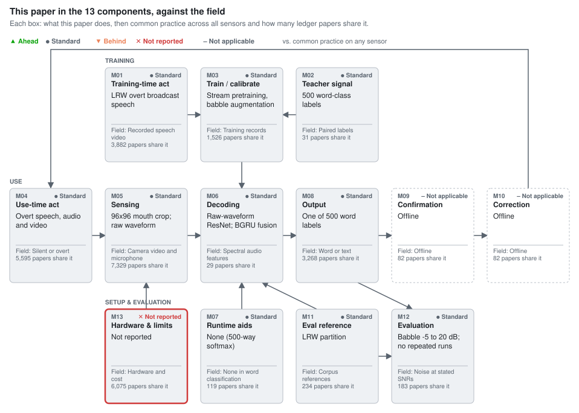

# End-to-End Audiovisual Speech Recognition

Petridis, S., Stafylakis, T., Ma, P., Cai, F., Tzimiropoulos, G., Pantic, M. · IEEE ICASSP · 2018 · [doi:10.1109/ICASSP.2018.8461326](https://doi.org/10.1109/ICASSP.2018.8461326) · [arXiv:1802.06424](https://arxiv.org/abs/1802.06424)

**Section:** [Other sensors](../../README.md#other-sensors)

## Figures

### This paper in the 13 components, against the field

<picture><source media="(prefers-color-scheme: dark)" srcset="figures/components-dark.svg"></picture>

Verdicts compare the paper's choice for each component with common practice across 8,995 ledger entries on any sensor (silent speech, brain-to-text, lip reading).

Data

| Component | This paper | Common practice | Papers with this practice | Verdict |
| --- | --- | --- | --- | --- |
| M01 Training-time act | LRW overt broadcast speech | Recorded speech video | 3,882 of 8,995 | ● Standard (Inherited.) |
| M02 Teacher signal | 500 word-class labels | Paired labels | 31 of 8,995 | ● Standard (Inherited (LRW labels).) |
| M03 Train / calibrate | Stream pretraining, babble augmentation | Training records | 1,526 of 8,995 | ● Standard (One run; seeds not stated.) |
| M04 Use-time act | Overt speech, audio and video | Silent or overt | 5,595 of 8,995 | ● Standard (Inherited.) |
| M05 Sensing | 96x96 mouth crop; raw waveform | Camera video and microphone | 7,329 of 8,995 | ● Standard (Inherited.) |
| M06 Decoding | Raw-waveform ResNet; BGRU fusion | Spectral audio features | 29 of 8,995 | ● Standard (Departure without repetition; ties MFCC in clean audio; no fusion baseline.) |
| M07 Runtime aids | None (500-way softmax) | None in word classification | 119 of 8,995 | ● Standard (Inherited.) |
| M08 Output | One of 500 word labels | Word or text | 3,268 of 8,995 | ● Standard (Sentences left to future work.) |
| M09 Confirmation | Offline | Offline | 82 of 8,995 | – Not applicable (Offline study.) |
| M10 Correction | Offline | Offline | 82 of 8,995 | – Not applicable (Offline study.) |
| M11 Eval reference | LRW partition | Corpus references | 234 of 8,995 | ● Standard (Speaker overlap not stated.) |
| M12 Evaluation | Babble -5 to 20 dB; no repeated runs | Noise at stated SNRs | 183 of 8,995 | ● Standard (Same noise in training and test; no variance.) |
| M13 Hardware & limits | Not reported | Hardware and cost | 6,075 of 8,995 | ✕ Not reported (Training effort called higher (§5), not quantified.) |

## Verdict

The paper [[1]](#ref-1) changes processing (M06): an 18-layer 1D ResNet on the raw waveform replaces spectral audio features, joined to a raw-pixel visual ResNet by concatenation and a two-layer BGRU, trained jointly. The raw-waveform input departs from the usual approach: both LRW audio-visual studies dated before it use spectral features, and 17 later ones inherit the raw waveform (pattern match, Appendix). The verdict is still standard, because the paper shows the departure without repeated runs or a second dataset and it ties a 2-layer MFCC BGRU in clean audio (97.7% each, Table 1); its noise margin is measured against a baseline with no convolutional front end and a longer schedule (§5), so representation, depth and training length change together. The best LRW audio-visual result in the ledger, 98.76% [[2]](#ref-2), uses log-Mel input. The audio-visual gain under noise holds in direction, but no repeated runs are reported, the same babble noise type and SNR range in training and test (§4.3, §5) and no fusion alternative; "significantly outperforms" (Abstract) has no test behind it. Evaluation (M12) is standard for AVSR.

## Against the field, component by component

### M06 Processing: raw-waveform audio front end and BGRU fusion

**Usual approach:** Of 44 LRW audio-visual studies (pattern match, Appendix), 29 name spectral audio features and 18 a raw waveform, counting related-work mentions (upper bound); the two dated before February 2018 both use spectral features, and the other 17 raw-waveform matches are later, among them the same group's Conformer [[3]](#ref-3) (Appendix). Across 349 AVSR studies the split is 182 against 45 (pattern match, Appendix). The paper learns the audio front end from the waveform (§3.2) and fuses by concatenation plus a BGRU (§3.3), a design named by 4 of the 44, this paper and three [later] ones (Appendix).

**State of the art:** Ryumin et al. ([later], 2023) reach 98.76% LRW test accuracy, the best in the ledger, with log-Mel audio (Table 9) [[2]](#ref-2), against 98.0% here: 1.24% against 2.0% errors, 38% fewer (inference). Sentence-level AVSR reaches 0.76% LRS3 WER from Whisper's log-Mel input with 1,759 h of training data ([later], 2024) [[4]](#ref-4).

In the paper the MFCC system is a 2-layer BGRU trained longer (§5), the raw stream adds an 18-layer ResNet (§3.2), and the authors concede the end-to-end system takes "significantly higher" training effort (§5). The two separate only at 5 dB and below (0.9, 3.5 and 7.5 points at 5, 0 and -5 dB, §5). The [later] same-group Conformer study is the closer control: log-Mel input gives the same audio-only LRS2 WER as raw audio, 4.3%, and raw audio leads by at most 7.5 points at -5 dB babble [[3]](#ref-3), a second dataset but again babble only. The cross-paper numbers suggest the same: the 2023 system's log-Mel audio-only ResNet scores 96.07%, below the 97.7% raw stream here, while its visual model scores 87.16% against 82.0% (inference) [[2]](#ref-2). Fusion has no baseline: the [later] study by Stafylakis et al. finds late integration better than its best intermediate variant (1.90% against 2.20% MCR, audio-only 6.90%, Table 8), under DEMAND noise at -10 to 20 dB with word boundaries given [[5]](#ref-5). Verdict: standard. A departure without repetition across seeds, subjects or datasets, tying the baseline in clean audio, is standard, not ahead.

### M12 Evaluation: babble-noise sweep and run variability

**Usual approach:** Of 349 AVSR studies (pattern match, Appendix), 183 test additive noise at stated SNRs, 128 name babble and 33 report run-to-run variability. The paper follows the majority: NOISEX babble at -5 to 20 dB (§5), no repeated runs or variance reported.

**State of the art:** Stafylakis et al. ([later], 2018) train on 4 of 6 DEMAND noise categories, test on all 6 and score every network on fixed noisy files [[5]](#ref-5); Makino et al. ([later], 2019) give 95% confidence intervals [[6]](#ref-6).

Training adds babble at -5 to 20 dB or keeps clean audio (§4.3), and the test uses babble over the same range (§5), so the sweep measures robustness to noise seen in training. The 14.1-point audio-visual gain at -5 dB (§5) is too large to be run-to-run variation (inference); the clean gain of 0.3 points (13% fewer errors, inference) has no test or repeated run behind it. Verdict: standard.

## The 13 components

| Component | This paper | Usual approach (count) | State of the art | Verdict |
|---|---|---|---|---|
| M01 Training-time action | LRW overt broadcast speech | Recorded speech video (slot-filled 3,882) | – | standard |
| M02 Training-only supervision | 500 word-class labels | Paired labels (slot-filled 31) | – | standard |
| M03 Training and adaptation | Stream pretraining, babble augmentation | Training records (slot-filled 1,526) | – | standard |
| M04 Use-time action | Overt speech, audio and video | Silent or overt (slot-filled 5,595) | – | standard |
| M05 Sensors | 96x96 mouth crop; raw waveform | Camera video and microphone (slot-filled 7,329) | – | standard |
| M06 Processing and decoding | Raw-waveform ResNet; BGRU fusion | Spectral audio features (pattern match 29) | [[2]](#ref-2) (2023): LRW AV 98.76% (ledger best) | standard |
| M07 Lexicon and LM | None (500-way softmax) | None in word classification (slot-filled 119) | – | standard |
| M08 Output | One of 500 word labels | Word or text (slot-filled 3,268) | – | standard |
| M09 Confirmation | Offline | Offline (slot-filled 82) | – | not applicable |
| M10 Correction | Offline | Offline (slot-filled 82) | – | not applicable |
| M11 Reference construction | LRW partition | Corpus references (slot-filled 234) | – | standard |
| M12 Evaluation | Babble -5 to 20 dB; no repeated runs | Noise at stated SNRs (pattern match 183) | [[5]](#ref-5) (2018): 4 of 6 noise types trained | standard |
| M13 Device and cost | Not reported | Hardware and cost (slot-filled 6,075) | – | not reported |

## Where the claims outrun the evidence

- "State-of-the-art performance for audiovisual fusion" (§1): no earlier audio-visual LRW result existed and the authors built their own MFCC baseline (§5), so the model is compared with itself.
- "Similar performance to MFCCs which is a significant result" (§5): a deep front end ties a 2-layer BGRU (M06); not worse is not better.
- The visual stream scores 82.0% against 83.0% for its lineage's landmark-ROI ResNet (Table 1); the ROI difference is named, not tested.

## What the field needs next

- M06: raw waveform against log-Mel through the same front end and back end, at equal size, across seeds [[3]](#ref-3).
- M06: a late-integration baseline beside every intermediate-fusion claim [[5]](#ref-5).
- M12: noise types held out of training, fixed noisy test files, confidence intervals over runs [[5]](#ref-5), [[6]](#ref-6).
- M08: sentences instead of 500 word labels, the authors' own next step (§6).

## Questions for the authors

- Which partition do Table 1 and Fig. 3 report, and do test speakers appear in training?
- How many runs and seeds stand behind each number?
- Does the noisy test reuse babble segments seen in training?

## Appendix: literature search

- M06 / lrw-audiovisual-word-recognition. Inclusion rule: studies whose ledger names both the English LRW benchmark and audio-visual recognition, classified by audio input (raw waveform or spectral features) and fusion design (concatenation plus recurrent fusion, attention or Transformer, pre-trained front end); LRW-1000 and other-language variants excluded; a study counts under every design its text names, related-work mentions included (upper bound); versions once. Ledger: 7,345 slot-filled; 44 pattern match (unique studies). Pattern counts: attention or Transformer 32, spectral audio features 29, raw waveform 18, pre-trained self-supervised or ASR front end 17, concatenation plus recurrent fusion 4. Dated before 2018-02: 2 studies, both spectral features; raw waveform 0; the other 17 raw-waveform matches are later. Usual design: spectral audio features, 29 (pattern match). Read in full: [[2]](#ref-2) (state of the art), [[5]](#ref-5), [[3]](#ref-3). Known-item recall 1.0 (4 of 4).
- M06 / avsr-audio-stream-input-representation (published table, reused). Inclusion rule: studies whose ledger names AVSR, classified by audio-stream input (raw waveform to a learned front end, or filterbank, MFCC or spectrogram); a study counts under each it names; versions once. Ledger: 7,345 slot-filled; 349 pattern match (unique studies). Pattern counts: spectral features 182, raw waveform 45. Usual design: spectral features, 182 (pattern match). State of the art: [[4]](#ref-4). Added read: [[3]](#ref-3). Known-item recall 0.8.
- M12 / avsr-noise-and-run-variability-protocol (published table, reused). Inclusion rule: the same 349 AVSR studies, classified by the evaluation protocol their full text names: additive noise at stated SNRs, babble noise, run-to-run variability; a study counts under every protocol it names (upper bound); versions once. Ledger: 6,960 slot-filled; 349 pattern match (unique studies). Pattern counts: additive noise at stated SNRs 183, babble noise 128, run variability 33. Usual design: additive-noise test without run variability, 183 (pattern match). Read in full: [[6]](#ref-6), [[5]](#ref-5).

## References

Numbered by first citation. BibTeX in the same order and keys: [refs.bib](refs.bib).

1. Petridis, S., Stafylakis, T., Ma, P., Cai, F., Tzimiropoulos, G., Pantic, M. “End-to-End Audiovisual Speech Recognition.” *IEEE International Conference on Acoustics, Speech and Signal Processing (ICASSP)*, 2018. doi:[10.1109/ICASSP.2018.8461326](https://doi.org/10.1109/ICASSP.2018.8461326). arXiv:[1802.06424](https://arxiv.org/abs/1802.06424). Target. Read as arXiv v2. [wiki: arxiv-1802.06424](https://github.com/supernaiter/deep-research-wiki-for-silent-speech/blob/main/papers/arxiv-1802.06424/article.md)
2. Ryumin, D., Ivanko, D., Ryumina, E. “Audio-Visual Speech and Gesture Recognition by Sensors of Mobile Devices.” *Sensors*, 2023, 23(4), 2284. doi:[10.3390/s23042284](https://doi.org/10.3390/s23042284). Best LRW audio-visual accuracy in the ledger (log-Mel audio). [later] [wiki: pmc-9967234-mobavsr](https://github.com/supernaiter/deep-research-wiki-for-silent-speech/blob/main/papers/pmc-9967234-mobavsr/article.md) [wiki: doi-10.3390-s23042284](https://github.com/supernaiter/deep-research-wiki-for-silent-speech/blob/main/papers/doi-10.3390-s23042284/article.md) [wiki: pmc-9967234-mobileav](https://github.com/supernaiter/deep-research-wiki-for-silent-speech/blob/main/papers/pmc-9967234-mobileav/article.md) [wiki: pmc-9967234-mobileavsr](https://github.com/supernaiter/deep-research-wiki-for-silent-speech/blob/main/papers/pmc-9967234-mobileavsr/article.md)
3. Ma, P., Petridis, S., Pantic, M. “End-to-End Audio-Visual Speech Recognition with Conformers.” *IEEE International Conference on Acoustics, Speech and Signal Processing (ICASSP)*, 2021, 7613-7617. doi:[10.1109/ICASSP39728.2021.9413459](https://doi.org/10.1109/ICASSP39728.2021.9413459). arXiv:[2102.06657](https://arxiv.org/abs/2102.06657). Same group, raw waveform against log-Mel on LRS2. DOI from the wiki manifest. [later] [review](https://github.com/supernaiter/silent-speech-review/tree/main/reviews/end-to-end-audio-visual-speech-recognition-with-conformers) [wiki: arxiv-2102.06657](https://github.com/supernaiter/deep-research-wiki-for-silent-speech/blob/main/papers/arxiv-2102.06657/article.md)
4. Rouditchenko, A., Gong, Y., Thomas, S., Karlinsky, L., Kuehne, H., Feris, R., et al. “Whisper-Flamingo: Integrating Visual Features into Whisper for Audio-Visual Speech Recognition and Translation.” *Interspeech 2024*, 2024. arXiv:[2406.10082](https://arxiv.org/abs/2406.10082). LRS3 AVSR state of the art. [later] [wiki: arxiv-2406.10082](https://github.com/supernaiter/deep-research-wiki-for-silent-speech/blob/main/papers/arxiv-2406.10082/article.md) [wiki: isca-rouditchenko24-whisperflamingo](https://github.com/supernaiter/deep-research-wiki-for-silent-speech/blob/main/papers/isca-rouditchenko24-whisperflamingo/article.md) [wiki: in24-whisperflamingo](https://github.com/supernaiter/deep-research-wiki-for-silent-speech/blob/main/papers/in24-whisperflamingo/article.md) [wiki: isca-rouditchenko24_interspeech](https://github.com/supernaiter/deep-research-wiki-for-silent-speech/blob/main/papers/isca-rouditchenko24_interspeech/article.md)
5. Stafylakis, T., Khan, M. H., Tzimiropoulos, G. “Pushing the boundaries of audiovisual word recognition using Residual Networks and LSTMs.” *Computer Vision and Image Understanding*, 2018. arXiv:[1811.01194](https://arxiv.org/abs/1811.01194). LRW audio-visual words with held-out noise categories and late integration. Read as arXiv v1. [later] [wiki: arxiv-1811.01194](https://github.com/supernaiter/deep-research-wiki-for-silent-speech/blob/main/papers/arxiv-1811.01194/article.md)
6. Makino, T., Liao, H., Assael, Y., Shillingford, B., Garcia, B., Braga, O., et al. “Recurrent Neural Network Transducer for Audio-Visual Speech Recognition.” *IEEE Automatic Speech Recognition and Understanding Workshop (ASRU)*, 2019. doi:[10.1109/ASRU46091.2019.9004036](https://doi.org/10.1109/ASRU46091.2019.9004036). arXiv:[1911.04890](https://arxiv.org/abs/1911.04890). AVSR with 95% confidence intervals. [later] [wiki: arxiv-1911.04890](https://github.com/supernaiter/deep-research-wiki-for-silent-speech/blob/main/papers/arxiv-1911.04890/article.md) [wiki: doi-10.1109-asru46091.2019.9004036](https://github.com/supernaiter/deep-research-wiki-for-silent-speech/blob/main/papers/doi-10.1109-asru46091.2019.9004036/article.md)

## Materials

Data behind this review. Full texts of the papers are not included.

- [`review.md`](review.md): the review text (source)
- [`refs.bib`](refs.bib): references (BibTeX)
- [`slots.json`](slots.json): for each of the 13 components: this paper's choice, field practice, number of matching papers, verdict
- [`figures.json`](figures.json): figure definitions
- [`evaluation.md`](evaluation.md): independent evaluation by a second reviewer
- [`triage.md`](triage.md): how each evaluation finding was checked against the sources and resolved
- [`process/log.json`](process/log.json): process record: each step, who did it (reader, script, writer, evaluator), when, the checks run and the input versions
- [`process/notes.json`](process/notes.json): reading notes on the target and comparator papers: claims, numbers, conditions and what is not stated, with locations
- [`process/plan.json`](process/plan.json): plan: which components the paper changes and the topics it is compared on
- [`process/draft.md`](process/draft.md): the review as first written, before the independent evaluation
- [`process/claims-draft.md`](process/claims-draft.md): claim table of the draft: every claim mapped to a note or a count
- [`process/claims.md`](process/claims.md): claim table of the published review
- [`components/M06/avsr-audio-stream-input-representation.csv`](../../components/M06/avsr-audio-stream-input-representation.csv): M06 topic "avsr-audio-stream-input-representation", every candidate paper with its decision (7345 slot-filled, 349 pattern match, usual design in 182, 4 read in full)
- [`components/M06/lrw-audiovisual-word-recognition.csv`](../../components/M06/lrw-audiovisual-word-recognition.csv): M06 topic "lrw-audiovisual-word-recognition", every candidate paper with its decision (7345 slot-filled, 44 pattern match, usual design in 29, 3 read in full)
- [`components/M12/avsr-noise-and-run-variability-protocol.csv`](../../components/M12/avsr-noise-and-run-variability-protocol.csv): M12 topic "avsr-noise-and-run-variability-protocol", every candidate paper with its decision (6960 slot-filled, 349 pattern match, usual design in 183, 3 read in full)

## More reviews in Other sensors

- [Audio-Visual Speech Recognition with a Hybrid CTC/Attention Architecture](../audio-visual-speech-recognition-with-a-hybrid-ctc-attention-architecture/) (2018). No earlier sentence-level AVSR study in the ledger trains hybrid CTC/attention (0 of 32), but no CTC- or attention-only result, LRW under the no-external-data claim, one run: standard.
- [Inferring imagined speech using EEG signals: a new approach using Riemannian manifold features](../inferring-imagined-speech-using-eeg-signals-a-new-approach-using-riemannian-manifold-features/) (2018). Covariance tangent-space + RVM (M06) is new to imagined-speech EEG but beats only at-chance baselines; evaluation is behind: no test against chance, which 3 of 7 priors ran.
- [Real-time decoding of question-and-answer speech dialogue using human cortical activity](../real-time-decoding-of-question-and-answer-speech-dialogue-using-human-cortical-activity/) (2019). Context prior from the decoded question (M07) is ahead, gaining in 3 of 3 participants; HMM decoder (M06) is standard; no online accuracy or latency backs the real-time claim.
- [Recurrent Neural Network Transducer for Audio-Visual Speech Recognition](../recurrent-neural-network-transducer-for-audio-visual-speech-recognition/) (2019). First neural transducer for audio-visual speech in the ledger, but the LRS3 gain mixes 31k h of data, external-LM baselines and the decoder; one run, one test set: all changes standard.
- [Speech Synthesis from ECoG using Densely Connected 3D Convolutional Neural Networks](../speech-synthesis-from-ecog-using-densely-connected-3d-convolutional-neural-networks/) (2019). 3D DenseNet regressor (M06) and LJ-Speech WaveNet (M08) are standard: no in-paper baseline, mixed later head-to-heads, and no listener test behind the quality claims.
- [Towards reconstructing intelligible speech from the human auditory cortex](../towards-reconstructing-intelligible-speech-from-the-human-auditory-cortex/) (2019). M06 ahead for heard speech: a pretrained autoencoder code of vocoder parameters beats spectrograms in all five patients; synthesizer decoding dates to 2009; M12 listener test unrepeated.

---

Part of the [Silent Speech Interface Review](https://github.com/supernaiter/silent-speech-review). Found an error? [Open an issue](https://github.com/supernaiter/silent-speech-review/issues/new?template=correction.yml).
