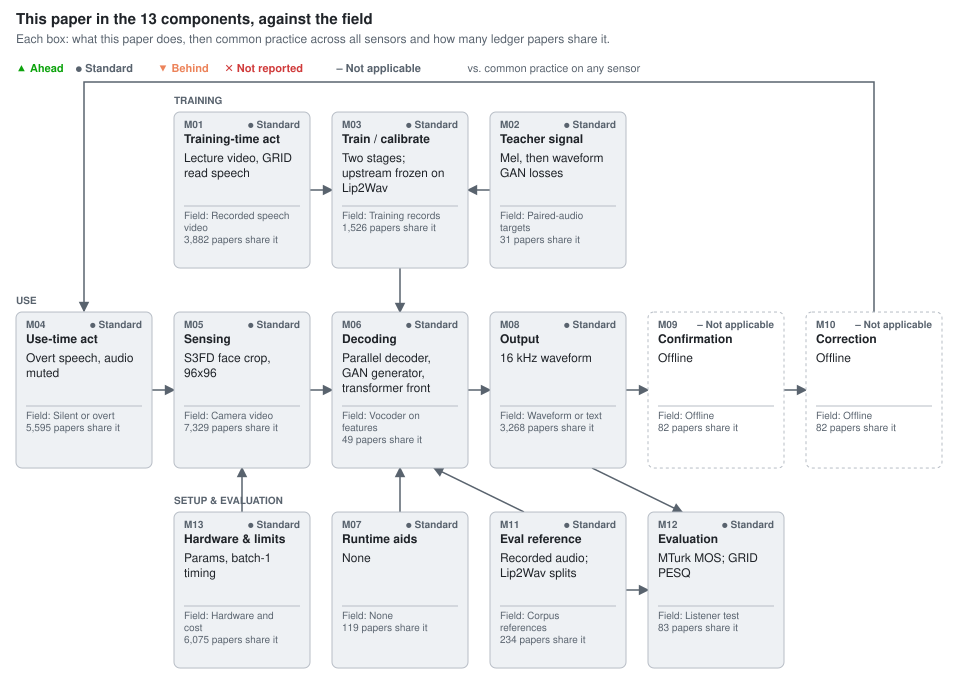

# FastLTS: Non-Autoregressive End-to-End Unconstrained Lip-to-Speech Synthesis

Wang, Y., Zhao, Z. · ACM Multimedia (MM '22) · 2022 · [DOI:10.1145/3503161.3548194](https://doi.org/10.1145/3503161.3548194) · [arXiv:2207.03800](https://arxiv.org/abs/2207.03800)

**Section:** [Lip & face video](../../README.md#lip--face-video)

## Figures

### This paper in the 13 components, against the field

<picture><source media="(prefers-color-scheme: dark)" srcset="figures/components-dark.svg"></picture>

Verdicts compare the paper's choice for each component with common practice across 8,995 ledger entries on any sensor (silent speech, brain-to-text, lip reading).

Data

| Component | This paper | Common practice | Papers with this practice | Verdict |
| --- | --- | --- | --- | --- |
| M01 Training-time act | Lecture video, GRID read speech | Recorded speech video | 3,882 of 8,995 | ● Standard (Inherited (Lip2Wav, GRID).) |
| M02 Teacher signal | Mel, then waveform GAN losses | Paired-audio targets | 31 of 8,995 | ● Standard (Inherited HiFi-GAN losses.) |
| M03 Train / calibrate | Two stages; upstream frozen on Lip2Wav | Training records | 1,526 of 8,995 | ● Standard (Regime differs by corpus; no seeds.) |
| M04 Use-time act | Overt speech, audio muted | Silent or overt | 5,595 of 8,995 | ● Standard (Inherited.) |
| M05 Sensing | S3FD face crop, 96x96 | Camera video | 7,329 of 8,995 | ● Standard (Inherited.) |
| M06 Decoding | Parallel decoder, GAN generator, transformer front end | Vocoder on features | 49 of 8,995 | ● Standard (End-to-end and transformer front ends predate it.) |
| M07 Runtime aids | None | None | 119 of 8,995 | ● Standard (Inherited.) |
| M08 Output | 16 kHz waveform | Waveform or text | 3,268 of 8,995 | ● Standard (Folded into M06.) |
| M09 Confirmation | Offline | Offline | 82 of 8,995 | – Not applicable (Offline study.) |
| M10 Correction | Offline | Offline | 82 of 8,995 | – Not applicable (Offline study.) |
| M11 Eval reference | Recorded audio; Lip2Wav splits | Corpus references | 234 of 8,995 | ● Standard (GRID speakers unnamed.) |
| M12 Evaluation | MTurk MOS; GRID PESQ | Listener test | 83 of 8,995 | ● Standard (Listener test as usual; narrower than Lip2Wav's protocol (no STOI/ESTOI).) |
| M13 Hardware & limits | Params, batch-1 timing | Hardware and cost | 6,075 of 8,995 | ● Standard (Memory not measured.) |

## Verdict

FastLTS [[1]](#ref-1) changes the decoding path (M06): a parallel acoustic decoder, a GAN generator on learned features, and a transformer front end. All three are standard: direct waveform generation predates it [[2]](#ref-2), and so does a transformer visual front end for lip reading [[3]](#ref-3). The non-autoregressive effect is the 9.14× mel-level speedup; the 19.76× waveform figure the abstract headlines mostly reflects replacing Griffin-Lim, as §5.5 itself notes, and no parallel mel-plus-vocoder system is timed. Evaluation (M12) is standard but narrower than its baseline's protocol: it drops the STOI/ESTOI/PESQ that Lip2Wav reported on the same three speakers [[4]](#ref-4).

## Against the field, component by component

### M06 Decoding path: parallel decoder, generator on learned features, transformer front end

**Usual approach:** Of 165 video-to-speech studies (pattern match, Appendix), 49 name a neural vocoder on predicted acoustic features and 24 an autoregressive or Tacotron decoder (9 prior). Of 1,342 articulator-video studies, 380 use a 3D-convolution front end (pattern match); FastLTS adds spatial and temporal transformers after a 3D-convolution tokenizer.

**State of the art:** On the same Lip2Wav speakers the [later] SLTS (2023) reaches STOI 0.757 and ESTOI 0.612 on Chemistry Lectures against 0.416 and 0.284 for Lip2Wav (Table 7) [[5]](#ref-5); FastLTS reports no STOI, so its gap is unknown. It exceeds the [later] RobustL2S, 0.583 (Table IV) [[6]](#ref-6). On GRID FastLTS's PESQ of 1.939 trails the prior VCA-GAN at 2.008 [[7]](#ref-7) (Table 4) and the prior end-to-end GAN of Mira et al. at 2.10 PESQ on four seen speakers (Table III) [[2]](#ref-2); Table 4 lists only that group's 2019 GAN, at 1.684.

Mira et al. already map video to waveform with no intermediate representation or separate vocoder [[2]](#ref-2). On Lip2Wav FastLTS freezes the visual encoder and acoustic module while the generator trains (§4.4), so its generator is a vocoder trained on the model's own features (inference). The Table 2 control lacks this: a HiFi-GAN trained on ground-truth spectrograms fed Lip2Wav's predictions, scoring 1.35 quality MOS on Chess Analysis, a failure Lip2Wav also reported (§5.4). That shows a train-test mismatch, not a need for end-to-end generation (inference).

Speed is compared only with Lip2Wav; GlowLTS's 5.337× is quoted from its paper at 30 s (§5.5). Of the 165 studies, 17 report inference speed, 1 prior (Appendix).

Of the 1,342 front-end studies, 102 name a transformer visual front end and 7 are prior, VTP among them [[3]](#ref-3), so "first ... for lip-to-speech synthesis and lipreading" (§1) fails for lip reading; among the 165 video-to-speech studies none prior names one (Appendix). No swap against a 3D-CNN front end is reported; the authors claim "comparable performance" (§5.4). Verdict: standard.

### M12 Evaluation: listener ratings without objective intelligibility

**Usual approach:** Of the 165 studies, 83 run a listener test, 56 report STOI or ESTOI (15 prior) and 38 an ASR WER (pattern match, Appendix). FastLTS uses MTurk MOS, plus PESQ on GRID, arguing that STOI penalizes GAN speech (§5.3).

**State of the art:** SLTS (2023, [later]) gives STOI, ESTOI and PESQ for FastLTS's three Lip2Wav speakers [[5]](#ref-5); the [later] RobustL2S rates FastLTS in a small test (ten raters, five samples, Sec. D) below Lip2Wav on intelligibility (Fig. 3) [[6]](#ref-6).

Lip2Wav reported STOI, ESTOI and PESQ for Chemistry Lectures, Chess Analysis and Hardware Security (Table 4) [[4]](#ref-4); FastLTS uses the same speakers and reports none, so SLTS lists Lip2Wav but not FastLTS (Table 7) [[5]](#ref-5). Its own intelligibility MOS is higher than Lip2Wav's in three of four conditions: Chess Analysis 3.82±0.10 against 3.51±0.09, Hardware Security 3.89±0.13 against 3.57±0.11, GRID 3.68±0.09 against 3.47±0.13, and lower on Chemistry Lectures, 3.73±0.11 against 3.88±0.10 (Tables 1, 3). Verdict: standard, narrower than its baseline's protocol.

## The 13 components

| Component | This paper | Usual approach (count) | State of the art | Verdict |
|---|---|---|---|---|
| M01 Training-time action | Lecture video, GRID read speech | Recorded speech video (slot-filled 3,882) | – | standard |
| M02 Training-only supervision | Mel, then waveform GAN losses | Paired-audio targets (slot-filled 31) | – | standard |
| M03 Training and adaptation | Two stages; upstream frozen on Lip2Wav | Training records (slot-filled 1,526) | – | standard |
| M04 Use-time action | Overt speech, audio muted | Silent or overt (slot-filled 5,595) | – | standard |
| M05 Sensors | S3FD face crop, 96x96 | Camera video (slot-filled 7,329) | – | standard |
| M06 Processing and decoding | Parallel decoder, GAN generator, transformer front end | Vocoder on features (pattern match 49) | [[5]](#ref-5) (2023): chem STOI 0.757 | standard |
| M07 Lexicon and LM | None | None (slot-filled 119) | – | standard |
| M08 Output | 16 kHz waveform | Waveform or text (slot-filled 3,268) | – | standard |
| M09 Confirmation | Offline | Offline (slot-filled 82) | – | not applicable |
| M10 Correction | Offline | Offline (slot-filled 82) | – | not applicable |
| M11 Reference construction | Recorded audio; Lip2Wav splits | Corpus references (slot-filled 234) | – | standard |
| M12 Evaluation | MTurk MOS; GRID PESQ | Listener test (pattern match 83) | [[5]](#ref-5) (2023): chem STOI 0.757 | standard |
| M13 Device and cost | Params, batch-1 timing | Hardware and cost (slot-filled 6,075) | – | standard |

## Where the claims outrun the evidence

- Speed (§5.5): warm-up, repetitions and GPU synchronization are not stated, and the "high memory occupancy" of flow models (Abstract) rests on parameter counts, 85.92M against 50.09M (Table 5), not measured memory.
- GRID (§5.1, Table 4): three unnamed speakers, while Lip2Wav and Mira et al. average four [[4]](#ref-4), [[2]](#ref-2); the provenance of the baseline values is not stated, so the ranking is not a same-protocol comparison.
- Ablations (Table 6): CMOS has no dataset, rater count or uncertainty, and the "w/o waveform generator" waveform method is not stated, so its −0.274 quality CMOS may measure vocoder choice.
- Training regime: the small corpus (GRID) appears to train the whole model on sampled windows (inference), Lip2Wav freezes upstream (§4.4); no seeds or repeated runs are reported.

## What the field needs next

- M06: on the Lip2Wav speakers, a parallel mel decoder with a HiFi-GAN fine-tuned on its own predicted mels against FastLTS, timed on one GPU with real-time factor and peak memory (M13).
- M12: STOI, ESTOI, PESQ and ASR WER on the Lip2Wav test splits.
- M06 front end: a 3D-CNN against transformer swap, decoder fixed, several seeds.

## Questions for the authors

- Which GRID speakers and split were used, and were the Table 4 baseline values recomputed?
- How is the waveform produced in the "w/o waveform generator" ablation, and on which data and raters was Table 6 obtained?
- How many utterances per speaker were rated?
- Do the 50.09M parameters include the auxiliary mel layer and discriminators?

## Appendix: literature search

- M06, video-to-speech-synthesis (published table, reused). Inclusion rule: studies that synthesize a speech waveform from talking-face or lip video (audio muted at test) and report the acoustic representation and how it becomes a waveform; enhancement with noisy audio at test, talking-head generation, text-only lip reading and video-to-text-to-speech excluded; versions count once. Ledger: 7,345 unique studies slot-filled for M06; 165 unique studies pattern match. Usual design: neural vocoder on predicted acoustic features 49; parametric vocoder 41, Griffin-Lim 16 (pattern match, published counts). Added full-text counts over the 165 (reference lists removed, related-work mentions included, upper bound; prior = first public before 2022-01): autoregressive or Tacotron decoder named 24 (9 prior); non-autoregressive named 8 (0 prior); inference speed reported 17 (1 prior); parameter count reported 21 (7 prior); transformer visual front end 10 (0 prior). Read in full: [[4]](#ref-4), [[2]](#ref-2), [[5]](#ref-5). Known-item recall 1.0.
- M06, articulator-video-spatiotemporal-front-end (published table, reused). Inclusion rule: studies that decode text, speech or acoustic features from articulator video with a learned image front end, classified by how temporal context enters the front end; versions count once. Ledger: 1,342 unique studies pattern match. Usual design: 3D convolution 380 (pattern match). Added: transformer visual front end 102 (7 prior, pattern match). Read in full: [[3]](#ref-3). Known-item recall 1.0.
- M12, video-to-speech-output-evaluation (published table, reused). Inclusion rule: the same 165 video-to-speech studies, counting the evaluation protocols each full text names. Ledger: 6,960 unique studies slot-filled for M12; 165 unique studies pattern match. Protocols: listener test 83, unseen speakers 51, ASR WER on output 38 (published counts); added: STOI or ESTOI 56 (15 prior), PESQ 52 (23 prior) (pattern match). Read in full: [[4]](#ref-4), [[5]](#ref-5), [[6]](#ref-6). Known-item recall 1.0.

## References

Numbered by first citation. BibTeX in the same order and keys: [refs.bib](refs.bib).

1. Wang, Y., Zhao, Z. “FastLTS: Non-Autoregressive End-to-End Unconstrained Lip-to-Speech Synthesis.” *Proceedings of the 30th ACM International Conference on Multimedia (MM '22)*, 2022. doi:[10.1145/3503161.3548194](https://doi.org/10.1145/3503161.3548194). arXiv:[2207.03800](https://arxiv.org/abs/2207.03800). Target. Read as arXiv v2 (13 Jul 2022). [review](https://github.com/supernaiter/silent-speech-review/tree/main/reviews/fastlts-non-autoregressive-end-to-end-unconstrained-lip-to-speech-synthesis) [wiki: arxiv-2207.03800](https://github.com/supernaiter/deep-research-wiki-for-silent-speech/blob/main/papers/arxiv-2207.03800/article.md)
2. Mira, R., Vougioukas, K., Ma, P., Petridis, S., Schuller, B. W., Pantic, M. “End-to-End Video-To-Speech Synthesis using Generative Adversarial Networks.” *IEEE Transactions on Cybernetics*, 2023, 53(6), 3454-3466. arXiv:[2104.13332](https://arxiv.org/abs/2104.13332). Prior; deciding prior for M06 (end-to-end waveform generation; GRID PESQ). [wiki: arxiv-2104.13332](https://github.com/supernaiter/deep-research-wiki-for-silent-speech/blob/main/papers/arxiv-2104.13332/article.md)
3. Prajwal, K. R., Afouras, T., Zisserman, A. “Sub-word Level Lip Reading With Visual Attention.” *Proc. IEEE/CVF Conference on Computer Vision and Pattern Recognition (CVPR)*, 2022. arXiv:[2110.07603](https://arxiv.org/abs/2110.07603). Prior; deciding prior for the M06 front-end novelty claim. [review](https://github.com/supernaiter/silent-speech-review/tree/main/reviews/sub-word-level-lip-reading-with-visual-attention) [wiki: arxiv-2110.07603](https://github.com/supernaiter/deep-research-wiki-for-silent-speech/blob/main/papers/arxiv-2110.07603/article.md) [wiki: cvf-prajwal22-subword-vtp](https://github.com/supernaiter/deep-research-wiki-for-silent-speech/blob/main/papers/cvf-prajwal22-subword-vtp/article.md) [wiki: cvpr22-prajwal](https://github.com/supernaiter/deep-research-wiki-for-silent-speech/blob/main/papers/cvpr22-prajwal/article.md)
4. Prajwal, K. R., Mukhopadhyay, R., Namboodiri, V. P., Jawahar, C. V. “Learning Individual Speaking Styles for Accurate Lip to Speech Synthesis.” *2020 IEEE/CVF Conference on Computer Vision and Pattern Recognition (CVPR)*, 2020, 13793-13802. doi:[10.1109/CVPR42600.2020.01381](https://doi.org/10.1109/CVPR42600.2020.01381). arXiv:[2005.08209](https://arxiv.org/abs/2005.08209). Prior; the target's baseline (Lip2Wav); deciding prior for M12. [wiki: arxiv-2005.08209](https://github.com/supernaiter/deep-research-wiki-for-silent-speech/blob/main/papers/arxiv-2005.08209/article.md) [wiki: cvf-prajwal20-lip2wav](https://github.com/supernaiter/deep-research-wiki-for-silent-speech/blob/main/papers/cvf-prajwal20-lip2wav/article.md)
5. Niu, Z., Mak, B. “On the Audio-visual Synchronization for Lip-to-Speech Synthesis.” *Proc. IEEE/CVF International Conference on Computer Vision (ICCV)*, 2023. arXiv:[2303.00502](https://arxiv.org/abs/2303.00502). Later; state of the art on the Lip2Wav speakers (M06, M12). Venue from the CVF open-access version in the wiki. [later] [wiki: arxiv-2303.00502](https://github.com/supernaiter/deep-research-wiki-for-silent-speech/blob/main/papers/arxiv-2303.00502/article.md) [wiki: cvf-niu23-slts](https://github.com/supernaiter/deep-research-wiki-for-silent-speech/blob/main/papers/cvf-niu23-slts/article.md) [wiki: cvf-niu23-slts-avsync](https://github.com/supernaiter/deep-research-wiki-for-silent-speech/blob/main/papers/cvf-niu23-slts-avsync/article.md)
6. Sahipjohn, N., Shah, N., Tambrahalli, V., Gandhi, V. “RobustL2S: Speaker-Specific Lip-to-Speech Synthesis exploiting Self-Supervised Representations.” *arXiv preprint*, 2023. arXiv:[2307.01233](https://arxiv.org/abs/2307.01233). Later; the only later work that rates the target in a listening test (Fig. 3). [later] [review](https://github.com/supernaiter/silent-speech-review/tree/main/reviews/robustl2s-speaker-specific-lip-to-speech-synthesis-exploiting-self-supervised-representations) [wiki: arxiv-2307.01233](https://github.com/supernaiter/deep-research-wiki-for-silent-speech/blob/main/papers/arxiv-2307.01233/article.md)
7. Kim, M., Hong, J., Ro, Y. M. “Lip to Speech Synthesis with Visual Context Attentional GAN.” *Advances in Neural Information Processing Systems 34 (NeurIPS 2021)*, 2021. arXiv:[2204.01726](https://arxiv.org/abs/2204.01726). Prior (NeurIPS 2021; arXiv v1 posted 2022-04); best GRID PESQ in the target's Table 4. [wiki: arxiv-2204.01726](https://github.com/supernaiter/deep-research-wiki-for-silent-speech/blob/main/papers/arxiv-2204.01726/article.md)

## Materials

Data behind this review. Full texts of the papers are not included.

- [`review.md`](review.md): the review text (source)
- [`refs.bib`](refs.bib): references (BibTeX)
- [`slots.json`](slots.json): for each of the 13 components: this paper's choice, field practice, number of matching papers, verdict
- [`figures.json`](figures.json): figure definitions
- [`evaluation.md`](evaluation.md): independent evaluation by a second reviewer
- [`triage.md`](triage.md): how each evaluation finding was checked against the sources and resolved
- [`process/log.json`](process/log.json): process record: each step, who did it (reader, script, writer, evaluator), when, the checks run and the input versions
- [`process/notes.json`](process/notes.json): reading notes on the target and comparator papers: claims, numbers, conditions and what is not stated, with locations
- [`process/plan.json`](process/plan.json): plan: which components the paper changes and the topics it is compared on
- [`process/draft.md`](process/draft.md): the review as first written, before the independent evaluation
- [`process/claims-draft.md`](process/claims-draft.md): claim table of the draft: every claim mapped to a note or a count
- [`process/claims.md`](process/claims.md): claim table of the published review
- [`components/M06/articulator-video-spatiotemporal-front-end.csv`](../../components/M06/articulator-video-spatiotemporal-front-end.csv): M06 topic "articulator-video-spatiotemporal-front-end", every candidate paper with its decision (7345 slot-filled, 1342 pattern match, usual design in 380, 5 read in full)
- [`components/M06/video-to-speech-synthesis.csv`](../../components/M06/video-to-speech-synthesis.csv): M06 topic "video-to-speech-synthesis", every candidate paper with its decision (7345 slot-filled, 165 pattern match, usual design in 49, 3 read in full)
- [`components/M12/video-to-speech-output-evaluation.csv`](../../components/M12/video-to-speech-output-evaluation.csv): M12 topic "video-to-speech-output-evaluation", every candidate paper with its decision (6960 slot-filled, 165 pattern match, usual design in 83, 5 read in full)

## More reviews in Lip & face video

- [Learning Audio-Visual Speech Representation by Masked Multimodal Cluster Prediction](../learning-audio-visual-speech-representation-by-masked-multimodal-cluster-prediction/) (2022). AV-HuBERT's masked audio-visual cluster pre-training (M03) was a large step past distillation, but its LRS3 gains lack repeated runs and later work beats it at matched budgets.
- [Lip-to-Speech Synthesis for Arbitrary Speakers in the Wild](../lip-to-speech-synthesis-for-arbitrary-speakers-in-the-wild/) (2022). VAE-GAN lip-to-speech with a reference-audio voice: a standard design whose gains are in distribution and sync metrics; no WER is reported, behind its own lineage on evaluation.
- [Sub-word Level Lip Reading With Visual Attention](../sub-word-level-lip-reading-with-visual-attention/) (2022). Attention pooling of the lip map (M06) was ahead in 2021 but not the route to later SOTA; WordPiece output (M08) was preceded by BPE in 2020; the SOTA table mixes data budgets.
- [SVTS: Scalable Video-to-Speech Synthesis](../svts-scalable-video-to-speech-synthesis/) (2022). Conformer mel predictor plus pretrained vocoder (M06) and data scaling (M03) are standard; GRID/LRW gains hold, but later tests put SVTS at 78-82% WER on LRS3.
- [VCVTS: Multi-speaker Video-to-Speech synthesis via cross-modal knowledge transfer from voice conversion](../vcvts-multi-speaker-video-to-speech-synthesis-via-cross-modal-knowledge-transfer-from-voice-conversion/) (2022). VCVTS performs multi-speaker video-to-speech synthesis by transferring knowledge from voice conversion, with speaker control from reference speech, on GRID and LRW.
- [VisageSynTalk: Unseen Speaker Video-to-Speech Synthesis via Speech-Visage Feature Selection](../visagesyntalk-unseen-speaker-video-to-speech-synthesis-via-speech-visage-feature-selection/) (2022). VisageSynTalk disentangles speech content and visage (identity) features for video-to-speech synthesis, yielding robust results for unseen speakers on benchmarks.

---

Part of the [Silent Speech Interface Review](https://github.com/supernaiter/silent-speech-review). Found an error? [Open an issue](https://github.com/supernaiter/silent-speech-review/issues/new?template=correction.yml).
