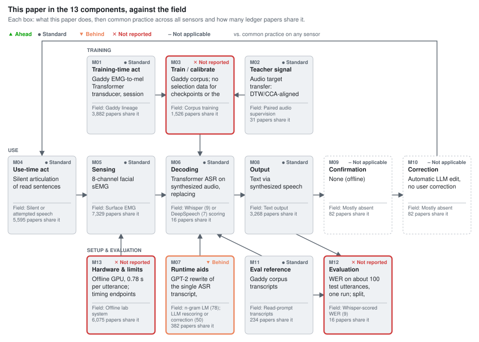

# From Silent Signals to Natural Language: A Dual-Stage Transformer-LLM Approach

Sivasubramaniam. arXiv preprint, 2025. [arXiv:2509.04507](https://arxiv.org/abs/2509.04507)

**Section:** [Surface EMG](../../README.md#surface-emg)

## Figures

### This paper in the 13 components, against the field

<picture><source media="(prefers-color-scheme: dark)" srcset="figures/components-dark.svg"></picture>

Verdicts compare the paper's choice for each component with common practice across 8,995 ledger entries on any sensor (silent speech, brain-to-text, lip reading).

Data

| Component | This paper | Common practice | Papers with this practice | Verdict |
| --- | --- | --- | --- | --- |
| M01 Training-time act | Gaddy EMG-to-mel Transformer transducer, session embeddings | Gaddy lineage | 3,882 of 8,995 | ● Standard (Inherited; Fig. 2 and Sec. 2.3 disagree on a convolutional front end.) |
| M02 Teacher signal | Audio target transfer: DTW/CCA-aligned vocalized audio | Paired audio supervision | 31 of 8,995 | ● Standard (Inherited from [@gaddy2020digital].) |
| M03 Train / calibrate | Gaddy corpus; no selection data for checkpoints or the 0.7 threshold | Corpus training | 1,526 of 8,995 | ✕ Not reported (No selection data for checkpoints or the 0.7 threshold.) |
| M04 Use-time act | Silent articulation of read sentences | Silent or attempted speech | 5,595 of 8,995 | ● Standard (Inherited.) |
| M05 Sensing | 8-channel facial sEMG | Surface EMG | 7,329 of 8,995 | ● Standard (1000 Hz (Sec. 2.2) vs 16 kHz (Sec. 3) unexplained.) |
| M06 Decoding | Transformer ASR on synthesized audio, replacing DeepSpeech | Whisper (9) or DeepSpeech (7) scoring | 16 of 8,995 | ● Standard (Scorer swap; same audio, different recognizer.) |
| M07 Runtime aids | GPT-2 rewrite of the single ASR transcript, threshold 0.7 | n-gram LM (78); LLM rescoring or correction (50) | 382 of 8,995 | ▼ Behind (Earlier work passes several hypotheses to the LLM.) |
| M08 Output | Text via synthesized speech | Text output | 3,268 of 8,995 | ● Standard (Synthesized audio itself not evaluated.) |
| M09 Confirmation | None (offline) | Mostly absent | 82 of 8,995 | – Not applicable (Offline study.) |
| M10 Correction | Automatic LLM edit, no user correction | Mostly absent | 82 of 8,995 | – Not applicable (Offline study.) |
| M11 Eval reference | Gaddy corpus transcripts | Read-prompt transcripts | 234 of 8,995 | ● Standard (Inherited corpus references.) |
| M12 Evaluation | WER on about 100 test utterances, one run; split, seeds and intervals not stated | Whisper-scored WER (9) | 16 of 8,995 | ✕ Not reported (Test split not identified; exact n, seeds and uncertainty not stated.) |
| M13 Hardware & limits | Offline GPU, 0.78 s per utterance; timing endpoints not stated | Offline lab system | 6,075 of 8,995 | ✕ Not reported (Timing endpoints undefined.) |

## Verdict

The paper [[1]](#ref-1) keeps the Gaddy EMG-to-speech pipeline [[2]](#ref-2) and changes two later stages: the recognizer that transcribes the synthesized audio (M06, standard) and a GPT-2 correction of that transcript (M07, behind). Its claim to be the first LLM correction stage for silent speech (Sec. 1) does not hold: an earlier study passed beam lists and model ensembles from silent EMG on the same benchmark to an LLM and reached 12.2% test WER [[3]](#ref-3), against 30% here (Table 1). The recognizer gain, 36% to 32.5%, swaps the scoring ASR on the same synthesized audio, not the silent-speech system. The final 30% does not beat the 28.8% test WER of Gaddy's 2022 direct EMG-to-text decoder on this benchmark, as tabulated in [[3]](#ref-3) (Table 3). All numbers come from one run on about 100 test utterances whose split is not identified, with no seeds or uncertainty (Sec. 3).

## Against the field, component by component

### M07 Use-time language model: LLM correction of the transcript

**Usual approach:** Among 382 text-producing decoders from non-acoustic or neural signals whose ledger mentions a use-time language model (pattern match, unique studies; Appendix), an n-gram language model in beam search is most frequent (78); LLM rescoring or correction appears in 50. Earlier designs give the language model several hypotheses: GPT-2 rescoring of lip-reading beams [[4]](#ref-4), LLM rescoring of 5-gram hypotheses in intracortical decoding [[5]](#ref-5), and an LLM choosing among beams or ensemble outputs from silent EMG [[3]](#ref-3). The paper instead rewrites one ASR output with GPT-2 (Sec. 2.5), although its own related work cites N-best correction (Sec. 1).

**State of the art:** On the same silent-EMG benchmark, Benster et al. (2024) reach 12.2% test WER with an LLM over a 10-model ensemble [[3]](#ref-3); the paper's 30% trails it by 17.8 points (inference).

The LLM's added effect about equals the earlier one in absolute terms and is smaller in relative terms: 32.5% to 30%, 2.5 points or 7.7% relative (inference), against 20.6% to 18.0%, 2.6 points or 12.6% relative (inference), for LLM rescoring of top-10 beams on validation data in [[3]](#ref-3), from a stronger starting point. The earlier study averaged 5 seeds and chose its test models on validation WER before the first test evaluation [[3]](#ref-3); the paper reports one run and states a 0.7 confidence threshold and edit filters without their selection data, checkpoint or prompt (Sec. 2.5). Verdict: behind, against the best comparable work.

### M06 Processing: recognizer of the synthesized speech

**Usual approach:** Of 16 studies that synthesize speech from silent EMG on this corpus and score it by transcription (pattern match, unique studies; Appendix), 9 score with Whisper and 7 with DeepSpeech. The paper trains its own Transformer ASR (Sec. 2.4) and counts it as part of the system.

**State of the art:** [later] GETS (2026) reaches 11.89% WER on the silent-EMG test set with Whisper-medium, and 21.32% for the same audio with DeepSpeech [[6]](#ref-6) (Table 1).

That 9.4-point difference from the scorer alone (inference) is larger than the paper's 3.5-point recognizer gain (Table 1). The 36% baseline matches the WER Benster et al. give for Gaddy's route of "directly synthesizing audio" [[3]](#ref-3), so it may be quoted rather than re-run (inference). Verdict: standard.

## The 13 components

| Component | This paper | Usual approach (count) | State of the art | Verdict |
|---|---|---|---|---|
| M01 Training-time action | Gaddy EMG-to-mel Transformer transducer, session embeddings | Gaddy lineage (slot-filled 3,882) | – | standard |
| M02 Training-only supervision | Audio target transfer: DTW/CCA-aligned vocalized audio | Paired audio supervision (slot-filled 31) | – | standard |
| M03 Training and adaptation | Gaddy corpus; no selection data for checkpoints or the 0.7 threshold | Corpus training (slot-filled 1,526) | – | not reported |
| M04 Use-time action | Silent articulation of read sentences | Silent or attempted speech (slot-filled 5,595) | – | standard |
| M05 Sensors | 8-channel facial sEMG | Surface EMG (slot-filled 7,329) | – | standard |
| M06 Processing and decoding | Transformer ASR on synthesized audio, replacing DeepSpeech | Whisper (9) or DeepSpeech (7) scoring (pattern match 16) | 11.89% WER, Whisper-medium [[6]](#ref-6) | standard |
| M07 Lexicon and LM | GPT-2 rewrite of the single ASR transcript, threshold 0.7 | n-gram LM (78); LLM rescoring or correction (50) (pattern match 382) | 12.2% WER, silent EMG, LLM over 10-model ensemble [[3]](#ref-3) | behind |
| M08 Output | Text via synthesized speech | Text output (slot-filled 3,268) | – | standard |
| M09 Confirmation | None (offline) | Mostly absent (slot-filled 82) | – | not applicable |
| M10 Correction | Automatic LLM edit, no user correction | Mostly absent (slot-filled 82) | – | not applicable |
| M11 Reference construction | Gaddy corpus transcripts | Read-prompt transcripts (slot-filled 234) | – | standard |
| M12 Evaluation | WER on about 100 test utterances, one run; split, seeds and intervals not stated | Whisper-scored WER (9) (pattern match 16) | 11.89% WER [[6]](#ref-6) | not reported |
| M13 Device and cost | Offline GPU, 0.78 s per utterance; timing endpoints not stated | Offline lab system (slot-filled 6,075) | – | not reported |

## Where the claims outrun the evidence

- **Priority.** "The first to demonstrate" an LLM correction stage in SSI (Sec. 1) is contradicted by [[3]](#ref-3) (prior; Appendix), which the paper does not cite.
- **Attribution of the gain.** No condition applies GPT-2 to the DeepSpeech output or the Transformer ASR to real audio, so system improvement and scorer change are not separated (Table 1).
- **Intelligibility.** "Substantial improvements in intelligibility" (Abstract) rest on WER of a text transcript; the synthesized speech is never rated by listeners (Sec. 3).
- **Inconsistency.** sEMG at 1000 Hz (Sec. 2.2) versus processing at 16 kHz (Sec. 3); Fig. 2 labels a "convolutional & transformer encoder" that Sec. 2.3 describes as a Transformer encoder only.
- **Real time.** "Feasible for near real-time applications" (Sec. 3) rests on 0.78 s per utterance on a GPU without timing endpoints (Table 1), which does not establish it.

## What the field needs next

- M07: the same GPT-2 stage given N-best lists versus one transcript, against the LLM rescoring in [[3]](#ref-3), over several seeds.
- M06: one fixed scorer (Whisper) for every condition, with the Transformer ASR also reported as a scorer, so system and scorer effects separate.
- M12: the Gaddy test split, exact utterance count, seeds and confidence intervals, as in [[3]](#ref-3).

## Questions for the authors

- Was the 36% baseline re-run on the same test utterances, and how many were there?
- On what data was the Transformer ASR trained: real audio, synthesized audio, or both?
- Which GPT-2 checkpoint and prompt were used, and on which data was the 0.7 threshold chosen?
- How was WER normalized, and which speakers and sessions are in the test set?

## Appendix: literature search

- **M07 llm-transcript-correction.** Inclusion rule: text-producing speech decoders from non-acoustic or neural signals (surface EMG, EEG, MEG, ECoG, intracortical, ultrasound, articulography, lip video, fMRI) whose ledger mentions a use-time language model, lexicon, beam search or rescoring; the design compared is the use-time language prior (n-gram beam search, neural LM rescoring, or LLM rescoring or rewriting); language models used only for training targets and acoustic-only ASR are excluded. Ledger: 119 slot-filled; 382 pattern match (unique studies). Usual design: n-gram LM, 78 (pattern match); LLM rescoring or correction, 50. Read in full: [[3]](#ref-3) (prior; state of the art), [[5]](#ref-5) (prior), [[4]](#ref-4) (prior). Known-item recall 0.5 (2 seeds).
- **M12 silent-emg-voicing-benchmark** (published table, appended). Inclusion rule: studies that synthesize audible speech from silently articulated surface EMG on the Gaddy open-vocabulary corpus and score it by ASR or listener transcription; recognition-only studies, other corpora and voiced-only results are excluded. Ledger: 6,960 slot-filled; 16 pattern match (unique studies). Usual design: ASR-scored WER with Whisper, 9 (pattern match); DeepSpeech, 7; listener transcription, 3. Read in full: [[6]](#ref-6) (state of the art). Known-item recall 1.0. This table also serves M06.

## References

Numbered by first citation. BibTeX in the same order and keys: [refs.bib](refs.bib).

1. Sivasubramaniam, N. “From Silent Signals to Natural Language: A Dual-Stage Transformer-LLM Approach.” *arXiv preprint*, 2025. arXiv:[2509.04507](https://arxiv.org/abs/2509.04507). arXiv v1 read; no journal or proceedings record in Crossref (checked 2026-11-21) [review](https://github.com/supernaiter/silent-speech-review/tree/main/reviews/from-silent-signals-to-natural-language-a-dual-stage-transformer-llm-approach) [wiki: arxiv-2509.04507](https://github.com/supernaiter/deep-research-wiki-for-silent-speech/blob/main/papers/arxiv-2509.04507/article.md) [wiki: arxiv-2509.04507-dualstg](https://github.com/supernaiter/deep-research-wiki-for-silent-speech/blob/main/papers/arxiv-2509.04507-dualstg/article.md)
2. Gaddy, D., Klein, D. “Digital Voicing of Silent Speech.” *Proceedings of the 2020 Conference on Empirical Methods in Natural Language Processing (EMNLP)*, 2020, 5521–5530. doi:[10.18653/v1/2020.emnlp-main.445](https://doi.org/10.18653/v1/2020.emnlp-main.445). arXiv:[2010.02960](https://arxiv.org/abs/2010.02960). [review](https://github.com/supernaiter/silent-speech-review/tree/main/reviews/digital-voicing-of-silent-speech) [wiki: doi-10.18653-v1-2020.emnlp-main.445](https://github.com/supernaiter/deep-research-wiki-for-silent-speech/blob/main/papers/doi-10.18653-v1-2020.emnlp-main.445/article.md) [wiki: arxiv-2010.02960](https://github.com/supernaiter/deep-research-wiki-for-silent-speech/blob/main/papers/arxiv-2010.02960/article.md)
3. Benster, T., Wilson, G., Elisha, R., Willett, F. R., Druckmann, S. “A Cross-Modal Approach to Silent Speech with LLM-Enhanced Recognition.” *arXiv preprint*, 2024. arXiv:[2403.05583](https://arxiv.org/abs/2403.05583). [wiki: arxiv-2403.05583](https://github.com/supernaiter/deep-research-wiki-for-silent-speech/blob/main/papers/arxiv-2403.05583/article.md)
4. Prajwal, K. R., Afouras, T., Zisserman, A. “Sub-word Level Lip Reading With Visual Attention.” *Proc. IEEE/CVF Conference on Computer Vision and Pattern Recognition (CVPR)*, 2022. arXiv:[2110.07603](https://arxiv.org/abs/2110.07603). [review](https://github.com/supernaiter/silent-speech-review/tree/main/reviews/sub-word-level-lip-reading-with-visual-attention) [wiki: arxiv-2110.07603](https://github.com/supernaiter/deep-research-wiki-for-silent-speech/blob/main/papers/arxiv-2110.07603/article.md) [wiki: cvf-prajwal22-subword-vtp](https://github.com/supernaiter/deep-research-wiki-for-silent-speech/blob/main/papers/cvf-prajwal22-subword-vtp/article.md) [wiki: cvpr22-prajwal](https://github.com/supernaiter/deep-research-wiki-for-silent-speech/blob/main/papers/cvpr22-prajwal/article.md)
5. Willett, F. R., Li, J., Le, T., Fan, C., Chen, M., Shlizerman, E., et al. “Brain-to-Text Benchmark '24: Lessons Learned.” *arXiv preprint*, 2024. arXiv:[2412.17227](https://arxiv.org/abs/2412.17227). [wiki: arxiv-2412.17227](https://github.com/supernaiter/deep-research-wiki-for-silent-speech/blob/main/papers/arxiv-2412.17227/article.md)
6. Lee, J., Lee, J., Lee, K. “GETS: Guiding EMG-to-Speech Synthesis via Silent Speech Recognition.” *Proc. Interspeech 2026*, 2026. doi:[10.21437/Interspeech.2026-1938](https://doi.org/10.21437/Interspeech.2026-1938). [later] [wiki: isca-lee26r_interspeech](https://github.com/supernaiter/deep-research-wiki-for-silent-speech/blob/main/papers/isca-lee26r_interspeech/article.md)

## Materials

Data behind this review. Full texts of the papers are not included.

- [`review.md`](review.md): the review text (source)
- [`refs.bib`](refs.bib): references (BibTeX)
- [`slots.json`](slots.json): for each of the 13 components: this paper's choice, field practice, number of matching papers, verdict
- [`figures.json`](figures.json): figure definitions
- [`evaluation.md`](evaluation.md): independent evaluation by a second reviewer
- [`triage.md`](triage.md): how each evaluation finding was checked against the sources and resolved
- [`components/M07/llm-transcript-correction.csv`](../../components/M07/llm-transcript-correction.csv): M07 topic "llm-transcript-correction", every candidate paper with its decision (119 slot-filled, 382 pattern match, usual design in 78, 4 read in full)
- [`components/M12/silent-emg-voicing-benchmark.csv`](../../components/M12/silent-emg-voicing-benchmark.csv): M12 topic "silent-emg-voicing-benchmark", every candidate paper with its decision (6960 slot-filled, 16 pattern match, usual design in 9, 4 read in full)

## More reviews in Surface EMG

- [A Parallel Ultra-Low Power Silent Speech Interface based on a Wearable, Fully-dry EMG Neckband](../a-parallel-ultra-low-power-silent-speech-interface-based-on-a-wearable-fully-dry-emg-neckband/) (2025). A fully dry wearable EMG neckband with ultra-low-power BioGAP-Ultra classifies 8 silently articulated words for one healthy user at 68% accuracy, dropping to 54% on an unseen re-wearing session; acquisition plus BLE uses 22.2 mW.
- [A Silent Speech Decoding System from EEG and EMG with Heterogenous Electrode Configurations](../a-silent-speech-decoding-system-from-eeg-and-emg-with-heterogenous-electrode-configurations/) (2025). Pooled EEG/EMG pretraining lifts 64-word accuracy, but each test subject's training sessions, the patient's included, are in pretraining; the coordinate kernel is neither new nor best.
- [Articulatory Feature Prediction from Surface EMG during Speech Production](../articulatory-feature-prediction-from-surface-emg-during-speech-production/) (2025). Articulatory route works on vocalized EMG but trails the mel baseline on WER; it exists for ECoG since 2019, and the electrode subset is never tested against equal-size alternatives.
- [CAT-Net: A Cross-Attention Tone Network for Cross-Subject EEG-EMG Fusion Tone Decoding](../cat-net-a-cross-attention-tone-network-for-cross-subject-eeg-emg-fusion-tone-decoding/) (2025). CAT-Net fuses EEG and surface EMG with cross-attention to classify Mandarin lexical tones in silent articulation, reporting 85.10% leave-one-subject-out accuracy over 4 tones.
- [Confidence-Based Self-Training for EMG-to-Speech: Leveraging Synthetic EMG for Robust Modeling](../confidence-based-self-training-for-emg-to-speech-leveraging-synthetic-emg-for-robust-modeling/) (2025). Synthetic EMG with confidence filtering (M03, standard) gives a small real-EMG gain, 23.30% to 21.87% WER on one speaker; large gains appear only on synthetic test EMG.
- [emg2speech: Synthesizing speech from electromyography using self-supervised speech models](../emg2speech-synthesizing-speech-from-electromyography-using-self-supervised-speech-models/) (2025). Ports a 2023 ECoG recipe (text-to-speech HuBERT units, CTC) to EMG; phoneme guidance (M02) and covariance input (M06) are standard. Table 6 mixes listener and decoder scoring, so it ranks no route.

---

Part of the [Silent Speech Interface Review](https://github.com/supernaiter/silent-speech-review). Found an error? [Open an issue](https://github.com/supernaiter/silent-speech-review/issues/new?template=correction.yml).
