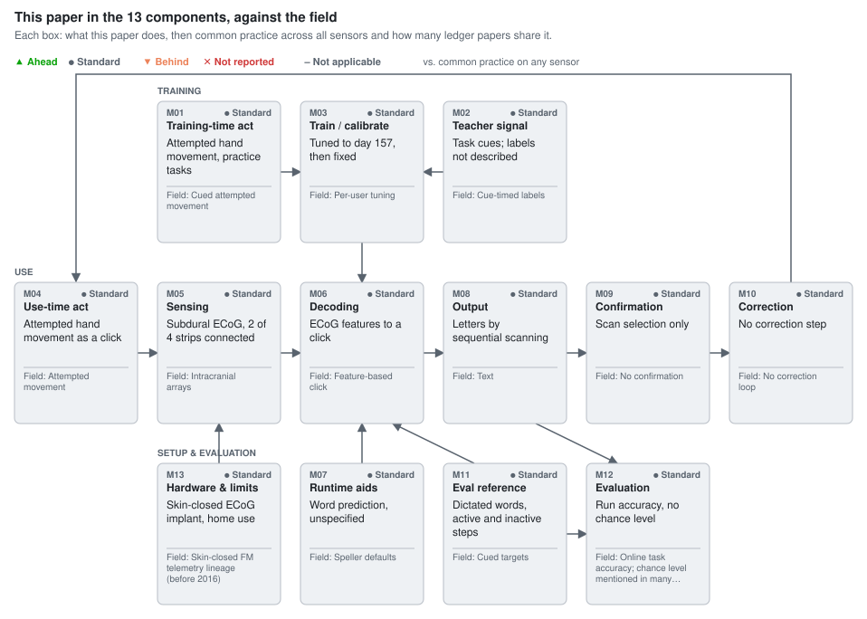

# Fully Implanted Brain-Computer Interface in a Locked-In Patient with ALS

Vansteensel, M. J., Pels, E. G. M., Bleichner, M. G., Branco, M. P., Denison, T., et al. · New England Journal of Medicine 375(21), 2060–2066 · 2016 · [doi:10.1056/NEJMoa1608085](https://doi.org/10.1056/NEJMoa1608085)

**Section:** [Other sensors](../../README.md#other-sensors)

## Figures

### This paper in the 13 components, against the field

<picture><source media="(prefers-color-scheme: dark)" srcset="figures/components-dark.svg"></picture>

Verdicts compare the paper's choice for each component with common practice across 8,995 ledger entries on any sensor (silent speech, brain-to-text, lip reading).

Data

| Component | This paper | Common practice | Papers with this practice | Verdict |
| --- | --- | --- | --- | --- |
| M01 Training-time act | Attempted hand movement, practice tasks | Cued attempted movement |  | ● Standard (Inherited.) |
| M02 Teacher signal | Task cues; labels not described | Cue-timed labels |  | ● Standard (Inherited.) |
| M03 Train / calibrate | Tuned to day 157, then fixed | Per-user tuning |  | ● Standard (Tuning overlaps reported runs.) |
| M04 Use-time act | Attempted hand movement as a click | Attempted movement |  | ● Standard (Inherited (switch scanning).) |
| M05 Sensing | Subdural ECoG, 2 of 4 strips connected | Intracranial arrays |  | ● Standard (Prefrontal strips untested.) |
| M06 Decoding | ECoG features to a click | Feature-based click |  | ● Standard (Decoder in the supplement.) |
| M07 Runtime aids | Word prediction, unspecified | Speller defaults |  | ● Standard (Configuration not given.) |
| M08 Output | Letters by sequential scanning | Text |  | ● Standard (Slow: 33 s per letter.) |
| M09 Confirmation | Scan selection only | No confirmation |  | ● Standard (Inherited.) |
| M10 Correction | No correction step | No correction loop |  | ● Standard (Timing misclicks reported.) |
| M11 Eval reference | Dictated words, active and inactive steps | Cued targets |  | ● Standard (Steps pooled in M12.) |
| M12 Evaluation | Run accuracy, no chance level | Online task accuracy; chance level mentioned in many studies |  | ● Standard (No floor in the main text; classes pooled.) |
| M13 Hardware & limits | Skin-closed ECoG implant, home use | Skin-closed FM telemetry lineage (before 2016) |  | ● Standard (One user; no repetition.) |

## Verdict

The paper [[1]](#ref-1) changes the device and how it is operated (M13): subdural ECoG feeding a subcutaneous transmitter, nothing through the skin after day 3, used at home without investigators from day 197. Both departures are standard under the verdict rules. The skin-closed link predates it in the neurotrophic-electrode telemetry lineage [[2]](#ref-2), and independent home use rests on one participant; within implanted systems, the [later] skin-closed endovascular study still calls it "the only report of an unsupervised, ambulatory implantable BCI" [[3]](#ref-3), and all 18 independent-use matches in the ledger date from 2017 or later (Appendix). The main claim, that one locked-in user can communicate with it without the team, holds, and the [later] follow-up of the same user extends it to 7 years [[4]](#ref-4), in time but not across people. The main text does not show the click's reliability: 89% spelling accuracy pools target-letter steps with more numerous non-target steps and gives no chance level or false-click rate (Fig. 3; M12). The rate, 1.8 letters per minute with unspecified word prediction, is about 8 times below the 13.81 correct characters per minute of the first ALS user of that [later] skin-closed system (inference) [[3]](#ref-3).

## Against the field, component by component

### M13 Device: skin-closed ECoG implant

**Usual approach:** In the ledger population of 347 implanted-sensor speech or communication studies (versions merged; Appendix), only 17 have an index year before 2016, and their skin-closed designs are one lineage, the neurotrophic electrode with FM telemetry, which "eliminates the need for wires or connectors passing through the skin" [[2]](#ref-2). Guenther et al. cite earlier cursor control by paralyzed users with such implants (their refs. 32–33, Kennedy et al. 2000 and 2004). The paper swaps that electrode for subdural strips, two of four connected to the implant (Methods).

**State of the art:** In 2021, a [later] endovascular array with a transmitter in a chest pocket gave 2 users with ALS unsupervised home use from day 86 and day 71 [[3]](#ref-3). The [later] intracortical speech system used daily at home still runs through a percutaneous pedestal [[5]](#ref-5), as does the [later] wireless home system [[6]](#ref-6).

Against [[2]](#ref-2) the paper differs in sensor and task, not in the skin-closed principle, and both rest on one participant; two further patients died before implantation (Methods). Verdict: standard.

### M13 Operation: independent home use

**Usual approach:** Of the 347 studies, 159 mention a hospital, bedside or laboratory setting, 27 home use and 18 independent use, all 18 dated 2017 or later (pattern counts of mentions; Appendix). The [concurrent] intracortical typing study collected data in participants' homes with researchers monitoring from the laboratory and named a fully implanted wireless system as future work [[7]](#ref-7). Outside implanted systems, the EEG P300 community already had "broad experience with home use" by disabled users [[8]](#ref-8).

**State of the art:** In 2024, 7 years of independent at-home use by the same user, with the same electrodes and a transmitter replaced in 2020 [[4]](#ref-4); across users, unsupervised home use from day 71 to 86 with multiple clicks, against this paper's 197 days and single click, in Oxley et al.'s own comparison (2021) [[3]](#ref-3).

Independence was partial: set-up needed help with antenna, receiver, tablet and cables (Results), and logs show use on 32 days from day 197 to day 266, 46% of the 70 days (inference), at 86 minutes per day. Verdict: standard, because one participant gives no repetition.

### M12 Evaluation: accuracy without a floor

**Usual approach:** Of the 347 studies, 154 mention a chance level or shuffled null and 48 a false-positive rate (pattern counts; Appendix); the 8 chance-level matches before 2016 are offline classification, not online selection.

**State of the art:** In 2026, the [later] night study of the same participant reports unintended clicks per hour and the share of error-free nights [[9]](#ref-9), the floor a click BCI needs.

Spelling accuracy (89%, 44 runs) counts a click on the target letter and a withheld click on every other highlighted letter, with more inactive than active steps (Fig. 3); a user who never clicks would score above half (inference). In that same user, daytime decoders produced 245 unintended clicks per hour at night [[9]](#ref-9). Verdict: standard.

## The 13 components

| Component | This paper | Usual approach (count) | State of the art | Verdict |
|---|---|---|---|---|
| M01 Training-time action | Attempted hand movement, practice tasks | Cued attempted movement | – | standard |
| M02 Training-only supervision | Task cues; labels not described | Cue-timed labels | – | standard |
| M03 Training and adaptation | Tuned to day 157, then fixed | Per-user tuning | – | standard |
| M04 Use-time action | Attempted hand movement as a click | Attempted movement | – | standard |
| M05 Sensors | Subdural ECoG, 2 of 4 strips connected | Intracranial arrays | – | standard |
| M06 Processing and decoding | ECoG features to a click | Feature-based click | – | standard |
| M07 Lexicon and LM | Word prediction, unspecified | Speller defaults | – | standard |
| M08 Output | Letters by sequential scanning | Text | – | standard |
| M09 Confirmation | Scan selection only | No confirmation | – | standard |
| M10 Correction | No correction step | No correction loop | – | standard |
| M11 Reference construction | Dictated words, active and inactive steps | Cued targets | – | standard |
| M12 Evaluation | Run accuracy, no chance level | Online task accuracy; chance level mentioned in many studies | [[9]](#ref-9) (2026): unintended clicks per hour | standard |
| M13 Device and cost | Skin-closed ECoG implant, home use | Skin-closed FM telemetry lineage (before 2016) | [[3]](#ref-3) (2021): 2 users, unsupervised home use | standard |

## Where the claims outrun the evidence

- "Two letters per minute" (Abstract) rounds up the word-prediction rate: 33 s per letter is 1.8 letters per minute, the initial 52 s is 1.2 (inference; Results [[1]](#ref-1)).
- Target-task accuracy (91%, 83 runs, days 15 to 262) pools runs before and after settings were fixed on day 157 (Results; Fig. 2 [[1]](#ref-1)).
- "Capable of meeting the requirements for independent communication" (Discussion) rests on one user, set-up help and use on 32 of 70 days (inference; Results [[1]](#ref-1)).

## What the field needs next

- M12: class-wise sensitivity and false clicks per minute for scanning spellers, with chance from the scan design.
- M13: skin-closed subdural and endovascular systems compared in the same users' homes, with logs that separate BCI use from eye-tracker availability.
- M07: spelling rate with and without word prediction, the predictor stated.

## Questions for the authors

- What were accuracies on active and inactive steps, and the false-click rate at rest?
- How many target-task runs came after day 157, and how accurate were they?
- Which word prediction was used, and what was the rate without it?

## Appendix: literature search

- M13, wireless-implanted-speech-bci (published table, reused). Inclusion rule: speech or communication studies with implanted neural sensors (intracortical, ECoG, sEEG, depth), classified by how the signal leaves the body: percutaneous connector or pedestal, wireless telemetry (including a transmitter on a pedestal), or a fully implanted system; reviews and related-work mentions inflate full-text counts; wearable EMG or EEG devices excluded. Ledger: 6,075 unique studies slot-filled for M13; 382 unique studies pattern match, 347 after merging versions by title and DOI. Published usual design: system implemented and evaluated, 216 of the 296 pattern-matched studies with M13 recorded (slot-filled). This review's full-text mention counts over the 347: wireless telemetry 95, fully implanted 47, percutaneous connector 42; by index year before 2016 (17 studies): 9, 1 and 1, the fully implanted and percutaneous ones being future-work or contrast mentions, the fully implanted one in [[7]](#ref-7) ([concurrent], index year 2015). Published run: 52, 51, 35. Read in full: [[2]](#ref-2) (prior), [[3]](#ref-3) (state of the art), [[4]](#ref-4), [[5]](#ref-5), [[6]](#ref-6). Known-item recall 1.0 (published, 3 seeds); this run 0.6 (5 seeds; the target and its 2024 follow-up fall outside the pattern).
- M13, implanted-communication-bci-home-use (new). Inclusion rule: same population; the design compared is where and by whom the system is operated: hospital or laboratory (epilepsy monitoring, bedside, laboratory), the participant's home, and use without investigators (independent use); full-text mention counts with the reference list removed; a study counts under every setting it names. Ledger: 382 unique studies pattern match, 347 after merging versions. Counts: hospital or laboratory 159, home use 27, independent use 18 (pattern match); by index year before 2016: 10, 1 ([[7]](#ref-7)) and 0; all 18 independent-use matches dated 2017 or later. Read in full: [[7]](#ref-7) and [[8]](#ref-8) (both [concurrent]), [[4]](#ref-4) (state of the art), [[3]](#ref-3), [[6]](#ref-6), [[5]](#ref-5). Known-item recall 0.6 (5 seeds).
- M12, implanted-communication-bci-chance-and-false-positives (new). Inclusion rule: same population; the design compared is the floor reported for accuracy: a chance level or shuffled or permutation null, and a false-positive (unintended selection) rate; offline classification studies count. Ledger: 6,960 unique studies slot-filled for M12; 382 unique studies pattern match, 347 after merging versions. Counts: chance level 154, false-positive rate 48 (pattern match); chance level before 2016 by index year: 8, all offline classification. Read in full: [[9]](#ref-9) (state of the art). Known-item recall 0.6 (5 seeds).

## References

Numbered by first citation. BibTeX in the same order and keys: [refs.bib](refs.bib).

1. Vansteensel, M. J., Pels, E. G. M., Bleichner, M. G., Branco, M. P., Denison, T., Freudenburg, Z. V., et al. “Fully Implanted Brain-Computer Interface in a Locked-In Patient with ALS.” *New England Journal of Medicine*, 2016, 375(21), 2060–2066. doi:[10.1056/NEJMoa1608085](https://doi.org/10.1056/NEJMoa1608085). Target. Read as the PMC author manuscript. [wiki: pmc-5326682-als-implant-bci](https://github.com/supernaiter/deep-research-wiki-for-silent-speech/blob/main/papers/pmc-5326682-als-implant-bci/article.md)
2. Guenther, F. H., Brumberg, J. S., Wright, E. J., Nieto-Castanon, A., Tourville, J. A., Panko, M., et al. “A Wireless Brain-Machine Interface for Real-Time Speech Synthesis.” *PLoS ONE*, 2009, 4(12), e8218. doi:[10.1371/journal.pone.0008218](https://doi.org/10.1371/journal.pone.0008218). Prior; deciding prior for M13 (skin-closed telemetry). [review](https://github.com/supernaiter/silent-speech-review/tree/main/reviews/a-wireless-brain-machine-interface-for-real-time-speech-synthesis) [wiki: pmc-2784218-wireless](https://github.com/supernaiter/deep-research-wiki-for-silent-speech/blob/main/papers/pmc-2784218-wireless/article.md) [wiki: pmc-2784218-wirelesssynth](https://github.com/supernaiter/deep-research-wiki-for-silent-speech/blob/main/papers/pmc-2784218-wirelesssynth/article.md) [wiki: doi-10.1371-journal.pone.0008218](https://github.com/supernaiter/deep-research-wiki-for-silent-speech/blob/main/papers/doi-10.1371-journal.pone.0008218/article.md)
3. Oxley, T. J., Yoo, P. E., Rind, G. S., Ronayne, S. M., others “Motor neuroprosthesis implanted with neurointerventional surgery improves capacity for activities of daily living tasks in severe paralysis: first in-human experience.” *Journal of NeuroInterventional Surgery*, 2021, 13(2), 102–108. doi:[10.1136/neurintsurg-2020-016862](https://doi.org/10.1136/neurintsurg-2020-016862). Later. [later] [wiki: pmc-7848062-neurointerv](https://github.com/supernaiter/deep-research-wiki-for-silent-speech/blob/main/papers/pmc-7848062-neurointerv/article.md)
4. Vansteensel, M. J., others “Longevity of a Brain-Computer Interface for Amyotrophic Lateral Sclerosis.” *New England Journal of Medicine*, 2024, 391(7), 619–626. doi:[10.1056/NEJMoa2314598](https://doi.org/10.1056/NEJMoa2314598). Later; same participant and system. [later] [wiki: pmc-11395392-bcilong](https://github.com/supernaiter/deep-research-wiki-for-silent-speech/blob/main/papers/pmc-11395392-bcilong/article.md)
5. Card, N. S., Singer-Clark, T., Peracha, H., Iacobacci, C., Hou, X., Wairagkar, M., et al. “Long-term independent use of an intracortical brain-computer interface for speech and cursor control.” *Nature Medicine*, 2026, 32(7), 2504–2510. doi:[10.1038/s41591-026-04414-6](https://doi.org/10.1038/s41591-026-04414-6). Later. [later] [wiki: pmc-13375540-ltbci](https://github.com/supernaiter/deep-research-wiki-for-silent-speech/blob/main/papers/pmc-13375540-ltbci/article.md) [wiki: pmc-13375540-ibciterm](https://github.com/supernaiter/deep-research-wiki-for-silent-speech/blob/main/papers/pmc-13375540-ibciterm/article.md) [wiki: pmc-13375540-ltc-speechbci](https://github.com/supernaiter/deep-research-wiki-for-silent-speech/blob/main/papers/pmc-13375540-ltc-speechbci/article.md)
6. Simeral, J. D., Hosman, T., Saab, J., Flesher, S. N., Vilela, M., Franco, B., et al. “Home Use of a Percutaneous Wireless Intracortical Brain-Computer Interface by Individuals With Tetraplegia.” *IEEE Transactions on Biomedical Engineering*, 2021, 68(7), 2313–2325. doi:[10.1109/TBME.2021.3069119](https://doi.org/10.1109/TBME.2021.3069119). Later. [later] [wiki: pmc-8218873-wirelesshomebci](https://github.com/supernaiter/deep-research-wiki-for-silent-speech/blob/main/papers/pmc-8218873-wirelesshomebci/article.md)
7. Pandarinath, C., Nuyujukian, P., Blabe, C. H., Sorice, B. L., Saab, J., Willett, F. R., et al. “High performance communication by people with paralysis using an intracortical brain-computer interface.” *eLife*, 2017, 6, e18554. doi:[10.7554/eLife.18554](https://doi.org/10.7554/eLife.18554). Concurrent. [concurrent] [review](https://github.com/supernaiter/silent-speech-review/tree/main/reviews/high-performance-communication-by-people-with-paralysis-using-an-intracortical-brain-computer-interf) [wiki: pmc-5319839-ibcityping](https://github.com/supernaiter/deep-research-wiki-for-silent-speech/blob/main/papers/pmc-5319839-ibcityping/article.md) [wiki: pmc-5319839-hiprofiBCI](https://github.com/supernaiter/deep-research-wiki-for-silent-speech/blob/main/papers/pmc-5319839-hiprofiBCI/article.md)
8. Huggins, J. E., Guger, C., Ziat, M., Zander, T. O., others “Workshops of the Sixth International Brain-Computer Interface Meeting: brain-computer interfaces past, present, and future.” *Brain-Computer Interfaces*, 2017. doi:[10.1080/2326263X.2016.1275488](https://doi.org/10.1080/2326263X.2016.1275488). Concurrent; workshop summary of the June 2016 meeting. [concurrent] [wiki: pmc-5693371-bcimeeting](https://github.com/supernaiter/deep-research-wiki-for-silent-speech/blob/main/papers/pmc-5693371-bcimeeting/article.md)
9. Leinders, S., Aarnoutse, E. J., Branco, M. P., Freudenburg, Z. V., others “Implanted brain-computer interface functionality during nighttime in late-stage amyotrophic lateral sclerosis.” *Scientific Reports*, 2026. doi:[10.1038/s41598-026-44228-7](https://doi.org/10.1038/s41598-026-44228-7). Later. [later] [wiki: pmc-13133098-alsnight](https://github.com/supernaiter/deep-research-wiki-for-silent-speech/blob/main/papers/pmc-13133098-alsnight/article.md)

## Materials

Data behind this review. Full texts of the papers are not included.

- [`review.md`](review.md): the review text (source)
- [`refs.bib`](refs.bib): references (BibTeX)
- [`slots.json`](slots.json): for each of the 13 components: this paper's choice, field practice, number of matching papers, verdict
- [`figures.json`](figures.json): figure definitions
- [`evaluation.md`](evaluation.md): independent evaluation by a second reviewer
- [`triage.md`](triage.md): how each evaluation finding was checked against the sources and resolved
- [`process/log.json`](process/log.json): process record: each step, who did it (reader, script, writer, evaluator), when, the checks run and the input versions
- [`process/notes.json`](process/notes.json): reading notes on the target and comparator papers: claims, numbers, conditions and what is not stated, with locations
- [`process/plan.json`](process/plan.json): plan: which components the paper changes and the topics it is compared on
- [`process/draft.md`](process/draft.md): the review as first written, before the independent evaluation
- [`process/claims-draft.md`](process/claims-draft.md): claim table of the draft: every claim mapped to a note or a count
- [`process/claims.md`](process/claims.md): claim table of the published review
- [`components/M12/implanted-communication-bci-chance-and-false-positives.csv`](../../components/M12/implanted-communication-bci-chance-and-false-positives.csv): M12 topic "implanted-communication-bci-chance-and-false-positives", every candidate paper with its decision (6960 slot-filled, 382 pattern match, usual design in 169, 1 read in full)
- [`components/M13/implanted-communication-bci-home-use.csv`](../../components/M13/implanted-communication-bci-home-use.csv): M13 topic "implanted-communication-bci-home-use", every candidate paper with its decision (6075 slot-filled, 382 pattern match, usual design in 181, 6 read in full)
- [`components/M13/wireless-implanted-speech-bci.csv`](../../components/M13/wireless-implanted-speech-bci.csv): M13 topic "wireless-implanted-speech-bci", every candidate paper with its decision (6075 slot-filled, 382 pattern match, usual design in 216, 3 read in full)

## More reviews in Other sensors

- [Lipreading with Long Short-Term Memory](../lipreading-with-long-short-term-memory/) (2016). Joint LSTM + pixel front end (M06) is ahead of 2015 lipreading, but pixel-input and recurrent word models predate it, and the 8.3-point gain is over linear SVMs, not HMMs.
- [Combining Residual Networks with LSTMs for Lipreading](../combining-residual-networks-with-lstms-for-lipreading/) (2017). 3D-conv + ResNet + Bi-LSTM (M06), which became the field default, and per-step training (M03) are standard only for lack of run counts; 83.0% trails audio-supervised 93.2% today.
- [High performance communication by people with paralysis using an intracortical brain-computer interface](../high-performance-communication-by-people-with-paralysis-using-an-intracortical-brain-computer-interf/) (2017). ReFIT-KF + HMM click (M06) and ccpm/bitrate protocol (M12) are standard for 2017; 1.4-4.2x record gains are cross-study and the HMM is never isolated; later decoders reach 110 chars/min.
- [Brain-to-text: decoding spoken phrases from phone representations in the brain](../brain-to-text-decoding-spoken-phrases-from-phone-representations-in-the-brain/) (2015). Phone-model decoder (M06) is the EMG recognizer moved to ECoG: standard. 25% WER uses per-phrase dictionaries holding the spoken words (M07); the time-shift null (M12) is sound.
- [End-to-End Audiovisual Speech Recognition](../end-to-end-audiovisual-speech-recognition/) (2018). Raw-waveform front end and BGRU fusion (M06) depart from the usual approach but are standard: they tie MFCC in clean LRW audio (97.7%); noise gains lack repeated runs and use matched babble.
- [Decoding spectrotemporal features of overt and covert speech from the human cortex](../decoding-spectrotemporal-features-of-overt-and-covert-speech-from-the-human-cortex/) (2014). Overt-trained ECoG decoding of covert reading (M04), spectral outputs (M08) and the overt-recording covert reference (M11) are standard; DTW-aligned rest reaches r 0.30 vs covert 0.34.

---

Part of the [Silent Speech Interface Review](https://github.com/supernaiter/silent-speech-review). Found an error? [Open an issue](https://github.com/supernaiter/silent-speech-review/issues/new?template=correction.yml).
