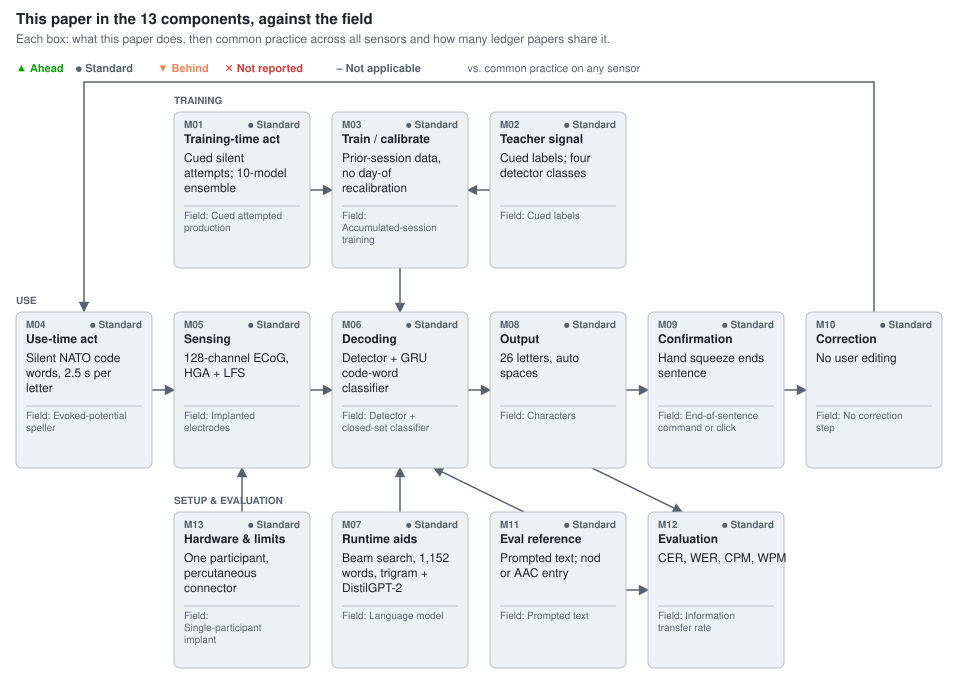

# Generalizable spelling using a speech neuroprosthesis in an individual with severe limb and vocal paralysis

Sean L. Metzger, Jessie R. Liu, David A. Moses, Maximilian E. Dougherty, Margaret P. Seaton, Kaylo T. Littlejohn, Josh Chartier, Gopala K. Anumanchipalli, Adelyn Tu-Chan, Karunesh Ganguly, Edward F. Chang. Nature Communications 13, 6510 (2022). [doi:10.1038/s41467-022-33611-3](https://doi.org/10.1038/s41467-022-33611-3)

**Section:** [Other sensors](../../README.md#other-sensors)

## Figures

### This paper in the 13 components, against the field

<picture><source media="(prefers-color-scheme: dark)" srcset="figures/components-dark.svg"></picture>

Verdicts compare the paper's choice for each component with common practice across 8,995 ledger entries on any sensor (silent speech, brain-to-text, lip reading).

Data

| Component | This paper | Common practice | Papers with this practice | Verdict |
| --- | --- | --- | --- | --- |
| M01 Training-time act | Cued silent attempts; 10-model ensemble | Cued attempted production |  | ● Standard (Inherited (Moses 2021 lineage).) |
| M02 Teacher signal | Cued labels; four detector classes | Cued labels |  | ● Standard (Inherited.) |
| M03 Train / calibrate | Prior-session data, no day-of recalibration | Accumulated-session training |  | ● Standard (Zero-error sentence trials added to training.) |
| M04 Use-time act | Silent NATO code words, 2.5 s per letter | Evoked-potential speller |  | ● Standard (No prior code-word letter code; one participant.) |
| M05 Sensing | 128-channel ECoG, HGA + LFS | Implanted electrodes |  | ● Standard (Inherited.) |
| M06 Decoding | Detector + GRU code-word classifier | Detector + closed-set classifier |  | ● Standard (Inherited (Moses 2021 lineage).) |
| M07 Runtime aids | Beam search, 1,152 words, trigram + DistilGPT-2 | Language model |  | ● Standard (Closed lexicon; >9,000 words offline only.) |
| M08 Output | 26 letters, auto spaces | Characters |  | ● Standard (Inherited.) |
| M09 Confirmation | Hand squeeze ends sentence | End-of-sentence command or click |  | ● Standard (Hand command 98.43%; no stop rule compared.) |
| M10 Correction | No user editing | No correction step |  | ● Standard (No backspace or edit command.) |
| M11 Eval reference | Prompted text; nod or AAC entry | Prompted text |  | ● Standard (Self-reported reference for conversation.) |
| M12 Evaluation | CER, WER, CPM, WPM | Information transfer rate |  | ● Standard (Matches implanted text-entry metrics.) |
| M13 Hardware & limits | One participant, percutaneous connector | Single-participant implant |  | ● Standard (Independent use not possible.) |

## Verdict

The paper changes the letter-selection action (M04, silently attempted NATO code words), the language assistance (M07, letter beam search over a 1,152-word lexicon) and the stop command (M09, attempted hand squeeze) [[1]](#ref-1). No prior spelling study in the curated set uses code words as a letter code (Appendix), but M04 stays standard because the evidence comes from one participant; M07 and M09 are standard because language models and hand-motor selection were already in use [[2]](#ref-2), [[3]](#ref-3). The claim holds for that participant and 1,152 words: median 29.41 characters per minute at 6.13% character error rate with the language model. The authors themselves set this against 90 characters per minute from attempted handwriting by a participant who could speak [[4]](#ref-4). The overreach is "generalizable": the 9,170-word result is an offline replay, and live conversation reached 14.8% character error rate on the trials kept (§ Generalizability to larger vocabularies).

## Against the field, component by component

### M04 Use-time action: silent code words for letters

**Usual approach:** Of 22 prior spelling and text-entry studies (curated, Appendix), 8 use evoked-potential spellers, 7 decode spoken letter names from lip video, 4 use motor or cursor selection and none uses code words. Lip-reading of spelled letters reached 45-55% visual-only recognition in 1994 on a "highly confusable" vocabulary [[5]](#ref-5).

**State of the art:** Attempted handwriting reached 90 characters per minute at 5.4% raw character error rate without a language model (0.89% with an offline model) in 2021 [[4]](#ref-4). In 2026 attempted finger typing peaked at 110 characters per minute in one participant (the other peaked at 47) [[6]](#ref-6) [later], about 3.6 times the target's best block of 30.79 (inference).

In the paper's own offline test on isolated trials, code words beat letters (z = 3.78, Fig. 4a). Silent sEMG work decoded NATO words only as vocabulary items, not as a letter code [[7]](#ref-7). [Concurrent] silent letter-name spelling with an in-mouth sensor reached 37 words per minute in seven participants [[8]](#ref-8). Repetition spans one participant's trials and sessions (§ Discussion). Verdict: standard.

### M07 Lexicon and language model: closed-lexicon beam search

**Usual approach:** Among the 22 prior studies, a language model is mentioned in 4 and word prediction in 4, beam search in none (pattern match, mentions, Appendix). A 2016 review found language models raise speller speed and accuracy but word-based ones cannot handle out-of-vocabulary words [[2]](#ref-2).

**State of the art:** In 2026 a 5-gram model gave 1.6% word error rate at user-regulated speed in finger typing [[6]](#ref-6) [later].

The classifier alone gave 35.1% median character error rate (§ Decoding performance), cut by 82% in the full pipeline (inference). The cost is the closed lexicon the review warned about [[2]](#ref-2): 6 of 39 conversational trials involved out-of-vocabulary words (§ Data exclusions). Verdict: standard.

### M09 Confirmation: hand squeeze as stop command

**Usual approach:** Among the 22 prior studies, an end-of-sentence command is mentioned in 7, click selection in 6 and dwell or timeout in 3 (pattern match, mentions, Appendix). Intracortical typing already selected keys by a hand squeeze or by dwell [[3]](#ref-3).

**State of the art:** In 2023 the same group separated silent code words from finger flexions in 569 of 570 test trials [[9]](#ref-9) [later], against the target's 98.43% hand-command accuracy (§ Discussion).

The authors write "Our approach is the first to combine the two cortical areas to control a BCI" (§ Discussion); none of the 5 neural studies dated 2021 or earlier that match a hand-command and a speech-decoding pattern combines the two (Appendix). Verdict: standard.

### M12 Evaluation: implanted-speller metrics

**Usual approach:** Information transfer rate is mentioned in 7 of the 22 prior studies and characters per minute in 5 (pattern match, mentions, Appendix); that metric is the evoked-potential convention.

**State of the art:** Implanted text entry reports characters per minute with character or word error rate [[4]](#ref-4), and in 2026 110 characters per minute, 22 words per minute and 1.6% word error rate [[6]](#ref-6) [later]. The target uses the same set. Verdict: standard.

## The 13 components

| Component | This paper | Usual approach (count) | State of the art | Verdict |
|---|---|---|---|---|
| M01 Training-time action | Cued silent attempts; 10-model ensemble | Cued attempted production | – | standard |
| M02 Training-only supervision | Cued labels; four detector classes | Cued labels | – | standard |
| M03 Training and adaptation | Prior-session data, no day-of recalibration | Accumulated-session training | – | standard |
| M04 Use-time action | Silent NATO code words, 2.5 s per letter | Evoked-potential speller | [[6]](#ref-6) (2026): peak 110 characters per minute | standard |
| M05 Sensors | 128-channel ECoG, HGA + LFS | Implanted electrodes | – | standard |
| M06 Processing and decoding | Detector + GRU code-word classifier | Detector + closed-set classifier | – | standard |
| M07 Lexicon and LM | Beam search, 1,152 words, trigram + DistilGPT-2 | Language model | [[6]](#ref-6) (2026): 5-gram LM, 1.6% WER | standard |
| M08 Output | 26 letters, auto spaces | Characters | – | standard |
| M09 Confirmation | Hand squeeze ends sentence | End-of-sentence command or click | [[9]](#ref-9) (2023): 569 of 570 separated | standard |
| M10 Correction | No user editing | No correction step | – | standard |
| M11 Reference construction | Prompted text; nod or AAC entry | Prompted text | – | standard |
| M12 Evaluation | CER, WER, CPM, WPM | Information transfer rate | [[6]](#ref-6) (2026): CPM, WPM, WER | standard |
| M13 Device and cost | One participant, percutaneous connector | Single-participant implant | – | standard |

## Where the claims outrun the evidence

- The 9,170-word result (8.23% character error rate) replays the real-time neural outputs offline with a retrained n-gram model (§ Generalizability to larger vocabularies); live use stayed at 1,152 words.
- Live conversation gave 14.8% character and 16.7% word error rate over 28 of 39 trials; the authors report 15.7% and 17.6% with the out-of-vocabulary blocks and 8.52% and 13.75% for copy typing with the 13 self-reported error trials (§ Data exclusions).
- The Discussion's "immediately practical and clinically viable" modality could not be used independently because of the percutaneous connector (§ Discussion).

## What the field needs next

- M04: code words against letter names in live sentence spelling, in several participants.
- M07: a live open-vocabulary fallback tested at 9,170 words or more.
- M09 and M10: the hand channel used for edit or backspace, against a dwell stop.

## Questions for the authors

- Were first attempts of copy-typing sentences among the zero-error trials added to training before the second attempt?
- How many days did the 34 real-time blocks span, and which seeds initialized the 10 ensemble models?

## Appendix: literature search

Setting for all four topics: text entry by spelling, any signal type in the ledger. Full-text pattern (speller, letter-by-letter entry, spelling out words, letters or sentences; reference list removed): 483 unique studies in all years. Reference date 2021-12-22 (received); prior means first public before 2021-06-22, [concurrent] 2021-06-22 to 2022-06-22. Cleaning removed reviews and studies that only mention spellers, leaving 22 prior studies that build, test or record a speller, text-entry system or spelled-letter recognizer (classified from ledger records and titles); undated rows dated from manifests; 2 studies dated 2021 with unresolved month not counted. Recall-sample check: 30 snippets read; none describes a speech-driven speller dated before the cutoff. Known-item recall 1.0 (6 seeds) for each topic.

- M04, speech-or-motor-spelling-action. Inclusion rule: the setting above; design compared is the action that selects each letter. Ledger: 5,595 unique studies slot-filled for M04; 483 unique studies pattern match. Prior (22, curated by design): evoked-potential speller 8, spoken letter names from lip video 7, motor or cursor selection 4, handwriting or imagined characters 2, eye movement 1, code words 0. Full-text NATO-alphabet check over all papers: 28 folders; earlier ones are vocabulary items in sEMG and dysarthric speech, none a speller. Read in full: [[5]](#ref-5), [[7]](#ref-7), [[8]](#ref-8), [[3]](#ref-3), [[4]](#ref-4), [[6]](#ref-6), [[9]](#ref-9). Known-item recall 1.0.
- M07, spelling-language-assistance. Inclusion rule: the setting above; design compared is use-time language assistance. Ledger: 119 unique studies slot-filled for M07; 483 unique studies pattern match. Prior (22, mentions): language model 4, word prediction or completion 4, lexicon constraint 1, beam search 0, neural rescoring 0. Read in full: [[2]](#ref-2), [[6]](#ref-6). Known-item recall 1.0.
- M09, spelling-selection-and-termination-command. Inclusion rule: the setting above; design compared is how a selection or end of message is issued. Ledger: 82 unique studies slot-filled for M09; 483 unique studies pattern match. Prior (22, mentions): end-of-sentence command 7, click selection 6, dwell or timeout 3, attempted hand command 2, hybrid BCI 1. Combination check (neural studies dated 2021 or earlier, hand-command and speech-decoding patterns): 5 matches, all mentions or separate participants. Read in full: [[3]](#ref-3), [[9]](#ref-9). Known-item recall 1.0.
- M12, spelling-rate-and-error-metrics. Inclusion rule: the setting above; design compared is the reported metric. Ledger: 6,960 unique studies slot-filled for M12; 483 unique studies pattern match. Prior (22, mentions): information transfer rate 7, characters per minute 5, character error rate 3, words per minute 2, word error rate 1. Read in full: [[4]](#ref-4), [[6]](#ref-6). Known-item recall 1.0.

## References

Numbered by first citation. BibTeX in the same order and keys: [refs.bib](refs.bib).

1. Metzger, S. L., Liu, J. R., Moses, D. A., Dougherty, M. E., Seaton, M. P., Littlejohn, K. T., et al. “Generalizable spelling using a speech neuroprosthesis in an individual with severe limb and vocal paralysis.” *Nature Communications*, 2022, 13, 6510. doi:[10.1038/s41467-022-33611-3](https://doi.org/10.1038/s41467-022-33611-3). Target. Read as the published version (2022-11-08). [wiki: doi-10.1038-s41467-022-33611-3](https://github.com/supernaiter/deep-research-wiki-for-silent-speech/blob/main/papers/doi-10.1038-s41467-022-33611-3/article.md) [wiki: pmc-9643551-bravospell](https://github.com/supernaiter/deep-research-wiki-for-silent-speech/blob/main/papers/pmc-9643551-bravospell/article.md) [wiki: pmc-9643551-bravospelling](https://github.com/supernaiter/deep-research-wiki-for-silent-speech/blob/main/papers/pmc-9643551-bravospelling/article.md)
2. Speier, W., Arnold, C., Pouratian, N. “Integrating language models into classifiers for BCI communication: a review.” *Journal of Neural Engineering*, 2016, 13(3), 031002. doi:[10.1088/1741-2560/13/3/031002](https://doi.org/10.1088/1741-2560/13/3/031002). Prior; deciding prior for M07 (language models in BCI spellers). [wiki: pmc-5495144-lmbci](https://github.com/supernaiter/deep-research-wiki-for-silent-speech/blob/main/papers/pmc-5495144-lmbci/article.md)
3. Pandarinath, C., Nuyujukian, P., Blabe, C. H., Sorice, B. L., Saab, J., Willett, F. R., et al. “High performance communication by people with paralysis using an intracortical brain-computer interface.” *eLife*, 2017, e18554. doi:[10.7554/eLife.18554](https://doi.org/10.7554/eLife.18554). Prior; hand-squeeze click and dwell selection in intracortical typing (M09); point-and-click rate (M04). [review](https://github.com/supernaiter/silent-speech-review/tree/main/reviews/high-performance-communication-by-people-with-paralysis-using-an-intracortical-brain-computer-interf) [wiki: pmc-5319839-ibcityping](https://github.com/supernaiter/deep-research-wiki-for-silent-speech/blob/main/papers/pmc-5319839-ibcityping/article.md) [wiki: pmc-5319839-hiprofiBCI](https://github.com/supernaiter/deep-research-wiki-for-silent-speech/blob/main/papers/pmc-5319839-hiprofiBCI/article.md)
4. Willett, F. R., Avansino, D. T., Hochberg, L. R., Henderson, J. M., Shenoy, K. V. “High-performance brain-to-text communication via handwriting.” *Nature*, 2021, 593(7858), 249-254. doi:[10.1038/s41586-021-03506-2](https://doi.org/10.1038/s41586-021-03506-2). Prior (2021-05); best implanted spelling rate before the cutoff (M04, M07, M12). [review](https://github.com/supernaiter/silent-speech-review/tree/main/reviews/high-performance-brain-to-text-communication-via-handwriting) [wiki: doi-10.1038-s41586-021-03506-2](https://github.com/supernaiter/deep-research-wiki-for-silent-speech/blob/main/papers/doi-10.1038-s41586-021-03506-2/article.md) [wiki: pmc-8163299-b2thand](https://github.com/supernaiter/deep-research-wiki-for-silent-speech/blob/main/papers/pmc-8163299-b2thand/article.md)
5. Duchnowski, P., Meier, U., Waibel, A. “See me, hear me: integrating automatic speech recognition and lip-reading.” *Proceedings of the International Conference on Spoken Language Processing (ICSLP 1994)*, 1994. <https://www.isca-archive.org/icslp_1994/duchnowski94_icslp.html> Prior; deciding prior for M04 (spelled letter names decoded from lip images). [wiki: isca-duchnowski94_icslp](https://github.com/supernaiter/deep-research-wiki-for-silent-speech/blob/main/papers/isca-duchnowski94_icslp/article.md)
6. Jude, J. J., Levi-Aharoni, H., Acosta, A. J., Allcroft, S. B., Nicolas, C., Lacayo, B. E., et al. “Restoring rapid natural bimanual typing with a neuroprosthesis after paralysis.” *Nature Neuroscience*, 2026. doi:[10.1038/s41593-026-02218-y](https://doi.org/10.1038/s41593-026-02218-y). Later; peak character rate and metric set of the best implanted text entry today (M04, M07, M12). [later] [wiki: pmc-13633126-bitype](https://github.com/supernaiter/deep-research-wiki-for-silent-speech/blob/main/papers/pmc-13633126-bitype/article.md) [wiki: doi-10.1038-s41593-026-02218-y](https://github.com/supernaiter/deep-research-wiki-for-silent-speech/blob/main/papers/doi-10.1038-s41593-026-02218-y/article.md) [wiki: pmc-13633126-bityping](https://github.com/supernaiter/deep-research-wiki-for-silent-speech/blob/main/papers/pmc-13633126-bityping/article.md) [wiki: pmc-13633126-bimanualtype](https://github.com/supernaiter/deep-research-wiki-for-silent-speech/blob/main/papers/pmc-13633126-bimanualtype/article.md) [wiki: pmc-13633126-bimantype](https://github.com/supernaiter/deep-research-wiki-for-silent-speech/blob/main/papers/pmc-13633126-bimantype/article.md) [wiki: pmc-13633126-ibcityping](https://github.com/supernaiter/deep-research-wiki-for-silent-speech/blob/main/papers/pmc-13633126-ibcityping/article.md)
7. Meltzner, G. S., Heaton, J. T., Deng, Y., De Luca, G., Roy, S. H., Kline, J. C. “Development of sEMG sensors and algorithms for silent speech recognition.” *Journal of Neural Engineering*, 2018, 15(4), 046031. doi:[10.1088/1741-2552/aac965](https://doi.org/10.1088/1741-2552/aac965). Prior; NATO words as vocabulary items in silent sEMG word-sequence recognition, not a letter code (M04). [review](https://github.com/supernaiter/silent-speech-review/tree/main/reviews/development-of-semg-sensors-and-algorithms-for-silent-speech-recognition) [wiki: doi-10.1088-1741-2552-aac965](https://github.com/supernaiter/deep-research-wiki-for-silent-speech/blob/main/papers/doi-10.1088-1741-2552-aac965/article.md)
8. Kimura, N., Gemicioglu, T., Womack, J., Zhao, Y., Li, R., Bedri, A., et al. “SilentSpeller: towards mobile, hands-free, silent speech text entry using electropalatography.” *Proceedings of the 2022 CHI Conference on Human Factors in Computing Systems*, 2022. doi:[10.1145/3491102.3502015](https://doi.org/10.1145/3491102.3502015). Concurrent (CHI 2022, published 2022-04-29); silent spelling of letter names from an in-mouth sensor (M04). [concurrent] [review](https://github.com/supernaiter/silent-speech-review/tree/main/reviews/silentspeller) [wiki: doi-10.1145-3491102.3502015](https://github.com/supernaiter/deep-research-wiki-for-silent-speech/blob/main/papers/doi-10.1145-3491102.3502015/article.md)
9. Metzger, S. L., Littlejohn, K. T., Silva, A. B., Moses, D. A., Seaton, M. P., Wang, R., et al. “A high-performance neuroprosthesis for speech decoding and avatar control.” *Nature*, 2023, 620, 1037-1046. doi:[10.1038/s41586-023-06443-4](https://doi.org/10.1038/s41586-023-06443-4). Later; same lineage, silent NATO code words with attempted finger flexions (M04, M09). [later] [review](https://github.com/supernaiter/silent-speech-review/tree/main/reviews/a-high-performance-neuroprosthesis-for-speech-decoding-and-avatar-control) [wiki: doi-10.1038-s41586-023-06443-4](https://github.com/supernaiter/deep-research-wiki-for-silent-speech/blob/main/papers/doi-10.1038-s41586-023-06443-4/article.md) [wiki: pmc-10826467-avatarnp](https://github.com/supernaiter/deep-research-wiki-for-silent-speech/blob/main/papers/pmc-10826467-avatarnp/article.md)

## Materials

Data behind this review. Full texts of the papers are not included.

- [`review.md`](review.md): the review text (source)
- [`refs.bib`](refs.bib): references (BibTeX)
- [`slots.json`](slots.json): for each of the 13 components: this paper's choice, field practice, number of matching papers, verdict
- [`figures.json`](figures.json): figure definitions
- [`evaluation.md`](evaluation.md): independent evaluation by a second reviewer
- [`triage.md`](triage.md): how each evaluation finding was checked against the sources and resolved
- [`process/log.json`](process/log.json): process record: each step, who did it (reader, script, writer, evaluator), when, the checks run and the input versions
- [`process/notes.json`](process/notes.json): reading notes on the target and comparator papers: claims, numbers, conditions and what is not stated, with locations
- [`process/plan.json`](process/plan.json): plan: which components the paper changes and the topics it is compared on
- [`process/draft.md`](process/draft.md): the review as first written, before the independent evaluation
- [`process/claims-draft.md`](process/claims-draft.md): claim table of the draft: every claim mapped to a note or a count
- [`process/claims.md`](process/claims.md): claim table of the published review
- [`components/M04/speech-or-motor-spelling-action.csv`](../../components/M04/speech-or-motor-spelling-action.csv): M04 topic "speech-or-motor-spelling-action", every candidate paper with its decision (5595 slot-filled, 0 pattern match, usual design in 8, 7 read in full)
- [`components/M07/spelling-language-assistance.csv`](../../components/M07/spelling-language-assistance.csv): M07 topic "spelling-language-assistance", every candidate paper with its decision (119 slot-filled, 0 pattern match, usual design in 4, 2 read in full)
- [`components/M09/spelling-selection-and-termination-command.csv`](../../components/M09/spelling-selection-and-termination-command.csv): M09 topic "spelling-selection-and-termination-command", every candidate paper with its decision (82 slot-filled, 0 pattern match, usual design in 7, 2 read in full)
- [`components/M12/spelling-rate-and-error-metrics.csv`](../../components/M12/spelling-rate-and-error-metrics.csv): M12 topic "spelling-rate-and-error-metrics", every candidate paper with its decision (6960 slot-filled, 0 pattern match, usual design in 7, 2 read in full)

## More reviews in Other sensors

- [Imagined speech can be decoded from low- and cross-frequency intracranial EEG features](../imagined-speech-can-be-decoded-from-low-and-cross-frequency-intracranial-eeg-features/) (2022). Adds low-frequency power (precedent: Pei 2011, Ikeda 2014) and phase-amplitude coupling (new) to imagined-speech ECoG decoding (M06); CFC effect unshown: 12 of 144 uncorrected tests.
- [Robust Self-Supervised Audio-Visual Speech Recognition](../robust-self-supervised-audio-visual-speech-recognition/) (2022). Noise-augmented self-supervised AVSR training (M03) was new in 2022 but rests on one test set with no run count; the 49.6% babble gain mixes data and model size with pre-training.
- [Jointly Learning Visual and Auditory Speech Representations from Raw Data](../jointly-learning-visual-and-auditory-speech-representations-from-raw-data/) (2023). RAVEn's asymmetric momentum-teacher objective (M03) ties AV-HuBERT at Large with 30 h (32.5%); its lead comes with self-training (M02), whose pseudo-label decoding is not stated.
- [Semantic reconstruction of continuous language from non-invasive brain recordings](../semantic-reconstruction-of-continuous-language-from-non-invasive-brain-recordings/) (2023). LM candidates scored by encoding-model likelihood (M06) were ahead in 2022, as the authors claim; the scorer is now overtaken. GPT prior (M07) is standard; one pilot-touched test story limits M12.
- [End-to-End Audio-Visual Speech Recognition with Conformers](../end-to-end-audio-visual-speech-recognition-with-conformers/) (2021). Conformer back-end on raw inputs (M06) and Transformer LM (M07) are standard: raw-input AVSR predates it, and the Conformer gain is one unrepeated step confounded with a decoder swap.
- [Real-time synthesis of imagined speech processes from minimally invasive recordings of neural activity](../real-time-synthesis-of-imagined-speech-processes-from-minimally-invasive-recordings-of-neural-activi/) (2021). Closed-loop sEEG word synthesis (M06) and audible-to-imagined transfer (M04) are standard; one participant; imagined output gets no word-content test (M12 behind Martin 2014).

---

Part of the [Silent Speech Interface Review](https://github.com/supernaiter/silent-speech-review). Found an error? [Open an issue](https://github.com/supernaiter/silent-speech-review/issues/new?template=correction.yml).
