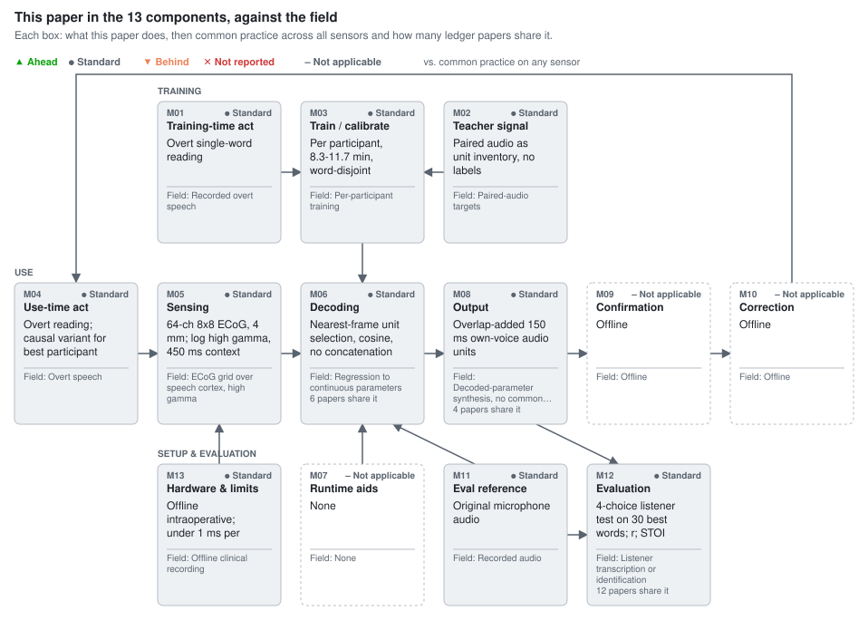

# Generating Natural, Intelligible Speech From Brain Activity in Motor, Premotor, and Inferior Frontal Cortices

Herff, Diener, Angrick, Mugler, Tate, Goldrick, Krusienski, Slutzky, Schultz. Frontiers in Neuroscience 13: 1267, 2019. [doi:10.3389/fnins.2019.01267](https://doi.org/10.3389/fnins.2019.01267)

**Section:** [Other sensors](../../README.md#other-sensors)

## Figures

### This paper in the 13 components, against the field

<picture><source media="(prefers-color-scheme: dark)" srcset="figures/components-dark.svg"></picture>

Verdicts compare the paper's choice for each component with common practice across 8,995 ledger entries on any sensor (silent speech, brain-to-text, lip reading).

Data

| Component | This paper | Common practice | Papers with this practice | Verdict |
| --- | --- | --- | --- | --- |
| M01 Training-time act | Overt single-word reading | Recorded overt speech |  | ● Standard (Inherited; same recordings as Angrick 2019.) |
| M02 Teacher signal | Paired audio as unit inventory, no labels | Paired-audio targets |  | ● Standard (Inherited.) |
| M03 Train / calibrate | Per participant, 8.3-11.7 min, word-disjoint 5-fold | Per-participant training |  | ● Standard (Durations differ from Angrick 2019 for the same data.) |
| M04 Use-time act | Overt reading; causal variant for best participant only | Overt speech |  | ● Standard (Causal result not given for all participants.) |
| M05 Sensing | 64-ch 8x8 ECoG, 4 mm; log high gamma, 450 ms context | ECoG grid over speech cortex, high gamma |  | ● Standard (Region comparison is analysis, not a design change.) |
| M06 Decoding | Nearest-frame unit selection, cosine, no concatenation cost | Regression to continuous parameters | 6 of 6 | ● Standard (New to intracranial; 6 prior biosignal unit-selection studies; no same-protocol comparison.) |
| M07 Runtime aids | None | None |  | – Not applicable (No lexicon or language model.) |
| M08 Output | Overlap-added 150 ms own-voice audio units | Decoded-parameter synthesis, no common method | 4 of 4 | ● Standard (Cross-signal EMG precedent; naturalness not measured.) |
| M09 Confirmation | Offline | Offline |  | – Not applicable (Offline study.) |
| M10 Correction | Offline | Offline |  | – Not applicable (Offline study.) |
| M11 Eval reference | Original microphone audio | Recorded audio |  | ● Standard (Inherited.) |
| M12 Evaluation | 4-choice listener test on 30 best words; r; STOI | Listener transcription or identification | 12 of 12 | ● Standard (Pre-selected stimuli; fewer options than the only neural production precedent.) |
| M13 Hardware & limits | Offline intraoperative; under 1 ms per window | Offline clinical recording |  | ● Standard (Real-time claim scoped to small inventory.) |

## Verdict

The paper [[1]](#ref-1) changes the decoder (M06), selecting stored frames by cosine similarity of high-gamma features, and the waveform step (M08), overlap-adding the participant's own audio. Both are standard. Unit selection is new to intracranial synthesis (0 of 6 earlier studies, Appendix) but 6 earlier ultrasound and EMG studies used it, and the authors cite the EMG precedent [[2]](#ref-2). Superiority over "more complex approaches" is unsupported: no comparator runs on the paper's folds, and the authors concede "slightly lower" correlations than their group's DenseNet on the same recordings [[3]](#ref-3), a sibling method presented with unit selection in 2018 [[4]](#ref-4). The listener test (M12) is standard, but four options on the 30 best-correlated words support "intelligible" only for those words, and "natural" is not measured.

## Against the field, component by component

### M06 Processing and decoding: unit selection by neural similarity

**Usual approach:** all 6 intracranial production reconstructions first public before 2019-05 regress continuous acoustic or synthesizer parameters, 4 with linear or Kalman models and 3 with deep networks (pattern match, Appendix) [[5]](#ref-5), [[6]](#ref-6); the 2016 pilot [[7]](#ref-7) is counted from citing texts ([later] [[8]](#ref-8); [[3]](#ref-3)). The target instead picks the nearest of over 50,000 stored frames.

**State of the art:** a [later] 2024 framework reaches a mean spectrogram PCC of 0.806 (causal 0.797) across 48 ECoG participants [[9]](#ref-9), against the target's 0.246 on different data.

As the paper says, the design comes from EMG-to-speech [[2]](#ref-2), later with a cosine target cost [[10]](#ref-10). Beyond a random-unit null (highest r = 0.04, Fig. 6A) and a qualitative comparison with Martin et al. (Discussion), "superior results than more complex approaches" has no reported comparison. The same-data DenseNet reports 0.19 to 0.69 per participant, per frequency bin on the pre-vocoder spectrogram [[3]](#ref-3); the target scores generated audio per word on word-disjoint folds (Correlation Analysis). The numbers are not comparable, and no same-protocol comparison of the group's two methods exists (Discussion). Verdict: standard.

### M08 Output: concatenated own-voice units

**Usual approach:** all 4 earlier intracranial studies that output a waveform generate it from decoded parameters, with no common method: 2 parametric synthesizers or vocoders [[5]](#ref-5), [[6]](#ref-6), 1 WaveNet trained on another speaker [[3]](#ref-3) and 1 spectrogram inversion [[7]](#ref-7) (pattern match, Appendix). None plays back recorded audio, as the target's 150 ms own-voice windows do.

**State of the art:** a [later] 2026 intracortical preprint reaches 5.24% listener transcription WER for one participant, offline, a full-system score not isolated to the waveform step [[11]](#ref-11).

The F0-carrying-units argument for naturalness is the EMG one [[2]](#ref-2). As cross-signal context, in an EMG comparison of four mappings listeners never preferred unit selection, which stayed above a real-time factor of 1 [[10]](#ref-10); the target's under 1 ms per 10 ms window holds "for our limited dataset size". Verdict: standard, on the cross-signal precedent rather than an intracranial majority.

### M12 Evaluation: listener test

**Usual approach:** all 12 earlier listener-test studies of speech synthesized from non-acoustic production signals (EMG, ultrasound, articulography, imaging, video, neural) use transcription or identification (Appendix); the 1 neural study identifies 325 spliced words among 10, 25 and 50 choices and transcribes sentences at a median 31% WER with a 25-word pool [[6]](#ref-6).

**State of the art:** listener open transcription reaches 5.24% WER in a [later] 2026 preprint [[11]](#ref-11); closed-set, listeners match sentences among 6 at 94.34% [[12]](#ref-12) (2025, [later], one participant).

Chance is 25% and the stimuli are the 30 best-correlated words, so the mean of 66.1% from 55 listeners (Fig. 5B), 55% of the way from chance to ceiling (inference), holds only for those words. Four options is fewer than the 10, 25 and 50 choices of the only earlier neural production test (Appendix). STOI 0.15 is mapped to "36%" by a predictor the authors call "notoriously unreliable" for synthesis. Verdict: standard.

## The 13 components

| Component | This paper | Usual approach (count) | State of the art | Verdict |
|---|---|---|---|---|
| M01 Training-time action | Overt single-word reading | Recorded overt speech | – | standard |
| M02 Training-only supervision | Paired audio as unit inventory, no labels | Paired-audio targets | – | standard |
| M03 Training and adaptation | Per participant, 8.3-11.7 min, word-disjoint 5-fold | Per-participant training | – | standard |
| M04 Use-time action | Overt reading; causal variant for best participant only | Overt speech | – | standard |
| M05 Sensors | 64-ch 8x8 ECoG, 4 mm; log high gamma, 450 ms context | ECoG grid over speech cortex, high gamma | – | standard |
| M06 Processing and decoding | Nearest-frame unit selection, cosine, no concatenation cost | Regression to continuous parameters (pattern match 6) | [[9]](#ref-9) (2024): PCC 0.806, 48 participants | standard |
| M07 Lexicon and LM | None | None | – | not applicable |
| M08 Output | Overlap-added 150 ms own-voice audio units | Decoded-parameter synthesis, no common method (pattern match 4) | [[11]](#ref-11) (2026): 5.24% listener WER, full system, preprint | standard |
| M09 Confirmation | Offline | Offline | – | not applicable |
| M10 Correction | Offline | Offline | – | not applicable |
| M11 Reference construction | Original microphone audio | Recorded audio | – | standard |
| M12 Evaluation | 4-choice listener test on 30 best words; r; STOI | Listener transcription or identification (confirmed 12) | [[11]](#ref-11) (2026): 5.24% open-transcription WER, preprint | standard |
| M13 Device and cost | Offline intraoperative; under 1 ms per window | Offline clinical recording | – | standard |

## Where the claims outrun the evidence

- "Natural" and "prosody" (Abstract) rest on own-voice units; no naturalness rating is reported (Fig. 5).
- "Superior results than more complex approaches" is not supported: the only same-data decoder reports higher, differently computed correlations, and the authors concede "slightly lower" [[3]](#ref-3).
- "Real-time ready": the causal result (0.528 against 0.57) is reported only for the best participant (Fig. 6B).
- Recording length: 8.3 to 11.7 min (Table 1) against 8.5 to 12.7 min for the same participants [[3]](#ref-3).

## What the field needs next

- M06: unit selection, linear regression and a DNN on identical word-disjoint folds, scored on the same waveform.
- M08: own-voice concatenation against a vocoder, rated blind for naturalness and speaker similarity.
- M12: open transcription of every test word, per participant.

## Questions for the authors

- Which participants supplied the 30 listening words, and what is accuracy per participant?
- Were those words chosen from test-fold correlations only?
- What are the causal correlations for all six participants?
- Which seeds fixed the folds and the 1,000 random-unit baselines?

## Appendix: literature search

- M06 intracranial-synthesis-decoder-architecture (published table, reused and appended). Inclusion rule: intracranial production-speech acoustic reconstruction, classified by the neural-to-acoustic model; prior-time tally of studies first public before 2019-05 reconstructing continuous acoustic or synthesizer parameters from intracranial recordings during produced speech, versions once, reviews, perception and classification studies excluded; Martin 2014 and Chakrabarti 2015 added from the M12 reconstruction table, and Herff 2016 [[7]](#ref-7) from citing texts. Ledger: 7,345 slot-filled, 180 pattern match (unique studies). At target time: 6 studies; regression to continuous parameters 6 of 6 (linear or Kalman 4, deep network 3); unit selection 0 of 6; [concurrent] none. Whole-wiki full-text check (unit selection, concatenative or corpus-based synthesis): 153 unique studies (191 folders); 34 folders with the match near a signal term read as snippets; neural-signal unit selection before the target 0, apart from the May 2018 meeting report of the authors' talk [[4]](#ref-4); biosignal unit selection 6 prior studies: Hueber 2007, 2008 and 2010 (ultrasound and lip video, phonetic targets) and Zahner 2014 [[2]](#ref-2), Diener 2015 and Janke 2016 [[10]](#ref-10) (EMG, direct frame matching). Read in full: [[3]](#ref-3), [[6]](#ref-6), [[2]](#ref-2), [[10]](#ref-10); state of the art [[9]](#ref-9). Known-item recall 1.0.
- M08 intracranial-synthesis-waveform-generation (published table, reused and appended). Inclusion rule: intracranial production-speech acoustic reconstruction, classified by how features become a waveform; prior-time tally of the studies above that output a waveform. Ledger: 3,268 slot-filled, 180 pattern match (unique studies). At target time: 4 studies, all generating audio from decoded parameters; parametric synthesizer or vocoder 2 of 4, neural vocoder 1 of 4, spectrogram inversion 1 of 4, own-voice concatenation 0 of 4; same full-text check as M06. Read in full: [[5]](#ref-5) (published table), [[6]](#ref-6), [[3]](#ref-3); state of the art [[11]](#ref-11). Known-item recall 1.0.
- M12 listener-intelligibility-test (published table, reused and appended). Inclusion rule: speech synthesized from non-acoustic signals evaluated by listeners who transcribe or identify words or sentences; naturalness-only, ASR-only, acoustic-input conversion and mentions excluded; versions once; for this review, perception decoding excluded. Ledger: 6,960 slot-filled, 37 pattern match (unique studies). At target time: 12 prior production studies (confirmed include decisions), 1 of them neural; [concurrent] 2. Read in full: [[6]](#ref-6); state of the art [[11]](#ref-11), [[12]](#ref-12). Known-item recall 1.0.

## References

Numbered by first citation. BibTeX in the same order and keys: [refs.bib](refs.bib).

1. Herff, C., Diener, L., Angrick, M., Mugler, E., Tate, M. C., Goldrick, M. A., et al. “Generating Natural, Intelligible Speech From Brain Activity in Motor, Premotor, and Inferior Frontal Cortices.” *Frontiers in Neuroscience*, 2019, 13, 1267. doi:[10.3389/fnins.2019.01267](https://doi.org/10.3389/fnins.2019.01267). Target. Read as the published article (PMC6882773), published 22 November 2019. [wiki: doi-10.3389-fnins.2019.01267](https://github.com/supernaiter/deep-research-wiki-for-silent-speech/blob/main/papers/doi-10.3389-fnins.2019.01267/article.md) [wiki: pmc-6882773-b2speech](https://github.com/supernaiter/deep-research-wiki-for-silent-speech/blob/main/papers/pmc-6882773-b2speech/article.md) [wiki: pmc-6882773-braintospeech](https://github.com/supernaiter/deep-research-wiki-for-silent-speech/blob/main/papers/pmc-6882773-braintospeech/article.md)
2. Zahner, M., Janke, M., Wand, M., Schultz, T. “Conversion from Facial Myoelectric Signals to Speech: A Unit Selection Approach.” *Proc. Interspeech 2014*, 2014. doi:[10.21437/Interspeech.2014-164](https://doi.org/10.21437/Interspeech.2014-164). [wiki: isca-zahner14_interspeech](https://github.com/supernaiter/deep-research-wiki-for-silent-speech/blob/main/papers/isca-zahner14_interspeech/article.md)
3. Angrick, M., Herff, C., Mugler, E., Tate, M. C., Slutzky, M. W., Krusienski, D. J., et al. “Speech Synthesis from ECoG using Densely Connected 3D Convolutional Neural Networks.” *Journal of Neural Engineering*, 2019, 16(3), 036019. doi:[10.1088/1741-2552/ab0c59](https://doi.org/10.1088/1741-2552/ab0c59). [review](https://github.com/supernaiter/silent-speech-review/tree/main/reviews/speech-synthesis-from-ecog-using-densely-connected-3d-convolutional-neural-networks) [wiki: doi-10.1088-1741-2552-ab0c59](https://github.com/supernaiter/deep-research-wiki-for-silent-speech/blob/main/papers/doi-10.1088-1741-2552-ab0c59/article.md) [wiki: pmc-6822609-3dcnn](https://github.com/supernaiter/deep-research-wiki-for-silent-speech/blob/main/papers/pmc-6822609-3dcnn/article.md) [wiki: doi-10.1101-478644](https://github.com/supernaiter/deep-research-wiki-for-silent-speech/blob/main/papers/doi-10.1101-478644/article.md)
4. Huggins, J. E., Guger, C., Aarnoutse, E., Allison, B., Anderson, C. W., Bedrick, S., et al. “Workshops of the Seventh International Brain-Computer Interface Meeting: Not Getting Lost in Translation.” *Brain-Computer Interfaces*, 2019. doi:[10.1080/2326263X.2019.1697163](https://doi.org/10.1080/2326263X.2019.1697163). [concurrent] [wiki: pmc-7539697-bciworkshops](https://github.com/supernaiter/deep-research-wiki-for-silent-speech/blob/main/papers/pmc-7539697-bciworkshops/article.md)
5. Guenther, F. H., Brumberg, J. S., Wright, E. J., Nieto-Castanon, A., Tourville, J. A., Panko, M., et al. “A Wireless Brain-Machine Interface for Real-Time Speech Synthesis.” *PLoS ONE*, 2009, 4(12), e8218. doi:[10.1371/journal.pone.0008218](https://doi.org/10.1371/journal.pone.0008218). [review](https://github.com/supernaiter/silent-speech-review/tree/main/reviews/a-wireless-brain-machine-interface-for-real-time-speech-synthesis) [wiki: pmc-2784218-wireless](https://github.com/supernaiter/deep-research-wiki-for-silent-speech/blob/main/papers/pmc-2784218-wireless/article.md) [wiki: pmc-2784218-wirelesssynth](https://github.com/supernaiter/deep-research-wiki-for-silent-speech/blob/main/papers/pmc-2784218-wirelesssynth/article.md) [wiki: doi-10.1371-journal.pone.0008218](https://github.com/supernaiter/deep-research-wiki-for-silent-speech/blob/main/papers/doi-10.1371-journal.pone.0008218/article.md)
6. Anumanchipalli, G. K., Chartier, J., Chang, E. F. “Speech synthesis from neural decoding of spoken sentences.” *Nature*, 2019, 568(7753), 493–498. doi:[10.1038/s41586-019-1119-1](https://doi.org/10.1038/s41586-019-1119-1). [review](https://github.com/supernaiter/silent-speech-review/tree/main/reviews/speech-synthesis-from-neural-decoding-of-spoken-sentences) [wiki: doi-10.1038-s41586-019-1119-1](https://github.com/supernaiter/deep-research-wiki-for-silent-speech/blob/main/papers/doi-10.1038-s41586-019-1119-1/article.md) [wiki: pmc-9714519-speechsynth](https://github.com/supernaiter/deep-research-wiki-for-silent-speech/blob/main/papers/pmc-9714519-speechsynth/article.md)
7. Herff, C., Johnson, G., Diener, L., Shih, J., Krusienski, D., Schultz, T. “Towards direct speech synthesis from ECoG: A pilot study.” *Proc. 38th Annual International Conference of the IEEE Engineering in Medicine and Biology Society (EMBC)*, 2016, 1540–1543. doi:[10.1109/EMBC.2016.7591004](https://doi.org/10.1109/EMBC.2016.7591004). Not in the wiki; described from citing papers.
8. Ben Ticha, M. B. “Reconstruction of overt speech from Electrocorticographic (ECoG) data using deep neural networks.” *PhD thesis, HAL theses tel-05219015*, 2025. <https://theses.hal.science/tel-05219015> [later] [wiki: tel-5219015-ecogthesis](https://github.com/supernaiter/deep-research-wiki-for-silent-speech/blob/main/papers/tel-5219015-ecogthesis/article.md)
9. Chen, X., Wang, R., Khalilian-Gourtani, A., Yu, L., Dugan, P., Friedman, D., et al. “A neural speech decoding framework leveraging deep learning and speech synthesis.” *Nature Machine Intelligence*, 2024. doi:[10.1038/s42256-024-00824-8](https://doi.org/10.1038/s42256-024-00824-8). [later] [wiki: doi-10.1038-s42256-024-00824-8](https://github.com/supernaiter/deep-research-wiki-for-silent-speech/blob/main/papers/doi-10.1038-s42256-024-00824-8/article.md) [wiki: doi-10.1101-2023.09.16.558028](https://github.com/supernaiter/deep-research-wiki-for-silent-speech/blob/main/papers/doi-10.1101-2023.09.16.558028/article.md) [wiki: pmc-12965882-nmidecode](https://github.com/supernaiter/deep-research-wiki-for-silent-speech/blob/main/papers/pmc-12965882-nmidecode/article.md) [wiki: pmc-12965882-nsdecode](https://github.com/supernaiter/deep-research-wiki-for-silent-speech/blob/main/papers/pmc-12965882-nsdecode/article.md)
10. Janke, M. “EMG-to-Speech: Direct Generation of Speech from Facial Electromyographic Signals.” *Karlsruhe Institute of Technology (KIT), Doctoral dissertation*, 2016. <https://publikationen.bibliothek.kit.edu/1000054490> Doctoral dissertation (oral examination 22 April 2016); the wiki folder carrying this text is registered under the later TASLP article DOI. [wiki: doi-10.1109-taslp-2017-2738568](https://github.com/supernaiter/deep-research-wiki-for-silent-speech/blob/main/papers/doi-10.1109-taslp-2017-2738568/article.md)
11. Wairagkar, M., Srinivasan, A., Card, N. S., Singer-Clark, T., Hou, X., Iacobacci, C., et al. “Brain2voice 2.0: High-performance voice synthesis brain-computer interface.” *bioRxiv*, 2026. doi:[10.64898/2026.06.30.735633](https://doi.org/10.64898/2026.06.30.735633). [later] [wiki: doi-10.64898-2026.06.30.735633](https://github.com/supernaiter/deep-research-wiki-for-silent-speech/blob/main/papers/doi-10.64898-2026.06.30.735633/article.md)
12. Wairagkar, M., Card, N. S., Singer-Clark, T., Hou, X., Iacobacci, C., Miller, L. M., et al. “An instantaneous voice-synthesis neuroprosthesis.” *Nature*, 2025. doi:[10.1038/s41586-025-09127-3](https://doi.org/10.1038/s41586-025-09127-3). [later] [review](https://github.com/supernaiter/silent-speech-review/tree/main/reviews/an-instantaneous-voice-synthesis-neuroprosthesis) [wiki: doi-10.1038-s41586-025-09127-3](https://github.com/supernaiter/deep-research-wiki-for-silent-speech/blob/main/papers/doi-10.1038-s41586-025-09127-3/article.md) [wiki: doi-10.1101-2024.08.14.607690](https://github.com/supernaiter/deep-research-wiki-for-silent-speech/blob/main/papers/doi-10.1101-2024.08.14.607690/article.md) [wiki: pmc-12369848-voicesynth](https://github.com/supernaiter/deep-research-wiki-for-silent-speech/blob/main/papers/pmc-12369848-voicesynth/article.md) [wiki: pmc-12369848-voice-synth-np](https://github.com/supernaiter/deep-research-wiki-for-silent-speech/blob/main/papers/pmc-12369848-voice-synth-np/article.md) [wiki: pmc-11370360-instvoice](https://github.com/supernaiter/deep-research-wiki-for-silent-speech/blob/main/papers/pmc-11370360-instvoice/article.md)

## Materials

Data behind this review. Full texts of the papers are not included.

- [`review.md`](review.md): the review text (source)
- [`refs.bib`](refs.bib): references (BibTeX)
- [`slots.json`](slots.json): for each of the 13 components: this paper's choice, field practice, number of matching papers, verdict
- [`figures.json`](figures.json): figure definitions
- [`evaluation.md`](evaluation.md): independent evaluation by a second reviewer
- [`triage.md`](triage.md): how each evaluation finding was checked against the sources and resolved
- [`process/log.json`](process/log.json): process record: each step, who did it (reader, script, writer, evaluator), when, the checks run and the input versions
- [`process/notes.json`](process/notes.json): reading notes on the target and comparator papers: claims, numbers, conditions and what is not stated, with locations
- [`process/plan.json`](process/plan.json): plan: which components the paper changes and the topics it is compared on
- [`process/draft.md`](process/draft.md): the review as first written, before the independent evaluation
- [`process/claims-draft.md`](process/claims-draft.md): claim table of the draft: every claim mapped to a note or a count
- [`process/claims.md`](process/claims.md): claim table of the published review
- [`components/M06/intracranial-synthesis-decoder-architecture.csv`](../../components/M06/intracranial-synthesis-decoder-architecture.csv): M06 topic "intracranial-synthesis-decoder-architecture", every candidate paper with its decision (7345 slot-filled, 180 pattern match, usual design in 79, 4 read in full)
- [`components/M08/intracranial-synthesis-waveform-generation.csv`](../../components/M08/intracranial-synthesis-waveform-generation.csv): M08 topic "intracranial-synthesis-waveform-generation", every candidate paper with its decision (3268 slot-filled, 180 pattern match, usual design in 51, 2 read in full)
- [`components/M12/listener-intelligibility-test.csv`](../../components/M12/listener-intelligibility-test.csv): M12 topic "listener-intelligibility-test", every candidate paper with its decision (6960 slot-filled, 37 pattern match, usual design in 15, 5 read in full)

## More reviews in Other sensors

- [Real-time decoding of question-and-answer speech dialogue using human cortical activity](../real-time-decoding-of-question-and-answer-speech-dialogue-using-human-cortical-activity/) (2019). Context prior from the decoded question (M07) is ahead, gaining in 3 of 3 participants; HMM decoder (M06) is standard; no online accuracy or latency backs the real-time claim.
- [Recurrent Neural Network Transducer for Audio-Visual Speech Recognition](../recurrent-neural-network-transducer-for-audio-visual-speech-recognition/) (2019). First neural transducer for audio-visual speech in the ledger, but the LRS3 gain mixes 31k h of data, external-LM baselines and the decoder; one run, one test set: all changes standard.
- [Spatio-Temporal Fusion based Convolutional Sequence Learning for Lip Reading](../spatio-temporal-fusion-based-convolutional-sequence-learning-for-lip-reading/) (2019). STFM and the convolutional encoder-decoder (M06) are standard: layout-keeping reduction predates it, baselines are weakened; LRW SOTA claim fails; LM use never stated (M07).
- [Speech Synthesis from ECoG using Densely Connected 3D Convolutional Neural Networks](../speech-synthesis-from-ecog-using-densely-connected-3d-convolutional-neural-networks/) (2019). 3D DenseNet regressor (M06) and LJ-Speech WaveNet (M08) are standard: no in-paper baseline, mixed later head-to-heads, and no listener test behind the quality claims.
- [Towards reconstructing intelligible speech from the human auditory cortex](../towards-reconstructing-intelligible-speech-from-the-human-auditory-cortex/) (2019). M06 ahead for heard speech: a pretrained autoencoder code of vocoder parameters beats spectrograms in all five patients; synthesizer decoding dates to 2009; M12 listener test unrepeated.
- [ASR is all you need: cross-modal distillation for lip reading](../asr-is-all-you-need-cross-modal-distillation-for-lip-reading/) (2020). ASR-teacher labels (M02) replaced transcribed-data alignment targets; standard: LRS2 parity holds, but effects differ across datasets, one WER each, and distillation is not isolated.

---

Part of the [Silent Speech Interface Review](https://github.com/supernaiter/silent-speech-review). Found an error? [Open an issue](https://github.com/supernaiter/silent-speech-review/issues/new?template=correction.yml).
