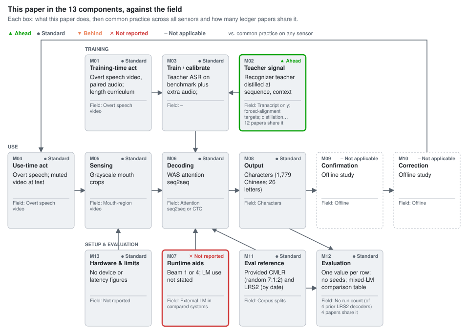

# Hearing Lips: Improving Lip Reading by Distilling Speech Recognizers

Zhao, Y., Xu, R., Wang, X., Hou, P., Tang, H., Song, M. · AAAI 2020 · 2020 · [doi:10.1609/aaai.v34i04.6174](https://doi.org/10.1609/aaai.v34i04.6174) · [arXiv:1911.11502](https://arxiv.org/abs/1911.11502)

**Section:** [Other sensors](../../README.md#other-sensors)

## Figures

### This paper in the 13 components, against the field

<picture><source media="(prefers-color-scheme: dark)" srcset="figures/components-dark.svg"></picture>

Verdicts compare the paper's choice for each component with common practice across 8,995 ledger entries on any sensor (silent speech, brain-to-text, lip reading).

Data

| Component | This paper | Common practice | Papers with this practice | Verdict |
| --- | --- | --- | --- | --- |
| M01 Training-time act | Overt speech video, paired audio; length curriculum | Overt speech video |  | ● Standard (Inherited from the WAS lineage.) |
| M02 Teacher signal | Recognizer teacher distilled at sequence, context and frame level; transcripts kept | Transcript only; forced-alignment targets; distillation 0 of 76 | 12 of 76 | ▲ Ahead (Absent among 76 prior decoders and in whole-wiki recall for a video-only student; Li et al. (2019-04) distil into an audio-visual student; gains on CMLR, LRS2 and three teachers, single values.) |
| M03 Train / calibrate | Teacher ASR on benchmark plus extra audio; grid-searched KD weights | – |  | ● Standard (Inherited; selection split and teacher audio split not stated.) |
| M04 Use-time act | Overt speech; muted video at test | Overt speech video |  | ● Standard (Inherited.) |
| M05 Sensing | Grayscale mouth crops | Mouth-region video |  | ● Standard (Inherited.) |
| M06 Decoding | WAS attention seq2seq | Attention seq2seq or CTC |  | ● Standard (Inherited from WAS.) |
| M07 Runtime aids | Beam 1 or 4; LM use not stated | External LM in compared systems |  | ✕ Not reported (Needed because Table 5 compares against systems decoded with an external LM.) |
| M08 Output | Characters (1,779 Chinese; 26 letters) | Characters |  | ● Standard (Inherited.) |
| M09 Confirmation | Offline study | Offline |  | – Not applicable (Offline benchmark.) |
| M10 Correction | Offline study | Offline |  | – Not applicable (No user correction.) |
| M11 Eval reference | Provided CMLR (random 7:1:2) and LRS2 (by date) splits | Corpus splits |  | ● Standard (CMLR test speakers also appear in training (inference from the random split); not stated by the paper.) |
| M12 Evaluation | One value per row; no seeds; mixed-LM comparison table | No run count (of 4 prior LRS2 decoders) | 4 of 4 | ● Standard (State-of-the-art claim holds for CMLR only.) |
| M13 Hardware & limits | No device or latency figures | Not reported |  | ● Standard (Inherited.) |

## Verdict

The paper [[1]](#ref-1) changes the training-only supervision (M02): a speech recognizer is distilled into a sentence-level lip reader at three granularities, transcripts kept, which the authors call "the first attempt along this line" (§1). Before 2019-05, audio entered training of 76 sentence-level lip-reading and audio-visual decoders as forced-alignment targets (12, 8 for the visual stream) and never as distilled teacher outputs (0, pattern match, Appendix); the closest prior, Li et al. (2019-04) [[2]](#ref-2), distils into an audio-visual student. For a video-only student the design is ahead at the time, shared with the [concurrent] Afouras et al. [[3]](#ref-3). The gain repeats on CMLR, LRS2 and all three teachers, single values without run counts (§4), but the rationale that the benefit comes from audio is untested: a [later] same-student comparison finds a video teacher about as useful [[4]](#ref-4). The state-of-the-art claim (M12) holds for CMLR only; on LRS2 the paper's Table 5 lists two earlier systems with lower WER.

## Against the field, component by component

### M02 Training-only supervision: recognizer teacher distilled into the lip reader

**Usual approach:** In 76 sentence-level lip-reading and audio-visual decoders first public before 2019-05, supervision is the transcript; 12 also take forced-alignment labels from an audio recognizer as targets, 8 for the visual stream (pattern match, Appendix), e.g. [[5]](#ref-5), [[6]](#ref-6); none of the 76 distils a recognizer's outputs or states (Appendix). LIBS uses soft teacher targets.

**State of the art:** Ren et al. (2021) [[4]](#ref-4) [later] isolate the step on LRS2: one student gives 57.5% WER without distillation, 54.2% with an audio teacher and 53.4% with a video teacher, single values, teacher sizes not stated (Table 1). The audio-teacher gain, 3.3 points (5.7% relative), is close to LIBS's 2.90 on LRS2 (68.19% to 65.29%, 4.3% relative), from a baseline about 11 points weaker (inference).

Whole-wiki recall finds no study before 2019-05 distilling an audio teacher into a non-acoustic decoder (Appendix). Li et al., "the closest work" for Afouras et al., does not lip read "from the video signal alone" ([[3]](#ref-3), §1.1). [concurrent]: Afouras et al. report 58.5% LRS2 WER for ground-truth CTC against 57.9% for distillation then fine-tuning on a small fraction of ground truth, 6-gram LM [[3]](#ref-3); a throat-microphone student [[7]](#ref-7) is acoustic.

The effect repeats: CER falls from 38.93% to 31.27% on CMLR and from 48.28% to 45.53% on LRS2 (Table 3), 19.7% and 5.7% relative (inference), and every teacher beats WAS on CMLR (31.27% to 34.94% against 38.93%, Table 2). Verdict: ahead for a video-only student.

### M12 Evaluation: state-of-the-art claim and run counts

**Usual approach:** None of the 4 earlier decoders reporting visual-only LRS2 error rates states seeds or repeated runs (pattern match, Appendix); nor does LIBS (Tables 2–5).

**State of the art:** On LRS2 visual-only WER, USR (2024) [[8]](#ref-8) [later] reaches 16.0% without an LM (223 labelled, 1,759 unlabelled hours); its Table 6 lists Auto-AVSR at 14.6% with an LM and 3,448 labelled hours. On CMLR, Ma et al. (2022) [[9]](#ref-9) [later] report 9.1% CER, mean of ten runs, with an external LM on CMLR plus news2016zh text. LIBS is 49.3 and 22.2 points higher; the gaps mix LM and data (inference).

The abstract claims "the new state-of-the-art performance on the CMLR and LRS2 datasets"; Table 5 supports CMLR (31.27% against 32.48% for the authors' own [concurrent] CSSMCM [[10]](#ref-10)); on LRS2 it lists CTC/Attention [[11]](#ref-11) at 42.1% CER and 63.5% WER and TM-seq2seq at 49.8% WER, against 45.53% and 65.29%. The authors concede TM-seq2seq "achieves the lowest WER on the LRS2 dataset" (§4). CTC/Attention uses an external LM [[11]](#ref-11); TM-seq2seq's 49.8% is its no-LM row [[12]](#ref-12); LIBS does not state its LM use. Verdict: standard, as the field also gave no run counts.

## The 13 components

| Component | This paper | Usual approach (count) | State of the art | Verdict |
|---|---|---|---|---|
| M01 Training-time action | Overt speech video, paired audio; length curriculum | Overt speech video | – | standard |
| M02 Training-only supervision | Recognizer teacher distilled at sequence, context and frame level; transcripts kept | Transcript only; forced-alignment targets; distillation 0 of 76 (pattern match 12) | [[4]](#ref-4) (2021): LRS2 57.5% WER, audio teacher 54.2%, video teacher 53.4% | ahead |
| M03 Training and adaptation | Teacher ASR on benchmark plus extra audio; grid-searched KD weights | – | – | standard |
| M04 Use-time action | Overt speech; muted video at test | Overt speech video | – | standard |
| M05 Sensors | Grayscale mouth crops | Mouth-region video | – | standard |
| M06 Processing and decoding | WAS attention seq2seq | Attention seq2seq or CTC | – | standard |
| M07 Lexicon and LM | Beam 1 or 4; LM use not stated | External LM in compared systems | – | not reported |
| M08 Output | Characters (1,779 Chinese; 26 letters) | Characters | – | standard |
| M09 Confirmation | Offline study | Offline | – | not applicable |
| M10 Correction | Offline study | Offline | – | not applicable |
| M11 Reference construction | Provided CMLR (random 7:1:2) and LRS2 (by date) splits | Corpus splits | – | standard |
| M12 Evaluation | One value per row; no seeds; mixed-LM comparison table | No run count (of 4 prior LRS2 decoders) (pattern match 4) | [[8]](#ref-8) (2024): LRS2 VSR 16.0% WER without LM | standard |
| M13 Device and cost | No device or latency figures | Not reported | – | standard |

## Where the claims outrun the evidence

- The motivating 10.4% against 39.5% CER, "Given the same amount of training data and model architecture" (§1), comes from Chung et al. [[13]](#ref-13) on LRS, not LRS2, whose audio model also trains on 342,644 extra audio-only utterances (Tables 4–5).
- That audio gives "complementary and discriminant clues" (Abstract) lacks a same-modality teacher control; Ren et al. [[4]](#ref-4) and self-distillation [[14]](#ref-14), both [later], show video teachers help.
- Teacher 2 beats Teacher 1 on ASR CER (9.23% against 9.83%) yet gives a worse student (34.94% against 31.27%, Table 2); the authors' cause, mismatched dimensions (§4), is the same change as a wider teacher.
- Frame-level distillation adds 0.44 CER points over sequence plus context on LRS2 (45.97% to 45.53%, Table 3), one value (inference).
- CMLR is split at random 7:1:2 over eleven hosts [[10]](#ref-10), so its test speakers are seen in training (inference); §4 does not say so.

## What the field needs next

- M02: one student distilled from audio, video and audio-visual teachers of matched size, several seeds.
- M02: per-granularity and LCS-filter ablations, repeated runs.
- M12: comparators under one LM setting; a speaker-disjoint CMLR test.
- M03: teachers trained on training audio only.

## Questions for the authors

- Is an external language model used in decoding?
- Which split selected the λ weights and checkpoints?
- Did teacher training use CMLR or LRS2 test audio?
- How many runs underlie each row of Tables 2–4?

## Appendix: literature search

- M02, knowledge-distillation-in-speech-decoding (published table, appended). Inclusion rule: speech decoding from any non-acoustic or audio-visual signal with a teacher-student objective; for this review, the design is compared on the 76 sentence-level lip-reading, VSR and AVSR decoders first public before 2019-05 and the 17 [concurrent] ones (2019-05 to 2020-05), from a 633-study population after removing perception, neuroscience, corpus, enhancement and review papers and version duplicates (an inventory-based audio-visual enhancement paper excluded on reading, leaving 76 of the shared 77), by full-text pattern (reference list removed) with every prior hit snippet read. Ledger counts (all dates, not used in the comparison): slot-filled 31 (M02); 22 unique studies ledger match; 131 with ledger or full-text mentions (pattern match). Before 2019-05: distillation 1 of 76 (a mention of acoustic teacher-student training), same design 0; audio forced alignment 20 of 76, of which 12 use audio-derived alignments as training targets (8 for the visual stream, 4 for audio-visual models), 4 build corpora or evaluation boundaries, 4 mention it; audio-feature regression 0. Outside the wiki: Li et al. [[2]](#ref-2) (prior, 2019-04), ASR teacher into an audio-visual student. KD priors the target cites outside speech decoding: Hinton et al., Romero et al. (FitNets), Kim and Rush, Gupta et al. (image to depth) and Hou et al. (driving). [concurrent]: same design 2 (the target and [[3]](#ref-3)), adjacent 1 ([[7]](#ref-7), acoustic student). Whole-wiki recall, any signal, before 2020-06: 3,089 scanned (2,648 before 2019-05), 26 hits, same design before 2019-05: 0. Read: [[5]](#ref-5), [[6]](#ref-6) (prior); [[3]](#ref-3), [[7]](#ref-7) ([concurrent]); [[4]](#ref-4), [[14]](#ref-14) ([later]). Known-item recall 1.0.
- M12, lrs2-visual-only-sentence-evaluation (new). Inclusion rule: studies that report visual-only CER or WER on the LRS2 test set, any training regime; audio-only and audio-visual rows, keyword spotting and corpus papers excluded on reading; versions once. Ledger counts: 127 unique studies pattern match (182 folders); slot-filled 6,960 (M12). Before 2019-05: 5 raw, 4 decoders after excluding a keyword-spotting study; seeds or repeated runs 0 of 4 (spread-pattern hits were augmentation and normalization text); [concurrent]: 7 including the target. Read: [[12]](#ref-12), [[11]](#ref-11), [[13]](#ref-13), [[10]](#ref-10) (prior or [concurrent] comparators); [[8]](#ref-8), [[9]](#ref-9) (state of the art). Known-item recall 1.0.

## References

Numbered by first citation. BibTeX in the same order and keys: [refs.bib](refs.bib).

1. Zhao, Y., Xu, R., Wang, X., Hou, P., Tang, H., Song, M. “Hearing Lips: Improving Lip Reading by Distilling Speech Recognizers.” *Proceedings of the AAAI Conference on Artificial Intelligence*, 2020, 34(04), 6917-6924. doi:[10.1609/aaai.v34i04.6174](https://doi.org/10.1609/aaai.v34i04.6174). arXiv:[1911.11502](https://arxiv.org/abs/1911.11502). Target. AAAI-20 proceedings version; first public as arXiv:1911.11502 v1. [wiki: doi-10.1609-aaai.v34i04.6174](https://github.com/supernaiter/deep-research-wiki-for-silent-speech/blob/main/papers/doi-10.1609-aaai.v34i04.6174/article.md) [wiki: arxiv-1911.11502](https://github.com/supernaiter/deep-research-wiki-for-silent-speech/blob/main/papers/arxiv-1911.11502/article.md)
2. Li, W., Wang, S., Lei, M., Siniscalchi, S. M., Lee, C. “Improving Audio-visual Speech Recognition Performance with Cross-modal Student-teacher Training.” *IEEE International Conference on Acoustics, Speech and Signal Processing (ICASSP)*, 2019, 6560-6564. doi:[10.1109/ICASSP.2019.8682868](https://doi.org/10.1109/ICASSP.2019.8682868). Prior; ASR teacher distilled into an audio-visual student (M02), as described by Afouras et al.
3. Afouras, T., Chung, J. S., Zisserman, A. “ASR is all you need: cross-modal distillation for lip reading.” *IEEE International Conference on Acoustics, Speech and Signal Processing (ICASSP)*, 2020. arXiv:[1911.12747](https://arxiv.org/abs/1911.12747). ASR-teacher distillation into a lip reader, untranscribed video (M02). [concurrent] [review](https://github.com/supernaiter/silent-speech-review/tree/main/reviews/asr-is-all-you-need-cross-modal-distillation-for-lip-reading) [wiki: arxiv-1911.12747](https://github.com/supernaiter/deep-research-wiki-for-silent-speech/blob/main/papers/arxiv-1911.12747/article.md)
4. Ren, S., Du, Y., Lv, J., Han, G., He, S. “Learning from the Master: Distilling Cross-modal Advanced Knowledge for Lip Reading.” *IEEE/CVF Conference on Computer Vision and Pattern Recognition (CVPR)*, 2021. <https://openaccess.thecvf.com/content/CVPR2021/papers/Ren_Learning_From_the_Master_Distilling_Cross-Modal_Advanced_Knowledge_for_Lip_CVPR_2021_paper.pdf> Same LRS2 student without distillation and with audio or video teachers (M02). [later] [wiki: cvf-ren21-master-kd](https://github.com/supernaiter/deep-research-wiki-for-silent-speech/blob/main/papers/cvf-ren21-master-kd/article.md) [wiki: cvpr21-ren](https://github.com/supernaiter/deep-research-wiki-for-silent-speech/blob/main/papers/cvpr21-ren/article.md)
5. Sarı, L., Hasegawa-Johnson, M., Kumaran, S., Stemmer, G., Nair, K. N. “Speaker Adaptive Audio-Visual Fusion for the Open-Vocabulary Section of AVICAR.” *Interspeech 2018*, 2018, 3524-3528. doi:[10.21437/Interspeech.2018-2359](https://doi.org/10.21437/Interspeech.2018-2359). Prior; audio-ASR forced alignments as frame targets for a visual front end (M02). [wiki: isca-sari18-avicar](https://github.com/supernaiter/deep-research-wiki-for-silent-speech/blob/main/papers/isca-sari18-avicar/article.md)
6. Tatulli, E., Hueber, T. “Feature Extraction Using Multimodal Convolutional Neural Networks for Visual Speech Recognition.” *IEEE International Conference on Acoustics, Speech and Signal Processing (ICASSP)*, 2017. <https://www.gipsa-lab.grenoble-inp.fr/~thomas.hueber/mes_documents/tatulli_hueber_icassp2017.pdf> Prior; audio forced alignment labels video and ultrasound frames (M02). [wiki: icassp2017-tatulli-multimodal-cnn-vsr](https://github.com/supernaiter/deep-research-wiki-for-silent-speech/blob/main/papers/icassp2017-tatulli-multimodal-cnn-vsr/article.md)
7. Suzuki, T., Ogata, J., Tsunakawa, T., Nishida, M., Nishimura, M. “Knowledge Distillation for Throat Microphone Speech Recognition.” *Interspeech 2019*, 2019. doi:[10.21437/Interspeech.2019-3115](https://doi.org/10.21437/Interspeech.2019-3115). Close-talk teacher distilled into a throat-microphone student (M02). [concurrent] [wiki: isca-suzuki19_interspeech](https://github.com/supernaiter/deep-research-wiki-for-silent-speech/blob/main/papers/isca-suzuki19_interspeech/article.md)
8. Haliassos, A., Mira, R., Chen, H., Landgraf, Z., Petridis, S., Pantic, M. “Unified Speech Recognition: A Single Model for Auditory, Visual, and Audiovisual Inputs.” *Advances in Neural Information Processing Systems (NeurIPS)*, 2024. arXiv:[2411.02256](https://arxiv.org/abs/2411.02256). LRS2 visual-only WER without an LM, 223 labelled hours (M12). [later] [wiki: arxiv-2411.02256](https://github.com/supernaiter/deep-research-wiki-for-silent-speech/blob/main/papers/arxiv-2411.02256/article.md)
9. Ma, P., Petridis, S., Pantic, M. “Visual Speech Recognition for Multiple Languages in the Wild.” *Nature Machine Intelligence*, 2022, 930-939. doi:[10.1038/s42256-022-00550-z](https://doi.org/10.1038/s42256-022-00550-z). arXiv:[2202.13084](https://arxiv.org/abs/2202.13084). CMLR CER, mean over ten runs, external LM (M12). [later] [review](https://github.com/supernaiter/silent-speech-review/tree/main/reviews/visual-speech-recognition-for-multiple-languages-in-the-wild) [wiki: arxiv-2202.13084](https://github.com/supernaiter/deep-research-wiki-for-silent-speech/blob/main/papers/arxiv-2202.13084/article.md) [wiki: doi-10.1038-s42256-022-00550-z](https://github.com/supernaiter/deep-research-wiki-for-silent-speech/blob/main/papers/doi-10.1038-s42256-022-00550-z/article.md)
10. Zhao, Y., Xu, R., Song, M. “A Cascade Sequence-to-Sequence Model for Chinese Mandarin Lip Reading.” *ACM Multimedia Asia (MMAsia)*, 2019. doi:[10.1145/3338533.3366579](https://doi.org/10.1145/3338533.3366579). arXiv:[1908.04917](https://arxiv.org/abs/1908.04917). CSSMCM and the CMLR corpus, same group (M11, M12). [concurrent] [wiki: arxiv-1908.04917](https://github.com/supernaiter/deep-research-wiki-for-silent-speech/blob/main/papers/arxiv-1908.04917/article.md) [wiki: doi-10.1145-3338533.3366579](https://github.com/supernaiter/deep-research-wiki-for-silent-speech/blob/main/papers/doi-10.1145-3338533.3366579/article.md)
11. Petridis, S., Stafylakis, T., Ma, P., Tzimiropoulos, G., Pantic, M. “Audio-Visual Speech Recognition with a Hybrid CTC/Attention Architecture.” *IEEE Spoken Language Technology Workshop (SLT)*, 2018. doi:[10.1109/SLT.2018.8639643](https://doi.org/10.1109/SLT.2018.8639643). arXiv:[1810.00108](https://arxiv.org/abs/1810.00108). Prior; LRS2 visual-only CER and WER with an external LM (M12). [review](https://github.com/supernaiter/silent-speech-review/tree/main/reviews/audio-visual-speech-recognition-with-a-hybrid-ctc-attention-architecture) [wiki: arxiv-1810.00108](https://github.com/supernaiter/deep-research-wiki-for-silent-speech/blob/main/papers/arxiv-1810.00108/article.md) [wiki: doi-10.1109-slt.2018.8639643](https://github.com/supernaiter/deep-research-wiki-for-silent-speech/blob/main/papers/doi-10.1109-slt.2018.8639643/article.md)
12. Afouras, T., Chung, J. S., Senior, A., Vinyals, O., Zisserman, A. “Deep Audio-Visual Speech Recognition.” *IEEE Transactions on Pattern Analysis and Machine Intelligence*, 2018. doi:[10.1109/TPAMI.2018.2889052](https://doi.org/10.1109/TPAMI.2018.2889052). arXiv:[1809.02108](https://arxiv.org/abs/1809.02108). Prior; TM-seq2seq LRS2 WER with and without external LM (M12). [review](https://github.com/supernaiter/silent-speech-review/tree/main/reviews/deep-audio-visual-speech-recognition) [wiki: arxiv-1809.02108](https://github.com/supernaiter/deep-research-wiki-for-silent-speech/blob/main/papers/arxiv-1809.02108/article.md) [wiki: doi-10.1109-tpami.2018.2889052](https://github.com/supernaiter/deep-research-wiki-for-silent-speech/blob/main/papers/doi-10.1109-tpami.2018.2889052/article.md)
13. Chung, J. S., Senior, A., Vinyals, O., Zisserman, A. “Lip Reading Sentences in the Wild.” *IEEE Conference on Computer Vision and Pattern Recognition (CVPR)*, 2017. doi:[10.1109/CVPR.2017.367](https://doi.org/10.1109/CVPR.2017.367). arXiv:[1611.05358](https://arxiv.org/abs/1611.05358). Prior; WAS baseline and the audio-only against lips-only CER on LRS (M12). [review](https://github.com/supernaiter/silent-speech-review/tree/main/reviews/lip-reading-sentences-in-the-wild) [wiki: arxiv-1611.05358](https://github.com/supernaiter/deep-research-wiki-for-silent-speech/blob/main/papers/arxiv-1611.05358/article.md) [wiki: cvf-chung17-lipreadwild](https://github.com/supernaiter/deep-research-wiki-for-silent-speech/blob/main/papers/cvf-chung17-lipreadwild/article.md)
14. Ma, P., Martinez, B., Petridis, S., Pantic, M. “Towards Practical Lipreading with Distilled and Efficient Models.” *IEEE International Conference on Acoustics, Speech and Signal Processing (ICASSP)*, 2021, 7608-7612. doi:[10.1109/ICASSP39728.2021.9415063](https://doi.org/10.1109/ICASSP39728.2021.9415063). arXiv:[2007.06504](https://arxiv.org/abs/2007.06504). Same-modality self-distillation of a word-level lip reader (M02). [later] [wiki: arxiv-2007.06504](https://github.com/supernaiter/deep-research-wiki-for-silent-speech/blob/main/papers/arxiv-2007.06504/article.md)

## Materials

Data behind this review. Full texts of the papers are not included.

- [`review.md`](review.md): the review text (source)
- [`refs.bib`](refs.bib): references (BibTeX)
- [`slots.json`](slots.json): for each of the 13 components: this paper's choice, field practice, number of matching papers, verdict
- [`figures.json`](figures.json): figure definitions
- [`evaluation.md`](evaluation.md): independent evaluation by a second reviewer
- [`triage.md`](triage.md): how each evaluation finding was checked against the sources and resolved
- [`process/log.json`](process/log.json): process record: each step, who did it (reader, script, writer, evaluator), when, the checks run and the input versions
- [`process/notes.json`](process/notes.json): reading notes on the target and comparator papers: claims, numbers, conditions and what is not stated, with locations
- [`process/plan.json`](process/plan.json): plan: which components the paper changes and the topics it is compared on
- [`process/draft.md`](process/draft.md): the review as first written, before the independent evaluation
- [`process/claims-draft.md`](process/claims-draft.md): claim table of the draft: every claim mapped to a note or a count
- [`process/claims.md`](process/claims.md): claim table of the published review
- [`components/M02/knowledge-distillation-in-speech-decoding.csv`](../../components/M02/knowledge-distillation-in-speech-decoding.csv): M02 topic "knowledge-distillation-in-speech-decoding", every candidate paper with its decision (31 slot-filled, 22 pattern match, usual design in 46, 1 read in full)
- [`components/M12/lrs2-visual-only-sentence-evaluation.csv`](../../components/M12/lrs2-visual-only-sentence-evaluation.csv): M12 topic "lrs2-visual-only-sentence-evaluation", every candidate paper with its decision (6960 slot-filled, 127 pattern match, usual design in 4, 7 read in full)

## More reviews in Other sensors

- [ASR is all you need: cross-modal distillation for lip reading](../asr-is-all-you-need-cross-modal-distillation-for-lip-reading/) (2020). ASR-teacher labels (M02) replaced transcribed-data alignment targets; standard: LRS2 parity holds, but effects differ across datasets, one WER each, and distillation is not isolated.
- [Decoding Imagined and Spoken Phrases From Non-invasive Neural (MEG) Signals](../decoding-imagined-and-spoken-phrases-from-non-invasive-neural-meg-signals/) (2020). Scalogram CNNs (M06) and ImageNet weights (M03) were new for imagined speech but standard: effects not isolated; 93% imagination sits on a 43.77% pre-stimulus floor (Table 1).
- [Decoding spoken English from intracortical electrode arrays in dorsal precentral gyrus](../decoding-spoken-english-from-intracortical-electrode-arrays-in-dorsal-precentral-gyrus/) (2020). 39-phoneme decoding from dorsal Utah arrays (M06) and overt-speech confound controls (M12) are standard: both have read priors, T5 alone carries them, and folds share words.
- [Learning Individual Speaking Styles for Accurate Lip to Speech Synthesis](../learning-individual-speaking-styles-for-accurate-lip-to-speech-synthesis/) (2020). Lip2Wav's per-speaker natural corpus (M03) is ahead; its attention decoder (M06) is standard, since LipSound had one in 2019; two Table 2 baseline WERs match another recognizer's values.
- [Lipreading using Temporal Convolutional Networks](../lipreading-using-temporal-convolutional-networks/) (2020). Multi-scale TCN (M06) and variable-length cropping (M03) are standard: head and augmentation are not separated, no run counts, robustness comes from the cropping; 85.3% LRW trails 93.2% today.
- [Machine translation of cortical activity to text with an encoder-decoder framework](../machine-translation-of-cortical-activity-to-text-with-an-encoder-decoder-framework/) (2020). Word-level ECoG encoder-decoder; all changed components standard. 3% WER is on repeats of 50 sentences; unseen sentences and participants were never tested.

---

Part of the [Silent Speech Interface Review](https://github.com/supernaiter/silent-speech-review). Found an error? [Open an issue](https://github.com/supernaiter/silent-speech-review/issues/new?template=correction.yml).
