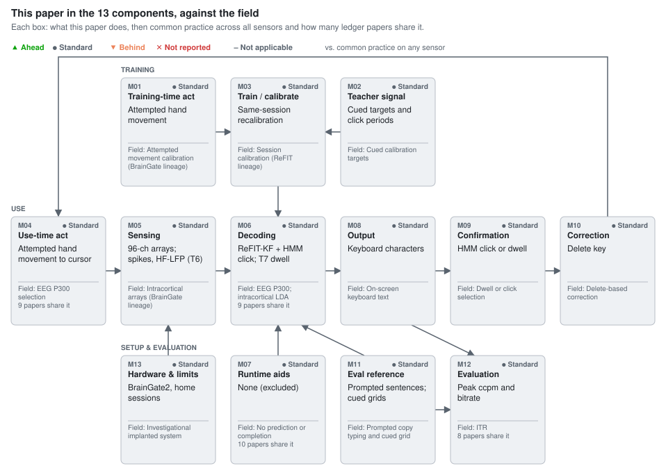

# High performance communication by people with paralysis using an intracortical brain-computer interface

Chethan Pandarinath, Paul Nuyujukian, Christine H. Blabe, Brittany L. Sorice, Jad Saab, Francis R. Willett, Leigh R. Hochberg, Krishna V. Shenoy, Jaimie M. Henderson. eLife, 2017. [doi:10.7554/eLife.18554](https://doi.org/10.7554/eLife.18554)

**Section:** [Other sensors](../../README.md#other-sensors)

## Figures

### This paper in the 13 components, against the field

<picture><source media="(prefers-color-scheme: dark)" srcset="figures/components-dark.svg"></picture>

Verdicts compare the paper's choice for each component with common practice across 8,995 ledger entries on any sensor (silent speech, brain-to-text, lip reading).

Data

| Component | This paper | Common practice | Papers with this practice | Verdict |
| --- | --- | --- | --- | --- |
| M01 Training-time act | Attempted hand movement | Attempted movement calibration (BrainGate lineage) |  | ● Standard (Inherited.) |
| M02 Teacher signal | Cued targets and click periods | Cued calibration targets |  | ● Standard (Inherited.) |
| M03 Train / calibrate | Same-session recalibration | Session calibration (ReFIT lineage) |  | ● Standard (No frozen-decoder test.) |
| M04 Use-time act | Attempted hand movement to cursor | EEG P300 selection | 9 of 12 | ● Standard (Same action as intracortical priors.) |
| M05 Sensing | 96-ch arrays; spikes, HF-LFP (T6) | Intracortical arrays (BrainGate lineage) |  | ● Standard (Inherited.) |
| M06 Decoding | ReFIT-KF + HMM click; T7 dwell | EEG P300; intracortical LDA | 9 of 12 | ● Standard (LDA to HMM swap unmeasured.) |
| M07 Runtime aids | None (excluded) | No prediction or completion | 10 of 12 | ● Standard (Matches priors.) |
| M08 Output | Keyboard characters | On-screen keyboard text |  | ● Standard (Inherited.) |
| M09 Confirmation | HMM click or dwell | Dwell or click selection |  | ● Standard (Inherited.) |
| M10 Correction | Delete key | Delete-based correction |  | ● Standard (Uncorrected errors count.) |
| M11 Eval reference | Prompted sentences; cued grids | Prompted copy typing and cued grid |  | ● Standard (Inherited.) |
| M12 Evaluation | Peak ccpm and bitrate | ITR | 8 of 12 | ● Standard (Cross-study gains.) |
| M13 Hardware & limits | BrainGate2, home sessions | Investigational implanted system |  | ● Standard (Inherited.) |

## Verdict

The paper [[1]](#ref-1) changes the decoder (M06), a ReFIT Kalman cursor with an HMM click, and the evaluation (M12), peak ccpm plus achieved grid bitrate without word completion. Both are standard for its time: its Table 1 lists 2 prior intracortical typing studies, both with an LDA classifier, and it adapts the ReFIT-KF and HMM from earlier work (§Neural control algorithms). The record holds as performance, not as component evidence: each 1.4–4.2× gain compares across studies, tasks and partly the same participants (Table 1). No experiment isolates the HMM. Today, [later] decoders reach 62–78 words per minute from attempted speech and 110 characters per minute from attempted typing [[2]](#ref-2), [[3]](#ref-3), [[4]](#ref-4).

## Against the field, component by component

### M06 Processing and decoding: cursor-and-click decoder

**Usual approach:** at the time, 9 of the 12 prior studies in the target's Table 1 use an EEG P300 classifier and both intracortical ones an LDA classifier (CLC+LDA, RTI+LDA). Today, click decoders lead among 17 primary intracortical studies (10, pattern match, Appendix). The paper swaps LDA for an HMM click (T6, T5); T7 used dwell only (Table 3).

**State of the art:** [later] handwriting decoding plateaued at 90 characters per minute, 5.4% CER, in T5 [[5]](#ref-5) (2021): 2.3× his 39.2 ccpm mean here (inference), with different error counting.

Reason for standard: the architecture follows the intracortical priors (Table 1) and the swap is unmeasured. The HMM's evidence is 92.6% (T6) and 97.7% (T5) correct clicks analysed as in Kim et al. 2011, whose values are not restated (Fig. 3—figure supplement 1). In the papers read, the dwell-versus-click contrast is in monkeys, prior to the target: 10.0 to 12.0 and 7.2 to 7.8 wpm on different passages [[6]](#ref-6), +20% and +8% (inference). Kalman plus LDA click also runs in [concurrent] human typing [[7]](#ref-7). T6 and T5 could click or dwell in one block, with no split reported (Video 1 caption).

### M12 Evaluation: rate metric and comparison protocol

**Usual approach:** at the time, ITR is reported by 8 of the 12 prior studies in Table 1, ccpm by 4 and achieved bitrate by 2. Today, ccpm and words per minute tie among the 17 primary studies (5 each, pattern match, Appendix). The paper reports all three, at peak after same-session recalibration (Discussion).

**State of the art:** rate with word error rate, 110 characters per minute at 1.6% WER (T18 peak; WER below 7% across blocks) [[4]](#ref-4) (2026). The target's ccpm counts uncorrected errors as correct (§Correct characters per minute).

Reason for standard: the metrics match its priors. The record comparisons are uncontrolled. Typing gains of 3.4×, 4.2× and 1.4× are against one participant at 9.4 ccpm (Table 1); bitrate gains of 2.4× and 2.2× for T6 and T7 are against their own free-typing results (0.93 and 0.64 bps), and the authors put the task effect at about 30% (Results).

### M04 Use-time action: attempted hand movement to a cursor

**Usual approach:** at the time, 9 of the 12 prior studies in Table 1 use EEG P300 selection; the paper is of the intracortical kind (2 prior). Today, imagined or inner speech leads among 154 neural text-entry studies (68, pattern match, Appendix).

**State of the art:** attempted speech at 62 words per minute with 23.8% WER on 125,000 words [[2]](#ref-2) (2023) and a median 78 words per minute at 25% WER [[3]](#ref-3) (2023); among hand actions, 110 characters per minute at 1.6% WER [[4]](#ref-4) (2026), a peak against the target's means.

Reason for standard: matches its intracortical priors (inference). T6 moved her hand during evaluation; suppressed sessions differed by 0–20% (p>0.2), without EMG (Figure 4).

### M07 Lexicon and LM: none, by design

**Usual approach:** at the time, 10 of the 12 prior studies in Table 1 report rates without word prediction or completion; today a language model is named in 6 of the 17 primary studies (pattern match, Appendix).

**State of the art:** a 5-gram LM at 110 characters per minute [[4]](#ref-4) (2026).

Reason for standard: matches its priors. The claim that completion "should only increase" rates (Results) was measured [later]: +68% (T6), +13% (T9), +35% (T5) [[8]](#ref-8).

## The 13 components

| Component | This paper | Usual approach (count) | State of the art | Verdict |
|---|---|---|---|---|
| M01 Training-time action | Attempted hand movement | Attempted movement calibration (BrainGate lineage) | – | standard |
| M02 Training-only supervision | Cued targets and click periods | Cued calibration targets | – | standard |
| M03 Training and adaptation | Same-session recalibration | Session calibration (ReFIT lineage) | – | standard |
| M04 Use-time action | Attempted hand movement to cursor | EEG P300 selection (confirmed 9) | [[3]](#ref-3) (2023): 78 wpm, 25% WER | standard |
| M05 Sensors | 96-ch arrays; spikes, HF-LFP (T6) | Intracortical arrays (BrainGate lineage) | – | standard |
| M06 Processing and decoding | ReFIT-KF + HMM click; T7 dwell | EEG P300; intracortical LDA (confirmed 9) | [[5]](#ref-5) (2021): 90 chars/min, T5 | standard |
| M07 Lexicon and LM | None (excluded) | No prediction or completion (confirmed 10) | [[4]](#ref-4) (2026): 5-gram LM | standard |
| M08 Output | Keyboard characters | On-screen keyboard text | – | standard |
| M09 Confirmation | HMM click or dwell | Dwell or click selection | – | standard |
| M10 Correction | Delete key | Delete-based correction | – | standard |
| M11 Reference construction | Prompted sentences; cued grids | Prompted copy typing and cued grid | – | standard |
| M12 Evaluation | Peak ccpm and bitrate | ITR (confirmed 8) | [[4]](#ref-4) (2026): 110 chars/min | standard |
| M13 Device and cost | BrainGate2, home sessions | Investigational implanted system | – | standard |

## Where the claims outrun the evidence

- "All three participants achieved the highest BCI communication rates" (§Discussion): the authors credit T7's record to continuous control, since he died before HMM sessions (Table 3), so the HMM is not needed for one of the three records.
- Experience is comparable (S3 had 4.3 years, Table 2), but T6 and T7 were also in the bitrate comparator study, so it is not independent (Table 1).
- T5's 4.0× bitrate gain is against another study's best participant on another task (§Results; Table 1).
- T5's spike-only result is used to argue T6's HF-LFP control is not eye-movement EMG (§Neural feature extraction), a cross-participant inference.
- T5 grid testing is 4 days and 29 blocks in Results but 2 days in the Fig. 3b caption; Fig. 3—figure supplement 1(b) is titled for T7 but reports T5 over 4 days.

## What the field needs next

- M06: dwell, HMM-click and LDA-click blocks within participant.
- M12: ccpm with uncorrected error rate; frozen-decoder test days.
- M04: EMG during closed-loop typing.
- M07: rates with and without completion, same sessions.

## Questions for the authors

- What fraction of T6 and T5 selections were HMM clicks?
- How many calibration trials did T5 and T7 give?
- What uncorrected error rate remained in copy typing?

## Appendix: literature search

- Prior-period basis for M04, M06, M07 and M12: the 12 prior studies in the target's Table 1 (people with motor impairment). Control modality: EEG P300 9, intracortical with LDA classifier 2, subdural ECoG 1. Metrics: ITR 8, ccpm 4, achieved bitrate 2. Rates without word prediction or completion: 10. Designs of Kim et al. 2011, Bacher et al. 2015 and Kao et al. 2016 are taken from the target's own text. Known-item recall in every topic, for the target's one in-wiki citation (an ECoG study): 0.0 (0 of 1).
- M04, neural-text-entry-action. Inclusion rule: neural BCI studies (intracortical, ECoG, sEEG, EEG, MEG) whose ledger names the recording modality with a text output, text error rate or text-entry rate; design = user action that drives text at use time; a study counts under every action its full text names (upper bound); versions counted once. Ledger counts: slot-filled 5,595 unique studies; pattern match 154 unique studies. Usual design: imagined or inner speech 68 (pattern match); attempted speech 56; cursor or keyboard typing 37. Known-item recall: 0.0 for this review's basis; 1.0 for the published table's seeds. Papers read: [[4]](#ref-4), [[2]](#ref-2), [[3]](#ref-3).
- M06, intracortical-cursor-click-communication-decoder. Inclusion rule: ledger records naming an intracortical recording with cursor, point-and-click, keyboard, typing, text entry, characters per minute, ccpm or grid task; design = decoder that turns neural activity into selections; full-text pattern counts, reference list removed (upper bound). Ledger counts: slot-filled 7,345 unique studies; pattern match 33 unique studies, of which 17 primary intracortical studies after excluding 11 reviews or commentaries, 1 dissertation, 1 noninvasive study, 1 speech-synthesizer study and the target. Usual design over the 17: click decoder 10 (pattern match); recurrent network 8; Kalman-family 8; dwell 7. The 3 records with index year 2016 or earlier are a speech-synthesizer BCI, a monkey cursor study and the [concurrent] click-calibration study; none is a prior human text-entry study. Known-item recall: 0.0. Papers read: [[6]](#ref-6), [[7]](#ref-7), [[5]](#ref-5), [[4]](#ref-4).
- M07, intracortical-communication-language-assistance. Inclusion rule: the M06 population; design = use-time language model, or word prediction or completion (upper bound). Ledger counts: slot-filled 119 unique studies; pattern match 33 unique studies, 17 primary. Usual design over the 17: language model 6 (pattern match); word prediction or completion 2. Known-item recall: 0.0. Papers read: [[8]](#ref-8), [[4]](#ref-4).
- M12, intracortical-communication-rate-benchmark. Inclusion rule: the M06 population; design = rate metric reported (achieved bitrate, ITR, ccpm, words per minute, word error rate beside the rate). Ledger counts: slot-filled 6,960 unique studies; pattern match 33 unique studies, 17 primary. Usual design over the 17: ccpm 5 and words per minute 5 (pattern match); word error rate 3; achieved bitrate 2; ITR 1. Known-item recall: 0.0. Papers read: [[6]](#ref-6), [[4]](#ref-4).

## References

Numbered by first citation. BibTeX in the same order and keys: [refs.bib](refs.bib).

1. Pandarinath, C., Nuyujukian, P., Blabe, C. H., Sorice, B. L., Saab, J., Willett, F. R., et al. “High performance communication by people with paralysis using an intracortical brain-computer interface.” *eLife*, 2017, 6, e18554. doi:[10.7554/eLife.18554](https://doi.org/10.7554/eLife.18554). Target. Read as the Version of Record (PMC5319839). [wiki: pmc-5319839-ibcityping](https://github.com/supernaiter/deep-research-wiki-for-silent-speech/blob/main/papers/pmc-5319839-ibcityping/article.md) [wiki: pmc-5319839-hiprofiBCI](https://github.com/supernaiter/deep-research-wiki-for-silent-speech/blob/main/papers/pmc-5319839-hiprofiBCI/article.md)
2. Willett, F. R., Kunz, E. M., Fan, C., Avansino, D. T., Wilson, G. H., Choi, E. Y., et al. “A high-performance speech neuroprosthesis.” *Nature*, 2023, 621, 1031-1036. doi:[10.1038/s41586-023-06377-x](https://doi.org/10.1038/s41586-023-06377-x). Later. Read: Abstract. [later] [review](https://github.com/supernaiter/silent-speech-review/tree/main/reviews/a-high-performance-speech-neuroprosthesis) [wiki: doi-10.1038-s41586-023-06377-x](https://github.com/supernaiter/deep-research-wiki-for-silent-speech/blob/main/papers/doi-10.1038-s41586-023-06377-x/article.md) [wiki: pmc-10468393-neuroprosthesis](https://github.com/supernaiter/deep-research-wiki-for-silent-speech/blob/main/papers/pmc-10468393-neuroprosthesis/article.md)
3. Metzger, S. L., Littlejohn, K. T., Silva, A. B., Moses, D. A., Seaton, M. P., Wang, R. “A high-performance neuroprosthesis for speech decoding and avatar control.” *Nature*, 2023. doi:[10.1038/s41586-023-06443-4](https://doi.org/10.1038/s41586-023-06443-4). Later. Read: Abstract and Results (text decoding rate and WER). Author list truncated to the first six in the wiki manifest. [later] [review](https://github.com/supernaiter/silent-speech-review/tree/main/reviews/a-high-performance-neuroprosthesis-for-speech-decoding-and-avatar-control) [wiki: doi-10.1038-s41586-023-06443-4](https://github.com/supernaiter/deep-research-wiki-for-silent-speech/blob/main/papers/doi-10.1038-s41586-023-06443-4/article.md) [wiki: pmc-10826467-avatarnp](https://github.com/supernaiter/deep-research-wiki-for-silent-speech/blob/main/papers/pmc-10826467-avatarnp/article.md)
4. Jude, J. J., Levi-Aharoni, H., Acosta, A. J., Allcroft, S. B., Nicolas, C., Lacayo, B. E., et al. “Restoring rapid natural bimanual typing with a neuroprosthesis after paralysis.” *Nature Neuroscience*, 2026, 29. doi:[10.1038/s41593-026-02218-y](https://doi.org/10.1038/s41593-026-02218-y). Later; state of the art. Read: Abstract, Introduction, Results (sentence typing). [later] [wiki: pmc-13633126-bitype](https://github.com/supernaiter/deep-research-wiki-for-silent-speech/blob/main/papers/pmc-13633126-bitype/article.md) [wiki: doi-10.1038-s41593-026-02218-y](https://github.com/supernaiter/deep-research-wiki-for-silent-speech/blob/main/papers/doi-10.1038-s41593-026-02218-y/article.md) [wiki: pmc-13633126-bimantype](https://github.com/supernaiter/deep-research-wiki-for-silent-speech/blob/main/papers/pmc-13633126-bimantype/article.md) [wiki: pmc-13633126-bimanualtype](https://github.com/supernaiter/deep-research-wiki-for-silent-speech/blob/main/papers/pmc-13633126-bimanualtype/article.md) [wiki: pmc-13633126-bityping](https://github.com/supernaiter/deep-research-wiki-for-silent-speech/blob/main/papers/pmc-13633126-bityping/article.md) [wiki: pmc-13633126-ibcityping](https://github.com/supernaiter/deep-research-wiki-for-silent-speech/blob/main/papers/pmc-13633126-ibcityping/article.md)
5. Willett, F. R., Avansino, D. T., Hochberg, L. R., Henderson, J. M., Shenoy, K. V. “High-performance brain-to-text communication via handwriting.” *Nature*, 2021, 593. doi:[10.1038/s41586-021-03506-2](https://doi.org/10.1038/s41586-021-03506-2). Later. Read: Summary and Results (online copy typing, comparison with point-and-click). [later] [review](https://github.com/supernaiter/silent-speech-review/tree/main/reviews/high-performance-brain-to-text-communication-via-handwriting) [wiki: doi-10.1038-s41586-021-03506-2](https://github.com/supernaiter/deep-research-wiki-for-silent-speech/blob/main/papers/doi-10.1038-s41586-021-03506-2/article.md)
6. Nuyujukian, P., Kao, J. C., Ryu, S. I., Shenoy, K. V. “A Non-Human Primate Brain-Computer Typing Interface.” *Proceedings of the IEEE*, 2017, 105(1). doi:[10.1109/JPROC.2016.2586967](https://doi.org/10.1109/JPROC.2016.2586967). Prior: cited by the target as Nuyujukian et al., 2016 (IEEE early access; month taken from the 2016 DOI registration, issue January 2017). Read: Abstract, Methods (ReFIT-KF, HMM click decoder, typing task). [wiki: pmc-7970827-nhptyping](https://github.com/supernaiter/deep-research-wiki-for-silent-speech/blob/main/papers/pmc-7970827-nhptyping/article.md)
7. Jarosiewicz, B., Sarma, A. A., Saab, J., Franco, B., Cash, S. S., Eskandar, E. N., et al. “Retrospectively supervised click decoder calibration for self-calibrating point-and-click brain-computer interfaces.” *Journal of Physiology - Paris*, 2016. doi:[10.1016/j.jphysparis.2017.03.001](https://doi.org/10.1016/j.jphysparis.2017.03.001). [concurrent]: DOI registered 2017-03 (10.1016/j.jphysparis.2017.03.001), after the target's 2017-02-21 publication; not cited by the target. Read: Methods (Kalman filter and LDA click decoder calibration). [concurrent] [wiki: pmc-5591042-clickcal](https://github.com/supernaiter/deep-research-wiki-for-silent-speech/blob/main/papers/pmc-5591042-clickcal/article.md)
8. Nuyujukian, P., Albites Sanabria, J., Saab, J., Pandarinath, C., Jarosiewicz, B., Blabe, C. H., et al. “Cortical control of a tablet computer by people with paralysis.” *PLoS ONE*, 2018, 13(11), e0204566. doi:[10.1371/journal.pone.0204566](https://doi.org/10.1371/journal.pone.0204566). Later. Read: Results (typing performance, Table 3). [later] [wiki: pmc-6248919-ibci-tablet](https://github.com/supernaiter/deep-research-wiki-for-silent-speech/blob/main/papers/pmc-6248919-ibci-tablet/article.md)

## Materials

Data behind this review. Full texts of the papers are not included.

- [`review.md`](review.md): the review text (source)
- [`refs.bib`](refs.bib): references (BibTeX)
- [`slots.json`](slots.json): for each of the 13 components: this paper's choice, field practice, number of matching papers, verdict
- [`figures.json`](figures.json): figure definitions
- [`evaluation.md`](evaluation.md): independent evaluation by a second reviewer
- [`triage.md`](triage.md): how each evaluation finding was checked against the sources and resolved
- [`process/log.json`](process/log.json): process record: each step, who did it (reader, script, writer, evaluator), when, the checks run and the input versions
- [`process/notes.json`](process/notes.json): reading notes on the target and comparator papers: claims, numbers, conditions and what is not stated, with locations
- [`process/plan.json`](process/plan.json): plan: which components the paper changes and the topics it is compared on
- [`process/draft.md`](process/draft.md): the review as first written, before the independent evaluation
- [`process/claims-draft.md`](process/claims-draft.md): claim table of the draft: every claim mapped to a note or a count
- [`process/claims.md`](process/claims.md): claim table of the published review
- [`components/M04/neural-text-entry-action.csv`](../../components/M04/neural-text-entry-action.csv): M04 topic "neural-text-entry-action", every candidate paper with its decision (5595 slot-filled, 154 pattern match, usual design in 68, 4 read in full)
- [`components/M06/intracortical-cursor-click-communication-decoder.csv`](../../components/M06/intracortical-cursor-click-communication-decoder.csv): M06 topic "intracortical-cursor-click-communication-decoder", every candidate paper with its decision (7345 slot-filled, 33 pattern match, usual design in 10, 4 read in full)
- [`components/M07/intracortical-communication-language-assistance.csv`](../../components/M07/intracortical-communication-language-assistance.csv): M07 topic "intracortical-communication-language-assistance", every candidate paper with its decision (119 slot-filled, 33 pattern match, usual design in 6, 2 read in full)
- [`components/M12/intracortical-communication-rate-benchmark.csv`](../../components/M12/intracortical-communication-rate-benchmark.csv): M12 topic "intracortical-communication-rate-benchmark", every candidate paper with its decision (6960 slot-filled, 33 pattern match, usual design in 5, 2 read in full)

## More reviews in Other sensors

- [Combining Residual Networks with LSTMs for Lipreading](../combining-residual-networks-with-lstms-for-lipreading/) (2017). 3D-conv + ResNet + Bi-LSTM (M06), which became the field default, and per-step training (M03) are standard only for lack of run counts; 83.0% trails audio-supervised 93.2% today.
- [End-to-End Audiovisual Speech Recognition](../end-to-end-audiovisual-speech-recognition/) (2018). Raw-waveform front end and BGRU fusion (M06) depart from the usual approach but are standard: they tie MFCC in clean LRW audio (97.7%); noise gains lack repeated runs and use matched babble.
- [Fully Implanted Brain-Computer Interface in a Locked-In Patient with ALS](../fully-implanted-brain-computer-interface-in-a-locked-in-patient-with-als/) (2016). Skin-closed ECoG implant used at home without investigators (M13): standard, one user, skin-closed telemetry predates it; main-text 89% spelling accuracy pools inactive steps, no chance level.
- [Real-time decoding of question-and-answer speech dialogue using human cortical activity](../real-time-decoding-of-question-and-answer-speech-dialogue-using-human-cortical-activity/) (2019). Context prior from the decoded question (M07) is ahead, gaining in 3 of 3 participants; HMM decoder (M06) is standard; no online accuracy or latency backs the real-time claim.
- [Speech Synthesis from ECoG using Densely Connected 3D Convolutional Neural Networks](../speech-synthesis-from-ecog-using-densely-connected-3d-convolutional-neural-networks/) (2019). 3D DenseNet regressor (M06) and LJ-Speech WaveNet (M08) are standard: no in-paper baseline, mixed later head-to-heads, and no listener test behind the quality claims.
- [Brain-to-text: decoding spoken phrases from phone representations in the brain](../brain-to-text-decoding-spoken-phrases-from-phone-representations-in-the-brain/) (2015). Phone-model decoder (M06) is the EMG recognizer moved to ECoG: standard. 25% WER uses per-phrase dictionaries holding the spoken words (M07); the time-shift null (M12) is sound.

---

Part of the [Silent Speech Interface Review](https://github.com/supernaiter/silent-speech-review). Found an error? [Open an issue](https://github.com/supernaiter/silent-speech-review/issues/new?template=correction.yml).
