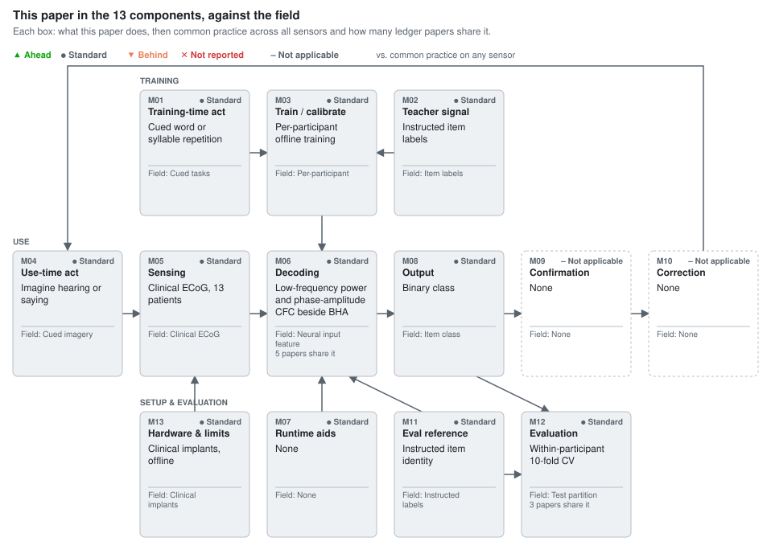

# Imagined speech can be decoded from low- and cross-frequency intracranial EEG features

Proix, Delgado Saa, Christen, Martin, Pasley, Knight, Tian, Poeppel, Doyle, Devinsky, Arnal, Mégevand, Giraud. Nature Communications 13, 48 (2022). DOI: [10.1038/s41467-021-27725-3](https://doi.org/10.1038/s41467-021-27725-3); preprint bioRxiv [10.1101/2021.01.26.428315](https://doi.org/10.1101/2021.01.26.428315) (2021).

**Section:** [Other sensors](../../README.md#other-sensors)

## Figures

### This paper in the 13 components, against the field

<picture><source media="(prefers-color-scheme: dark)" srcset="figures/components-dark.svg"></picture>

Verdicts compare the paper's choice for each component with common practice across 8,995 ledger entries on any sensor (silent speech, brain-to-text, lip reading).

Data

| Component | This paper | Common practice | Papers with this practice | Verdict |
| --- | --- | --- | --- | --- |
| M01 Training-time act | Cued word or syllable repetition | Cued tasks |  | ● Standard (Inherited.) |
| M02 Teacher signal | Instructed item labels | Item labels |  | ● Standard (Inherited.) |
| M03 Train / calibrate | Per-participant offline training | Per-participant |  | ● Standard (Inherited.) |
| M04 Use-time act | Imagine hearing or saying | Cued imagery |  | ● Standard (Inherited.) |
| M05 Sensing | Clinical ECoG, 13 patients | Clinical ECoG |  | ● Standard (Inherited.) |
| M06 Decoding | Low-frequency power and phase-amplitude CFC beside BHA | Neural input feature | 5 of 5 | ● Standard (Low-frequency power has precedent; CFC input new, not shown beyond uncorrected tests.) |
| M07 Runtime aids | None | None |  | ● Standard (Inherited.) |
| M08 Output | Binary class | Item class |  | ● Standard (Inherited.) |
| M09 Confirmation | None | None |  | – Not applicable (Offline study.) |
| M10 Correction | None | None |  | – Not applicable (Offline study.) |
| M11 Eval reference | Instructed item identity | Instructed labels |  | ● Standard (Inherited.) |
| M12 Evaluation | Within-participant 10-fold CV | Test partition | 3 of 5 | ● Standard (Code z-scores CFC before folds.) |
| M13 Hardware & limits | Clinical implants, offline | Clinical implants |  | ● Standard (Inherited.) |

## Verdict

The paper changes the neural input of an imagined-speech decoder (M06), adding low-frequency power and phase-amplitude coupling (CFC) to broadband high-frequency activity (BHA) [[1]](#ref-1). Low-frequency power has precedent in 2 of the 5 earlier intracranial imagined-speech decoders (Appendix), one of them uncited here [[2]](#ref-2). CFC input appears in none of the five (Appendix), but its effect is not shown: 12 of 144 uncorrected per-participant tests passed, close to the 7 expected at 5% (inference), with no test against power (Fig. 7). The test partition (M12) is the usual within-participant cross-validation. The authors concede that binary classification is far from a real BCI (Discussion), yet their reading that imagined speech is "equally well" decoded from low and cross-frequency features (Introduction) rests on an imagined BHA baseline with 1 passing pair.

## Against the field, component by component

### M06 Processing: neural input feature

**Usual approach:** Among intracranial imagined-speech decoders first public before 2020-07, all 5 fed gamma or high-gamma power, 2 also theta-to-beta power, none coupling (5 unique studies, confirmed; Appendix) [[3]](#ref-3), [[4]](#ref-4), [[5]](#ref-5), [[2]](#ref-2), [[6]](#ref-6). The paper adds CFC and tests both families in two datasets (8 participants; study 3 excluded, Results).

**State of the art:** Zhao et al. (2026) [later] decode imagined syllables from 256-channel HD-ECoG with a framework built on beta1-band activity, at a median 80.4% over 9 participants (chance 16.7%; 6 or 8 classes; tenfold cross-validation) [[7]](#ref-7). This low-frequency input supports the paper's direction; the paper's 0.60 is a median of passing pairs only, not comparable.

Pei et al. fed 8–12 and 18–26 Hz amplitudes to a covert-word decoder [[4]](#ref-4), and Ikeda et al. found a beta-power electrode in Broca's area at 55.6% against a best high-gamma electrode at 46.7% (chance 33.3%; best single electrodes, per-electrode tests) [[2]](#ref-2). The paper cites Pei et al. without their low-frequency inputs, does not cite Ikeda et al., and compares itself with "previous studies attempting to decode covert speech using only BHA features" (Discussion). For overt syllables, lower bands were redundant with high gamma [[8]](#ref-8), as in the paper's overt result (BHA best, 15 pairs at 0.64).

None of the 5 priors feeds coupling to a decoder, and none of 34 full-text coupling hits on imagined or covert speech up to 2021 does (Appendix); Livezey et al. measured beta–high-gamma amplitude coupling in overt speech beside, not inside, their classifier [[8]](#ref-8), and a [concurrent] scalp-EEG study analyses theta–gamma coupling without decoding [[9]](#ref-9).

Verdict: standard. The coupling input is new but fails the repetition condition on protocol grounds: per-participant thresholds uncorrected across 6 combinations, 3 representations and 8 participants (Methods, Decoding); a pass rate of 12 of 144 (8%), below that of power (10 above-chance results over at least 72 tests, 14%) (inference); no CFC-versus-power test or combined decoder; and CFC features z-scored over all trials before the folds (covert_MI/svmClassifier.py:34), a step the power classifier omits.

### M12 Evaluation: test partition

**Usual approach:** 3 of the 5 prior decoders hold out covert trials within participant (confirmed, Appendix) [[4]](#ref-4), [[2]](#ref-2), [[6]](#ref-6); Martin et al. trained on overt and tested on covert data of the same session [[5]](#ref-5); Leuthardt et al. fixed features in a screening run and tested online [[3]](#ref-3). The paper uses within-participant 10-fold cross-validation.

**State of the art:** Kunz et al. (2025) [later] decode inner speech online in closed-loop blocks whose sentences never appeared in training blocks, at 24% and 33% word error rate on 50 words for T12 and T16, and 14% for T15, whose decoder was retrained online up to and during the evaluation block (intracortical) [[10]](#ref-10). The paper has no held-out session, subject or online test.

The CFC z-scoring is label-free, but test trials enter the scaling; its effect is unmeasured (inference). Verdict: standard.

## The 13 components

| Component | This paper | Usual approach (count) | State of the art | Verdict |
|---|---|---|---|---|
| M01 Training-time action | Cued word or syllable repetition | Cued tasks | – | standard |
| M02 Training-only supervision | Instructed item labels | Item labels | – | standard |
| M03 Training and adaptation | Per-participant offline training | Per-participant | – | standard |
| M04 Use-time action | Imagine hearing or saying | Cued imagery | – | standard |
| M05 Sensors | Clinical ECoG, 13 patients | Clinical ECoG | – | standard |
| M06 Processing and decoding | Low-frequency power and phase-amplitude CFC beside BHA | Gamma or high-gamma power (confirmed 5) | [[7]](#ref-7) (2026): median 80.4%, imagined syllables, beta1 input | standard |
| M07 Lexicon and LM | None | None | – | standard |
| M08 Output | Binary class | Item class | – | standard |
| M09 Confirmation | None | None | – | not applicable |
| M10 Correction | None | None | – | not applicable |
| M11 Reference construction | Instructed item identity | Instructed labels | – | standard |
| M12 Evaluation | Within-participant 10-fold CV | Within-participant held-out covert trials (confirmed 3) | [[10]](#ref-10) (2025): online inner speech, 50-word WER 14-33% (14% with online retraining) | standard |
| M13 Device and cost | Clinical implants, offline | Clinical implants | – | standard |

## Where the claims outrun the evidence

- "Equally well" (Introduction) and "did not yield better scores than with other bands" (Results) are measured against imagined BHA with 1 above-chance result in 24 tests, a chance-level baseline [[1]](#ref-1).
- Counts in Fig. 7 sum above-chance participant–representation–band results; with 144 CFC tests at 5% about 7 pass by chance (P ≈ 0.06 for 12 or more) (inference) [[1]](#ref-1).
- The 0.60 medians are of passing results only (Fig. 7), so they are selected values.
- Feature-distance significance uses 200 permutations in the released code (clustering_fisher_grouping.py:54) against 1,000 in the Methods [[1]](#ref-1).
- The authors concede residual silent mouthing despite three controls and non-specific CFC changes despite their precautions (Discussion) [[1]](#ref-1); the CFC result carries both caveats.

## What the field needs next

- M06: one decoder combining low-frequency power and CFC, corrected across combinations, against power alone on multi-class tasks [[2]](#ref-2).
- M12: a held-out-session or online test of a low-frequency or CFC decoder, as for spike features [[10]](#ref-10).
- M11: an onset marker for imagined trials; realigning overt trials raised six-class accuracy above 80% for 3 of 4 participants [[1]](#ref-1).

## Questions for the authors

- How many CFC results survive a correction across combinations, representations and participants?
- Do the CFC results hold with z-scoring fitted on training folds only?
- Which permutation count, 200 or 1,000, produced the reported feature distances?
- What are the per-participant class assignments and trial counts per class?

## Appendix: literature search

M06, topic intracranial-imagined-speech-neural-features. Inclusion rule: human intracranial (ECoG, sEEG, depth, intracortical) studies that decode imagined, covert or inner speech with a trained decoder; design of interest is the decoder's neural input feature (high-gamma or gamma power, low-frequency band power, phase or phase-amplitude coupling); excluded are attempted speech decoded from unit firing (e.g. Guenther 2009, Brumberg 2011), reviews, listening-only reconstruction, scalp EEG/MEG, overt-only studies and analyses without a decoder; versions count once. Priors: first public before 2020-07; no 2020 candidate matched. Ledger counts: slot-filled 7,345 unique studies; pattern match 89 unique studies (all years). Prior population: 19 pattern-match studies, 5 decoders after excluding reviews (5), listening-only (2), scalp EEG/MEG (3) and overt-only or non-decoding studies (4). Usual design at the target's time: gamma or high-gamma power input 5 of 5; theta-to-beta band power input 2 of 5; phase-amplitude coupling input 0 of 5 (confirmed by reading all five). All-years full-text pattern counts over the 89 studies, mentions included: high gamma 60, low-frequency band power 11, phase-amplitude coupling 8, low-frequency phase 2. Full-text coupling check (coupling, imagined or covert speech and decoding terms; first public up to 2021): 34 hits, no decoder with coupling input besides the target. Read in full: [[3]](#ref-3), [[4]](#ref-4), [[5]](#ref-5), [[2]](#ref-2), [[6]](#ref-6), [[8]](#ref-8), [[7]](#ref-7). Known-item recall 0.83 (5 of 6 seeds).

M12, topic intracranial-imagined-speech-test-partition. Inclusion rule: the same population and cutoff as the M06 topic; design of interest is how test data are separated from training data (within-participant k-fold, leave-one-out or random split; overt-to-covert transfer; held-out session or day; held-out subject; online closed-loop test). Ledger counts: slot-filled 6,960 unique studies; pattern match 89 unique studies. Usual design at the target's time: within-participant held-out covert trials 3 of 5; overt-trained model tested on covert trials of the same session 1 of 5; online test after a separate screening run 1 of 5; held-out session or subject 0 of 5 (confirmed). All-years full-text pattern counts, mentions included: online or closed-loop 48, k-fold or leave-one-out 30, random split 6, held-out subject 3, held-out session 0. Read in full: [[4]](#ref-4), [[2]](#ref-2), [[5]](#ref-5), [[6]](#ref-6), [[3]](#ref-3), [[10]](#ref-10). Known-item recall 1.0 (5 of 5 seeds).

## References

Numbered by first citation. BibTeX in the same order and keys: [refs.bib](refs.bib).

1. Proix, T., Delgado Saa, J., Christen, A., Martin, S., Pasley, B. N., Knight, R. T., et al. “Imagined speech can be decoded from low- and cross-frequency intracranial EEG features.” *Nature Communications*, 2022, 13(1), 48. doi:[10.1038/s41467-021-27725-3](https://doi.org/10.1038/s41467-021-27725-3). Target. Read as the published article; first public as bioRxiv 10.1101/2021.01.26.428315 v1. [wiki: doi-10.1038-s41467-021-27725-3](https://github.com/supernaiter/deep-research-wiki-for-silent-speech/blob/main/papers/doi-10.1038-s41467-021-27725-3/article.md) [wiki: doi-10.1101-2021.01.26.428315](https://github.com/supernaiter/deep-research-wiki-for-silent-speech/blob/main/papers/doi-10.1101-2021.01.26.428315/article.md) [wiki: pmc-8748882-cfc](https://github.com/supernaiter/deep-research-wiki-for-silent-speech/blob/main/papers/pmc-8748882-cfc/article.md) [wiki: pmc-8748882-imaginedecog](https://github.com/supernaiter/deep-research-wiki-for-silent-speech/blob/main/papers/pmc-8748882-imaginedecog/article.md) [wiki: pmc-8748882-lcf](https://github.com/supernaiter/deep-research-wiki-for-silent-speech/blob/main/papers/pmc-8748882-lcf/article.md)
2. Ikeda, S., Shibata, T., Nakano, N., Okada, R., Tsuyuguchi, N., Ikeda, K., et al. “Neural decoding of single vowels during covert articulation using electrocorticography.” *Frontiers in Human Neuroscience*, 2014, 8, 125. doi:[10.3389/fnhum.2014.00125](https://doi.org/10.3389/fnhum.2014.00125). Prior, not cited by the target; deciding prior for M06 (theta, alpha and beta power as decoder input for covert vowels). Read in full. [wiki: doi-10.3389-fnhum.2014.00125](https://github.com/supernaiter/deep-research-wiki-for-silent-speech/blob/main/papers/doi-10.3389-fnhum.2014.00125/article.md) [wiki: pmc-3945950-covertvowel](https://github.com/supernaiter/deep-research-wiki-for-silent-speech/blob/main/papers/pmc-3945950-covertvowel/article.md) [wiki: pmc-3945950-covertvowl](https://github.com/supernaiter/deep-research-wiki-for-silent-speech/blob/main/papers/pmc-3945950-covertvowl/article.md)
3. Leuthardt, E. C., Gaona, C., Sharma, M., Szrama, N., Roland, J., Freudenberg, Z., et al. “Using the electrocorticographic speech network to control a brain-computer interface in humans.” *Journal of Neural Engineering*, 2011, 8(3), 036004. doi:[10.1088/1741-2560/8/3/036004](https://doi.org/10.1088/1741-2560/8/3/036004). Prior; online control with imagined phonemes; deciding prior for M06 and M12. Read in full. [wiki: doi-10.1088-1741-2560-8-3-036004](https://github.com/supernaiter/deep-research-wiki-for-silent-speech/blob/main/papers/doi-10.1088-1741-2560-8-3-036004/article.md)
4. Pei, X., Barbour, D., Leuthardt, E. C., Schalk, G. “Decoding Vowels and Consonants in Spoken and Imagined Words Using Electrocorticographic Signals in Humans.” *Journal of Neural Engineering*, 2011, 8(4), 046028. doi:[10.1088/1741-2560/8/4/046028](https://doi.org/10.1088/1741-2560/8/4/046028). Prior; deciding prior for M06 and M12 (8-12, 18-26 and 70-170 Hz amplitudes as decoder input). Read in full. [review](https://github.com/supernaiter/silent-speech-review/tree/main/reviews/decoding-vowels-and-consonants-in-spoken-and-imagined-words-using-electrocorticographic-signals-in-h) [wiki: doi-10.1088-1741-2560-8-4-046028](https://github.com/supernaiter/deep-research-wiki-for-silent-speech/blob/main/papers/doi-10.1088-1741-2560-8-4-046028/article.md) [wiki: pmc-3772685-vowelcons](https://github.com/supernaiter/deep-research-wiki-for-silent-speech/blob/main/papers/pmc-3772685-vowelcons/article.md)
5. Martin, S., Brunner, P., Holdgraf, C., Heinze, H., Crone, N. E., Rieger, J., et al. “Decoding spectrotemporal features of overt and covert speech from the human cortex.” *Frontiers in Neuroengineering*, 2014, 7, 14. doi:[10.3389/fneng.2014.00014](https://doi.org/10.3389/fneng.2014.00014). Prior; deciding prior for M06 and M12. [review](https://github.com/supernaiter/silent-speech-review/tree/main/reviews/decoding-spectrotemporal-features-of-overt-and-covert-speech-from-the-human-cortex) [wiki: doi-10.3389-fneng.2014.00014](https://github.com/supernaiter/deep-research-wiki-for-silent-speech/blob/main/papers/doi-10.3389-fneng.2014.00014/article.md) [wiki: pmc-4034498-overtcovert](https://github.com/supernaiter/deep-research-wiki-for-silent-speech/blob/main/papers/pmc-4034498-overtcovert/article.md) [wiki: pmc-4034498-spectemp](https://github.com/supernaiter/deep-research-wiki-for-silent-speech/blob/main/papers/pmc-4034498-spectemp/article.md)
6. Martin, S., Brunner, P., Iturrate, I., Millán, J. d. R., Schalk, G., Knight, R. T., et al. “Word pair classification during imagined speech using direct brain recordings.” *Scientific Reports*, 2016, 6, 25803. doi:[10.1038/srep25803](https://doi.org/10.1038/srep25803). Prior; source study of the target's study 1 data lineage; deciding prior for M06 and M12. [wiki: doi-10.1038-srep25803](https://github.com/supernaiter/deep-research-wiki-for-silent-speech/blob/main/papers/doi-10.1038-srep25803/article.md) [wiki: pmc-4863149-ecog-word-pairs](https://github.com/supernaiter/deep-research-wiki-for-silent-speech/blob/main/papers/pmc-4863149-ecog-word-pairs/article.md) [wiki: pmc-pmc4863149](https://github.com/supernaiter/deep-research-wiki-for-silent-speech/blob/main/papers/pmc-pmc4863149/article.md) [wiki: pmc-4863149-wordpair](https://github.com/supernaiter/deep-research-wiki-for-silent-speech/blob/main/papers/pmc-4863149-wordpair/article.md)
7. Zhao, Z., Wang, Z., Liu, Y., Qian, Y., Yin, Y., Gao, X., et al. “A neural architecture for imagined and overt speech motor dynamics.” *Nature Neuroscience*, 2026. doi:[10.1038/s41593-026-02456-0](https://doi.org/10.1038/s41593-026-02456-0). Later; state of the art for M06. [later] [wiki: natneuro-02456-motordyn](https://github.com/supernaiter/deep-research-wiki-for-silent-speech/blob/main/papers/natneuro-02456-motordyn/article.md)
8. Livezey, J. A., Bouchard, K. E., Chang, E. F. “Deep learning as a tool for neural data analysis: Speech classification and cross-frequency coupling in human sensorimotor cortex.” *PLoS Computational Biology*, 2019, 15(9), e1007091. doi:[10.1371/journal.pcbi.1007091](https://doi.org/10.1371/journal.pcbi.1007091). Prior (overt speech); lower bands versus high gamma as classifier input. [wiki: doi-10.1371-journal.pcbi.1007091](https://github.com/supernaiter/deep-research-wiki-for-silent-speech/blob/main/papers/doi-10.1371-journal.pcbi.1007091/article.md) [wiki: pmc-6762206-dlspeech](https://github.com/supernaiter/deep-research-wiki-for-silent-speech/blob/main/papers/pmc-6762206-dlspeech/article.md)
9. Moon, J., Orlandi, S., Chau, T. “A comparison of oscillatory characteristics in covert speech and speech perception.” *arXiv preprint*, 2020. arXiv:[2009.02816](https://arxiv.org/abs/2009.02816). Concurrent; scalp EEG; theta-gamma PAC analysed, no decoder. [concurrent] [review](https://github.com/supernaiter/silent-speech-review/tree/main/reviews/a-comparison-of-oscillatory-characteristics-in-covert-speech-and-speech-perception) [wiki: arxiv-2009.02816](https://github.com/supernaiter/deep-research-wiki-for-silent-speech/blob/main/papers/arxiv-2009.02816/article.md)
10. Kunz, E. M., Krasa, B. A., Kamdar, F., Avansino, D., Hahn, N., Yoon, S., et al. “Inner speech in motor cortex and implications for speech neuroprostheses.” *Cell*, 2025, 188(17), 4658–4673.e17. doi:[10.1016/j.cell.2025.06.015](https://doi.org/10.1016/j.cell.2025.06.015). Later; state of the art for M12. [later] [wiki: doi-10.1016-j.cell.2025.06.015](https://github.com/supernaiter/deep-research-wiki-for-silent-speech/blob/main/papers/doi-10.1016-j.cell.2025.06.015/article.md) [wiki: cell-40816265-innersp](https://github.com/supernaiter/deep-research-wiki-for-silent-speech/blob/main/papers/cell-40816265-innersp/article.md) [wiki: pmc-12360486-inner-motor](https://github.com/supernaiter/deep-research-wiki-for-silent-speech/blob/main/papers/pmc-12360486-inner-motor/article.md) [wiki: pmc-12360486-innercell](https://github.com/supernaiter/deep-research-wiki-for-silent-speech/blob/main/papers/pmc-12360486-innercell/article.md) [wiki: pmc-12360486-innermtrcx](https://github.com/supernaiter/deep-research-wiki-for-silent-speech/blob/main/papers/pmc-12360486-innermtrcx/article.md)

## Materials

Data behind this review. Full texts of the papers are not included.

- [`review.md`](review.md): the review text (source)
- [`refs.bib`](refs.bib): references (BibTeX)
- [`slots.json`](slots.json): for each of the 13 components: this paper's choice, field practice, number of matching papers, verdict
- [`figures.json`](figures.json): figure definitions
- [`evaluation.md`](evaluation.md): independent evaluation by a second reviewer
- [`triage.md`](triage.md): how each evaluation finding was checked against the sources and resolved
- [`process/log.json`](process/log.json): process record: each step, who did it (reader, script, writer, evaluator), when, the checks run and the input versions
- [`process/notes.json`](process/notes.json): reading notes on the target and comparator papers: claims, numbers, conditions and what is not stated, with locations
- [`process/plan.json`](process/plan.json): plan: which components the paper changes and the topics it is compared on
- [`process/draft.md`](process/draft.md): the review as first written, before the independent evaluation
- [`process/claims-draft.md`](process/claims-draft.md): claim table of the draft: every claim mapped to a note or a count
- [`process/claims.md`](process/claims.md): claim table of the published review
- [`components/M06/intracranial-imagined-speech-neural-features.csv`](../../components/M06/intracranial-imagined-speech-neural-features.csv): M06 topic "intracranial-imagined-speech-neural-features", every candidate paper with its decision (7345 slot-filled, 89 pattern match, usual design in 5, 7 read in full)
- [`components/M12/intracranial-imagined-speech-test-partition.csv`](../../components/M12/intracranial-imagined-speech-test-partition.csv): M12 topic "intracranial-imagined-speech-test-partition", every candidate paper with its decision (6960 slot-filled, 89 pattern match, usual design in 3, 6 read in full)

## More reviews in Other sensors

- [Robust Self-Supervised Audio-Visual Speech Recognition](../robust-self-supervised-audio-visual-speech-recognition/) (2022). Noise-augmented self-supervised AVSR training (M03) was new in 2022 but rests on one test set with no run count; the 49.6% babble gain mixes data and model size with pre-training.
- [Semantic reconstruction of continuous language from non-invasive brain recordings](../semantic-reconstruction-of-continuous-language-from-non-invasive-brain-recordings/) (2023). LM candidates scored by encoding-model likelihood (M06) were ahead in 2022, as the authors claim; the scorer is now overtaken. GPT prior (M07) is standard; one pilot-touched test story limits M12.
- [End-to-End Audio-Visual Speech Recognition with Conformers](../end-to-end-audio-visual-speech-recognition-with-conformers/) (2021). Conformer back-end on raw inputs (M06) and Transformer LM (M07) are standard: raw-input AVSR predates it, and the Conformer gain is one unrepeated step confounded with a decoder swap.
- [Ultrasensitive Textile Strain Sensors Redefine Wearable Silent Speech Interfaces with High Machine Learning Efficiency](../ultrasensitive-textile-strain-sensors-redefine-wearable-silent-speech-interfaces-with-high-machine-learning-efficiency/) (2024). Standard sensor (M05) and decoder (M06): one throat strain channel, small CNN. 95.25% on 20 words, with split grouping and production mode unstated, does not show silent, session-independent decoding.
- [Lipreading using Temporal Convolutional Networks](../lipreading-using-temporal-convolutional-networks/) (2020). Multi-scale TCN (M06) and variable-length cropping (M03) are standard: head and augmentation are not separated, no run counts, robustness comes from the cropping; 85.3% LRW trails 93.2% today.
- [Machine translation of cortical activity to text with an encoder-decoder framework](../machine-translation-of-cortical-activity-to-text-with-an-encoder-decoder-framework/) (2020). Word-level ECoG encoder-decoder; all changed components standard. 3% WER is on repeats of 50 sentences; unseen sentences and participants were never tested.

---

Part of the [Silent Speech Interface Review](https://github.com/supernaiter/silent-speech-review). Found an error? [Open an issue](https://github.com/supernaiter/silent-speech-review/issues/new?template=correction.yml).
