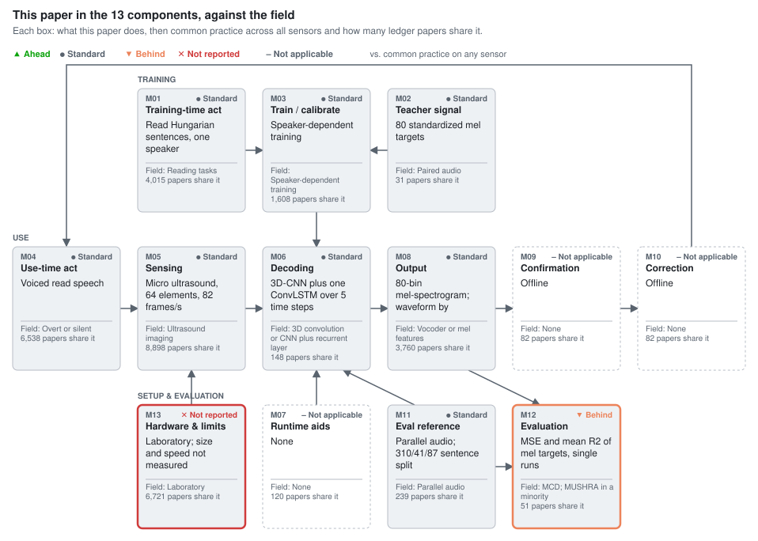

# Improved Processing of Ultrasound Tongue Videos by Combining ConvLSTM and 3D Convolutional Networks

Shandiz AH, Tóth L. arXiv preprint, 2022. [arXiv:2206.12947](https://arxiv.org/abs/2206.12947)

**Section:** [Ultrasound & tongue imaging](../../README.md#ultrasound--tongue-imaging)

## Figures

### This paper in the 13 components, against the field

<picture><source media="(prefers-color-scheme: dark)" srcset="figures/components-dark.svg"></picture>

Verdicts compare the paper's choice for each component with common practice across 8,995 ledger entries on any sensor (silent speech, brain-to-text, lip reading).

Data

| Component | This paper | Common practice | Papers with this practice | Verdict |
| --- | --- | --- | --- | --- |
| M01 Training-time act | Read Hungarian sentences, one speaker | Reading tasks | 4,015 of 8,995 | ● Standard (Inherited corpus design [@csapo2017dnn].) |
| M02 Teacher signal | 80 standardized mel targets | Paired audio | 31 of 8,995 | ● Standard (Mel targets as in [@csapo2020waveglow].) |
| M03 Train / calibrate | Speaker-dependent training | Speaker-dependent training | 1,608 of 8,995 | ● Standard (No adaptation or held-out speaker; normalization fit scope unstated.) |
| M04 Use-time act | Voiced read speech | Overt or silent | 6,538 of 8,995 | ● Standard (Silent articulation motivates the work but is not tested.) |
| M05 Sensing | Micro ultrasound, 64 elements, 82 frames/s | Ultrasound imaging | 8,898 of 8,995 | ● Standard (Inherited hardware.) |
| M06 Decoding | 3D-CNN plus one ConvLSTM over 5 time steps | 3D convolution or CNN plus recurrent layer | 148 of 8,995 | ● Standard (New layer type for ultrasound-to-speech; 2.1% MSE edge over BiLSTM, one speaker, one run, co-varying dropout and pooling.) |
| M07 Runtime aids | None | None | 120 of 8,995 | – Not applicable (Direct acoustic regression.) |
| M08 Output | 80-bin mel-spectrogram; waveform by WaveGlow | Vocoder or mel features | 3,760 of 8,995 | ● Standard (Inherited from [@csapo2020waveglow]; waveform not evaluated.) |
| M09 Confirmation | Offline | None | 82 of 8,995 | – Not applicable (Offline study.) |
| M10 Correction | Offline | None | 82 of 8,995 | – Not applicable (Offline study.) |
| M11 Eval reference | Parallel audio; 310/41/87 sentence split | Parallel audio | 239 of 8,995 | ● Standard (Same split as [@grosz2018f0].) |
| M12 Evaluation | MSE and mean R2 of mel targets, single runs | MCD; MUSHRA in a minority | 51 of 8,995 | ▼ Behind (Behind best comparable work (group's listener-tested studies), not typical practice (MUSHRA 14 of 51).) |
| M13 Hardware & limits | Laboratory; size and speed not measured | Laboratory | 6,721 of 8,995 | ✕ Not reported (No parameter count, training or inference time.) |

## Verdict

The paper [[1]](#ref-1) changes one component (M06): a unidirectional ConvLSTM replaces the top layers of its group's 3D-CNN ultrasound front end, and test MSE on 80 standardized mel targets falls from 0.293 (3D-CNN) and 0.282 (3D-CNN + BiLSTM) to 0.276, 5.8% and 2.1% relative (inference). M06 is standard: the layer is new to ultrasound-to-speech mapping (9 ConvLSTM pattern matches among 148 ultrasound studies, none an earlier speech-output study; Appendix), but the edge over the BiLSTM is one run on one speaker, with dropout raised from 0.3 to 0.35 and pooling changed alongside (Table 1). Later work dropped it [[2]](#ref-2), [[3]](#ref-3). Evaluation (M12) is behind the best comparable work, not the field's typical practice: MSE and mean R² only, although the group's listener-tested studies of this speaker and of the same WaveGlow synthesis stage [[4]](#ref-4), [[5]](#ref-5), [[6]](#ref-6) predate it. "Smaller and faster" (Abstract) is unmeasured.

## Against the field, component by component

### M06 Processing: temporal fusion over the ultrasound frame stack

**Usual approach:** Mostly single-frame regression with a fully connected DNN (37) or a CNN (31) among 51 unique ultrasound-to-speech studies (pattern match, Appendix). Across 148 unique ultrasound studies, multi-frame models use 3D convolution (27) or a CNN followed by a recurrent layer (24); ConvLSTM appears in 9, Transformer or Conformer attention in 8 (pattern match, Appendix). The paper keeps the 3D-CNN of [[7]](#ref-7) and swaps the layer fusing its 5 output feature maps (Sec. 4).

**State of the art:** Tongue2Speech (2026, [later]) pairs a 3D front end with a multi-layer Transformer: 15.93% WER of ASR on synthesized single-speaker TaL1 speech, against 24.15% for its best 3D-CNN+BiLSTM baseline [[3]](#ref-3). Corpus and metric differ; the field moved to attention fusion, not to ConvLSTM.

The only earlier ledger ConvLSTM on ultrasound predicts tongue images from lip video [[8]](#ref-8). The layer is new here (Appendix), its role is not: over 5 time steps it does what the BiLSTM does in the same table. Against that BiLSTM the gain is 0.006 test MSE (inference), from single runs (Table 2), with dropout raised from 0.3 to 0.35 and two (1,2,2) pooling layers replaced by one (1,2,1) layer (Table 1); parameter totals were kept similar, uncounted (Sec. 5). More ConvLSTM layers do not help: two Conv3D plus two ConvLSTM layers give test MSE 0.35 (Table 3), above the baseline's 0.293 (Table 2), also from single runs. Later work dropped it: the group's 2023 study lists ConvLSTM layers but applies the 3D-CNN [[2]](#ref-2), and Tongue2Speech names "ConvLSTM hybrids" in related work but not among its six baselines [[3]](#ref-3). Verdict: standard.

### M12 Evaluation: output measure and repetition

**Usual approach:** Mel-cepstral distortion in 21 of 51 unique studies, MUSHRA in 14 (pattern match, Appendix); listener tests are a minority practice. Of 31 studies dated before 2021-12, 10 mention MUSHRA (pattern match, Appendix), among them the group's studies of this speaker with 23 listeners [[4]](#ref-4) and 24 listeners on the same 310/41/87 split [[5]](#ref-5).

**State of the art:** ASR WER on synthesized speech (2026, [later]): 15.93% single-speaker, 31.64% multi-speaker; its authors call MSE-type metrics weak indicators of lexical accuracy [[3]](#ref-3).

The target synthesizes with WaveGlow (Sec. 3) but scores neither MCD nor listeners, only mel MSE and R² (Table 2); the same group had put 80-dimensional mel targets and WaveGlow, with a different network, through an online MUSHRA test over four speakers [[6]](#ref-6). Its predecessor also reported only MSE and R² [[7]](#ref-7). In Tongue2Speech, adding a BiLSTM to a 3D-CNN that ends in a linear mel projection moves overall WER from 99.26 to 36.46 (Table 1), and session-level variability reaches 9 absolute WER points [[3]](#ref-3): the fusion layer can decide intelligibility, and a 0.006 MSE gap (inference) cannot show where ConvLSTM falls. Verdict: behind the best comparable work, three earlier listener-tested studies of the same group, one on the same synthesis stage; not behind typical practice.

## The 13 components

| Component | This paper | Usual approach (count) | State of the art | Verdict |
|---|---|---|---|---|
| M01 Training-time action | Read Hungarian sentences, one speaker | Reading tasks (slot-filled 4,015) | – | standard |
| M02 Training-only supervision | 80 standardized mel targets | Paired audio (slot-filled 31) | – | standard |
| M03 Training and adaptation | Speaker-dependent training | Speaker-dependent training (slot-filled 1,608) | – | standard |
| M04 Use-time action | Voiced read speech | Overt or silent (slot-filled 6,538) | – | standard |
| M05 Sensors | Micro ultrasound, 64 elements, 82 frames/s | Ultrasound imaging (slot-filled 8,898) | – | standard |
| M06 Processing and decoding | 3D-CNN plus one ConvLSTM over 5 time steps | 3D convolution or CNN plus recurrent layer (pattern match 148) | 15.93% WER [[3]](#ref-3) | standard |
| M07 Lexicon and LM | None | None (slot-filled 120) | – | not applicable |
| M08 Output | 80-bin mel-spectrogram; waveform by WaveGlow | Vocoder or mel features (slot-filled 3,760) | – | standard |
| M09 Confirmation | Offline | None (slot-filled 82) | – | not applicable |
| M10 Correction | Offline | None (slot-filled 82) | – | not applicable |
| M11 Reference construction | Parallel audio; 310/41/87 sentence split | Parallel audio (slot-filled 239) | – | standard |
| M12 Evaluation | MSE and mean R2 of mel targets, single runs | MCD; MUSHRA in a minority (pattern match 51) | 31.64% WER, multi-speaker [[3]](#ref-3) | behind |
| M13 Device and cost | Laboratory; size and speed not measured | Laboratory (slot-filled 6,721) | – | not reported |

## Where the claims outrun the evidence

- "This clearly proves the efficiency of the ConvLSTM layer" (Sec. 5) rests on a single-run 0.006 MSE gap (inference) in Table 2.
- The abstract calls the hybrid smaller and faster; Sec. 5 says ConvLSTM has "much more trainable parameters" than Conv3D and that totals were kept similar. No count or time is reported (M13). The authors concede that a bidirectional ConvLSTM cost many parameters for a marginal gain (Sec. 5).
- The introduction promises a comparison with 2D-CNN+LSTM (Sec. 1); Table 2 has no such row.
- The baseline was retrained with Adam instead of SGD (Sec. 4) and predicts mel bins, so it is not the published 3D-CNN [[7]](#ref-7).
- Silent articulation motivates the work (Sec. 1); the data are one speaker reading aloud (Sec. 3).

## What the field needs next

- M06: dense, BiLSTM, ConvLSTM and Transformer fusion on one 3D front end at equal dropout and pooling, with parameter counts and several seeds, scored by ASR WER [[3]](#ref-3).
- M12: ASR WER and listeners on the WaveGlow output.
- M13: state the 25-frame window's look-ahead; test a causal variant.

## Questions for the authors

- How many runs stand behind Tables 2 and 3, and what is the spread?
- What are the parameter counts and training times of the Table 2 models?
- Does the ConvLSTM gain remain at dropout 0.3 with the baseline pooling?

## Appendix: literature search

- M06 ultrasound-to-speech-network-architecture (published table, reused). Inclusion rule: studies that map ultrasound tongue images to acoustic features or a waveform with a trained network and name the architecture; recognition-only, contour tracking and reviews excluded; versions counted once. Ledger counts: slot-filled 7,345 unique studies (M06); pattern match 51 unique studies (70 folders). Design counts (pattern match): fully connected DNN 37, CNN 31, recurrent 25, 3D CNN 19, transformer 9, conformer 3. Read in full: [[7]](#ref-7) (prior), [[2]](#ref-2) ([later]), [[3]](#ref-3) (state of the art). Known-item recall 1.0 (3 seeds).
- M06 ultrasound-image-sequence-temporal-layer (new). Inclusion rule: studies whose ledger lists ultrasound imaging as an input modality, classified by full-text pattern (reference list removed) by how frames are fused over time: 3D convolution, CNN followed by a recurrent layer, ConvLSTM, Transformer or Conformer attention; related-work mentions, reviews, theses and non-speech tasks remain pattern matches (upper bound); ConvLSTM hits classified by snippet; versions counted once. Ledger counts: slot-filled 7,345 unique studies (M06); pattern match 148 unique studies (192 folders). Design counts (pattern match, a study can match several): 3D convolution 27, CNN followed by a recurrent layer 24, ConvLSTM 9, Transformer or Conformer attention 8. ConvLSTM hits: the target and its later thesis chapter (doi:10.14232/phd.11818, a separate wiki entry), one 2021-06 prior on lip-to-ultrasound image prediction [[8]](#ref-8), one 2022 review of tongue contour tracking (doi:10.3390/diagnostics12112811), and [later] citations or related-work mentions; 0 earlier speech-output studies. Read in full: [[8]](#ref-8), [[7]](#ref-7) (prior), [[3]](#ref-3) (state of the art). Known-item recall 1.0 (3 seeds).
- M12 ultrasound-to-speech-output-evaluation (published table, reused). Inclusion rule: studies that synthesize speech or acoustic features from ultrasound tongue images and evaluate the output, classified by output measure. Ledger counts: slot-filled 6,960 unique studies (M12); pattern match 51 unique studies. Design counts (pattern match): MCD 21, MUSHRA 14, listener intelligibility 5, MOS 4, ASR on output 3; dated before 2021-12: 31 unique studies, MUSHRA 10, 5 undated. Read in full: [[4]](#ref-4), [[5]](#ref-5), [[6]](#ref-6) (prior), [[3]](#ref-3) (state of the art). Known-item recall 0.57.

## References

Numbered by first citation. BibTeX in the same order and keys: [refs.bib](refs.bib).

1. Shandiz, A. H., Tóth, L. “Improved Processing of Ultrasound Tongue Videos by Combining ConvLSTM and 3D Convolutional Networks.” *arXiv preprint*, 2022. arXiv:[2206.12947](https://arxiv.org/abs/2206.12947). Target. arXiv:2206.12947 v1 (2022-06-26) read. [review](https://github.com/supernaiter/silent-speech-review/tree/main/reviews/improved-processing-of-ultrasound-tongue-videos-by-combining-convlstm-and-3d-convolutional-networks) [wiki: arxiv-2206.12947](https://github.com/supernaiter/deep-research-wiki-for-silent-speech/blob/main/papers/arxiv-2206.12947/article.md)
2. Tóth, L., Shandiz, A. H., Gosztolya, G., Csapó, T. G. “Adaptation of Tongue Ultrasound-Based Silent Speech Interfaces Using Spatial Transformer Networks.” *Proc. Interspeech 2023*, 2023. doi:[10.21437/Interspeech.2023-1607](https://doi.org/10.21437/Interspeech.2023-1607). arXiv:[2305.19130](https://arxiv.org/abs/2305.19130). [later] [review](https://github.com/supernaiter/silent-speech-review/tree/main/reviews/adaptation-of-tongue-ultrasound-based-silent-speech-interfaces-using-spatial-transformer-networks) [wiki: arxiv-2305.19130](https://github.com/supernaiter/deep-research-wiki-for-silent-speech/blob/main/papers/arxiv-2305.19130/article.md) [wiki: isca-toth23_interspeech](https://github.com/supernaiter/deep-research-wiki-for-silent-speech/blob/main/papers/isca-toth23_interspeech/article.md) [wiki: isca-toth23-usadapt](https://github.com/supernaiter/deep-research-wiki-for-silent-speech/blob/main/papers/isca-toth23-usadapt/article.md)
3. Sonkar, Y., Kilaru, Y., Yelimeli, S., Shah, N., Gandhi, V. “Tongue2Speech: Real-Time Speech Synthesis from Tongue Ultrasound Videos via Spatiotemporal Transformers.” *Proc. Interspeech 2026*, 2026, 6856–6860. doi:[10.21437/Interspeech.2026-3023](https://doi.org/10.21437/Interspeech.2026-3023). [later] [wiki: isca-sonkar26_interspeech](https://github.com/supernaiter/deep-research-wiki-for-silent-speech/blob/main/papers/isca-sonkar26_interspeech/article.md)
4. Csapó, T. G., Grósz, T., Gosztolya, G., Tóth, L., Markó, A. “DNN-Based Ultrasound-to-Speech Conversion for a Silent Speech Interface.” *Proc. Interspeech 2017*, 2017, 3672–3676. doi:[10.21437/Interspeech.2017-939](https://doi.org/10.21437/Interspeech.2017-939). [wiki: isca-csapo17-us2speech](https://github.com/supernaiter/deep-research-wiki-for-silent-speech/blob/main/papers/isca-csapo17-us2speech/article.md) [wiki: isca-csapo17_interspeech](https://github.com/supernaiter/deep-research-wiki-for-silent-speech/blob/main/papers/isca-csapo17_interspeech/article.md) [wiki: isca-csapo17_ussynth](https://github.com/supernaiter/deep-research-wiki-for-silent-speech/blob/main/papers/isca-csapo17_ussynth/article.md) [wiki: isca-csapo17_ustospeech](https://github.com/supernaiter/deep-research-wiki-for-silent-speech/blob/main/papers/isca-csapo17_ustospeech/article.md)
5. Grósz, T., Gosztolya, G., Tóth, L., Csapó, T. G., Markó, A. “F0 Estimation for DNN-Based Ultrasound Silent Speech Interfaces.” *Proc. IEEE ICASSP 2018*, 2018, 291–295. doi:[10.1109/ICASSP.2018.8461732](https://doi.org/10.1109/ICASSP.2018.8461732). [wiki: doi-10-1109-icassp-2018-8461732](https://github.com/supernaiter/deep-research-wiki-for-silent-speech/blob/main/papers/doi-10-1109-icassp-2018-8461732/article.md)
6. Csapó, T. G., Zainkó, C., Tóth, L., Gosztolya, G., Markó, A. “Ultrasound-based Articulatory-to-Acoustic Mapping with WaveGlow Speech Synthesis.” *Proc. Interspeech 2020*, 2020, 2727–2731. doi:[10.21437/Interspeech.2020-1031](https://doi.org/10.21437/Interspeech.2020-1031). arXiv:[2008.03152](https://arxiv.org/abs/2008.03152). [wiki: isca-csapo20b_interspeech](https://github.com/supernaiter/deep-research-wiki-for-silent-speech/blob/main/papers/isca-csapo20b_interspeech/article.md) [wiki: arxiv-2008.03152](https://github.com/supernaiter/deep-research-wiki-for-silent-speech/blob/main/papers/arxiv-2008.03152/article.md) [wiki: isca-csapo20b-uswaveglow](https://github.com/supernaiter/deep-research-wiki-for-silent-speech/blob/main/papers/isca-csapo20b-uswaveglow/article.md)
7. Tóth, L., Honarmandi Shandiz, A. “3D Convolutional Neural Networks for Ultrasound-Based Silent Speech Interfaces.” *Artificial Intelligence and Soft Computing (ICAISC 2020), Lecture Notes in Computer Science 12415*, 2020. doi:[10.1007/978-3-030-61401-0_16](https://doi.org/10.1007/978-3-030-61401-0_16). arXiv:[2104.11532](https://arxiv.org/abs/2104.11532). [review](https://github.com/supernaiter/silent-speech-review/tree/main/reviews/3d-convolutional-neural-networks-for-ultrasound-based-silent-speech-interfaces) [wiki: arxiv-2104.11532](https://github.com/supernaiter/deep-research-wiki-for-silent-speech/blob/main/papers/arxiv-2104.11532/article.md)
8. Liu, H., Zhang, J. “Improving Ultrasound Tongue Image Reconstruction from Lip Images Using Self-supervised Learning and Attention Mechanism.” *arXiv preprint*, 2021. arXiv:[2106.11769](https://arxiv.org/abs/2106.11769). [wiki: arxiv-2106.11769](https://github.com/supernaiter/deep-research-wiki-for-silent-speech/blob/main/papers/arxiv-2106.11769/article.md)

## Materials

Data behind this review. Full texts of the papers are not included.

- [`review.md`](review.md): the review text (source)
- [`refs.bib`](refs.bib): references (BibTeX)
- [`slots.json`](slots.json): for each of the 13 components: this paper's choice, field practice, number of matching papers, verdict
- [`figures.json`](figures.json): figure definitions
- [`evaluation.md`](evaluation.md): independent evaluation by a second reviewer
- [`triage.md`](triage.md): how each evaluation finding was checked against the sources and resolved
- [`process/log.json`](process/log.json): process record: each step, who did it (reader, script, writer, evaluator), when, the checks run and the input versions
- [`process/notes.json`](process/notes.json): reading notes on the target and comparator papers: claims, numbers, conditions and what is not stated, with locations
- [`process/plan.json`](process/plan.json): plan: which components the paper changes and the topics it is compared on
- [`process/draft.md`](process/draft.md): the review as first written, before the independent evaluation
- [`process/claims-draft.md`](process/claims-draft.md): claim table of the draft: every claim mapped to a note or a count
- [`process/claims.md`](process/claims.md): claim table of the published review
- [`components/M06/ultrasound-image-sequence-temporal-layer.csv`](../../components/M06/ultrasound-image-sequence-temporal-layer.csv): M06 topic "ultrasound-image-sequence-temporal-layer", every candidate paper with its decision (7345 slot-filled, 148 pattern match, usual design in 27, 4 read in full)
- [`components/M06/ultrasound-to-speech-network-architecture.csv`](../../components/M06/ultrasound-to-speech-network-architecture.csv): M06 topic "ultrasound-to-speech-network-architecture", every candidate paper with its decision (7345 slot-filled, 51 pattern match, usual design in 37, 4 read in full)
- [`components/M12/ultrasound-to-speech-output-evaluation.csv`](../../components/M12/ultrasound-to-speech-output-evaluation.csv): M12 topic "ultrasound-to-speech-output-evaluation", every candidate paper with its decision (6960 slot-filled, 51 pattern match, usual design in 21, 3 read in full)

## More reviews in Ultrasound & tongue imaging

- [Adaptation of Tongue Ultrasound-Based Silent Speech Interfaces Using Spatial Transformer Networks](../adaptation-of-tongue-ultrasound-based-silent-speech-interfaces-using-spatial-transformer-networks/) (2023). STN-only adaptation (M03) closes 75-76% of the retraining gap, not the 88% the abstract states; untested against lower-layer adaptation; dev-set MSE only (M12 behind).
- [Speech Reconstruction from Silent Tongue and Lip Articulation By Pseudo Target Generation and Domain Adversarial Training](../speech-reconstruction-from-silent-tongue-and-lip-articulation-by-pseudo-target-generation-and-domain-adversarial-training/) (2023). DTW pseudo targets (M02) follow prior EMG target transfer; the mode discriminator (M03) is untested by its ablation; silent MCD/STOI use self-made references and 18 speakers are dropped.
- [Convolutional Neural Network-Based Age Estimation Using B-Mode Ultrasound Tongue Image](../convolutional-neural-network-based-age-estimation-using-b-mode-ultrasound-tongue-image/) (2021). Age output from tongue ultrasound (M08) is new but unproven: the random frame split shares children between training and validation (M12), so speaker identity can explain the gain.
- [Improving Neural Silent Speech Interface Models by Adversarial Training](../improving-neural-silent-speech-interface-models-by-adversarial-training/) (2021). Standard on the adversarial loss (M02): it predates the paper in video-to-speech and its gains are small, with no variance reported; behind on evaluation (M12): no listening test.
- [Neural Speaker Embeddings for Ultrasound-based Silent Speech Interfaces](../neural-speaker-embeddings-for-ultrasound-based-silent-speech-interfaces/) (2021). Standard on embedding conditioning (2.4% relative MSE gain on seen speakers); behind on speaker recognition, which never separates speaker from recording session.
- [Silent versus modal multi-speaker speech recognition from ultrasound and video](../silent-versus-modal-multi-speaker-speech-recognition-from-ultrasound-and-video/) (2021). Standard on both changed components: modal-to-silent loss and fMLLR were known; later work narrows the absolute gap but not the fMLLR ratio, and adaptation gains rest on single runs.

---

Part of the [Silent Speech Interface Review](https://github.com/supernaiter/silent-speech-review). Found an error? [Open an issue](https://github.com/supernaiter/silent-speech-review/issues/new?template=correction.yml).
