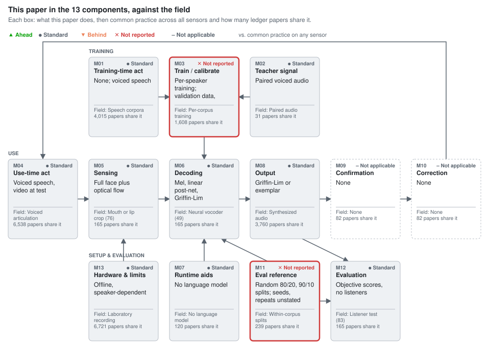

# Improved Speech Reconstruction from Silent Video

Ariel Ephrat, Tavi Halperin, Shmuel Peleg. 2017 IEEE International Conference on Computer Vision Workshops (ICCVW), pp. 455–462, 2017. [doi:10.1109/ICCVW.2017.61](https://doi.org/10.1109/ICCVW.2017.61) · [arXiv:1708.01204](https://arxiv.org/abs/1708.01204)

**Section:** [Lip & face video](../../README.md#lip--face-video)

## Figures

### This paper in the 13 components, against the field

<picture><source media="(prefers-color-scheme: dark)" srcset="figures/components-dark.svg"></picture>

Verdicts compare the paper's choice for each component with common practice across 8,995 ledger entries on any sensor (silent speech, brain-to-text, lip reading).

Data

| Component | This paper | Common practice | Papers with this practice | Verdict |
| --- | --- | --- | --- | --- |
| M01 Training-time act | None; voiced speech | Speech corpora | 4,015 of 8,995 | ● Standard (Inherited.) |
| M02 Teacher signal | Paired voiced audio | Paired audio | 31 of 8,995 | ● Standard (Inherited.) |
| M03 Train / calibrate | Per-speaker training; validation data, seeds unstated | Per-corpus training | 1,608 of 8,995 | ✕ Not reported (Validation data, seeds not stated.) |
| M04 Use-time act | Voiced speech, video at test | Voiced articulation | 6,538 of 8,995 | ● Standard (Inherited.) |
| M05 Sensing | Full face plus optical flow | Mouth or lip crop (76) | 165 of 8,995 | ● Standard (Flow: STOI 0.670 to 0.665.) |
| M06 Decoding | Mel, linear post-net, Griffin-Lim | Neural vocoder (49) | 165 of 8,995 | ● Standard (Post-net row mixes synthesis paths.) |
| M07 Runtime aids | No language model | No language model | 120 of 8,995 | ● Standard (Inherited.) |
| M08 Output | Griffin-Lim or exemplar | Synthesized audio | 3,760 of 8,995 | ● Standard (Inherited.) |
| M09 Confirmation | None | None | 82 of 8,995 | – Not applicable (Offline study.) |
| M10 Correction | None | None | 82 of 8,995 | – Not applicable (Offline study.) |
| M11 Eval reference | Random 80/20, 90/10 splits; seeds, repeats unstated | Within-corpus splits | 239 of 8,995 | ✕ Not reported (Unseen-word share not stated.) |
| M12 Evaluation | Objective scores, no listeners | Listener test (83) | 165 of 8,995 | ● Standard (Comparators ran listener tests.) |
| M13 Hardware & limits | Offline, speaker-dependent | Laboratory recording | 6,721 of 8,995 | ● Standard (Speaker-dependent (Sec. 4).) |

## Verdict

The paper [[1]](#ref-1) changes the visual input (M05: an optical-flow tower beside full-face pixels) and the decoder (M06: a mel-to-linear post-net, then Griffin-Lim); both are standard on its own evidence. Flow lowers STOI from 0.670 to 0.665 on GRID S3 in one reported split (Table 5); the full-model row adds 0.015, but it mixes two synthesis paths (M06). The gain over Vid2speech [[2]](#ref-2) holds on objective scores (S4 STOI 0.584 to 0.700, Table 3), but on S3 Le Cornu and Milner [[3]](#ref-3) [concurrent] score higher ESTOI (0.437 against 0.398) and PESQ (2.055 against 1.974) in the same table. The evaluation (M12) drops the listener test both comparators ran; in Lip2Wav's [later] re-run of this method in its own setup it scores 27.83% WER on GRID and 53.52% on TCD-TIMIT, against 14.08% and 31.26% for Lip2Wav [[4]](#ref-4). The "unconstrained dictionary" result rests on one of three TCD-TIMIT speakers (Table 4).

## Against the field, component by component

### M05 Sensors: optical-flow tower

**Usual approach:** Of 165 unique video-to-speech studies (pattern match, Appendix), 76 name a mouth or lip crop, 15 the full face and 7 optical flow. The paper keeps the full face of Vid2speech, where it gave 40% lower test error than the mouth [[2]](#ref-2), and adds a tower over K − 1 = 8 flow fields (Sec. 3.1, Sec. 5).

**State of the art:** Lip2Wav (2020) [later] uses the face without flow, expecting flow to hurt under "large head pose changes" [[4]](#ref-4). Its GRID WER gap (14.08% against 27.83% for its re-run of this method) compares whole systems, not inputs.

In Table 5 (GRID S3), pixels plus flow score 0.7% lower STOI and 1.4% lower PESQ than pixels alone (inference). The authors' own reading, that pixels carry most of the information (Sec. 6.2), is the right one. Verdict: standard.

### M06 Processing: post-net and Griffin-Lim

**Usual approach:** Of the 165 studies (pattern match, Appendix), 49 name a neural vocoder, 41 a parametric vocoder and 16 Griffin-Lim; 15 name a post-net, all but this paper dated 2019 or later. The post-net comes from Tacotron, a text-to-speech system (Sec. 2). Vid2speech used LSP with unvoiced excitation [[2]](#ref-2), Le Cornu and Milner STRAIGHT [[5]](#ref-5).

**State of the art:** In a 2023 comparison on four seen GRID speakers, scored by one ASR model (0.1% WER on real audio), the best row is a 2022 end-to-end waveform GAN at 4.07% WER (Table IV) [[6]](#ref-6).

The full-model row of Table 5 is the Table 3 row that takes STOI and ViSQOL from Lin-synth and PESQ from Mel-synth (Table 2), so its post-net gain mixes two synthesis paths. The clean result: Lin-synth beats Mel-synth on STOI for all four GRID speakers (Table 2). Verdict: standard.

### M12 Evaluation: no listeners

**Usual approach:** Of the 165 studies (pattern match, Appendix), 83 name a listener or opinion test and 38 ASR WER. Both comparators ran listener tests. Vid2speech had 23 MTurk workers pick each word from the GRID vocabulary: 82.6% on S4 audio-only, against 40.0% for Le Cornu and Milner (2015) and 19% chance [[2]](#ref-2); Le Cornu and Milner 20 listeners [[5]](#ref-5) and 85% word accuracy [[3]](#ref-3). The paper reports STOI, ESTOI, PESQ and ViSQOL only (Sec. 6).

**State of the art:** Lip2Wav [later] pairs ASR WER with a 15-rater opinion test and listener error counts [[4]](#ref-4). In the 2023 comparison the best unseen-speaker GRID row is 16.05% WER (Table VII) [[6]](#ref-6).

Lip2Wav's row is its own re-run (its GRID STOI, 0.659, matches no row of Tables 2–3, inference). There, PESQ ranks the two systems the wrong way round (1.825 against 1.772) while WER is about twice as high (27.83% against 14.08%); STOI (0.659 against 0.731) and ESTOI (0.376 against 0.535) do not. Objective-only evaluation is common (82 of 165 name no listener test, inference), but here it replaces the predecessor's listener test. Verdict: standard, a step back from both comparators.

## The 13 components

| Component | This paper | Usual approach (count) | State of the art | Verdict |
|---|---|---|---|---|
| M01 Training-time action | None; voiced speech | Speech corpora (slot-filled 4,015) | – | standard |
| M02 Training-only supervision | Paired voiced audio | Paired audio (slot-filled 31) | – | standard |
| M03 Training and adaptation | Per-speaker training; validation data, seeds unstated | Per-corpus training (slot-filled 1,608) | – | not reported |
| M04 Use-time action | Voiced speech, video at test | Voiced articulation (slot-filled 6,538) | – | standard |
| M05 Sensors | Full face plus optical flow | Mouth or lip crop (76) (pattern match 165) | Lip2Wav: no flow; 14.08% vs 27.83% WER, whole systems [[4]](#ref-4) | standard |
| M06 Processing and decoding | Mel, linear post-net, Griffin-Lim | Neural vocoder (49) (pattern match 165) | 4.07% WER, GRID seen speakers [[6]](#ref-6) | standard |
| M07 Lexicon and LM | No language model | No language model (slot-filled 120) | – | standard |
| M08 Output | Griffin-Lim or exemplar | Synthesized audio (slot-filled 3,760) | – | standard |
| M09 Confirmation | None | None (slot-filled 82) | – | not applicable |
| M10 Correction | None | None (slot-filled 82) | – | not applicable |
| M11 Reference construction | Random 80/20, 90/10 splits; seeds, repeats unstated | Within-corpus splits (slot-filled 239) | – | not reported |
| M12 Evaluation | Objective scores, no listeners | Listener test (83) (pattern match 165) | ASR WER plus listener ratings [[4]](#ref-4); unseen GRID 16.05% WER [[6]](#ref-6) | standard |
| M13 Device and cost | Offline, speaker-dependent | Laboratory recording (slot-filled 6,721) | – | standard |

## Where the claims outrun the evidence

- "Significantly improved quality over existing models" (Abstract) has no interval, seed or test. In Table 3 it trails Le Cornu and Milner on S3 by 8.9% on ESTOI and 3.9% on PESQ and leads on S4 by 6.5% and 14.0% (inference), with comparator splits and data unstated.
- The S3 "Ours" row (Table 3) takes the better synthesis mode per metric (Table 2). The authors call it "our best results" (Sec. 6.1), so it is disclosed, but no single system produced it.
- "Conclusively demonstrates the superiority" (Sec. 6) rests on supplementary videos, not a listener study.
- The unconstrained-dictionary claim (Abstract) holds for Lipspeaker 3 only (STOI 0.630 against 0.318 and 0.357); the authors concede the speech is "not entirely intelligible" (Sec. 6.1).

## What the field needs next

- M12: listener transcription and ASR WER on the same clips, with chance level, over several splits and seeds.
- M05: pixels against pixels plus flow on all GRID speakers and under head motion.
- M06: post-net against none with one fixed synthesis path, and Griffin-Lim against a vocoder on the same predictions.

## Questions for the authors

- Which synthesis mode produced each value of the full-model rows in Tables 3 and 5?
- How many runs or splits underlie Tables 2–5, with which seeds?
- Which validation data stopped training (Sec. 5)?
- What share of TCD-TIMIT test words is absent from training?
- Were the Table 3 comparator scores recomputed on your split?

## Appendix: literature search

- M05 video-to-speech-visual-input-stream (new topic table). Inclusion rule: the 165-study video-to-speech population of the published M06 synthesis table, counted by the visual input its full text names (mouth or lip crop, full face, optical-flow stream), reference list removed; a study counts under every input its text names (upper bound, related-work mentions included); enhancement with noisy audio, talking-head generation and video-to-text-to-speech pipelines excluded; versions counted once. Slot-filled 7,329 unique studies; pattern match 165 unique studies. Usual design: mouth or lip crop, 76 (pattern match). Design counts: mouth or lip crop 76, full face 15, optical flow 7. Read in full: [[2]](#ref-2), [[3]](#ref-3) [concurrent], [[4]](#ref-4) [later], target. Known-item recall 1.0.
- M06 video-to-speech-synthesis (published topic table, appended). Inclusion rule: studies that synthesize a speech waveform from talking-face or lip video and report the acoustic representation and how it becomes a waveform; enhancement with noisy audio at test, talking-head generation, text-only lip reading and video-to-text-to-TTS pipelines excluded; versions counted once. Slot-filled 7,345 unique studies; pattern match 165 unique studies. Usual design: neural vocoder, 49 (pattern match). Design counts: neural vocoder 49, parametric vocoder 41, Griffin-Lim 16, auditory spectrogram 3; added here: post-net 15 (every hit besides the target dated 2019 or later), optical flow 7. State of the art from the table: [[6]](#ref-6) [later]. Read in full for this review: [[4]](#ref-4) [later], target. Known-item recall 1.0.
- M12 video-to-speech-output-evaluation (published topic table, appended). Inclusion rule: the same population, compared by how the synthesized speech is evaluated (listener or opinion tests, ASR WER on the output, unseen-speaker tests); a study counts under every protocol its full text names (upper bound); versions counted once. Slot-filled 6,960 unique studies; pattern match 165 unique studies. Usual design: listener or opinion-score test, 83 (pattern match). Design counts: listener test 83, unseen-speaker test 51, ASR WER on the output 38, GRID unseen split 19. Read in full: [[5]](#ref-5), [[2]](#ref-2), [[3]](#ref-3) [concurrent], [[4]](#ref-4) [later], target. Known-item recall 1.0.

## References

Numbered by first citation. BibTeX in the same order and keys: [refs.bib](refs.bib).

1. Ephrat, A., Halperin, T., Peleg, S. “Improved Speech Reconstruction from Silent Video.” *2017 IEEE International Conference on Computer Vision Workshops (ICCVW)*, 2017, 455-462. doi:[10.1109/ICCVW.2017.61](https://doi.org/10.1109/ICCVW.2017.61). arXiv:[1708.01204](https://arxiv.org/abs/1708.01204). Target. Read as arXiv v3 (29 Aug 2017); venue and pages from the ICCVW proceedings record. [review](https://github.com/supernaiter/silent-speech-review/tree/main/reviews/improved-speech-reconstruction-from-silent-video) [wiki: arxiv-1708.01204](https://github.com/supernaiter/deep-research-wiki-for-silent-speech/blob/main/papers/arxiv-1708.01204/article.md)
2. Ephrat, A., Peleg, S. “Vid2speech: Speech Reconstruction from Silent Video.” *2017 IEEE International Conference on Acoustics, Speech and Signal Processing (ICASSP)*, 2017, 5095-5099. doi:[10.1109/ICASSP.2017.7953127](https://doi.org/10.1109/ICASSP.2017.7953127). arXiv:[1701.00495](https://arxiv.org/abs/1701.00495). [review](https://github.com/supernaiter/silent-speech-review/tree/main/reviews/vid2speech-speech-reconstruction-from-silent-video) [wiki: arxiv-1701.00495](https://github.com/supernaiter/deep-research-wiki-for-silent-speech/blob/main/papers/arxiv-1701.00495/article.md)
3. Le Cornu, T., Milner, B. “Generating Intelligible Audio Speech from Visual Speech.” *IEEE/ACM Transactions on Audio, Speech, and Language Processing*, 2017, 25(9), 1751-1761. doi:[10.1109/TASLP.2017.2716178](https://doi.org/10.1109/TASLP.2017.2716178). [concurrent] [wiki: doi-10.1109-taslp.2017.2716178](https://github.com/supernaiter/deep-research-wiki-for-silent-speech/blob/main/papers/doi-10.1109-taslp.2017.2716178/article.md) [wiki: doi-10.1109-taslp-2017-2716178](https://github.com/supernaiter/deep-research-wiki-for-silent-speech/blob/main/papers/doi-10.1109-taslp-2017-2716178/article.md)
4. Prajwal, K. R., Mukhopadhyay, R., Namboodiri, V. P., Jawahar, C. V. “Learning Individual Speaking Styles for Accurate Lip to Speech Synthesis.” *2020 IEEE/CVF Conference on Computer Vision and Pattern Recognition (CVPR)*, 2020, 13793-13802. doi:[10.1109/CVPR42600.2020.01381](https://doi.org/10.1109/CVPR42600.2020.01381). arXiv:[2005.08209](https://arxiv.org/abs/2005.08209). Read as arXiv v1. [later] [wiki: arxiv-2005.08209](https://github.com/supernaiter/deep-research-wiki-for-silent-speech/blob/main/papers/arxiv-2005.08209/article.md)
5. Le Cornu, T., Milner, B. “Reconstructing intelligible audio speech from visual speech features.” *Interspeech 2015*, 2015. doi:[10.21437/Interspeech.2015-139](https://doi.org/10.21437/Interspeech.2015-139). [wiki: isca-cornu15-v2speech](https://github.com/supernaiter/deep-research-wiki-for-silent-speech/blob/main/papers/isca-cornu15-v2speech/article.md) [wiki: isca-cornu15_interspeech](https://github.com/supernaiter/deep-research-wiki-for-silent-speech/blob/main/papers/isca-cornu15_interspeech/article.md)
6. Kefalas, T., Panagakis, Y., Pantic, M. “Large-scale unsupervised audio pre-training for video-to-speech synthesis.” *IEEE/ACM Transactions on Audio, Speech, and Language Processing*, 2024, 32, 2255-2268. doi:[10.1109/TASLP.2024.3382500](https://doi.org/10.1109/TASLP.2024.3382500). arXiv:[2306.15464](https://arxiv.org/abs/2306.15464). Read as arXiv v1 (2023); table numbers from that version. [later] [review](https://github.com/supernaiter/silent-speech-review/tree/main/reviews/large-scale-unsupervised-audio-pre-training-for-video-to-speech-synthesis) [wiki: arxiv-2306.15464-v2apretrain](https://github.com/supernaiter/deep-research-wiki-for-silent-speech/blob/main/papers/arxiv-2306.15464-v2apretrain/article.md)

## Materials

Data behind this review. Full texts of the papers are not included.

- [`review.md`](review.md): the review text (source)
- [`refs.bib`](refs.bib): references (BibTeX)
- [`slots.json`](slots.json): for each of the 13 components: this paper's choice, field practice, number of matching papers, verdict
- [`figures.json`](figures.json): figure definitions
- [`evaluation.md`](evaluation.md): independent evaluation by a second reviewer
- [`triage.md`](triage.md): how each evaluation finding was checked against the sources and resolved
- [`components/M05/video-to-speech-visual-input-stream.csv`](../../components/M05/video-to-speech-visual-input-stream.csv): M05 topic "video-to-speech-visual-input-stream", every candidate paper with its decision (7329 slot-filled, 165 pattern match, usual design in 76, 4 read in full)
- [`components/M06/video-to-speech-synthesis.csv`](../../components/M06/video-to-speech-synthesis.csv): M06 topic "video-to-speech-synthesis", every candidate paper with its decision (7345 slot-filled, 165 pattern match, usual design in 49, 3 read in full)
- [`components/M12/video-to-speech-output-evaluation.csv`](../../components/M12/video-to-speech-output-evaluation.csv): M12 topic "video-to-speech-output-evaluation", every candidate paper with its decision (6960 slot-filled, 165 pattern match, usual design in 83, 5 read in full)

## More reviews in Lip & face video

- [Lip Reading Sentences in the Wild](../lip-reading-sentences-in-the-wild/) (2017). Made sentence lipreading measurable with LRS, but its decoder and curriculum gains are confounded with data and augmentation, and the beats-a-lipreader claim is on unequal terms.
- [Seeing Through Noise: Visually Driven Speaker Separation and Enhancement](../seeing-through-noise-visually-driven-speaker-separation-and-enhancement/) (2017). Uses visual speech predictions from face video to build masks that separate or enhance a target speaker from audio mixtures, beating audio-only separation on GRID and TCD-TIMIT. Not an SSI paper.
- [Vid2speech: Speech Reconstruction from Silent Video](../vid2speech-speech-reconstruction-from-silent-video/) (2017). Vid2speech reconstructs intelligible speech from silent face video on GRID with speaker-specific models and LPC-style resynthesis, reaching about 80% human intelligibility and partial out-of-vocabulary recovery.
- [Deep Audio-Visual Speech Recognition](../deep-audio-visual-speech-recognition/) (2018). LRS2-BBC outlasts the models: the CTC vs seq2seq comparison is confounded, the 22-point gain is not attributable to the new architecture, and test speaker overlap is unreported.
- [Harnessing AI for Speech Reconstruction using Multi-view Silent Video Feed](../harnessing-ai-for-speech-reconstruction-using-multi-view-silent-video-feed/) (2018). Reconstructs speech audio from multi-view silent video on OuluVS2 with CNN-LSTM models, showing multi-view input improves PESQ over single view and that camera placement matters.
- [Lip2AudSpec: Speech Reconstruction from Silent Lip Movements Video](../lip2audspec-speech-reconstruction-from-silent-lip-movements-video/) (2018). Bottleneck target (M02) and auditory-spectrogram route (M06) are standard; gains rest on one speaker, a re-implemented baseline and a vocabulary-cued test on four seen GRID speakers.

---

Part of the [Silent Speech Interface Review](https://github.com/supernaiter/silent-speech-review). Found an error? [Open an issue](https://github.com/supernaiter/silent-speech-review/issues/new?template=correction.yml).
