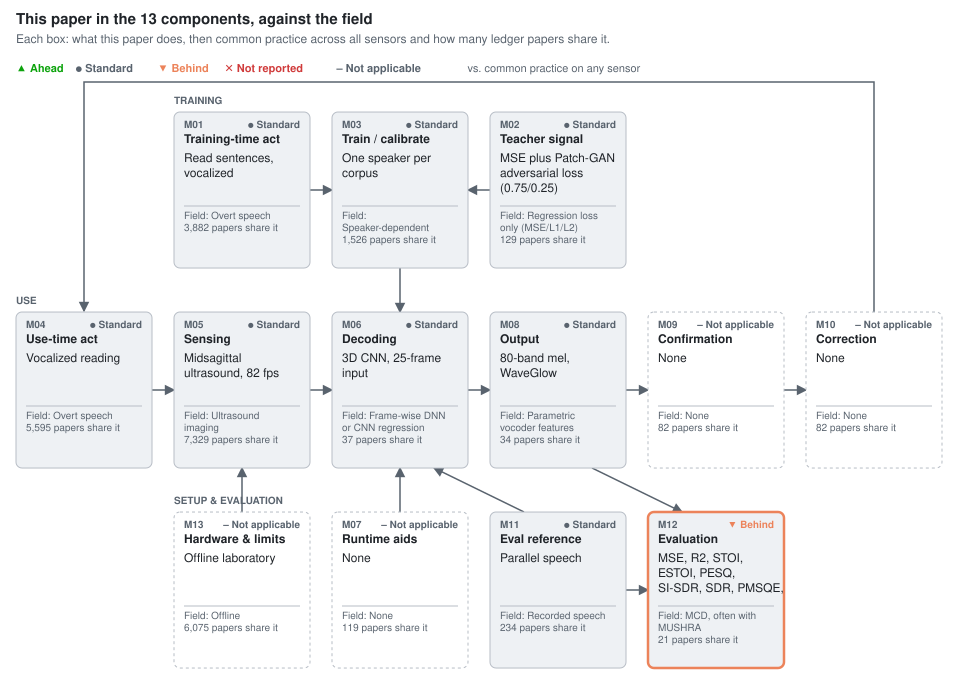

# Improving Neural Silent Speech Interface Models by Adversarial Training

Shandiz, A. H., Tóth, L., Gosztolya, G., Markó, A., Csapó, T. G. · arXiv preprint; AICV 2021 · 2021 · [doi:10.1007/978-3-030-76346-6_39](https://doi.org/10.1007/978-3-030-76346-6_39) · [arXiv:2104.11601](https://arxiv.org/abs/2104.11601)

**Section:** [Ultrasound & tongue imaging](../../README.md#ultrasound--tongue-imaging)

## Figures

### This paper in the 13 components, against the field

<picture><source media="(prefers-color-scheme: dark)" srcset="figures/components-dark.svg"></picture>

Verdicts compare the paper's choice for each component with common practice across 8,995 ledger entries on any sensor (silent speech, brain-to-text, lip reading).

Data

| Component | This paper | Common practice | Papers with this practice | Verdict |
| --- | --- | --- | --- | --- |
| M01 Training-time act | Read sentences, vocalized | Overt speech | 3,882 of 8,995 | ● Standard (Inherited from the Csapo/Toth corpus and TaL1.) |
| M02 Teacher signal | MSE plus Patch-GAN adversarial loss (0.75/0.25) | Regression loss only (MSE/L1/L2) | 129 of 8,995 | ● Standard (Critic plus regression predates it in video-to-speech [@vougioukas2019video]; the authors claim a first for ultrasound only; no variance reported.) |
| M03 Train / calibrate | One speaker per corpus | Speaker-dependent | 1,526 of 8,995 | ● Standard (Split procedure not stated; no held-out session reported.) |
| M04 Use-time act | Vocalized reading | Overt speech | 5,595 of 8,995 | ● Standard (No silent test.) |
| M05 Sensing | Midsagittal ultrasound, 82 fps | Ultrasound imaging | 7,329 of 8,995 | ● Standard (Articulate Instruments Micro; 64x128 input.) |
| M06 Decoding | 3D CNN, 25-frame input | Frame-wise DNN or CNN regression | 37 of 8,995 | ● Standard (Generator from the authors' earlier study.) |
| M07 Runtime aids | None | None | 119 of 8,995 | – Not applicable (Direct spectral mapping.) |
| M08 Output | 80-band mel, WaveGlow | Parametric vocoder features | 34 of 8,995 | ● Standard (Neural vocoder as in [@csapo2020waveglow].) |
| M09 Confirmation | None | None | 82 of 8,995 | – Not applicable (Offline study.) |
| M10 Correction | None | None | 82 of 8,995 | – Not applicable (Offline study.) |
| M11 Eval reference | Parallel speech | Recorded speech | 234 of 8,995 | ● Standard (Reference from the same recording.) |
| M12 Evaluation | MSE, R2, STOI, ESTOI, PESQ, SI-SDR, SDR, PMSQE, MCD; no listeners | MCD, often with MUSHRA | 21 of 8,995 | ▼ Behind (No listening or intelligibility test; no variance reported; 24 English test utterances.) |
| M13 Hardware & limits | Offline laboratory | Offline | 6,075 of 8,995 | – Not applicable (No deployment claim.) |

## Verdict

The paper [[1]](#ref-1) changes one component, the training-only supervision (M02): a Patch-GAN discriminator adds an adversarial loss, weighted 0.25 against 0.75 MSE, to an ultrasound-to-mel 3D CNN. M02 is standard: the authors claim a first only for ultrasound (§6), and a critic loss added to a regression loss for speech from a silent signal already existed in video-to-speech [[2]](#ref-2). The effect is not established: no repeated runs or variance are reported, and test STOI rises 0.24% relative in Hungarian and 1.8% in English (Table 3) (inference). The GAN model also has lower test MSE than the model trained on MSE alone (Table 2), which is unexplained: a weak baseline, a regularizing effect of the adversarial term, or the change from 1 to 5 output frames (§4.2) would each produce it (inference). Evaluation (M12) is behind on the group's own earlier practice: its 2020 study ran a MUSHRA test with 22 listeners [[3]](#ref-3), four earlier ultrasound-to-speech studies of the group ran MUSHRA (pattern match, Appendix), and this one runs none, so "improved quality" rests on objective metrics only.

## Against the field, component by component

### M02 Training-only supervision: adversarial loss on the mapping

**Usual approach:** a regression loss only (MSE, L1 or L2) on spectral or vocoder targets: 129 of 400 unique studies that generate speech from a non-acoustic signal name one (pattern match, Appendix); 50 name adversarial training, an upper bound that includes GAN vocoders. The paper adds a discriminator term to the MSE of the same generator (§3).

**State of the art:** EMA-to-speech with HiFi-GAN-style adversarial losses on the mapping, 18.5% transcription WER from 70 listeners, one speaker, 2022 [[4]](#ref-4) [later]. Its input and setup differ, so it does not rank the target's loss design; it shows that such a loss can be judged by listeners.

The closest prior is video-to-waveform synthesis with a Wasserstein critic plus L1, perceptual and smoothness losses [[2]](#ref-2), whose ablation found that without the adversarial term the output was noise (§4.1). No ultrasound study before the target trains the mapping with an adversarial loss (0, pattern match with snippet check, Appendix), so the transfer to ultrasound is new; the design is not. There the critic shaped raw waveforms; here WaveGlow renders the mel output, leaving the discriminator only spectral texture (inference). Test gains are 2.3-2.7% relative for PESQ, 2.5-5.2% for ESTOI and 1.5-4.5% for MCD, with no variance reported (Table 3) (inference). The generator also changed its output from 1 to 5 mel frames for the GAN experiments (§4.2), and the text does not say the MSE baseline did the same. Verdict: standard.

### M12 Evaluation: output measures

**Usual approach:** spectral distance (MCD, 21 of 51 unique ultrasound-to-speech studies), often with a MUSHRA naturalness test (14); intelligibility is rarely measured (pattern match, Appendix). The paper reports MSE and R2 (Table 2), STOI, ESTOI, PESQ, SI-SDR, SDR, PMSQE and MCD (Table 3), and no listening test (§5).

**State of the art:** 15.93% WER of speech synthesized from TaL1 ultrasound, the corpus of the paper's English set, 2026 [[5]](#ref-5) [later]; at the time, 2.99 dB MCD and 27.9% WER on TaL1 tongue input [[6]](#ref-6) [concurrent]. The authors cite the 2.99 dB (§5) against their best 3.229 dB (Table 3) and give no WER.

The authors skip MUSHRA as slow (§5). The same group had run one eight months earlier on WaveGlow output from ultrasound: 22 listeners, 16 sentences, 13 minutes per listener [[3]](#ref-3); four prior ultrasound-to-speech studies of the group ran MUSHRA (pattern match, Appendix). SI-SDR of -39.4 to -36.0 dB and SDR of -18.3 to -16.9 dB (Table 3) compare waveforms a vocoder does not phase-align with the reference (inference). Verdict: behind (best comparable work).

## The 13 components

| Component | This paper | Usual approach (count) | State of the art | Verdict |
|---|---|---|---|---|
| M01 Training-time action | Read sentences, vocalized | Overt speech (slot-filled 3,882) | – | standard |
| M02 Training-only supervision | MSE plus Patch-GAN adversarial loss (0.75/0.25) | Regression loss only (MSE/L1/L2) (pattern match 129) | 18.5% listener WER, EMA, 2022 [[4]](#ref-4) [later] | standard |
| M03 Training and adaptation | One speaker per corpus | Speaker-dependent (slot-filled 1,526) | – | standard |
| M04 Use-time action | Vocalized reading | Overt speech (slot-filled 5,595) | – | standard |
| M05 Sensors | Midsagittal ultrasound, 82 fps | Ultrasound imaging (slot-filled 7,329) | – | standard |
| M06 Processing and decoding | 3D CNN, 25-frame input | Frame-wise DNN or CNN regression (pattern match 37) | – | standard |
| M07 Lexicon and LM | None | None (slot-filled 119) | – | not applicable |
| M08 Output | 80-band mel, WaveGlow | Parametric vocoder features (pattern match 34) | – | standard |
| M09 Confirmation | None | None (slot-filled 82) | – | not applicable |
| M10 Correction | None | None (slot-filled 82) | – | not applicable |
| M11 Reference construction | Parallel speech | Recorded speech (slot-filled 234) | – | standard |
| M12 Evaluation | MSE, R2, STOI, ESTOI, PESQ, SI-SDR, SDR, PMSQE, MCD; no listeners | MCD, often with MUSHRA (pattern match 21) | 15.93% WER on TaL1, 2026 [[5]](#ref-5) [later] | behind |
| M13 Device and cost | Offline laboratory | Offline (slot-filled 6,075) | – | not applicable |

## Where the claims outrun the evidence

- "Consistent improvement in all the evaluated metrics" (§5) comes with no repeated runs or variance; the smallest gain, Hungarian STOI 0.7050 to 0.7067 (Table 3), is within what a reseed could move (inference).
- Test MSE falls from 0.326 to 0.29 (Hungarian) and 0.317 to 0.293 (English) under the mixed loss (Table 2). A model trained only on MSE should not lose on MSE unless it was under-trained, set up differently or regularized by the adversarial term (inference); the 1-to-5-frame output change (§4.2) also leaves the two MSE values not directly comparable.
- The 0.75/0.25 weighting is "the best results" (§4.2) with no stated selection set; English test results rest on 24 utterances (§4.1).
- "Justify the utility of GANs" (§5) rests on metrics the authors say may not reflect perception (§5).

## What the field needs next

- M02: MSE-only and MSE-plus-adversarial generators with identical output windows, several seeds, and a listening test, on TaL1 so results meet [[6]](#ref-6) and [[5]](#ref-5).
- M12: intelligibility (listener or ASR WER) beside MCD for every ultrasound-to-speech comparison; drop SDR and SI-SDR for vocoded output.
- M03: the split procedure stated (§4.1 gives only counts), so the English test set can be matched to TaL1 xaud [[6]](#ref-6).

## Questions for the authors

- Did the MSE-only baseline also predict 5 consecutive mel frames?
- Which data selected the loss weights and the stopping point?
- Was WaveGlow the public pretrained model or adapted to each speaker?
- Were the 24 English test utterances the TaL1 xaud prompts used in [[6]](#ref-6)?

## Appendix: literature search

- M02 adversarial-loss-non-acoustic-to-speech (new topic table). Inclusion rule: studies that generate speech from a non-acoustic speech signal (ultrasound, EMA, PMA, EMG, lip or face video, radar, intracranial recordings) and train the mapping network itself with an adversarial (discriminator or critic) loss, alone or added to a regression loss; off-the-shelf GAN vocoders trained on audio only, domain-adversarial training, acoustic-input conversion and reviews excluded; versions counted once. Slot-filled 31 unique studies (sparse slot); pattern match 400 unique studies. Full-text pattern counts: regression loss 129, GAN vocoder named 61, adversarial training named 50 (upper bound), perceptual or metric loss 18, domain-adversarial 11. Snippet check of the adversarial hits: prior [[2]](#ref-2) (video); ultrasound before the target 0. Usual design: regression loss only, 129 (pattern match). State of the art: [[4]](#ref-4) [later]. Read in full: [[2]](#ref-2), [[4]](#ref-4), target. Known-item recall 1.0 (2 of 2 seeds).
- M12 ultrasound-to-speech-output-evaluation (published topic table, reused and appended). Inclusion rule: studies that synthesize speech or acoustic features from ultrasound tongue images (with or without lip video) and evaluate the output; recognition-only studies, contour tracking and reviews excluded; versions counted once. Slot-filled 6,960 unique studies; pattern match 51 unique studies. Full-text pattern counts: MCD 21, MUSHRA 14, listener intelligibility 5, MOS 4, ASR on output 3. Prior listening tests in the target's group: 4 unique studies (pattern match). Usual design: spectral distance (MCD, 21), often with MUSHRA (pattern match). State of the art: [[5]](#ref-5) [later]. Read in full: [[3]](#ref-3), [[6]](#ref-6), [[5]](#ref-5) (published table), target.
- Counts in the 13-components table: slot-filled counts are wiki papers with that slot filled, out of 7,388 across all topics; pattern-match counts are unique studies in a topic's candidate set, 400 for M02 and 51 ultrasound-to-speech studies for M06, M08 and M12.

## References

Numbered by first citation. BibTeX in the same order and keys: [refs.bib](refs.bib).

1. Shandiz, A. H., Tóth, L., Gosztolya, G., Markó, A., Csapó, T. G. “Improving Neural Silent Speech Interface Models by Adversarial Training.” *arXiv preprint (cs.SD); published in Proc. AICV 2021, Springer AISC*, 2021. doi:[10.1007/978-3-030-76346-6_39](https://doi.org/10.1007/978-3-030-76346-6_39). arXiv:[2104.11601](https://arxiv.org/abs/2104.11601). Target. Read as arXiv v1. [review](https://github.com/supernaiter/silent-speech-review/tree/main/reviews/improving-neural-silent-speech-interface-models-by-adversarial-training) [wiki: arxiv-2104.11601](https://github.com/supernaiter/deep-research-wiki-for-silent-speech/blob/main/papers/arxiv-2104.11601/article.md)
2. Vougioukas, K., Ma, P., Petridis, S., Pantic, M. “Video-Driven Speech Reconstruction using Generative Adversarial Networks.” *Proc. Interspeech 2019*, 2019, 4125–4129. doi:[10.21437/Interspeech.2019-1445](https://doi.org/10.21437/Interspeech.2019-1445). arXiv:[1906.06301](https://arxiv.org/abs/1906.06301). [review](https://github.com/supernaiter/silent-speech-review/tree/main/reviews/video-driven-speech-reconstruction-using-generative-adversarial-networks) [wiki: isca-vougioukas19_ganv2s](https://github.com/supernaiter/deep-research-wiki-for-silent-speech/blob/main/papers/isca-vougioukas19_ganv2s/article.md)
3. Csapó, T. G., Zainkó, C., Tóth, L., Gosztolya, G., Markó, A. “Ultrasound-based Articulatory-to-Acoustic Mapping with WaveGlow Speech Synthesis.” *Proc. Interspeech 2020*, 2020, 2727–2731. doi:[10.21437/Interspeech.2020-1031](https://doi.org/10.21437/Interspeech.2020-1031). arXiv:[2008.03152](https://arxiv.org/abs/2008.03152). [wiki: isca-csapo20b-uswaveglow](https://github.com/supernaiter/deep-research-wiki-for-silent-speech/blob/main/papers/isca-csapo20b-uswaveglow/article.md) [wiki: isca-csapo20b_interspeech](https://github.com/supernaiter/deep-research-wiki-for-silent-speech/blob/main/papers/isca-csapo20b_interspeech/article.md) [wiki: arxiv-2008.03152](https://github.com/supernaiter/deep-research-wiki-for-silent-speech/blob/main/papers/arxiv-2008.03152/article.md)
4. Wu, P., Watanabe, S., Goldstein, L., Black, A. W., Anumanchipalli, G. K. “Deep Speech Synthesis from Articulatory Representations.” *Proc. Interspeech 2022*, 2022, 779–783. doi:[10.21437/Interspeech.2022-10892](https://doi.org/10.21437/Interspeech.2022-10892). arXiv:[2209.06337](https://arxiv.org/abs/2209.06337). [later] [wiki: arxiv-2209.06337](https://github.com/supernaiter/deep-research-wiki-for-silent-speech/blob/main/papers/arxiv-2209.06337/article.md)
5. Sonkar, Y., Kilaru, Y., Yelimeli, S., Shah, N., Gandhi, V. “Tongue2Speech: Real-Time Speech Synthesis from Tongue Ultrasound Videos via Spatiotemporal Transformers.” *Proc. Interspeech 2026*, 2026. doi:[10.21437/Interspeech.2026-3023](https://doi.org/10.21437/Interspeech.2026-3023). [later] [wiki: isca-sonkar26_interspeech](https://github.com/supernaiter/deep-research-wiki-for-silent-speech/blob/main/papers/isca-sonkar26_interspeech/article.md)
6. Ribeiro, M. S., Sanger, J., Zhang, J., Eshky, A., Wrench, A., Richmond, K., et al. “TaL: A Synchronised Multi-Speaker Corpus of Ultrasound Tongue Imaging, Audio, and Lip Videos.” *Proc. IEEE Spoken Language Technology Workshop (SLT 2021)*, 2021. doi:[10.1109/SLT48900.2021.9383619](https://doi.org/10.1109/SLT48900.2021.9383619). arXiv:[2011.09804](https://arxiv.org/abs/2011.09804). [concurrent] [wiki: arxiv-2011.09804](https://github.com/supernaiter/deep-research-wiki-for-silent-speech/blob/main/papers/arxiv-2011.09804/article.md) [wiki: doi-10.1109-slt48900.2021.9383619](https://github.com/supernaiter/deep-research-wiki-for-silent-speech/blob/main/papers/doi-10.1109-slt48900.2021.9383619/article.md)

## Materials

Data behind this review. Full texts of the papers are not included.

- [`review.md`](review.md): the review text (source)
- [`refs.bib`](refs.bib): references (BibTeX)
- [`slots.json`](slots.json): for each of the 13 components: this paper's choice, field practice, number of matching papers, verdict
- [`figures.json`](figures.json): figure definitions
- [`evaluation.md`](evaluation.md): independent evaluation by a second reviewer
- [`triage.md`](triage.md): how each evaluation finding was checked against the sources and resolved
- [`components/M02/adversarial-loss-non-acoustic-to-speech.csv`](../../components/M02/adversarial-loss-non-acoustic-to-speech.csv): M02 topic "adversarial-loss-non-acoustic-to-speech", every candidate paper with its decision (31 slot-filled, 400 pattern match, usual design in 129, 3 read in full)
- [`components/M12/ultrasound-to-speech-output-evaluation.csv`](../../components/M12/ultrasound-to-speech-output-evaluation.csv): M12 topic "ultrasound-to-speech-output-evaluation", every candidate paper with its decision (6960 slot-filled, 51 pattern match, usual design in 21, 3 read in full)

## More reviews in Ultrasound & tongue imaging

- [Convolutional Neural Network-Based Age Estimation Using B-Mode Ultrasound Tongue Image](../convolutional-neural-network-based-age-estimation-using-b-mode-ultrasound-tongue-image/) (2021). Age output from tongue ultrasound (M08) is new but unproven: the random frame split shares children between training and validation (M12), so speaker identity can explain the gain.
- [Neural Speaker Embeddings for Ultrasound-based Silent Speech Interfaces](../neural-speaker-embeddings-for-ultrasound-based-silent-speech-interfaces/) (2021). Standard on embedding conditioning (2.4% relative MSE gain on seen speakers); behind on speaker recognition, which never separates speaker from recording session.
- [Silent versus modal multi-speaker speech recognition from ultrasound and video](../silent-versus-modal-multi-speaker-speech-recognition-from-ultrasound-and-video/) (2021). Standard on both changed components: modal-to-silent loss and fMLLR were known; later work narrows the absolute gap but not the fMLLR ratio, and adaptation gains rest on single runs.
- [Speech Synthesis from Text and Ultrasound Tongue Image-based Articulatory Input](../speech-synthesis-from-text-and-ultrasound-tongue-image-based-articulatory-input/) (2021). Text+ultrasound input to DNN-TTS (M06) is standard: test MCD falls 0.015-0.229 dB on 8 speakers; BAP, voicing worsen on test, F0 correlation improves; no listening test.
- [Voice Activity Detection for Ultrasound-based Silent Speech Interfaces using Convolutional Neural Networks](../voice-activity-detection-for-ultrasound-based-silent-speech-interfaces-using-convolutional-neural-networks/) (2021). Frame-wise ultrasound CNN VAD (M06) and audio-VAD labels (M02) are standard; one-speaker file-split test (M12) is behind held-out-speaker VAD work; 85% is 11 points over majority.
- [Improved Processing of Ultrasound Tongue Videos by Combining ConvLSTM and 3D Convolutional Networks](../improved-processing-of-ultrasound-tongue-videos-by-combining-convlstm-and-3d-convolutional-networks/) (2022). ConvLSTM top layer (M06) is standard: new to ultrasound-to-speech, but a 2.1% MSE edge over BiLSTM, one speaker, one run; later work dropped it. No MCD or listener test (M12 behind).

---

Part of the [Silent Speech Interface Review](https://github.com/supernaiter/silent-speech-review). Found an error? [Open an issue](https://github.com/supernaiter/silent-speech-review/issues/new?template=correction.yml).
