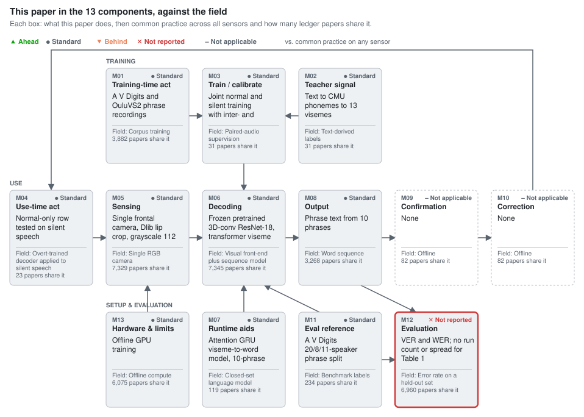

# Improving the Gap in Visual Speech Recognition Between Normal and Silent Speech Based on Metric Learning

Sara Kashiwagi, Keitaro Tanaka, Qi Feng, Shigeo Morishima. Interspeech 2023, Dublin, pp. 3397-3401. [doi:10.21437/Interspeech.2023-370](https://doi.org/10.21437/Interspeech.2023-370) · [arXiv:2305.14203](https://arxiv.org/abs/2305.14203)

**Section:** [Lip & face video](../../README.md#lip--face-video)

## Figures

### This paper in the 13 components, against the field

<picture><source media="(prefers-color-scheme: dark)" srcset="figures/components-dark.svg"></picture>

Verdicts compare the paper's choice for each component with common practice across 8,995 ledger entries on any sensor (silent speech, brain-to-text, lip reading).

Data

| Component | This paper | Common practice | Papers with this practice | Verdict |
| --- | --- | --- | --- | --- |
| M01 Training-time act | A V Digits and OuluVS2 phrase recordings | Corpus training | 3,882 of 8,995 | ● Standard (Recorded read phrases; no in-use training action.) |
| M02 Teacher signal | Text to CMU phonemes to 13 visemes | Text-derived labels | 31 of 8,995 | ● Standard (Viseme targets from text only; no audio target.) |
| M03 Train / calibrate | Joint normal and silent training with inter- and within-mode KL on viseme posteriors | Paired-audio supervision | 31 of 8,995 | ● Standard (Divergence route is the earliest of 5 (pattern match) but Table 1 reports no run count, so the ahead rule is not met; target transfer 27, domain-adversarial 12 (pattern match).) |
| M04 Use-time act | Normal-only row tested on silent speech | Overt-trained decoder applied to silent speech | 23 of 8,995 | ● Standard (WER 11.58% to 22.55% (nearly doubles); degradation already in [@petridis2018visual].) |
| M05 Sensing | Single frontal camera, Dlib lip crop, grayscale 112 x 112 | Single RGB camera | 7,329 of 8,995 | ● Standard (Pixel normalization not stated.) |
| M06 Decoding | Frozen pretrained 3D-conv ResNet-18, transformer viseme classifier | Visual front-end plus sequence model | 7,345 of 8,995 | ● Standard (Front-end weights from a large normal-speech model, kept fixed.) |
| M07 Runtime aids | Attention GRU viseme-to-word model, 10-phrase set | Closed-set language model | 119 of 8,995 | ● Standard (Trained on normal-speech viseme predictions only; search not stated.) |
| M08 Output | Phrase text from 10 phrases | Word sequence | 3,268 of 8,995 | ● Standard (Closed vocabulary; unknown words left to future work.) |
| M09 Confirmation | None | Offline | 82 of 8,995 | – Not applicable (Offline benchmark.) |
| M10 Correction | None | Offline | 82 of 8,995 | – Not applicable (Offline benchmark.) |
| M11 Eval reference | A V Digits 20/8/11-speaker phrase split | Benchmark labels | 234 of 8,995 | ● Standard (Counts match the corpus split of [@petridis2018visual]; speaker disjointness not stated.) |
| M12 Evaluation | VER and WER; no run count or spread for Table 1 | Error rate on a held-out set | 6,960 of 8,995 | ✕ Not reported (No seeds, intervals or named selection split for Table 1; Fig. 3 averages 5 subset runs, VER only.) |
| M13 Hardware & limits | Offline GPU training | Offline compute | 6,075 of 8,995 | ● Standard (No latency or device measurement.) |

## Verdict

The paper [[1]](#ref-1) changes training (M03): a lip-video model learns from normal and silent recordings together, with KL terms pulling the viseme posteriors of the two modes toward each other. The verdict is standard: overt recordings already enter silent-speech training as paired-audio supervision (31 of 138 slot-filled studies, Appendix), as in EMG [[2]](#ref-2), and the paper does not show that its loss beats these routes. Most of the reported gap closing comes from adding silent data, not from metric learning: the normal-to-silent WER gap falls from 10.97 to 2.70 points with cross-entropy on both modes and only to 1.77 with the full loss (Table 1) (inference). The headline gain, silent WER from 12.91% to 9.97%, is reported without a run count or spread, after a loss-weight search that does not say which split selected the weights. A later EMG study of the same idea, on a different task, reports a seed-to-seed WER standard deviation of about 1 point and used 10 seeds to show a 1.61-point gain (inference) [[3]](#ref-3); by that analogy the gain is not established, and run variance (M12) is not reported.

## Against the field, component by component

### M03 Training: tying normal and silent recordings

**Usual approach:** overt recordings enter silent-speech training as paired-audio supervision, 31 of 138 slot-filled studies (Appendix), most often as time-aligned target transfer (27 studies, pattern match), as in EMG where vocalized audio is warped onto the silent take [[2]](#ref-2). The paper instead adds a divergence between the modes' outputs.

**State of the art:** a 2026 silent-voiced alignment loss on parallel EMG lowers silent WER from 26.75% to 25.14% (6.0% relative), mean of 10 seeds, p = 0.002 [[3]](#ref-3) [later].

Of the 5 studies whose full text names a divergence, metric or contrastive loss between modes (pattern match, Appendix), the target is the earliest and the 4 others are [later]; domain-adversarial training [[4]](#ref-4) is [concurrent] and aligns modes through a domain classifier, not a divergence between paired outputs. It stays standard: ahead needs repetition, which Table 1 lacks. Against a baseline already trained on both modes, the metric terms move silent WER by 2.94 points, 22.8% relative (inference), with no run count reported, and silent VER spans only 6.66-7.77% over the 12 two-mode rows (Table 1). Domain-adversarial joint training on ultrasound gains 8.1 points of silent WER (51.199% to 43.114%) (inference) [[4]](#ref-4) [concurrent]; in EMG, dropping non-parallel vocalized data costs 3.6 points [[2]](#ref-2). These open-vocabulary WERs do not rank against 10-phrase WER; no study compares a divergence loss with these alternatives on one task. Verdict: standard.

### M04 Use-time action: normal-trained model on silent speech

**Usual approach:** a decoder trained on overt speech and applied to silent speech, reported as a degradation, 23 of 33 studies across signals (confirmed; Appendix). Table 1 row 1 follows it.

**State of the art:** in 2018, on a split with the same 20/8/11 speaker counts, a normal-trained end-to-end model reached 61.2% on silent phrases against 64.4% when silent-trained (run SDs 1.6 and 2.3) [[5]](#ref-5).

Here the normal-only model nearly doubles its WER on silent speech (11.58% to 22.55%), against the earlier 8.5-point accuracy drop [[5]](#ref-5); word error and phrase accuracy do not rank against each other. Verdict: standard.

## The 13 components

| Component | This paper | Usual approach (count) | State of the art | Verdict |
|---|---|---|---|---|
| M01 Training-time action | A V Digits and OuluVS2 phrase recordings | Corpus training (slot-filled 3,882) | – | standard |
| M02 Training-only supervision | Text to CMU phonemes to 13 visemes | Text-derived labels (slot-filled 31) | – | standard |
| M03 Training and adaptation | Joint normal and silent training with inter- and within-mode KL on viseme posteriors | Paired-audio supervision (slot-filled 31) | [[3]](#ref-3) 25.14% silent WER, 10 seeds [later] | standard |
| M04 Use-time action | Normal-only row tested on silent speech | Overt-trained decoder applied to silent speech (confirmed 23) | [[5]](#ref-5) 61.2% vs 64.4% silent phrase accuracy | standard |
| M05 Sensors | Single frontal camera, Dlib lip crop, grayscale 112 x 112 | Single RGB camera (slot-filled 7,329) | – | standard |
| M06 Processing and decoding | Frozen pretrained 3D-conv ResNet-18, transformer viseme classifier | Visual front-end plus sequence model (slot-filled 7,345) | – | standard |
| M07 Lexicon and LM | Attention GRU viseme-to-word model, 10-phrase set | Closed-set language model (slot-filled 119) | – | standard |
| M08 Output | Phrase text from 10 phrases | Word sequence (slot-filled 3,268) | – | standard |
| M09 Confirmation | None | Offline (slot-filled 82) | – | not applicable |
| M10 Correction | None | Offline (slot-filled 82) | – | not applicable |
| M11 Reference construction | A V Digits 20/8/11-speaker phrase split | Benchmark labels (slot-filled 234) | – | standard |
| M12 Evaluation | VER and WER; no run count or spread for Table 1 | Error rate on a held-out set (slot-filled 6,960) | – | not reported |
| M13 Device and cost | Offline GPU training | Offline compute (slot-filled 6,075) | – | standard |

## Where the claims outrun the evidence

- The title credits metric learning with closing the gap, but the two-mode cross-entropy baseline closes 75% of the 10.97-point gap (to 2.70 points, Table 1), 90% of what the full loss closes (inference); the metric terms add 0.93 points.
- "Nearly 3%" (Sec. 1) is 2.94 absolute WER points (inference) with no run count or spread; the parameter search kept the best setting (Sec. 4.2) without saying which split selected it, although a validation split exists (Sec. 4.1).
- Rows disagree across metrics: the normal within-speech term alone gives the best normal WER (7.36%) and the worst two-mode silent WER (13.45%); adding the silent term to the KL loss worsens silent VER (7.17% to 7.35%) but improves silent WER (11.06% to 10.71%) (Table 1). Unreported run-to-run noise explains these as well as any loss (inference).
- The data-efficiency claim (Fig. 3) holds normal data at 1,000 utterances, not the 2,560 of Table 1, and plots VER only; the "400 matches 800" statement has no WER and no test.
- The fine-tuning comparator (Sec. 4.4) has no number.

## What the field needs next

- M03: divergence loss, target transfer and domain-adversarial training compared on one lip-video corpus with matched data and several seeds.
- M12: Table 1 repeated over seeds and speaker folds, with intervals and loss weights fixed on validation data.
- M04: an open-vocabulary silent test, since 10 phrases let the word model mask viseme errors.

## Questions for the authors

- Are the 20/8/11 speakers of the split disjoint, and is it the published split of the corpus?
- Which data and metric selected the loss weights and the reported checkpoints?
- How much do Table 1 rows vary across seeds?
- What VER and WER did the fine-tuning comparator reach?

## Appendix: literature search

- M03 overt-silent-joint-training (new topic table). Inclusion rule: studies with any signal whose ledger mentions both overt (normal, vocalized, voiced, audible, modal) and silent (mouthed, silently articulated, unvoiced) production; the design compared is how overt recordings enter the training of a silent decoder (pooling, fine-tuning, time-aligned target transfer, domain-adversarial invariance, or a divergence, metric or contrastive loss between paired modes); overt-only training applied to silent tests belongs to M04; whisper conversion and perception studies excluded; reviews count as pattern matches only; versions counted once. Slot-filled 1,526 unique studies; pattern match 354 unique studies. Usual design among slot-filled topic studies: paired-audio supervision, 31 of 138 (slot-filled). Full-text pattern counts: time-aligned target transfer 27, domain-adversarial 12, fine-tuning from an overt model 11, divergence / metric / contrastive loss 5 (pattern match; the 4 besides the target are later). State of the art: [[3]](#ref-3) [later]. Read in full: [[2]](#ref-2), [[5]](#ref-5), [[4]](#ref-4) [concurrent], [[3]](#ref-3) [later], target. Known-item recall 1.0 (6 of 6 seeds).
- M04 overt-to-silent-transfer (published topic table, appended). Inclusion rule unchanged: decoders trained only on overt speech and applied to silent, mouthed, inner or imagined speech without retraining, any signal; versions counted once. Slot-filled 5,595 unique studies; pattern match 33 unique studies; usual design: overt-trained decoder applied to silent speech and reported as a degradation, 23 (confirmed). Read in full: [[5]](#ref-5), target. Known-item recall 1.0 (3 of 3 seeds).

## References

Numbered by first citation. BibTeX in the same order and keys: [refs.bib](refs.bib).

1. Kashiwagi, S., Tanaka, K., Feng, Q., Morishima, S. “Improving the Gap in Visual Speech Recognition Between Normal and Silent Speech Based on Metric Learning.” *Proc. Interspeech 2023*, 2023, 3397–3401. doi:[10.21437/Interspeech.2023-370](https://doi.org/10.21437/Interspeech.2023-370). arXiv:[2305.14203](https://arxiv.org/abs/2305.14203). [review](https://github.com/supernaiter/silent-speech-review/tree/main/reviews/improving-the-gap-in-visual-speech-recognition-between-normal-and-silent-speech-based-on-metric-learning) [wiki: arxiv-2305.14203](https://github.com/supernaiter/deep-research-wiki-for-silent-speech/blob/main/papers/arxiv-2305.14203/article.md) [wiki: isca-kashiwagi23-silentvsr](https://github.com/supernaiter/deep-research-wiki-for-silent-speech/blob/main/papers/isca-kashiwagi23-silentvsr/article.md) [wiki: isca-kashiwagi23_interspeech](https://github.com/supernaiter/deep-research-wiki-for-silent-speech/blob/main/papers/isca-kashiwagi23_interspeech/article.md)
2. Gaddy, D., Klein, D. “Digital Voicing of Silent Speech.” *Proc. Conference on Empirical Methods in Natural Language Processing (EMNLP 2020)*, 2020. doi:[10.18653/v1/2020.emnlp-main.445](https://doi.org/10.18653/v1/2020.emnlp-main.445). arXiv:[2010.02960](https://arxiv.org/abs/2010.02960). [review](https://github.com/supernaiter/silent-speech-review/tree/main/reviews/digital-voicing-of-silent-speech) [wiki: arxiv-2010.02960](https://github.com/supernaiter/deep-research-wiki-for-silent-speech/blob/main/papers/arxiv-2010.02960/article.md) [wiki: doi-10.18653-v1-2020.emnlp-main.445](https://github.com/supernaiter/deep-research-wiki-for-silent-speech/blob/main/papers/doi-10.18653-v1-2020.emnlp-main.445/article.md)
3. Lee, J., Hwang, I., Lee, J., Kim, E., Han, D., Lee, K. “Enhancing EMG-to-Speech via Silent-Voiced Representation Alignment.” *Proc. Interspeech 2026*, 2026. doi:[10.21437/Interspeech.2026-2931](https://doi.org/10.21437/Interspeech.2026-2931). [later] [wiki: isca-lee26v_interspeech](https://github.com/supernaiter/deep-research-wiki-for-silent-speech/blob/main/papers/isca-lee26v_interspeech/article.md)
4. Zheng, R., Ai, Y., Ling, Z. “Speech Reconstruction from Silent Tongue and Lip Articulation by Pseudo Target Generation and Domain Adversarial Training.” *arXiv preprint*, 2023. arXiv:[2304.05574](https://arxiv.org/abs/2304.05574). [concurrent] [review](https://github.com/supernaiter/silent-speech-review/tree/main/reviews/speech-reconstruction-from-silent-tongue-and-lip-articulation-by-pseudo-target-generation-and-domain-adversarial-training) [wiki: arxiv-2304.05574](https://github.com/supernaiter/deep-research-wiki-for-silent-speech/blob/main/papers/arxiv-2304.05574/article.md)
5. Petridis, S., Shen, J., Cetin, D., Pantic, M. “Visual-Only Recognition of Normal, Whispered and Silent Speech.” *Proc. IEEE International Conference on Acoustics, Speech and Signal Processing (ICASSP 2018)*, 2018. doi:[10.1109/ICASSP.2018.8461596](https://doi.org/10.1109/ICASSP.2018.8461596). arXiv:[1802.06399](https://arxiv.org/abs/1802.06399). [review](https://github.com/supernaiter/silent-speech-review/tree/main/reviews/visual-only-recognition-of-normal-whispered-and-silent-speech) [wiki: arxiv-1802.06399](https://github.com/supernaiter/deep-research-wiki-for-silent-speech/blob/main/papers/arxiv-1802.06399/article.md) [wiki: doi-10.1109-icassp.2018.8461596](https://github.com/supernaiter/deep-research-wiki-for-silent-speech/blob/main/papers/doi-10.1109-icassp.2018.8461596/article.md)

## Materials

Data behind this review. Full texts of the papers are not included.

- [`review.md`](review.md): the review text (source)
- [`refs.bib`](refs.bib): references (BibTeX)
- [`slots.json`](slots.json): for each of the 13 components: this paper's choice, field practice, number of matching papers, verdict
- [`figures.json`](figures.json): figure definitions
- [`evaluation.md`](evaluation.md): independent evaluation by a second reviewer
- [`triage.md`](triage.md): how each evaluation finding was checked against the sources and resolved
- [`components/M03/overt-silent-joint-training.csv`](../../components/M03/overt-silent-joint-training.csv): M03 topic "overt-silent-joint-training", every candidate paper with its decision (1526 slot-filled, 354 pattern match, usual design in 31, 5 read in full)
- [`components/M04/overt-to-silent-transfer.csv`](../../components/M04/overt-to-silent-transfer.csv): M04 topic "overt-to-silent-transfer", every candidate paper with its decision (23 confirmed, 104 candidates read, 0 unread)

## More reviews in Lip & face video

- [Audio-visual video-to-speech synthesis with synthesized input audio](../audio-visual-video-to-speech-synthesis-with-synthesized-input-audio/) (2023). A second synthesis pass on first-pass speech (M06) and modality dropout (M03) are standard; gains are small and inconsistent, earlier systems keep lower WER, and no equal-training control exists.
- [Auto-AVSR: Audio-Visual Speech Recognition with Automatic Labels](../auto-avsr-audio-visual-speech-recognition-with-automatic-labels/) (2023). Training lipreading and AV-ASR on 3,448 h including ASR-pseudo-labelled AVSpeech and VoxCeleb2 cuts LRS3 visual-only WER to 19.1% and audio-visual WER to 0.9%.
- [High-Quality Automatic Voice Over with Accurate Alignment: Supervision through Self-Supervised Discrete Speech Units](../high-quality-automatic-voice-over-with-accurate-alignment-supervision-through-self-supervised-discrete-speech-units/) (2023). An automatic voice-over system that supervises alignment by predicting self-supervised discrete speech units from text and lip video, improving lip-sync and speech quality on a single-speaker dataset. Not an SSI paper.
- [Intelligible Lip-to-Speech Synthesis with Speech Units](../intelligible-lip-to-speech-synthesis-with-speech-units/) (2023). Unit target (M02) and unit-conditioned vocoder (M06) are standard; units cut LRS3 WER 21.8 points, AV-HuBERT 20.4 more, the vocoder 0.3; unit gain untested on AV-HuBERT, single runs.
- [Large-scale unsupervised audio pre-training for video-to-speech synthesis](../large-scale-unsupervised-audio-pre-training-for-video-to-speech-synthesis/) (2023). Pretrains the decoder of a video-to-speech model on large audio-only corpora, improving reconstruction quality on GRID, TCD-TIMIT and LRW, though WER gains are not consistent.
- [LipLearner: Customizable Silent Speech Interactions on Mobile Devices](../liplearner-customizable-silent-speech-interactions-on-mobile-devices/) (2023). LipLearner enables customizable few-shot silent speech commands on smartphones with on-device keyword spotting and incremental learning; reaches 98.8% five-shot accuracy on 30 commands in a live study.

---

Part of the [Silent Speech Interface Review](https://github.com/supernaiter/silent-speech-review). Found an error? [Open an issue](https://github.com/supernaiter/silent-speech-review/issues/new?template=correction.yml).
