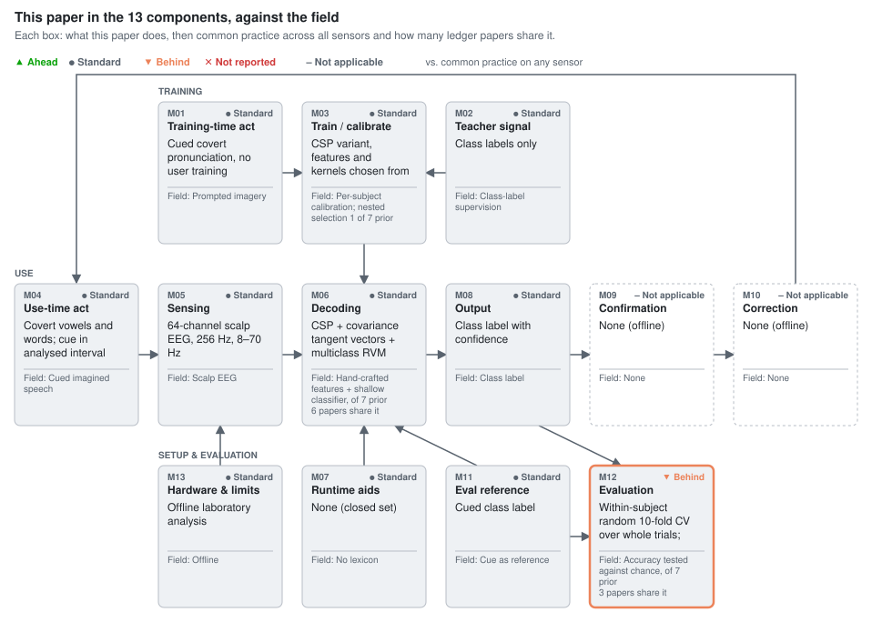

# Inferring imagined speech using EEG signals: a new approach using Riemannian manifold features

Chuong H. Nguyen, George K. Karavas, Panagiotis Artemiadis. Journal of Neural Engineering 15 (2018) 016002, first published December 2017. [doi:10.1088/1741-2552/aa8235](https://doi.org/10.1088/1741-2552/aa8235)

**Section:** [Other sensors](../../README.md#other-sensors)

## Figures

### This paper in the 13 components, against the field

<picture><source media="(prefers-color-scheme: dark)" srcset="figures/components-dark.svg"></picture>

Verdicts compare the paper's choice for each component with common practice across 8,995 ledger entries on any sensor (silent speech, brain-to-text, lip reading).

Data

| Component | This paper | Common practice | Papers with this practice | Verdict |
| --- | --- | --- | --- | --- |
| M01 Training-time act | Cued covert pronunciation, no user training | Prompted imagery |  | ● Standard (Inherited.) |
| M02 Teacher signal | Class labels only | Class-label supervision |  | ● Standard (Inherited.) |
| M03 Train / calibrate | CSP variant, features and kernels chosen from observed CV accuracy; no held-out selection set | Per-subject calibration; nested selection 1 of 7 prior |  | ● Standard (Nested selection only in one prior (Yoshimura 2016); fewer than 3 for behind.) |
| M04 Use-time act | Covert vowels and words; cue in analysed interval | Cued imagined speech |  | ● Standard (Inherited; authors analyse the visual-cue window to avoid auditory responses (§4.1).) |
| M05 Sensing | 64-channel scalp EEG, 256 Hz, 8–70 Hz | Scalp EEG |  | ● Standard (Inherited.) |
| M06 Decoding | CSP + covariance tangent vectors + multiclass RVM | Hand-crafted features + shallow classifier, of 7 prior | 6 of 7 | ● Standard (Absent in 0 of 7 priors; gains over at-chance baselines, uncorrected tests, accuracy-based tuning.) |
| M07 Runtime aids | None (closed set) | No lexicon |  | ● Standard (Inherited.) |
| M08 Output | Class label with confidence | Class label |  | ● Standard (Inherited.) |
| M09 Confirmation | None (offline) | None |  | – Not applicable (Offline study.) |
| M10 Correction | None (offline) | None |  | – Not applicable (Offline study.) |
| M11 Eval reference | Cued class label | Cue as reference |  | ● Standard (Inherited.) |
| M12 Evaluation | Within-subject random 10-fold CV over whole trials; chance stated, not tested | Accuracy tested against chance, of 7 prior | 3 of 7 | ▼ Behind (Chance stated, not tested; 3 priors test it [@deng2010eeg].) |
| M13 Hardware & limits | Offline laboratory analysis | Offline |  | ● Standard (Inherited; no online test.) |

## Verdict

The paper changes the decoder (M06) to covariance tangent-space features with an RVM [[1]](#ref-1). None of the 7 prior imagined-speech EEG decoders used Riemannian features (Appendix), and the gain repeats across 6 to 8 subjects per task, but it is measured against re-implemented baselines at or near chance, with uncorrected tests and per-subject settings chosen on the reported accuracy, so M06 is standard: new to the setting, not shown to beat a working decoder. Evaluation (M12) is behind the best comparable work: 3 of 7 priors test accuracy against chance, this paper does not. The authors analyse the window in which the word-specific visual cue is shown, to avoid auditory responses (§4.1); a [later] re-analysis of the released data links the best contrast to muscle tension and that cue and finds vowels and short words near chance once all segments of a trial share a fold [[2]](#ref-2). The released dataset (Abstract), reused by later decoders [[3]](#ref-3), [[4]](#ref-4), is the lasting contribution.

## Against the field, component by component

### M06 Decoder: covariance tangent-space features with an RVM

**Usual approach:** 6 of the 7 prior decoders use hand-crafted statistical, spectral, wavelet, waveform or source features with a shallow classifier (4 of 7 SVM, LDA or ELM), one uses CSP with a recurrent CNN, and none uses Riemannian or tangent-space features or an RVM (pattern match, Appendix); the closest read prior classifies segment statistics with SVM and ELM [[5]](#ref-5). The authors take the representation from motor-imagery BCI (§6.2).

**State of the art:** On the same dataset, a 2021 [later] connectivity-image decoder with transfer learning reports mean κ 0.78 on three vowels (about 85% accuracy, inference) and at least 79.7% for every vowel subject, testing whole held-out trials with training-only augmentation [[3]](#ref-3), against 49.0% (κ 0.23) here (Table 2).

The vowel gains in Table 4 are gains over baselines whose per-subject means are 29.3–40.3% (log-variance+LDA) and 31.0–41.7% (DaSalla et al.) against 33% chance (Table 3a); the authors note this and attribute the DaSalla result to different instructions (§6.1). Of the 12 Tangent+RVM tests, run at 5% without correction (Table 4), 5 survive a Bonferroni threshold (inference). RVM and ELM differ by 3.8 and 3.5 points on vowels and short words (inference) and are, in the authors' words, equivalent on short-versus-long (p = 0.16, §6.1). A [later] tangent-space follow-up lifts its own baselines from 49.2% to 58.61% (vowels) and 49.3% to 60.35% (short words), but scores 900 epochs per subject, three per trial, with stratified 10-fold splits [[4]](#ref-4), the segment-level design the re-analysis shows inflates accuracy on this dataset [[2]](#ref-2). Verdict: standard.

### M12 Evaluation: within-subject cross-validation and chance

**Usual approach:** Of the 7 prior decoders, 6 reference chance and 3 test against it, by binomial model [[6]](#ref-6) or significance test [[7]](#ref-7) (pattern match, Appendix). The paper states chance at 33% and 50% (Fig. 8) and calls the results above chance with no test (Table 4 compares methods).

**State of the art:** A 2026 [later] re-analysis groups all segments of a trial in one fold: pooled medians over pairwise contrasts fall from 0.89 to 0.74, only short versus long (about 0.75) stays clearly above chance, and its authors read the post-imagery drop to 0.55 as confirming task-related decoding [[2]](#ref-2).

The 0.89 comes from the re-analysis's own 1.4 s segments at 0.1 s stride, not from this paper, which tests whole trials (270/30 and 160/40, §5.2), and its 73.3% on short versus long matches the grouped value. The authors' blocked-order control, 99.3 ± 1.4% for one subject, which they call erroneously optimistic (§6.1), is their own evidence that temporal structure can drive these numbers. Verdict: behind; yardstick, the best comparable work [[6]](#ref-6).

## The 13 components

| Component | This paper | Usual approach (count) | State of the art | Verdict |
|---|---|---|---|---|
| M01 Training-time action | Cued covert pronunciation, no user training | Prompted imagery | – | standard |
| M02 Training-only supervision | Class labels only | Class-label supervision | – | standard |
| M03 Training and adaptation | CSP variant, features and kernels chosen from observed CV accuracy; no held-out selection set | Per-subject calibration; nested selection 1 of 7 prior | – | standard |
| M04 Use-time action | Covert vowels and words; cue in analysed interval | Cued imagined speech | – | standard |
| M05 Sensors | 64-channel scalp EEG, 256 Hz, 8–70 Hz | Scalp EEG | – | standard |
| M06 Processing and decoding | CSP + covariance tangent vectors + multiclass RVM | Hand-crafted features + shallow classifier, of 7 prior (pattern match 6) | Vowels κ 0.78, same dataset [[3]](#ref-3) [later] | standard |
| M07 Lexicon and LM | None (closed set) | No lexicon | – | standard |
| M08 Output | Class label with confidence | Class label | – | standard |
| M09 Confirmation | None (offline) | None | – | not applicable |
| M10 Correction | None (offline) | None | – | not applicable |
| M11 Reference construction | Cued class label | Cue as reference | – | standard |
| M12 Evaluation | Within-subject random 10-fold CV over whole trials; chance stated, not tested | Accuracy tested against chance, of 7 prior (pattern match 3) | Trial-grouped CV and post-imagery check, same dataset [[2]](#ref-2) [later] | behind |
| M13 Device and cost | Offline laboratory analysis | Offline | – | standard |

## Where the claims outrun the evidence

- Robustness (Abstract) rests on lower spread of RVM than ELM (§6.1); no session or noise test is reported.
- Selection: frequency features were dropped because they gave no improvement and the CSP variant was the one with the highest accuracy (§5.2), with no held-out selection set; comparators are best grid means (§6.1).
- Sound versus meaning (§6.3) compares vowels and short words that share 3 of their subjects (Table 2).
- Complexity (§6.3): the κ gap, 0.32 against 0.25, is untested and confounded by subject set, window length (4.5 s vs 4 s, §5.2) and class count.
- The abstract's 70% and 95% are single-fold maxima within one subject (Table 3).
- The 8–70 Hz band said to remove EMG (§4.2) keeps part of the EMG range (inference), and the re-analysis links one participant's separation to muscle tension [[2]](#ref-2).

## What the field needs next

- M12: trial-grouped folds and a test against chance for tangent+RVM and the [later] decoders on identical subject sets.
- M04: a cue removed before imagery, duration-matched words and EMG channels.
- M03: CSP count and kernels chosen inside training folds, as in nested selection [[7]](#ref-7).

## Questions for the authors

- Were overlapping epochs of one training trial used as separate training samples, and were CSP filters fit inside each training fold?
- Were CSP count and kernel settings chosen on folds separate from those used for the reported accuracy?
- Which mRVM variant, standardization setting and random seeds produced the results?

## Appendix: literature search

Target-time population for both topics: imagined, covert, unspoken or internal speech decoders from scalp EEG (one EEG and MEG study) first public before 2017-06, found by a full-text pattern over the whole wiki and triaged by hand; ECoG, fMRI, perception, ERP-only and review papers excluded; versions once. 7 prior unique studies, 1 [concurrent]. Target date: published 2017-12 (accepted 2017-07); with a 2017-07 date one prior becomes [concurrent] and no verdict changes. Known-item recall below measures the ledger-pattern population, not this hand-triaged one.

M06, covariance-tangent-space-features-imagined-speech-eeg. Inclusion rule: studies that classify imagined, covert or inner speech from scalp EEG; design compared is covariance matrices used as features on the SPD manifold or in tangent space, with the RVM classifier tallied separately; Riemannian terms used only for artifact detection, in related work or in reviews are not deciding priors; covariance inside CSP counts as CSP; versions once; motor-imagery-only studies are outside the population. Ledger population: 167 unique studies (pattern match, all years), 3 dated 2017 or earlier. Usual design among the 7 prior (pattern match, checked in body text): hand-crafted features with a shallow classifier 6; SVM, LDA or ELM 4; CSP with a recurrent CNN 1; Riemannian or tangent-space features 0; RVM 0. Whole-wiki recall check (Riemannian or tangent-space term with imagined, covert or inner speech): one earlier hit, a 2017 BCI-meeting workshop report naming Riemannian geometry for artifact detection, excluded as off-population. Read: [[5]](#ref-5) (prior), [[3]](#ref-3) (state of the art, [later]), [[4]](#ref-4) ([later]). Known-item recall 0.25.

M12, imagined-speech-eeg-chance-reference (published table, reused). Inclusion rule: studies that classify imagined, covert or inner speech from scalp EEG; design compared is whether accuracy is referenced against chance (stated chance level or above-chance test, or a permutation null). Ledger population: 167 unique studies (pattern match, all years); 95 with no chance term. Among the 7 prior (pattern match, checked in body text): tested against chance 3, chance stated without a test 3, no chance reference 1. Read: [[6]](#ref-6) and [[7]](#ref-7) (prior), [[2]](#ref-2) ([later]). Known-item recall 0.0.

## References

Numbered by first citation. BibTeX in the same order and keys: [refs.bib](refs.bib).

1. Nguyen, C. H., Karavas, G. K., Artemiadis, P. “Inferring imagined speech using EEG signals: a new approach using Riemannian manifold features.” *Journal of Neural Engineering*, 2018, 15(1), 016002. doi:[10.1088/1741-2552/aa8235](https://doi.org/10.1088/1741-2552/aa8235). Target. Published version read. [wiki: doi-10.1088-1741-2552-aa8235](https://github.com/supernaiter/deep-research-wiki-for-silent-speech/blob/main/papers/doi-10.1088-1741-2552-aa8235/article.md)
2. Tates, A., Matran-Fernandez, A., Halder, S., Daly, I. “Unpacking the Success of Riemannian Tangent Space Decoding for Speech Imagery.” *IEEE MetroXRAINE 2026 (in press)*, 2026. <https://repository.essex.ac.uk/43678/> Later; same-dataset re-evaluation (M12). [later] [wiki: essex-43678-riemann](https://github.com/supernaiter/deep-research-wiki-for-silent-speech/blob/main/papers/essex-43678-riemann/article.md)
3. Panachakel, J. T., Ganesan, R. A. “Decoding Imagined Speech From EEG Using Transfer Learning.” *IEEE Access*, 2021, 9. doi:[10.1109/ACCESS.2021.3116196](https://doi.org/10.1109/ACCESS.2021.3116196). Later; same dataset; state of the art for M06. [later] [wiki: doi-10.1109-access.2021.3116196](https://github.com/supernaiter/deep-research-wiki-for-silent-speech/blob/main/papers/doi-10.1109-access.2021.3116196/article.md)
4. Singh, A., Gumaste, A. “Decoding Imagined Speech and Computer Control using Brain Waves.” *arXiv preprint*, 2019. arXiv:[1911.04255](https://arxiv.org/abs/1911.04255). Later; same dataset; state of the art for M06. Read as arXiv v4. [later] [wiki: arxiv-1911.04255](https://github.com/supernaiter/deep-research-wiki-for-silent-speech/blob/main/papers/arxiv-1911.04255/article.md)
5. Min, B., Kim, J., Park, H., Lee, B. “Vowel Imagery Decoding toward Silent Speech BCI Using Extreme Learning Machine with Electroencephalogram.” *BioMed Research International*, 2016, 2016, 2618265. doi:[10.1155/2016/2618265](https://doi.org/10.1155/2016/2618265). Prior; closest read prior for M06. [wiki: doi-10.1155-2016-2618265](https://github.com/supernaiter/deep-research-wiki-for-silent-speech/blob/main/papers/doi-10.1155-2016-2618265/article.md) [wiki: pmc-5206788-vowelelm](https://github.com/supernaiter/deep-research-wiki-for-silent-speech/blob/main/papers/pmc-5206788-vowelelm/article.md) [wiki: pmc-5206788-kumar](https://github.com/supernaiter/deep-research-wiki-for-silent-speech/blob/main/papers/pmc-5206788-kumar/article.md)
6. Deng, S., Srinivasan, R., Lappas, T., D'Zmura, M. “EEG classification of imagined syllable rhythm using Hilbert spectrum methods.” *Journal of Neural Engineering*, 2010, 7(4), 046006. doi:[10.1088/1741-2560/7/4/046006](https://doi.org/10.1088/1741-2560/7/4/046006). Prior; deciding prior for M12 (binomial test against chance). [wiki: doi-10.1088-1741-2560-7-4-046006](https://github.com/supernaiter/deep-research-wiki-for-silent-speech/blob/main/papers/doi-10.1088-1741-2560-7-4-046006/article.md)
7. Yoshimura, N., Nishimoto, A., Belkacem, A. N., Shin, D., Kambara, H., Hanakawa, T., et al. “Decoding of Covert Vowel Articulation Using Electroencephalography Cortical Currents.” *Frontiers in Neuroscience*, 2016, 10, 175. doi:[10.3389/fnins.2016.00175](https://doi.org/10.3389/fnins.2016.00175). Prior; nested hyperparameter selection (M03) and test against chance (M12). [wiki: pmc-4853397-covertvowel](https://github.com/supernaiter/deep-research-wiki-for-silent-speech/blob/main/papers/pmc-4853397-covertvowel/article.md)

## Materials

Data behind this review. Full texts of the papers are not included.

- [`review.md`](review.md): the review text (source)
- [`refs.bib`](refs.bib): references (BibTeX)
- [`slots.json`](slots.json): for each of the 13 components: this paper's choice, field practice, number of matching papers, verdict
- [`figures.json`](figures.json): figure definitions
- [`evaluation.md`](evaluation.md): independent evaluation by a second reviewer
- [`triage.md`](triage.md): how each evaluation finding was checked against the sources and resolved
- [`process/log.json`](process/log.json): process record: each step, who did it (reader, script, writer, evaluator), when, the checks run and the input versions
- [`process/notes.json`](process/notes.json): reading notes on the target and comparator papers: claims, numbers, conditions and what is not stated, with locations
- [`process/plan.json`](process/plan.json): plan: which components the paper changes and the topics it is compared on
- [`process/draft.md`](process/draft.md): the review as first written, before the independent evaluation
- [`process/claims-draft.md`](process/claims-draft.md): claim table of the draft: every claim mapped to a note or a count
- [`process/claims.md`](process/claims.md): claim table of the published review
- [`components/M06/covariance-tangent-space-features-imagined-speech-eeg.csv`](../../components/M06/covariance-tangent-space-features-imagined-speech-eeg.csv): M06 topic "covariance-tangent-space-features-imagined-speech-eeg", every candidate paper with its decision (7345 slot-filled, 167 pattern match, usual design in 6, 3 read in full)
- [`components/M12/imagined-speech-eeg-chance-reference.csv`](../../components/M12/imagined-speech-eeg-chance-reference.csv): M12 topic "imagined-speech-eeg-chance-reference", every candidate paper with its decision (6960 slot-filled, 167 pattern match, usual design in 95, 2 read in full)

## More reviews in Other sensors

- [Audio-Visual Speech Recognition with a Hybrid CTC/Attention Architecture](../audio-visual-speech-recognition-with-a-hybrid-ctc-attention-architecture/) (2018). No earlier sentence-level AVSR study in the ledger trains hybrid CTC/attention (0 of 32), but no CTC- or attention-only result, LRW under the no-external-data claim, one run: standard.
- [Decoding spoken phonemes from sensorimotor cortex with High-Density ECoG grids](../decoding-spoken-phonemes-from-sensorimotor-cortex-with-high-density-ecog-grids/) (2018). Spatiotemporal templates on HD-ECoG (M06, M05) reuse the group's gesture decoder; the density claim is untested: standard. Voice-onset and rest anchoring confound the temporal gain.
- [End-to-End Audiovisual Speech Recognition](../end-to-end-audiovisual-speech-recognition/) (2018). Raw-waveform front end and BGRU fusion (M06) depart from the usual approach but are standard: they tie MFCC in clean LRW audio (97.7%); noise gains lack repeated runs and use matched babble.
- [Large-Scale Visual Speech Recognition](../large-scale-visual-speech-recognition/) (2018). Its YouTube mining scaled on in later work, but Table 1 holds data fixed; the phoneme+WFST decoder had 2016-17 priors; zero-shot LRS3 changes everything at once: standard.
- [LCANet: End-to-End Lipreading with Cascaded Attention-CTC](../lcanet-end-to-end-lipreading-with-cascaded-attention-ctc/) (2018). New attention-before-CTC decoder for lip reading, but one corpus, one run and no in-house CTC-only or attention-only baseline make it standard; against LRSW it is a tie.
- [Generating Natural, Intelligible Speech From Brain Activity in Motor, Premotor, and Inferior Frontal Cortices](../generating-natural-intelligible-speech-from-brain-activity-in-motor-premotor-and-inferior-frontal-co/) (2019). Unit selection (M06) and own-voice concatenation (M08) are standard: an EMG design new to ECoG, never compared on its folds; 4-choice test (M12) on 30 best words; naturalness unmeasured.

---

Part of the [Silent Speech Interface Review](https://github.com/supernaiter/silent-speech-review). Found an error? [Open an issue](https://github.com/supernaiter/silent-speech-review/issues/new?template=correction.yml).
