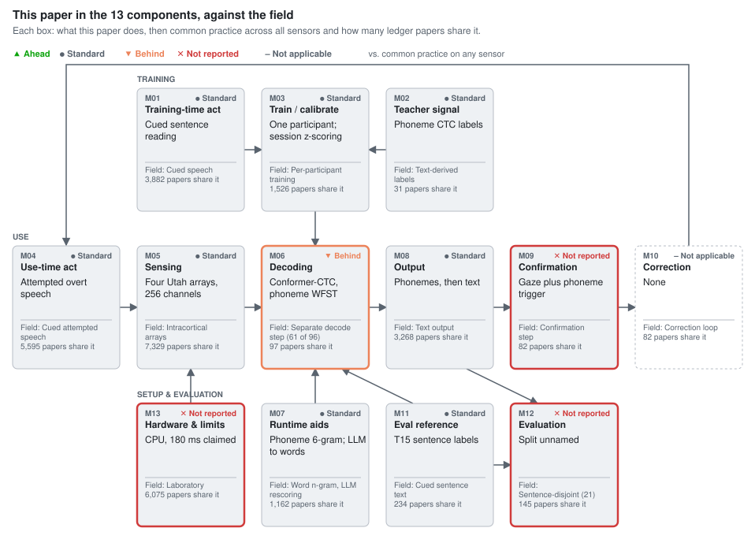

# iPhoneme: Brain-to-Text Communication for ALS Using ConformerXL Decoding

Yoonmin Cha, Dawit Chun, Sung Park. arXiv preprint, 2026. [arXiv:2604.16441](https://arxiv.org/abs/2604.16441) [[1]](#ref-1)

**Section:** [Brain signals (EEG, MEG, intracortical)](../../README.md#brain-signals-eeg-meg-intracortical)

## Figures

### This paper in the 13 components, against the field

<picture><source media="(prefers-color-scheme: dark)" srcset="figures/components-dark.svg"></picture>

Verdicts compare the paper's choice for each component with common practice across 8,995 ledger entries on any sensor (silent speech, brain-to-text, lip reading).

Data

| Component | This paper | Common practice | Papers with this practice | Verdict |
| --- | --- | --- | --- | --- |
| M01 Training-time act | Cued sentence reading | Cued speech | 3,882 of 8,995 | ● Standard (Inherited.) |
| M02 Teacher signal | Phoneme CTC labels | Text-derived labels | 31 of 8,995 | ● Standard (Inherited.) |
| M03 Train / calibrate | One participant; session z-scoring | Per-participant training | 1,526 of 8,995 | ● Standard (Normalization scope unstated.) |
| M04 Use-time act | Attempted overt speech | Cued attempted speech | 5,595 of 8,995 | ● Standard (Not silent speech.) |
| M05 Sensing | Four Utah arrays, 256 channels | Intracortical arrays | 7,329 of 8,995 | ● Standard (Paper calls it ECoG.) |
| M06 Decoding | Conformer-CTC, phoneme WFST | Separate decode step (61 of 96) | 97 of 8,995 | ▼ Behind (26.61% WER.) |
| M07 Runtime aids | Phoneme 6-gram; LLM to words | Word n-gram, LLM rescoring | 1,162 of 8,995 | ● Standard (LLM share untested.) |
| M08 Output | Phonemes, then text | Text output | 3,268 of 8,995 | ● Standard (Inherited.) |
| M09 Confirmation | Gaze plus phoneme trigger | Confirmation step | 82 of 8,995 | ✕ Not reported (Proposed; no user evaluation.) |
| M10 Correction | None | Correction loop | 82 of 8,995 | – Not applicable (Offline.) |
| M11 Eval reference | T15 sentence labels | Cued sentence text | 234 of 8,995 | ● Standard (Inherited.) |
| M12 Evaluation | Split unnamed | Sentence-disjoint (21) | 145 of 8,995 | ✕ Not reported (No labelled test.) |
| M13 Hardware & limits | CPU, 180 ms claimed | Laboratory | 6,075 of 8,995 | ✕ Not reported (180 ms claimed; no timing protocol.) |

## Verdict

iPhoneme changes the decoder (M06) and language model (M07) of the field's phoneme-CTC-plus-LM cascade, and its claim of the highest reported performance on the T15 dataset does not hold. On the same participant's recordings, its 26.61% WER is four times the 6.67% offline RNN baseline on the Brain-to-Text 2025 holdout [[2]](#ref-2) [concurrent] (inference); online, in their final five sessions, Card et al. reach 2.5% [[3]](#ref-3). The 3-point gain over "Card et al. (89%)" is taken from iPhoneme's 92.14% phoneme accuracy (Table IV), while Card et al. report 90.2% word accuracy on day two and 97.5% in conversation. No scoring split is named (M12), while validation errors shape the LM and 150 decoder configurations were searched. The M07 change, a lexicon-free phoneme 6-gram then an external LLM, departs from the usual word n-gram but is never compared with it, so it is rated standard. The gaze-plus-phoneme confirmation (M09) has no user evaluation (not reported).

## Against the field, component by component

### M06 Decoder: Conformer-CTC with phoneme WFST search

**Usual approach:** of 97 pattern-match unique studies decoding phoneme or character CTC/RNN outputs through an LM (Appendix), 96 have an M06 design value and 61 of these record a separate decode step (slot-filled), typically a recurrent network, lexicon WFST and word n-gram [[4]](#ref-4), [[3]](#ref-3). iPhoneme uses a Conformer with a bidirectional GRU prenet and a lexicon-free phoneme search.

**State of the art:** on the Brain-to-Text 2025 holdout from the same recordings, offline, the RNN baseline reaches 6.67% WER and BIT 4.06% [[2]](#ref-2) [concurrent]; iPhoneme's 26.61% is four times the baseline error (inference). Online, Card et al. (2024) report 2.5% WER in their final five sessions, 125,000-word vocabulary [[3]](#ref-3).

Three prior ledger studies report online WER below 26.61%: [[3]](#ref-3); [[4]](#ref-4), 23.8% with 125,000 words; and [[5]](#ref-5), 25% with 1,024 words from ECoG. No ablation isolates the prenet, subsampling or Pre-RMSNorm (§V), and Table II gives about 25M parameters against 192.9M in §V. Verdict: behind the best comparable work on the same recordings.

### M07 Language model: phoneme 6-gram, then LLM to words

**Usual approach:** of 1,162 pattern-match unique studies on large-vocabulary LMs for neural decoding (119 slot-filled, sparse; Appendix), an n-gram LM is named in 134 and LLM rescoring in 14 to 152 by pattern (pattern match); the usual design is a word n-gram, often with LLM rescoring [[4]](#ref-4), [[3]](#ref-3). iPhoneme instead uses a lexicon-free 6-gram trained on 3.1M phoneme sequences including T15 training sentences.

**State of the art:** Card et al. (2024), 2.5% online WER, a whole-system figure [[3]](#ref-3). LM choice alone moved Willett et al. from 23.8% to 17.4% WER offline [[4]](#ref-4).

A confusion matrix from validation errors informs the LM (§VII), and the LLM's input, settings and share of the 73.39% word accuracy are not given (§V). Verdict: standard by rule, since the departure is never compared with a lexicon plus word n-gram.

### M12 Evaluation: the scoring split

**Usual approach:** of 6,960 studies with an M12 entry (slot-filled), 145 are neural text decoders (pattern match, unique studies; Appendix); 21 name a sentence-disjoint test, 10 repeated training sentences, and at least 114, the usual case, neither (inference). iPhoneme names no scoring split.

**State of the art:** Willett et al. (2023), 23.8% online WER on sentences never in training [[4]](#ref-4); for these data, the hidden-label Brain-to-Text 2025 holdout [[2]](#ref-2) [concurrent].

§III gives 7,050 training and 1,021 validation trials as 73.7% and 13.0%, implying about 9,570 trials, yet these two alone make the abstract's 8,071, and a 13.2% unlabelled test share is added (inference). The scores therefore come from trials used for tuning (inference), with no seeds or intervals. Validation accuracy falls to about 80.8% on 2025 sessions (§X). Verdict: not reported.

## The 13 components

| Component | This paper | Usual approach (count) | State of the art | Verdict |
|---|---|---|---|---|
| M01 Training-time action | Cued sentence reading | Cued speech (slot-filled 3,882) | – | standard |
| M02 Training-only supervision | Phoneme CTC labels | Text-derived labels (slot-filled 31) | – | standard |
| M03 Training and adaptation | One participant; session z-scoring | Per-participant training (slot-filled 1,526) | – | standard |
| M04 Use-time action | Attempted overt speech | Cued attempted speech (slot-filled 5,595) | – | standard |
| M05 Sensors | Four Utah arrays, 256 channels | Intracortical arrays (slot-filled 7,329) | – | standard |
| M06 Processing and decoding | Conformer-CTC, phoneme WFST | Separate decode step (61 of 96) (pattern match 97) | 2.5% WER [[3]](#ref-3) | behind |
| M07 Lexicon and LM | Phoneme 6-gram; LLM to words | Word n-gram, LLM rescoring (pattern match 1,162) | 2.5% WER [[3]](#ref-3) | standard |
| M08 Output | Phonemes, then text | Text output (slot-filled 3,268) | – | standard |
| M09 Confirmation | Gaze plus phoneme trigger | Confirmation step (slot-filled 82) | – | not reported |
| M10 Correction | None | Correction loop (slot-filled 82) | – | not applicable |
| M11 Reference construction | T15 sentence labels | Cued sentence text (slot-filled 234) | – | standard |
| M12 Evaluation | Split unnamed | Sentence-disjoint (21) (pattern match 145) | 23.8% WER [[4]](#ref-4) | not reported |
| M13 Device and cost | CPU, 180 ms claimed | Laboratory (slot-filled 6,075) | – | not reported |

## Where the claims outrun the evidence

- "Highest reported performance on the T15 dataset" (§X) is contradicted by the 6.67% holdout baseline on the same recordings [[2]](#ref-2) and by 2.5% online WER [[3]](#ref-3). Table VI's 89% for Card et al. names no metric (§I).
- §III calls the T15 recording a 256-channel ECoG array and the abstract calls it intracranial EEG; Card et al. implanted four microelectrode arrays [[3]](#ref-3).
- Table IV ties 180 ms to the WFST beam stage, yet §XIII gives it as CPU deployment latency; by the authors' account the full-sequence bidirectional GRU adds 100–200 ms (§X), and the external LLM (§XI) is not timed.
- §VIII claims a 3–10 times speed-up over dwell with no user study, false-trigger rate or selection accuracy.

## What the field needs next

- M12: score on the hidden-label Brain-to-Text 2025 holdout [[2]](#ref-2), against its 6.67% baseline.
- M06: ablate prenet, subsampling and normalization at matched size against the RNN of [[3]](#ref-3), over seeds.
- M07: compare the phoneme 6-gram with a lexicon plus word n-gram, with and without the LLM, in WER.
- M09: measure false activations, selection accuracy and throughput of gaze confirmation versus dwell.

## Questions for the authors

- Which trials produced Table IV, and did they inform the LM or the Optuna search?
- What did the LLM receive, and how was text normalized before WER?
- Do the 6-gram data include scored sentences?
- Which CPU, input length and timing scope give 180 ms?
- How many seeds or runs, and is the model 192.9M or about 25M parameters?

## Appendix: literature search

Ledger at wiki commit 730b0b4: 7,388 unique studies.

**M06, phoneme-rnn-ctc-lm-decoding.** Inclusion rule: neural or articulatory speech decoders that emit phoneme or character probabilities with a recurrent or CTC-trained network and convert them to words with an n-gram or neural language model; sEMG, EEG, ECoG and intracortical, online or offline; closed-set word classifiers and direct audio synthesis are excluded. Ledger counts: 7,345 slot-filled unique studies; 97 pattern match (unique studies). Usual design: separate decode step, 61 of the 96 pattern-match studies with an M06 design value (slot-filled). Read in full: [[3]](#ref-3) (state of the art, prior), [[4]](#ref-4) (prior), [[5]](#ref-5) (prior), [[2]](#ref-2) ([concurrent]). Known-item recall: 0.5 (1 of 2 seeds).

**M07, large-vocabulary-lm-for-neural-speech.** Inclusion rule: neural speech decoders that constrain output with a vocabulary of at least 1,000 words through an n-gram or neural language model at use time; 50-word or command sets count as small vocabulary; LLM rescoring counts. Ledger counts: 119 slot-filled unique studies (sparse slot); 1,162 pattern match (unique studies). Usual design: n-gram LM 134; LLM rescoring 14 under the same pattern set, 152 in the topic table (pattern match). Read in full: [[3]](#ref-3) (state of the art), [[4]](#ref-4) (prior). Known-item recall: 1.0 (2 of 2 seeds).

**M12, neural-text-unseen-sentence-test.** Inclusion rule: neural text decoders; the design compared is whether WER is measured on sentences absent from training (sentence-disjoint) or on repeats of training sentences; a paper counts under each protocol its text names. Ledger counts: 6,960 slot-filled unique studies; 145 pattern match (unique studies). Usual design: sentence-disjoint test 21, repeated training sentences 10, neither named in the rest (pattern match). Read in full: [[4]](#ref-4) (state of the art), [[2]](#ref-2) ([concurrent]). Known-item recall: 0.8 (4 of 5 seeds).

**Inherited slots (M01–M05, M08–M11, M13).** Table counts are slot-filled ledger values at the same commit.

## References

Numbered by first citation. BibTeX in the same order and keys: [refs.bib](refs.bib).

1. Cha, Y., Chun, D., Park, S. “iPhoneme: Brain-to-Text Communication for ALS Using ConformerXL Decoding.” *arXiv preprint [cs.SD]*, 2026. arXiv:[2604.16441](https://arxiv.org/abs/2604.16441). arXiv v1 [review](https://github.com/supernaiter/silent-speech-review/tree/main/reviews/iphoneme-brain-to-text-communication-for-als-using-conformerxl-decoding) [wiki: arxiv-2604-16441-iphoneme](https://github.com/supernaiter/deep-research-wiki-for-silent-speech/blob/main/papers/arxiv-2604-16441-iphoneme/article.md) [wiki: arxiv-2604.16441-iphoneme](https://github.com/supernaiter/deep-research-wiki-for-silent-speech/blob/main/papers/arxiv-2604.16441-iphoneme/article.md)
2. Zhang, Y., He, L., Fan, C., Liu, T., Yu, H., Le, T., et al. “A cross-species neural foundation model for end-to-end speech decoding.” *International Conference on Learning Representations (ICLR 2026)*, 2026. arXiv:[2511.21740](https://arxiv.org/abs/2511.21740). arXiv v5 [concurrent] [review](https://github.com/supernaiter/silent-speech-review/tree/main/reviews/a-cross-species-neural-foundation-model-for-end-to-end-speech-decoding) [wiki: arxiv-2511.21740](https://github.com/supernaiter/deep-research-wiki-for-silent-speech/blob/main/papers/arxiv-2511.21740/article.md)
3. Card, N. S., Wairagkar, M., Iacobacci, C., Hou, X., Singer-Clark, T., Willett, F. R., et al. “An accurate and rapidly calibrating speech neuroprosthesis.” *New England Journal of Medicine*, 2024, 391(7), 609-618. doi:[10.1056/NEJMoa2314132](https://doi.org/10.1056/NEJMoa2314132). [review](https://github.com/supernaiter/silent-speech-review/tree/main/reviews/an-accurate-and-rapidly-calibrating-speech-neuroprosthesis) [wiki: doi-10.1056-nejmoa2314132](https://github.com/supernaiter/deep-research-wiki-for-silent-speech/blob/main/papers/doi-10.1056-nejmoa2314132/article.md) [wiki: pmc-11328962-rapidcal](https://github.com/supernaiter/deep-research-wiki-for-silent-speech/blob/main/papers/pmc-11328962-rapidcal/article.md)
4. Willett, F. R., Kunz, E. M., Fan, C., Avansino, D. T., Wilson, G. H., Choi, E. Y., et al. “A high-performance speech neuroprosthesis.” *Nature*, 2023, 620(7976), 1031-1036. doi:[10.1038/s41586-023-06377-x](https://doi.org/10.1038/s41586-023-06377-x). [review](https://github.com/supernaiter/silent-speech-review/tree/main/reviews/a-high-performance-speech-neuroprosthesis) [wiki: doi-10.1038-s41586-023-06377-x](https://github.com/supernaiter/deep-research-wiki-for-silent-speech/blob/main/papers/doi-10.1038-s41586-023-06377-x/article.md) [wiki: pmc-10468393-neuroprosthesis](https://github.com/supernaiter/deep-research-wiki-for-silent-speech/blob/main/papers/pmc-10468393-neuroprosthesis/article.md)
5. Metzger, S. L., Littlejohn, K. T., Silva, A. B., Moses, D. A., Seaton, M. P., Wang, R., et al. “A high-performance neuroprosthesis for speech decoding and avatar control.” *Nature*, 2023, 620, 1037–1046. doi:[10.1038/s41586-023-06443-4](https://doi.org/10.1038/s41586-023-06443-4). [review](https://github.com/supernaiter/silent-speech-review/tree/main/reviews/a-high-performance-neuroprosthesis-for-speech-decoding-and-avatar-control) [wiki: doi-10.1038-s41586-023-06443-4](https://github.com/supernaiter/deep-research-wiki-for-silent-speech/blob/main/papers/doi-10.1038-s41586-023-06443-4/article.md) [wiki: pmc-10826467-avatarnp](https://github.com/supernaiter/deep-research-wiki-for-silent-speech/blob/main/papers/pmc-10826467-avatarnp/article.md)

## Materials

Data behind this review. Full texts of the papers are not included.

- [`review.md`](review.md): the review text (source)
- [`refs.bib`](refs.bib): references (BibTeX)
- [`slots.json`](slots.json): for each of the 13 components: this paper's choice, field practice, number of matching papers, verdict
- [`figures.json`](figures.json): figure definitions
- [`evaluation.md`](evaluation.md): independent evaluation by a second reviewer
- [`triage.md`](triage.md): how each evaluation finding was checked against the sources and resolved
- [`components/M06/phoneme-rnn-ctc-lm-decoding.csv`](../../components/M06/phoneme-rnn-ctc-lm-decoding.csv): M06 topic "phoneme-rnn-ctc-lm-decoding", every candidate paper with its decision (7345 slot-filled, 97 pattern match, usual design in 61, 5 read in full)
- [`components/M07/large-vocabulary-lm-for-neural-speech.csv`](../../components/M07/large-vocabulary-lm-for-neural-speech.csv): M07 topic "large-vocabulary-lm-for-neural-speech", every candidate paper with its decision (119 slot-filled, 1162 pattern match, usual design in 152, 4 read in full)
- [`components/M12/neural-text-unseen-sentence-test.csv`](../../components/M12/neural-text-unseen-sentence-test.csv): M12 topic "neural-text-unseen-sentence-test", every candidate paper with its decision (6960 slot-filled, 145 pattern match, usual design in 21, 4 read in full)

## More reviews in Brain signals (EEG, MEG, intracortical)

- [A cross-species neural foundation model for end-to-end speech decoding](../a-cross-species-neural-foundation-model-for-end-to-end-speech-decoding/) (2026). Cascaded decoding with the pretrained encoder is a strong standard result; the end-to-end audio-LLM path beats the prior end-to-end entry but trails RNN cascades, and the cross-species gain is small.
- [Brain-to-Speech: Prosody Feature Engineering and Transformer-Based Reconstruction](../brain-to-speech-prosody-feature-engineering-and-transformer-based-reconstruction/) (2026). Same three parts and same Table 1 values as MiSTR (2025, same first two authors), not cited. Features (M06) and phase vocoder (M08) standard, unablated; no listener test (M12, behind).
- [Brain2Speech-Net: Fast and Intelligible Brain-to-Speech Synthesis Without Text Decoding](../brain2speech-net-intelligible-real-time-brain-to-speech-synthesis-without-text-decoding/) (2026). Text-free synthesis is shown, but its real time is throughput, not causal synthesis, unseen-sentence WER is 2.3 times the cascade, and intelligibility rests on ratings and ASR.
- [Do EEG Foundation Models Transfer to Speech? A Benchmark on Overt and Imagined Speech Decoding](../do-eeg-foundation-models-transfer-to-speech-a-benchmark-on-overt-and-imagined-speech-decoding/) (2026). Benchmark (M03) confirms earlier reports that LaBraM gains nothing on speech EEG; decoders (M06) sit far below same-corpus results; test-subject early stopping (M12).
- [EEG-Based Imagined Speech Decoding Using a Hybrid CNN-SNN Architecture](../eeg-based-imagined-speech-decoding-using-a-hybrid-cnn-snn-architecture/) (2026). CNN-to-LIF decoder (M06) is standard: a 2024 SNN-CNN inner-speech decoder precedes it; 80.13% on the validation subset is not comparable with the 82.6% competition test score (M12); no SNN ablation.
- [Mechanistic Interpretability of Brain-to-Speech Models Across Speech Modes](../mechanistic-interpretability-of-brain-to-speech-models-across-speech-modes/) (2026). Patching shows the decoder depends on donor activations, not that transfer runs through a compact subspace: kept regions score below the unpatched decoder, with no null and no held-out split.

---

Part of the [Silent Speech Interface Review](https://github.com/supernaiter/silent-speech-review). Found an error? [Open an issue](https://github.com/supernaiter/silent-speech-review/issues/new?template=correction.yml).
