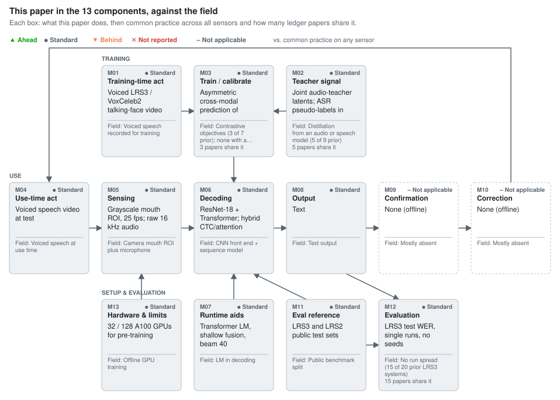

# Jointly Learning Visual and Auditory Speech Representations from Raw Data

Alexandros Haliassos, Pingchuan Ma, Rodrigo Mira, Stavros Petridis, Maja Pantic. ICLR 2023. [arXiv:2212.06246](https://arxiv.org/abs/2212.06246)

**Section:** [Other sensors](../../README.md#other-sensors)

## Figures

### This paper in the 13 components, against the field

<picture><source media="(prefers-color-scheme: dark)" srcset="figures/components-dark.svg"></picture>

Verdicts compare the paper's choice for each component with common practice across 8,995 ledger entries on any sensor (silent speech, brain-to-text, lip reading).

Data

| Component | This paper | Common practice | Papers with this practice | Verdict |
| --- | --- | --- | --- | --- |
| M01 Training-time act | Voiced LRS3 / VoxCeleb2 talking-face video | Voiced speech recorded for training |  | ● Standard (Inherited from the LRS3 / VoxCeleb2 pipeline.) |
| M02 Teacher signal | Joint audio-teacher latents; ASR pseudo-labels in self-training | Distillation from an audio or speech model (5 of 9 prior) | 5 of 9 | ● Standard (Same audio pseudo-labelling route as AV-HuBERT on the same data: 7.7 against 3.9 points; pseudo-label decoding not stated.) |
| M03 Train / calibrate | Asymmetric cross-modal prediction of momentum-teacher latents | Contrastive objectives (3 of 7 prior); none with a momentum teacher | 3 of 7 | ● Standard (Cross-modal asymmetric use of data2vec-style momentum teachers; ties AV-HuBERT at Large, 30 h (32.5%); ablations Base only, no repeat runs.) |
| M04 Use-time act | Voiced speech video at test | Voiced speech at use time |  | ● Standard (Inherited.) |
| M05 Sensing | Grayscale mouth ROI, 25 fps; raw 16 kHz audio | Camera mouth ROI plus microphone |  | ● Standard (Inherited; raw waveform instead of filterbanks is a minor departure.) |
| M06 Decoding | ResNet-18 + Transformer; hybrid CTC/attention | CNN front end + sequence model |  | ● Standard (Inherited from the ESPnet / Ma et al. lineage.) |
| M07 Runtime aids | Transformer LM, shallow fusion, beam 40 | LM in decoding |  | ● Standard (Inherited; selected weight not stated in the paper (public script: 0.3).) |
| M08 Output | Text | Text output |  | ● Standard (Inherited.) |
| M09 Confirmation | None (offline) | Mostly absent |  | – Not applicable (Offline benchmark study.) |
| M10 Correction | None (offline) | Mostly absent |  | – Not applicable (Offline benchmark study.) |
| M11 Eval reference | LRS3 and LRS2 public test sets | Public benchmark split |  | ● Standard (VoxCeleb2 speaker overlap with the LRS3 test set not discussed.) |
| M12 Evaluation | LRS3 test WER, single runs, no seeds | No run spread (15 of 20 prior LRS3 systems) | 15 of 20 | ● Standard (Typical of the field; the same group reported ten-run spread earlier; abstract picks 25.9% over the 19.3% in its own table.) |
| M13 Hardware & limits | 32 / 128 A100 GPUs for pre-training | Offline GPU training |  | ● Standard (Inherited.) |

## Verdict

The paper [[1]](#ref-1) changes the pre-training objective (M03), asymmetric cross-modal prediction of momentum-teacher latents, and training-only audio supervision (M02); both stay standard. At Large with 1,759 h unlabelled and 30 h labelled, without self-training or LM, its 32.5% VSR WER equals AV-HuBERT's 32.5% [[2]](#ref-2) (Table 1), so the lead over self-supervised methods rests on Base (4.8 and 5.9 points), 27.8% against 28.6% at 433 h, and self-training, none with repeat runs. The gap opens in self-training: the same audio pseudo-labelling route on the same data gives RAVEn 7.7 points and AV-HuBERT 3.9 [[2]](#ref-2), with RAVEn's pseudo-label decoding unstated. The abstract compares with 25.9% from 90,000 hours while the authors' own Table 1 lists 19.3%.

## Against the field, component by component

### M03 Training: self-supervised pre-training objective

**Usual approach:** Of 7 in-scope prior studies (pattern match, screened, Appendix), 3 use contrastive audio-visual objectives, 2 regress audio targets, as the authors' LiRA did [[3]](#ref-3), and 2 predict masked cluster labels, as AV-HuBERT did on LRS3 [[2]](#ref-2); none uses a momentum teacher.

**State of the art:** Without pseudo-labels, the best Large, 30 h result is 30.8% (BRAVEn, 2024, as listed in [[4]](#ref-4) [later]), equal to AV-data2vec [[5]](#ref-5) [concurrent]: 1.7 points below 32.5% (inference).

A masked student regressing momentum-teacher outputs is data2vec's recipe in one modality, as the authors state in Sec. 2, where they credit BYOL-style self-distillation and separate their targets from data2vec's. What is new against the read priors is the cross-modal, asymmetric use for audio-visual speech; among 3 [concurrent] studies only AV2vec [[6]](#ref-6) also uses a momentum teacher (Appendix). The asymmetry helps inside the paper (32.9% against 40.8% for cross-modal prediction alone, Table 3), but ablations are Base, validation set, no repeat runs (Sec. 4.4). At Large there is no VSR gain over AV-HuBERT, whose rows use an S2S decoder without external LM [[2]](#ref-2), while RAVEn uses hybrid CTC/attention (Sec. 3.2). Standard.

### M02 Training-only supervision: audio teacher for the video model

**Usual approach:** Of 9 in-scope prior lip-reading studies that move audio knowledge into a video-only model (pattern match, screened, Appendix), 5 distil from an audio or speech model, as in [[7]](#ref-7); 2 recall an audio memory and 2 regress audio targets [[3]](#ref-3).

**State of the art:** USR 2.0 (2026) uses EMA-teacher pseudo-labels and reaches 23.7% at the matched Large, 30 h budget [[4]](#ref-4) [later], against 24.8% for RAVEn with self-training.

The deciding prior is AV-HuBERT's self-training: a fine-tuned audio model pseudo-labels the same unlabelled data and no additional data is used [[2]](#ref-2). Along that route RAVEn gains 7.7 points (32.5% to 24.8%) and AV-HuBERT 3.9 (32.5% to 28.6%), leaving RAVEn 3.8 points ahead (Table 1; inference); at 433 h, 24.4% against 26.9% (Table 2). Section 3.2 describes one pass but not how pseudo-labels were decoded (beam, LM, filtering), and the labellers differ, so the extra gain is not attributable to the objective alone. Standard.

### M12 Evaluation: LRS3 WER without repeat runs

**Usual approach:** 15 of 20 prior LRS3 lip-reading systems show no run-spread pattern (pattern match, screened, Appendix); the authors' own earlier work reported the mean and standard deviation over ten runs (32.1±0.3) [[8]](#ref-8). This paper reports none.

**State of the art:** 12.8% VSR WER from about 100k h of non-public YouTube data [[9]](#ref-9) [concurrent]; on public data, 17.6% (USR 2.0 Huge, 2026, LRS2+LRS3 labelled) [[4]](#ref-4) [later].

The 90,000-hour claim survives without the LM (24.8% against 25.9%, Table 1), but the abstract picks 25.9% while Table 1 also lists 19.3% from 90,000 hours; the table is honest, the abstract and Sec. 4.2 overstate. On LRS2 (Table 9) AV-HuBERT has no result, so the second dataset holds no comparison with the closest prior. Standard.

## The 13 components

| Component | This paper | Usual approach (count) | State of the art | Verdict |
|---|---|---|---|---|
| M01 Training-time action | Voiced LRS3 / VoxCeleb2 talking-face video | Voiced speech recorded for training | – | standard |
| M02 Training-only supervision | Joint audio-teacher latents; ASR pseudo-labels in self-training | Distillation from an audio or speech model (5 of 9 prior) (pattern match 5) | [[4]](#ref-4) EMA-teacher pseudo-labels, 23.7% (Large, 30 h) | standard |
| M03 Training and adaptation | Asymmetric cross-modal prediction of momentum-teacher latents | Contrastive objectives (3 of 7 prior); none with a momentum teacher (pattern match 3) | BRAVEn 30.8% at Large, 30 h, no pseudo-labels (listed in [[4]](#ref-4)) | standard |
| M04 Use-time action | Voiced speech video at test | Voiced speech at use time | – | standard |
| M05 Sensors | Grayscale mouth ROI, 25 fps; raw 16 kHz audio | Camera mouth ROI plus microphone | – | standard |
| M06 Processing and decoding | ResNet-18 + Transformer; hybrid CTC/attention | CNN front end + sequence model | – | standard |
| M07 Lexicon and LM | Transformer LM, shallow fusion, beam 40 | LM in decoding | – | standard |
| M08 Output | Text | Text output | – | standard |
| M09 Confirmation | None (offline) | Mostly absent | – | not applicable |
| M10 Correction | None (offline) | Mostly absent | – | not applicable |
| M11 Reference construction | LRS3 and LRS2 public test sets | Public benchmark split | – | standard |
| M12 Evaluation | LRS3 test WER, single runs, no seeds | No run spread (15 of 20 prior LRS3 systems) (pattern match 15) | [[9]](#ref-9) 12.8% (100k h non-public); 17.6% public [[4]](#ref-4) | standard |
| M13 Device and cost | 32 / 128 A100 GPUs for pre-training | Offline GPU training | – | standard |

## Where the claims outrun the evidence

- Sec. 1 hedges ("by a large margin in most settings"), but the abstract's "surpasses all self-supervised methods on VSR" fails at Large with 30 h: 32.5% for both (Table 1).
- The asymmetric loss is chosen on Base, validation set, no repeat runs (Sec. 4.4, Table 3), then used unablated at Large.
- "Transcribed data ... can be largely substituted" (Sec. 4.2): the best 30 h result also uses audio pseudo-labels and an LM trained on text including LRS2 and LRS3 (Appendix A.4).
- The 27.8% against 28.6% margin at 433 h shrinks to 0.4 points with the 28.2% that [[4]](#ref-4) lists for RAVEn (inference).

## What the field needs next

- M03: rerun AV-HuBERT, RAVEn and AV-data2vec under one fine-tuning and decoding recipe at Base and Large, three or more seeds.
- M02: fix the encoder and compare pseudo-label sources (audio encoder, EMA teacher, none) with decoding, LM and filtering stated.
- M12: add the noisy-audio test the authors defer (Appendix C.3).

## Questions for the authors

- How were pseudo-labels decoded (beam, LM, filtering)?
- Do any VoxCeleb2 speakers appear in the LRS3 test set?
- How many runs underlie Tables 1 to 3, and what is the spread?
- Which LM weight gave 23.8% (the public script sets 0.3), and which text normalisation precedes scoring?

## Appendix: literature search

- M03, self-supervised-pretraining. Inclusion rule: self-supervised or teacher-generated pre-training on unlabelled non-audio-only input before supervised fine-tuning for speech or text decoding; audio-only self-supervised ASR and checkpoint reuse excluded. Ledger counts: 1,526 unique studies slot-filled for M03; 123 unique studies pattern match (all years). Prior means first public before 2022-06, [concurrent] 2022-06 to 2023-06. After screening against the rule (separation, enhancement, deepfake, synchronisation, speaker-embedding, pre-2015 and checkpoint-reuse papers removed): 7 prior studies (contrastive 3, audio-target regression 2, masked cluster prediction 2, momentum teacher 0) and 3 [concurrent] (momentum teacher 1). Full-text pattern for momentum or EMA teachers near visual speech: 9 unique studies besides the target, none earlier. Priors from the target's reference list outside the wiki: data2vec and BYOL (Sec. 2). Read in full: [[2]](#ref-2) (prior), [[3]](#ref-3) (prior), [[4]](#ref-4) (state of the art). Known-item recall 1.0.
- M02, audio-knowledge-transfer-to-video. Inclusion rule: lip-reading and video-to-speech studies with video-only input at test that use paired audio or a speech model in training (distillation, audio-feature regression, audio memory); audio-visual models needing audio at test excluded. Ledger counts: 31 unique studies slot-filled for M02; 54 unique studies pattern match (all years). After screening (mentions only, self-distillation without audio, AVSR without transfer removed): 9 prior studies, 7 with full text; distillation from an audio or speech model 5 (2 by title), audio memory 2, audio-target regression 2; 2 [concurrent]. Read in full: [[7]](#ref-7) (prior), [[3]](#ref-3) (prior), [[2]](#ref-2) (prior, self-training), [[4]](#ref-4) (state of the art). Known-item recall 1.0 on the published seed set; 0.5 on this review's seeds (LiRA missed by the pattern).
- M12, lrs3-visual-only-wer. Inclusion rule: visual-only WER on the LRS3 test set, any training regime; audio-only and audio-visual rows excluded. Ledger counts: 6,960 unique studies slot-filled for M12; 258 unique studies pattern match (all years). Prior systems after screening (keyword spotting, synchronisation, separation, surveys and LRS2-only papers removed): 20; run-spread pattern hits 5, of which [[8]](#ref-8) reports ten training runs. Read in full: [[8]](#ref-8) (prior), [[9]](#ref-9) (state of the art, non-public data), [[4]](#ref-4) (state of the art, public data). Known-item recall 1.0.

## References

Numbered by first citation. BibTeX in the same order and keys: [refs.bib](refs.bib).

1. Haliassos, A., Ma, P., Mira, R., Petridis, S., Pantic, M. “Jointly Learning Visual and Auditory Speech Representations from Raw Data.” *International Conference on Learning Representations (ICLR)*, 2023. arXiv:[2212.06246](https://arxiv.org/abs/2212.06246). [wiki: arxiv-2212.06246](https://github.com/supernaiter/deep-research-wiki-for-silent-speech/blob/main/papers/arxiv-2212.06246/article.md)
2. Shi, B., Hsu, W., Lakhotia, K., Mohamed, A. “Learning Audio-Visual Speech Representation by Masked Multimodal Cluster Prediction.” *International Conference on Learning Representations (ICLR)*, 2022. arXiv:[2201.02184](https://arxiv.org/abs/2201.02184). [review](https://github.com/supernaiter/silent-speech-review/tree/main/reviews/learning-audio-visual-speech-representation-by-masked-multimodal-cluster-prediction) [wiki: arxiv-2201.02184](https://github.com/supernaiter/deep-research-wiki-for-silent-speech/blob/main/papers/arxiv-2201.02184/article.md)
3. Ma, P., Mira, R., Petridis, S., Schuller, B. W., Pantic, M. “LiRA: Learning Visual Speech Representations from Audio through Self-supervision.” *Interspeech*, 2021. doi:[10.21437/Interspeech.2021-1360](https://doi.org/10.21437/Interspeech.2021-1360). [wiki: isca-ma21c-lira](https://github.com/supernaiter/deep-research-wiki-for-silent-speech/blob/main/papers/isca-ma21c-lira/article.md)
4. Haliassos, A., Mira, R., Petridis, S. “Pay Attention to CTC: Fast and Robust Pseudo-Labelling for Unified Speech Recognition.” *International Conference on Learning Representations (ICLR)*, 2026. arXiv:[2602.19316](https://arxiv.org/abs/2602.19316). [later] [wiki: arxiv-2602.19316](https://github.com/supernaiter/deep-research-wiki-for-silent-speech/blob/main/papers/arxiv-2602.19316/article.md)
5. Lian, J., Baevski, A., Hsu, W., Auli, M. “AV-data2vec: Self-supervised Learning of Audio-Visual Speech Representations with Contextualized Target Representations.” *arXiv*, 2023. arXiv:[2302.06419](https://arxiv.org/abs/2302.06419). [concurrent] [wiki: arxiv-2302.06419](https://github.com/supernaiter/deep-research-wiki-for-silent-speech/blob/main/papers/arxiv-2302.06419/article.md)
6. Zhang, J., Wan, G., Ling, Z., Pan, J., Gao, J., Liu, C. “Self-Supervised Audio-Visual Speech Representations Learning by Multimodal Self-Distillation.” *arXiv*, 2022. arXiv:[2212.02782](https://arxiv.org/abs/2212.02782). [concurrent] [wiki: arxiv-2212.02782](https://github.com/supernaiter/deep-research-wiki-for-silent-speech/blob/main/papers/arxiv-2212.02782/article.md)
7. Afouras, T., Chung, J. S., Zisserman, A. “ASR is all you need: cross-modal distillation for lip reading.” *IEEE International Conference on Acoustics, Speech and Signal Processing (ICASSP)*, 2020. arXiv:[1911.12747](https://arxiv.org/abs/1911.12747). [review](https://github.com/supernaiter/silent-speech-review/tree/main/reviews/asr-is-all-you-need-cross-modal-distillation-for-lip-reading) [wiki: arxiv-1911.12747](https://github.com/supernaiter/deep-research-wiki-for-silent-speech/blob/main/papers/arxiv-1911.12747/article.md)
8. Ma, P., Petridis, S., Pantic, M. “Visual Speech Recognition for Multiple Languages in the Wild.” *Nature Machine Intelligence*, 2022, 930-939. doi:[10.1038/s42256-022-00550-z](https://doi.org/10.1038/s42256-022-00550-z). arXiv:[2202.13084](https://arxiv.org/abs/2202.13084). [review](https://github.com/supernaiter/silent-speech-review/tree/main/reviews/visual-speech-recognition-for-multiple-languages-in-the-wild) [wiki: arxiv-2202.13084](https://github.com/supernaiter/deep-research-wiki-for-silent-speech/blob/main/papers/arxiv-2202.13084/article.md)
9. Chang, O., Liao, H., Serdyuk, D., Shah, A., Siohan, O. “Conformers are All You Need for Visual Speech Recognition.” *IEEE International Conference on Acoustics, Speech and Signal Processing (ICASSP)*, 2024, 10136-10140. arXiv:[2302.10915](https://arxiv.org/abs/2302.10915). [concurrent] [wiki: arxiv-2302.10915](https://github.com/supernaiter/deep-research-wiki-for-silent-speech/blob/main/papers/arxiv-2302.10915/article.md)

## Materials

Data behind this review. Full texts of the papers are not included.

- [`review.md`](review.md): the review text (source)
- [`refs.bib`](refs.bib): references (BibTeX)
- [`slots.json`](slots.json): for each of the 13 components: this paper's choice, field practice, number of matching papers, verdict
- [`figures.json`](figures.json): figure definitions
- [`evaluation.md`](evaluation.md): independent evaluation by a second reviewer
- [`triage.md`](triage.md): how each evaluation finding was checked against the sources and resolved
- [`process/log.json`](process/log.json): process record: each step, who did it (reader, script, writer, evaluator), when, the checks run and the input versions
- [`process/notes.json`](process/notes.json): reading notes on the target and comparator papers: claims, numbers, conditions and what is not stated, with locations
- [`process/plan.json`](process/plan.json): plan: which components the paper changes and the topics it is compared on
- [`process/draft.md`](process/draft.md): the review as first written, before the independent evaluation
- [`process/claims-draft.md`](process/claims-draft.md): claim table of the draft: every claim mapped to a note or a count
- [`process/claims.md`](process/claims.md): claim table of the published review
- [`components/M02/audio-knowledge-transfer-to-video.csv`](../../components/M02/audio-knowledge-transfer-to-video.csv): M02 topic "audio-knowledge-transfer-to-video", every candidate paper with its decision (31 slot-filled, 54 pattern match, usual design in 40, 8 read in full)
- [`components/M03/self-supervised-pretraining.csv`](../../components/M03/self-supervised-pretraining.csv): M03 topic "self-supervised-pretraining", every candidate paper with its decision (1526 slot-filled, 123 pattern match, usual design in 31, 3 read in full)
- [`components/M12/lrs3-visual-only-wer.csv`](../../components/M12/lrs3-visual-only-wer.csv): M12 topic "lrs3-visual-only-wer", every candidate paper with its decision (6960 slot-filled, 258 pattern match, usual design in 18, 1 read in full)

## More reviews in Other sensors

- [Semantic reconstruction of continuous language from non-invasive brain recordings](../semantic-reconstruction-of-continuous-language-from-non-invasive-brain-recordings/) (2023). LM candidates scored by encoding-model likelihood (M06) were ahead in 2022, as the authors claim; the scorer is now overtaken. GPT prior (M07) is standard; one pilot-touched test story limits M12.
- [Ultrasensitive Textile Strain Sensors Redefine Wearable Silent Speech Interfaces with High Machine Learning Efficiency](../ultrasensitive-textile-strain-sensors-redefine-wearable-silent-speech-interfaces-with-high-machine-learning-efficiency/) (2024). Standard sensor (M05) and decoder (M06): one throat strain channel, small CNN. 95.25% on 20 words, with split grouping and production mode unstated, does not show silent, session-independent decoding.
- [Generalizable spelling using a speech neuroprosthesis in an individual with severe limb and vocal paralysis](../generalizable-spelling-using-a-speech-neuroprosthesis-in-an-individual-with-severe-limb-and-vocal-pa/) (2022). Silent NATO code-word spelling (M04), closed-lexicon beam search (M07) and a hand-squeeze stop (M09) are standard; one participant, and >9,000 words only offline.
- [Imagined speech can be decoded from low- and cross-frequency intracranial EEG features](../imagined-speech-can-be-decoded-from-low-and-cross-frequency-intracranial-eeg-features/) (2022). Adds low-frequency power (precedent: Pei 2011, Ikeda 2014) and phase-amplitude coupling (new) to imagined-speech ECoG decoding (M06); CFC effect unshown: 12 of 144 uncorrected tests.
- [Robust Self-Supervised Audio-Visual Speech Recognition](../robust-self-supervised-audio-visual-speech-recognition/) (2022). Noise-augmented self-supervised AVSR training (M03) was new in 2022 but rests on one test set with no run count; the 49.6% babble gain mixes data and model size with pre-training.
- [Large Language Models are Strong Audio-Visual Speech Recognition Learners](../large-language-models-are-strong-audio-visual-speech-recognition-learners/) (2025). Llama-AVSR is a strong engineering result but not a new design: VSP-LLM already had a frozen-encoder LoRA LLM decoder; SOTA margins are single-run and under 0.1 WER points.

---

Part of the [Silent Speech Interface Review](https://github.com/supernaiter/silent-speech-review). Found an error? [Open an issue](https://github.com/supernaiter/silent-speech-review/issues/new?template=correction.yml).
