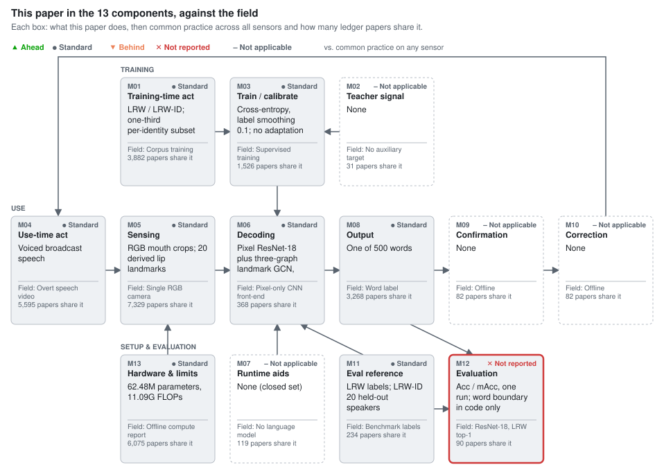

# Landmark Guided Visual Feature Extractor for Visual Speech Recognition with Limited Resource

Lei Yang, Junshan Jin, Mingyuan Zhang, Yi He, Bofan Chen, Shilin Wang. MUWS '25 workshop, Dublin, 2025. [arXiv:2508.07233](https://arxiv.org/abs/2508.07233)

**Section:** [Lip & face video](../../README.md#lip--face-video)

## Figures

### This paper in the 13 components, against the field

<picture><source media="(prefers-color-scheme: dark)" srcset="figures/components-dark.svg"></picture>

Verdicts compare the paper's choice for each component with common practice across 8,995 ledger entries on any sensor (silent speech, brain-to-text, lip reading).

Data

| Component | This paper | Common practice | Papers with this practice | Verdict |
| --- | --- | --- | --- | --- |
| M01 Training-time act | LRW / LRW-ID; one-third per-identity subset | Corpus training | 3,882 of 8,995 | ● Standard (Inherited corpus; sampling seed and subset not reported.) |
| M02 Teacher signal | None | No auxiliary target | 31 of 8,995 | – Not applicable (No audio or text-derived auxiliary target.) |
| M03 Train / calibrate | Cross-entropy, label smoothing 0.1; no adaptation | Supervised training | 1,526 of 8,995 | ● Standard (DC-TCN training recipe of [@ma2022training] without mixup.) |
| M04 Use-time act | Voiced broadcast speech | Overt speech video | 5,595 of 8,995 | ● Standard (No silent articulation.) |
| M05 Sensing | RGB mouth crops; 20 derived lip landmarks | Single RGB camera | 7,329 of 8,995 | ● Standard (Landmarks are a derived stream, not a new sensor; 96 x 96 mouth crops with 88 x 88 random or centre crop, as in the standard pipeline.) |
| M06 Decoding | Pixel ResNet-18 plus three-graph landmark GCN, staged fusion | Pixel-only CNN front-end | 368 of 8,995 | ● Standard (Graph-plus-pixel fusion of 20 lip points already in [@liu2020lipgraph]; landmark stream in 64 studies (pattern match).) |
| M07 Runtime aids | None (closed set) | No language model | 119 of 8,995 | – Not applicable (500-word closed set.) |
| M08 Output | One of 500 words | Word label | 3,268 of 8,995 | ● Standard (Isolated-word output.) |
| M09 Confirmation | None | Offline | 82 of 8,995 | – Not applicable (Offline benchmark.) |
| M10 Correction | None | Offline | 82 of 8,995 | – Not applicable (Offline benchmark.) |
| M11 Eval reference | LRW labels; LRW-ID 20 held-out speakers | Benchmark labels | 234 of 8,995 | ● Standard (Validation and test share the 20 held-out speakers, as the authors state (Sec. 4.1) following earlier LRW-ID settings.) |
| M12 Evaluation | Acc / mAcc, one run; word boundary in code only | ResNet-18, LRW top-1 | 90 of 8,995 | ✕ Not reported (No seeds, perturbation magnitudes or word-boundary condition stated.) |
| M13 Hardware & limits | 62.48M parameters, 11.09G FLOPs | Offline compute report | 6,075 of 8,995 | ● Standard (Parameters up from 52.55M; no latency or device test; authors concede edge-deployment cost.) |

## Verdict

The paper [[1]](#ref-1) changes one component, the visual processing (M06), by fusing a graph stream over 20 lip landmarks into a pixel ResNet-18 and DC-TCN word classifier; the design is standard, because a 2020 model already fused a graph over 20 lip key points with an image branch on LRW [[2]](#ref-2). The central claim, better accuracy with one third of the training data, rests on a 0.90-point gain on LRW-ID from a single run with no seeds, so the reliability of the gain is unknown. The robustness claim is weaker still: corrupting the landmarks costs the model 0.20 points (inference) under perturbations of unstated size, and no test drops the landmark stream, so robustness cannot be told apart from low reliance on that stream. On LRW the reported 91.69% stays below the best earlier result trained on LRW clips alone, 95.0% with word boundaries [[3]](#ref-3), and the released test script defaults to word-boundary input that the paper never mentions. Evaluation (M12) is not reported to the standard the comparison needs: no seeds, no perturbation magnitudes, no boundary condition.

## Against the field, component by component

### M06 Processing: landmark graph stream fused with pixel features

**Usual approach:** a pixel-only CNN front-end is named in 368 of 1,116 lip-reading studies; a landmark or geometric stream appears in 64 and graph convolution over landmarks in 12 (pattern match, upper bounds; Appendix).

**State of the art:** NestLipGNN (2026, [later]) reaches 92.3% on LRW over five seeded runs with a landmark lip graph and landmark-centred appearance patches [[4]](#ref-4), 0.6 points above this paper (inference); it is the best landmark-graph result, not the LRW state of the art (M12). Landmark-only models reach 49.3% for the 2020 lip graph and 75.1%, or 80.3% with word boundaries, for the SyncVSR point cloud [[3]](#ref-3).

Liu et al. ran graph convolution and a BGRU over 20 lip key points and fused them with a ResNet-18 image branch, raising visual-only LRW accuracy from 83.29% to 84.25% [[2]](#ref-2). LipFormer fused lip-motion and facial-landmark streams for unseen speakers [[5]](#ref-5). Landmarks alone, even 478 face points, give 62.7% on LRW [[6]](#ref-6); the higher SyncVSR point-cloud figure adds audio-token supervision and word boundaries [[3]](#ref-3). What this paper adds is the split into coordinate, distance and similarity graphs, and its own ablation does not support it: the distance graph alone moves low-resource accuracy from 85.75% to 85.74% (Table 2), and graphs are only added in a fixed order. Verdict: standard. On LRW this paper gains 0.69 points over the DC-TCN row (91.00% to 91.69%, 7.7% fewer errors) and the 2020 design 0.96 points over its image branch (83.29% to 84.25%, 5.7% fewer errors) (inference); the baselines differ by 7.7 points and the 91.00% row is not shown to be rerun, so neither gain ranks the designs.

### M12 Evaluation: LRW-ID low-resource split and the LRW comparison

**Usual approach:** a ResNet-18 front-end scored by top-1 accuracy on the LRW test set, named in 90 of 155 LRW studies; 40 name word-boundary indicators and 25 mixup (pattern match, Appendix).

**State of the art:** SyncVSR (2024, prior) reports 93.2% without and 95.0% with word boundaries, trained on LRW clips alone with audio-token targets from a pretrained quantizer, averaged over three runs [[3]](#ref-3).

The paper's LRW reference, DC-TCN at 91.00% "without mixup" (Table 4), matches the Ma et al. ablation row that keeps word boundaries and drops mixup (91.0%, Table 1); their recipe reaches 92.1% with boundaries and mixup and 90.4% without boundaries [[7]](#ref-7). The target omits mixup (Sec. 4.2) and its code defaults to boundary input, so its 91.69% sits below the recipe it borrows. On LRW-ID the test speakers are disjoint from training; the authors state that, following earlier LRW-ID settings, the adaptation set of the 20 speakers serves for both validation and testing (Sec. 4.1), and the released manifests confirm it, so model selection saw the test identities. Verdict: not reported; the boundary input, seeds and perturbation sizes had to be stated.

## The 13 components

| Component | This paper | Usual approach (count) | State of the art | Verdict |
|---|---|---|---|---|
| M01 Training-time action | LRW / LRW-ID; one-third per-identity subset | Corpus training (slot-filled 3,882) | – | standard |
| M02 Training-only supervision | None | No auxiliary target (slot-filled 31) | – | not applicable |
| M03 Training and adaptation | Cross-entropy, label smoothing 0.1; no adaptation | Supervised training (slot-filled 1,526) | – | standard |
| M04 Use-time action | Voiced broadcast speech | Overt speech video (slot-filled 5,595) | – | standard |
| M05 Sensors | RGB mouth crops; 20 derived lip landmarks | Single RGB camera (slot-filled 7,329) | – | standard |
| M06 Processing and decoding | Pixel ResNet-18 plus three-graph landmark GCN, staged fusion | Pixel-only CNN front-end (pattern match 368) | [[4]](#ref-4) 92.3% [later] | standard |
| M07 Lexicon and LM | None (closed set) | No language model (slot-filled 119) | – | not applicable |
| M08 Output | One of 500 words | Word label (slot-filled 3,268) | – | standard |
| M09 Confirmation | None | Offline (slot-filled 82) | – | not applicable |
| M10 Correction | None | Offline (slot-filled 82) | – | not applicable |
| M11 Reference construction | LRW labels; LRW-ID 20 held-out speakers | Benchmark labels (slot-filled 234) | – | standard |
| M12 Evaluation | Acc / mAcc, one run; word boundary in code only | ResNet-18, LRW top-1 (pattern match 90) | [[3]](#ref-3) 93.2% / 95.0% (boundary) | not reported |
| M13 Device and cost | 62.48M parameters, 11.09G FLOPs | Offline compute report (slot-filled 6,075) | – | standard |

## Where the claims outrun the evidence

- The unseen-speaker claim (Sec. 5) rests on +0.90 Acc and +0.84 mAcc (inference) from one run (Table 3) with no seeds, intervals or significance test.
- Robustness (Table 5): landmark perturbation alone lowers accuracy from 86.65% to 86.45%, and combined corruption costs 0.85 points against 0.96 for DC-TCN (inference); noise and offset sizes are not given, and no run drops the landmark stream.
- The released test script defaults to word-boundary input, which the text never mentions (Sec. 4.2), and Table 4 does not say whether competitor rows share that condition.

## What the field needs next

- M06: each graph type added alone to the pixel baseline, with at least three seeds, against the 2020 lip-graph design.
- M12: LRW results with and without word boundaries under the standard mixup recipe, placed against 92.1% and 95.0%.
- M12: robustness tests with stated magnitudes that also drop the landmark stream.

## Questions for the authors

- Do Tables 3 and 4 use word-boundary input, and were competitor rows rerun under the same condition?
- How many runs and seeds stand behind each table?
- Which noise variance and landmark offset produced Table 5?
- Which checkpoint-selection rule used validation clips that share the 20 test speakers?

## Appendix: literature search

- **M06 lip-landmark-geometric-stream.** Inclusion rule: visual or audio-visual speech recognition studies whose ledger names lip reading, VSR, AVSR or an LRS/LRW benchmark; the design compared is whether facial or lip landmarks enter the recognizer as a feature stream next to or instead of pixels, and how that stream is encoded; landmarks used only for detection, alignment or cropping do not count; versions counted once. Ledger: 7,345 slot-filled; 1,116 pattern match (unique studies). Usual design: pixel-only CNN front-end, 368 (pattern match); landmark or geometric stream, 64; graph convolution over landmarks, 12. Read in full: [[2]](#ref-2) (prior), [[5]](#ref-5) (prior), [[6]](#ref-6) (prior), [[3]](#ref-3) (prior), [[4]](#ref-4) (state of the art, [later]). Known-item recall 1.0 (6 seeds).
- **M12 lrw-word-accuracy.** Inclusion rule: visual-only word-level lip reading on the English LRW benchmark with top-1 test accuracy; LRW-1000 and other-language variants excluded; audio-visual results only with a visual-only figure; word-boundary results kept and labelled; versions counted once. Ledger: 6,960 slot-filled; 155 pattern match (unique studies). Usual design: ResNet-18 front-end, 90 (pattern match); word-boundary indicators, 40; distillation, 32; mixup, 25; landmark stream, 13. Read in full: [[3]](#ref-3) (state of the art), [[7]](#ref-7) (prior). Known-item recall 0.75 (4 seeds).

## References

Numbered by first citation. BibTeX in the same order and keys: [refs.bib](refs.bib).

1. Yang, L., Jin, J., Zhang, M., He, Y., Chen, B., Wang, S. “Landmark Guided Visual Feature Extractor for Visual Speech Recognition with Limited Resource.” *Proceedings of the 4th International Workshop on Multimodal Human Understanding for the Web and Social Media (MUWS '25)*, 2025. arXiv:[2508.07233](https://arxiv.org/abs/2508.07233). [review](https://github.com/supernaiter/silent-speech-review/tree/main/reviews/landmark-guided-visual-feature-extractor-for-visual-speech-recognition-with-limited-resource) [wiki: arxiv-2508.07233](https://github.com/supernaiter/deep-research-wiki-for-silent-speech/blob/main/papers/arxiv-2508.07233/article.md) [wiki: arxiv-2508.07233-landvfe](https://github.com/supernaiter/deep-research-wiki-for-silent-speech/blob/main/papers/arxiv-2508.07233-landvfe/article.md)
2. Liu, H., Chen, Z., Yang, B. “Lip Graph Assisted Audio-Visual Speech Recognition Using Bidirectional Synchronous Fusion.” *Proc. Interspeech 2020*, 2020, 3520–3524. doi:[10.21437/Interspeech.2020-3146](https://doi.org/10.21437/Interspeech.2020-3146). [wiki: isca-liu20r-lipgraph](https://github.com/supernaiter/deep-research-wiki-for-silent-speech/blob/main/papers/isca-liu20r-lipgraph/article.md) [wiki: isca-liu20r_interspeech](https://github.com/supernaiter/deep-research-wiki-for-silent-speech/blob/main/papers/isca-liu20r_interspeech/article.md)
3. Ahn, Y. J., Park, J., Park, S., Choi, J., Kim, K. “SyncVSR: Data-Efficient Visual Speech Recognition with End-to-End Crossmodal Audio Token Synchronization.” *Proc. Interspeech 2024*, 2024. doi:[10.21437/Interspeech.2024-432](https://doi.org/10.21437/Interspeech.2024-432). arXiv:[2406.12233](https://arxiv.org/abs/2406.12233). [wiki: arxiv-2406.12233](https://github.com/supernaiter/deep-research-wiki-for-silent-speech/blob/main/papers/arxiv-2406.12233/article.md) [wiki: isca-ahn24-syncvsr](https://github.com/supernaiter/deep-research-wiki-for-silent-speech/blob/main/papers/isca-ahn24-syncvsr/article.md) [wiki: isca-ahn24_interspeech](https://github.com/supernaiter/deep-research-wiki-for-silent-speech/blob/main/papers/isca-ahn24_interspeech/article.md) [wiki: in24-syncvsr](https://github.com/supernaiter/deep-research-wiki-for-silent-speech/blob/main/papers/in24-syncvsr/article.md)
4. Hoang, V. T., Dinh, N., Phuong, L. Q., Tran-Trung, K., Hong, H. D. T., Van, B. N., et al. “NestLipGNN: A Hierarchical Graph Neural Network Framework with Nested Multi-Granularity Learning for Robust Visual Speech Recognition.” *Computers, Materials & Continua*, 2026, 88(1). doi:[10.32604/cmc.2026.078089](https://doi.org/10.32604/cmc.2026.078089). [later] [wiki: cmc-nestlipgnn](https://github.com/supernaiter/deep-research-wiki-for-silent-speech/blob/main/papers/cmc-nestlipgnn/article.md)
5. Xue, F., Li, Y., Liu, D., Xie, Y., Wu, L., Hong, R. “LipFormer: Learning to Lipread Unseen Speakers based on Visual-Landmark Transformers.” *arXiv preprint*, 2023. arXiv:[2302.02141](https://arxiv.org/abs/2302.02141). [wiki: arxiv-2302.02141](https://github.com/supernaiter/deep-research-wiki-for-silent-speech/blob/main/papers/arxiv-2302.02141/article.md) [wiki: doi-10.1109-tcsvt.2023.3282224](https://github.com/supernaiter/deep-research-wiki-for-silent-speech/blob/main/papers/doi-10.1109-tcsvt.2023.3282224/article.md)
6. Pouthier, B., Pilati, L., Valenti, G., Bouveyron, C., Precioso, F. “Another Point of View on Visual Speech Recognition.” *Proc. Interspeech 2023*, 2023. doi:[10.21437/Interspeech.2023-969](https://doi.org/10.21437/Interspeech.2023-969). [wiki: isca-pouthier23-povvsr](https://github.com/supernaiter/deep-research-wiki-for-silent-speech/blob/main/papers/isca-pouthier23-povvsr/article.md) [wiki: isca-pouthier23_interspeech](https://github.com/supernaiter/deep-research-wiki-for-silent-speech/blob/main/papers/isca-pouthier23_interspeech/article.md) [wiki: interspeech-2023-969-pov](https://github.com/supernaiter/deep-research-wiki-for-silent-speech/blob/main/papers/interspeech-2023-969-pov/article.md)
7. Ma, P., Wang, Y., Petridis, S., Shen, J., Pantic, M. “Training Strategies for Improved Lip-reading.” *Proc. IEEE International Conference on Acoustics, Speech and Signal Processing (ICASSP 2022)*, 2022, 8472–8476. arXiv:[2209.01383](https://arxiv.org/abs/2209.01383). [wiki: arxiv-2209.01383](https://github.com/supernaiter/deep-research-wiki-for-silent-speech/blob/main/papers/arxiv-2209.01383/article.md)

## Materials

Data behind this review. Full texts of the papers are not included.

- [`review.md`](review.md): the review text (source)
- [`refs.bib`](refs.bib): references (BibTeX)
- [`slots.json`](slots.json): for each of the 13 components: this paper's choice, field practice, number of matching papers, verdict
- [`figures.json`](figures.json): figure definitions
- [`evaluation.md`](evaluation.md): independent evaluation by a second reviewer
- [`triage.md`](triage.md): how each evaluation finding was checked against the sources and resolved
- [`components/M06/lip-landmark-geometric-stream.csv`](../../components/M06/lip-landmark-geometric-stream.csv): M06 topic "lip-landmark-geometric-stream", every candidate paper with its decision (7345 slot-filled, 1116 pattern match, usual design in 368, 5 read in full)
- [`components/M12/lrw-word-accuracy.csv`](../../components/M12/lrw-word-accuracy.csv): M12 topic "lrw-word-accuracy", every candidate paper with its decision (6960 slot-filled, 155 pattern match, usual design in 90, 2 read in full)

## More reviews in Lip & face video

- [LipDiffuser: Lip-to-Speech Generation with Conditional Diffusion Models](../lipdiffuser-lip-to-speech-generation-with-conditional-diffusion-models/) (2025). Diffusion decoder with per-frame MP-FiLM (M06) and audio-only pretraining (M02) are standard; quality and speaker-similarity leads rest on enhanced targets and a clean-reference enrollment.
- [LTA-L2S: Lexical Tone-Aware Lip-to-Speech Synthesis for Mandarin with Cross-Lingual Transfer Learning](../lta-l2s-lexical-tone-aware-lip-to-speech-synthesis-for-mandarin-with-cross-lingual-transfer-lear/) (2025). Mandarin lip-to-speech whose gain over Intelligible matches its English-initialization ablation; the tone components move CER little with no repeats reported, and pitch removal leaves TER at 40.9%.
- [NaturalL2S: End-to-End High-quality Multispeaker Lip-to-Speech Synthesis with Differential Digital Signal Processing](../naturall2s-end-to-end-high-quality-multispeaker-lip-to-speech-synthesis-with-differential-digita/) (2025). NaturalL2S synthesizes speech from mouth video without a reference audio of the speaker, using differentiable DSP. It improves quality and naturalness, but WER is worse than the comparison (30.4% vs 27.7% on LRS3).
- [RESOUND: Speech Reconstruction from Silent Videos via Acoustic-Semantic Decomposed Modeling](../resound-speech-reconstruction-from-silent-videos-via-acoustic-semantic-decomposed-modeling/) (2025). RESOUND synthesizes speech from silent video plus a 0.5 s reference audio by separating content and prosody paths; naturalness improves, but LRS2 WER (28.55%) is worse than LipVoicer (17.04%).
- [VSpeechLM: A Visual Speech Language Model for Visual Text-to-Speech Task](../vspeechlm-a-visual-speech-language-model-for-visual-text-to-speech-task/) (2025). VSpeechLM generates lip-synchronized speech from text, a reference voice and lip video by converting lip timing into phoneme sequences; WER is 12.5% on Chem and 18.3% on GRID.
- [A First Exploration of Neuromorphic OT-CFM for Multi-Speaker VSR](../lipsflow-a-first-exploration-of-neuromorphic-ot-cfm-for-multi-speaker-vsr/) (2026). Event input and a two-step OT-CFM decoder are standard; the DVS-Lip evaluation is behind: WER on an isolated-word set with no split details or seeds, and baselines that do not match their sources.

---

Part of the [Silent Speech Interface Review](https://github.com/supernaiter/silent-speech-review). Found an error? [Open an issue](https://github.com/supernaiter/silent-speech-review/issues/new?template=correction.yml).
