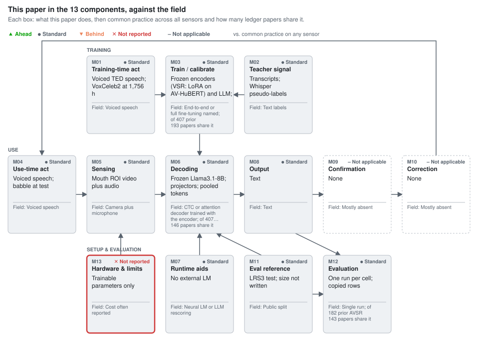

# Large Language Models are Strong Audio-Visual Speech Recognition Learners

Umberto Cappellazzo, Minsu Kim, Honglie Chen, Pingchuan Ma, Stavros Petridis, Daniele Falavigna, Alessio Brutti, Maja Pantic. ICASSP 2025. [doi:10.1109/ICASSP49660.2025.10889251](https://doi.org/10.1109/ICASSP49660.2025.10889251) [arXiv:2409.12319](https://arxiv.org/abs/2409.12319)

**Section:** [Other sensors](../../README.md#other-sensors)

## Figures

### This paper in the 13 components, against the field

<picture><source media="(prefers-color-scheme: dark)" srcset="figures/components-dark.svg"></picture>

Verdicts compare the paper's choice for each component with common practice across 8,995 ledger entries on any sensor (silent speech, brain-to-text, lip reading).

Data

| Component | This paper | Common practice | Papers with this practice | Verdict |
| --- | --- | --- | --- | --- |
| M01 Training-time act | Voiced TED speech; VoxCeleb2 at 1,756 h | Voiced speech |  | ● Standard (Inherited.) |
| M02 Teacher signal | Transcripts; Whisper pseudo-labels (VoxCeleb2) | Text labels |  | ● Standard (Inherited [@ma2023autoavsr].) |
| M03 Train / calibrate | Frozen encoders (VSR: LoRA on AV-HuBERT) and LLM; projectors and LoRA trained | End-to-end or full fine-tuning named; of 407 prior | 193 of 407 | ● Standard (As in [@yeo2024vspllm].) |
| M04 Use-time act | Voiced speech; babble at test | Voiced speech |  | ● Standard (Inherited.) |
| M05 Sensing | Mouth ROI video plus audio | Camera plus microphone |  | ● Standard (Inherited.) |
| M06 Decoding | Frozen Llama3.1-8B; projectors; pooled tokens | CTC or attention decoder trained with the encoder; of 407 prior | 146 of 407 | ● Standard (As in [@yeo2024vspllm].) |
| M07 Runtime aids | No external LM | Neural LM or LLM rescoring |  | ● Standard (LLM carries the prior.) |
| M08 Output | Text | Text |  | ● Standard (Inherited.) |
| M09 Confirmation | None | Mostly absent |  | – Not applicable (Offline.) |
| M10 Correction | None | Mostly absent |  | – Not applicable (Offline.) |
| M11 Eval reference | LRS3 test; size not written | Public split |  | ● Standard (Inherited.) |
| M12 Evaluation | One run per cell; copied rows | Single run; of 182 prior AVSR | 143 of 182 | ● Standard (Margins under 0.1 points.) |
| M13 Hardware & limits | Trainable parameters only | Cost often reported |  | ✕ Not reported (No inference cost.) |

## Verdict

The paper [[1]](#ref-1) changes two components, both standard. M06 replaces the field's trained CTC or attention decoders with a frozen Llama3.1-8B fed by projected, pooled tokens; the authors name VSP-LLM [[2]](#ref-2), seven months earlier, as the one prior LLM-based method (§III-B, Appendix). M03, training only projectors and LoRA (Table I), is VSP-LLM's regime too; new is one frozen LLM for audio, video and both. The clearest overreach: Table I omits VSP-LLM(FT), the closest configuration, against which the 433-hour VSR gain is 0.1 points (25.3% against 25.4%). The 0.77% AVSR result led when posted and still beats the later noise-trained Whisper-Flamingo row (0.86%) [[3]](#ref-3), but each cell is one run and the margins are under 0.1 points (Table I).

## Against the field, component by component

### M06 Processing: frozen LLM decoder with projectors and token pooling

**Usual approach:** Of 407 VSR/AVSR studies before 2024-03, 146 name CTC, 136 an attention encoder-decoder, 80 a transducer and 55 hybrid CTC/attention, and 180 HMMs (mentions, pattern match, Appendix); an LLM decoder appears in 1, VSP-LLM (read). Llama-AVSR pools tokens at a fixed rate (K = 3, Sec. III-A); VSP-LLM merges them by speech units (about 50%, Sec. 1).

**State of the art:** On LRS3 clean AVSR, DoubleHelix [[4]](#ref-4) [later] (2026), an LLM decoder on the same frozen encoders, reports 0.68% at 1,759 hours against 0.77% here (Table I), 12% lower (inference). For VSR at 433 labelled hours, DLLM-VSR [[5]](#ref-5) [later] (2026) reaches 21.9% with the same AV-HuBERT encoder and 19.4% with a 3,305-hour pre-trained one, against 25.3% (Table I).

The authors build on LLM-based ASR (Sec. I) and VSP-LLM. In the [concurrent] window 7 of 50 studies name an LLM decoder (Appendix), e.g. SynesLM [[6]](#ref-6) (OPT, Sec. 3.2) and Personalized Lip Reading [[7]](#ref-7) (LLaMA3-8B, Sec. 4). Verdict: standard; the deciding prior has the design.

### M03 Training: frozen encoders and LLM, projectors and LoRA only

**Usual approach:** Before 2024-03, 193 of 407 VSR/AVSR studies mention end-to-end training or full fine-tuning (pattern match, upper bound), 17 a frozen encoder and 3 LoRA (Appendix); the one LoRA design inside the boundary is VSP-LLM, a frozen AV-HuBERT with QLoRA on LLaMA2-7B (Sec. 4.2). Llama-AVSR freezes Whisper-medium, AV-HuBERT Large (LoRA on it for VSR only) and the LLM, training about 42M to 57M parameters (Table I).

**State of the art:** DoubleHelix [[4]](#ref-4) [later] (2026) keeps the encoders frozen under a LoRA-tuned LLaMA-3.2-3B: 0.68% LRS3 clean AVSR at 1,759 hours (Sec. 4); MMS-LLaMA [[8]](#ref-8) [concurrent] reported 0.72% with QLoRA on LLaMA 3.2 3B (Table 1).

Table I's "Labeled Hours" gives 433 for a model whose audio encoder saw 680k weakly supervised hours [[3]](#ref-3) (Sec. 1; target ref. 39), more than LP Conformer's 100K (Table I); the 42M trainable parameters exclude the frozen 8B decoder. The 2.3% full fine-tuning row is Whisper-Large with noise and beam 15 (Table 3), close to Llama-AVSR's setup (Sec. III-A); rows added in November 2024 give 1.1% and 0.85% (433 and 1,759 hours) with greedy decoding, against 1.1% and 0.79% here (Table I). Verdict: standard.

### M12 Evaluation: single-run SOTA claims on LRS3

**Usual approach:** Of 182 AVSR studies before 2024-03, at least 143 report no seeds, repeated runs or intervals, on LRS3 at least 42 of 51 (pattern match, Appendix). Llama-AVSR reports one WER per cell and copies other rows from their papers (Table I).

**State of the art:** USR 2.0 [[9]](#ref-9) [later] (2026) reports LRS3 low-resource AVSR WER as mean and standard deviation over three seeds (2.9 ± 0.1%, App. Table 13).

Verdict: standard, but margins are small: as the authors note, video moves 0.79% to 0.77% at 1,756 hours (Sec. III-B), about 2.5% relative (inference); the v1 ASR cell was 0.81% [[3]](#ref-3) (Table 3).

## The 13 components

| Component | This paper | Usual approach (count) | State of the art | Verdict |
|---|---|---|---|---|
| M01 Training-time action | Voiced TED speech; VoxCeleb2 at 1,756 h | Voiced speech | – | standard |
| M02 Training-only supervision | Transcripts; Whisper pseudo-labels (VoxCeleb2) | Text labels | – | standard |
| M03 Training and adaptation | Frozen encoders (VSR: LoRA on AV-HuBERT) and LLM; projectors and LoRA trained | End-to-end or full fine-tuning named; of 407 prior (pattern match 193) | [[4]](#ref-4) 0.68%, frozen encoders, LoRA 3B LLM [later] | standard |
| M04 Use-time action | Voiced speech; babble at test | Voiced speech | – | standard |
| M05 Sensors | Mouth ROI video plus audio | Camera plus microphone | – | standard |
| M06 Processing and decoding | Frozen Llama3.1-8B; projectors; pooled tokens | CTC or attention decoder trained with the encoder; of 407 prior (pattern match 146) | [[4]](#ref-4) 0.68% AVSR, 1,759 h [later] | standard |
| M07 Lexicon and LM | No external LM | Neural LM or LLM rescoring | – | standard |
| M08 Output | Text | Text | – | standard |
| M09 Confirmation | None | Mostly absent | – | not applicable |
| M10 Correction | None | Mostly absent | – | not applicable |
| M11 Reference construction | LRS3 test; size not written | Public split | – | standard |
| M12 Evaluation | One run per cell; copied rows | Single run; of 182 prior AVSR (pattern match 143) | [[9]](#ref-9) mean ± SD over three seeds [later] | standard |
| M13 Device and cost | Trainable parameters only | Cost often reported | – | not reported |

## Where the claims outrun the evidence

- Table I lists VSP-LLM at 26.7% (frozen encoder), not 25.4% unfrozen [[2]](#ref-2) (Table 1), the closest configuration (it also trains translation, beam 20, Sec. 4.2): "outstrips VSP-LLM" (§III-B) holds by 0.1 points at 433 hours, and at 30 hours by 1.4 (inference; 28.4% against 29.8%, omitted).
- "Two new SOTA" (§III-B): the 2025 revision keeps Whisper-Flamingo at 1.5% (433 hours, Table I), not its November 2024 1,759-hour rows [[3]](#ref-3) (Table 3): 0.86% noise-trained, which 0.77% beats, and 0.76% clean-trained, less comparable.
- "Outperforms methods that exploit tens of thousands of hours" (§III-B): at 433 hours 0.95% beats ViT3D-CM (1.6%, 90K hours) but not LP Conformer (0.9%, 100K hours; Table I).
- §III-B pairs 433 hours with 1.5% and 30 hours with 1.1% for ASR, the reverse of Table I.
- The authors concede VSR trails RAVEn and BRAVEn (20.1%, Table I; §III-B, §IV).

## What the field needs next

- M06: the same frozen features (Sec. III-A) decoded by a trained CTC/attention decoder of equal trainable size, to isolate the LLM's share.
- M12: several seeds and a significance test for the 1,756-hour ASR and AVSR runs (Table I).
- M03 and M13: total pre-training hours, inference memory and latency beside Table I's trainable parameters.

## Questions for the authors

- Which test partition and text normalization give the WERs, also for copied rows?
- Why did the 2025 revision not add VSP-LLM(FT) or Whisper-Flamingo's 1,759-hour rows?
- On which held-out data were K, LoRA rank and checkpoints chosen?
- How were VoxCeleb2 pseudo-labels filtered?
- What is the AVSR result at 30 hours?

## Appendix: literature search

- Setting, the same for every topic: sentence-level VSR, AVSR and ASR on LRS3. Population: 739 unique VSR/AVSR studies with a WER, CER or accuracy result (pattern match on the ledger, target excluded). Dated against 2024-09: prior before 2024-03 (407 studies), [concurrent] 2024-03 to 2025-03 (50), [later] after 2025-03 (135), date unresolved 147. Counts are full-text pattern matches, related-work mentions included, unless marked read.
- M06, generative-text-decoder-vsr (published table, appended). Inclusion rule: the published rule (VSR or AVSR text decoders: CTC, attention, hybrid CTC/attention, LLM or iterative generative decoder). Ledger counts: 7,345 unique studies slot-filled for M06; 740 unique studies pattern match. Prior: HMM 180, CTC 146, attention or seq2seq 136, transducer 80, hybrid CTC/attention 55; LLM decoder 2 hits, 1 after reading (VSP-LLM; the other is audio-only error correction). [Concurrent]: LLM decoder 9 hits, 7 after reading. Read: [[2]](#ref-2) (prior); [[6]](#ref-6), [[7]](#ref-7) ([concurrent]); [[8]](#ref-8) ([concurrent]); [[4]](#ref-4), [[5]](#ref-5) (state of the art). Known-item recall 1.0.
- M03, frozen-encoder-parameter-efficient-training-vsr (new). Inclusion rule: the same 739-study population, classified by the training regime the full text names (LoRA or QLoRA; adapters, prompt tuning or other parameter-efficient tuning; frozen encoder; end-to-end or full fine-tuning); a study counts under every regime it names. Ledger counts: 1,526 unique studies slot-filled for M03; 740 unique studies pattern match. Prior: end-to-end or full fine-tuning 193, frozen encoder 17, adapters or prompt tuning 14, LoRA 3 (1 inside the boundary after reading: VSP-LLM). [Concurrent]: LoRA 8. Read: [[2]](#ref-2) (prior); [[8]](#ref-8) ([concurrent]); [[4]](#ref-4) (state of the art). Known-item recall 1.0.
- M12, avsr-noise-and-run-variability-protocol (published table, appended). Inclusion rule: the published rule and regexes (additive noise at stated SNRs, babble, run variability) over the AVSR population. Ledger counts: 6,960 unique studies slot-filled for M12; 349 unique studies pattern match (348 without the target). Prior 182: run-variability pattern 39 (upper bound), babble 63, LRS3 51, LRS3 with a variability pattern 9. Read: [[3]](#ref-3) ([concurrent], arXiv v3 of 2024-11); [[9]](#ref-9), [[4]](#ref-4) (state of the art). Known-item recall 1.0.
- Lineage: VoxCeleb2 pseudo-labels follow [[10]](#ref-10).

## References

Numbered by first citation. BibTeX in the same order and keys: [refs.bib](refs.bib).

1. Cappellazzo, U., Kim, M., Chen, H., Ma, P., Petridis, S., Falavigna, D., et al. “Large Language Models are Strong Audio-Visual Speech Recognition Learners.” *IEEE International Conference on Acoustics, Speech and Signal Processing (ICASSP)*, 2025. doi:[10.1109/ICASSP49660.2025.10889251](https://doi.org/10.1109/ICASSP49660.2025.10889251). arXiv:[2409.12319](https://arxiv.org/abs/2409.12319). First public as arXiv:2409.12319 (2024-09); text read: v2 (7 Mar 2025). [wiki: arxiv-2409.12319](https://github.com/supernaiter/deep-research-wiki-for-silent-speech/blob/main/papers/arxiv-2409.12319/article.md) [wiki: doi-10.1109-icassp49660.2025.10889251](https://github.com/supernaiter/deep-research-wiki-for-silent-speech/blob/main/papers/doi-10.1109-icassp49660.2025.10889251/article.md)
2. Yeo, J. H., Han, S., Kim, M., Ro, Y. M. “Where Visual Speech Meets Language: VSP-LLM Framework for Efficient and Context-Aware Visual Speech Processing.” *Findings of the Association for Computational Linguistics: EMNLP 2024*, 2024. arXiv:[2402.15151](https://arxiv.org/abs/2402.15151). Prior; deciding prior for M03 and M06. [wiki: arxiv-2402.15151](https://github.com/supernaiter/deep-research-wiki-for-silent-speech/blob/main/papers/arxiv-2402.15151/article.md) [wiki: acl-emnlp24-vspll](https://github.com/supernaiter/deep-research-wiki-for-silent-speech/blob/main/papers/acl-emnlp24-vspll/article.md)
3. Rouditchenko, A., Gong, Y., Thomas, S., Karlinsky, L., Kuehne, H., Feris, R., et al. “Whisper-Flamingo: Integrating Visual Features into Whisper for Audio-Visual Speech Recognition and Translation.” *Interspeech*, 2024. arXiv:[2406.10082](https://arxiv.org/abs/2406.10082). Values from arXiv:2406.10082v3 (2024-11-19); the Interspeech 2024 version reports only the 433 h rows. [concurrent] [wiki: arxiv-2406.10082](https://github.com/supernaiter/deep-research-wiki-for-silent-speech/blob/main/papers/arxiv-2406.10082/article.md) [wiki: isca-rouditchenko24_interspeech](https://github.com/supernaiter/deep-research-wiki-for-silent-speech/blob/main/papers/isca-rouditchenko24_interspeech/article.md) [wiki: isca-rouditchenko24-whisperflamingo](https://github.com/supernaiter/deep-research-wiki-for-silent-speech/blob/main/papers/isca-rouditchenko24-whisperflamingo/article.md) [wiki: in24-whisperflamingo](https://github.com/supernaiter/deep-research-wiki-for-silent-speech/blob/main/papers/in24-whisperflamingo/article.md)
4. Cheng, Z. “DoubleHelix: Structured Cross-Modal Fusion for Audio-Visual Speech Recognition with LLMs.” *arXiv preprint*, 2026. arXiv:[2607.29112](https://arxiv.org/abs/2607.29112). Preprint, v1. [later] [wiki: arxiv-2607.29112](https://github.com/supernaiter/deep-research-wiki-for-silent-speech/blob/main/papers/arxiv-2607.29112/article.md) [wiki: arxiv-2607-29112-doublehelix](https://github.com/supernaiter/deep-research-wiki-for-silent-speech/blob/main/papers/arxiv-2607-29112-doublehelix/article.md) [wiki: arxiv-2607.29112-doublehelix](https://github.com/supernaiter/deep-research-wiki-for-silent-speech/blob/main/papers/arxiv-2607.29112-doublehelix/article.md)
5. Yeo, J. H., Kim, C. W., Rha, H., Ro, Y. M. “Diffusion Large Language Models for Visual Speech Recognition.” *arXiv preprint*, 2026. arXiv:[2605.28456](https://arxiv.org/abs/2605.28456). [later] [wiki: arxiv-2605.28456](https://github.com/supernaiter/deep-research-wiki-for-silent-speech/blob/main/papers/arxiv-2605.28456/article.md) [wiki: arxiv-2605-28456-dllmvsr](https://github.com/supernaiter/deep-research-wiki-for-silent-speech/blob/main/papers/arxiv-2605-28456-dllmvsr/article.md) [wiki: arxiv-2605.28456-dllmvsr](https://github.com/supernaiter/deep-research-wiki-for-silent-speech/blob/main/papers/arxiv-2605.28456-dllmvsr/article.md)
6. Lu, Y., Song, J., Chang, X., Bian, H., Maiti, S., Watanabe, S. “SynesLM: A Unified Approach for Audio-visual Speech Recognition and Translation via Language Model and Synthetic Data.” *arXiv preprint*, 2024. arXiv:[2408.00624](https://arxiv.org/abs/2408.00624). [concurrent] [wiki: arxiv-2408.00624](https://github.com/supernaiter/deep-research-wiki-for-silent-speech/blob/main/papers/arxiv-2408.00624/article.md)
7. Yeo, J. H., Kim, C. W., Kim, H., Rha, H., Han, S., Cheng, W., et al. “Personalized Lip Reading: Adapting to Your Unique Lip Movements with Vision and Language.” *arXiv preprint*, 2024. arXiv:[2409.00986](https://arxiv.org/abs/2409.00986). [concurrent] [wiki: arxiv-2409.00986](https://github.com/supernaiter/deep-research-wiki-for-silent-speech/blob/main/papers/arxiv-2409.00986/article.md)
8. Yeo, J. H., Rha, H., Park, S. J., Ro, Y. M. “MMS-LLaMA: Efficient LLM-based Audio-Visual Speech Recognition with Minimal Multimodal Speech Tokens.” *arXiv preprint*, 2025. arXiv:[2503.11315](https://arxiv.org/abs/2503.11315). [concurrent] [wiki: arxiv-2503.11315](https://github.com/supernaiter/deep-research-wiki-for-silent-speech/blob/main/papers/arxiv-2503.11315/article.md) [wiki: acl-2025-mms-llama](https://github.com/supernaiter/deep-research-wiki-for-silent-speech/blob/main/papers/acl-2025-mms-llama/article.md)
9. Haliassos, A., Mira, R., Petridis, S. “Pay Attention to CTC: Fast and Robust Pseudo-Labelling for Unified Speech Recognition.” *International Conference on Learning Representations (ICLR)*, 2026. arXiv:[2602.19316](https://arxiv.org/abs/2602.19316). [later] [wiki: arxiv-2602.19316](https://github.com/supernaiter/deep-research-wiki-for-silent-speech/blob/main/papers/arxiv-2602.19316/article.md)
10. Ma, P., Haliassos, A., Fernandez-Lopez, A., Chen, H., Petridis, S., Pantic, M. “Auto-AVSR: Audio-Visual Speech Recognition with Automatic Labels.” *IEEE International Conference on Acoustics, Speech and Signal Processing (ICASSP)*, 2023. arXiv:[2303.14307](https://arxiv.org/abs/2303.14307). Prior; source of the VoxCeleb2 pseudo-labelling recipe. [review](https://github.com/supernaiter/silent-speech-review/tree/main/reviews/auto-avsr-audio-visual-speech-recognition-with-automatic-labels) [wiki: arxiv-2303.14307](https://github.com/supernaiter/deep-research-wiki-for-silent-speech/blob/main/papers/arxiv-2303.14307/article.md)

## Materials

Data behind this review. Full texts of the papers are not included.

- [`review.md`](review.md): the review text (source)
- [`refs.bib`](refs.bib): references (BibTeX)
- [`slots.json`](slots.json): for each of the 13 components: this paper's choice, field practice, number of matching papers, verdict
- [`figures.json`](figures.json): figure definitions
- [`evaluation.md`](evaluation.md): independent evaluation by a second reviewer
- [`triage.md`](triage.md): how each evaluation finding was checked against the sources and resolved
- [`process/log.json`](process/log.json): process record: each step, who did it (reader, script, writer, evaluator), when, the checks run and the input versions
- [`process/notes.json`](process/notes.json): reading notes on the target and comparator papers: claims, numbers, conditions and what is not stated, with locations
- [`process/plan.json`](process/plan.json): plan: which components the paper changes and the topics it is compared on
- [`process/draft.md`](process/draft.md): the review as first written, before the independent evaluation
- [`process/claims-draft.md`](process/claims-draft.md): claim table of the draft: every claim mapped to a note or a count
- [`process/claims.md`](process/claims.md): claim table of the published review
- [`components/M03/frozen-encoder-parameter-efficient-training-vsr.csv`](../../components/M03/frozen-encoder-parameter-efficient-training-vsr.csv): M03 topic "frozen-encoder-parameter-efficient-training-vsr", every candidate paper with its decision (1526 slot-filled, 740 pattern match, usual design in 193, 3 read in full)
- [`components/M06/generative-text-decoder-vsr.csv`](../../components/M06/generative-text-decoder-vsr.csv): M06 topic "generative-text-decoder-vsr", every candidate paper with its decision (7345 slot-filled, 740 pattern match, usual design in 131, 2 read in full)
- [`components/M12/avsr-noise-and-run-variability-protocol.csv`](../../components/M12/avsr-noise-and-run-variability-protocol.csv): M12 topic "avsr-noise-and-run-variability-protocol", every candidate paper with its decision (6960 slot-filled, 349 pattern match, usual design in 183, 3 read in full)

## More reviews in Other sensors

- [A neural speech decoding framework leveraging deep learning and speech synthesis](../a-neural-speech-decoding-framework-leveraging-deep-learning-and-speech-synthesis/) (2024). Differentiable-synthesizer decoding (M06) and autoencoder guidance (M02) are standard: the group posted both in 2021. New: 48 participants, mostly low-density grids; no listener test.
- [Online speech synthesis using a chronically implanted brain–computer interface in an individual with ALS](../online-speech-synthesis-using-a-chronically-implanted-brain-computer-interface-in-an-individual-with/) (2024). Closed-loop word synthesis (M06) from a chronic ECoG implant in ALS (M13) holds on six keywords at 80% listener accuracy; standard designs, one participant, stability untested.
- [Ultrasensitive Textile Strain Sensors Redefine Wearable Silent Speech Interfaces with High Machine Learning Efficiency](../ultrasensitive-textile-strain-sensors-redefine-wearable-silent-speech-interfaces-with-high-machine-learning-efficiency/) (2024). Standard sensor (M05) and decoder (M06): one throat strain channel, small CNN. 95.25% on 20 words, with split grouping and production mode unstated, does not show silent, session-independent decoding.
- [Whisper-Flamingo: Integrating Visual Features into Whisper for Audio-Visual Speech Recognition and Translation](../whisper-flamingo-integrating-visual-features-into-whisper-for-audio-visual-speech-recognition-and-tr/) (2024). Whisper-Flamingo is a well-engineered combination of prior parts; its clean LRS3 gain disappears at beam 1, and one model trails per-pair models in noisy translation (20.5 vs 20.8 BLEU).
- [Jointly Learning Visual and Auditory Speech Representations from Raw Data](../jointly-learning-visual-and-auditory-speech-representations-from-raw-data/) (2023). RAVEn's asymmetric momentum-teacher objective (M03) ties AV-HuBERT at Large with 30 h (32.5%); its lead comes with self-training (M02), whose pseudo-label decoding is not stated.
- [Semantic reconstruction of continuous language from non-invasive brain recordings](../semantic-reconstruction-of-continuous-language-from-non-invasive-brain-recordings/) (2023). LM candidates scored by encoding-model likelihood (M06) were ahead in 2022, as the authors claim; the scorer is now overtaken. GPT prior (M07) is standard; one pilot-touched test story limits M12.

---

Part of the [Silent Speech Interface Review](https://github.com/supernaiter/silent-speech-review). Found an error? [Open an issue](https://github.com/supernaiter/silent-speech-review/issues/new?template=correction.yml).
