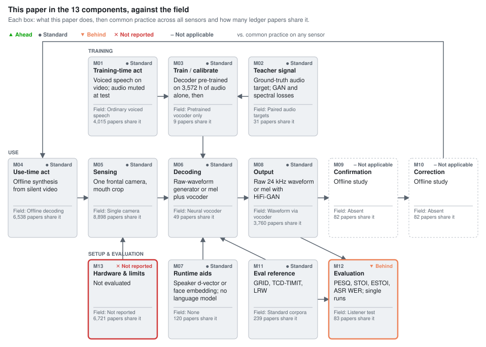

# Large-scale unsupervised audio pre-training for video-to-speech synthesis

Triantafyllos Kefalas, Yannis Panagakis, Maja Pantic. arXiv preprint (cs.SD), 2023. [arXiv:2306.15464](https://arxiv.org/abs/2306.15464)

**Section:** [Lip & face video](../../README.md#lip--face-video)

## Figures

### This paper in the 13 components, against the field

<picture><source media="(prefers-color-scheme: dark)" srcset="figures/components-dark.svg"></picture>

Verdicts compare the paper's choice for each component with common practice across 8,995 ledger entries on any sensor (silent speech, brain-to-text, lip reading).

Data

| Component | This paper | Common practice | Papers with this practice | Verdict |
| --- | --- | --- | --- | --- |
| M01 Training-time act | Voiced speech on video; audio muted at test | Ordinary voiced speech | 4,015 of 8,995 | ● Standard (Inherited.) |
| M02 Teacher signal | Ground-truth audio target; GAN and spectral losses | Paired audio targets | 31 of 8,995 | ● Standard (End-to-end WGAN lineage.) |
| M03 Train / calibrate | Decoder pre-trained on 3,572 h of audio alone, then transferred | Pretrained vocoder only | 9 of 8,995 | ● Standard (Helps WER in 7 of 16 pairs (inference).) |
| M04 Use-time act | Offline synthesis from silent video | Offline decoding | 6,538 of 8,995 | ● Standard (Inherited.) |
| M05 Sensing | One frontal camera, mouth crop | Single camera | 8,898 of 8,995 | ● Standard (Inherited.) |
| M06 Decoding | Raw-waveform generator or mel plus vocoder | Neural vocoder | 49 of 8,995 | ● Standard (WER behind on all four splits; TCD-TIMIT STOI, ESTOI behind.) |
| M07 Runtime aids | Speaker d-vector or face embedding; no language model | None | 120 of 8,995 | ● Standard (Inherited.) |
| M08 Output | Raw 24 kHz waveform or mel with HiFi-GAN | Waveform via vocoder | 3,760 of 8,995 | ● Standard (Inherited.) |
| M09 Confirmation | Offline study | Absent | 82 of 8,995 | – Not applicable (Offline.) |
| M10 Correction | Offline study | Absent | 82 of 8,995 | – Not applicable (Offline.) |
| M11 Eval reference | GRID, TCD-TIMIT, LRW | Standard corpora | 239 of 8,995 | ● Standard (Inherited.) |
| M12 Evaluation | PESQ, STOI, ESTOI, ASR WER; single runs | Listener test | 83 of 8,995 | ▼ Behind (No listener test, no seeds.) |
| M13 Hardware & limits | Not evaluated | Not reported | 6,721 of 8,995 | ✕ Not reported (No latency or compute.) |

## Verdict

The paper [[1]](#ref-1) changes training (M03): it pre-trains the speech decoder on 3,572 hours of audio alone and transfers it to video-to-speech models. The design is standard: transferring a decoder trained without the input signal is used at least since 2021 [[2]](#ref-2), and the paper's departure is dropping the transcripts a text-to-speech decoder needs. The transfer does not reliably help: it lowers WER against the same model trained from scratch in 7 of 16 model and split pairs and raises it in 9 (inference; pairs in the Appendix). Earlier systems keep lower WER on all four splits [[3]](#ref-3), [[4]](#ref-4). The strongest confound is unequal training, since only pre-trained variants inherit a fully trained audio model, and every row is a single run with no listener test, so the claim that audio pre-training improves video-to-speech is not supported.

## Against the field, component by component

### M03 Training: decoder pre-trained on audio alone

**Usual approach:** Of 30 unique studies on speech synthesis from a non-acoustic signal that mention audio-only or decoder pre-training (pattern match, Appendix), the most common design is an off-the-shelf pretrained vocoder with no decoder transfer, 9 of 30. The paper's mel route also ends in a pretrained HiFi-GAN (§III-D), shared by scratch and transferred variants; only the mel decoder is transferred. Decoder transfer is rare: TaLNet moves a Tacotron 2 decoder trained on 460 hours of LibriTTS into a tongue-and-lip model [[2]](#ref-2), and LipSound2 pre-trains its whole model on about 2400 hours of paired audio-visual data [[5]](#ref-5). The departure is audio without text or video, at larger scale.

**State of the art:** TaLNet (2021) cut WER from 55.9% (SD 9.9 across speakers) to 36.5% (SD 10.8) with decoder transfer, 19.4 points or 34.7% relative (inference), and at every training-set size from 75 speakers to 1 [[2]](#ref-2). The paper's best single gain is 25.75% to 18.57% on GRID unseen speakers, 7.18 points or 27.9% relative (inference), Table VII, but the sign flips elsewhere: 2.66% to 3.66% on GRID seen speakers (Table V) and 14.96% to 18.70% on LRW (Table VIII). The starting points differ (ultrasound plus lip input, transcribed data), so the effects cannot be ranked. Verdict: standard.

### M06 Decoding: raw waveform and mel routes

**Usual approach:** A neural vocoder on predicted acoustic features is the most common design, 49 of 165 unique video-to-speech studies (pattern match, Appendix) [[6]](#ref-6), [[4]](#ref-4). The paper adds a raw-waveform route.

**State of the art:** Earlier systems lead on WER on every scored split: 4.07% against 4.54% on GRID four speakers [[3]](#ref-3), 2.37% against 2.66% on GRID seen speakers and 12.90% against 14.96% on LRW [[4]](#ref-4), and 16.05% against 17.08% on GRID unseen speakers [[3]](#ref-3) (Tables IV, V, VII, VIII). On TCD-TIMIT a 2021 system keeps higher STOI and ESTOI, 0.595 and 0.420 against the paper's best 0.568 and 0.405 (Table VI) [[6]](#ref-6). On LRS3, later work cut SVTS's 78.0% WER to 28.5% [[7]](#ref-7), a benchmark the paper omits. Verdict: standard; its metric gains cannot be separated from unmeasured run-to-run variation.

### M12 Evaluation: listener test and repeated runs

**Usual approach:** About half of video-to-speech studies, 83 of 165, run a listener or opinion test (pattern match, Appendix) [[8]](#ref-8), [[9]](#ref-9). The paper reports objective metrics and ASR WER only (§V-E), conceding that none matches human perception.

**State of the art:** Listener tests were in use by 2015, with twenty listeners [[10]](#ref-10); in 2017 listeners reached 85% word accuracy on GRID with speaker-dependent systems [[8]](#ref-8). This paper has neither listeners nor seeds. Verdict: behind, against about half of the field.

## The 13 components

| Component | This paper | Usual approach (count) | State of the art | Verdict |
|---|---|---|---|---|
| M01 Training-time action | Voiced speech on video; audio muted at test | Ordinary voiced speech (slot-filled 4,015) | – | standard |
| M02 Training-only supervision | Ground-truth audio target; GAN and spectral losses | Paired audio targets (slot-filled 31) | – | standard |
| M03 Training and adaptation | Decoder pre-trained on 3,572 h of audio alone, then transferred | Pretrained vocoder only (pattern match 9) | TTS decoder transfer, 55.9% to 36.5% WER [[2]](#ref-2) | standard |
| M04 Use-time action | Offline synthesis from silent video | Offline decoding (slot-filled 6,538) | – | standard |
| M05 Sensors | One frontal camera, mouth crop | Single camera (slot-filled 8,898) | – | standard |
| M06 Processing and decoding | Raw-waveform generator or mel plus vocoder | Neural vocoder (pattern match 49) | GRID unseen 16.05% WER [[3]](#ref-3); LRW 12.90% [[4]](#ref-4) | standard |
| M07 Lexicon and LM | Speaker d-vector or face embedding; no language model | None (slot-filled 120) | – | standard |
| M08 Output | Raw 24 kHz waveform or mel with HiFi-GAN | Waveform via vocoder (slot-filled 3,760) | – | standard |
| M09 Confirmation | Offline study | Absent (slot-filled 82) | – | not applicable |
| M10 Correction | Offline study | Absent (slot-filled 82) | – | not applicable |
| M11 Reference construction | GRID, TCD-TIMIT, LRW | Standard corpora (slot-filled 239) | – | standard |
| M12 Evaluation | PESQ, STOI, ESTOI, ASR WER; single runs | Listener test (pattern match 83) | Listeners by 2015 [[10]](#ref-10); 85% word accuracy [[8]](#ref-8) | behind |
| M13 Device and cost | Not evaluated | Not reported (slot-filled 6,721) | – | not reported |

## Where the claims outrun the evidence

- §VI says the raw-waveform models beat previous work on all reconstruction metrics, comparing within output category. Against earlier raw-waveform rows this holds except one TCD-TIMIT PESQ (1.39 against 1.40, Table VI) and a GRID unseen ESTOI tie (0.289). Across categories, STOI and ESTOI trail VCA-GAN on TCD-TIMIT and SVTS on LRW (0.637 and 0.456 against 0.649 and 0.482, Table VIII), and WER trails on all four splits.
- The authors concede that scratch mel models beat fine-tuned ones on GRID seen speakers and LRW (§VI); the text is honest, but the abstract's claim of improved speech overstates the tables.
- Scratch models start from random weights (§V-C2), pre-trained ones from an audio model trained to minimum validation loss (§V-C1), on LRW first tuned on LRW training audio (§V-D2); with no equal-training control, training length explains the gains as well as audio does.

## What the field needs next

- M03: scratch models trained for equal total steps, and pre-training data scaled at fixed steps, to separate audio from training length.
- M03: a TTS decoder against the audio-only decoder under one video model, the comparison with [[2]](#ref-2) that the paper lacks.
- M12: a listener intelligibility test and at least three seeds on GRID unseen speakers and LRW.

## Questions for the authors

- How many seeds lie behind each row, and with what WER spread?
- Which ASR checkpoints, decoding settings and language models produced the WER?
- Do any pre-training speakers overlap with GRID or LRW test speakers?

## Appendix: literature search

**M03 audio-only-decoder-pretraining.** Inclusion rule: studies that synthesize speech from a non-acoustic signal and pre-train the speech-generating part on speech without that signal, then transfer it; a pretrained vocoder used alone, encoder-side self-supervision, audio-visual paired pre-training and distillation are counted separately. Ledger: 1,526 slot-filled unique studies; 30 pattern match (unique studies). Usual design: pretrained vocoder only, 9 of 30 (pattern match); audio-only decoder pre-training 4, including the target, all 2023 or later; transfer of a TTS decoder 2; audio-visual pre-training 2. Read in full: [[2]](#ref-2), [[5]](#ref-5). WER pairs, scratch to transferred (basic fine-tuning or fine-tuned decoder; WaveGAN-F, WaveGAN-SP, MelSpec-F, MelSpec-SP; %): GRID four speakers 5.50 to 4.54, 4.68 to 5.58, 7.97 to 6.70, 6.70 to 5.74; GRID seen 3.60 to 3.73, 2.79 to 2.83, 3.08 to 4.19, 2.66 to 3.66; GRID unseen 25.75 to 18.57, 19.88 to 17.08, 23.25 to 25.14, 18.00 to 17.90; LRW 41.00 to 35.83, 29.79 to 29.88, 22.67 to 28.84, 14.96 to 18.70; lower in 7 of 16 (Tables IV, V, VII, VIII). Known-item recall 0.67 (3 seeds; LipSound2 lies outside the ledger pattern).

**M06 video-to-speech-synthesis.** Inclusion rule: studies that synthesize a speech waveform from talking-face or lip video with audio muted at test; enhancement with noisy audio, talking-head generation and text-only lip reading excluded. Ledger: 7,345 slot-filled unique studies; 165 pattern match (unique studies). Usual design: neural vocoder on predicted acoustic features, 49 of 165 (pattern match). Comparison rows read from the target's Tables IV to VIII; later LRS3 values from [[7]](#ref-7) (Table I). Known-item recall 1.0.

**M12 video-to-speech-output-evaluation.** Inclusion rule: the M06 population; how synthesized speech is evaluated. Ledger: 6,960 slot-filled unique studies; 165 pattern match (unique studies). Usual design: listener or opinion test, 83 of 165 (pattern match); unseen-speaker test 51, ASR WER on output 38. Read in full: [[10]](#ref-10), [[8]](#ref-8), [[9]](#ref-9). Known-item recall 1.0.

## References

Numbered by first citation. BibTeX in the same order and keys: [refs.bib](refs.bib).

1. Kefalas, T., Panagakis, Y., Pantic, M. “Large-scale unsupervised audio pre-training for video-to-speech synthesis.” *arXiv preprint (cs.SD), submitted to IEEE*, 2023. arXiv:[2306.15464](https://arxiv.org/abs/2306.15464). Target. Read as arXiv v2 (31 Jul 2023). [review](https://github.com/supernaiter/silent-speech-review/tree/main/reviews/large-scale-unsupervised-audio-pre-training-for-video-to-speech-synthesis) [wiki: arxiv-2306.15464-v2apretrain](https://github.com/supernaiter/deep-research-wiki-for-silent-speech/blob/main/papers/arxiv-2306.15464-v2apretrain/article.md)
2. Zhang, J., Richmond, K., Ling, Z., Dai, L. “TaLNet: Voice Reconstruction from Tongue and Lip Articulation with Transfer Learning from Text-to-Speech Synthesis.” *The Thirty-Fifth AAAI Conference on Artificial Intelligence (AAAI-21)*, 2021, 35(16), 14402-14410. doi:[10.1609/aaai.v35i16.17693](https://doi.org/10.1609/aaai.v35i16.17693). [wiki: doi-10.1609-aaai.v35i16.17693](https://github.com/supernaiter/deep-research-wiki-for-silent-speech/blob/main/papers/doi-10.1609-aaai.v35i16.17693/article.md)
3. Mira, R., Vougioukas, K., Ma, P., Petridis, S., Schuller, B. W., Pantic, M. “End-to-End Video-To-Speech Synthesis using Generative Adversarial Networks.” *IEEE Transactions on Cybernetics*, 2023, 53(6), 3454-3466. doi:[10.1109/TCYB.2022.3162495](https://doi.org/10.1109/TCYB.2022.3162495). arXiv:[2104.13332](https://arxiv.org/abs/2104.13332). Title and authors from the arXiv first page; journal, volume, pages and DOI confirmed against the Crossref record of the DOI. [wiki: arxiv-2104.13332](https://github.com/supernaiter/deep-research-wiki-for-silent-speech/blob/main/papers/arxiv-2104.13332/article.md)
4. Mira, R., Haliassos, A., Petridis, S., Schuller, B. W., Pantic, M. “SVTS: Scalable Video-to-Speech Synthesis.” *Interspeech 2022*, 2022. arXiv:[2205.02058](https://arxiv.org/abs/2205.02058). [review](https://github.com/supernaiter/silent-speech-review/tree/main/reviews/svts-scalable-video-to-speech-synthesis) [wiki: arxiv-2205.02058](https://github.com/supernaiter/deep-research-wiki-for-silent-speech/blob/main/papers/arxiv-2205.02058/article.md)
5. Qu, L., Weber, C., Wermter, S. “LipSound2: Self-Supervised Pre-Training for Lip-to-Speech Reconstruction and Lip Reading.” *IEEE Transactions on Neural Networks and Learning Systems*, 2022. doi:[10.1109/TNNLS.2022.3191677](https://doi.org/10.1109/TNNLS.2022.3191677). arXiv:[2112.04748](https://arxiv.org/abs/2112.04748). [wiki: arxiv-2112.04748](https://github.com/supernaiter/deep-research-wiki-for-silent-speech/blob/main/papers/arxiv-2112.04748/article.md) [wiki: doi-10.1109-tnnls.2022.3191677](https://github.com/supernaiter/deep-research-wiki-for-silent-speech/blob/main/papers/doi-10.1109-tnnls.2022.3191677/article.md)
6. Kim, M., Hong, J., Ro, Y. M. “Lip to Speech Synthesis with Visual Context Attentional GAN.” *35th Conference on Neural Information Processing Systems (NeurIPS 2021)*, 2021. arXiv:[2204.01726](https://arxiv.org/abs/2204.01726). Read as arXiv v1 (4 Apr 2022). [wiki: arxiv-2204.01726](https://github.com/supernaiter/deep-research-wiki-for-silent-speech/blob/main/papers/arxiv-2204.01726/article.md)
7. Choi, J., Kim, J., Li, J., Chung, J. S., Liu, S. “V2SFlow: Video-to-Speech Generation with Speech Decomposition and Rectified Flow.” *arXiv preprint*, 2024. arXiv:[2411.19486](https://arxiv.org/abs/2411.19486). [later] [wiki: arxiv-2411.19486](https://github.com/supernaiter/deep-research-wiki-for-silent-speech/blob/main/papers/arxiv-2411.19486/article.md)
8. Le Cornu, T., Milner, B. “Generating Intelligible Audio Speech From Visual Speech.” *IEEE/ACM Transactions on Audio, Speech, and Language Processing*, 2017, 25(9), 1751-1761. doi:[10.1109/TASLP.2017.2716178](https://doi.org/10.1109/TASLP.2017.2716178). [wiki: doi-10.1109-taslp.2017.2716178](https://github.com/supernaiter/deep-research-wiki-for-silent-speech/blob/main/papers/doi-10.1109-taslp.2017.2716178/article.md)
9. Ephrat, A., Peleg, S. “Vid2speech: Speech Reconstruction from Silent Video.” *2017 IEEE International Conference on Acoustics, Speech and Signal Processing (ICASSP)*, 2017, 5095-5099. doi:[10.1109/ICASSP.2017.7953127](https://doi.org/10.1109/ICASSP.2017.7953127). arXiv:[1701.00495](https://arxiv.org/abs/1701.00495). [review](https://github.com/supernaiter/silent-speech-review/tree/main/reviews/vid2speech-speech-reconstruction-from-silent-video) [wiki: arxiv-1701.00495](https://github.com/supernaiter/deep-research-wiki-for-silent-speech/blob/main/papers/arxiv-1701.00495/article.md)
10. Le Cornu, T., Milner, B. “Reconstructing intelligible audio speech from visual speech features.” *Proc. Interspeech 2015*, 2015. doi:[10.21437/Interspeech.2015-319](https://doi.org/10.21437/Interspeech.2015-319). [wiki: isca-cornu15_interspeech](https://github.com/supernaiter/deep-research-wiki-for-silent-speech/blob/main/papers/isca-cornu15_interspeech/article.md)

## Materials

Data behind this review. Full texts of the papers are not included.

- [`review.md`](review.md): the review text (source)
- [`refs.bib`](refs.bib): references (BibTeX)
- [`slots.json`](slots.json): for each of the 13 components: this paper's choice, field practice, number of matching papers, verdict
- [`figures.json`](figures.json): figure definitions
- [`evaluation.md`](evaluation.md): independent evaluation by a second reviewer
- [`triage.md`](triage.md): how each evaluation finding was checked against the sources and resolved
- [`components/M03/audio-only-decoder-pretraining.csv`](../../components/M03/audio-only-decoder-pretraining.csv): M03 topic "audio-only-decoder-pretraining", every candidate paper with its decision (1526 slot-filled, 30 pattern match, usual design in 9, 3 read in full)
- [`components/M06/video-to-speech-synthesis.csv`](../../components/M06/video-to-speech-synthesis.csv): M06 topic "video-to-speech-synthesis", every candidate paper with its decision (7345 slot-filled, 165 pattern match, usual design in 49, 3 read in full)
- [`components/M12/video-to-speech-output-evaluation.csv`](../../components/M12/video-to-speech-output-evaluation.csv): M12 topic "video-to-speech-output-evaluation", every candidate paper with its decision (6960 slot-filled, 165 pattern match, usual design in 83, 5 read in full)

## More reviews in Lip & face video

- [Audio-visual video-to-speech synthesis with synthesized input audio](../audio-visual-video-to-speech-synthesis-with-synthesized-input-audio/) (2023). A second synthesis pass on first-pass speech (M06) and modality dropout (M03) are standard; gains are small and inconsistent, earlier systems keep lower WER, and no equal-training control exists.
- [Auto-AVSR: Audio-Visual Speech Recognition with Automatic Labels](../auto-avsr-audio-visual-speech-recognition-with-automatic-labels/) (2023). Training lipreading and AV-ASR on 3,448 h including ASR-pseudo-labelled AVSpeech and VoxCeleb2 cuts LRS3 visual-only WER to 19.1% and audio-visual WER to 0.9%.
- [High-Quality Automatic Voice Over with Accurate Alignment: Supervision through Self-Supervised Discrete Speech Units](../high-quality-automatic-voice-over-with-accurate-alignment-supervision-through-self-supervised-discrete-speech-units/) (2023). An automatic voice-over system that supervises alignment by predicting self-supervised discrete speech units from text and lip video, improving lip-sync and speech quality on a single-speaker dataset. Not an SSI paper.
- [Improving the Gap in Visual Speech Recognition Between Normal and Silent Speech Based on Metric Learning](../improving-the-gap-in-visual-speech-recognition-between-normal-and-silent-speech-based-on-metric-learning/) (2023). Joint normal-silent training does most of the gap closing; the viseme KL terms add 0.93 WER points with no run count reported, so the metric-learning gain is not established.
- [Intelligible Lip-to-Speech Synthesis with Speech Units](../intelligible-lip-to-speech-synthesis-with-speech-units/) (2023). Unit target (M02) and unit-conditioned vocoder (M06) are standard; units cut LRS3 WER 21.8 points, AV-HuBERT 20.4 more, the vocoder 0.3; unit gain untested on AV-HuBERT, single runs.
- [LipLearner: Customizable Silent Speech Interactions on Mobile Devices](../liplearner-customizable-silent-speech-interactions-on-mobile-devices/) (2023). All three changed components are standard: on-device few-shot head untested against prototypes or fine-tuning; voiced enrollment loses 5.6 points; visual KWS predates it uncited.

---

Part of the [Silent Speech Interface Review](https://github.com/supernaiter/silent-speech-review). Found an error? [Open an issue](https://github.com/supernaiter/silent-speech-review/issues/new?template=correction.yml).
