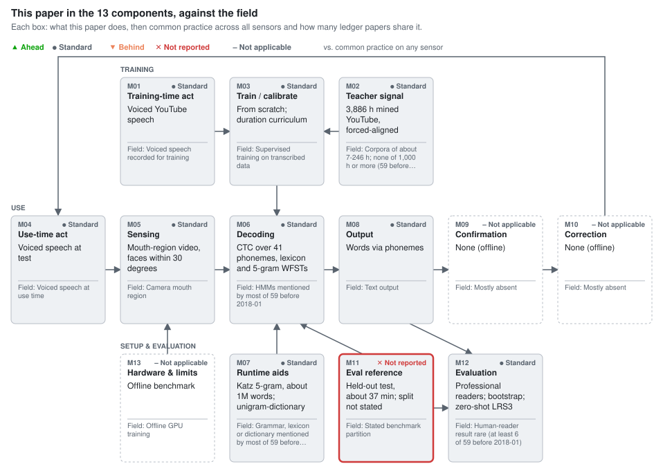

# Large-Scale Visual Speech Recognition

Brendan Shillingford, Yannis Assael, Matthew W. Hoffman, Thomas Paine, Cían Hughes, Utsav Prabhu, Hank Liao, Hasim Sak, Kanishka Rao, Lorrayne Bennett, Marie Mulville, Ben Coppin, Ben Laurie, Andrew Senior, Nando de Freitas. arXiv preprint, 2018. [arXiv:1807.05162](https://arxiv.org/abs/1807.05162)

**Section:** [Other sensors](../../README.md#other-sensors)

## Figures

### This paper in the 13 components, against the field

<picture><source media="(prefers-color-scheme: dark)" srcset="figures/components-dark.svg"></picture>

Verdicts compare the paper's choice for each component with common practice across 8,995 ledger entries on any sensor (silent speech, brain-to-text, lip reading).

Data

| Component | This paper | Common practice | Papers with this practice | Verdict |
| --- | --- | --- | --- | --- |
| M01 Training-time act | Voiced YouTube speech | Voiced speech recorded for training |  | ● Standard (Inherited.) |
| M02 Teacher signal | 3,886 h mined YouTube, forced-aligned phonemes | Corpora of about 7-246 h; none of 1,000 h or more (59 before 2018-01) |  | ● Standard (Table 1 holds data fixed; data effect not measured.) |
| M03 Train / calibrate | From scratch; duration curriculum | Supervised training on transcribed data |  | ● Standard (Inherited; one training run, no seeds.) |
| M04 Use-time act | Voiced speech at test | Voiced speech at use time |  | ● Standard (Inherited.) |
| M05 Sensing | Mouth-region video, faces within 30 degrees | Camera mouth region |  | ● Standard (Inherited face-angle filter (Chung et al. 2017).) |
| M06 Decoding | CTC over 41 phonemes, lexicon and 5-gram WFSTs | HMMs mentioned by most of 59 before 2018-01 |  | ● Standard (Decoder had priors; visual-only CTC phonemes new.) |
| M07 Runtime aids | Katz 5-gram, about 1M words; unigram-dictionary ablation | Grammar, lexicon or dictionary mentioned by most of 59 before 2018-01 |  | ● Standard (LM text not named.) |
| M08 Output | Words via phonemes | Text output |  | ● Standard (Inherited.) |
| M09 Confirmation | None (offline) | Mostly absent |  | – Not applicable (Offline benchmark.) |
| M10 Correction | None (offline) | Mostly absent |  | – Not applicable (Offline benchmark.) |
| M11 Eval reference | Held-out test, about 37 min; split not stated | Stated benchmark partition |  | ✕ Not reported (Split construction and speaker or video overlap with training not given (Sec. 5).) |
| M12 Evaluation | Professional readers; bootstrap; zero-shot LRS3 | Human-reader result rare (at least 6 of 59 before 2018-01) |  | ● Standard (Human subsets differ from model test; one run.) |
| M13 Hardware & limits | Offline benchmark | Offline GPU training |  | – Not applicable (Medical use described as potential (Appendix A of the paper).) |

## Verdict

The paper [[1]](#ref-1) changes M02, M06 and M07, all standard. Its YouTube mining is what later work kept: the same line reached 31k hours and 33.6% zero-shot LRS3 WER [[2]](#ref-2) [later]. None of the 59 earlier sentence-level studies names a video corpus of 1,000 hours or more (pattern match, Appendix), yet Table 1 holds the data fixed, so the data effect is never measured. The phoneme-plus-WFST 'first' claim (Sec. 1) holds only for visual-only CTC phonemes; [[3]](#ref-3) and [[4]](#ref-4) built that decoder before (Appendix). The zero-shot LRS3 claim (Table 2) changes data, model, decoder and LM at once, with no stated exclusion of TED talks.

## Against the field, component by component

### M02 Training supervision: mined corpus scale

**Usual approach:** Earlier corpora span about 7 hours (TCD-TIMIT [[3]](#ref-3)) to 246 hours (LRS [[5]](#ref-5)), with GRID at 28 and IBM ViaVoice at 35 (target Sec. 2); none of the 59 names a single video corpus of 1,000 hours or more (pattern match, hits read, Appendix). LSVSR mines 3,886 hours from public YouTube (Sec. 3).

**State of the art:** Trained only on 31k hours of YouTube, [[2]](#ref-2) [later] (2019) reaches 33.6% LRS3 visual-only WER against 55.1% here (Table 2), both zero-shot; with 100k hours and LRS3 fine-tuning, [[6]](#ref-6) [later] (2024) reaches 12.8%.

LSVSR is 15.8 times LRS but 8.2 times the [concurrent] LRS3 [[7]](#ref-7) at about 475 hours (inference), so "an order of magnitude greater than any previous dataset" (Sec. 2) holds only against prior corpora. Standard, not ahead: Table 1 retrains every baseline on LSVSR with the same LM, so no comparison varies data alone.

### M06 Processing: CTC phonemes with WFST word decoding

**Usual approach:** 57 of the 59 earlier studies mention HMMs (pattern match, Appendix); the visual-only neural sentence readers emitted characters, by CTC [[8]](#ref-8) or attention [[5]](#ref-5). V2P emits 41 phonemes plus blank (Table 5) into lexicon and word n-gram WFSTs, following Eesen (Sec. 4).

**State of the art:** Lexicon-free outputs lead today: characters at 12.8% LRS3 WER after fine-tuning [[6]](#ref-6) [later] (2024), sub-words at 17.6% on public data [[9]](#ref-9) [later] (2026).

[[3]](#ref-3) (prior) decodes visual-only DNN-HMM phoneme models through a Kaldi WFST with a pronunciation dictionary and word bigram (its Sec. 5). [[4]](#ref-4) (prior) decodes CTC phoneme or viseme posteriors through Eesen WFSTs into words, but its video-only results are viseme accuracy (its Table 2). A recall check over 2,209 wiki studies finds no earlier visual-only CTC phoneme model decoded to words (Appendix); that is what survives. Phonemes gain 3.2 WER points in the LipNet pair, 89.8% against 93.0% (Table 1), on one test set. Standard.

### M07 Lexicon and LM: word 5-gram

**Usual approach:** 33 of the 59 earlier studies mention a grammar, lexicon, dictionary or pronunciation and 7 an n-gram LM (pattern match, mentions, Appendix). V2P uses a Katz 5-gram with about one million words (Sec. 4).

**State of the art:** [[9]](#ref-9) [later] (2026) reaches 17.6% LRS3 WER, the best on public data, with no external LM.

Replacing the 5-gram by a frequency-weighted 100k-word dictionary, "essentially a uni-gram language model" (Sec. 5), raises WER from 40.9% to 53.6% (Table 1), 31% relative (inference). The vocabulary-extension claim (Sec. 1) is untested: that ablation changes vocabulary and LM at once, and no out-of-vocabulary rate is given. Standard.

### M12 Evaluation: human readers and uncertainty

**Usual approach:** 5 of the 59 earlier studies match the human-reader pattern and WAS, which it misses, adds a sixth; 3 same-item comparisons are confirmed (Appendix). WAS [[5]](#ref-5) had a professional at 87.6% WER including declined clips (its Table 5).

**State of the art:** [[9]](#ref-9) [later] (2026) reports mean and standard deviation over three random seeds (its Table 13); no later sentence-level study in the ledger table repeats a professional comparison (Appendix).

The readers' 92.9% and 86.4% WER come from 274- and 153-video subsets, the context subset limited to 12 or more words with the first 6 words, title and category given; readers saw whole heads, the model mouths, and the model's 40.9% is the full test (Sec. 5, Table 1). No repeated training runs are reported (Sec. 5.1). Standard.

## The 13 components

| Component | This paper | Usual approach (count) | State of the art | Verdict |
|---|---|---|---|---|
| M01 Training-time action | Voiced YouTube speech | Voiced speech recorded for training | – | standard |
| M02 Training-only supervision | 3,886 h mined YouTube, forced-aligned phonemes | Corpora of about 7-246 h; none of 1,000 h or more (59 before 2018-01) | [[2]](#ref-2) 31k h, 33.6% LRS3 zero-shot | standard |
| M03 Training and adaptation | From scratch; duration curriculum | Supervised training on transcribed data | – | standard |
| M04 Use-time action | Voiced speech at test | Voiced speech at use time | – | standard |
| M05 Sensors | Mouth-region video, faces within 30 degrees | Camera mouth region | – | standard |
| M06 Processing and decoding | CTC over 41 phonemes, lexicon and 5-gram WFSTs | HMMs mentioned by most of 59 before 2018-01 | [[6]](#ref-6) characters, 12.8% LRS3 WER after fine-tuning | standard |
| M07 Lexicon and LM | Katz 5-gram, about 1M words; unigram-dictionary ablation | Grammar, lexicon or dictionary mentioned by most of 59 before 2018-01 | [[9]](#ref-9) 17.6%, no external LM | standard |
| M08 Output | Words via phonemes | Text output | – | standard |
| M09 Confirmation | None (offline) | Mostly absent | – | not applicable |
| M10 Correction | None (offline) | Mostly absent | – | not applicable |
| M11 Reference construction | Held-out test, about 37 min; split not stated | Stated benchmark partition | – | not reported |
| M12 Evaluation | Professional readers; bootstrap; zero-shot LRS3 | Human-reader result rare (at least 6 of 59 before 2018-01) | [[9]](#ref-9) mean and SD over three seeds | standard |
| M13 Device and cost | Offline benchmark | Offline GPU training | – | not applicable |

## Where the claims outrun the evidence

- Zero-shot "state-of-the-art performance" (Sec. 5.1): Table 2 lists 57.9% for the [concurrent] TM-seq2seq, while [[10]](#ref-10) reports 58.9% with its LM and 59.9% without (its Table 2); "In both cases, V2P" outperforms it (Sec. 5.1), but Table 2 has no filtered-test score for TM-seq2seq.
- LRS3 comes from TED and TEDx talks [[7]](#ref-7) and LSVSR from public YouTube (Sec. 3), with no stated exclusion of those talks.
- The LM text is unnamed (Sec. 4); overlap with test transcripts is open.

## What the field needs next

- M02: train on nested LSVSR subsets, with seeds, tested on a public set.
- M07: decode with and without the 5-gram at fixed vocabulary, then with extended vocabularies and their out-of-vocabulary rates.
- M12: retest LRS3 after removing TED and TEDx videos from training.

## Questions for the authors

- Is the test split by video, channel or speaker?
- Were TED or TEDx videos in LSVSR training?
- Which text trained the 5-gram LM?
- What is V2P's WER on the two human subsets, and how many readers took part?

## Appendix: literature search

- Setting, the same for every topic: sentence-level lip reading, VSR or AVSR, the 633-study ledger population of the M06 table. Window for the target (first public 2018-07): prior before 2018-01, [concurrent] 2018-01 to 2019-01. 88 studies are dated before 2018-01; removing 28 human-perception or neuroscience entries and 1 version duplicate leaves 59, which still include corpus papers, a review, a book chapter and audio-visual enhancement or detection items, so every count is an upper bound. Concurrent: 17 besides the target; 6 dated only to 2018 or undated are date unresolved. Counts are full-text pattern matches with mentions, reference lists removed (upper bounds).
- M02, asr-transcribed-unlabelled-video-training (published table, appended). Inclusion rule: the published rule (training-label source for unlabelled lip video), restricted to the setting and classified by a named video corpus of 1,000 hours or more. Ledger counts: 31 unique studies slot-filled; 1,049 unique studies pattern match. Of the 59: 1,000 hours or more 2 (read: formula, citation), so 59 without; YouTube 2; forced alignment 18. Recall check over 2,209 wiki studies before 2018-01: 8 hits, none a labelled video corpus of that size. Read: [[5]](#ref-5) (prior); [[6]](#ref-6), [[2]](#ref-2) (state of the art). Known-item recall 1.0.
- M06, sentence-lipreading-sequence-objective (published table, appended). Inclusion rule: the published rule (sequence objective named in the full text), plus WFST, DNN-HMM and phoneme-unit patterns. Ledger counts: 7,345 unique studies slot-filled; 633 unique studies pattern match. Of the 59 (mentions): HMM 57, LipNet and WAS included, phoneme units 52, DNN-HMM or tandem 14, WFST 7, CTC 5 (3 designs: [[8]](#ref-8), [[4]](#ref-4), one audio-visual character model), attention 1. Concurrent: CTC 10, attention 8. Recall check (CTC with WFST or Eesen, lips or video) over 2,209 wiki studies before 2018-01: 5 hits, 2 audio-visual designs, 3 mentions; 0 visual-only. Read: [[3]](#ref-3), [[4]](#ref-4) (prior); [[9]](#ref-9) (state of the art). Known-item recall 1.0.
- M07, use-time-language-model-visual-speech (published table, appended). Inclusion rule: the published rule and patterns (use-time language information named in the full text). Ledger counts: 119 unique studies slot-filled; 633 unique studies pattern match. Of the 59 (mentions): grammar, lexicon, dictionary or pronunciation 33; n-gram 7; neural LM 0; no-LM statement 1. Concurrent: neural LM 3. Read: [[10]](#ref-10) ([concurrent]); [[9]](#ref-9) (state of the art). Known-item recall 1.0.
- M12, human-lipreader-baseline (published table, appended). Inclusion rule: the published rule (machine and human lipreaders on the same items), plus run-variability and bootstrap patterns. Ledger counts: 6,960 unique studies slot-filled; 64 unique studies pattern match. Of the 59: human-lipreader pattern 5, plus WAS, which the pattern misses; confirmed same-item comparisons 3 ([[8]](#ref-8), [[5]](#ref-5), one other); variability estimate 10; bootstrap 6. Read: [[5]](#ref-5) (prior). Known-item recall 0.8.

## References

Numbered by first citation. BibTeX in the same order and keys: [refs.bib](refs.bib).

1. Shillingford, B., Assael, Y., Hoffman, M. W., Paine, T., Hughes, C., Prabhu, U., et al. “Large-Scale Visual Speech Recognition.” *arXiv preprint*, 2018. arXiv:[1807.05162](https://arxiv.org/abs/1807.05162). First public as arXiv:1807.05162 (2018-07); read as v3 (dated 1 Oct 2018); later version at Interspeech 2019. [wiki: arxiv-1807.05162](https://github.com/supernaiter/deep-research-wiki-for-silent-speech/blob/main/papers/arxiv-1807.05162/article.md) [wiki: isca-shillingford19-largescale](https://github.com/supernaiter/deep-research-wiki-for-silent-speech/blob/main/papers/isca-shillingford19-largescale/article.md) [wiki: isca-shillingford19_interspeech](https://github.com/supernaiter/deep-research-wiki-for-silent-speech/blob/main/papers/isca-shillingford19_interspeech/article.md)
2. Makino, T., Liao, H., Assael, Y., Shillingford, B., Garcia, B., Braga, O., et al. “Recurrent Neural Network Transducer for Audio-Visual Speech Recognition.” *IEEE Automatic Speech Recognition and Understanding Workshop (ASRU)*, 2019. doi:[10.1109/ASRU46091.2019.9004036](https://doi.org/10.1109/ASRU46091.2019.9004036). arXiv:[1911.04890](https://arxiv.org/abs/1911.04890). Same YouTube-mining line at 31k h; zero-shot LRS3 comparator (M02). [later] [review](https://github.com/supernaiter/silent-speech-review/tree/main/reviews/recurrent-neural-network-transducer-for-audio-visual-speech-recognition) [wiki: arxiv-1911.04890](https://github.com/supernaiter/deep-research-wiki-for-silent-speech/blob/main/papers/arxiv-1911.04890/article.md) [wiki: doi-10.1109-asru46091.2019.9004036](https://github.com/supernaiter/deep-research-wiki-for-silent-speech/blob/main/papers/doi-10.1109-asru46091.2019.9004036/article.md)
3. Thangthai, K., Harvey, R. “Improving Computer Lipreading via DNN Sequence Discriminative Training Techniques.” *Interspeech*, 2017. doi:[10.21437/Interspeech.2017-106](https://doi.org/10.21437/Interspeech.2017-106). Prior; deciding prior for M06 (visual-only DNN-HMM phoneme models decoded through a Kaldi WFST with a pronunciation dictionary and word bigram). [wiki: isca-thangthai17_interspeech](https://github.com/supernaiter/deep-research-wiki-for-silent-speech/blob/main/papers/isca-thangthai17_interspeech/article.md) [wiki: isca-thangthai17-dnnsdt](https://github.com/supernaiter/deep-research-wiki-for-silent-speech/blob/main/papers/isca-thangthai17-dnnsdt/article.md) [wiki: isca-thangthai17_lipdnn](https://github.com/supernaiter/deep-research-wiki-for-silent-speech/blob/main/papers/isca-thangthai17_lipdnn/article.md) [wiki: isca-thangthai17_lipread](https://github.com/supernaiter/deep-research-wiki-for-silent-speech/blob/main/papers/isca-thangthai17_lipread/article.md)
4. Sanabria, R., Metze, F., De La Torre, F. “Robust End-to-End Deep Audiovisual Speech Recognition.” *arXiv preprint*, 2016. arXiv:[1611.06986](https://arxiv.org/abs/1611.06986). Prior; deciding prior for M06 (CTC phoneme/viseme posteriors decoded through Eesen WFSTs, audio-visual). [wiki: arxiv-1611.06986](https://github.com/supernaiter/deep-research-wiki-for-silent-speech/blob/main/papers/arxiv-1611.06986/article.md)
5. Chung, J. S., Senior, A., Vinyals, O., Zisserman, A. “Lip Reading Sentences in the Wild.” *IEEE Conference on Computer Vision and Pattern Recognition (CVPR)*, 2017. doi:[10.1109/CVPR.2017.367](https://doi.org/10.1109/CVPR.2017.367). arXiv:[1611.05358](https://arxiv.org/abs/1611.05358). Prior; LRS corpus, character attention decoder, professional lipreader on LRS test clips. [review](https://github.com/supernaiter/silent-speech-review/tree/main/reviews/lip-reading-sentences-in-the-wild) [wiki: arxiv-1611.05358](https://github.com/supernaiter/deep-research-wiki-for-silent-speech/blob/main/papers/arxiv-1611.05358/article.md) [wiki: cvf-chung17-lipreadwild](https://github.com/supernaiter/deep-research-wiki-for-silent-speech/blob/main/papers/cvf-chung17-lipreadwild/article.md)
6. Chang, O., Liao, H., Serdyuk, D., Shah, A., Siohan, O. “Conformers are All You Need for Visual Speech Recognition.” *IEEE International Conference on Acoustics, Speech and Signal Processing (ICASSP)*, 2024, 10136-10140. arXiv:[2302.10915](https://arxiv.org/abs/2302.10915). 100k h transcribed YouTube video; best LRS3 visual-only WER (M02, M06). [later] [wiki: arxiv-2302.10915](https://github.com/supernaiter/deep-research-wiki-for-silent-speech/blob/main/papers/arxiv-2302.10915/article.md)
7. Afouras, T., Chung, J. S., Zisserman, A. “LRS3-TED: a large-scale dataset for visual speech recognition.” *arXiv preprint*, 2018. arXiv:[1809.00496](https://arxiv.org/abs/1809.00496). LRS3-TED corpus from TED and TEDx talks. [concurrent] [wiki: arxiv-1809.00496](https://github.com/supernaiter/deep-research-wiki-for-silent-speech/blob/main/papers/arxiv-1809.00496/article.md)
8. Assael, Y. M., Shillingford, B., Whiteson, S., de Freitas, N. “LipNet: End-to-End Sentence-level Lipreading.” *arXiv preprint*, 2016. arXiv:[1611.01599](https://arxiv.org/abs/1611.01599). Prior; character CTC, visual-only, GRID. [review](https://github.com/supernaiter/silent-speech-review/tree/main/reviews/lipnet-end-to-end-sentence-level-lipreading) [wiki: arxiv-1611.01599](https://github.com/supernaiter/deep-research-wiki-for-silent-speech/blob/main/papers/arxiv-1611.01599/article.md)
9. Haliassos, A., Mira, R., Petridis, S. “Pay Attention to CTC: Fast and Robust Pseudo-Labelling for Unified Speech Recognition.” *International Conference on Learning Representations (ICLR)*, 2026. arXiv:[2602.19316](https://arxiv.org/abs/2602.19316). Best public-data LRS3 visual-only WER, no external LM (M07). [later] [wiki: arxiv-2602.19316](https://github.com/supernaiter/deep-research-wiki-for-silent-speech/blob/main/papers/arxiv-2602.19316/article.md)
10. Afouras, T., Chung, J. S., Senior, A., Vinyals, O., Zisserman, A. “Deep Audio-Visual Speech Recognition.” *IEEE Transactions on Pattern Analysis and Machine Intelligence*, 2018. doi:[10.1109/TPAMI.2018.2889052](https://doi.org/10.1109/TPAMI.2018.2889052). arXiv:[1809.02108](https://arxiv.org/abs/1809.02108). TM-seq2seq, the comparison system in the target's Table 2. [concurrent] [review](https://github.com/supernaiter/silent-speech-review/tree/main/reviews/deep-audio-visual-speech-recognition) [wiki: arxiv-1809.02108](https://github.com/supernaiter/deep-research-wiki-for-silent-speech/blob/main/papers/arxiv-1809.02108/article.md) [wiki: doi-10.1109-tpami.2018.2889052](https://github.com/supernaiter/deep-research-wiki-for-silent-speech/blob/main/papers/doi-10.1109-tpami.2018.2889052/article.md)

## Materials

Data behind this review. Full texts of the papers are not included.

- [`review.md`](review.md): the review text (source)
- [`refs.bib`](refs.bib): references (BibTeX)
- [`slots.json`](slots.json): for each of the 13 components: this paper's choice, field practice, number of matching papers, verdict
- [`figures.json`](figures.json): figure definitions
- [`evaluation.md`](evaluation.md): independent evaluation by a second reviewer
- [`triage.md`](triage.md): how each evaluation finding was checked against the sources and resolved
- [`process/log.json`](process/log.json): process record: each step, who did it (reader, script, writer, evaluator), when, the checks run and the input versions
- [`process/notes.json`](process/notes.json): reading notes on the target and comparator papers: claims, numbers, conditions and what is not stated, with locations
- [`process/plan.json`](process/plan.json): plan: which components the paper changes and the topics it is compared on
- [`process/draft.md`](process/draft.md): the review as first written, before the independent evaluation
- [`process/claims-draft.md`](process/claims-draft.md): claim table of the draft: every claim mapped to a note or a count
- [`process/claims.md`](process/claims.md): claim table of the published review
- [`components/M02/asr-transcribed-unlabelled-video-training.csv`](../../components/M02/asr-transcribed-unlabelled-video-training.csv): M02 topic "asr-transcribed-unlabelled-video-training", every candidate paper with its decision (31 slot-filled, 1049 pattern match, usual design in 45, 4 read in full)
- [`components/M06/sentence-lipreading-sequence-objective.csv`](../../components/M06/sentence-lipreading-sequence-objective.csv): M06 topic "sentence-lipreading-sequence-objective", every candidate paper with its decision (7345 slot-filled, 633 pattern match, usual design in 291, 6 read in full)
- [`components/M07/use-time-language-model-visual-speech.csv`](../../components/M07/use-time-language-model-visual-speech.csv): M07 topic "use-time-language-model-visual-speech", every candidate paper with its decision (119 slot-filled, 633 pattern match, usual design in 143, 4 read in full)
- [`components/M12/human-lipreader-baseline.csv`](../../components/M12/human-lipreader-baseline.csv): M12 topic "human-lipreader-baseline", every candidate paper with its decision (6960 slot-filled, 64 pattern match, usual design in 40, 116 read in full)

## More reviews in Other sensors

- [Audio-Visual Speech Recognition with a Hybrid CTC/Attention Architecture](../audio-visual-speech-recognition-with-a-hybrid-ctc-attention-architecture/) (2018). No earlier sentence-level AVSR study in the ledger trains hybrid CTC/attention (0 of 32), but no CTC- or attention-only result, LRW under the no-external-data claim, one run: standard.
- [Decoding spoken phonemes from sensorimotor cortex with High-Density ECoG grids](../decoding-spoken-phonemes-from-sensorimotor-cortex-with-high-density-ecog-grids/) (2018). Spatiotemporal templates on HD-ECoG (M06, M05) reuse the group's gesture decoder; the density claim is untested: standard. Voice-onset and rest anchoring confound the temporal gain.
- [Deep Lip Reading: a comparison of models and an online application](../deep-lip-reading-a-comparison-of-models-and-an-online-application/) (2018). Standard: first CTC and Transformer lip readers side by side on LRS2, but objective and architecture are confounded and runs single; online decoding lacks partial-hypothesis accuracy and ms delay.
- [End-to-End Audiovisual Speech Recognition](../end-to-end-audiovisual-speech-recognition/) (2018). Raw-waveform front end and BGRU fusion (M06) depart from the usual approach but are standard: they tie MFCC in clean LRW audio (97.7%); noise gains lack repeated runs and use matched babble.
- [Inferring imagined speech using EEG signals: a new approach using Riemannian manifold features](../inferring-imagined-speech-using-eeg-signals-a-new-approach-using-riemannian-manifold-features/) (2018). Covariance tangent-space + RVM (M06) is new to imagined-speech EEG but beats only at-chance baselines; evaluation is behind: no test against chance, which 3 of 7 priors ran.
- [LCANet: End-to-End Lipreading with Cascaded Attention-CTC](../lcanet-end-to-end-lipreading-with-cascaded-attention-ctc/) (2018). New attention-before-CTC decoder for lip reading, but one corpus, one run and no in-house CTC-only or attention-only baseline make it standard; against LRSW it is a tie.

---

Part of the [Silent Speech Interface Review](https://github.com/supernaiter/silent-speech-review). Found an error? [Open an issue](https://github.com/supernaiter/silent-speech-review/issues/new?template=correction.yml).
