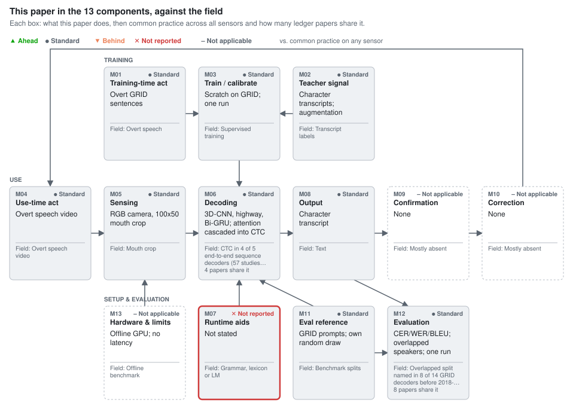

# LCANet: End-to-End Lipreading with Cascaded Attention-CTC

Xu, K., Li, D., Cassimatis, N., Wang, X. · IEEE FG · 2018 · [arXiv:1803.04988](https://arxiv.org/abs/1803.04988)

**Section:** [Other sensors](../../README.md#other-sensors)

## Figures

### This paper in the 13 components, against the field

<picture><source media="(prefers-color-scheme: dark)" srcset="figures/components-dark.svg"></picture>

Verdicts compare the paper's choice for each component with common practice across 8,995 ledger entries on any sensor (silent speech, brain-to-text, lip reading).

Data

| Component | This paper | Common practice | Papers with this practice | Verdict |
| --- | --- | --- | --- | --- |
| M01 Training-time act | Overt GRID sentences | Overt speech |  | ● Standard (Inherited.) |
| M02 Teacher signal | Character transcripts; augmentation | Transcript labels |  | ● Standard (Inherited from LipNet.) |
| M03 Train / calibrate | Scratch on GRID; one run | Supervised training |  | ● Standard (No seeds; selection split unstated.) |
| M04 Use-time act | Overt speech video | Overt speech video |  | ● Standard (Inherited.) |
| M05 Sensing | RGB camera, 100x50 mouth crop | Mouth crop |  | ● Standard (Inherited from LipNet.) |
| M06 Decoding | 3D-CNN, highway, Bi-GRU; attention cascaded into CTC | CTC in 4 of 5 end-to-end sequence decoders (57 studies before 2018-03) | 4 of 5 | ● Standard (New in lip reading; one corpus, one run; no in-house CTC-only baseline.) |
| M07 Runtime aids | Not stated | Grammar, lexicon or LM |  | ✕ Not reported (No LM condition given against an LM comparator.) |
| M08 Output | Character transcript | Text |  | ● Standard (Inherited.) |
| M09 Confirmation | None | Mostly absent |  | – Not applicable (Offline.) |
| M10 Correction | None | Mostly absent |  | – Not applicable (Offline.) |
| M11 Eval reference | GRID prompts; own random draw | Benchmark splits |  | ● Standard (No item list released.) |
| M12 Evaluation | CER/WER/BLEU; overlapped speakers; one run | Overlapped split named in 8 of 14 GRID decoders before 2018-03 (mentions) | 8 of 14 | ● Standard (No unseen-speaker result, no seeds.) |
| M13 Hardware & limits | Offline GPU; no latency | Offline benchmark |  | – Not applicable (Offline study.) |

## Verdict

LCANet [[1]](#ref-1) changes one component, the decoder (M06): an attention layer placed before a single CTC loss, plus highway layers in the encoder. The design is new in lip reading (Appendix: no cascade or hybrid among 57 sentence-level decoder studies before 2018-03, none wiki-wide before 2018-09), but it is standard, not ahead: one corpus, one run, no seeds (Sec. 4.C), and no in-house CTC-only or attention-only baseline (Table II). The gain over LipNet holds on GRID with overlapping speakers, 2.9% against 4.8% WER (Table III), and more clearly against LipNet without its language model, 5.6% [[2]](#ref-2). Against LRSW it does not: that system reports only a GRID WER, 3.0% [[3]](#ref-3), so "better CER" has no comparator and 2.9% against 3.0% from single runs is a tie (inference). The multi-task baseline ranked last (4.9%) is the design of the best later result under this protocol [[4]](#ref-4).

## Against the field, component by component

### M06 Decoding: attention cascaded into a single CTC loss

**Usual approach:** Of the 57 sentence-level lip-reading decoder studies first public before 2018-03, 56 mention HMMs; the 5 end-to-end sequence decoders among them train one loss, CTC in 4 (one [concurrent]) and attention in 1 [[3]](#ref-3) (pattern match, read, Appendix). None names a hybrid or cascade (Appendix). The authors' stated precedent, from audio ASR [[5]](#ref-5), trains a shared encoder on CTC and attention losses jointly; cascading avoids tuning the loss weight (Sec. 2.A). In ASR, attention inside CTC appeared that month [[6]](#ref-6) [concurrent].

**State of the art:** on the target's GRID protocol (255 test sentences per speaker, no external language model), 1.83% WER from a hybrid CTC/attention model with the joint loss LCANet ranked last (2024, [later]) [[4]](#ref-4), 37% below LCANet's 2.9% (inference).

The ablation does not test attention without CTC. A-CTC, called "the attention-only model" (Sec. 4.D), still trains on CTC alone (Table II). Attention lowers WER from 4.3% (H-CTC) to 2.9% (Table III), 33% relative (inference), one run each. The joint-loss AH-CTC-CE (4.9%), which follows [[5]](#ref-5) (Sec. 4.C), is worse than the CTC-only H-CTC (4.3%), although the joint training it builds on outperformed both CTC and attention, best at λ = 0.2 [[7]](#ref-7); the λ chosen and its selection data are not stated (Sec. 4.C). The [concurrent] [[8]](#ref-8) trains CTC and Transformer back ends separately; the [concurrent] [[9]](#ref-9) trains the joint loss. Verdict: standard; new, but one corpus and one run.

### M12 Evaluation: GRID with overlapping speakers, one run

**Usual approach:** Of 14 GRID decoder studies before 2018-03, 8 name an overlapped-speaker and 7 an unseen-speaker split, 6 name a variability or significance measure, and none names seeds or repeated runs (pattern match, mentions, Appendix). LCANet uses its comparators' random 255-per-speaker split (Sec. 4.A) [[2]](#ref-2), [[3]](#ref-3).

**State of the art:** under the same protocol, 1.83% overlapped and 10.21% unseen-speaker WER (2024, [later]) [[4]](#ref-4); the lowest GRID WER read is 0.99%, CFLip 1.01%, on a 24,750/8,250 split of unnamed speaker condition (2026, [later]) [[10]](#ref-10).

The like-for-like comparator is LipNet's overlapped row, 4.8% with a 5-gram model, 5.6% without [[2]](#ref-2); LCANet describes no language model (Fig. 2), so the gain over the LM-free row is 48% relative (inference). Sec. 4.A takes 255 test sentences from every speaker, so speakers overlap, and no unseen-speaker result is given, the setting where LipNet's WER is 11.4% against 4.8% [[2]](#ref-2). No seeds or intervals are given (Sec. 4.C), and the 255 sentences are a fresh draw. Verdict: standard.

## The 13 components

| Component | This paper | Usual approach (count) | State of the art | Verdict |
|---|---|---|---|---|
| M01 Training action | Overt GRID sentences | Overt speech | – | standard |
| M02 Supervision | Character transcripts; augmentation | Transcript labels | – | standard |
| M03 Training/adaptation | Scratch on GRID; one run | Supervised training | – | standard |
| M04 Use-time action | Overt speech video | Overt speech video | – | standard |
| M05 Sensors | RGB camera, 100x50 mouth crop | Mouth crop | – | standard |
| M06 Decoding | 3D-CNN, highway, Bi-GRU; attention cascaded into CTC | CTC: 4 of 5 end-to-end sequence decoders among 57 studies before 2018-03 (pattern match 4) | [[4]](#ref-4) 1.83% GRID WER, 255 per speaker, no LM, joint loss | standard |
| M07 Lexicon/LM | Not stated | Grammar, lexicon or LM | – | not reported |
| M08 Output | Character transcript | Text | – | standard |
| M09 Confirmation | None | Mostly absent | – | not applicable |
| M10 Correction | None | Mostly absent | – | not applicable |
| M11 Reference | GRID prompts; own random draw | Benchmark splits | – | standard |
| M12 Evaluation | CER/WER/BLEU; overlapped speakers; one run | Overlapped split named: 8 of 14 GRID decoders before 2018-03 (pattern match 8) | [[4]](#ref-4) 1.83% (255 per speaker); [[10]](#ref-10) 0.99% (24,750/8,250 split) | standard |
| M13 Device/cost | Offline GPU; no latency | Offline benchmark | – | not applicable |

## Where the claims outrun the evidence

- "Our method still achieves better CER and WER" than LRSW (Sec. 4.D), which the authors note is pretrained on LRS; its source gives only a GRID WER, 3.0% after one epoch of fine-tuning [[3]](#ref-3), so the CER claim has no comparator and the WER claim rests on 2.9% against 3.0%, one run each.
- Table III gives 2.9% WER, the abstract 3.0%; the stated 37.5% gain over LipNet and 1.1-point highway gain (Sec. 4.D) both follow from 3.0, so 2.9 is the outlier (inference). The 12.3% gain over "the state-of-the-art methods" names no metric or comparator (Abstract).
- The LipNet row (Table III) carries LipNet's published LM-decoded figures plus a BLEU of 96.0 that the LipNet paper does not report, while Fig. 6 shows LipNet curves from the authors' own training (inference); no plain CTC model shares LCANet's pipeline.
- The explanation for the weak multi-task variant, "only the shared encoder is jointly updated" (Sec. 4.D), is untested.
- The speed-up is attributed to the cascade (Sec. 4.E), but Fig. 6 compares against LipNet, not LCANet's variants, and its caption says iterations where the text says epochs; joint CTC-attention training already converged early [[7]](#ref-7).
- Cross-viseme confusion is called "not statistically significant" without a test (Sec. 4.F). The authors concede the CTC loss itself is not modified (Sec. 5).

## What the field needs next

- M06: cascade, joint loss and CTC-only on one encoder, λ swept on validation data including 0 and 1, three or more seeds, on GRID and an open corpus.
- M12: unseen-speaker GRID results, a released test list and seed spread, so gaps such as 2.9% against 3.0% can be read.

## Questions for the authors

- Which split selected λ and the early-stopping checkpoint?
- Was any language model, lexicon or grammar used in decoding?
- Was the LipNet row retrained in-house, and where does its BLEU come from? What gives the 12.3%?
- What is the WER spread over seeds, and what is the unseen-speaker WER?

## Appendix: literature search

- Setting, the same for both topics: sentence-level lip reading, visual or audio-visual (the 633-study population of the published M06 table), and its GRID subset (the 93-study population of the published M12 table), dated at the target's arXiv v1, 2018-03; [concurrent] 2017-09 to 2018-09. Counts are full-text pattern matches, mentions included, unless marked read.
- M06, sentence-lipreading-sequence-objective (published table, appended). Inclusion rule: the published rule (sentence-level or open-vocabulary speech from lip or face video, classified by the sequence objective the full text names). Ledger counts: 7,345 unique studies slot-filled for M06; 633 unique studies pattern match. Before 2018-03: 89 unique studies, minus 29 perception or neuroscience studies, 1 review, 1 enhancement study and 1 version duplicate, gives 57 decoder studies. Mentions among the 57: HMM 56, CTC 6, attention or sequence-to-sequence 2, hybrid or joint CTC/attention 0, highway network 0. Designs after reading the snippets: CTC 4 (arxiv-1611.01599, arxiv-1611.02879, arxiv-1611.06986, arxiv-1802.05521 [concurrent]), attention 1 ([[3]](#ref-3)); one CTC hit is a reference-list mention in a DNN-HMM system. Recall check over 2,615 wiki studies with text first public before 2018-09: 6 hits, the target, the [concurrent] [[8]](#ref-8) (separate CTC and Transformer back ends), and 4 mentions or citations; 0 other cascade designs. In 2018-09 itself the wiki holds [[9]](#ref-9) (joint loss, [concurrent] by month) and a study with separate CTC and seq2seq models (arxiv-1809.02108). Read: [[2]](#ref-2), [[3]](#ref-3) (prior); [[7]](#ref-7), [[5]](#ref-5) (prior, audio ASR, outside the wiki); [[6]](#ref-6) ([concurrent], audio ASR, outside the wiki); [[8]](#ref-8), [[9]](#ref-9) ([concurrent]); [[4]](#ref-4) (state of the art). Known-item recall 1.0 (published table).
- M12, grid-sentence-lipreading-protocol (published table, appended). Inclusion rule: the published rule (GRID lip-reading or VSR decoders classified by the evaluation partition the full text names, with a variability or significance regex), plus a seeds or repeated-runs regex. Ledger counts: 6,960 unique studies slot-filled for M12; 93 unique studies pattern match. Before 2018-03: 24 unique keys, minus 2 LRW-only, 2 enhancement and 1 statistics study and 5 version duplicates, gives 14 decoder studies, all prior. Mentions among the 14: overlapped-speaker split 8, unseen-speaker split 7, variability or significance 6, seeds or repeated runs 0. Later studies stating the same 255-per-speaker protocol: 4, including [[4]](#ref-4). Read: [[2]](#ref-2), [[3]](#ref-3) (prior); [[4]](#ref-4), [[10]](#ref-10) (state of the art). Known-item recall 1.0 (published table).

## References

Numbered by first citation. BibTeX in the same order and keys: [refs.bib](refs.bib).

1. Xu, K., Li, D., Cassimatis, N., Wang, X. “LCANet: End-to-End Lipreading with Cascaded Attention-CTC.” *IEEE International Conference on Automatic Face and Gesture Recognition (FG)*, 2018, 548-555. arXiv:[1803.04988](https://arxiv.org/abs/1803.04988). First public as arXiv:1803.04988v1 (13 Mar 2018). [wiki: arxiv-1803.04988](https://github.com/supernaiter/deep-research-wiki-for-silent-speech/blob/main/papers/arxiv-1803.04988/article.md)
2. Assael, Y. M., Shillingford, B., Whiteson, S., de Freitas, N. “LipNet: End-to-End Sentence-level Lipreading.” *arXiv preprint*, 2016. arXiv:[1611.01599](https://arxiv.org/abs/1611.01599). [review](https://github.com/supernaiter/silent-speech-review/tree/main/reviews/lipnet-end-to-end-sentence-level-lipreading) [wiki: arxiv-1611.01599](https://github.com/supernaiter/deep-research-wiki-for-silent-speech/blob/main/papers/arxiv-1611.01599/article.md)
3. Chung, J. S., Senior, A., Vinyals, O., Zisserman, A. “Lip Reading Sentences in the Wild.” *IEEE Conference on Computer Vision and Pattern Recognition (CVPR)*, 2017. doi:[10.1109/CVPR.2017.367](https://doi.org/10.1109/CVPR.2017.367). arXiv:[1611.05358](https://arxiv.org/abs/1611.05358). The LRSW comparator of the target's Table III. [review](https://github.com/supernaiter/silent-speech-review/tree/main/reviews/lip-reading-sentences-in-the-wild) [wiki: arxiv-1611.05358](https://github.com/supernaiter/deep-research-wiki-for-silent-speech/blob/main/papers/arxiv-1611.05358/article.md) [wiki: cvf-chung17-lipreadwild](https://github.com/supernaiter/deep-research-wiki-for-silent-speech/blob/main/papers/cvf-chung17-lipreadwild/article.md)
4. Wu, L., Zhang, X., Zhang, Y., Zheng, C., Liu, T., Xie, L., et al. “Landmark-Guided Cross-Speaker Lip Reading with Mutual Information Regularization.” *arXiv preprint*, 2024. arXiv:[2403.16071](https://arxiv.org/abs/2403.16071). GRID overlapped-speaker WER under the target's 255-per-speaker protocol, hybrid CTC/attention, no external LM. [later] [wiki: arxiv-2403.16071](https://github.com/supernaiter/deep-research-wiki-for-silent-speech/blob/main/papers/arxiv-2403.16071/article.md)
5. Hori, T., Watanabe, S., Hershey, J. R. “Joint CTC/attention decoding for end-to-end speech recognition.” *Annual Meeting of the Association for Computational Linguistics (ACL)*, 2017. doi:[10.18653/v1/P17-1048](https://doi.org/10.18653/v1/P17-1048). Audio ASR; the target's reference [43] and the source of its multi-task comparator.
6. Das, A., Li, J., Zhao, R., Gong, Y. “Advancing Connectionist Temporal Classification With Attention Modeling.” *IEEE International Conference on Acoustics, Speech and Signal Processing (ICASSP)*, 2018. arXiv:[1803.05563](https://arxiv.org/abs/1803.05563). Audio ASR; attention inside CTC. [concurrent]
7. Kim, S., Hori, T., Watanabe, S. “Joint CTC-Attention Based End-to-End Speech Recognition Using Multi-Task Learning.” *IEEE International Conference on Acoustics, Speech and Signal Processing (ICASSP)*, 2017. arXiv:[1609.06773](https://arxiv.org/abs/1609.06773). Audio ASR; joint CTC-attention multi-task training, not cited by the target.
8. Afouras, T., Chung, J. S., Zisserman, A. “Deep Lip Reading: a comparison of models and an online application.” *Proc. Interspeech 2018*, 2018. arXiv:[1806.06053](https://arxiv.org/abs/1806.06053). [concurrent] [wiki: arxiv-1806.06053](https://github.com/supernaiter/deep-research-wiki-for-silent-speech/blob/main/papers/arxiv-1806.06053/article.md) [wiki: isca-afouras18b-deeplip](https://github.com/supernaiter/deep-research-wiki-for-silent-speech/blob/main/papers/isca-afouras18b-deeplip/article.md) [wiki: isca-afouras18b_deeplipread](https://github.com/supernaiter/deep-research-wiki-for-silent-speech/blob/main/papers/isca-afouras18b_deeplipread/article.md) [wiki: isca-afouras18b_interspeech](https://github.com/supernaiter/deep-research-wiki-for-silent-speech/blob/main/papers/isca-afouras18b_interspeech/article.md)
9. Petridis, S., Stafylakis, T., Ma, P., Tzimiropoulos, G., Pantic, M. “Audio-Visual Speech Recognition with a Hybrid CTC/Attention Architecture.” *IEEE Spoken Language Technology Workshop (SLT)*, 2018. doi:[10.1109/SLT.2018.8639643](https://doi.org/10.1109/SLT.2018.8639643). arXiv:[1810.00108](https://arxiv.org/abs/1810.00108). First public as arXiv:1810.00108v1 (dated 28 Sep 2018). [concurrent] [review](https://github.com/supernaiter/silent-speech-review/tree/main/reviews/audio-visual-speech-recognition-with-a-hybrid-ctc-attention-architecture) [wiki: arxiv-1810.00108](https://github.com/supernaiter/deep-research-wiki-for-silent-speech/blob/main/papers/arxiv-1810.00108/article.md) [wiki: doi-10.1109-slt.2018.8639643](https://github.com/supernaiter/deep-research-wiki-for-silent-speech/blob/main/papers/doi-10.1109-slt.2018.8639643/article.md)
10. Xue, F., Zhu, B., Jia, W., Li, S., Li, Y., Zhang, J., et al. “LinProVSR: Linguistics-Knowledge Guided Progressive Disambiguation Network for Visual Speech Recognition.” *AAAI*, 2026. doi:[10.1609/aaai.v40i14.38133](https://doi.org/10.1609/aaai.v40i14.38133). [later] [wiki: aaai-38133-linprovsr](https://github.com/supernaiter/deep-research-wiki-for-silent-speech/blob/main/papers/aaai-38133-linprovsr/article.md)

## Materials

Data behind this review. Full texts of the papers are not included.

- [`review.md`](review.md): the review text (source)
- [`refs.bib`](refs.bib): references (BibTeX)
- [`slots.json`](slots.json): for each of the 13 components: this paper's choice, field practice, number of matching papers, verdict
- [`figures.json`](figures.json): figure definitions
- [`evaluation.md`](evaluation.md): independent evaluation by a second reviewer
- [`triage.md`](triage.md): how each evaluation finding was checked against the sources and resolved
- [`process/log.json`](process/log.json): process record: each step, who did it (reader, script, writer, evaluator), when, the checks run and the input versions
- [`process/notes.json`](process/notes.json): reading notes on the target and comparator papers: claims, numbers, conditions and what is not stated, with locations
- [`process/plan.json`](process/plan.json): plan: which components the paper changes and the topics it is compared on
- [`process/draft.md`](process/draft.md): the review as first written, before the independent evaluation
- [`process/claims-draft.md`](process/claims-draft.md): claim table of the draft: every claim mapped to a note or a count
- [`process/claims.md`](process/claims.md): claim table of the published review
- [`components/M06/sentence-lipreading-sequence-objective.csv`](../../components/M06/sentence-lipreading-sequence-objective.csv): M06 topic "sentence-lipreading-sequence-objective", every candidate paper with its decision (7345 slot-filled, 633 pattern match, usual design in 291, 6 read in full)
- [`components/M12/grid-sentence-lipreading-protocol.csv`](../../components/M12/grid-sentence-lipreading-protocol.csv): M12 topic "grid-sentence-lipreading-protocol", every candidate paper with its decision (6960 slot-filled, 93 pattern match, usual design in 54, 5 read in full)

## More reviews in Other sensors

- [Audio-Visual Speech Recognition with a Hybrid CTC/Attention Architecture](../audio-visual-speech-recognition-with-a-hybrid-ctc-attention-architecture/) (2018). No earlier sentence-level AVSR study in the ledger trains hybrid CTC/attention (0 of 32), but no CTC- or attention-only result, LRW under the no-external-data claim, one run: standard.
- [Decoding spoken phonemes from sensorimotor cortex with High-Density ECoG grids](../decoding-spoken-phonemes-from-sensorimotor-cortex-with-high-density-ecog-grids/) (2018). Spatiotemporal templates on HD-ECoG (M06, M05) reuse the group's gesture decoder; the density claim is untested: standard. Voice-onset and rest anchoring confound the temporal gain.
- [End-to-End Audiovisual Speech Recognition](../end-to-end-audiovisual-speech-recognition/) (2018). Raw-waveform front end and BGRU fusion (M06) depart from the usual approach but are standard: they tie MFCC in clean LRW audio (97.7%); noise gains lack repeated runs and use matched babble.
- [Inferring imagined speech using EEG signals: a new approach using Riemannian manifold features](../inferring-imagined-speech-using-eeg-signals-a-new-approach-using-riemannian-manifold-features/) (2018). Covariance tangent-space + RVM (M06) is new to imagined-speech EEG but beats only at-chance baselines; evaluation is behind: no test against chance, which 3 of 7 priors ran.
- [Large-Scale Visual Speech Recognition](../large-scale-visual-speech-recognition/) (2018). Its YouTube mining scaled on in later work, but Table 1 holds data fixed; the phoneme+WFST decoder had 2016-17 priors; zero-shot LRS3 changes everything at once: standard.
- [Generating Natural, Intelligible Speech From Brain Activity in Motor, Premotor, and Inferior Frontal Cortices](../generating-natural-intelligible-speech-from-brain-activity-in-motor-premotor-and-inferior-frontal-co/) (2019). Unit selection (M06) and own-voice concatenation (M08) are standard: an EMG design new to ECoG, never compared on its folds; 4-choice test (M12) on 30 best words; naturalness unmeasured.

---

Part of the [Silent Speech Interface Review](https://github.com/supernaiter/silent-speech-review). Found an error? [Open an issue](https://github.com/supernaiter/silent-speech-review/issues/new?template=correction.yml).
