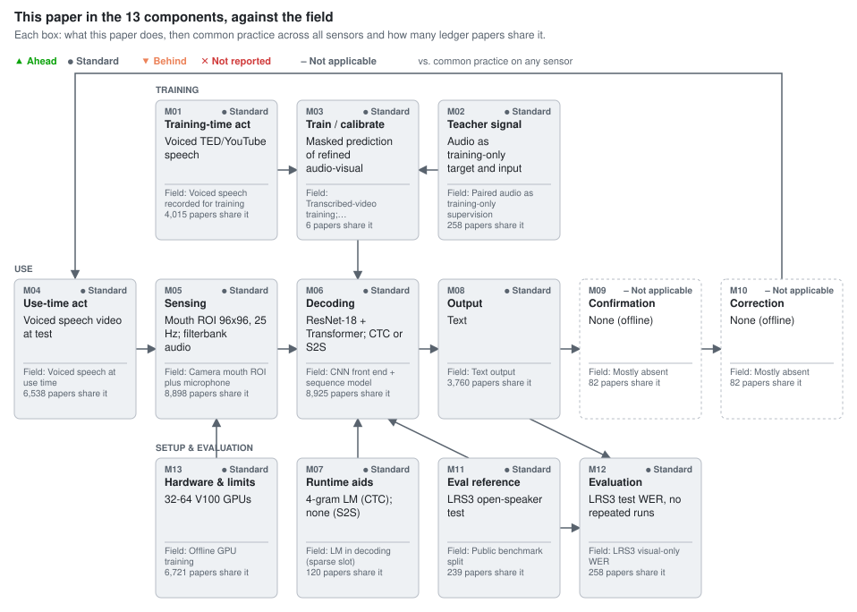

# Learning Audio-Visual Speech Representation by Masked Multimodal Cluster Prediction

Bowen Shi, Wei-Ning Hsu, Kushal Lakhotia, Abdelrahman Mohamed. ICLR 2022. [arXiv:2201.02184](https://arxiv.org/abs/2201.02184)

**Section:** [Lip & face video](../../README.md#lip--face-video)

## Figures

### This paper in the 13 components, against the field

<picture><source media="(prefers-color-scheme: dark)" srcset="figures/components-dark.svg"></picture>

Verdicts compare the paper's choice for each component with common practice across 8,995 ledger entries on any sensor (silent speech, brain-to-text, lip reading).

Data

| Component | This paper | Common practice | Papers with this practice | Verdict |
| --- | --- | --- | --- | --- |
| M01 Training-time act | Voiced TED/YouTube speech | Voiced speech recorded for training | 4,015 of 8,995 | ● Standard (Inherited from the LRS3 / VoxCeleb2 pipeline.) |
| M02 Teacher signal | Audio as training-only target and input Video-only test | Paired audio as training-only supervision | 258 of 8,995 | ● Standard (Audio-as-teacher is common) |
| M03 Train / calibrate | Masked prediction of refined audio-visual clusters | Transcribed-video training; self-supervised in 6 of 141 LRS3 papers | 6 of 8,995 | ● Standard (Large single-dataset gain over scratch and over the read priors, but one test set and no repeated runs) |
| M04 Use-time act | Voiced speech video at test | Voiced speech at use time | 6,538 of 8,995 | ● Standard (Inherited) |
| M05 Sensing | Mouth ROI 96x96, 25 Hz; filterbank audio | Camera mouth ROI plus microphone | 8,898 of 8,995 | ● Standard (Inherited LRS3 preprocessing.) |
| M06 Decoding | ResNet-18 + Transformer; CTC or S2S | CNN front end + sequence model | 8,925 of 8,995 | ● Standard (Inherited front end) |
| M07 Runtime aids | 4-gram LM (CTC); none (S2S) | LM in decoding (sparse slot) | 120 of 8,995 | ● Standard (Decoder trained on LRS3 transcripts still learns in-domain text.) |
| M08 Output | Text | Text output | 3,760 of 8,995 | ● Standard (Inherited.) |
| M09 Confirmation | None (offline) | Mostly absent | 82 of 8,995 | – Not applicable (Offline benchmark.) |
| M10 Correction | None (offline) | Mostly absent | 82 of 8,995 | – Not applicable (Offline benchmark.) |
| M11 Eval reference | LRS3 open-speaker test | Public benchmark split | 239 of 8,995 | ● Standard (Inherited LRS3 split) |
| M12 Evaluation | LRS3 test WER, no repeated runs | LRS3 visual-only WER | 258 of 8,995 | ● Standard (Usual metric, but the headline SOTA claim compares across label regimes and Sec. C.2 cites an open-speaker value absent from Table 1.) |
| M13 Hardware & limits | 32-64 V100 GPUs | Offline GPU training | 6,721 of 8,995 | ● Standard (Inference cost not reported) |

## Verdict

The paper [[1]](#ref-1) changes two components: the pre-training objective (M03), masked prediction of audio-visual cluster labels refined iteratively, and audio as training-only supervision (M02), with video alone at test. The M03 gain over the paper's own scratch baseline is large (92.3% to 32.5% WER at 30 h of labels, 62.3% to 28.6% at 433 h), but that baseline is weak: a supervised conformer in Table 1 reaches 43.3% at 433 h, so the 33.7-point gain overstates the gain over a tuned system, and the margin over distillation [[2]](#ref-2) mixes data, model and decoder (inference). Both components remain standard: one test set, no repeated runs (Table 1). Later work beats the design at matched budgets: 23.7% against 32.5% at 30 h, and 21.5% against 26.9% at 433 h even after this paper's self-training [[3]](#ref-3) [later]. The 1/1000-of-the-labels headline rests on a 1.1-point gap (32.5% against 33.6% [[4]](#ref-4), no variance); the firmer result is the self-trained 26.9% at 433 h, 6.7 points lower (inference).

## Against the field, component by component

### M03 Training: self-supervised pre-training objective

**Usual approach:** Among the 141 LRS3 papers with M03 recorded, the supervision kind is tagged text_prompt in 18, paired_audio in 17 and self_supervised in 6 (slot-filled, Appendix); in the 75 studies of the pre-training topic with the field recorded, self_supervised leads with 31 (slot-filled, Appendix). The prior unlabelled-video route was distillation from an audio recogniser [[2]](#ref-2); audio-feature regression [[5]](#ref-5) is [concurrent]. This paper makes the targets audio-visual and refines them from its own encoder.

**State of the art:** In 2026, with the same model size and unlabelled data, a pseudo-labelling model reaches 23.7% against 32.5% here at 30 h, 27% relative lower (inference), and 21.5% against 28.6% at 433 h [[3]](#ref-3) [later]. Against the fairer comparator, this paper's self-trained 26.9%, the gap is still 5.4 points, 20% relative (inference).

Distillation reached 59.8% [[2]](#ref-2) from 334 h of ASR-transcribed VoxCeleb2 with a CNN-CTC model and 157 h of word-level plus 433 h of sentence-level labels (Table 1), against 1,759 h, 30 h and a Transformer-LARGE S2S here. Audio-feature regression gained only 39.1% to 38.8% on LRS2 [[5]](#ref-5), another dataset. Standard: one test set, no repeated runs (Table 1), and the NMI gain over audio-only clusters (44.2% against 39.7%, Table E.1) is a proxy, not a recognition result.

### M02 Training-only supervision: audio as target, video at test

**Usual approach:** Audio used only in training is common: paired_audio is the supervision kind in 258 of 941 wiki entries with that M03 field (slot-filled, versions counted separately; M02 is sparse), as features [[5]](#ref-5) or ASR transcripts [[2]](#ref-2). Here audio is masked input and part of the cluster targets.

**State of the art:** Later work (2026) keeps audio in training via an audio-visual teacher and is lower in all five groups of its Table 2: 36.2/51.8, 26.4/46.1 and 23.7/32.5 at 30 h; 24.8/34.8 and 21.5/28.6 at 433 h [[3]](#ref-3) [later].

The audio-only result (1.3% against 2.3% ASR WER) sets a model without a language model against one with it (Table 4). Standard.

### M12 Evaluation: LRS3 visual-only WER

**Usual approach:** Unseen-speaker LRS3 test WER is the field benchmark for sentence lip reading [[6]](#ref-6); 258 unique studies mention LRS3 (pattern match, Appendix). The paper follows it.

**State of the art:** 17.6% in 2026 (semi-supervised; 656 h labelled, 2,649 h unlabelled) [[3]](#ref-3) [later]; the supervised LP Conformer it lists reaches 12.8% with 100,000 h transcribed [[3]](#ref-3). In 2019: 33.6% from 31,000 h [[4]](#ref-4).

The 1.1-point margin over 33.6% is 3.3% relative, with no repeated runs (inference). Standard.

## The 13 components

| Component | This paper | Usual approach (count) | State of the art | Verdict |
|---|---|---|---|---|
| M01 Training-time action | Voiced TED/YouTube speech | Voiced speech recorded for training (slot-filled 4,015) | – | standard |
| M02 Training-only supervision | Audio as training-only target and input; Video-only test | Paired audio as training-only supervision (slot-filled 258) | [[3]](#ref-3) unified pseudo-labels | standard |
| M03 Training and adaptation | Masked prediction of refined audio-visual clusters | LRS3 papers (141): text_prompt most frequent; self-supervised 6 (slot-filled 18) | [[3]](#ref-3) 23.7% at 30 h | standard |
| M04 Use-time action | Voiced speech video at test | Voiced speech at use time (slot-filled 6,538) | – | standard |
| M05 Sensors | Mouth ROI 96x96, 25 Hz; filterbank audio | Camera mouth ROI plus microphone (slot-filled 8,898) | – | standard |
| M06 Processing and decoding | ResNet-18 + Transformer; CTC or S2S | CNN front end + sequence model (slot-filled 8,925) | – | standard |
| M07 Lexicon and LM | 4-gram LM (CTC); none (S2S) | LM in decoding (sparse slot) (slot-filled 120) | – | standard |
| M08 Output | Text | Text output (slot-filled 3,760) | – | standard |
| M09 Confirmation | None (offline) | Mostly absent (slot-filled 82) | – | not applicable |
| M10 Correction | None (offline) | Mostly absent (slot-filled 82) | – | not applicable |
| M11 Reference construction | LRS3 open-speaker test | Public benchmark split (slot-filled 239) | – | standard |
| M12 Evaluation | LRS3 test WER, no repeated runs | LRS3 visual-only WER (pattern match 258) | [[3]](#ref-3) 17.6%; 12.8% supervised | standard |
| M13 Device and cost | 32-64 V100 GPUs | Offline GPU training (slot-filled 6,721) | – | standard |

## Where the claims outrun the evidence

- "1/1000 of the labeled data" counts only transcribed hours; the 30 h model also uses 1,759 h of unlabelled audio-visual data (Sec. 4.2, Table 1).
- Sec. C.2 contrasts 18.0% for seen speakers with 30.5% for unseen speakers, but no Table 1 row gives 30.5%, and the seen-speaker groups come from trainval, which is also in the 433 h LRS3 pre-training pool (Sec. 4.2).
- As the authors state (Table 1 note), the 17.5-point advantage over LiRA (Sec. 4.2) is against their re-implementation of its objective, not the published system [[5]](#ref-5).
- Self-training alone exceeds 50% WER (Appendix C.3), yet its rounds, filtering and pseudo-label quality are not given.

## What the field needs next

- M03: matched-budget comparisons (30 h and 433 h labels, fixed unlabelled data) over at least three seeds and a second test set such as LRS2.
- M04: test whether audio-visual pre-training transfers to silent articulation, where lip motion differs from voiced speech.
- M11: report overlap between pre-training videos and LRS3 test talks, and a seen-speaker split excluded from pre-training.

## Questions for the authors

- Which labelled budget produced the 30.5% unseen-speaker WER in Sec. C.2?
- Were the Sec. C.2 seen-speaker groups excluded from fine-tuning and pre-training?
- How many runs underlie each Table 1 entry, and what is the spread? Only Sec. C.2 gives one (18.0 ± 0.5%).
- Which text normalisation and scoring tool produced the WERs, and do they match those of the comparators?

## Appendix: literature search

- M03, self-supervised-pretraining. Inclusion rule: self-supervised or teacher-generated pre-training on unlabelled non-audio-only input before supervised fine-tuning for speech or text decoding; audio-only self-supervised ASR and checkpoint reuse excluded. Ledger counts: 1,526 unique studies slot-filled for M03; 123 unique studies pattern match. Usual design in the population: supervision_kind=self_supervised, 31 studies (slot-filled, of 75 with M03 recorded). Read in full: [[2]](#ref-2) (prior), [[5]](#ref-5) ([concurrent]), [[3]](#ref-3) (state of the art). Known-item recall 1.0.
- M12, lrs3-visual-only-wer. Inclusion rule: visual-only WER on the LRS3 test set, any training regime; audio-only and audio-visual rows excluded. Ledger counts: 6,960 unique studies slot-filled for M12; 258 unique studies pattern match. Training design among the 141 with M03 recorded: text_prompt 18, paired_audio 17, self_supervised 6 (slot-filled). Read in full: [[3]](#ref-3) (state of the art). Known-item recall 1.0.

## References

Numbered by first citation. BibTeX in the same order and keys: [refs.bib](refs.bib).

1. Shi, B., Hsu, W., Lakhotia, K., Mohamed, A. “Learning Audio-Visual Speech Representation by Masked Multimodal Cluster Prediction.” *International Conference on Learning Representations (ICLR)*, 2022. arXiv:[2201.02184](https://arxiv.org/abs/2201.02184). [review](https://github.com/supernaiter/silent-speech-review/tree/main/reviews/learning-audio-visual-speech-representation-by-masked-multimodal-cluster-prediction) [wiki: arxiv-2201.02184](https://github.com/supernaiter/deep-research-wiki-for-silent-speech/blob/main/papers/arxiv-2201.02184/article.md)
2. Afouras, T., Chung, J. S., Zisserman, A. “ASR is all you need: cross-modal distillation for lip reading.” *IEEE International Conference on Acoustics, Speech and Signal Processing (ICASSP)*, 2020. arXiv:[1911.12747](https://arxiv.org/abs/1911.12747). [wiki: arxiv-1911.12747](https://github.com/supernaiter/deep-research-wiki-for-silent-speech/blob/main/papers/arxiv-1911.12747/article.md)
3. Haliassos, A., Mira, R., Petridis, S. “Pay Attention to CTC: Fast and Robust Pseudo-Labelling for Unified Speech Recognition.” *International Conference on Learning Representations (ICLR)*, 2026. arXiv:[2602.19316](https://arxiv.org/abs/2602.19316). [later] [wiki: arxiv-2602.19316](https://github.com/supernaiter/deep-research-wiki-for-silent-speech/blob/main/papers/arxiv-2602.19316/article.md)
4. Makino, T., Liao, H., Assael, Y., Shillingford, B., Garcia, B., Braga, O., et al. “Recurrent Neural Network Transducer for Audio-Visual Speech Recognition.” *IEEE Automatic Speech Recognition and Understanding Workshop (ASRU)*, 2019. doi:[10.1109/ASRU46091.2019.9004036](https://doi.org/10.1109/ASRU46091.2019.9004036). arXiv:[1911.04890](https://arxiv.org/abs/1911.04890). [wiki: doi-10.1109-asru46091.2019.9004036](https://github.com/supernaiter/deep-research-wiki-for-silent-speech/blob/main/papers/doi-10.1109-asru46091.2019.9004036/article.md)
5. Ma, P., Mira, R., Petridis, S., Schuller, B. W., Pantic, M. “LiRA: Learning Visual Speech Representations from Audio through Self-supervision.” *Interspeech*, 2021. doi:[10.21437/Interspeech.2021-1360](https://doi.org/10.21437/Interspeech.2021-1360). [concurrent] [wiki: isca-ma21c-lira](https://github.com/supernaiter/deep-research-wiki-for-silent-speech/blob/main/papers/isca-ma21c-lira/article.md)
6. Afouras, T., Chung, J. S., Zisserman, A. “LRS3-TED: a large-scale dataset for visual speech recognition.” *arXiv*, 2018. arXiv:[1809.00496](https://arxiv.org/abs/1809.00496). [wiki: arxiv-1809.00496](https://github.com/supernaiter/deep-research-wiki-for-silent-speech/blob/main/papers/arxiv-1809.00496/article.md)

## Materials

Data behind this review. Full texts of the papers are not included.

- [`review.md`](review.md): the review text (source)
- [`refs.bib`](refs.bib): references (BibTeX)
- [`slots.json`](slots.json): for each of the 13 components: this paper's choice, field practice, number of matching papers, verdict
- [`figures.json`](figures.json): figure definitions
- [`evaluation.md`](evaluation.md): independent evaluation by a second reviewer
- [`triage.md`](triage.md): how each evaluation finding was checked against the sources and resolved
- [`components/M03/self-supervised-pretraining.csv`](../../components/M03/self-supervised-pretraining.csv): M03 topic "self-supervised-pretraining", every candidate paper with its decision (1526 slot-filled, 123 pattern match, usual design in 31, 3 read in full)
- [`components/M12/lrs3-visual-only-wer.csv`](../../components/M12/lrs3-visual-only-wer.csv): M12 topic "lrs3-visual-only-wer", every candidate paper with its decision (6960 slot-filled, 258 pattern match, usual design in 18, 1 read in full)

## More reviews in Lip & face video

- [FastLTS: Non-Autoregressive End-to-End Unconstrained Lip-to-Speech Synthesis](../fastlts-non-autoregressive-end-to-end-unconstrained-lip-to-speech-synthesis/) (2022). FastLTS is a non-autoregressive end-to-end lip-to-speech system that makes unconstrained synthesis substantially faster without obvious quality loss, evaluated on Lip2Wav and GRID.
- [Lip-to-Speech Synthesis for Arbitrary Speakers in the Wild](../lip-to-speech-synthesis-for-arbitrary-speakers-in-the-wild/) (2022). VAE-GAN lip-to-speech with a reference-audio voice: a standard design whose gains are in distribution and sync metrics; no WER is reported, behind its own lineage on evaluation.
- [Sub-word Level Lip Reading With Visual Attention](../sub-word-level-lip-reading-with-visual-attention/) (2022). Attention pooling of the lip map (M06) was ahead in 2021 but not the route to later SOTA; WordPiece output (M08) was preceded by BPE in 2020; the SOTA table mixes data budgets.
- [SVTS: Scalable Video-to-Speech Synthesis](../svts-scalable-video-to-speech-synthesis/) (2022). SVTS shows a simple spectrogram predictor with a pretrained vocoder outperforms prior complex video-to-speech models and scales to large datasets such as LRS3+VoxCeleb2.
- [VCVTS: Multi-speaker Video-to-Speech synthesis via cross-modal knowledge transfer from voice conversion](../vcvts-multi-speaker-video-to-speech-synthesis-via-cross-modal-knowledge-transfer-from-voice-conversion/) (2022). VCVTS performs multi-speaker video-to-speech synthesis by transferring knowledge from voice conversion, with speaker control from reference speech, on GRID and LRW.
- [VisageSynTalk: Unseen Speaker Video-to-Speech Synthesis via Speech-Visage Feature Selection](../visagesyntalk-unseen-speaker-video-to-speech-synthesis-via-speech-visage-feature-selection/) (2022). VisageSynTalk disentangles speech content and visage (identity) features for video-to-speech synthesis, yielding robust results for unseen speakers on benchmarks.

---

Part of the [Silent Speech Interface Review](https://github.com/supernaiter/silent-speech-review). Found an error? [Open an issue](https://github.com/supernaiter/silent-speech-review/issues/new?template=correction.yml).
