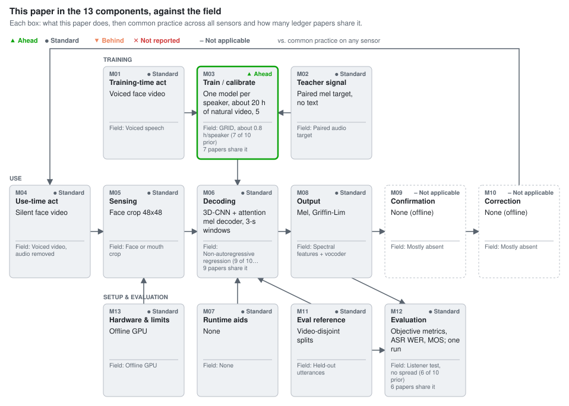

# Learning Individual Speaking Styles for Accurate Lip to Speech Synthesis

K R Prajwal, Rudrabha Mukhopadhyay, Vinay P. Namboodiri, C V Jawahar. CVPR 2020. [doi:10.1109/CVPR42600.2020.01381](https://doi.org/10.1109/CVPR42600.2020.01381) · [arXiv:2005.08209](https://arxiv.org/abs/2005.08209)

**Section:** [Other sensors](../../README.md#other-sensors)

## Figures

### This paper in the 13 components, against the field

<picture><source media="(prefers-color-scheme: dark)" srcset="figures/components-dark.svg"></picture>

Verdicts compare the paper's choice for each component with common practice across 8,995 ledger entries on any sensor (silent speech, brain-to-text, lip reading).

Data

| Component | This paper | Common practice | Papers with this practice | Verdict |
| --- | --- | --- | --- | --- |
| M01 Training-time act | Voiced face video | Voiced speech |  | ● Standard (Inherited from public audio-visual corpora.) |
| M02 Teacher signal | Paired mel target, no text | Paired audio target |  | ● Standard (As in every prior synthesizer listed in the Appendix.) |
| M03 Train / calibrate | One model per speaker, about 20 h of natural video, 5 speakers | GRID, about 0.8 h/speaker (7 of 10 prior) | 7 of 10 | ▲ Ahead (0 of 10 priors over about 1 h per speaker or unconstrained; 5 speakers; hours not ablated.) |
| M04 Use-time act | Silent face video | Voiced video, audio removed |  | ● Standard (Offline synthesis over 3-s windows with small overlap.) |
| M05 Sensing | Face crop 48x48 | Face or mouth crop |  | ● Standard (Full-face input as in Vid2Speech and Ephrat et al.) |
| M06 Decoding | 3D-CNN + attention mel decoder, 3-s windows | Non-autoregressive regression (9 of 10 prior) | 9 of 10 | ● Standard (LipSound (2019) already used an attention mel decoder on whole 3-s clips; ablations one speaker, one run.) |
| M07 Runtime aids | None | None |  | ● Standard (No lexicon or language model at use time.) |
| M08 Output | Mel, Griffin-Lim | Spectral features + vocoder |  | ● Standard (Authors report neural vocoders performed poorly on their mels (Sec. 5.3).) |
| M09 Confirmation | None (offline) | Mostly absent |  | – Not applicable (Offline study.) |
| M10 Correction | None (offline) | Mostly absent |  | – Not applicable (Offline study.) |
| M11 Eval reference | Video-disjoint splits | Held-out utterances |  | ● Standard (No WER on Lip2Wav; later work uses Whisper transcripts.) |
| M12 Evaluation | Objective metrics, ASR WER, MOS; one run | Listener test, no spread (6 of 10 prior) | 6 of 10 | ● Standard (Two Table 2 WERs match a GRID-trained ASR's values; multi-speaker priors denied.) |
| M13 Hardware & limits | Offline GPU | Offline GPU |  | ● Standard (No latency or deployment figures.) |

## Verdict

Lip2Wav [[1]](#ref-1) changes the training corpus (M03) and the decoder (M06). The corpus is ahead: 0 of 10 prior synthesizers trained on unconstrained speech or over about 1 h per speaker (Appendix); its speakers, above all Chemistry Lectures, became a single-speaker benchmark. The decoder is standard: LipSound [[2]](#ref-2) had an attention mel decoder on whole 3-s clips, and the paper cites it only as lip-to-text work (§2.2). The evaluation (M12) is standard; two GRID WERs in Table 2 match, to one decimal, values from another recognizer [[3]](#ref-3). Baselines share the splits, so gains confound decoder, encoder and context, not data; each ablation is one speaker, one run.

## Against the field, component by component

### M03 Training data: per-speaker hours of natural speech

**Usual approach:** 7 of the 10 prior synthesizers (pattern match, screened, Appendix) train speaker-dependent GRID models, about 0.8 h per speaker (Table 1); 3 use OuluVS2. Lip2Wav has about 20 h and more than 5,000 words per speaker.

**State of the art:** on the official Chemistry Lectures split, per speaker, RobustL2S (2023) [[4]](#ref-4) [later], with AV-HuBERT pre-training, reaches STOI/ESTOI 0.583/0.397 and the key-value memory model of Hong et al. [later] 0.566/0.429, against Lip2Wav's 0.416/0.284 (Table IV).

Ahead under the rule: 0 of 10 priors share the design, each checked at its corpus section (Appendix): GRID, OuluVS2 or under 25 min of TCD-TIMIT per speaker [[5]](#ref-5). 5 speakers are trained independently. Their claim to be "the first to study this problem in a large vocabulary setting" (§2.1) holds. The hours are untested: no model, then or later, trains on part of a speaker's data.

### M06 Decoder: autoregressive attention over 3-s windows

**Usual approach:** 9 of the 10 prior synthesizers (pattern match, screened, Appendix) regress features non-autoregressively from frame windows or a recurrent encoder, e.g. 9 frames [[5]](#ref-5) or 7 frames plus a GRU [[3]](#ref-3).

**State of the art:** RobustL2S (2023) [[4]](#ref-4) [later] isolates the step: a non-autoregressive mapping of self-supervised features raises Chemistry Lectures STOI from 0.50 to 0.583 (Table I).

The authors say Ephrat et al. and the GAN-based work lack sequence-to-sequence models (§2.1), true of those two. LipSound did: Tacotron2-style, whole 3-s GRID clips, teacher forcing, Griffin-Lim, but no STOI, PESQ or listener score. The "0.3 -0.5 seconds of context" of previous works (§7.1) fits frame windows and Lip2AudSpec's 200-ms slices [[6]](#ref-6), not LipSound or the GRU over the clip in Vougioukas et al. Lip2Wav adds teacher-forcing decay (Table 9: STOI 0.221 forced, 0.446 decayed); 3D-CNN encoders were already used [[3]](#ref-3). LipSound2 [[7]](#ref-7) [later] adds about 2,400 h of pre-training to the attention decoder: GRID ESTOI 0.592 against 0.535 (Table III). The context ablation (Table 8: 0.264 at 0.5 s, 0.446 at 3 s) is one speaker, one run. The authors credit homophenes as the main error (§6.3.1). Standard.

### M12 Evaluation: baseline rows and single runs

**Usual approach:** 6 of the 10 prior synthesizers run a human listener test and 0 of 10 report a run or seed spread (pattern match, hits inspected, Appendix).

**State of the art:** Niu and Mak (2023) [[8]](#ref-8) [later] show Lip2Wav audio and video are out of sync and score with alignment, Whisper-transcript WER and MOS with 95% intervals; on Chemistry Lectures, alignment moves VCA-GAN from STOI 0.543 to a-STOI 0.659 (test-set means, Table 2).

Table 2's GAN-based and Lip2AudSpec WERs (26.64%, 32.51%) match those of Vougioukas et al. (26.6%, 32.5%) to their one decimal, from an ASR trained on GRID (4% on ground truth; §3.2 of [[3]](#ref-3)). Yet the paper uses the Google API and says it ran the authors' code "or re-implement a version ourselves" (§6). STOI of the same rows differs from that source (0.564 against 0.518; 0.513 against 0.446), so the WER cells look copied, STOI re-run (inference). Standard.

## The 13 components

| Component | This paper | Usual approach (count) | State of the art | Verdict |
|---|---|---|---|---|
| M01 Training-time action | Voiced face video | Voiced speech | – | standard |
| M02 Training-only supervision | Paired mel target, no text | Paired audio target | – | standard |
| M03 Training and adaptation | One model per speaker, about 20 h of natural video, 5 speakers | GRID, about 0.8 h/speaker (7 of 10 prior) (pattern match 7) | [[4]](#ref-4) STOI 0.583 vs 0.416, per speaker | ahead |
| M04 Use-time action | Silent face video | Voiced video, audio removed | – | standard |
| M05 Sensors | Face crop 48x48 | Face or mouth crop | – | standard |
| M06 Processing and decoding | 3D-CNN + attention mel decoder, 3-s windows | Non-autoregressive regression (9 of 10 prior) (pattern match 9) | [[4]](#ref-4) seq2seq step 0.50 to 0.583 STOI | standard |
| M07 Lexicon and LM | None | None | – | standard |
| M08 Output | Mel, Griffin-Lim | Spectral features + vocoder | – | standard |
| M09 Confirmation | None (offline) | Mostly absent | – | not applicable |
| M10 Correction | None (offline) | Mostly absent | – | not applicable |
| M11 Reference construction | Video-disjoint splits | Held-out utterances | – | standard |
| M12 Evaluation | Objective metrics, ASR WER, MOS; one run | Listener test, no spread (6 of 10 prior) (pattern match 6) | [[8]](#ref-8) VCA-GAN 0.543 to 0.659 a-STOI | standard |
| M13 Device and cost | Offline GPU | Offline GPU | – | standard |

## Where the claims outrun the evidence

- "Four times more intelligible" (abstract, Table 4) holds only for ESTOI against Ephrat's model, ratios 3.26 to 4.86 (inference); against the GAN baseline ratios are 1.78 to 2.83, and STOI against Ephrat's model 2.27 to 2.58 (inference).
- The claim that no previous lip-to-speech work tackles the multi-speaker case (§6.4) ignores Lipper, speaker-independent and cited [[9]](#ref-9), Hush-Hush Speak [[10]](#ref-10), LipSound's 33-speaker model and the unseen speakers of Vougioukas et al. (WER 40.5%, Table 4 of [[3]](#ref-3)).
- Table 7 sets ASR WER on generated LRW words (34.2%) against a classifier's error (38.8%).
- Manual transcripts plus TTS beat Lip2Wav on intelligibility (3.86 against 3.04, Table 6); the authors' case is naturalness (3.63 against 3.15), 15 raters, no interval.
- "80× more data" per speaker (contributions) exceeds Table 1: 25 times GRID, 40 times TCD-TIMIT (inference).

## What the field needs next

- M03: one speaker trained on 1, 5 and 20 h, with and without external pre-training, one test split.
- M06: LipSound-style and Lip2Wav decoders on one encoder, data and vocoder, three seeds per speaker.
- M12: time-aligned metrics [[8]](#ref-8) and all baseline rows re-scored with one recognizer.

## Questions for the authors

- Which Table 2 and 3 rows were retrained, and which ASR gave each WER?
- Which GRID speakers form the mean: S1 to S4 as in Ephrat et al., or S1, S2, S4, S29?
- Which validation metric selected the checkpoint, and, with splits made by video (§5.1), are the 90/5/5 shares by duration or by video count?
- How many annotators labelled the 50 files of Table 5?

## Appendix: literature search

Population for all three topics: video-only talking-face or lip video to speech waveform synthesizers, screened from the 165-study ledger pattern of the published M06 video-to-speech table by title and full text; reviews, datasets, enhancement and separation with audio at test, tongue-ultrasound, talking-head and off-task papers removed; versions once. Prior means first public before 2019-11, [concurrent] 2019-11 to 2020-11. Prior synthesizers: 10 (Le Cornu and Milner 2015 and 2017, Vid2Speech, Ephrat et al. 2017, Lip2AudSpec, Kumar et al. 2018, Lipper, Vougioukas et al. 2019, Hush-Hush Speak, LipSound); [concurrent]: 1 (Michelsanti et al. 2020, non-autoregressive). Full-text step (lip-to-speech or video-to-speech wording, reference lists removed, index year 2020 or earlier): 21 folders, 0 new synthesizers. Same-group earlier lip-to-speech systems: 0. The boundary is talking-face video because the claim (§2.1) is about it: tongue-ultrasound corpora use another sensor, and the single-speaker EMG corpus of Gaddy and Klein (2020-10) is [concurrent]. The target cites LipSound only among lip-to-text works and does not cite Le Cornu and Milner 2015, Kumar et al. 2018 or Hush-Hush Speak.

- M03, training-data-scale-video-to-speech. Inclusion rule: the 165-study video-to-speech population classified by the training corpora and scale it names (published rule kept), screened as above. Ledger counts: 1,526 unique studies slot-filled for M03; 165 unique studies pattern match (all years). Prior designs: GRID 7, OuluVS2 3, TCD-TIMIT 1, unconstrained corpus 0, more than about 1 h per speaker 0. Later studies reusing the Lip2Wav speakers: 5. Read in full: [[2]](#ref-2), [[3]](#ref-3), [[6]](#ref-6), [[5]](#ref-5) (prior), [[4]](#ref-4) (state of the art); corpus sections checked: [[11]](#ref-11) (§3, 800 training sentences), [[12]](#ref-12) (§IV, 800), [[13]](#ref-13) (§3, OuluVS2), [[9]](#ref-9) (§1, OuluVS2) and [[10]](#ref-10) (§2.1, OuluVS2); GRID for the rest. Known-item recall 1.0.
- M06, video-to-speech-synthesis. Inclusion rule: studies that synthesize a speech waveform from talking-face or lip video and report the acoustic representation and waveform generation (published rule kept), screened as above and classified by decoder. Ledger counts: 7,345 unique studies slot-filled for M06; 165 unique studies pattern match (all years). Prior designs: non-autoregressive regression 9, autoregressive attention decoder 1 [[2]](#ref-2); whole 3-s clip input 1, 200-ms slices 1 [[6]](#ref-6). Read in full: [[2]](#ref-2), [[3]](#ref-3), [[5]](#ref-5), [[6]](#ref-6), [[14]](#ref-14) (prior), [[4]](#ref-4) (state of the art), [[7]](#ref-7) (later). Known-item recall 1.0.
- M12, video-to-speech-output-evaluation. Inclusion rule: the same population compared by evaluation protocol (published rule kept), screened as above. Ledger counts: 6,960 unique studies slot-filled for M12; 165 unique studies pattern match (all years). Prior designs: listener test 6, PESQ 8, STOI or ESTOI 3, ASR WER on output 2, unseen-speaker test 3, run or seed spread 0, listener-score spread 1. Read in full: [[3]](#ref-3), [[14]](#ref-14), [[9]](#ref-9), [[10]](#ref-10) (prior), [[8]](#ref-8) (state of the art). Known-item recall 1.0.

## References

Numbered by first citation. BibTeX in the same order and keys: [refs.bib](refs.bib).

1. Prajwal, K. R., Mukhopadhyay, R., Namboodiri, V. P., Jawahar, C. V. “Learning Individual Speaking Styles for Accurate Lip to Speech Synthesis.” *2020 IEEE/CVF Conference on Computer Vision and Pattern Recognition (CVPR)*, 2020, 13793-13802. doi:[10.1109/CVPR42600.2020.01381](https://doi.org/10.1109/CVPR42600.2020.01381). arXiv:[2005.08209](https://arxiv.org/abs/2005.08209). [wiki: cvf-prajwal20-lip2wav](https://github.com/supernaiter/deep-research-wiki-for-silent-speech/blob/main/papers/cvf-prajwal20-lip2wav/article.md) [wiki: arxiv-2005.08209](https://github.com/supernaiter/deep-research-wiki-for-silent-speech/blob/main/papers/arxiv-2005.08209/article.md)
2. Qu, L., Weber, C., Wermter, S. “LipSound: Neural Mel-spectrogram Reconstruction for Lip Reading.” *Interspeech*, 2019. doi:[10.21437/Interspeech.2019-1393](https://doi.org/10.21437/Interspeech.2019-1393). [wiki: isca-qu19-lipsound](https://github.com/supernaiter/deep-research-wiki-for-silent-speech/blob/main/papers/isca-qu19-lipsound/article.md) [wiki: isca-qu19_interspeech](https://github.com/supernaiter/deep-research-wiki-for-silent-speech/blob/main/papers/isca-qu19_interspeech/article.md)
3. Vougioukas, K., Ma, P., Petridis, S., Pantic, M. “Video-Driven Speech Reconstruction using Generative Adversarial Networks.” *Proc. Interspeech 2019*, 2019, 4125–4129. doi:[10.21437/Interspeech.2019-1445](https://doi.org/10.21437/Interspeech.2019-1445). arXiv:[1906.06301](https://arxiv.org/abs/1906.06301). [review](https://github.com/supernaiter/silent-speech-review/tree/main/reviews/video-driven-speech-reconstruction-using-generative-adversarial-networks) [wiki: isca-vougioukas19_ganv2s](https://github.com/supernaiter/deep-research-wiki-for-silent-speech/blob/main/papers/isca-vougioukas19_ganv2s/article.md)
4. Sahipjohn, N., Shah, N., Tambrahalli, V., Gandhi, V. “RobustL2S: Speaker-Specific Lip-to-Speech Synthesis exploiting Self-Supervised Representations.” *arXiv preprint*, 2023. arXiv:[2307.01233](https://arxiv.org/abs/2307.01233). [later] [review](https://github.com/supernaiter/silent-speech-review/tree/main/reviews/robustl2s-speaker-specific-lip-to-speech-synthesis-exploiting-self-supervised-representations) [wiki: arxiv-2307.01233](https://github.com/supernaiter/deep-research-wiki-for-silent-speech/blob/main/papers/arxiv-2307.01233/article.md)
5. Ephrat, A., Halperin, T., Peleg, S. “Improved Speech Reconstruction from Silent Video.” *2017 IEEE International Conference on Computer Vision Workshops (ICCVW)*, 2017, 455-462. doi:[10.1109/ICCVW.2017.61](https://doi.org/10.1109/ICCVW.2017.61). arXiv:[1708.01204](https://arxiv.org/abs/1708.01204). [review](https://github.com/supernaiter/silent-speech-review/tree/main/reviews/improved-speech-reconstruction-from-silent-video) [wiki: arxiv-1708.01204](https://github.com/supernaiter/deep-research-wiki-for-silent-speech/blob/main/papers/arxiv-1708.01204/article.md)
6. Akbari, H., Arora, H., Cao, L., Mesgarani, N. “Lip2AudSpec: Speech reconstruction from silent lip movements video.” *2018 IEEE International Conference on Acoustics, Speech and Signal Processing (ICASSP)*, 2018, 2516-2520. doi:[10.1109/ICASSP.2018.8461856](https://doi.org/10.1109/ICASSP.2018.8461856). arXiv:[1710.09798](https://arxiv.org/abs/1710.09798). [review](https://github.com/supernaiter/silent-speech-review/tree/main/reviews/lip2audspec-speech-reconstruction-from-silent-lip-movements-video) [wiki: arxiv-1710.09798](https://github.com/supernaiter/deep-research-wiki-for-silent-speech/blob/main/papers/arxiv-1710.09798/article.md)
7. Qu, L., Weber, C., Wermter, S. “LipSound2: Self-Supervised Pre-Training for Lip-to-Speech Reconstruction and Lip Reading.” *IEEE Transactions on Neural Networks and Learning Systems*, 2022. doi:[10.1109/TNNLS.2022.3191677](https://doi.org/10.1109/TNNLS.2022.3191677). arXiv:[2112.04748](https://arxiv.org/abs/2112.04748). [later] [wiki: arxiv-2112.04748](https://github.com/supernaiter/deep-research-wiki-for-silent-speech/blob/main/papers/arxiv-2112.04748/article.md) [wiki: doi-10.1109-tnnls.2022.3191677](https://github.com/supernaiter/deep-research-wiki-for-silent-speech/blob/main/papers/doi-10.1109-tnnls.2022.3191677/article.md)
8. Niu, Z., Mak, B. “On the Audio-visual Synchronization for Lip-to-Speech Synthesis.” *Proc. IEEE/CVF International Conference on Computer Vision (ICCV)*, 2023. arXiv:[2303.00502](https://arxiv.org/abs/2303.00502). [later] [wiki: arxiv-2303.00502](https://github.com/supernaiter/deep-research-wiki-for-silent-speech/blob/main/papers/arxiv-2303.00502/article.md) [wiki: cvf-niu23-slts](https://github.com/supernaiter/deep-research-wiki-for-silent-speech/blob/main/papers/cvf-niu23-slts/article.md) [wiki: cvf-niu23-slts-avsync](https://github.com/supernaiter/deep-research-wiki-for-silent-speech/blob/main/papers/cvf-niu23-slts-avsync/article.md)
9. Kumar, Y., Jain, R., Salik, K. M., Shah, R. R., Yin, Y., Zimmermann, R. “Lipper: Synthesizing Thy Speech Using Multi-View Lipreading.” *Proceedings of the AAAI Conference on Artificial Intelligence*, 2019. arXiv:[1907.01367](https://arxiv.org/abs/1907.01367). [review](https://github.com/supernaiter/silent-speech-review/tree/main/reviews/lipper-synthesizing-thy-speech-using-multi-view-lipreading) [wiki: arxiv-1907.01367](https://github.com/supernaiter/deep-research-wiki-for-silent-speech/blob/main/papers/arxiv-1907.01367/article.md)
10. Uttam, S., Kumar, Y., Sahrawat, D., Aggarwal, M., Shah, R. R., Mahata, D., et al. “Hush-Hush Speak: Speech Reconstruction Using Silent Videos.” *Interspeech*, 2019. doi:[10.21437/Interspeech.2019-3269](https://doi.org/10.21437/Interspeech.2019-3269). [wiki: isca-uttam19-hushhush](https://github.com/supernaiter/deep-research-wiki-for-silent-speech/blob/main/papers/isca-uttam19-hushhush/article.md) [wiki: isca-uttam19_interspeech](https://github.com/supernaiter/deep-research-wiki-for-silent-speech/blob/main/papers/isca-uttam19_interspeech/article.md)
11. Le Cornu, T., Milner, B. “Reconstructing Intelligible Audio Speech from Visual Speech Features.” *Interspeech*, 2015. doi:[10.21437/Interspeech.2015-139](https://doi.org/10.21437/Interspeech.2015-139). [wiki: isca-cornu15-v2speech](https://github.com/supernaiter/deep-research-wiki-for-silent-speech/blob/main/papers/isca-cornu15-v2speech/article.md)
12. Le Cornu, T., Milner, B. “Generating Intelligible Audio Speech from Visual Speech.” *IEEE/ACM Transactions on Audio, Speech, and Language Processing*, 2017. doi:[10.1109/TASLP.2017.2716178](https://doi.org/10.1109/TASLP.2017.2716178). [wiki: doi-10.1109-taslp.2017.2716178](https://github.com/supernaiter/deep-research-wiki-for-silent-speech/blob/main/papers/doi-10.1109-taslp.2017.2716178/article.md)
13. Kumar, Y., Aggarwal, M., Nawal, P., Satoh, S., Shah, R. R., Zimmermann, R. “Harnessing AI for Speech Reconstruction using Multi-view Silent Video Feed.” *ACM Multimedia*, 2018. arXiv:[1807.00619](https://arxiv.org/abs/1807.00619). [review](https://github.com/supernaiter/silent-speech-review/tree/main/reviews/harnessing-ai-for-speech-reconstruction-using-multi-view-silent-video-feed) [wiki: arxiv-1807.00619](https://github.com/supernaiter/deep-research-wiki-for-silent-speech/blob/main/papers/arxiv-1807.00619/article.md)
14. Ephrat, A., Peleg, S. “Vid2speech: Speech Reconstruction from Silent Video.” *2017 IEEE International Conference on Acoustics, Speech and Signal Processing (ICASSP)*, 2017, 5095-5099. doi:[10.1109/ICASSP.2017.7953127](https://doi.org/10.1109/ICASSP.2017.7953127). arXiv:[1701.00495](https://arxiv.org/abs/1701.00495). [review](https://github.com/supernaiter/silent-speech-review/tree/main/reviews/vid2speech-speech-reconstruction-from-silent-video) [wiki: arxiv-1701.00495](https://github.com/supernaiter/deep-research-wiki-for-silent-speech/blob/main/papers/arxiv-1701.00495/article.md)

## Materials

Data behind this review. Full texts of the papers are not included.

- [`review.md`](review.md): the review text (source)
- [`refs.bib`](refs.bib): references (BibTeX)
- [`slots.json`](slots.json): for each of the 13 components: this paper's choice, field practice, number of matching papers, verdict
- [`figures.json`](figures.json): figure definitions
- [`evaluation.md`](evaluation.md): independent evaluation by a second reviewer
- [`triage.md`](triage.md): how each evaluation finding was checked against the sources and resolved
- [`process/log.json`](process/log.json): process record: each step, who did it (reader, script, writer, evaluator), when, the checks run and the input versions
- [`process/notes.json`](process/notes.json): reading notes on the target and comparator papers: claims, numbers, conditions and what is not stated, with locations
- [`process/plan.json`](process/plan.json): plan: which components the paper changes and the topics it is compared on
- [`process/draft.md`](process/draft.md): the review as first written, before the independent evaluation
- [`process/claims-draft.md`](process/claims-draft.md): claim table of the draft: every claim mapped to a note or a count
- [`process/claims.md`](process/claims.md): claim table of the published review
- [`components/M03/training-data-scale-video-to-speech.csv`](../../components/M03/training-data-scale-video-to-speech.csv): M03 topic "training-data-scale-video-to-speech", every candidate paper with its decision (1526 slot-filled, 165 pattern match, usual design in 59, 2 read in full)
- [`components/M06/video-to-speech-synthesis.csv`](../../components/M06/video-to-speech-synthesis.csv): M06 topic "video-to-speech-synthesis", every candidate paper with its decision (7345 slot-filled, 165 pattern match, usual design in 49, 3 read in full)
- [`components/M12/video-to-speech-output-evaluation.csv`](../../components/M12/video-to-speech-output-evaluation.csv): M12 topic "video-to-speech-output-evaluation", every candidate paper with its decision (6960 slot-filled, 165 pattern match, usual design in 83, 5 read in full)

## More reviews in Other sensors

- [ASR is all you need: cross-modal distillation for lip reading](../asr-is-all-you-need-cross-modal-distillation-for-lip-reading/) (2020). ASR-teacher labels (M02) replaced transcribed-data alignment targets; standard: LRS2 parity holds, but effects differ across datasets, one WER each, and distillation is not isolated.
- [Decoding Imagined and Spoken Phrases From Non-invasive Neural (MEG) Signals](../decoding-imagined-and-spoken-phrases-from-non-invasive-neural-meg-signals/) (2020). Scalogram CNNs (M06) and ImageNet weights (M03) were new for imagined speech but standard: effects not isolated; 93% imagination sits on a 43.77% pre-stimulus floor (Table 1).
- [Decoding spoken English from intracortical electrode arrays in dorsal precentral gyrus](../decoding-spoken-english-from-intracortical-electrode-arrays-in-dorsal-precentral-gyrus/) (2020). 39-phoneme decoding from dorsal Utah arrays (M06) and overt-speech confound controls (M12) are standard: both have read priors, T5 alone carries them, and folds share words.
- [Discriminative Multi-modality Speech Recognition](../discriminative-multi-modality-speech-recognition/) (2020). Enhance-then-AV-recognise (M06) is standard: video used twice predates it (2002, 2013); LRS3 0 dB WER 41.1% to 25.5%, but one run, a clean-trained AV baseline and copied baselines.
- [Hearing Lips: Improving Lip Reading by Distilling Speech Recognizers](../hearing-lips-improving-lip-reading-by-distilling-speech-recognizers/) (2020). Recognizer-to-lip-reader distillation (M02) is ahead of the prior record and repeats over two datasets and three teachers; the audio rationale is untested and the LRS2 state-of-the-art claim fails.
- [Lipreading using Temporal Convolutional Networks](../lipreading-using-temporal-convolutional-networks/) (2020). Multi-scale TCN (M06) and variable-length cropping (M03) are standard: head and augmentation are not separated, no run counts, robustness comes from the cropping; 85.3% LRW trails 93.2% today.

---

Part of the [Silent Speech Interface Review](https://github.com/supernaiter/silent-speech-review). Found an error? [Open an issue](https://github.com/supernaiter/silent-speech-review/issues/new?template=correction.yml).
