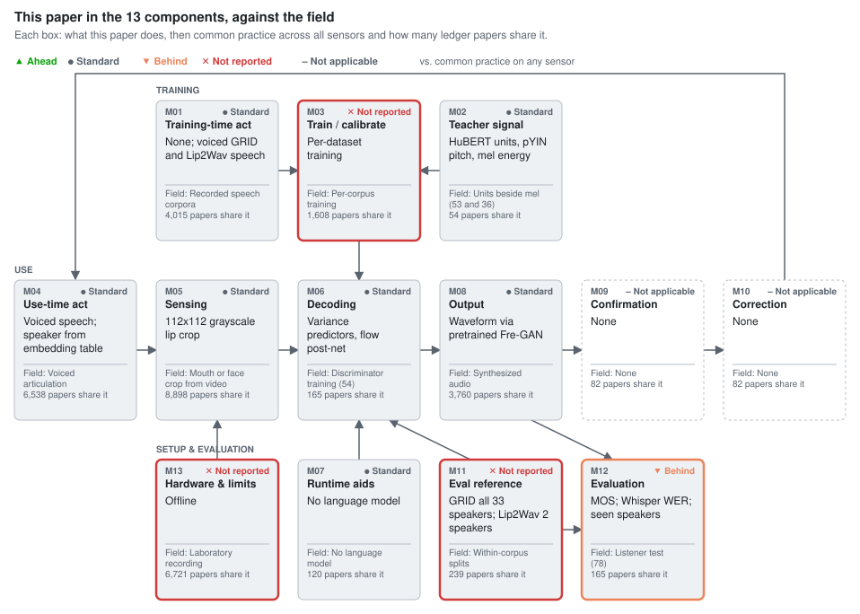

# Let There Be Sound: Reconstructing High Quality Speech from Silent Videos

Ji-Hoon Kim, Jaehun Kim, Joon Son Chung. AAAI 2024 (arXiv preprint August 2023). [arXiv:2308.15256](https://arxiv.org/abs/2308.15256)

**Section:** [Lip & face video](../../README.md#lip--face-video)

## Figures

### This paper in the 13 components, against the field

<picture><source media="(prefers-color-scheme: dark)" srcset="figures/components-dark.svg"></picture>

Verdicts compare the paper's choice for each component with common practice across 8,995 ledger entries on any sensor (silent speech, brain-to-text, lip reading).

Data

| Component | This paper | Common practice | Papers with this practice | Verdict |
| --- | --- | --- | --- | --- |
| M01 Training-time act | None; voiced GRID and Lip2Wav speech | Recorded speech corpora | 4,015 of 8,995 | ● Standard (Inherited.) |
| M02 Teacher signal | HuBERT units, pYIN pitch, mel energy | Units beside mel (53 and 36) | 54 of 8,995 | ● Standard (Units as in ReVISE (2022), unit-plus-pitch as in VCVTS (2022); neither cited.) |
| M03 Train / calibrate | Per-dataset training | Per-corpus training | 1,608 of 8,995 | ✕ Not reported (Seeds and checkpoint selection not stated.) |
| M04 Use-time act | Voiced speech; speaker from embedding table | Voiced articulation | 6,538 of 8,995 | ● Standard (Training speakers only.) |
| M05 Sensing | 112x112 grayscale lip crop | Mouth or face crop from video | 8,898 of 8,995 | ● Standard (Inherited.) |
| M06 Decoding | Variance predictors, flow post-net | Discriminator training (54) | 165 of 8,995 | ● Standard (Pitch predictor and flow decoder predate it.) |
| M07 Runtime aids | No language model | No language model | 120 of 8,995 | ● Standard (Inherited.) |
| M08 Output | Waveform via pretrained Fre-GAN | Synthesized audio | 3,760 of 8,995 | ● Standard (Inherited.) |
| M09 Confirmation | None | None | 82 of 8,995 | – Not applicable (Offline study.) |
| M10 Correction | None | None | 82 of 8,995 | – Not applicable (Offline study.) |
| M11 Eval reference | GRID all 33 speakers; Lip2Wav 2 speakers | Within-corpus splits | 239 of 8,995 | ✕ Not reported (Split unit not stated.) |
| M12 Evaluation | MOS; Whisper WER; seen speakers | Listener test (78) | 165 of 8,995 | ▼ Behind (Unseen-speaker tests existed, incl. VCA-GAN.) |
| M13 Hardware & limits | Offline | Laboratory recording | 6,721 of 8,995 | ✕ Not reported (No runtime figures.) |

## Verdict

The paper [[1]](#ref-1) changes the training targets (M02: 200 HuBERT units, pitch and energy from the paired audio) and the decoder (M06: variance predictors and a flow post-net); both are standard, the units follow ReVISE [[2]](#ref-2) and the unit-plus-pitch design VCVTS [[3]](#ref-3), neither cited, and the ablations do not single out the units. The "large margin" holds for MOS and for Lip2Wav WER (34.71% against 48.73% for VCA-GAN), but GRID WER is 17.07% against 17.62% under a scorer at 12.20% on real speech (Table 1). Its test sets draw on the training speakers (Sec. Datasets), behind earlier unseen-speaker GRID tests including its own comparator [[4]](#ref-4). On LRS3, which the paper did not use, two [later] re-runs by the authors' group give 79.7% and 84.08% WER under different scorers, against 28.5% and 30.45% for their successors [[5]](#ref-5), [[6]](#ref-6).

## Against the field, component by component

### M02 Training-only supervision: units plus pitch and energy targets

**Usual approach:** Of 54 unique studies that synthesize speech from a non-acoustic signal with self-supervised speech targets (pattern match, Appendix), 53 name speech units and 36 a mel target (M03 supervision: paired audio, 11 of 22, slot-filled). The paper follows this units-plus-mel design, adding pitch and energy.

**State of the art:** In 2023 the [concurrent] Choi et al. predicted 200 HuBERT units beside mel [[7]](#ref-7), listed at 29.8% LRS3 WER by V2SFlow [later], which reaches 28.5% and scores this system at 79.7% [[5]](#ref-5), 51.2 points behind (inference).

ReVISE (2022) predicts 2000 HuBERT units from video [[2]](#ref-2); VCVTS (2022) predicts 200 VQ units and infers F0 with a two-layer convolutional predictor [[3]](#ref-3). The paper repeats this with HuBERT units and cites neither. Removing the units raises Lip2Wav WER from 34.71% to 42.51%, but removing the speaker embedding gives 42.33% and removing energy 40.58% (Table 5), single runs. Verdict: standard; the units are one of five similar contributions.

### M06 Processing: variance predictors and flow post-net

**Usual approach:** Of 165 unique video-to-speech studies (pattern match, Appendix), 54 name a discriminator, 44 speech-unit conditioning, 22 diffusion, 19 flow decoders and 9 pitch or energy predictors. Unlike VCA-GAN, the paper's loss has no adversarial term (Eq. 7); it uses a variance adaptor and flow post-net from text-to-speech.

**State of the art:** By 2022 GlowLTS (cited) had a flow-based generator and VCVTS a pitch predictor [[3]](#ref-3). In 2025 Faces-to-Voices [later] reaches LRS3 WER 30.45% and UTMOS 4.031 against 84.08% and 2.417 for this paper's code under the same scorer [[6]](#ref-6), 53.6 points apart (inference).

With and without the pitch predictor, pitch skewness is 0.654 and 0.652 (real 0.696) and standard deviation 101.63 and 102.39 (real 101.84) (Table 2); energy MAE is 3.886 and 3.959 with and without the energy predictor (Table 3). These shifts are small; whether prosody explains the WER effect in Table 5 is not tested. Verdict: standard.

### M12 Evaluation: seen speakers only

**Usual approach:** Of 165 unique video-to-speech studies (pattern match, Appendix), 78 name a listener test, 65 ASR WER and 52 an unseen-speaker test. The paper has the first two; its GRID test is an 80/10/10 split over all 33 speakers and Lip2Wav has two speakers.

**State of the art:** On LRS3 unseen speakers, in 2024 V2SFlow [later] reaches 28.5% WER (real speech 2.5%) [[5]](#ref-5) and in 2025 Faces-to-Voices [later] 30.45% under another scorer (real 2.29%) [[6]](#ref-6).

VCA-GAN reports a GRID unseen-speaker split (15, 8 and 10 subjects) beside the all-speaker setting [[4]](#ref-4); Vougioukas et al. test unseen GRID speakers [[8]](#ref-8), and VCVTS holds out four GRID speakers [[3]](#ref-3). Verdict: behind, against the best comparable work (its own comparator), not typical practice.

## The 13 components

| Component | This paper | Usual approach (count) | State of the art | Verdict |
|---|---|---|---|---|
| M01 Training-time action | None; voiced GRID and Lip2Wav speech | Recorded speech corpora (slot-filled 4,015) | – | standard |
| M02 Training-only supervision | HuBERT units, pYIN pitch, mel energy | Units beside mel (53 and 36) (pattern match 54) | V2SFlow: LRS3 WER 28.5% vs 79.7% [[5]](#ref-5) | standard |
| M03 Training and adaptation | Per-dataset training | Per-corpus training (slot-filled 1,608) | – | not reported |
| M04 Use-time action | Voiced speech; speaker from embedding table | Voiced articulation (slot-filled 6,538) | – | standard |
| M05 Sensors | 112x112 grayscale lip crop | Mouth or face crop from video (slot-filled 8,898) | – | standard |
| M06 Processing and decoding | Variance predictors, flow post-net | Discriminator training (54) (pattern match 165) | Faces-to-Voices: LRS3 WER 30.45% vs 84.08% [[6]](#ref-6) | standard |
| M07 Lexicon and LM | No language model | No language model (slot-filled 120) | – | standard |
| M08 Output | Waveform via pretrained Fre-GAN | Synthesized audio (slot-filled 3,760) | – | standard |
| M09 Confirmation | None | None (slot-filled 82) | – | not applicable |
| M10 Correction | None | None (slot-filled 82) | – | not applicable |
| M11 Reference construction | GRID all 33 speakers; Lip2Wav 2 speakers | Within-corpus splits (slot-filled 239) | – | not reported |
| M12 Evaluation | MOS; Whisper WER; seen speakers | Listener test (78) (pattern match 165) | LRS3 unseen speakers: V2SFlow 28.5% WER [[5]](#ref-5) | behind |
| M13 Device and cost | Offline | Laboratory recording (slot-filled 6,721) | – | not reported |

## Where the claims outrun the evidence

- "Large margin" (Abstract) holds for GRID MOS (4.46 against 3.46 naturalness, 4.63 against 4.10 intelligibility for VCA-GAN), but GRID WER differs by 0.55 points, 3% relative (inference), without an interval (Table 1).
- "Approaches vocoded speech" holds for GRID MOS (gaps 0.28 and 0.16) but not WER: GRID 17.07% against 12.44% is 37% higher (inference), and Lip2Wav 34.71% against 6.05% (Table 1).
- The intelligibility MOS gap is 0.16 in the abstract and Table 1 but 0.13 in Sec. Qualitative Results.
- All baselines are retrained by the authors and SVTS is reproduced on MT's code (Sec. Evaluation Metrics), so Table 1 baselines rest on runs with no reported tuning.

## What the field needs next

- M12: GRID unseen-speaker and LRS3 tests, several seeds, the same scored clips for every system.
- M02: HuBERT units, VQ units and mel alone on one encoder, with and without pitch and energy.
- M06: flow post-net, discriminator and flow-matching decoder on a fixed encoder, scored by WER and UTMOS.

## Questions for the authors

- Is the GRID split by utterance, and does any test speaker appear in training?
- Are the 300 ASR samples per dataset, and the same clips for every system?
- Which Whisper checkpoint and text normalization give 12.20% on real GRID speech?
- How is a speaker outside the embedding table handled at use time?
- Which data selected the checkpoints, and how many runs underlie Tables 1 and 5?
- Was VCA-GAN's test-time flip averaging used in Table 1?

## Appendix: literature search

- M02 ssl-speech-unit-target (published topic table, appended). Inclusion rule: studies that synthesize speech from a non-acoustic speech signal and train the encoder to predict self-supervised speech representations (HuBERT units, soft units, ContentVec, wav2vec features) from paired or aligned audio, instead of or besides spectral targets; recognition-only studies, self-generated targets and acoustic-input conversion excluded; versions counted once. Slot-filled 31 unique studies; pattern match 54 unique studies. Usual design: supervision_kind=paired_audio, 11 of the 22 topic studies with that M03 field filled (slot-filled); design counts ssl_units 53, mel_target 36 (pattern match). Read in full: [[3]](#ref-3), [[2]](#ref-2), [[5]](#ref-5) [later], [[7]](#ref-7) [concurrent], target. Known-item recall 1.0.
- M06 video-to-speech-one-to-many-decoder (new topic table). Inclusion rule: the video-to-speech population of the M06 video-to-speech-synthesis table, classified from full text with the reference list removed by how the decoder handles the one-to-many mapping (pitch or energy predictors, flow, diffusion, discriminator, speech-unit conditioning); a study counts under every design its text names (upper bound); enhancement with noisy audio, talking-head generation and video-to-text-to-speech pipelines excluded; versions counted once. Slot-filled 7,345 unique studies; pattern match 165 unique studies. Usual design: discriminator training, 54 (pattern match). Design counts: discriminator 54, speech-unit conditioning 44, diffusion 22, flow 19, pitch or energy predictor 9 (earliest VCVTS, 2022). Read in full: [[6]](#ref-6) [later], [[5]](#ref-5) [later], [[3]](#ref-3), target. Known-item recall 1.0.
- M12 video-to-speech-speaker-held-out-test (new topic table). Inclusion rule: the same 165-study population, counted by evaluation protocol named in full text with references removed (held-out speakers, listener test, ASR WER on the output, repeated runs over seeds); a study counts under every protocol its text names (upper bound); versions counted once. Slot-filled 6,960 unique studies; pattern match 165 unique studies. Usual design: listener or opinion-score test, 78 (pattern match). Design counts: listener test 78, ASR WER 65, unseen-speaker test 52 (14 with an index year of 2022 or earlier), repeated runs 2. Read in full: [[4]](#ref-4), [[3]](#ref-3), [[8]](#ref-8), [[5]](#ref-5) [later], [[6]](#ref-6) [later], target. Known-item recall 1.0.

## References

Numbered by first citation. BibTeX in the same order and keys: [refs.bib](refs.bib).

1. Kim, J., Kim, J., Chung, J. S. “Let There Be Sound: Reconstructing High Quality Speech from Silent Videos.” *Proceedings of the AAAI Conference on Artificial Intelligence (AAAI-24)*, 2024. arXiv:[2308.15256](https://arxiv.org/abs/2308.15256). Target. Read as arXiv v2 (4 Jan 2024). [review](https://github.com/supernaiter/silent-speech-review/tree/main/reviews/let-there-be-sound-reconstructing-high-quality-speech-from-silent-videos) [wiki: arxiv-2308.15256](https://github.com/supernaiter/deep-research-wiki-for-silent-speech/blob/main/papers/arxiv-2308.15256/article.md)
2. Hsu, W., Remez, T., Shi, B., Donley, J., Adi, Y. “ReVISE: Self-Supervised Speech Resynthesis with Visual Input for Universal and Generalized Speech Regeneration.” *Proceedings of the IEEE/CVF Conference on Computer Vision and Pattern Recognition (CVPR)*, 2023, 18795-18805. arXiv:[2212.11377](https://arxiv.org/abs/2212.11377). Read as arXiv v1 (Dec 2022). [wiki: arxiv-2212.11377](https://github.com/supernaiter/deep-research-wiki-for-silent-speech/blob/main/papers/arxiv-2212.11377/article.md)
3. Wang, D., Yang, S., Su, D., Liu, X., Yu, D., Meng, H. “VCVTS: Multi-Speaker Video-to-Speech Synthesis via Cross-Modal Knowledge Transfer from Voice Conversion.” *ICASSP 2022 - IEEE International Conference on Acoustics, Speech and Signal Processing*, 2022, 7252-7256. doi:[10.1109/ICASSP43922.2022.9747427](https://doi.org/10.1109/ICASSP43922.2022.9747427). arXiv:[2202.09081](https://arxiv.org/abs/2202.09081). Read as arXiv v1 (18 Feb 2022). [review](https://github.com/supernaiter/silent-speech-review/tree/main/reviews/vcvts-multi-speaker-video-to-speech-synthesis-via-cross-modal-knowledge-transfer-from-voice-conversion) [wiki: arxiv-2202.09081-vcvts](https://github.com/supernaiter/deep-research-wiki-for-silent-speech/blob/main/papers/arxiv-2202.09081-vcvts/article.md)
4. Kim, M., Hong, J., Ro, Y. M. “Lip to Speech Synthesis with Visual Context Attentional GAN.” *35th Conference on Neural Information Processing Systems (NeurIPS 2021)*, 2021. arXiv:[2204.01726](https://arxiv.org/abs/2204.01726). Read as arXiv v1 (4 Apr 2022). [wiki: arxiv-2204.01726](https://github.com/supernaiter/deep-research-wiki-for-silent-speech/blob/main/papers/arxiv-2204.01726/article.md)
5. Choi, J., Kim, J., Li, J., Chung, J. S., Liu, S. “V2SFlow: Video-to-Speech Generation with Speech Decomposition and Rectified Flow.” *ICASSP 2025 - IEEE International Conference on Acoustics, Speech and Signal Processing*, 2025. doi:[10.1109/ICASSP49660.2025.10889780](https://doi.org/10.1109/ICASSP49660.2025.10889780). arXiv:[2411.19486](https://arxiv.org/abs/2411.19486). Read as arXiv v2 (30 May 2025). [later] [wiki: arxiv-2411.19486](https://github.com/supernaiter/deep-research-wiki-for-silent-speech/blob/main/papers/arxiv-2411.19486/article.md)
6. Kim, J., Choi, J., Kim, J., Jung, C., Chung, J. S. “From Faces to Voices: Learning Hierarchical Representations for High-quality Video-to-Speech.” *Proceedings of the IEEE/CVF Conference on Computer Vision and Pattern Recognition (CVPR)*, 2025, 15874-15884. arXiv:[2503.16956](https://arxiv.org/abs/2503.16956). Read as arXiv v1 (21 Mar 2025). [later] [wiki: arxiv-2503.16956](https://github.com/supernaiter/deep-research-wiki-for-silent-speech/blob/main/papers/arxiv-2503.16956/article.md)
7. Choi, J., Kim, M., Ro, Y. M. “Intelligible Lip-to-Speech Synthesis with Speech Units.” *Interspeech 2023*, 2023, 4349-4353. doi:[10.21437/Interspeech.2023-194](https://doi.org/10.21437/Interspeech.2023-194). arXiv:[2305.19603](https://arxiv.org/abs/2305.19603). [concurrent] [review](https://github.com/supernaiter/silent-speech-review/tree/main/reviews/intelligible-lip-to-speech-synthesis-with-speech-units) [wiki: arxiv-2305.19603](https://github.com/supernaiter/deep-research-wiki-for-silent-speech/blob/main/papers/arxiv-2305.19603/article.md) [wiki: isca-choi23-liptospeech](https://github.com/supernaiter/deep-research-wiki-for-silent-speech/blob/main/papers/isca-choi23-liptospeech/article.md) [wiki: isca-choi23_interspeech](https://github.com/supernaiter/deep-research-wiki-for-silent-speech/blob/main/papers/isca-choi23_interspeech/article.md)
8. Vougioukas, K., Ma, P., Petridis, S., Pantic, M. “Video-Driven Speech Reconstruction using Generative Adversarial Networks.” *Interspeech 2019*, 2019, 4125-4129. doi:[10.21437/Interspeech.2019-1445](https://doi.org/10.21437/Interspeech.2019-1445). arXiv:[1906.06301](https://arxiv.org/abs/1906.06301). [review](https://github.com/supernaiter/silent-speech-review/tree/main/reviews/video-driven-speech-reconstruction-using-generative-adversarial-networks) [wiki: isca-vougioukas19_ganv2s](https://github.com/supernaiter/deep-research-wiki-for-silent-speech/blob/main/papers/isca-vougioukas19_ganv2s/article.md)

## Materials

Data behind this review. Full texts of the papers are not included.

- [`review.md`](review.md): the review text (source)
- [`refs.bib`](refs.bib): references (BibTeX)
- [`slots.json`](slots.json): for each of the 13 components: this paper's choice, field practice, number of matching papers, verdict
- [`figures.json`](figures.json): figure definitions
- [`evaluation.md`](evaluation.md): independent evaluation by a second reviewer
- [`triage.md`](triage.md): how each evaluation finding was checked against the sources and resolved
- [`components/M02/ssl-speech-unit-target.csv`](../../components/M02/ssl-speech-unit-target.csv): M02 topic "ssl-speech-unit-target", every candidate paper with its decision (31 slot-filled, 54 pattern match, usual design in 11, 2 read in full)
- [`components/M06/video-to-speech-one-to-many-decoder.csv`](../../components/M06/video-to-speech-one-to-many-decoder.csv): M06 topic "video-to-speech-one-to-many-decoder", every candidate paper with its decision (7345 slot-filled, 165 pattern match, usual design in 54, 4 read in full)
- [`components/M12/video-to-speech-speaker-held-out-test.csv`](../../components/M12/video-to-speech-speaker-held-out-test.csv): M12 topic "video-to-speech-speaker-held-out-test", every candidate paper with its decision (6960 slot-filled, 165 pattern match, usual design in 78, 5 read in full)

## More reviews in Lip & face video

- [Advancing NAM-to-Speech Conversion with Novel Methods and the MultiNAM Dataset](../advancing-nam-to-speech-conversion-with-novel-methods-and-the-multinam-dataset/) (2024). Compares ways to create target speech for converting non-audible murmur (NAM) to speech and releases the 7.96-hour MultiNAM dataset. Diff-NAM gives final WER 32.39%/38.94% for two speakers, below Lipvoicer but behind MFA-TTS (26.38%/32.61%).
- [AKVSR: Audio Knowledge Empowered Visual Speech Recognition by Compressing Audio Knowledge of a Pretrained Model](../akvsr-audio-knowledge-empowered-visual-speech-recognition-by-compressing-audio-knowledge-of-a-pretrained-model/) (2024). The quantized audio memory (M02) is a standard memory-recall design; its gains repeat over a no-memory baseline, but the LRS3 state-of-the-art claim and the edge over distillation do not hold.
- [Landmark Guided Visual Feature Extractor for Visual Speech Recognition with Limited Resource](../landmark-guided-visual-feature-extractor-for-visual-speech-recognition-with-limited-resource/) (2025). Combines 20 lip landmarks with image features for visual word recognition; with one-third training data on LRW-ID, accuracy improves from 85.75% to 86.65%, at larger model size.
- [LipDiffuser: Lip-to-Speech Generation with Conditional Diffusion Models](../lipdiffuser-lip-to-speech-generation-with-conditional-diffusion-models/) (2025). LipDiffuser generates speech from mouth video plus the target speaker's enrollment audio using a conditional diffusion model. On LRS3-CHiME3 at -10 dB it improves quality and speaker similarity, but WER is 38% versus 36% for the best baseline.
- [LTA-L2S: Lexical Tone-Aware Lip-to-Speech Synthesis for Mandarin with Cross-Lingual Transfer Learning](../lta-l2s-lexical-tone-aware-lip-to-speech-synthesis-for-mandarin-with-cross-lingual-transfer-lear/) (2025). LTA-L2S synthesizes Mandarin speech from lip video using English pretraining and tone-aware generation, reducing character and tone errors versus baselines, but CER remains 61.2%.
- [NaturalL2S: End-to-End High-quality Multispeaker Lip-to-Speech Synthesis with Differential Digital Signal Processing](../naturall2s-end-to-end-high-quality-multispeaker-lip-to-speech-synthesis-with-differential-digita/) (2025). NaturalL2S synthesizes speech from mouth video without a reference audio of the speaker, using differentiable DSP. It improves quality and naturalness, but WER is worse than the comparison (30.4% vs 27.7% on LRS3).

---

Part of the [Silent Speech Interface Review](https://github.com/supernaiter/silent-speech-review). Found an error? [Open an issue](https://github.com/supernaiter/silent-speech-review/issues/new?template=correction.yml).
