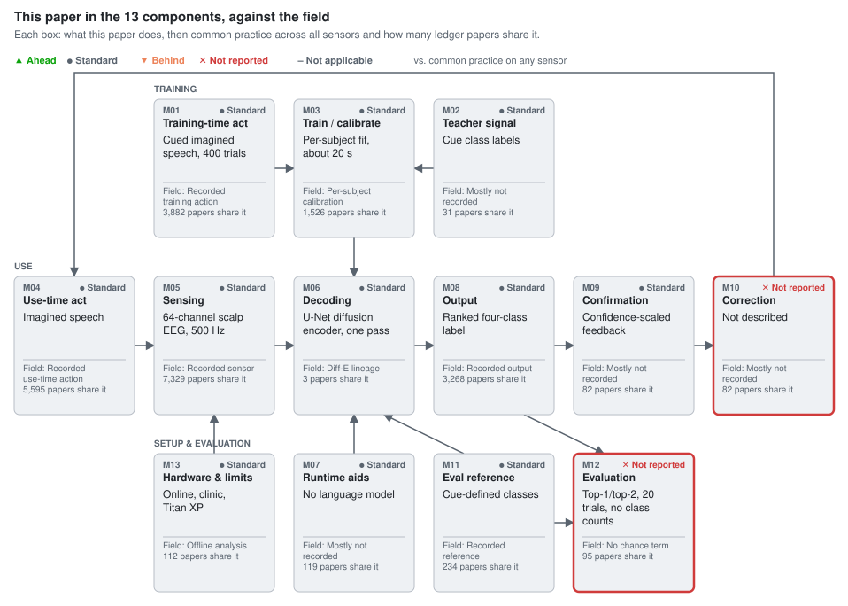

# Lightweight Diffusion-based Framework for Online Imagined Speech Decoding in Aphasia

Eunyeong Ko, Soowon Kim, Ha-Na Jo. arXiv preprint, 2025. [arXiv:2511.07920](https://arxiv.org/abs/2511.07920)

**Section:** [Brain signals (EEG, MEG, intracortical)](../../README.md#brain-signals-eeg-meg-intracortical)

## Figures

### This paper in the 13 components, against the field

<picture><source media="(prefers-color-scheme: dark)" srcset="figures/components-dark.svg"></picture>

Verdicts compare the paper's choice for each component with common practice across 8,995 ledger entries on any sensor (silent speech, brain-to-text, lip reading).

Data

| Component | This paper | Common practice | Papers with this practice | Verdict |
| --- | --- | --- | --- | --- |
| M01 Training-time act | Cued imagined speech, 400 trials | Recorded training action | 3,882 of 8,995 | ● Standard (Inherited.) |
| M02 Teacher signal | Cue class labels | Mostly not recorded | 31 of 8,995 | ● Standard (Inherited.) |
| M03 Train / calibrate | Per-subject fit, about 20 s | Per-subject calibration | 1,526 of 8,995 | ● Standard (Heuristic stop rule.) |
| M04 Use-time act | Imagined speech | Recorded use-time action | 5,595 of 8,995 | ● Standard (Inherited.) |
| M05 Sensing | 64-channel scalp EEG, 500 Hz | Recorded sensor | 7,329 of 8,995 | ● Standard (Inherited.) |
| M06 Decoding | U-Net diffusion encoder, one pass | Diff-E lineage | 3 of 8,995 | ● Standard (14.11 M parameters; no ablation.) |
| M07 Runtime aids | No language model | Mostly not recorded | 119 of 8,995 | ● Standard (Closed four-class set.) |
| M08 Output | Ranked four-class label | Recorded output | 3,268 of 8,995 | ● Standard (Inherited.) |
| M09 Confirmation | Confidence-scaled feedback | Mostly not recorded | 82 of 8,995 | ● Standard (No usability measure.) |
| M10 Correction | Not described | Mostly not recorded | 82 of 8,995 | ✕ Not reported (Online use, no correction step.) |
| M11 Eval reference | Cue-defined classes | Recorded reference | 234 of 8,995 | ● Standard (Inherited.) |
| M12 Evaluation | Top-1/top-2, 20 trials, no class counts | No chance term | 95 of 8,995 | ✕ Not reported (All row of Table I inconsistent.) |
| M13 Hardware & limits | Online, clinic, Titan XP | Offline analysis | 112 of 8,995 | ● Standard (One participant, one session.) |

## Verdict

The paper [[1]](#ref-1) changes the decoder (M06) and runs it online with one person with aphasia (M13). M06 is standard: the design belongs to the Diff-E lineage, which already classified without reverse sampling [[2]](#ref-2), [[3]](#ref-3), [[4]](#ref-4), and at 14.11 M parameters the network is larger than Diff-E, not lighter (§II-D.3). M13 is standard: online decoding departs from the offline default (112 of 167 imagined-speech EEG studies, pattern match, Appendix), but an earlier online study tested 20 participants over two sessions [[5]](#ref-5) against one participant and 20 trials here. The main problem is M12: the All row of Table I (65% top-1, 70% top-2) does not follow from its class rows. Without baseline or ablation (§III), what diffusion adds is untested. What holds is a working clinical pipeline: about 30 minutes of calibration, about 20 seconds of fitting (§III-A).

## Against the field, component by component

### M06 Decoding: diffusion-trained encoder

**Usual approach:** Of 13 unique studies that train a diffusion model inside an EEG decoder (pattern match, Appendix), the commonest design outside the target is the Diff-E line, a DDPM with a conditional autoencoder and classifier (3 studies) [[2]](#ref-2), [[3]](#ref-3), [[4]](#ref-4). The paper uses a conditioned U-Net and one forward pass at noise level 0.5 (§II-D).

**State of the art:** Diff-E (2023) reports 60.63% on 13 imagined-speech classes, 22 healthy participants, within-subject [[2]](#ref-2); the target's 65% top-1 (4 classes, one participant, 20 online trials) is not comparable.

Skipping reverse sampling at test time is inherited: the lineage already classifies without it [[2]](#ref-2), [[4]](#ref-4), [[3]](#ref-3). Diff-E has about 300,000 plus 400,000 parameters [[2]](#ref-2); 14.11 M is about 20 times more (inference). Two of the three lineage studies ablated the diffusion model: Diff-E fell from 60.63% to 46.59% [[2]](#ref-2), the ensemble from 85.47% to 68.12% on spoken-speech EEG [[3]](#ref-3); the viseme decoder compares only with non-diffusion networks such as EEGNet [[4]](#ref-4). The target reports neither an ablation nor a baseline (Table I). Verdict: standard.

### M13 Operation: online closed-loop decoding

**Usual approach:** 112 of 167 unique imagined-speech EEG studies have no online, real-time or closed-loop term (pattern match, Appendix); the paper decodes live (§II-D.3).

**State of the art:** Wu et al. (2024) ran online binary syllable imagery with 20 participants in two sessions at least 3 weeks apart: 55.7% control with an adaptive against 52.3% with a static classifier (share of 500-ms windows matching the cue) [[5]](#ref-5). Metric, class count and cohort differ; the gap is not measurable.

The online evidence is 20 trials, about 5 minutes (§III-B). The 2 ms figure is inference per window on an NVIDIA Titan XP (§II-D.3), not the user's cycle, which includes 3 seconds of feedback (§II-A). "Stable online decoding" (§IV) rests on one session; stability across days is what [[5]](#ref-5) measured. Verdict: standard.

### M12 Evaluation: trial counts and chance reference

**Usual approach:** 95 of 167 unique imagined-speech EEG studies have no "chance" term and 63 state one (pattern match, Appendix); the paper follows the majority.

**State of the art:** Wu et al. (2024) score trials against a stated 50% chance level and report their effect in 15 of 20 participants [[5]](#ref-5).

Per-class top-2 gains in Table I are 20, 60, 20 and 20 points, so any split of the 20 trials gives an overall gain of at least 20 points, yet the All row shows 5. Each class percentage needs a class size that is a multiple of 5, so the four classes hold five trials each and the class rows give 50% top-1 and 80% top-2 (inference). Class counts and the computed confusion matrices are not shown (§II-A.2, §II-D.2). Against 25% chance, 10 of 20 correct gives a one-sided binomial p of about 0.014 (inference), so above-chance decoding holds; the 65% does not. Verdict: not reported (class counts).

## The 13 components

| Component | This paper | Usual approach (count) | State of the art | Verdict |
|---|---|---|---|---|
| M01 Training-time action | Cued imagined speech, 400 trials | Recorded training action (slot-filled 3,882) | – | standard |
| M02 Training-only supervision | Cue class labels | Mostly not recorded (slot-filled 31) | – | standard |
| M03 Training and adaptation | Per-subject fit, about 20 s | Per-subject calibration (slot-filled 1,526) | – | standard |
| M04 Use-time action | Imagined speech | Recorded use-time action (slot-filled 5,595) | – | standard |
| M05 Sensors | 64-channel scalp EEG, 500 Hz | Recorded sensor (slot-filled 7,329) | – | standard |
| M06 Processing and decoding | U-Net diffusion encoder, one pass | Diff-E lineage (pattern match 3) | 60.63%, 13 classes [[2]](#ref-2) | standard |
| M07 Lexicon and LM | No language model | Mostly not recorded (slot-filled 119) | – | standard |
| M08 Output | Ranked four-class label | Recorded output (slot-filled 3,268) | – | standard |
| M09 Confirmation | Confidence-scaled feedback | Mostly not recorded (slot-filled 82) | – | standard |
| M10 Correction | Not described | Mostly not recorded (slot-filled 82) | – | not reported |
| M11 Reference construction | Cue-defined classes | Recorded reference (slot-filled 234) | – | standard |
| M12 Evaluation | Top-1/top-2, 20 trials, no class counts | No chance term (pattern match 95) | 50% chance stated [[5]](#ref-5) | not reported |
| M13 Operation | Online, clinic, Titan XP | Offline analysis (pattern match 112) | 55.7% vs 52.3%, 20 participants [[5]](#ref-5) | standard |

## Where the claims outrun the evidence

- The authors concede one participant, subject-specific calibration and four classes (§III-C), but the abstract's 65% / 70% and "over 60%" (§I) rest on the inconsistent All row of Table I.
- "Lightweight" (§II-D.1) has no size or latency comparison; its four efficiency changes have no ablation (§III).
- Training stops when training accuracy exceeds 75% or validation accuracy 40% (§II-D.2), with no split sizes; the 20-second fit measures this stop rule, not convergence.

## What the field needs next

- M12: per-class trial counts, confusion matrix and chance bound per online session.
- M06: the same U-Net without the diffusion objective, and a compact non-diffusion classifier.
- M03: pretraining on the 22-participant Diff-E dataset, whose 13 classes name clock, toilet and water in English [[2]](#ref-2) while the target's words are Korean (§II-A.1), to test whether cross-language pretraining cuts patient calibration.
- M13: online sessions on separate days [[5]](#ref-5), with end-to-end latency.

## Questions for the authors

- How many of the 20 online trials belonged to each class, and how was the All row of Table I computed?
- What were the train and validation split sizes, and which stop criterion fired?
- The encoder is class-conditioned in training (§II-D.1); what class input does it receive online?

## Appendix: literature search

**M06 diffusion-model-eeg-decoding** (published topic table, reused and appended). Inclusion rule: EEG decoding studies (classification, text or speech decoding) that train a denoising diffusion model as part of the decoder, jointly with a classifier, as a feature learner, or to generate training samples; diffusion used only to synthesize EEG with no decoding result, reviews, and non-generative "diffusion" are excluded; versions count once. Ledger counts: slot-filled 7,345 unique studies; pattern match 13 unique studies (17 folders). Usual design: DDPM with conditional autoencoder and latent classifier (Diff-E lineage), 3 studies, pattern match. Read in full: [[2]](#ref-2), [[3]](#ref-3), [[4]](#ref-4). Known-item recall 1.0 (2 of 2).

**M13 online-imagined-speech-eeg** (published topic table, reused and appended). Inclusion rule: studies that classify imagined, covert or inner speech from scalp EEG; the design compared is online decoding with feedback against offline analysis of recorded trials; real-time use named only as future work is a pattern match, not an online study; versions count once. Ledger counts: slot-filled 6,075 unique studies; pattern match 167 unique studies (256 folders). Usual design: offline analysis, 112 studies, pattern match; 55 use an online, real-time or closed-loop term (upper bound). Read in full: [[5]](#ref-5). Known-item recall 0.5 (1 of 2; [[5]](#ref-5) outside the ledger pattern).

**M12 imagined-speech-eeg-chance-reference** (new topic). Inclusion rule: the same imagined-speech EEG population as the M13 table; the design compared is whether accuracy is referenced to chance (stated chance level or above-chance test, or a permutation null); full-text counts are upper bounds and a study with no "chance" in its full text counts as giving no chance reference; versions count once. Ledger counts: slot-filled 6,960 unique studies; pattern match 167 unique studies (256 folders). Designs (pattern match, overlapping): no "chance" term 95, chance level or above-chance term 63, permutation or label-shuffle null 14. Read in full: [[5]](#ref-5), [[2]](#ref-2). Known-item recall 0.0 (0 of 1; [[5]](#ref-5) outside the ledger pattern).

## References

Numbered by first citation. BibTeX in the same order and keys: [refs.bib](refs.bib).

1. Ko, E., Kim, S., Jo, H. “Lightweight Diffusion-based Framework for Online Imagined Speech Decoding in Aphasia.” *arXiv preprint*, 2025. arXiv:[2511.07920](https://arxiv.org/abs/2511.07920). Target. Read as arXiv v3. [review](https://github.com/supernaiter/silent-speech-review/tree/main/reviews/lightweight-diffusion-based-framework-for-online-imagined-speech-decoding-in-aphasia) [wiki: arxiv-2511.07920](https://github.com/supernaiter/deep-research-wiki-for-silent-speech/blob/main/papers/arxiv-2511.07920/article.md)
2. Kim, S., Lee, Y., Lee, S., Lee, S. “Diff-E: Diffusion-based Learning for Decoding Imagined Speech EEG.” *Interspeech*, 2023. arXiv:[2307.14389](https://arxiv.org/abs/2307.14389). Prior; deciding prior for M06 and state of the art of the M06 topic. [wiki: arxiv-2307.14389](https://github.com/supernaiter/deep-research-wiki-for-silent-speech/blob/main/papers/arxiv-2307.14389/article.md) [wiki: arxiv-2307-14389-diffe](https://github.com/supernaiter/deep-research-wiki-for-silent-speech/blob/main/papers/arxiv-2307-14389-diffe/article.md) [wiki: isca-kim23g-diffe](https://github.com/supernaiter/deep-research-wiki-for-silent-speech/blob/main/papers/isca-kim23g-diffe/article.md) [wiki: isca-kim23g_interspeech](https://github.com/supernaiter/deep-research-wiki-for-silent-speech/blob/main/papers/isca-kim23g_interspeech/article.md)
3. Kim, S., Jo, H., Ko, E. “EEG-Based Speech Decoding: A Novel Approach Using Multi-Kernel Ensemble Diffusion Models.” *arXiv preprint*, 2024. arXiv:[2411.09302](https://arxiv.org/abs/2411.09302). Prior; deciding prior for M06. [wiki: arxiv-2411.09302](https://github.com/supernaiter/deep-research-wiki-for-silent-speech/blob/main/papers/arxiv-2411.09302/article.md)
4. Park, J., Lee, S., Kim, S., Lee, S. “Towards Dynamic Neural Communication and Speech Neuroprosthesis Based on Viseme Decoding.” *arXiv preprint*, 2025. arXiv:[2501.14790](https://arxiv.org/abs/2501.14790). Prior; Diff-E lineage member for M06. [wiki: arxiv-2501.14790](https://github.com/supernaiter/deep-research-wiki-for-silent-speech/blob/main/papers/arxiv-2501.14790/article.md)
5. Wu, S., Bhadra, K., Giraud, A., Marchesotti, S. “Adaptive LDA Classifier Enhances Real-Time Control of an EEG Brain-Computer Interface for Decoding Imagined Syllables.” *Brain Sciences*, 2024, 14(3), 196. doi:[10.3390/brainsci14030196](https://doi.org/10.3390/brainsci14030196). Prior; state of the art for M13 and M12. Preprint: bioRxiv, doi:10.1101/2023.12.12.571206. [wiki: doi-10.3390-brainsci14030196](https://github.com/supernaiter/deep-research-wiki-for-silent-speech/blob/main/papers/doi-10.3390-brainsci14030196/article.md)

## Materials

Data behind this review. Full texts of the papers are not included.

- [`review.md`](review.md): the review text (source)
- [`refs.bib`](refs.bib): references (BibTeX)
- [`slots.json`](slots.json): for each of the 13 components: this paper's choice, field practice, number of matching papers, verdict
- [`figures.json`](figures.json): figure definitions
- [`evaluation.md`](evaluation.md): independent evaluation by a second reviewer
- [`triage.md`](triage.md): how each evaluation finding was checked against the sources and resolved
- [`process/log.json`](process/log.json): process record: each step, who did it (reader, script, writer, evaluator), when, the checks run and the input versions
- [`process/notes.json`](process/notes.json): reading notes on the target and comparator papers: claims, numbers, conditions and what is not stated, with locations
- [`process/plan.json`](process/plan.json): plan: which components the paper changes and the topics it is compared on
- [`process/draft.md`](process/draft.md): the review as first written, before the independent evaluation
- [`process/claims-draft.md`](process/claims-draft.md): claim table of the draft: every claim mapped to a note or a count
- [`process/claims.md`](process/claims.md): claim table of the published review
- [`components/M06/diffusion-model-eeg-decoding.csv`](../../components/M06/diffusion-model-eeg-decoding.csv): M06 topic "diffusion-model-eeg-decoding", every candidate paper with its decision (7345 slot-filled, 13 pattern match, usual design in 3, 3 read in full)
- [`components/M12/imagined-speech-eeg-chance-reference.csv`](../../components/M12/imagined-speech-eeg-chance-reference.csv): M12 topic "imagined-speech-eeg-chance-reference", every candidate paper with its decision (6960 slot-filled, 167 pattern match, usual design in 95, 2 read in full)
- [`components/M13/online-imagined-speech-eeg.csv`](../../components/M13/online-imagined-speech-eeg.csv): M13 topic "online-imagined-speech-eeg", every candidate paper with its decision (6075 slot-filled, 167 pattern match, usual design in 112, 3 read in full)

## More reviews in Brain signals (EEG, MEG, intracortical)

- [A Convolutional Framework for Mapping Imagined Auditory MEG into Listened Brain Responses](../a-convolutional-framework-for-mapping-imagined-auditory-meg-into-listened-brain-responses/) (2025). Mapping imagined onto listened MEG (M06) is ahead in design, but the subject-calibrated CNN gain is unproven: no ablation, a channel-shuffling null, and r 0.0113 against 0.0063.
- [An instantaneous voice-synthesis neuroprosthesis](../an-instantaneous-voice-synthesis-neuroprosthesis/) (2025). Closed-loop sentence voice from intracortical arrays holds for one participant; the design is standard, forced-choice and proxy-target metrics overstate intelligibility.
- [Brain-to-Text Decoding: A Non-invasive Approach via Typing](../brain-to-text-decoding-a-non-invasive-approach-via-typing/) (2025). Executed typing as the decoded action (M04) was ahead for MEG/EEG in 2025; keystroke-locked decoding (M06) and an n-gram LM (M07) are standard, and decoding needs known keystroke times.
- [Distinct Theta Synchrony across Speech Modes: Perceived, Spoken, Whispered, and Imagined](../distinct-theta-synchrony-across-speech-modes-perceived-spoken-whispered-and-imagined/) (2025). Exploratory comparison of EEG theta-band functional connectivity across perceived, spoken, whispered and imagined speech in ten healthy subjects; no recognition performance is measured.
- [EEG-to-Voice Decoding of Spoken and Imagined speech Using Non-Invasive EEG](../eeg-to-voice-decoding-of-spoken-and-imagined-speech-using-non-invasive-eeg/) (2025). Drops DTW from an EEG-to-Mel generator (M06, standard) but tests only the ten trained classes (M12, behind); one frozen ASR both trains and scores it, and EEG output beats recorded-speech WER.
- [MultiDiffNet: A Multi-Objective Diffusion Framework for Generalizable Brain Decoding](../multidiffnet-a-multi-objective-diffusion-framework-for-generalizable-brain-decoding/) (2025). Diff-E-style decoder (M06) whose own ablation does not show diffusion helping; 1.01-point imagined-speech gain over EEGNet on two held-out subjects, normalized on scored trials (M03).

---

Part of the [Silent Speech Interface Review](https://github.com/supernaiter/silent-speech-review). Found an error? [Open an issue](https://github.com/supernaiter/silent-speech-review/issues/new?template=correction.yml).
