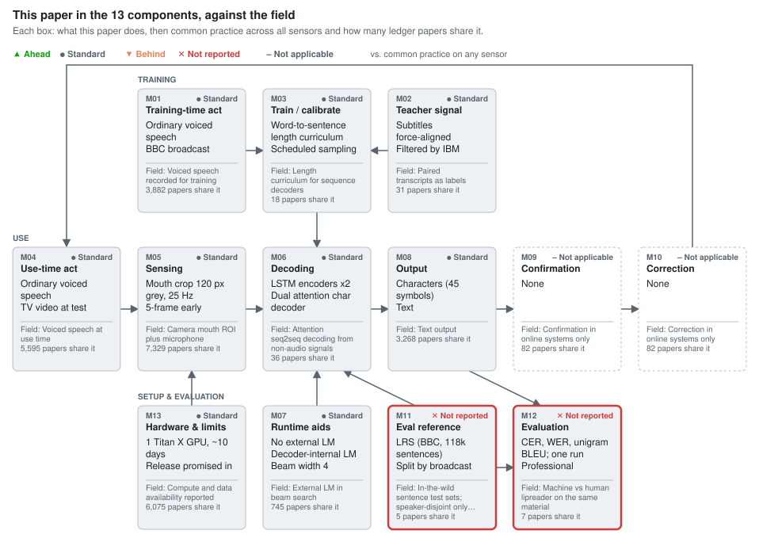

# Lip Reading Sentences in the Wild

Joon Son Chung, Andrew Senior, Oriol Vinyals, Andrew Zisserman. CVPR 2017. doi:[10.1109/CVPR.2017.367](https://doi.org/10.1109/CVPR.2017.367) · arXiv:[1611.05358](https://arxiv.org/abs/1611.05358)

**Section:** [Lip & face video](../../README.md#lip--face-video)

## Figures

### This paper in the 13 components, against the field

<picture><source media="(prefers-color-scheme: dark)" srcset="figures/components-dark.svg"></picture>

Verdicts compare the paper's choice for each component with common practice across 8,995 ledger entries on any sensor (silent speech, brain-to-text, lip reading), not only lip-reading papers.

Data

| Component | This paper | Common practice | Papers with this practice | Verdict |
| --- | --- | --- | --- | --- |
| M01 Training-time act | Ordinary voiced speech BBC broadcast | Voiced speech recorded for training | 3,882 of 8,995 | ● Standard (Inherited from the LRW pipeline; broadcast voiced speech is the field default.) |
| M02 Teacher signal | Subtitles force-aligned Filtered by IBM Watson ASR | Paired transcripts as labels | 31 of 8,995 | ● Standard (Automatic subtitle-aligned labels inherited from LRW; standard for broadcast data.) |
| M03 Train / calibrate | Word-to-sentence length curriculum Scheduled sampling to 0.25 Uniform modality selection | Length curriculum for sequence decoders | 18 of 8,995 | ● Standard (First length curriculum in the wiki and widely copied, but the 76.5 to 61.1% WER gain is one run and was later attributed to sub-sequence augmentation, so not ahead.) |
| M04 Use-time act | Ordinary voiced speech TV video at test | Voiced speech at use time | 5,595 of 8,995 | ● Standard (Inherited; voiced speech at use time is the field default.) |
| M05 Sensing | Mouth crop 120 px grey, 25 Hz 5-frame early fusion 13-dim MFCC | Camera mouth ROI plus microphone | 7,329 of 8,995 | ● Standard (Inherited from LRW; camera mouth ROI plus microphone is the field default.) |
| M06 Decoding | LSTM encoders x2 Dual attention char decoder Beam 4 | Attention seq2seq decoding from non-audio signals | 36 of 8,995 | ● Standard (LAS imported from audio ASR; no decoder comparison on LRS and LRW/GRID results are fine-tunes of the LRS model, so method and data scale are confounded and it is not ahead.) |
| M07 Runtime aids | No external LM Decoder-internal LM Beam width 4 | External LM in beam search | 745 of 8,995 | ● Standard (No external LM with beam 4 is ordinary practice for attention decoders.) |
| M08 Output | Characters (45 symbols) Text | Text output | 3,268 of 8,995 | ● Standard (Character output is standard.) |
| M09 Confirmation | None | Confirmation in online systems only | 82 of 8,995 | – Not applicable (Offline benchmark study; confirmation does not apply.) |
| M10 Correction | None | Correction in online systems only | 82 of 8,995 | – Not applicable (Offline benchmark study; correction does not apply.) |
| M11 Eval reference | LRS (BBC, 118k sentences) Split by broadcast date Speaker overlap unstated | In-the-wild sentence test sets; speaker-disjoint only in some | 5 of 8,995 | ✕ Not reported (LRS made in-the-wild sentence lipreading measurable, but train/test speaker overlap is not reported and BBC presenters recur across broadcasts.) |
| M12 Evaluation | CER, WER, unigram BLEU; one run Professional lipreader on 200 clips Machine subset unstated | Machine vs human lipreader on the same material | 7 of 8,995 | ✕ Not reported (The machine beats the lipreader in direction, but whether 50.2% was scored on the same 200 clips and run-to-run variance are not reported.) |
| M13 Hardware & limits | 1 Titan X GPU, ~10 days Release promised in arXiv v2 only; never released | Compute and data availability reported | 6,075 of 8,995 | ● Standard (Compute is reported; the dataset release promised in arXiv v2 was dropped from the CVF version and LRS stayed unreleased.) |

## Verdict

The paper [[1]](#ref-1) changed three components: a dual-attention character decoder (M06), a word-to-sentence length curriculum (M03) and an automatically built BBC sentence benchmark (M11). M11 is its lasting contribution: its pipeline became LRS2-BBC and LRS3-TED [[2]](#ref-2), although LRS itself was never released [[3]](#ref-3). The decoder is standard: LAS carried over from ASR, later beaten by CTC on fixed data, 76.8% against 40.9% WER [[4]](#ref-4). The curriculum is standard: its 76.5% to 61.1% WER gain is one run, later attributed to sub-sequence augmentation [[5]](#ref-5). "Better than a professional lipreader" holds in direction (50.2% against 73.8% WER), but the conditions are unequal, the machine is not shown to have read the same 200 clips, and speaker independence is asserted, not shown.

## Against the field, component by component

### M06 Decoding: dual-attention character decoder (standard)

**Usual approach:** in 2016 non-audio decoders were classifiers or CTC, as in concurrent LipNet [[6]](#ref-6); the paper imports LAS attention decoding from audio ASR and adds a second attention for audio.

**State of the art:** Transformer decoders with CTC or sub-word outputs, e.g. VTP [[5]](#ref-5) (2022, 22.6% LRS2 and 30.7% LRS3 WER); WAS itself scored 70.4% on LRS2-BBC [[3]](#ref-3).

36 confirmed works use it on non-audio input: none prior or concurrent, 35 later, including EEG [[7]](#ref-7) and acoustic sensing [[8]](#ref-8); cortical decoding dropped the attention [[9]](#ref-9). No decoders are compared on LRS; LRW (23.8% against 38.9%) and GRID (3.0%) are fine-tunes of the LRS model (§5.3–5.4), GRID on the speaker-overlapping split behind LipNet's 4.8%. Method and data scale stay confounded.

### M03 Training: length curriculum (standard)

**Usual approach:** train on full sequences from the start; the paper starts from single words and lengthens to sentences.

**State of the art:** VTP [[5]](#ref-5) (2022) keeps only sub-sequence augmentation and states the gain comes from it, not from ordering.

18 confirmed works use the curriculum: none prior or concurrent, 17 later, including Deep Lip Reading [[10]](#ref-10) and Deep AVSR [[3]](#ref-3). The authors say it "presumably" acts as augmentation (§3.1) and show no convergence curves; the 15.4-point gain is unattributed.

### M11 Ground truth: the LRS benchmark (not reported)

**Usual approach:** GRID (51 words) or word-level LRW [[11]](#ref-11) (500 words); concurrent Miao and Metze [[12]](#ref-12) used YouTube video without mouth crops. LRS is the first in-the-wild sentence set (17,428 words) of five confirmed.

**State of the art:** LRS3-TED [[2]](#ref-2) (2018) splits by source video and argues, without labelling identities, that TED speakers rarely recur; no confirmed benchmark reports identity overlap.

LRS splits by broadcast date, but LRW §2 [[11]](#ref-11) says BBC presenters recur and the LRS3 paper says the same of LRS2-BBC. Of 6,882 test words, 6,641 (96.5%) appear in the audio-only text that also trains the decoder, so its internal language model has seen nearly the whole test vocabulary.

### M12 Evaluation: machine against a human lipreader (not reported)

**Usual approach:** controlled material: letters A–F against 17 students [[13]](#ref-13), VCV syllables [[14]](#ref-14), GRID with three hearing-impaired people [[6]](#ref-6), slowly uttered sentences with 24 participants in VLRF [[15]](#ref-15). The paper is the first of seven confirmed to test a professional on in-the-wild sentences.

**State of the art:** Jain and Harte [[16]](#ref-16) (2026) score models and humans on identical material (65% against 83% WER) and ask whether the errors are human-like; LSVSR [[4]](#ref-4) reported professionals at 86.4% and 92.9%.

Whether 50.2% was scored on the lipreader's 200 clips is not stated; every number is one run.

### Inherited

M01, M02, M04 and M05 follow LRW [[11]](#ref-11); the rest are routine or not applicable.

## The 13 components

| Component | This paper | Usual approach (count) | State of the art | Verdict |
|---|---|---|---|---|
| M01 Training behaviour | Broadcast voiced speech | Voiced (3,882 / 7,388) | Same | standard |
| M02 Training labels | Aligned subtitles | Transcripts (31) | — | standard |
| M03 Training | Length curriculum | Full sequences (18 curricula) | Augmentation (2022) | standard |
| M04 Use-time behaviour | Broadcast voiced speech | Voiced speech (5,595) | Same | standard |
| M05 Sensing | 120 px mouth crop, 25 Hz; MFCC | Camera ROI (7,329) | Same | standard |
| M06 Decoding | Dual-attention seq2seq | CTC (36 attention, later) | Transformer (2022) | standard |
| M07 Use-time aids | No LM, beam 4 | LM in beam (745) | — | standard |
| M08 Output | Characters | Text (3,268) | Sub-words | standard |
| M09 Confirmation | None | Online only (82) | — | not applicable |
| M10 Correction | None | Online only (82) | — | not applicable |
| M11 Ground truth | LRS, date split | Word sets (5 sentence sets) | LRS3 (2018) | not reported |
| M12 Evaluation | One lipreader, 200 clips | Controlled tests (7) | Identical material (2026) | not reported |
| M13 Hardware | One GPU; data unreleased | Compute reported (6,075) | Public data | standard |

## Where the claims outrun the evidence

- **Lipreader comparison.** The lipreader saw the full face, knew the programme and had ten times the clip length (§5.2); the machine also learned from 342,644 audio-only sentences. The 73.8% excludes declined clips (87.6% with them). One lipreader, one pass: the direction holds, the margin does not.
- **"Lips help on clean audio"** rests on 17.7% to 13.9% WER, but retrained Kaldi reaches 16.8% on audio alone; noisy tests (62.9% to 42.0% at 0 dB) reuse the training SNRs with the noise type unstated.
- **Inconsistencies.** CVF §5.1 text gives CER 16.2% to 13.3%, Table 5 10.4% to 7.9%; CER is defined over words; Table 3 gives LRW 400,000 (arXiv v2) or 450,000 (CVF) utterances.
- **Release.** arXiv v2 §1 promises the data; the CVF version drops it, and LRS stayed unreleased [[3]](#ref-3).

## What the field needs next

1. **M03:** ordering against sub-sequence augmentation, several seeds.
2. **M06:** attention, CTC and hybrid decoders on identical data, as LSVSR [[4]](#ref-4) began.
3. **M11:** test speakers disjoint by labelled identity, with overlap counts.
4. **M12:** humans and machine on identical clips with matched context and several lipreaders.

## Questions for the authors

- What is the WER on the 200 clips, with and without declined ones?
- Was each Table 5 row a separate run with the same stopping rule?
- How many test speakers appear in training?
- Was the test noise white, as in training?

## Appendix: literature search

Scan: 8,995 ledger folders (7,388 unique papers) at wiki commit `730b0b4`; candidates from ledger and full-text regular expressions, decisions from the source text. Concurrent means within ±6 months of first public release (arXiv v1, 2016-11). Counts include the target.

| Topic | Slot-filled | Pattern match | Confirmed | Read / unread | Known-item recall | Recall estimate |
|---|---:|---:|---:|---|---|---|
| M06 attention seq2seq decoding | 7,345 | 210 | 36 | 115 / 441 | 7/7 | 0.33 (6 of 30 full-text-only sample) |
| M03 length curriculum | 1,526 | 39 | 18 | 71 / 5 | 5/5 | 0.78 (4 of 30) |
| M11 in-the-wild sentence benchmark | 234 | 271 | 5 | 49 / 293 | 6/6 | 0.6 (2 of 19) |
| M12 human lipreader baseline | 6,960 | 64 | 7 | 116 / 0 | 4/5 | 0.81 (1 of 30) |

- **M06.** Inclusion: non-audio input (video, biosignals, neural, or audio-visual) decoded autoregressively into symbols by an attention encoder-decoder, with results; CTC-only and speech-feature outputs excluded. Confirmed: the target; later Deep Lip Reading [[10]](#ref-10), LSVSR [[4]](#ref-4), Deep AVSR [[3]](#ref-3), EEG [[7]](#ref-7), acoustic sensing [[8]](#ref-8), sub-word VTP [[5]](#ref-5) and 29 others (Can DNNs Learn to Lipread Full Sentences?, Modality Attention, Hearing Lips, hybrid CTC/attention AVSR, Conformer AVSR, LiRA, AVATAR, SSR7000 ultrasound, among them). All candidates first public before 2017-05 were read. LRW [[11]](#ref-11) was excluded (word classifier), Makin et al. [[9]](#ref-9) (no attention).
- **M03.** Inclusion: decoder training that starts from short units and lengthens the input as training proceeds; noise-level, difficulty or data-order curricula excluded. Confirmed: the target and 17 later, including Deep Lip Reading [[10]](#ref-10), Deep AVSR [[3]](#ref-3), LiRA and AV-RelScore. Prajwal et al. [[5]](#ref-5) excluded (augmentation replaces the curriculum).
- **M11.** Inclusion: sentence- or phrase-level audio-visual data built from uncontrolled video with automatic transcripts and a defined test split; word-level sets excluded. Confirmed: LRS (target), LSVSR [[4]](#ref-4), LRS3-TED [[2]](#ref-2), VoxLRS-SA, ViCocktail. Miao and Metze [[12]](#ref-12) excluded as a boundary case; LRW-Persian excluded (word-level).
- **M12.** Inclusion: machine and human lipreaders on the same data with the same metric; human scores quoted from literature excluded. Confirmed: Hilder et al. [[13]](#ref-13), Ma and Leijon [[14]](#ref-14) (prior); LipNet [[6]](#ref-6), VLRF [[15]](#ref-15) (concurrent); LSVSR [[4]](#ref-4), Jain and Harte [[16]](#ref-16) (later); the target. Potamianos et al. 2001 excluded (no visual-only human condition).

## References

Numbered by first citation; BibTeX in [refs.bib](refs.bib) with the same order and keys.

1. Chung, J. S., Senior, A., Vinyals, O., Zisserman, A. “Lip Reading Sentences in the Wild.” *Proc. IEEE Conference on Computer Vision and Pattern Recognition (CVPR)*, 2017, 3444–3453. doi:[10.1109/CVPR.2017.367](https://doi.org/10.1109/CVPR.2017.367). arXiv:[1611.05358](https://arxiv.org/abs/1611.05358). [[review]](https://github.com/supernaiter/silent-speech-review/tree/main/reviews/lip-reading-sentences-in-the-wild) [[wiki: arxiv-1611.05358]](https://github.com/supernaiter/deep-research-wiki-for-silent-speech/blob/main/papers/arxiv-1611.05358/article.md) [[wiki: cvf-chung17-lipreadwild]](https://github.com/supernaiter/deep-research-wiki-for-silent-speech/blob/main/papers/cvf-chung17-lipreadwild/article.md)
2. Afouras, T., Chung, J. S., Zisserman, A. “LRS3-TED: a large-scale dataset for visual speech recognition.” *arXiv preprint*, 2018. arXiv:[1809.00496](https://arxiv.org/abs/1809.00496). [later] [[wiki: arxiv-1809.00496]](https://github.com/supernaiter/deep-research-wiki-for-silent-speech/blob/main/papers/arxiv-1809.00496/article.md)
3. Afouras, T., Chung, J. S., Senior, A., Vinyals, O., Zisserman, A. “Deep Audio-Visual Speech Recognition.” *IEEE Transactions on Pattern Analysis and Machine Intelligence*, 2018. doi:[10.1109/TPAMI.2018.2889052](https://doi.org/10.1109/TPAMI.2018.2889052). arXiv:[1809.02108v2](https://arxiv.org/abs/1809.02108v2). [later] [[review]](https://github.com/supernaiter/silent-speech-review/tree/main/reviews/deep-audio-visual-speech-recognition) [[wiki: arxiv-1809.02108]](https://github.com/supernaiter/deep-research-wiki-for-silent-speech/blob/main/papers/arxiv-1809.02108/article.md) [[wiki: doi-10.1109-tpami.2018.2889052]](https://github.com/supernaiter/deep-research-wiki-for-silent-speech/blob/main/papers/doi-10.1109-tpami.2018.2889052/article.md)
4. Shillingford, B., Assael, Y., Hoffman, M. W., Paine, T., Hughes, C., Prabhu, U., et al. “Large-Scale Visual Speech Recognition.” *arXiv preprint*, 2018. arXiv:[1807.05162](https://arxiv.org/abs/1807.05162). [later] [[wiki: arxiv-1807.05162]](https://github.com/supernaiter/deep-research-wiki-for-silent-speech/blob/main/papers/arxiv-1807.05162/article.md) [[wiki: isca-shillingford19-largescale]](https://github.com/supernaiter/deep-research-wiki-for-silent-speech/blob/main/papers/isca-shillingford19-largescale/article.md) [[wiki: isca-shillingford19_interspeech]](https://github.com/supernaiter/deep-research-wiki-for-silent-speech/blob/main/papers/isca-shillingford19_interspeech/article.md)
5. Prajwal, K. R., Afouras, T., Zisserman, A. “Sub-word Level Lip Reading With Visual Attention.” *Proc. IEEE/CVF Conference on Computer Vision and Pattern Recognition (CVPR)*, 2022. arXiv:[2110.07603](https://arxiv.org/abs/2110.07603). [later] [[review]](https://github.com/supernaiter/silent-speech-review/tree/main/reviews/sub-word-level-lip-reading-with-visual-attention) [[wiki: arxiv-2110.07603]](https://github.com/supernaiter/deep-research-wiki-for-silent-speech/blob/main/papers/arxiv-2110.07603/article.md) [[wiki: cvf-prajwal22-subword-vtp]](https://github.com/supernaiter/deep-research-wiki-for-silent-speech/blob/main/papers/cvf-prajwal22-subword-vtp/article.md) [[wiki: cvpr22-prajwal]](https://github.com/supernaiter/deep-research-wiki-for-silent-speech/blob/main/papers/cvpr22-prajwal/article.md)
6. Assael, Y. M., Shillingford, B., Whiteson, S., de Freitas, N. “LipNet: End-to-End Sentence-level Lipreading.” *arXiv preprint*, 2016. arXiv:[1611.01599](https://arxiv.org/abs/1611.01599). [concurrent] [[review]](https://github.com/supernaiter/silent-speech-review/tree/main/reviews/lipnet-end-to-end-sentence-level-lipreading) [[wiki: arxiv-1611.01599]](https://github.com/supernaiter/deep-research-wiki-for-silent-speech/blob/main/papers/arxiv-1611.01599/article.md)
7. Krishna, G., Han, Y., Tran, C., Carnahan, M., Tewfik, A. H. “State-of-the-art Speech Recognition using EEG and Towards Decoding of Speech Spectrum From EEG.” *arXiv preprint*, 2019. arXiv:[1908.05743](https://arxiv.org/abs/1908.05743). [later] [[wiki: arxiv-1908.05743-eegasr]](https://github.com/supernaiter/deep-research-wiki-for-silent-speech/blob/main/papers/arxiv-1908.05743-eegasr/article.md)
8. Luo, J., Wang, J., Cheng, N., Jiang, G., Xiao, J. “End-to-End Silent Speech Recognition with Acoustic Sensing.” *arXiv preprint*, 2020. arXiv:[2011.11315](https://arxiv.org/abs/2011.11315). [later] [[review]](https://github.com/supernaiter/silent-speech-review/tree/main/reviews/end-to-end-silent-speech-recognition-with-acoustic-sensing) [[wiki: arxiv-2011.11315]](https://github.com/supernaiter/deep-research-wiki-for-silent-speech/blob/main/papers/arxiv-2011.11315/article.md)
9. Makin, J. G., Moses, D. A., Chang, E. F. “Machine translation of cortical activity to text with an encoder–decoder framework.” *Nature Neuroscience*, 2020, 23, 575–582. doi:[10.1038/s41593-020-0608-8](https://doi.org/10.1038/s41593-020-0608-8). [later] [[wiki: pmc-10560395-makin]](https://github.com/supernaiter/deep-research-wiki-for-silent-speech/blob/main/papers/pmc-10560395-makin/article.md)
10. Afouras, T., Chung, J. S., Zisserman, A. “Deep Lip Reading: a comparison of models and an online application.” *Proc. Interspeech 2018*, 2018. arXiv:[1806.06053](https://arxiv.org/abs/1806.06053). [later] [[wiki: arxiv-1806.06053]](https://github.com/supernaiter/deep-research-wiki-for-silent-speech/blob/main/papers/arxiv-1806.06053/article.md) [[wiki: isca-afouras18b-deeplip]](https://github.com/supernaiter/deep-research-wiki-for-silent-speech/blob/main/papers/isca-afouras18b-deeplip/article.md) [[wiki: isca-afouras18b_deeplipread]](https://github.com/supernaiter/deep-research-wiki-for-silent-speech/blob/main/papers/isca-afouras18b_deeplipread/article.md) [[wiki: isca-afouras18b_interspeech]](https://github.com/supernaiter/deep-research-wiki-for-silent-speech/blob/main/papers/isca-afouras18b_interspeech/article.md)
11. Chung, J. S., Zisserman, A. “Lip Reading in the Wild.” *Proc. Asian Conference on Computer Vision (ACCV 2016), LNCS 10111*, 2016, 87–103. doi:[10.1007/978-3-319-54184-6_6](https://doi.org/10.1007/978-3-319-54184-6_6). [concurrent] [[wiki: w2594690981-lrw]](https://github.com/supernaiter/deep-research-wiki-for-silent-speech/blob/main/papers/w2594690981-lrw/article.md) [[wiki: doi-10.1007-978-3-319-54184-6_6]](https://github.com/supernaiter/deep-research-wiki-for-silent-speech/blob/main/papers/doi-10.1007-978-3-319-54184-6_6/article.md)
12. Miao, Y., Metze, F. “Open-Domain Audio-Visual Speech Recognition: A Deep Learning Approach.” *Proc. Interspeech 2016*, 2016. doi:[10.21437/Interspeech.2016-412](https://doi.org/10.21437/Interspeech.2016-412). [concurrent] [[wiki: isca-miao16-opendomain]](https://github.com/supernaiter/deep-research-wiki-for-silent-speech/blob/main/papers/isca-miao16-opendomain/article.md)
13. Hilder, S., Harvey, R., Theobald, B. “Comparison of human and machine-based lip-reading.” *Proc. International Conference on Auditory-Visual Speech Processing (AVSP)*, 2009. <https://www.isca-archive.org/avsp_2009/hilder09_avsp.html> [[wiki: isca-hilder09_avsp]](https://github.com/supernaiter/deep-research-wiki-for-silent-speech/blob/main/papers/isca-hilder09_avsp/article.md)
14. Ma, Z., Leijon, A. “Human Audio-Visual Consonant Recognition Analyzed with Three Bimodal Integration Models.” *Proc. Interspeech 2009*, 2009. doi:[10.21437/Interspeech.2009-60](https://doi.org/10.21437/Interspeech.2009-60). [[wiki: isca-ma09_avcon]](https://github.com/supernaiter/deep-research-wiki-for-silent-speech/blob/main/papers/isca-ma09_avcon/article.md) [[wiki: isca-ma09_avconsonant]](https://github.com/supernaiter/deep-research-wiki-for-silent-speech/blob/main/papers/isca-ma09_avconsonant/article.md) [[wiki: isca-ma09_interspeech]](https://github.com/supernaiter/deep-research-wiki-for-silent-speech/blob/main/papers/isca-ma09_interspeech/article.md)
15. Fernandez-Lopez, A., Martinez, O., Sukno, F. M. “Towards Estimating the Upper Bound of Visual-Speech Recognition: The Visual Lip-Reading Feasibility Database.” *arXiv preprint*, 2017. arXiv:[1704.08028](https://arxiv.org/abs/1704.08028). [concurrent] [[wiki: arxiv-1704.08028]](https://github.com/supernaiter/deep-research-wiki-for-silent-speech/blob/main/papers/arxiv-1704.08028/article.md)
16. Jain, R., Harte, N. “The Lipreading Gap: Do VSR Models Perceive Visual Speech Like Human Lipreaders?” *arXiv preprint*, 2026. arXiv:[2606.07435](https://arxiv.org/abs/2606.07435). [later] [[wiki: arxiv-2606.07435]](https://github.com/supernaiter/deep-research-wiki-for-silent-speech/blob/main/papers/arxiv-2606.07435/article.md) [[wiki: arxiv-2606-07435-lipgap]](https://github.com/supernaiter/deep-research-wiki-for-silent-speech/blob/main/papers/arxiv-2606-07435-lipgap/article.md) [[wiki: arxiv-2606.07435-lipgap]](https://github.com/supernaiter/deep-research-wiki-for-silent-speech/blob/main/papers/arxiv-2606.07435-lipgap/article.md) [[wiki: isca-jain26_interspeech]](https://github.com/supernaiter/deep-research-wiki-for-silent-speech/blob/main/papers/isca-jain26_interspeech/article.md)

## Materials

Data behind this review. Full texts of the papers are not included.

- [`review.md`](review.md): the review text (source)
- [`refs.bib`](refs.bib): references (BibTeX)
- [`slots.json`](slots.json): for each of the 13 components: this paper's choice, field practice, number of matching papers, verdict
- [`figures.json`](figures.json): figure definitions
- [`components/M03/length-curriculum.csv`](../../components/M03/length-curriculum.csv): M03 topic "length-curriculum", every candidate paper with its decision (1526 slot-filled, 39 pattern match, 71 read in full)
- [`components/M06/attention-seq2seq-decoding.csv`](../../components/M06/attention-seq2seq-decoding.csv): M06 topic "attention-seq2seq-decoding", every candidate paper with its decision (7345 slot-filled, 210 pattern match, 115 read in full)
- [`components/M11/in-the-wild-sentence-benchmark.csv`](../../components/M11/in-the-wild-sentence-benchmark.csv): M11 topic "in-the-wild-sentence-benchmark", every candidate paper with its decision (234 slot-filled, 271 pattern match, 49 read in full)
- [`components/M12/human-lipreader-baseline.csv`](../../components/M12/human-lipreader-baseline.csv): M12 topic "human-lipreader-baseline", every candidate paper with its decision (6960 slot-filled, 64 pattern match, 116 read in full)

## More reviews in Lip & face video

- [Improved Speech Reconstruction from Silent Video](../improved-speech-reconstruction-from-silent-video/) (2017). Reconstructs speech from silent full-face video plus optical flow with a CNN and temporal post-processing network, outperforming prior methods on GRID and TCD-TIMIT in objective metrics and human word accuracy.
- [Lip2AudSpec: Speech reconstruction from silent lip movements video](../lip2audspec-speech-reconstruction-from-silent-lip-movements-video/) (2017). Lip2AudSpec reconstructs speech from silent lip video using an auditory-spectrogram autoencoder bottleneck as target, improving objective intelligibility metrics and human word accuracy (55.8% vs 50.9%) over a baseline on four GRID speakers.
- [Seeing Through Noise: Visually Driven Speaker Separation and Enhancement](../seeing-through-noise-visually-driven-speaker-separation-and-enhancement/) (2017). Uses visual speech predictions from face video to build masks that separate or enhance a target speaker from audio mixtures, beating audio-only separation on GRID and TCD-TIMIT. Not an SSI paper.
- [Vid2speech: Speech Reconstruction from Silent Video](../vid2speech-speech-reconstruction-from-silent-video/) (2017). Vid2speech reconstructs intelligible speech from silent face video on GRID with speaker-specific models and LPC-style resynthesis, reaching about 80% human intelligibility and partial out-of-vocabulary recovery.
- [Deep Audio-Visual Speech Recognition](../deep-audio-visual-speech-recognition/) (2018). LRS2-BBC outlasts the models: the CTC vs seq2seq comparison is confounded, the 22-point gain is not attributable to the new architecture, and test speaker overlap is unreported.
- [Harnessing AI for Speech Reconstruction using Multi-view Silent Video Feed](../harnessing-ai-for-speech-reconstruction-using-multi-view-silent-video-feed/) (2018). Reconstructs speech audio from multi-view silent video on OuluVS2 with CNN-LSTM models, showing multi-view input improves PESQ over single view and that camera placement matters.

---

Part of the [Silent Speech Interface Review](https://github.com/supernaiter/silent-speech-review). Found an error? [Open an issue](https://github.com/supernaiter/silent-speech-review/issues/new?template=correction.yml).
