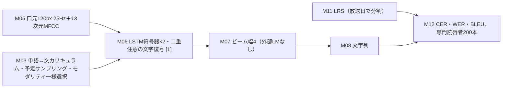

# Lip Reading Sentences in the Wild（Chung, Senior, Vinyals, Zisserman, CVPR 2017）専門査読：構成要素別の全分野比較

対象：Chung ら [[1]](#ref-1)（固定版は CVPR 2017 の CVF オープンアクセス版、PDF SHA-256 `e3aefbcb…eb75e6`。arXiv v2〔2017-01-30、SHA-256 `d93a2981…180084`〕も全文を読んだ。表5・表8 の数値は両版で一致し、表3 は CVF 版に MODALITY の行が加わり LRW の値も違う。初出は arXiv v1、2016-11）。wiki コミット `730b0b4`。
wiki の台帳（仕様 v2.1.0）の 13 構成要素（M01〜M13）ごとに、信号を問わず同じ要素を扱った論文と比べた。走査は 8,995 台帳フォルダ（版の重複を除くと 7,388 本）。候補は台帳と全文への正規表現で出し、原典を読んで確かめた。
件数は「枠記録」「文字列一致」（目安、上限）「確認済み」（読んで採った研究数）を区別し、数値の出所は「本文確認」「図読み」「台帳のみ」「査読者の計算」で示す。
**状態**：2026-11-12 作成。構成要素の採否と判定は LLM による読みで、話題ごとに先に採否規則を書いてから候補を読んだ。「他に見つからない」は wiki 内の検索の範囲の話で、話題ごとの既知項目の再現率と再現率の目安は付録A に示す。

---

## 要点

変えたのは **M06 処理・復号**（口元映像と音声を別々の LSTM で符号化し、二つの注意で読む文字単位の系列変換 WLAS）、**M03 学習**（単語の例から始めて系列長を伸ばすカリキュラム）、**M11 評価用の正解**（BBC 放送から自動で作った文単位データ LRS、放送日で分割）の三つである。M12 の人間との比較には付随の指摘がある。
映像だけの最良は WAS+CL+SS+BS で WER 50.2%、専門の読唇者は 73.8%（表5、本文確認）。ただし読唇者の値は回答を断った例を除いたもので、含めると 87.6% になる（表5 脚注）。読唇者はテストから無作為に選んだ 200 本を読み、機械の 50.2% がその 200 本で測った値かは書かれていない。
学習手順の寄与は表5 で、何もしない WAS 76.5% からカリキュラムで 61.1%（−15.4 ポイント、相対 −20%）、予定サンプリングで 58.1%、ビーム探索で 50.2%（査読者の計算）。どれも 1 回の学習の値で、乱数種や繰り返しの記載はない。
音声に口元を足すと、きれいな音声で 17.7% → 13.9%（相対 −21%）、0 dB で 62.9% → 42.0%（相対 −33%）になる（表5、査読者の計算）。音声だけでは再学習した Kaldi の 16.8% のほうが LAS の 17.7% より低い。
LRS は放送日で分けているが、話者の重なりは書かれていない。著者は「数千人の話者がいるので話者に依存しない」と述べるだけである（§4）。arXiv v2 §1 は「データを公開する」と書いたが、固定版の CVF 版ではこの文が消えており、後続論文 [[2]](#ref-2)（後続）によれば権利の都合で公開されなかった。

## 何をしたか

入力は 25 Hz の口元 120×120 画素の濃淡画像で、5 フレームの窓を VGG-M 型の畳み込み網に入れ、512 次元の特徴を 3 層 LSTM（256 セル）が逆時間順に読む。音声は 13 次元 MFCC を同じ形の LSTM が読む（§2.1–2.2、§3.5、本文確認）。
復号器は 3 層 LSTM（512 セル）で、各出力ステップで映像と音声に独立した注意をかけ、45 記号（英字・数字・句読点・制御記号）を出す（§2.3、§3.5）。復号は幅 4 のビーム探索で、外部の言語モデルは使わない（§5.1）。
学習は単語の例から長さを伸ばすカリキュラム、0 から 0.25 まで段階的に上げる予定サンプリング、例ごとに「音声のみ・口元のみ・両方」を一様に選ぶ多モーダル学習、後半での白色雑音（10 dB、0 dB）の付加からなる（§3.1–3.4）。顔の映らない 342,644 文の音声だけのデータを「音声のみ」の回に使い、著者はこれで言語モデルも豊かになるとしている（§3.3、表4）。
データは BBC の 6 番組 4,960 時間から 118,116 文を取り、訓練 2010-01〜2015-12、検証 2016-01〜02、テスト 2016-03〜09 に分ける（表1・表2）。手順は同時期の同グループの単語単位データ LRW [[3]](#ref-3) とほぼ同じで、字幕の強制整列、IBM Watson による選別、音声映像の同期と話者判定を使う（§4）。

| 対象論文の主要数値 | 値 | 出所 |
|---|---|---|
| LRS の規模 | 118,116 文、807,375 語、語彙 17,428 | 表2・表3（本文確認） |
| 分割 | 訓練 101,195／検証 5,138／テスト 11,783 文、テスト語彙 6,882 のうち 6,253 が訓練・検証に出る | 表2（本文確認） |
| 映像のみ（LRS テスト、CER／WER） | WAS 59.9／76.5、+CL 47.1／61.1、+SS 42.4／58.1、+BS 39.5／50.2 | 表5（本文確認） |
| 専門読唇者（200 本、CER／WER） | 58.7／73.8（断った例を含めると 78.9／87.6） | 表5（本文確認） |
| 音声のみ（WER、clean／10 dB／0 dB） | LAS 17.7／37.6／62.9、Kaldi 16.8（clean）、Google 22.6（clean） | 表5（本文確認） |
| 音声＋口元（WER、clean／10 dB／0 dB） | 13.9／27.6／42.0 | 表5（本文確認） |
| 外部データ（WER） | LRW 23.8%（従来 38.9%）、GRID 3.0% | 表8（本文確認） |
| 学習・復号の費用 | Titan X 1 枚で約 50 万反復・約 10 日、5 秒の文を約 0.5 秒で復号 | §3.5・§5.1（本文確認） |

本文に書かれていないこと：テスト話者と訓練話者の重なり、機械の 50.2% が読唇者と同じ 200 本で測った値か、表5 の各行が別々に学習したモデルか、雑音テストの雑音の種類（学習は白色雑音）、乱数種と繰り返し回数、図5 を描いた評価集合、LRW のテスト映像と LRS の訓練映像の重なり。

## それまでの到達点

**M06（注意つき系列変換）**：音声以外の信号から注意つきの符号器・復号器で記号列を出す研究は、wiki 内の検索では対象より前（2016-05 以前）にも同時期（〜2017-05）にも見つからなかった（付録A、この期間の候補はすべて読んだ。話題全体の再現率の目安は 0.33）。
同時期の LipNet [[4]](#ref-4)（同時期）は CTC で GRID の文を読み、著者も関連研究で触れている（§1.1）。系列変換そのものは音声認識の LAS（Chan ら）から採ったと著者が明記しており、wiki 外の技術の持ち込みである。
注意を使わない符号器・復号器は、後続の皮質電位からの文復号 [[5]](#ref-5)（後続）が使い、注意つきは後続の EEG [[6]](#ref-6)（後続）や音響センシングの無声発話 [[7]](#ref-7)（後続）に広がった。

**M03（長さのカリキュラム）**：系列長を伸ばす学習手順は、wiki 内の検索では対象より前に見つからなかった（再現率の目安 0.78、既知項目 5/5）。同時期の単語分類の研究には後段を段階的に足す学習があるが、系列長は変えない。

**M11（実環境の文単位データ）**：それまでの公開の唇読みデータは GRID（語彙 51、33,000 文）と単語単位の LRW（500 語）で、固定版の表3 はこの二つに MODALITY（語彙 182）を加えた三つと比べている（arXiv v2 の表3 は二つ）。同時期の Miao ら [[8]](#ref-8)（同時期）は先行研究の課題設定に従い、YouTube の作業解説動画 94 時間（訓練 90・テスト 4 時間）で音声映像認識を評価したが、映像は話者が映らないこともある場面特徴で、口元のデータではない（境界例として除外）。

**継いだ部品**：M01・M04（放送の通常発声）、M02（字幕の強制整列と市販音声認識での選別）、M05（口元の切り出しと 5 フレームの早期融合）は LRW [[3]](#ref-3) の手順を継ぐ。M07 は LAS 型の復号器に内在する言語モデルとビーム探索、M08 は文字列、M13 は単一 GPU での学習で、いずれも通例どおりである。

## 何が変わったか

**M06**：二重注意により、片方の入力がない場合や二つの入力の時刻がずれている場合でも同じモデルで読める、と著者は述べる（§2.3）。注意なしでは WER が 100% を超えたので結果は載せない、双方向の符号器は改善がなかった、とも書くが、どちらも数値は示されていない。
映像だけの 50.2% が従来手法より良いことは、同じデータでの別方式の比較がないので、方式の効果とデータ規模の効果を分けられない。外部データでの比較も、LRS で事前学習したモデルを 1 エポック微調整した値と、LRS を使わない従来値の比較である（§5.3–5.4）。後続の LSVSR [[9]](#ref-9)（後続）は同じデータで WAS 型の再実装（WER 76.8%）と自身の CTC 方式（40.9%）を並べており、データを揃えれば WLAS 型が最良とは限らないことを示す（同論文の表、本文確認）。
GRID の 3.0% は、各話者から 255 文をテストに取る無作為分割（話者が重なる条件）の値で、同時期の LipNet の 4.8% も同じ分割の値である（表8、本文確認）。
後続では、同じグループの Transformer 系列変換 [[10]](#ref-10)（後続）、[[2]](#ref-2)（後続）が WLAS の構成を置き換え、後者は LRS2-BBC での WAS の値を 70.4% として載せる（後続、同論文の表2 で本文確認、評価条件の記載なし）。

**M03**：カリキュラムだけで WER が 76.5% → 61.1% と最も大きく下がる（表5）。著者は「収束が数倍速く、過学習も大きく減る。おそらく自然なデータ増強として働くため」と述べるが、収束曲線や訓練誤差は示していない（§3.1）。
最も強い交絡は、学習の順序（短い→長い）の効果と、文の部分系列を学習例に足す増強の効果が分けられていないことである。著者自身が増強の可能性を挙げ、後続の Prajwal ら [[11]](#ref-11)（後続）は「改善はカリキュラムではなくデータ増強から来る」と主張して、部分系列の増強だけで置き換えた。
76.5% の基準は文全体で最初から学習したもので、§3.5 の停止規則（検証誤差が 5,000 反復改善しなければ停止）が基準モデルにも同じく適用されたかは書かれていない。後続ではこの手順を 17 本（本文確認 13、台帳のみ 4）が使い（付録A）、Deep AVSR [[2]](#ref-2)（後続）§5.2 はほぼ同じ文で「新しい戦略」と書いている。

**M11**：LRS は語彙 17,428 で、GRID・LRW より一桁以上大きい（表3）。テスト語彙の 6,882 語のうち 629 語（9.1%）は訓練・検証に現れない（査読者の計算）。また 6,641 語（96.5%）は音声のみの訓練データに現れる（表2 脚注、査読者の計算）。このデータは復号器も学ぶので、内在言語モデルはテストの語をほぼ見ている。
放送日で分けても、ニュースの司会者や常連の出演者は訓練とテストの両方に出うる。同時期の LRW [[3]](#ref-3)（同時期）自身が、BBC News の司会者などが繰り返し映ると書いている（§2）。後続の LRS3 論文 [[12]](#ref-12)（後続）は、同じ BBC 由来の LRS2-BBC について同じ人物が回をまたいで出やすいと書いている。

## 分野での位置づけ

| 枠 | 対象論文の選択 | 分野の通例（件数と層） | 判定 |
|---|---|---|---|
| M01 学習時の行為 | 放送の通常発声 | 枠記録 3,882／7,388 | standard |
| M02 学習専用の教師 | 字幕の強制整列、IBM Watson で選別 | 枠記録が疎（31）、通例の数は出さない | standard |
| M03 学習・適応 | 単語→文の長さカリキュラム、予定サンプリング、モダリティの一様選択、白色雑音 | 確認済み 18（先行 0、同時期 0、後続 17、対象を含む） | standard |
| M04 利用時の行為 | 放送の通常発声 | 枠記録 5,595 | standard |
| M05 計測 | 口元 120 画素の濃淡 25 Hz、13 次元 MFCC | 枠記録 7,329 | standard |
| M06 処理・復号 | LSTM 符号器×2 と二重注意の文字復号 | 確認済み 36（先行 0、同時期 0、後続 35、対象を含む） | standard |
| M07 利用時の補助 | 外部言語モデルなし、ビーム幅 4 | 文字列一致 745（枠記録は疎、119） | standard |
| M08 出力 | 文字（45 記号） | 枠記録 3,268 | standard |
| M09 確認 | なし（オフライン） | 枠記録 82 | not_applicable |
| M10 訂正 | なし（オフライン） | 枠記録 82 | not_applicable |
| M11 評価用の正解 | LRS、放送日で分割、話者の重なりは未記載 | 確認済み 5（先行 0、対象と後続 4） | not_reported |
| M12 評価 | CER・WER・BLEU、1 回の評価、読唇者 200 本 | 確認済み 7（先行 2、同時期 2、後続 2、対象） | not_reported |
| M13 装置・運用 | Titan X 1 枚で約 10 日、データは非公開に終わる（公開の約束は arXiv v2 のみ） | 枠記録 6,075 | standard |

M03 と M06 は、wiki 内では対象より前の例がないが ahead にしない。M03 は効果が一つのデータでの 1 回の学習で、増強の効果とも分けられていない。M06 は LRS・LRW・GRID で結果があるが、後二つは LRS で学習したモデルの微調整で、方式の効果とデータ規模の効果が分けられず、話題の再現率の目安も 0.33 と低い。

## 主張の範囲

「専門の読唇者を上回る」は、表5 の数値の上では成り立つ（50.2% 対 73.8%）。差の向きは、読唇者が断った例を除いた有利な値を使っても変わらない。
ただし条件は対等ではない。読唇者は顔全体を見て番組名を知らされ、訓練映像を見て、映像の長さの 10 倍の時間を使えた（§5.2）。機械は口元だけを見るが、LRS の訓練と 34 万文の音声のみの文で学んでいる。読唇者 1 社（経験約 10 年）の 1 回の判定で、ばらつきは測れない。
先行の Hilder ら [[13]](#ref-13) は文字 A–F で機械と学生 17 人を、Ma と Leijon [[14]](#ref-14) は VCV 無意味語で視覚のみの HMM と健聴 10 人を比べており、同時期の LipNet [[4]](#ref-4)（同時期）は GRID の未知話者で聴覚障害のある 3 人と比べた。大語彙の文で機械と人間を比べた研究は 2001 年にもあるが、人間の条件は音声のみと音声映像だった（付録A）。映像のみ・文単位・開語彙で読唇者と比べた例は、wiki 内の検索では対象より前に見つからなかった（再現率の目安 0.81、独立の別検索で 1 件の見落としが見つかったので過大）。ただし同じ 200 本で機械を測ったかが書かれていないので、比較の精度は落ちる。
「口元は、きれいな音声でも認識を助ける」は CER 10.4% → 7.9%、WER 17.7% → 13.9% で示されている（表5、本文確認）。ただし音声だけでも Kaldi の 16.8% との差は小さく、雑音条件は学習と同じ 10 dB と 0 dB である（雑音の種類はテスト側で未記載）。

## 実用上の意味

文単位・開語彙・実環境の唇読みを、測れる課題にした点が大きい。LRS 自体は公開されなかったが、手順は LRS2-BBC と LRS3-TED [[12]](#ref-12)（後続）に引き継がれ、以後の標準ベンチマークになった。
一方で、データは通常の発声を撮った放送映像で、無声発話の利用者にそのまま移せる根拠はない。復号は文全体を見てから行う一括方式で、著者自身が逐次型への拡張を今後の課題に挙げている（§6）。

## 前進、未解決、後退した軸

- 前進：文単位・開語彙の唇読み、注意つき系列変換の唇読みへの導入、長さのカリキュラム、人間の読唇者との文単位の比較。
- 未解決：話者の分離、繰り返しによるばらつき、人間との対等な比較、雑音種の幅、逐次復号。
- 後退：なし。ただしデータが公開されず、同じ数値を他者が再現できなかった。

## 限界

- 著者自身の注記：注意は単調に進むべきなのに制約がない、文全体を見る一括復号である（§6）。文は GPU メモリのため 100 文字か 10 秒で切った（§4）。
- 本文内の不一致：固定版の CVF 版 §5.1 本文は、口元を足したときの CER を「16.2% から 13.3% に下がる」と書くが、同じ版の表5 は 10.4% → 7.9% である（arXiv v2 の本文は 10.4% → 7.9%、本文確認）。CER と WER の定義で、N を参照の単語数としている（CER なら文字数のはず、§5.1）。表3 の LRW の発話数・語数は arXiv v2 で 400,000、CVF 版で 450,000 になっている。
- 図5（ビーム幅と WER）は評価集合を書いていない。縦軸の範囲は 50〜60% で、表5 の値と合う（図読み、読み取り誤差 ±1 ポイント程度）。

## 残る問い

- 機械の 50.2%（表5）は、読唇者が読んだ 200 本で測るとどうなるか。断った例も含めて比べるとどうか。
- 表5 の各行は、学習手順だけを変えて別々に学習したモデルか。反復回数と停止条件は揃っているか。
- LRS の訓練とテストに同じ話者はどれくらい重なっているか。
- 雑音テストの雑音は学習と同じ白色雑音か。
- LRW のテスト映像は LRS の訓練期間の放送と重なっていないか。
- 音声のみの 34 万文を除くと、映像のみの WER はどれだけ変わるか。

## 付録A　検討した論文

走査：wiki の全 8,995 台帳フォルダ（版の重複を除くと 7,388 本）を、枠の記入状態と台帳文字列への正規表現で数え、全文への正規表現で台帳が拾わない候補を探した。確認済みは原典の本文（一部は台帳スニペット、監査 JSON に区別を記録）を読んで採否を決めた研究数で、版の重複は 1 件とし、対象自身を含む。期間は対象の初出 2016-11 から ±6 か月を同時期とした。

| 話題 | 枠記録 | 文字列一致 | 確認済み | 読んだ候補／未読 | 既知項目の再現率 | 再現率の目安 |
|---|---:|---:|---:|---|---|---|
| M06 注意つき系列変換 | 7,345 | 210 | 36 | 115／441 | 7/7 | 0.33（全文のみの標本 30 本中 6 本） |
| M03 長さのカリキュラム | 1,526 | 39 | 18 | 71／5 | 5/5 | 0.78（標本 30 本中 4 本） |
| M11 実環境の文単位データ | 234 | 271 | 5 | 49／293 | 6/6 | 0.6（標本 19 本中 2 本） |
| M12 人間の読唇者との比較 | 6,960 | 64 | 7 | 116／0 | 4/5（研究単位 4/4） | 0.81（標本 30 本中 1 本、独立の別検索で見落とし 1 件があり過大） |

M06：2017-05 以前に初出の候補はすべて読み、採ったのは対象だけである。LRW [[3]](#ref-3) は台帳に「WLAS」とあるが、本文は畳み込み網による 500 単語分類で、台帳の誤りとして除いた。Makin ら [[5]](#ref-5) は注意機構を使わないので除いた。採った後続は Deep Lip Reading、Deep AVSR、EEG・音響センシング・超音波など 35 本で、多くは台帳スニペットでの判定（台帳のみ 24 本）。未読 441 本は大半が 2018 年以降で、確認済み 36 は下限である。

M03：先行・同時期は 0。後続 17 本は Deep Lip Reading（2 語から伸ばす）、Deep AVSR、LiRA（155 フレーム未満から）、AV-RelScore（100→600 フレーム）など。雑音の強さ・データ集合の順序のカリキュラムは除いた。Prajwal ら [[11]](#ref-11) は長さのカリキュラムを部分系列の増強で置き換えると明記しているので除いた。

M11：確認済みは LRS（対象）、LSVSR [[9]](#ref-9)、LRS3-TED [[12]](#ref-12)、VoxLRS-SA、ViCocktail（いずれも後続）。2017-05 以前の候補はすべて読み、Miao ら [[8]](#ref-8)（同時期）は境界例として除いた。単語単位の LRW-Persian（後続）も除いた。未読 293 本が残る。

M12：確認済みは Hilder ら [[13]](#ref-13)（先行、2009）、Ma と Leijon [[14]](#ref-14)（先行、2009。監査の正規表現が落とし、独立評価の別検索で見つかった）、LipNet [[4]](#ref-4)（同時期）、VLRF [[15]](#ref-15)（同時期、聴覚障害 9 人・健聴 15 人と自動認識系）、LSVSR [[9]](#ref-9)（後続、専門読唇者 86.4%／92.9% WER）、Jain と Harte [[16]](#ref-16)（後続）と対象。人間の成績を文献から引いただけの研究（Movellan 1999 など）と、人間の条件に映像のみがない Potamianos ら 2001（境界例）は除いた。

## 付録B　数値の出所

- 本文確認：対象論文の表1〜表5・表8（データ規模、分割、CER・WER・BLEU、外部データ）、§2〜§3（構成、学習手順、Titan X、約 10 日、50 万反復）、§4（100 文字・10 秒、放送日の分割、話者に関する記述）、§5.1（ビーム幅 4、0.5 秒、評価指標の定義）、§5.2（読唇者 200 本と条件）、表3 の版差（arXiv v2 と CVF 版）、CVF 版 §5.1 本文の CER 16.2%→13.3%、§3.5 の停止規則（5,000 反復）、arXiv v2 §1 の公開の文。LRW §2 の繰り返し映る人物の記述。LSVSR の WAS 型再実装 76.8% と V2P 40.9%。Ma と Leijon の視覚のみ HMM が人間を上回る記述。Prajwal らの増強に関する主張。Deep AVSR §1 のデータ非公開の記述と表2 の WAS 70.4%。LRS3 §2 の話者に関する記述。LipNet の GRID 4.8%（重なりのある分割）と聴覚障害のある 3 人との比較。LSVSR の 86.4%／92.9%。
- 図読み：図5 の縦軸 50〜60%（読み取り誤差 ±1 ポイント程度）。
- 台帳のみ：付録A の後続の採否の一部（監査 JSON に記録）。本文の主張には使っていない。
- 照合できなかったもの：機械の 50.2% の評価対象（全テストか 200 本か）、雑音テストの雑音の種類。
- 査読者の計算：76.5→61.1 の −15.4 ポイントと相対 −20%、61.1→58.1→50.2 の差、17.7→13.9 の相対 −21%、62.9→42.0 の相対 −33%、テスト語彙の未出現 629 語（9.1%）と 6,641 語（96.5%）。

## 参考文献

番号は本文での初出順。BibTeX は同じ番号順・同じキーで [lip-reading-sentences-in-the-wild.bib](lip-reading-sentences-in-the-wild.bib) にある。

1. Chung, J. S., Senior, A., Vinyals, O., Zisserman, A. “Lip Reading Sentences in the Wild.” *Proc. IEEE Conference on Computer Vision and Pattern Recognition (CVPR)*, 2017, 3444–3453. doi:[10.1109/CVPR.2017.367](https://doi.org/10.1109/CVPR.2017.367). arXiv:[1611.05358](https://arxiv.org/abs/1611.05358). 本査読の対象論文（CVF オープンアクセス版を固定版として読み、arXiv v2 と照合。頁は IEEE 刊行版の登録による。CVF 版 PDF の印字頁は 6447–6456）。 [レビュー](https://github.com/supernaiter/silent-speech-review/tree/main/reviews/lip-reading-sentences-in-the-wild) [wiki: arxiv-1611.05358](https://github.com/supernaiter/deep-research-wiki-for-silent-speech/blob/main/papers/arxiv-1611.05358/article.md) [wiki: cvf-chung17-lipreadwild](https://github.com/supernaiter/deep-research-wiki-for-silent-speech/blob/main/papers/cvf-chung17-lipreadwild/article.md)
2. Afouras, T., Chung, J. S., Senior, A., Vinyals, O., Zisserman, A. “Deep Audio-Visual Speech Recognition.” *IEEE Transactions on Pattern Analysis and Machine Intelligence*, 2018. doi:[10.1109/TPAMI.2018.2889052](https://doi.org/10.1109/TPAMI.2018.2889052). arXiv:[1809.02108v2](https://arxiv.org/abs/1809.02108v2). ［後続］ [レビュー](https://github.com/supernaiter/silent-speech-review/tree/main/reviews/deep-audio-visual-speech-recognition) [wiki: arxiv-1809.02108](https://github.com/supernaiter/deep-research-wiki-for-silent-speech/blob/main/papers/arxiv-1809.02108/article.md) [wiki: doi-10.1109-tpami.2018.2889052](https://github.com/supernaiter/deep-research-wiki-for-silent-speech/blob/main/papers/doi-10.1109-tpami.2018.2889052/article.md)
3. Chung, J. S., Zisserman, A. “Lip Reading in the Wild.” *Proc. Asian Conference on Computer Vision (ACCV 2016), LNCS 10111*, 2016, 87–103. doi:[10.1007/978-3-319-54184-6_6](https://doi.org/10.1007/978-3-319-54184-6_6). ［同時期］ [wiki: w2594690981-lrw](https://github.com/supernaiter/deep-research-wiki-for-silent-speech/blob/main/papers/w2594690981-lrw/article.md) [wiki: doi-10.1007-978-3-319-54184-6_6](https://github.com/supernaiter/deep-research-wiki-for-silent-speech/blob/main/papers/doi-10.1007-978-3-319-54184-6_6/article.md)
4. Assael, Y. M., Shillingford, B., Whiteson, S., de Freitas, N. “LipNet: End-to-End Sentence-level Lipreading.” *arXiv preprint*, 2016. arXiv:[1611.01599](https://arxiv.org/abs/1611.01599). ［同時期］ [レビュー](https://github.com/supernaiter/silent-speech-review/tree/main/reviews/lipnet-end-to-end-sentence-level-lipreading) [wiki: arxiv-1611.01599](https://github.com/supernaiter/deep-research-wiki-for-silent-speech/blob/main/papers/arxiv-1611.01599/article.md)
5. Makin, J. G., Moses, D. A., Chang, E. F. “Machine translation of cortical activity to text with an encoder–decoder framework.” *Nature Neuroscience*, 2020, 23, 575–582. doi:[10.1038/s41593-020-0608-8](https://doi.org/10.1038/s41593-020-0608-8). ［後続］ [wiki: pmc-10560395-makin](https://github.com/supernaiter/deep-research-wiki-for-silent-speech/blob/main/papers/pmc-10560395-makin/article.md)
6. Krishna, G., Han, Y., Tran, C., Carnahan, M., Tewfik, A. H. “State-of-the-art Speech Recognition using EEG and Towards Decoding of Speech Spectrum From EEG.” *arXiv preprint*, 2019. arXiv:[1908.05743](https://arxiv.org/abs/1908.05743). ［後続］ [wiki: arxiv-1908.05743-eegasr](https://github.com/supernaiter/deep-research-wiki-for-silent-speech/blob/main/papers/arxiv-1908.05743-eegasr/article.md)
7. Luo, J., Wang, J., Cheng, N., Jiang, G., Xiao, J. “End-to-End Silent Speech Recognition with Acoustic Sensing.” *arXiv preprint*, 2020. arXiv:[2011.11315](https://arxiv.org/abs/2011.11315). ［後続］ [レビュー](https://github.com/supernaiter/silent-speech-review/tree/main/reviews/end-to-end-silent-speech-recognition-with-acoustic-sensing) [wiki: arxiv-2011.11315](https://github.com/supernaiter/deep-research-wiki-for-silent-speech/blob/main/papers/arxiv-2011.11315/article.md)
8. Miao, Y., Metze, F. “Open-Domain Audio-Visual Speech Recognition: A Deep Learning Approach.” *Proc. Interspeech 2016*, 2016. doi:[10.21437/Interspeech.2016-412](https://doi.org/10.21437/Interspeech.2016-412). ［同時期］ [wiki: isca-miao16-opendomain](https://github.com/supernaiter/deep-research-wiki-for-silent-speech/blob/main/papers/isca-miao16-opendomain/article.md)
9. Shillingford, B., Assael, Y., Hoffman, M. W., Paine, T., Hughes, C., Prabhu, U., et al. “Large-Scale Visual Speech Recognition.” *arXiv preprint*, 2018. arXiv:[1807.05162](https://arxiv.org/abs/1807.05162). ［後続］ [wiki: arxiv-1807.05162](https://github.com/supernaiter/deep-research-wiki-for-silent-speech/blob/main/papers/arxiv-1807.05162/article.md) [wiki: isca-shillingford19-largescale](https://github.com/supernaiter/deep-research-wiki-for-silent-speech/blob/main/papers/isca-shillingford19-largescale/article.md) [wiki: isca-shillingford19_interspeech](https://github.com/supernaiter/deep-research-wiki-for-silent-speech/blob/main/papers/isca-shillingford19_interspeech/article.md)
10. Afouras, T., Chung, J. S., Zisserman, A. “Deep Lip Reading: a comparison of models and an online application.” *Proc. Interspeech 2018*, 2018. arXiv:[1806.06053](https://arxiv.org/abs/1806.06053). ［後続］ [wiki: arxiv-1806.06053](https://github.com/supernaiter/deep-research-wiki-for-silent-speech/blob/main/papers/arxiv-1806.06053/article.md) [wiki: isca-afouras18b-deeplip](https://github.com/supernaiter/deep-research-wiki-for-silent-speech/blob/main/papers/isca-afouras18b-deeplip/article.md) [wiki: isca-afouras18b_deeplipread](https://github.com/supernaiter/deep-research-wiki-for-silent-speech/blob/main/papers/isca-afouras18b_deeplipread/article.md) [wiki: isca-afouras18b_interspeech](https://github.com/supernaiter/deep-research-wiki-for-silent-speech/blob/main/papers/isca-afouras18b_interspeech/article.md)
11. Prajwal, K. R., Afouras, T., Zisserman, A. “Sub-word Level Lip Reading With Visual Attention.” *Proc. IEEE/CVF Conference on Computer Vision and Pattern Recognition (CVPR)*, 2022. arXiv:[2110.07603](https://arxiv.org/abs/2110.07603). ［後続］ [レビュー](https://github.com/supernaiter/silent-speech-review/tree/main/reviews/sub-word-level-lip-reading-with-visual-attention) [wiki: arxiv-2110.07603](https://github.com/supernaiter/deep-research-wiki-for-silent-speech/blob/main/papers/arxiv-2110.07603/article.md) [wiki: cvf-prajwal22-subword-vtp](https://github.com/supernaiter/deep-research-wiki-for-silent-speech/blob/main/papers/cvf-prajwal22-subword-vtp/article.md) [wiki: cvpr22-prajwal](https://github.com/supernaiter/deep-research-wiki-for-silent-speech/blob/main/papers/cvpr22-prajwal/article.md)
12. Afouras, T., Chung, J. S., Zisserman, A. “LRS3-TED: a large-scale dataset for visual speech recognition.” *arXiv preprint*, 2018. arXiv:[1809.00496](https://arxiv.org/abs/1809.00496). ［後続］ [wiki: arxiv-1809.00496](https://github.com/supernaiter/deep-research-wiki-for-silent-speech/blob/main/papers/arxiv-1809.00496/article.md)
13. Hilder, S., Harvey, R., Theobald, B. “Comparison of human and machine-based lip-reading.” *Proc. International Conference on Auditory-Visual Speech Processing (AVSP)*, 2009. <https://www.isca-archive.org/avsp_2009/hilder09_avsp.html> [wiki: isca-hilder09_avsp](https://github.com/supernaiter/deep-research-wiki-for-silent-speech/blob/main/papers/isca-hilder09_avsp/article.md)
14. Ma, Z., Leijon, A. “Human Audio-Visual Consonant Recognition Analyzed with Three Bimodal Integration Models.” *Proc. Interspeech 2009*, 2009. doi:[10.21437/Interspeech.2009-60](https://doi.org/10.21437/Interspeech.2009-60). [wiki: isca-ma09_avcon](https://github.com/supernaiter/deep-research-wiki-for-silent-speech/blob/main/papers/isca-ma09_avcon/article.md) [wiki: isca-ma09_avconsonant](https://github.com/supernaiter/deep-research-wiki-for-silent-speech/blob/main/papers/isca-ma09_avconsonant/article.md) [wiki: isca-ma09_interspeech](https://github.com/supernaiter/deep-research-wiki-for-silent-speech/blob/main/papers/isca-ma09_interspeech/article.md)
15. Fernandez-Lopez, A., Martinez, O., Sukno, F. M. “Towards Estimating the Upper Bound of Visual-Speech Recognition: The Visual Lip-Reading Feasibility Database.” *arXiv preprint*, 2017. arXiv:[1704.08028](https://arxiv.org/abs/1704.08028). 本文に IEEE 2017 の著作権表示があり会議版がある（会議版の書誌は未照合）。 ［同時期］ [wiki: arxiv-1704.08028](https://github.com/supernaiter/deep-research-wiki-for-silent-speech/blob/main/papers/arxiv-1704.08028/article.md)
16. Jain, R., Harte, N. “The Lipreading Gap: Do VSR Models Perceive Visual Speech Like Human Lipreaders?.” *arXiv preprint*, 2026. arXiv:[2606.07435](https://arxiv.org/abs/2606.07435). ［後続］ [wiki: arxiv-2606.07435](https://github.com/supernaiter/deep-research-wiki-for-silent-speech/blob/main/papers/arxiv-2606.07435/article.md) [wiki: arxiv-2606-07435-lipgap](https://github.com/supernaiter/deep-research-wiki-for-silent-speech/blob/main/papers/arxiv-2606-07435-lipgap/article.md) [wiki: arxiv-2606.07435-lipgap](https://github.com/supernaiter/deep-research-wiki-for-silent-speech/blob/main/papers/arxiv-2606.07435-lipgap/article.md) [wiki: isca-jain26_interspeech](https://github.com/supernaiter/deep-research-wiki-for-silent-speech/blob/main/papers/isca-jain26_interspeech/article.md)
