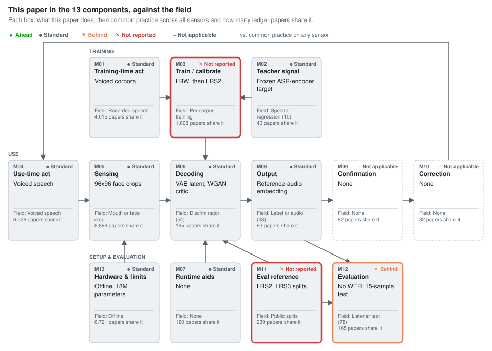

# Lip-to-Speech Synthesis for Arbitrary Speakers in the Wild

Sindhu B Hegde, K R Prajwal, Rudrabha Mukhopadhyay, Vinay P Namboodiri, C. V. Jawahar. ACM Multimedia (MM '22), 2022. [doi:10.1145/3503161.3548081](https://doi.org/10.1145/3503161.3548081) · [arXiv:2209.00642](https://arxiv.org/abs/2209.00642)

**Section:** [Lip & face video](../../README.md#lip--face-video)

## Figures

### This paper in the 13 components, against the field

<picture><source media="(prefers-color-scheme: dark)" srcset="figures/components-dark.svg"></picture>

Verdicts compare the paper's choice for each component with common practice across 8,995 ledger entries on any sensor (silent speech, brain-to-text, lip reading).

Data

| Component | This paper | Common practice | Papers with this practice | Verdict |
| --- | --- | --- | --- | --- |
| M01 Training-time act | Voiced corpora | Recorded speech | 4,015 of 8,995 | ● Standard (Inherited.) |
| M02 Teacher signal | Frozen ASR-encoder target | Spectral regression (10) | 40 of 8,995 | ● Standard (Ablation on one run.) |
| M03 Train / calibrate | LRW, then LRS2 | Per-corpus training | 1,608 of 8,995 | ✕ Not reported (Seeds and selection not stated.) |
| M04 Use-time act | Voiced speech | Voiced speech | 6,538 of 8,995 | ● Standard (Inherited.) |
| M05 Sensing | 96x96 face crops | Mouth or face crop | 8,898 of 8,995 | ● Standard (Inherited.) |
| M06 Decoding | VAE latent, WGAN critic | Discriminator (54) | 165 of 8,995 | ● Standard (VAE route uncited.) |
| M07 Runtime aids | None | None | 120 of 8,995 | ● Standard (Wrong words conceded.) |
| M08 Output | Reference-audio embedding | Label or audio (48) | 93 of 8,995 | ● Standard (Needs a voice recording.) |
| M09 Confirmation | None | None | 82 of 8,995 | – Not applicable (Offline.) |
| M10 Correction | None | None | 82 of 8,995 | – Not applicable (Offline.) |
| M11 Eval reference | LRS2, LRS3 splits | Public splits | 239 of 8,995 | ✕ Not reported (Test counts not stated.) |
| M12 Evaluation | No WER; 15-sample test | Listener test (78) | 165 of 8,995 | ▼ Behind (Drops lineage WER.) |
| M13 Hardware & limits | Offline, 18M parameters | Offline | 6,721 of 8,995 | ● Standard (Inherited.) |

## Verdict

The paper [[1]](#ref-1) changes the training target (M02, frozen ASR-encoder content), the decoder (M06, VAE latent with adversarial critic) and voice control (M08, reference-audio embedding); each is standard. Its in-the-wild claim rests on distribution and sync metrics and a listener test on 15 LRS2 samples (Sec. 4.3), without the word error rate its own lineage reported [[2]](#ref-2) (M12, behind on protocol). On LRS2 it beats the authors' sequence-to-sequence baseline on FDSD and sync (LSE-C 2.507 against 1.991) but not on PESQ and STOI (Table 3); content is unmeasured. In the same group's [later], harder test (10 LRS3 sentences of 10 s or longer), its intelligibility is rated 1.07 of 5 against 3.49 for their successor [[3]](#ref-3). SED is not shown to be independent of the voice loss's identity network (Sec. 3.2.7, 4.1.2), and the test-time voice reference is not stated (Sec. 3.2.4). The claim to be the first to handle ambiguity explicitly (Sec. 1) omits an earlier variational-autoencoder model sharing an author [[4]](#ref-4) (Appendix).

## Against the field, component by component

### M02 Training-only supervision: ASR-encoder content target

**Usual approach:** Of 40 unique studies supervising non-acoustic speech synthesis with paired speech (pattern match, Appendix), 10 regress spectra, 4 use a deep feature loss and 3 a speech-autoencoder latent. The paper ties lip and speech-content Gaussians by a KL loss (Sec. 3.2.3), the content coming from a frozen ASR encoder (Sec. 3.2.2).

**State of the art:** In a 2023 ablation a speech-unit target lowered LRS3 output WER from 72.5% to 50.7% [[5]](#ref-5) [later]; in 2024 V2SFlow reached 28.5% (real speech 2.5%) [[6]](#ref-6) [later]. The gap is unmeasured: the target reports no WER.

With a speech encoder trained from scratch in its place ("w/o Content Encoder", Sec. 4.2.1), LRS2 FDSD rises from 1.273 to 2.856 and rated intelligibility falls from 3.22 to 2.51 (Tables 3-4). Verdict: standard.

### M06 Processing: VAE latent with adversarial critic

**Usual approach:** Of 165 unique video-to-speech studies (pattern match, Appendix), 54 use a discriminator on the acoustic output, 22 diffusion and 19 flow decoders. The paper follows them and adds a Gaussian lip latent.

**State of the art:** In 2025 the Faces-to-Voices flow decoder reaches 30.45% LRS3 WER (Whisper Medium, voice inferred from the face) [[7]](#ref-7) [later]; V2SFlow's 28.5% [[6]](#ref-6) uses an audio-derived voice and another ASR.

On LRS2 the VAE-GAN's PESQ and STOI (0.60, 0.34) are 38% and 21% below the L1 sequence-to-sequence baseline (0.97, 0.43; Sec. 4.2.1) (inference), while FDSD improves from 3.840 to 1.273 (Table 3). Lip-to-text plus TTS has the lowest FDSD (0.984) despite LSE-D 19.012: FDSD ignores sync and does not score words, so closeness to it (Sec. 4.2.3) is not content evidence. Verdict: standard.

### M08 Output: voice from a reference-audio embedding

**Usual approach:** Of 93 unique studies setting the voice of non-acoustic speech synthesis (pattern match, Appendix), the usual design, a speaker label or reference-audio embedding, appears in 48; 23 name reference audio and 23 a face image. The paper uses one second of reference audio (Sec. 3.2.4).

**State of the art:** In 2023 DiffV2S took the speaker embedding from video alone, with voice-match MOS 3.91 on LRS3 [[8]](#ref-8) [later]; "any voice" here needs a recording of it.

LRS2 SED is 5.95 against 6.13 to 6.47 for baselines (Table 3), but SED names no encoder (Sec. 4.1.2) and may reuse the voice loss's identity network (Sec. 3.2.7) (inference). Rated voice match is 2.69 of 5 (Table 4). Verdict: standard.

### M12 Evaluation: no word error rate

**Usual approach:** Of 165 unique video-to-speech studies (pattern match, Appendix), 78 run a listener test, 65 score ASR WER on the output and 52 test unseen speakers. The paper has the first and third, not WER.

**State of the art:** Earlier GRID WERs: 26.6% for the 2019 GAN on seen speakers [[9]](#ref-9), 14.08% for Lip2Wav [[2]](#ref-2), 51.6% speaker-independent for vid2voc [[10]](#ref-10); in 2024 V2SFlow reaches 28.5% on LRS3 unseen speakers [[6]](#ref-6) [later], and text-guided LipVoicer 21.4% on LRS3 and 17.8% on LRS2 under another ASR [[11]](#ref-11) [later].

Its GRID table (Table 2) drops the WER that Lip2Wav and the GAN reported. Rated intelligibility is 3.22 (p ≈ 0.035, unspecified t-test). Verdict: behind the best comparable work (its own lineage) on protocol; no deficit is measured.

## The 13 components

| Component | This paper | Usual approach (count) | State of the art | Verdict |
|---|---|---|---|---|
| M01 Training-time action | Voiced corpora | Recorded speech (slot-filled 4,015) | – | standard |
| M02 Training-only supervision | Frozen ASR-encoder target | Spectral regression (10) (pattern match 40) | 28.5% LRS3 WER [[6]](#ref-6) | standard |
| M03 Training and adaptation | LRW, then LRS2 | Per-corpus training (slot-filled 1,608) | – | not reported |
| M04 Use-time action | Voiced speech | Voiced speech (slot-filled 6,538) | – | standard |
| M05 Sensors | 96x96 face crops | Mouth or face crop (slot-filled 8,898) | – | standard |
| M06 Processing and decoding | VAE latent, WGAN critic | Discriminator (54) (pattern match 165) | 30.45% WER, face voice [[7]](#ref-7) | standard |
| M07 Lexicon and LM | None | None (slot-filled 120) | – | standard |
| M08 Output | Reference-audio embedding | Label or audio (48) (pattern match 93) | MOS 3.91 [[8]](#ref-8) | standard |
| M09 Confirmation | None | None (slot-filled 82) | – | not applicable |
| M10 Correction | None | None (slot-filled 82) | – | not applicable |
| M11 Reference construction | LRS2, LRS3 splits | Public splits (slot-filled 239) | – | not reported |
| M12 Evaluation | No WER; 15-sample test | Listener test (78) (pattern match 165) | 28.5% WER [[6]](#ref-6) | behind |
| M13 Device and cost | Offline, 18M parameters | Offline (slot-filled 6,721) | – | standard |

## Where the claims outrun the evidence

- "Outperform all baselines by a large margin" (Abstract) holds for FDSD, KDSD and LSE, not PESQ and STOI (Table 3); the authors call these unsuitable (Sec. 4.2.3) but offer no content metric.
- No seeds or variances (Sec. 4.2.3) and no test-set sizes (Table 3 caption); the t-test names no unit, pairing or correction across 4 criteria and 7 systems (Sec. 4.3, Table 4).
- The authors concede wrong words and non-frontal failures (Sec. 6); non-frontal FDSD is 3.473 against 1.351, 2.6 times higher (inference) (Supplement Table 8).

## What the field needs next

- M12: ASR WER against the real-speech floor on LRS2 and LRS3, over several samples and seeds.
- M06: VAE latent against a deterministic decoder on WER.
- M08: voice references from another utterance, scored by a speaker encoder unused in training.
- M02: ASR-encoder, unit and mel targets on one encoder, scored by WER.

## Questions for the authors

- Which recording supplies the voice reference for each test video?
- How many runs underlie Tables 3-7, and which data selected the checkpoint?
- Were listeners blinded, and which t-test was used?

## Appendix: literature search

- M02 speech-latent-target (published topic table, appended). Inclusion rule: studies that synthesize speech from a non-acoustic signal (articulography, ultrasound, video, EMG, neural recordings) and supervise the signal encoder in training with paired speech, by direct spectral regression or by matching the latent of a speech encoder or autoencoder not used at test; acoustic-input conversion, recognition-only studies and self-generated targets excluded; versions counted once. Slot-filled 31 unique studies; pattern match 40 unique studies. Usual design: direct spectral regression, 10 (pattern match); deep feature loss 4, speech-autoencoder latent 3. Read in full: [[5]](#ref-5) [later], target. Known-item recall 1.0.
- M06 video-to-speech-one-to-many-decoder (published topic table, appended). Inclusion rule: the video-to-speech population of the M06 video-to-speech-synthesis table, classified from full text with the reference list removed by how the decoder handles the one-to-many mapping; a study counts under every design it names (upper bound); versions counted once. Slot-filled 7,345 unique studies; pattern match 165 unique studies. Usual design: discriminator training, 54 (pattern match); speech-unit conditioning 44, diffusion 22, flow 19, pitch or energy predictor 9. Read in full: [[9]](#ref-9), [[7]](#ref-7) [later], [[3]](#ref-3) [later], target. Prior cited outside the topic table: [[4]](#ref-4). Known-item recall 1.0.
- M08 biosignal-to-speech-voice-control (published topic table, appended). Inclusion rule: studies that synthesize speech audio from a non-acoustic speech signal and set the output voice through a speaker representation from reference audio, a speaker label or a face image; single-voice systems, text-to-speech after text decoding and acoustic-input conversion excluded; versions counted once. Slot-filled 3,268 unique studies; pattern match 93 unique studies. Usual design: speaker label or reference-audio embedding, 48 (pattern match); reference audio 23, face image 23. Read in full: [[8]](#ref-8) [later], [[6]](#ref-6) [later], target. Known-item recall 1.0.
- M12 video-to-speech-speaker-held-out-test (published topic table, appended). Inclusion rule: the same 165-study population, counted by evaluation protocol named in full text with references removed (held-out speakers, listener test, ASR WER on the output, repeated runs); a study counts under every protocol it names (upper bound); versions counted once. Slot-filled 6,960 unique studies; pattern match 165 unique studies. Usual design: listener or opinion-score test, 78 (pattern match); ASR WER 65, unseen-speaker test 52 (14 with an index year of 2022 or earlier), repeated runs 2. Read in full: [[2]](#ref-2), [[9]](#ref-9), [[10]](#ref-10), [[3]](#ref-3) [later], [[6]](#ref-6) [later], [[11]](#ref-11) [later], target. Known-item recall 1.0.

## References

Numbered by first citation. BibTeX in the same order and keys: [refs.bib](refs.bib).

1. Hegde, S. B., Prajwal, K. R., Mukhopadhyay, R., Namboodiri, V. P., Jawahar, C. V. “Lip-to-Speech Synthesis for Arbitrary Speakers in the Wild.” *Proceedings of the 30th ACM International Conference on Multimedia (MM '22)*, 2022. doi:[10.1145/3503161.3548081](https://doi.org/10.1145/3503161.3548081). arXiv:[2209.00642](https://arxiv.org/abs/2209.00642). Target. Read as arXiv v1 (1 September 2022), ACM MM '22 text. [review](https://github.com/supernaiter/silent-speech-review/tree/main/reviews/lip-to-speech-synthesis-for-arbitrary-speakers-in-the-wild) [wiki: arxiv-2209.00642](https://github.com/supernaiter/deep-research-wiki-for-silent-speech/blob/main/papers/arxiv-2209.00642/article.md)
2. Prajwal, K. R., Mukhopadhyay, R., Namboodiri, V. P., Jawahar, C. V. “Learning Individual Speaking Styles for Accurate Lip to Speech Synthesis.” *2020 IEEE/CVF Conference on Computer Vision and Pattern Recognition (CVPR)*, 2020, 13793-13802. doi:[10.1109/CVPR42600.2020.01381](https://doi.org/10.1109/CVPR42600.2020.01381). arXiv:[2005.08209](https://arxiv.org/abs/2005.08209). [wiki: arxiv-2005.08209](https://github.com/supernaiter/deep-research-wiki-for-silent-speech/blob/main/papers/arxiv-2005.08209/article.md)
3. Hegde, S., Mukhopadhyay, R., Jawahar, C. V., Namboodiri, V. “Towards Accurate Lip-to-Speech Synthesis in-the-Wild.” *Proceedings of the 31st ACM International Conference on Multimedia (MM '23)*, 2023. doi:[10.1145/3581783.3611787](https://doi.org/10.1145/3581783.3611787). arXiv:[2403.01087](https://arxiv.org/abs/2403.01087). Read as arXiv v1 (2 March 2024), ACM MM '23 text. [later] [wiki: arxiv-2403.01087](https://github.com/supernaiter/deep-research-wiki-for-silent-speech/blob/main/papers/arxiv-2403.01087/article.md)
4. Yadav, R., Sardana, A., Namboodiri, V. P., Hegde, R. M. “Speech Prediction in Silent Videos Using Variational Autoencoders.” *ICASSP 2021 - IEEE International Conference on Acoustics, Speech and Signal Processing*, 2021, 7048-7052. doi:[10.1109/ICASSP39728.2021.9414040](https://doi.org/10.1109/ICASSP39728.2021.9414040). Bibliographic record (Crossref); not in the wiki.
5. Choi, J., Kim, M., Ro, Y. M. “Intelligible Lip-to-Speech Synthesis with Speech Units.” *Interspeech 2023*, 2023, 4349-4353. doi:[10.21437/Interspeech.2023-194](https://doi.org/10.21437/Interspeech.2023-194). arXiv:[2305.19603](https://arxiv.org/abs/2305.19603). [later] [review](https://github.com/supernaiter/silent-speech-review/tree/main/reviews/intelligible-lip-to-speech-synthesis-with-speech-units) [wiki: arxiv-2305.19603](https://github.com/supernaiter/deep-research-wiki-for-silent-speech/blob/main/papers/arxiv-2305.19603/article.md)
6. Choi, J., Kim, J., Li, J., Chung, J. S., Liu, S. “V2SFlow: Video-to-Speech Generation with Speech Decomposition and Rectified Flow.” *ICASSP 2025 - 2025 IEEE International Conference on Acoustics, Speech and Signal Processing (ICASSP)*, 2025, 1-5. doi:[10.1109/ICASSP49660.2025.10889780](https://doi.org/10.1109/ICASSP49660.2025.10889780). arXiv:[2411.19486](https://arxiv.org/abs/2411.19486). Read as arXiv v2 (30 May 2025); venue, DOI and pages from Crossref. [later] [wiki: arxiv-2411.19486](https://github.com/supernaiter/deep-research-wiki-for-silent-speech/blob/main/papers/arxiv-2411.19486/article.md)
7. Kim, J., Choi, J., Kim, J., Jung, C., Chung, J. S. “From Faces to Voices: Learning Hierarchical Representations for High-quality Video-to-Speech.” *Proceedings of the IEEE/CVF Conference on Computer Vision and Pattern Recognition (CVPR)*, 2025, 15874-15884. arXiv:[2503.16956](https://arxiv.org/abs/2503.16956). [later] [wiki: arxiv-2503.16956](https://github.com/supernaiter/deep-research-wiki-for-silent-speech/blob/main/papers/arxiv-2503.16956/article.md)
8. Choi, J., Hong, J., Ro, Y. M. “DiffV2S: Diffusion-based Video-to-Speech Synthesis with Vision-guided Speaker Embedding.” *2023 IEEE/CVF International Conference on Computer Vision (ICCV)*, 2023, 6692-6701. doi:[10.1109/ICCV51070.2023.00618](https://doi.org/10.1109/ICCV51070.2023.00618). arXiv:[2308.07787](https://arxiv.org/abs/2308.07787). Venue, DOI and pages from the ICCV 2023 open-access version and Crossref. [later] [wiki: arxiv-2308.07787-diffv2s](https://github.com/supernaiter/deep-research-wiki-for-silent-speech/blob/main/papers/arxiv-2308.07787-diffv2s/article.md) [wiki: cvf23-choi_diffv2s](https://github.com/supernaiter/deep-research-wiki-for-silent-speech/blob/main/papers/cvf23-choi_diffv2s/article.md)
9. Vougioukas, K., Ma, P., Petridis, S., Pantic, M. “Video-Driven Speech Reconstruction using Generative Adversarial Networks.” *Interspeech 2019*, 2019, 4125-4129. doi:[10.21437/Interspeech.2019-1445](https://doi.org/10.21437/Interspeech.2019-1445). arXiv:[1906.06301](https://arxiv.org/abs/1906.06301). [review](https://github.com/supernaiter/silent-speech-review/tree/main/reviews/video-driven-speech-reconstruction-using-generative-adversarial-networks) [wiki: isca-vougioukas19_ganv2s](https://github.com/supernaiter/deep-research-wiki-for-silent-speech/blob/main/papers/isca-vougioukas19_ganv2s/article.md)
10. Michelsanti, D., Slizovskaia, O., Haro, G., Gómez, E., Tan, Z., Jensen, J. “Vocoder-Based Speech Synthesis from Silent Videos.” *Proc. Interspeech 2020*, 2020, 3530-3534. doi:[10.21437/Interspeech.2020-1026](https://doi.org/10.21437/Interspeech.2020-1026). arXiv:[2004.02541](https://arxiv.org/abs/2004.02541). [review](https://github.com/supernaiter/silent-speech-review/tree/main/reviews/vocoder-based-speech-synthesis-from-silent-videos) [wiki: isca-michelsanti20-vid2voc](https://github.com/supernaiter/deep-research-wiki-for-silent-speech/blob/main/papers/isca-michelsanti20-vid2voc/article.md) [wiki: isca-michelsanti20_interspeech](https://github.com/supernaiter/deep-research-wiki-for-silent-speech/blob/main/papers/isca-michelsanti20_interspeech/article.md)
11. Yemini, Y., Shamsian, A., Bracha, L., Gannot, S., Fetaya, E. “LipVoicer: Generating Speech from Silent Videos Guided by Lip Reading.” *The Twelfth International Conference on Learning Representations (ICLR 2024)*, 2024. arXiv:[2306.03258](https://arxiv.org/abs/2306.03258). Read as arXiv v2, ICLR 2024 text. [later] [review](https://github.com/supernaiter/silent-speech-review/tree/main/reviews/lipvoicer-generating-speech-from-silent-videos-guided-by-lip-reading) [wiki: arxiv-2306.03258](https://github.com/supernaiter/deep-research-wiki-for-silent-speech/blob/main/papers/arxiv-2306.03258/article.md)

## Materials

Data behind this review. Full texts of the papers are not included.

- [`review.md`](review.md): the review text (source)
- [`refs.bib`](refs.bib): references (BibTeX)
- [`slots.json`](slots.json): for each of the 13 components: this paper's choice, field practice, number of matching papers, verdict
- [`figures.json`](figures.json): figure definitions
- [`evaluation.md`](evaluation.md): independent evaluation by a second reviewer
- [`triage.md`](triage.md): how each evaluation finding was checked against the sources and resolved
- [`components/M02/speech-latent-target.csv`](../../components/M02/speech-latent-target.csv): M02 topic "speech-latent-target", every candidate paper with its decision (31 slot-filled, 40 pattern match, usual design in 10, 4 read in full)
- [`components/M06/video-to-speech-one-to-many-decoder.csv`](../../components/M06/video-to-speech-one-to-many-decoder.csv): M06 topic "video-to-speech-one-to-many-decoder", every candidate paper with its decision (7345 slot-filled, 165 pattern match, usual design in 54, 4 read in full)
- [`components/M08/biosignal-to-speech-voice-control.csv`](../../components/M08/biosignal-to-speech-voice-control.csv): M08 topic "biosignal-to-speech-voice-control", every candidate paper with its decision (3268 slot-filled, 93 pattern match, usual design in 48, 4 read in full)
- [`components/M12/video-to-speech-speaker-held-out-test.csv`](../../components/M12/video-to-speech-speaker-held-out-test.csv): M12 topic "video-to-speech-speaker-held-out-test", every candidate paper with its decision (6960 slot-filled, 165 pattern match, usual design in 78, 5 read in full)

## More reviews in Lip & face video

- [FastLTS: Non-Autoregressive End-to-End Unconstrained Lip-to-Speech Synthesis](../fastlts-non-autoregressive-end-to-end-unconstrained-lip-to-speech-synthesis/) (2022). Parallel decoder, learned-feature GAN generator and transformer front end (M06) are standard; 9.14x mel speedup is real, but evaluation (M12) drops the STOI/ESTOI its Lip2Wav baseline reported.
- [Learning Audio-Visual Speech Representation by Masked Multimodal Cluster Prediction](../learning-audio-visual-speech-representation-by-masked-multimodal-cluster-prediction/) (2022). AV-HuBERT's masked audio-visual cluster pre-training (M03) was a large step past distillation, but its LRS3 gains lack repeated runs and later work beats it at matched budgets.
- [Sub-word Level Lip Reading With Visual Attention](../sub-word-level-lip-reading-with-visual-attention/) (2022). Attention pooling of the lip map (M06) was ahead in 2021 but not the route to later SOTA; WordPiece output (M08) was preceded by BPE in 2020; the SOTA table mixes data budgets.
- [SVTS: Scalable Video-to-Speech Synthesis](../svts-scalable-video-to-speech-synthesis/) (2022). Conformer mel predictor plus pretrained vocoder (M06) and data scaling (M03) are standard; GRID/LRW gains hold, but later tests put SVTS at 78-82% WER on LRS3.
- [VCVTS: Multi-Speaker Video-to-Speech Synthesis via Cross-Modal Knowledge Transfer from Voice Conversion](../vcvts-multi-speaker-video-to-speech-synthesis-via-cross-modal-knowledge-transfer-from-voice-conversion/) (2022). VCVTS's unit targets, speech-trained decoder and F0 predictor (M02, M03, M06) came early but are untested by ablation: standard. No WER, unlike its baselines: evaluation (M12) behind.
- [VisageSynTalk: Unseen Speaker Video-to-Speech Synthesis via Speech-Visage Feature Selection](../visagesyntalk-unseen-speaker-video-to-speech-synthesis-via-speech-visage-feature-selection/) (2022). VisageSynTalk disentangles speech content and visage (identity) features for video-to-speech synthesis, yielding robust results for unseen speakers on benchmarks.

---

Part of the [Silent Speech Interface Review](https://github.com/supernaiter/silent-speech-review). Found an error? [Open an issue](https://github.com/supernaiter/silent-speech-review/issues/new?template=correction.yml).
