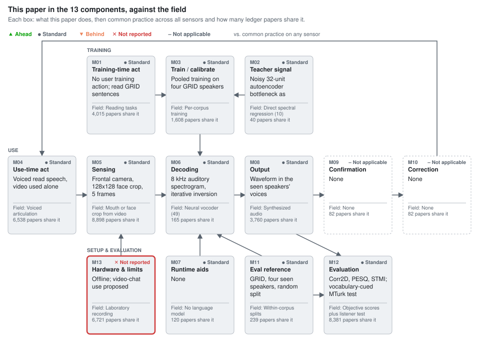

# Lip2AudSpec: Speech reconstruction from silent lip movements video

Hassan Akbari, Himani Arora, Liangliang Cao, Nima Mesgarani. ICASSP 2018 (arXiv preprint October 2017). [DOI](https://doi.org/10.1109/ICASSP.2018.8461856) · [arXiv:1710.09798](https://arxiv.org/abs/1710.09798)

**Section:** [Lip & face video](../../README.md#lip--face-video)

## Figures

### This paper in the 13 components, against the field

<picture><source media="(prefers-color-scheme: dark)" srcset="figures/components-dark.svg"></picture>

Verdicts compare the paper's choice for each component with common practice across 8,995 ledger entries on any sensor (silent speech, brain-to-text, lip reading).

Data

| Component | This paper | Common practice | Papers with this practice | Verdict |
| --- | --- | --- | --- | --- |
| M01 Training-time act | No user training action; read GRID sentences | Reading tasks | 4,015 of 8,995 | ● Standard (Inherited.) |
| M02 Teacher signal | Noisy 32-unit autoencoder bottleneck as target | Direct spectral regression (10) | 40 of 8,995 | ● Standard (Gain on one speaker, one run; 4 of 5 settings lower PESQ.) |
| M03 Train / calibrate | Pooled training on four GRID speakers | Per-corpus training | 1,608 of 8,995 | ● Standard (Inherited.) |
| M04 Use-time act | Voiced read speech, video used alone | Voiced articulation | 6,538 of 8,995 | ● Standard (Inherited.) |
| M05 Sensing | Frontal camera, 128x128 face crop, 5 frames | Mouth or face crop from video | 8,898 of 8,995 | ● Standard (Inherited from Vid2Speech.) |
| M06 Decoding | 8 kHz auditory spectrogram, iterative inversion | Neural vocoder (49) | 165 of 8,995 | ● Standard (STOI 0.446, ASR WER 32.5% when re-trained [@vougioukas2019video].) |
| M07 Runtime aids | None | No language model | 120 of 8,995 | ● Standard (Inherited.) |
| M08 Output | Waveform in the seen speakers' voices | Synthesized audio | 3,760 of 8,995 | ● Standard (No unseen-speaker voice.) |
| M09 Confirmation | None | None | 82 of 8,995 | – Not applicable (Offline study.) |
| M10 Correction | None | None | 82 of 8,995 | – Not applicable (Offline study.) |
| M11 Eval reference | GRID, four seen speakers, random split | Within-corpus splits | 239 of 8,995 | ● Standard (Split described two ways.) |
| M12 Evaluation | Corr2D, PESQ, STMI; vocabulary-cued MTurk test | Objective scores plus listener test | 8,381 of 8,995 | ● Standard (No clip count or statistics.) |
| M13 Hardware & limits | Offline; video-chat use proposed | Laboratory recording | 6,721 of 8,995 | ✕ Not reported (No latency or compute for the stated use.) |

## Verdict

Lip2AudSpec [[1]](#ref-1) changes the training target, a noisy 32-unit autoencoder bottleneck (M02), and the acoustic route, an 8 kHz auditory spectrogram with iterative inversion (M06). Both are standard. The bottleneck gain rests on one speaker and one run, and four of the five bottleneck settings tried score lower PESQ than direct spectrogram regression. Gender and naturalness gains are not credited to the auditory spectrogram: the baseline is a re-implementation with an unreported protocol, and no ablation swaps the representation. The result holds only for four seen GRID speakers and a vocabulary-cued listening test; on those speakers later work raised STOI from 0.446 to 0.731 [[2]](#ref-2), [[3]](#ref-3), and on unseen speakers the method produced no intelligible speech [[2]](#ref-2).

## Against the field, component by component

### M02 Training-only supervision: speech-latent target

**Usual approach:** Among 40 unique studies that synthesize speech from a non-acoustic signal with paired audio (pattern match, Appendix), direct spectral regression is the most common design (10), against 4 with a deep-feature loss and 3 with an autoencoder latent, Lip2AudSpec among them. Its baseline regressed LSP features directly [[4]](#ref-4).

**State of the art:** In video-to-speech the latent target returned as self-supervised speech units predicted beside the mel-spectrogram; adding them cut LRS3 ASR WER from 72.5% to 50.7% (2023, [[5]](#ref-5) [later]). On the four GRID speakers, Kefalas et al. initialize the audio decoder by audio-only pre-training, reusing a speech decoder as Lip2AudSpec does, at 4.54% ASR WER [[3]](#ref-3) [later].

The only support is a single-run ablation on speaker S29, chosen for its wide frequency range (Sec. 4.3.5). The bottleneck gives PESQ 1.76 against 1.69 for the best direct-spectrogram run, with equal Corr2D of 0.89 (Table 7): a 4% PESQ gain on one speaker (inference). Table 8 gives PESQ 1.09 without bottleneck noise (Corr2D 0.46), 1.19 and 1.26 with 16 or 64 units and 1.29 with dropout, all below 1.69. The working ingredient is noise on a 32-unit code, tuned on the evaluated speaker. Verdict: standard.

### M06 Processing: acoustic representation and waveform generation

**Usual approach:** Across the 165 unique studies of video-to-speech synthesis in the ledger (pattern match, Appendix), full texts name neural vocoders in 49, parametric vocoders in 41, Griffin-Lim in 16 and auditory spectrograms in 3. The paper's two prior comparisons were parametric: LSP of LPC [[4]](#ref-4) or an artificially set excitation [[6]](#ref-6).

**State of the art:** Re-trained on the same four seen speakers, Lip2AudSpec scores STOI 0.446 and ASR WER 32.5% (2019, [[2]](#ref-2)). On that split Lip2Wav (2020) reaches STOI 0.731 and an end-to-end WGAN (2022) ASR WER 4.07%, both as listed in [[3]](#ref-3): 64% higher STOI and 87% lower WER (inference); the WER scorers start from 4% and 0.1% on real audio, so part of the WER gap is the yardstick, the STOI gap is not.

The pitch argument rests on correct-gender rates of 85.1% against 43.2% and naturalness 1.63 against 1.35 of 5 (Table 5). For the two female speakers the baseline was heard as male in 37% and 51% of answers (Table 5, inference); with its training and excitation unreported (Sec. 4.3.3), the gender gain is no evidence for the auditory spectrogram. Vougioukas et al. found Lip2AudSpec ahead on PESQ (1.82 against 1.71) and behind on STOI and WER [[2]](#ref-2); no test isolates which part causes this. Verdict: standard for 2017.

## The 13 components

| Component | This paper | Usual approach (count) | State of the art | Verdict |
|---|---|---|---|---|
| M01 Training-time action | No user training action; read GRID sentences | Reading tasks (slot-filled 4,015) | – | standard |
| M02 Training-only supervision | Noisy 32-unit autoencoder bottleneck as target | Direct spectral regression (10) (pattern match 40) | Speech units: LRS3 WER 72.5% to 50.7% [[5]](#ref-5) | standard |
| M03 Training and adaptation | Pooled training on four GRID speakers | Per-corpus training (slot-filled 1,608) | – | standard |
| M04 Use-time action | Voiced read speech, video used alone | Voiced articulation (slot-filled 6,538) | – | standard |
| M05 Sensors | Frontal camera, 128x128 face crop, 5 frames | Mouth or face crop from video (slot-filled 8,898) | – | standard |
| M06 Processing and decoding | 8 kHz auditory spectrogram, iterative inversion | Neural vocoder (49) (pattern match 165) | STOI 0.731 (Lip2Wav), WER 4.07% (WGAN), GRID-4, via [[3]](#ref-3) | standard |
| M07 Lexicon and LM | None | No language model (slot-filled 120) | – | standard |
| M08 Output | Waveform in the seen speakers' voices | Synthesized audio (slot-filled 3,760) | – | standard |
| M09 Confirmation | None | None (slot-filled 82) | – | not applicable |
| M10 Correction | None | None (slot-filled 82) | – | not applicable |
| M11 Reference construction | GRID, four seen speakers, random split | Within-corpus splits (slot-filled 239) | – | standard |
| M12 Evaluation | Corr2D, PESQ, STMI; vocabulary-cued MTurk test | Objective scores plus listener test (slot-filled 8,381) | – | standard |
| M13 Device and cost | Offline; video-chat use proposed | Laboratory recording (slot-filled 6,721) | – | not reported |

## Where the claims outrun the evidence

- Word accuracy is 55.8% against 50.9% (Table 5), a 9.6% relative gain (inference); the paper calls it "significantly better" for three of four speakers with no test (Sec. 4.3.4), and on S4 the baseline wins on accuracy (57.7 against 54.9) and PESQ (1.79 against 1.61, Table 4). Pooled over speakers, letters score 6.0% against the baseline's 9.1%, chance 4.0% (Table 6).
- Listeners had the GRID vocabulary and unlimited replay, with 19% chance (Sec. 4.3.4): closed-set identification, with no clip count or scoring rule.
- The STMI average is 0.80 while the speaker values average 0.83 (Table 4, inference).
- The split is 10 validation and 10 test utterances in Sec. 4.2 but 90/5/5, shared with the autoencoder, in Sec. 4.3.2 and Sec. 4.3.3. The released script keeps the best-validation checkpoint yet writes test predictions every epoch (codes/train_main.py:221-241); the epoch behind Tables 4 to 8 is not stated.
- Speaker characteristics are shown only for seen speakers (Sec. 4.2); on unseen GRID speakers it gave no intelligible output ([[2]](#ref-2), Sec. 4.2).

## What the field needs next

- M02: latent against direct targets on all speakers with several seeds, with noise injection on the direct target as a control.
- M06: one visual network, auditory-spectrogram inversion against mel plus a neural vocoder, scored by STOI and ASR WER.
- M11/M12: an unseen-speaker GRID split and open listener transcription with clip counts and intervals.

## Questions for the authors

- How many clips did the listening test use, and how was accuracy scored across 20 workers?
- Which split produced Tables 4 to 8, and how was the 0.80 STMI average weighted?
- How was Vid2Speech re-trained, and how was its excitation set for female voices?

## Appendix: literature search

- M02 speech-latent-target (published topic table, appended). Inclusion rule: studies that synthesize speech from a non-acoustic signal (articulography, ultrasound, video, EMG, neural recordings) and supervise the encoder with paired speech, by direct spectral regression or by matching the latent of a speech encoder or autoencoder unused at test time; acoustic-input conversion, recognition-only studies and self-generated targets excluded; versions counted once. Slot-filled 31 unique studies; pattern match 40 unique studies. Usual design: direct spectral regression, 10 (pattern match, full text). Design counts (pattern match, full text): direct spectral regression 10, deep feature loss 4, speech-autoencoder latent 3; M03 supervision_kind=paired_audio 9 (slot-filled). Read in full: [[7]](#ref-7) [later], [[5]](#ref-5) [later], target. Known-item recall 1.0.
- M06 video-to-speech-synthesis. Inclusion rule: studies that synthesize a speech waveform from video of the talking face or lips and state the acoustic representation and how it becomes a waveform; audio-visual enhancement or separation with noisy audio at test, talking-head generation, text-only lip reading and video-to-text-to-TTS pipelines excluded; versions counted once. Slot-filled 7,345 unique studies; pattern match 165 unique studies (187 folders). Usual design: neural vocoder, 49 (pattern match, full text). Design counts: neural vocoder 49, parametric vocoder 41, Griffin-Lim 16, auditory spectrogram 3. Read in full: [[2]](#ref-2), [[3]](#ref-3), target. Known-item recall 1.0 (3 of 3 seeds).

## References

Numbered by first citation. BibTeX in the same order and keys: [refs.bib](refs.bib).

1. Akbari, H., Arora, H., Cao, L., Mesgarani, N. “Lip2AudSpec: Speech Reconstruction from Silent Lip Movements Video.” *2018 IEEE International Conference on Acoustics, Speech and Signal Processing (ICASSP)*, 2018, 2516-2520. doi:[10.1109/ICASSP.2018.8461856](https://doi.org/10.1109/ICASSP.2018.8461856). arXiv:[1710.09798](https://arxiv.org/abs/1710.09798). Target. Read as arXiv v1 (26 Oct 2017). [review](https://github.com/supernaiter/silent-speech-review/tree/main/reviews/lip2audspec-speech-reconstruction-from-silent-lip-movements-video) [wiki: arxiv-1710.09798](https://github.com/supernaiter/deep-research-wiki-for-silent-speech/blob/main/papers/arxiv-1710.09798/article.md)
2. Vougioukas, K., Ma, P., Petridis, S., Pantic, M. “Video-Driven Speech Reconstruction using Generative Adversarial Networks.” *Interspeech 2019*, 2019. doi:[10.21437/Interspeech.2019-1445](https://doi.org/10.21437/Interspeech.2019-1445). [later] [wiki: isca-vougioukas19_ganv2s](https://github.com/supernaiter/deep-research-wiki-for-silent-speech/blob/main/papers/isca-vougioukas19_ganv2s/article.md)
3. Kefalas, T., Panagakis, Y., Pantic, M. “Large-scale unsupervised audio pre-training for video-to-speech synthesis.” *arXiv preprint*, 2023. arXiv:[2306.15464](https://arxiv.org/abs/2306.15464). [later] [review](https://github.com/supernaiter/silent-speech-review/tree/main/reviews/large-scale-unsupervised-audio-pre-training-for-video-to-speech-synthesis) [wiki: arxiv-2306.15464-v2apretrain](https://github.com/supernaiter/deep-research-wiki-for-silent-speech/blob/main/papers/arxiv-2306.15464-v2apretrain/article.md)
4. Ephrat, A., Peleg, S. “Vid2speech: Speech Reconstruction from Silent Video.” *2017 IEEE International Conference on Acoustics, Speech and Signal Processing (ICASSP)*, 2017. arXiv:[1701.00495](https://arxiv.org/abs/1701.00495). [review](https://github.com/supernaiter/silent-speech-review/tree/main/reviews/vid2speech-speech-reconstruction-from-silent-video) [wiki: arxiv-1701.00495](https://github.com/supernaiter/deep-research-wiki-for-silent-speech/blob/main/papers/arxiv-1701.00495/article.md)
5. Choi, J., Kim, M., Ro, Y. M. “Intelligible Lip-to-Speech Synthesis with Speech Units.” *arXiv preprint*, 2023. arXiv:[2305.19603](https://arxiv.org/abs/2305.19603). Published at Interspeech 2023. [later] [review](https://github.com/supernaiter/silent-speech-review/tree/main/reviews/intelligible-lip-to-speech-synthesis-with-speech-units) [wiki: arxiv-2305.19603](https://github.com/supernaiter/deep-research-wiki-for-silent-speech/blob/main/papers/arxiv-2305.19603/article.md)
6. Le Cornu, T., Milner, B. “Reconstructing intelligible audio speech from visual speech features.” *Interspeech 2015*, 2015. doi:[10.21437/Interspeech.2015-139](https://doi.org/10.21437/Interspeech.2015-139). [wiki: isca-cornu15-v2speech](https://github.com/supernaiter/deep-research-wiki-for-silent-speech/blob/main/papers/isca-cornu15-v2speech/article.md) [wiki: isca-cornu15_interspeech](https://github.com/supernaiter/deep-research-wiki-for-silent-speech/blob/main/papers/isca-cornu15_interspeech/article.md)
7. Wu, P., Yu, B., Scheck, K., Black, A. W., Krishnapriyan, A. S., Chen, I. Y., et al. “Deep Speech Synthesis from Multimodal Articulatory Representations.” *arXiv preprint*, 2024. arXiv:[2412.13387](https://arxiv.org/abs/2412.13387). [later] [wiki: arxiv-2412.13387](https://github.com/supernaiter/deep-research-wiki-for-silent-speech/blob/main/papers/arxiv-2412.13387/article.md)

## Materials

Data behind this review. Full texts of the papers are not included.

- [`review.md`](review.md): the review text (source)
- [`refs.bib`](refs.bib): references (BibTeX)
- [`slots.json`](slots.json): for each of the 13 components: this paper's choice, field practice, number of matching papers, verdict
- [`figures.json`](figures.json): figure definitions
- [`evaluation.md`](evaluation.md): independent evaluation by a second reviewer
- [`triage.md`](triage.md): how each evaluation finding was checked against the sources and resolved
- [`components/M02/speech-latent-target.csv`](../../components/M02/speech-latent-target.csv): M02 topic "speech-latent-target", every candidate paper with its decision (31 slot-filled, 40 pattern match, usual design in 10, 4 read in full)
- [`components/M06/video-to-speech-synthesis.csv`](../../components/M06/video-to-speech-synthesis.csv): M06 topic "video-to-speech-synthesis", every candidate paper with its decision (7345 slot-filled, 165 pattern match, usual design in 49, 3 read in full)

## More reviews in Lip & face video

- [Deep Audio-Visual Speech Recognition](../deep-audio-visual-speech-recognition/) (2018). LRS2-BBC outlasts the models: the CTC vs seq2seq comparison is confounded, the 22-point gain is not attributable to the new architecture, and test speaker overlap is unreported.
- [Harnessing AI for Speech Reconstruction using Multi-view Silent Video Feed](../harnessing-ai-for-speech-reconstruction-using-multi-view-silent-video-feed/) (2018). Multi-view input (M05) is new for video-to-speech but standard on its evidence: 2 speakers, gains overstated (11.4% in Table 1, 26% in text); PESQ only, no listener test (M12).
- [Visual-Only Recognition of Normal, Whispered and Silent Speech](../visual-only-recognition-of-normal-whispered-and-silent-speech/) (2018). Ahead on data: the first public three-mode lip-video corpus. Standard on transfer: the silent drop was known, and most of it is test-mode difficulty, not the training mode.
- [Lipper: Synthesizing Thy Speech using Multi-View Lipreading](../lipper-synthesizing-thy-speech-using-multi-view-lipreading/) (2019). Multi-view input (M05) and LPC/LSP regression (M06) are standard; the view gain shrinks to +2-6% on two held-out speakers. Evaluation (M12) lacks STOI/ESTOI, ASR WER and transcription.
- [Video-Driven Speech Reconstruction using Generative Adversarial Networks](../video-driven-speech-reconstruction-using-generative-adversarial-networks/) (2019). Direct-waveform GAN (M06) and speech-encoder perceptual loss (M02) are early but standard; the perceptual loss carries the words. Unseen-speaker WER 40.5% (successor 16%); no listener test.
- [Improved Speech Reconstruction from Silent Video](../improved-speech-reconstruction-from-silent-video/) (2017). Optical-flow tower (M05) and mel-to-linear post-net (M06) are standard: no flow gain in Table 5; trails Le Cornu on S3; no listener test (M12); Lip2Wav's re-run: 27.83% vs 14.08% WER.

---

Part of the [Silent Speech Interface Review](https://github.com/supernaiter/silent-speech-review). Found an error? [Open an issue](https://github.com/supernaiter/silent-speech-review/issues/new?template=correction.yml).
