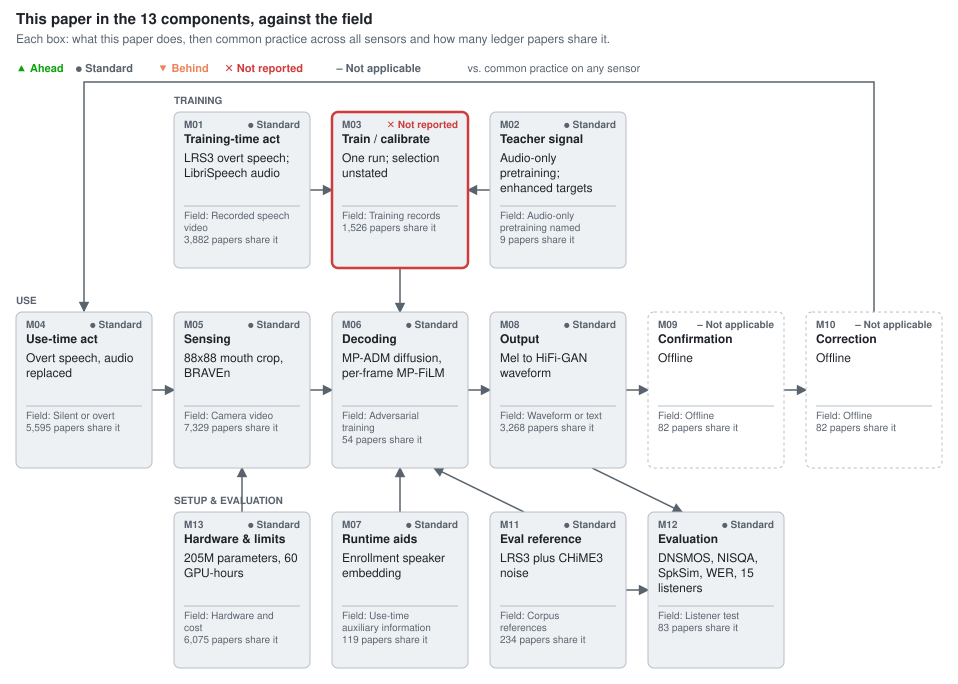

# LipDiffuser: Lip-to-Speech Generation with Conditional Diffusion Models

Richter, J., de Oliveira, D., Peer, T., Gerkmann, T. · arXiv preprint · 2025 · [arXiv:2505.11391](https://arxiv.org/abs/2505.11391)

**Section:** [Lip & face video](../../README.md#lip--face-video)

## Figures

### This paper in the 13 components, against the field

<picture><source media="(prefers-color-scheme: dark)" srcset="figures/components-dark.svg"></picture>

Verdicts compare the paper's choice for each component with common practice across 8,995 ledger entries on any sensor (silent speech, brain-to-text, lip reading).

Data

| Component | This paper | Common practice | Papers with this practice | Verdict |
| --- | --- | --- | --- | --- |
| M01 Training-time act | LRS3 overt speech; LibriSpeech audio | Recorded speech video | 3,882 of 8,995 | ● Standard (Inherited.) |
| M02 Teacher signal | Audio-only pretraining; enhanced targets | Audio-only pretraining named | 9 of 8,995 | ● Standard (No ablation in the target.) |
| M03 Train / calibrate | One run; selection unstated | Training records | 1,526 of 8,995 | ✕ Not reported (No seeds or selection rule.) |
| M04 Use-time act | Overt speech, audio replaced | Silent or overt | 5,595 of 8,995 | ● Standard (Inherited.) |
| M05 Sensing | 88x88 mouth crop, BRAVEn | Camera video | 7,329 of 8,995 | ● Standard (Inherited.) |
| M06 Decoding | MP-ADM diffusion, per-frame MP-FiLM | Adversarial training | 54 of 8,995 | ● Standard (FiLM 1 of 165; not ablated.) |
| M07 Runtime aids | Enrollment speaker embedding | Use-time auxiliary information | 119 of 8,995 | ● Standard (From the clean reference (M12).) |
| M08 Output | Mel to HiFi-GAN waveform | Waveform or text | 3,268 of 8,995 | ● Standard (Inherited.) |
| M09 Confirmation | Offline | Offline | 82 of 8,995 | – Not applicable (Offline study.) |
| M10 Correction | Offline | Offline | 82 of 8,995 | – Not applicable (Offline study.) |
| M11 Eval reference | LRS3 plus CHiME3 noise | Corpus references | 234 of 8,995 | ● Standard (Matters only for enhancement baselines.) |
| M12 Evaluation | DNSMOS, NISQA, SpkSim, WER, 15 listeners | Listener test | 83 of 8,995 | ● Standard (Speaker reference shared with conditioning.) |
| M13 Hardware & limits | 205M parameters, 60 GPU-hours | Hardware and cost | 6,075 of 8,995 | ● Standard (Code promised; no runtime.) |

## Verdict

LipDiffuser [[1]](#ref-1) changes the decoder (M06), a diffusion denoiser conditioned on video frame by frame through MP-FiLM, and the training targets (M02), with audio-only pretraining and enhanced LRS3 audio. Both are standard: no experiment isolates either (Table 1, the only table; Fig. 2, WER over input SNR), and Kefalas et al. [[2]](#ref-2), uncited, had already ablated audio-only decoder pretraining, with mixed effect. Trained on enhanced targets, it matches the clean recordings in quality rather than exceeding them: DNSMOS 3.64 against 3.56 (standard deviations 0.30, 0.36), NISQA 4.57 against 4.65 (Table 1). The speaker-similarity lead (0.63 against 0.37 for IL2S (SSL)) is measured against an enrollment taken from the clean reference (Table 1); [concurrent] V2SFlow [[3]](#ref-3) shows that an audio-derived embedding raises speaker similarity at unchanged WER. On content it does not beat LipVoicer or IL2S (SSL), which the authors call "comparable" (Sec. 5): WER 0.38 against 0.36, standard deviations 0.33-0.35, no interval or test (Table 1); the claimed cross-dataset generalization has no result (Sec. 5).

## Against the field, component by component

### M06 Decoder: diffusion with per-frame MP-FiLM conditioning

**Usual approach:** Of 165 video-to-speech studies (pattern match), 54 use adversarial training and 22 a diffusion decoder; 15 upsample video features to the acoustic rate, the earliest from 1999, and FiLM appears in 1, this paper (Appendix). The closest prior, DiffV2S, conditions its denoiser on concatenated visual features and a speaker embedding (Sec. 3.2.1) [[4]](#ref-4).

**State of the art:** [concurrent] Faces-to-Voices (2025) [[5]](#ref-5): 30.45% LRS3 WER at 10 steps, speaker embedding from video, Whisper Medium (Table 2). V2SFlow's 28.5% (M12) uses another recognizer, which gives DiffV2S 39.2% against 41.07% under Whisper Medium [[3]](#ref-3); the scales differ. LipDiffuser's 0.38 (QuartzNet, 1,321 LRS3-CHiME3 files, 32 steps, enrollment audio) cannot be read against it; in its own Table 1 it is 0.02 worse than LipVoicer, about 6% relative (inference).

No experiment compares MP-FiLM with concatenation or plain FiLM (Secs. 4-5). Verdict: standard.

### M02 Training targets: audio-only pretraining and enhanced audio

**Usual approach:** Of 165 video-to-speech studies, 9 name audio-only pretraining and 6 enhanced training audio (pattern match, upper bounds; Appendix); the rest train on paired audio-video data. LipDiffuser pretrains on 960 hours of enhanced LibriSpeech and enhances the LRS3 audio (Sec. 4.1).

**State of the art:** Kefalas et al. (2023) [[2]](#ref-2) pretrained decoders on more than 3,500 hours of audio: on unseen GRID speakers (33-speaker split, Table VII) WER fell from 25.75% to 18.57% when the waveform decoder was initialized from the audio-pretrained one; on seen speakers (Table V) a mel model rose from 2.66% to 3.58% with the frozen pretrained decoder.

LipDiffuser calls the pretraining "required" (Sec. 4.1) but gives no number without it, or for raw against enhanced targets. Verdict: standard.

### M12 Evaluation: reference-free quality and a shared speaker reference

**Usual approach:** Of 165 video-to-speech studies (pattern match), 83 name a listener test, 38 ASR WER, 23 a speaker-similarity score, 22 an audio or enrollment speaker reference, 21 a MOS predictor and 40 an interval or significance test (Appendix). LipDiffuser uses 15 listeners and reports means and standard deviations only.

**State of the art:** V2SFlow (2025) [[3]](#ref-3): 28.5% LRS3 WER with a speaker embedding from audio and from video alike, SECS 0.851 against 0.664 (Table I).

SpkSim is the cosine between enrollment and output embeddings (Sec. 4.3); LipDiffuser, Lip2Speech and IL2S are conditioned on that enrollment, DiffV2S and LipVoicer are not (Table 1). Among systems with the enrollment, LipDiffuser still leads IL2S (SSL) by 0.26, about 70% relative (inference). Faces-to-Voices attributed predictor scores above ground truth to noise in real recordings (Sec. 5.2) [[5]](#ref-5); LipDiffuser's targets are denoised (Sec. 4.1). Verdict: standard.

## The 13 components

| Component | This paper | Usual approach (count) | State of the art | Verdict |
|---|---|---|---|---|
| M01 Training-time action | LRS3 overt speech; LibriSpeech audio | Recorded speech video (slot-filled 3,882) | – | standard |
| M02 Training-only supervision | Audio-only pretraining; enhanced targets | Audio-only pretraining named (pattern match 9) | [[2]](#ref-2) (2023): GRID unseen 18.57% WER | standard |
| M03 Training and adaptation | One run; selection unstated | Training records (slot-filled 1,526) | – | not reported |
| M04 Use-time action | Overt speech, audio replaced | Silent or overt (slot-filled 5,595) | – | standard |
| M05 Sensors | 88x88 mouth crop, BRAVEn | Camera video (slot-filled 7,329) | – | standard |
| M06 Processing and decoding | MP-ADM diffusion, per-frame MP-FiLM | Adversarial training (pattern match 54) | [[5]](#ref-5) (2025): 30.45% WER (Whisper Medium), 10 steps | standard |
| M07 Lexicon and LM | Enrollment speaker embedding | Use-time auxiliary information (slot-filled 119) | – | standard |
| M08 Output | Mel to HiFi-GAN waveform | Waveform or text (slot-filled 3,268) | – | standard |
| M09 Confirmation | Offline | Offline (slot-filled 82) | – | not applicable |
| M10 Correction | Offline | Offline (slot-filled 82) | – | not applicable |
| M11 Reference construction | LRS3 plus CHiME3 noise | Corpus references (slot-filled 234) | – | standard |
| M12 Evaluation | DNSMOS, NISQA, SpkSim, WER, 15 listeners | Listener test (pattern match 83) | [[3]](#ref-3) (2025): 28.5% WER both embeddings | standard |
| M13 Device and cost | 205M parameters, 60 GPU-hours | Hardware and cost (slot-filled 6,075) | – | standard |

## Where the claims outrun the evidence

- "Cross-dataset evaluations demonstrate the strong generalization" (Sec. 1) and "robustness w.r.t different enrollment utterance scenarios" (Sec. 6) have no result: Sec. 5 reports only LRS3-CHiME3 (Table 1, Figs. 1-2).
- "Highest speech quality scores" (Sec. 5) compares a model trained on enhanced targets with baselines described only as trained on LRS3 (Sec. 4.4).
- The listening test (Fig. 1 caption, Sec. 4.3) gives no sample count, interval or test.

## What the field needs next

- M02: MP-ADM with and without audio-only pretraining, raw against enhanced targets, several seeds, baselines retrained on the same targets.
- M06: MP-FiLM against concatenation and plain FiLM.
- M12: enrollment from another utterance, SpkSim from an encoder not used for conditioning, an unseen-speaker split.

## Questions for the authors

- Is the enrollment the clean audio of the test utterance itself?
- Which encoder computes SpkSim, and is it the Wespeaker model used for conditioning?
- Do LRS3 test speakers overlap with training speakers?
- How many samples were rated against which reference?
- Were the LRS3 test references enhanced like the training audio?

## Appendix: literature search

- M06, video-to-speech-one-to-many-decoder (published table, reused). Inclusion rule: video-to-speech studies (speech synthesized from talking-face or lip video, audio muted at test), classified from full text by how the decoder handles the one-to-many mapping; enhancement with noisy audio at test, talking-head generation and video-to-text-to-speech pipelines excluded; a study counts under every design it names; versions count once. Ledger: 7,345 unique studies slot-filled for M06; 165 unique studies pattern match. Usual design: adversarial training 54; diffusion decoder 22 (published counts). Added (pattern match): any diffusion 36, video features upsampled to the acoustic rate 15, FiLM 1 (the target). Read in full: [[5]](#ref-5), [[4]](#ref-4). Known-item recall 1.0 (published seeds); 0.73 for this review's seeds.
- M02, audio-only-pretraining-for-visual-speech-generation (new). Inclusion rule: the same 165 video-to-speech studies, counted from full text for pretraining the speech generator on audio without video before paired training, and for enhancing or denoising the training target audio; mentions and vocoder-only pretraining included (upper bound); versions count once. Ledger: 31 unique studies slot-filled for M02; 165 unique studies pattern match. Designs: audio-only pretraining 9, enhanced training audio 6 (pattern match). Read in full: [[2]](#ref-2). Known-item recall 0.73.
- M12, video-to-speech-output-evaluation (published table, reused). Inclusion rule: the same video-to-speech population, counting the evaluation protocols its full text names. Ledger: 6,960 unique studies slot-filled for M12; 165 unique studies pattern match. Protocols: listener test 83, unseen speakers 51, ASR WER on output 38 (published counts); confidence interval or significance 40, reference-free MOS predictor 21, output stated to exceed ground truth 5 (published additions); added: speaker-similarity score 23, audio reference or enrollment embedding 22 (pattern match). Read in full: [[3]](#ref-3), [[5]](#ref-5). Known-item recall 1.0 (published seeds); 0.73 for this review's seeds.

## References

Numbered by first citation. BibTeX in the same order and keys: [refs.bib](refs.bib).

1. Richter, J., de Oliveira, D., Peer, T., Gerkmann, T. “LipDiffuser: Lip-to-Speech Generation with Conditional Diffusion Models.” *arXiv preprint*, 2025. doi:[10.48550/arXiv.2505.11391](https://doi.org/10.48550/arXiv.2505.11391). arXiv:[2505.11391](https://arxiv.org/abs/2505.11391). Target. Read as arXiv v3 (24 Oct 2025). [review](https://github.com/supernaiter/silent-speech-review/tree/main/reviews/lipdiffuser-lip-to-speech-generation-with-conditional-diffusion-models) [wiki: arxiv-2505.11391](https://github.com/supernaiter/deep-research-wiki-for-silent-speech/blob/main/papers/arxiv-2505.11391/article.md)
2. Kefalas, T., Panagakis, Y., Pantic, M. “Large-scale unsupervised audio pre-training for video-to-speech synthesis.” *arXiv preprint*, 2023. doi:[10.48550/arXiv.2306.15464](https://doi.org/10.48550/arXiv.2306.15464). arXiv:[2306.15464](https://arxiv.org/abs/2306.15464). Prior; deciding prior for M02 (audio-only decoder pretraining with ablations); not cited by the target. Read as arXiv v2. [review](https://github.com/supernaiter/silent-speech-review/tree/main/reviews/large-scale-unsupervised-audio-pre-training-for-video-to-speech-synthesis) [wiki: arxiv-2306.15464-v2apretrain](https://github.com/supernaiter/deep-research-wiki-for-silent-speech/blob/main/papers/arxiv-2306.15464-v2apretrain/article.md)
3. Choi, J., Kim, J., Li, J., Chung, J. S., Liu, S. “V2SFlow: Video-to-Speech Generation with Speech Decomposition and Rectified Flow.” *ICASSP 2025 - IEEE International Conference on Acoustics, Speech and Signal Processing*, 2025. arXiv:[2411.19486](https://arxiv.org/abs/2411.19486). State of the art for M12 (audio- against video-derived speaker embedding). Read as arXiv v2. [concurrent] [wiki: arxiv-2411.19486](https://github.com/supernaiter/deep-research-wiki-for-silent-speech/blob/main/papers/arxiv-2411.19486/article.md)
4. Choi, J., Hong, J., Ro, Y. M. “DiffV2S: Diffusion-based Video-to-Speech Synthesis with Vision-guided Speaker Embedding.” *IEEE/CVF International Conference on Computer Vision (ICCV)*, 2023. arXiv:[2308.07787](https://arxiv.org/abs/2308.07787). Prior; baseline of the target; deciding prior for M06 (diffusion decoder conditioned by concatenation). Read as arXiv v1. [wiki: arxiv-2308.07787-diffv2s](https://github.com/supernaiter/deep-research-wiki-for-silent-speech/blob/main/papers/arxiv-2308.07787-diffv2s/article.md) [wiki: cvf23-choi_diffv2s](https://github.com/supernaiter/deep-research-wiki-for-silent-speech/blob/main/papers/cvf23-choi_diffv2s/article.md)
5. Kim, J., Choi, J., Kim, J., Jung, C., Chung, J. S. “From Faces to Voices: Learning Hierarchical Representations for High-quality Video-to-Speech.” *Proceedings of the IEEE/CVF Conference on Computer Vision and Pattern Recognition (CVPR)*, 2025, 15874-15884. arXiv:[2503.16956](https://arxiv.org/abs/2503.16956). State of the art for M06; quality predictors above ground truth explained by noisy recordings. Read as arXiv v1. [concurrent] [wiki: arxiv-2503.16956](https://github.com/supernaiter/deep-research-wiki-for-silent-speech/blob/main/papers/arxiv-2503.16956/article.md) [wiki: cvf-kim25-facesvoices](https://github.com/supernaiter/deep-research-wiki-for-silent-speech/blob/main/papers/cvf-kim25-facesvoices/article.md)

## Materials

Data behind this review. Full texts of the papers are not included.

- [`review.md`](review.md): the review text (source)
- [`refs.bib`](refs.bib): references (BibTeX)
- [`slots.json`](slots.json): for each of the 13 components: this paper's choice, field practice, number of matching papers, verdict
- [`figures.json`](figures.json): figure definitions
- [`evaluation.md`](evaluation.md): independent evaluation by a second reviewer
- [`triage.md`](triage.md): how each evaluation finding was checked against the sources and resolved
- [`process/log.json`](process/log.json): process record: each step, who did it (reader, script, writer, evaluator), when, the checks run and the input versions
- [`process/notes.json`](process/notes.json): reading notes on the target and comparator papers: claims, numbers, conditions and what is not stated, with locations
- [`process/plan.json`](process/plan.json): plan: which components the paper changes and the topics it is compared on
- [`process/draft.md`](process/draft.md): the review as first written, before the independent evaluation
- [`process/claims-draft.md`](process/claims-draft.md): claim table of the draft: every claim mapped to a note or a count
- [`process/claims.md`](process/claims.md): claim table of the published review
- [`components/M02/audio-only-pretraining-for-visual-speech-generation.csv`](../../components/M02/audio-only-pretraining-for-visual-speech-generation.csv): M02 topic "audio-only-pretraining-for-visual-speech-generation", every candidate paper with its decision (31 slot-filled, 165 pattern match, usual design in 9, 2 read in full)
- [`components/M06/video-to-speech-one-to-many-decoder.csv`](../../components/M06/video-to-speech-one-to-many-decoder.csv): M06 topic "video-to-speech-one-to-many-decoder", every candidate paper with its decision (7345 slot-filled, 165 pattern match, usual design in 54, 4 read in full)
- [`components/M12/video-to-speech-output-evaluation.csv`](../../components/M12/video-to-speech-output-evaluation.csv): M12 topic "video-to-speech-output-evaluation", every candidate paper with its decision (6960 slot-filled, 165 pattern match, usual design in 83, 5 read in full)

## More reviews in Lip & face video

- [Landmark Guided Visual Feature Extractor for Visual Speech Recognition with Limited Resource](../landmark-guided-visual-feature-extractor-for-visual-speech-recognition-with-limited-resource/) (2025). Lip-landmark graph plus pixel fusion is a standard design (2020 precedent); the 0.90-point low-data gain comes from one unseeded run, and LRW 91.69% stays below 95.0%.
- [LTA-L2S: Lexical Tone-Aware Lip-to-Speech Synthesis for Mandarin with Cross-Lingual Transfer Learning](../lta-l2s-lexical-tone-aware-lip-to-speech-synthesis-for-mandarin-with-cross-lingual-transfer-lear/) (2025). Mandarin lip-to-speech whose gain over Intelligible matches its English-initialization ablation; the tone components move CER little with no repeats reported, and pitch removal leaves TER at 40.9%.
- [NaturalL2S: End-to-End High-quality Multispeaker Lip-to-Speech Synthesis with Differential Digital Signal Processing](../naturall2s-end-to-end-high-quality-multispeaker-lip-to-speech-synthesis-with-differential-digita/) (2025). DDSP prior and jointly trained vocoder (M06) are standard: joint waveform training predates it; quality leads its baselines, but LRS3 WER 30.4% trails the uncompared LipVoicer (21.4%).
- [RESOUND: Speech Reconstruction from Silent Videos via Acoustic-Semantic Decomposed Modeling](../resound-speech-reconstruction-from-silent-videos-via-acoustic-semantic-decomposed-modeling/) (2025). Decoder split (M06) and lip-reader text plus audio prompt (M07) are standard; WER gain comes from the lip reader, LRS3 WER level with LipVoicer, prosody leads confounded by the prompt.
- [VSpeechLM: A Visual Speech Language Model for Visual Text-to-Speech Task](../vspeechlm-a-visual-speech-language-model-for-visual-text-to-speech-task/) (2025). VSpeechLM generates lip-synchronized speech from text, a reference voice and lip video by converting lip timing into phoneme sequences; WER is 12.5% on Chem and 18.3% on GRID.
- [A First Exploration of Neuromorphic OT-CFM for Multi-Speaker VSR](../lipsflow-a-first-exploration-of-neuromorphic-ot-cfm-for-multi-speaker-vsr/) (2026). Event input and a two-step OT-CFM decoder are standard; the DVS-Lip evaluation is behind: WER on an isolated-word set with no split details or seeds, and baselines that do not match their sources.

---

Part of the [Silent Speech Interface Review](https://github.com/supernaiter/silent-speech-review). Found an error? [Open an issue](https://github.com/supernaiter/silent-speech-review/issues/new?template=correction.yml).
