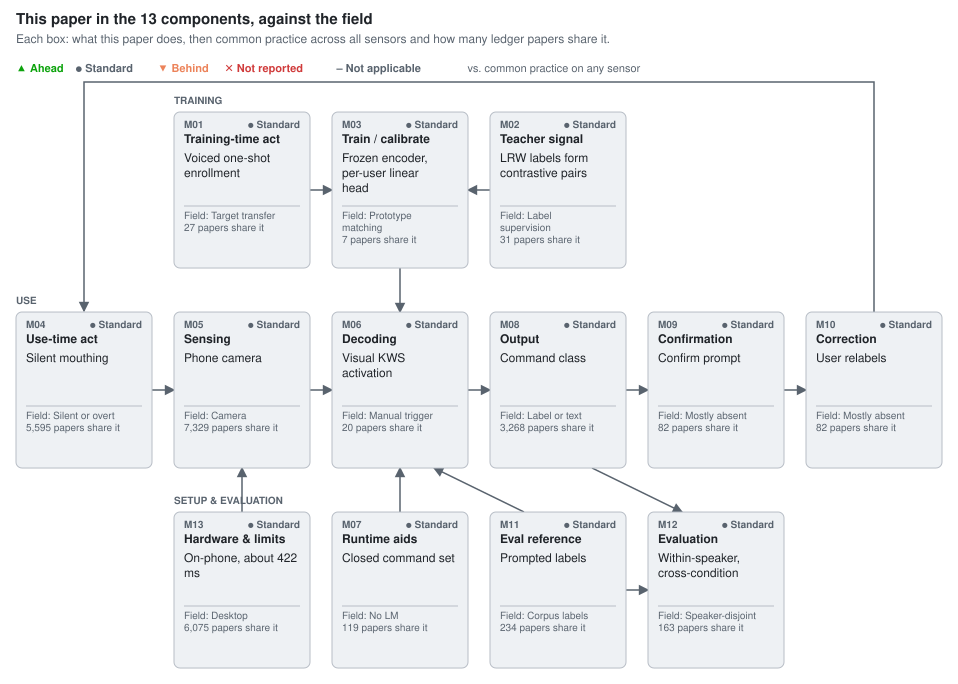

# LipLearner: Customizable Silent Speech Interactions on Mobile Devices

Su, Z., Fang, S., Rekimoto, J. · CHI '23 · 2023 · [DOI:10.1145/3544548.3581465](https://doi.org/10.1145/3544548.3581465) · [arXiv:2302.05907](https://arxiv.org/abs/2302.05907)

**Section:** [Lip & face video](../../README.md#lip--face-video)

## Figures

### This paper in the 13 components, against the field

<picture><source media="(prefers-color-scheme: dark)" srcset="figures/components-dark.svg"></picture>

Verdicts compare the paper's choice for each component with common practice across 8,995 ledger entries on any sensor (silent speech, brain-to-text, lip reading).

Data

| Component | This paper | Common practice | Papers with this practice | Verdict |
| --- | --- | --- | --- | --- |
| M01 Training-time act | Voiced one-shot enrollment | Target transfer | 27 of 8,995 | ● Standard (Overt-only at one shot; 5.6-point silent loss.) |
| M02 Teacher signal | LRW labels form contrastive pairs | Label supervision | 31 of 8,995 | ● Standard (Inherited from LRW word classification [@feng2020learn].) |
| M03 Train / calibrate | Frozen encoder, per-user linear head | Prototype matching | 7 of 8,995 | ● Standard (Only frozen-encoder linear head among 30; no head or encoder ablation.) |
| M04 Use-time act | Silent mouthing | Silent or overt | 5,595 of 8,995 | ● Standard (–) |
| M05 Sensing | Phone camera | Camera | 7,329 of 8,995 | ● Standard (–) |
| M06 Decoding | Visual KWS activation | Manual trigger | 20 of 8,995 | ● Standard (New for interfaces; no mouth-opening comparison.) |
| M07 Runtime aids | Closed command set | No LM | 119 of 8,995 | ● Standard (–) |
| M08 Output | Command class | Label or text | 3,268 of 8,995 | ● Standard (–) |
| M09 Confirmation | Confirm prompt | Mostly absent | 82 of 8,995 | ● Standard (Authors concede the effort it costs.) |
| M10 Correction | User relabels | Mostly absent | 82 of 8,995 | ● Standard (On-demand correction mode.) |
| M11 Eval reference | Prompted labels | Corpus labels | 234 of 8,995 | ● Standard (LRW overlap of speakers and words not stated.) |
| M12 Evaluation | Within-speaker, cross-condition | Speaker-disjoint | 163 of 8,995 | ● Standard (From-scratch counterpart; no chance level.) |
| M13 Hardware & limits | On-phone, about 422 ms | Desktop | 6,075 of 8,995 | ● Standard (Inherited deployment; local update 2,217 ms.) |

## Verdict

LipLearner [[1]](#ref-1) changes command registration (M03), enrollment from a voiced utterance (M01) and activation by visual keyword spotting (M06); all three are standard. Its frozen-encoder linear head is the only one among 30 few-shot vocabulary studies (pattern match, Appendix), but the one-shot 25-command F1 of 0.8947 over 1,000 random draws (§5.3) faces no prototype or fine-tuning head (§5.2–5.4). The voiced-to-silent loss (87.29% against 81.67%, §8.2.2) is the known overt-to-silent degradation, and KWS activation is new only for lipreading interfaces, as the paper says (§6.1): visual-only spotting predates it uncited [[2]](#ref-2), [[3]](#ref-3). The superiority claim rests on an in-house counterpart trained from scratch (0.9895 against 0.7147 F1, §5.4).

## Against the field, component by component

### M03 Training and adaptation: frozen encoder, per-user linear classifier

**Usual approach:** Of 30 few-shot or user-vocabulary studies (pattern match, Appendix), 7 name metric or prototype matching, 6 training from scratch and 3 fine-tuning on the user; LipLearner alone names a frozen encoder with a linear classifier (§5.2). The closest lip prior trains end-to-end on one real plus synthetic videos per word: 68.1% top-1 for an ALS patient, against 49.3% for a plain classifier on the real sample (Table 2) [[4]](#ref-4).

**State of the art:** Jeon et al. ([later], 2026) store EMG class prototypes without retraining: 82.85% one-shot and 90.17% three-shot accuracy, 20-way, on held-out sessions [[5]](#ref-5).

The logistic head comes from the few-shot literature the paper cites (§5.2); new is the 2,217 ms on-phone update for 30 commands × 5 shots (§6.2.3). Its one-shot F1 of 0.8947 (§5.3) faces only the from-scratch counterpart (M12). The encoder starts from Feng et al.'s weights [[6]](#ref-6) and is trained contrastively with word labels deciding positive pairs (§3.3), but is never compared with them (Secs. 5.2–5.4). Verdict: standard; new to lip commands, advantage untested.

### M01 Training-time action: voiced one-shot enrollment

**Usual approach:** Of 354 studies naming overt and silent production (pattern match, Appendix), overt data enter silent decoders by time-aligned target transfer (27), adversarial invariance (12), fine-tuning (11) or a cross-mode loss (5) [[7]](#ref-7), [concurrent] [[8]](#ref-8); overt-only training tested on silent speech is excluded by rule. Voice2Lip (one voiced take labelled by speech recognition, §1) is that case at one shot, then pools silent shots (§7.2).

**State of the art:** Kashiwagi et al. ([concurrent], 2023): silent WER on 11 held-out speakers of 22.55% when trained solely on normal speech, 9.97% with silent data and metric learning (Table 1), on 10 phrases [[9]](#ref-9).

The one-shot loss of about 5.6 points (§8.2.2) is in line with the 8.5% drop [[9]](#ref-9) reports for a normal-trained model [[10]](#ref-10). No silent one-shot enrollment is run under the same protocol (§7.2). Verdict: standard.

### M06 Decoding: visual keyword spotting as activation

**Usual approach:** Of 183 silent-speech interface studies (pattern match, Appendix), 20 name a manual trigger, 9 an activity detector, 7 a gaze or gesture trigger and 3 keyword spotting. LipLearner swaps the mouth-opening trigger (§1) for similarity to enrolled keyword samples (§6.1).

**State of the art:** Visual-only KWS predates the paper: wake-word KWS-Net (2020) at 5.7% EER [[2]](#ref-2); 6.46% EER on 635 unseen LRS2 words (2018) [[3]](#ref-3); Transpotter (2021), 72.5% mAPCls on LRS2 (Table 1) [[11]](#ref-11); all with phoneme text queries.

The paper limits its novelty to lipreading interfaces (§6.1) and cites none of these. Its 6.75% EER (§6.1) separates one enrolled command from the rest of a closed set, not comparable with open search in video. The authors concede no threshold suits all users (§8.2.1). Mouth-opening activation goes untested (Secs. 1–2, 8.2.1); the only evidence of benefit is a false-positive rate falling from 0.26% to 0.07% after about 7 reported misactivations (§8.2.1). Verdict: standard; new for interfaces (Appendix), benefit untested.

### M12 Evaluation: baseline and test separation

**Usual approach:** Of 402 camera-based word or command studies (pattern match, Appendix), 163 name a speaker-disjoint test, 99 within-speaker, 62 session- or condition-disjoint and 18 a chance level. LipLearner trains and tests per user (§5.2), adds leave-one-condition-out splits (§4.3, §5.4) and gives no chance level (§5.3).

**State of the art:** Jeon et al. ([later], 2026) score queries from four sessions other than the support session [[5]](#ref-5).

The counterpart is an in-house model trained from scratch on 30 samples per command against LipLearner's 6-shot set (§5.4), so 0.9895 against 0.7147 F1 measures pretraining against none. Live accuracies of 96.04% at three and 98.75% at five shots (§8.2.2) come from a test-then-update loop in one session (§7.2), not held-out sessions. Strong: three-shot F1 averages 0.9391 or more across condition changes (Table 2). Verdict: standard.

## The 13 components

| Component | This paper | Usual approach (count) | State of the art | Verdict |
|---|---|---|---|---|
| M01 Training-time action | Voiced one-shot enrollment | Target transfer (pattern match 27) | [[9]](#ref-9) (2023): WER 9.97% | standard |
| M02 Training-only supervision | LRW labels form contrastive pairs | Label supervision (slot-filled 31) | – | standard |
| M03 Training and adaptation | Frozen encoder, per-user linear head | Prototype matching (pattern match 7) | [[5]](#ref-5) (2026): 82.85%, EMG | standard |
| M04 Use-time action | Silent mouthing | Silent or overt (slot-filled 5,595) | – | standard |
| M05 Sensors | Phone camera | Camera (slot-filled 7,329) | – | standard |
| M06 Processing and decoding | Visual KWS activation | Manual trigger (pattern match 20) | [[11]](#ref-11) (2021): mAP 72.5% | standard |
| M07 Lexicon and LM | Closed command set | No LM (slot-filled 119) | – | standard |
| M08 Output | Command class | Label or text (slot-filled 3,268) | – | standard |
| M09 Confirmation | Confirm prompt | Mostly absent (slot-filled 82) | – | standard |
| M10 Correction | User relabels | Mostly absent (slot-filled 82) | – | standard |
| M11 Reference construction | Prompted labels | Corpus labels (slot-filled 234) | – | standard |
| M12 Evaluation | Within-speaker, cross-condition | Speaker-disjoint (pattern match 163) | [[5]](#ref-5) (2026): held-out sessions | standard |
| M13 Device and cost | On-phone, about 422 ms | Desktop (slot-filled 6,075) | – | standard |

## Where the claims outrun the evidence

- "Non-verbal lip gestures" as commands (§1): one-shot facial expressions, 9 of 11 tries correct (§8.1).

## What the field needs next

- M03: linear head, prototypes and fine-tuning on one encoder, starting weights as control [[6]](#ref-6).
- M01: silent versus voiced one-shot enrollment.
- M06: KWS against mouth-opening activation in free use.

## Questions for the authors

- Which F1 average and which unit give the mean ± SD in §5.3 and Table 2?
- How many enrollment samples and which negatives gave the 6.75% EER?

## Appendix: literature search

- M03, few-shot-user-vocabulary-enrollment (new). Inclusion rule: silent-speech, lip-reading and other non-acoustic speech or command decoders whose ledger names few-shot, one-shot or N-shot learning, user-defined or customized vocabularies, vocabulary registration or personalized lip models, classified by how a user's examples enter the model; a study counts under every design its full text names (upper bound); versions once. Ledger: 1,526 unique studies slot-filled for M03; 30 unique studies pattern match. Designs (pattern match): metric or prototype matching 7, user-dependent training from scratch 6, fine-tuning on the user 3, frozen encoder with linear or logistic classifier 1 (the target). Read in full: [[4]](#ref-4), [[5]](#ref-5). Known-item recall 1.0 (3 seeds).
- M03 for M01, overt-silent-joint-training (published table, reused). Inclusion rule: studies with any signal whose ledger names both overt and silent production, classified by how overt recordings enter the training of a silent decoder; overt-only training applied to silent test data excluded. Ledger: 1,526 unique studies slot-filled for M03; 354 unique studies pattern match. Usual design: paired-audio supervision 31 of 138 (slot-filled). Cross-mode designs (pattern match, published counts): time-aligned target transfer 27, domain-adversarial invariance 12, fine-tuning from an overt model 11, cross-mode distance or contrastive loss 5. Read in full: [[10]](#ref-10), [[7]](#ref-7), [[8]](#ref-8) (published reads), [[9]](#ref-9). Known-item recall 1.0.
- M06, visual-keyword-spotting (new). Inclusion rule: studies whose ledger names a camera modality and keyword spotting, wake words or hotwords, classified by how the keyword is specified and which signal is used; every named design counts (upper bound); versions once. Ledger: 7,345 unique studies slot-filled for M06; 18 unique studies pattern match. Designs (pattern match): fixed wake word or keyword set 12, audio-visual fusion 8, visual-only 7, text or phoneme query 5, enrolled example query 3 (two of them, [[2]](#ref-2) and [[11]](#ref-11), use phoneme text queries when read). Read in full: [[3]](#ref-3), [[2]](#ref-2), [[11]](#ref-11). Known-item recall 0.8 (5 seeds).
- M06, silent-command-activation (new). Inclusion rule: silent-speech, lip-reading and mouthed-speech studies whose ledger names commands, interaction or an interface, classified by how a command utterance is started or segmented at use time; every named design counts (upper bound); versions once. Ledger: 7,345 unique studies slot-filled for M06; 183 unique studies pattern match. Designs (pattern match): explicit manual trigger 20, mouth or speech activity detector 9, gaze or gesture trigger 7, keyword spotting or wake word 3. Known-item recall 0.5 (4 seeds).
- M12, lip-command-recognition-test-split (new). Inclusion rule: camera-based lip-reading or silent-speech studies whose ledger names word, phrase or command classification, classified by how test data are separated from enrollment or training data and whether chance level is reported; every named split counts (upper bound); versions once. Ledger: 6,960 unique studies slot-filled for M12; 402 unique studies pattern match. Designs (pattern match): speaker-disjoint test 163, within-speaker test 99, session- or condition-disjoint test 62, chance level reported 18. Read in full: [[5]](#ref-5).

## References

Numbered by first citation. BibTeX in the same order and keys: [refs.bib](refs.bib).

1. Su, Z., Fang, S., Rekimoto, J. “LipLearner: Customizable Silent Speech Interactions on Mobile Devices.” *Proceedings of the 2023 CHI Conference on Human Factors in Computing Systems (CHI '23)*, 2023. doi:[10.1145/3544548.3581465](https://doi.org/10.1145/3544548.3581465). arXiv:[2302.05907](https://arxiv.org/abs/2302.05907). Target. Read as arXiv v3. [review](https://github.com/supernaiter/silent-speech-review/tree/main/reviews/liplearner-customizable-silent-speech-interactions-on-mobile-devices) [wiki: arxiv-2302-05907-liplearner](https://github.com/supernaiter/deep-research-wiki-for-silent-speech/blob/main/papers/arxiv-2302-05907-liplearner/article.md) [wiki: arxiv-2302.05907](https://github.com/supernaiter/deep-research-wiki-for-silent-speech/blob/main/papers/arxiv-2302.05907/article.md) [wiki: doi-10.1145-3544548.3581465](https://github.com/supernaiter/deep-research-wiki-for-silent-speech/blob/main/papers/doi-10.1145-3544548.3581465/article.md)
2. Momeni, L., Afouras, T., Stafylakis, T., Albanie, S., Zisserman, A. “Seeing wake words: Audio-Visual Keyword Spotting.” *arXiv preprint*, 2020. arXiv:[2009.01225](https://arxiv.org/abs/2009.01225). Prior; deciding prior for M06 (visual-only and audio-visual keyword spotting, wake words). [wiki: arxiv-2009-01225-wakewords](https://github.com/supernaiter/deep-research-wiki-for-silent-speech/blob/main/papers/arxiv-2009-01225-wakewords/article.md) [wiki: arxiv-2009.01225](https://github.com/supernaiter/deep-research-wiki-for-silent-speech/blob/main/papers/arxiv-2009.01225/article.md)
3. Stafylakis, T., Tzimiropoulos, G. “Zero-shot keyword spotting for visual speech recognition in-the-wild.” *arXiv preprint*, 2018. arXiv:[1807.08469](https://arxiv.org/abs/1807.08469). Prior; deciding prior for M06 (visual-only keyword spotting). [wiki: arxiv-1807-08469-zeroshotkws](https://github.com/supernaiter/deep-research-wiki-for-silent-speech/blob/main/papers/arxiv-1807-08469-zeroshotkws/article.md) [wiki: arxiv-1807.08469](https://github.com/supernaiter/deep-research-wiki-for-silent-speech/blob/main/papers/arxiv-1807.08469/article.md) [wiki: eccv18-stafylakis_zskws](https://github.com/supernaiter/deep-research-wiki-for-silent-speech/blob/main/papers/eccv18-stafylakis_zskws/article.md) [wiki: ecva-stafylakis18-zerokws](https://github.com/supernaiter/deep-research-wiki-for-silent-speech/blob/main/papers/ecva-stafylakis18-zerokws/article.md)
4. Sen, B., Agarwal, A., Mukhopadhyay, R., Namboodiri, V., Jawahar, C. V. “Personalized One-Shot Lipreading for an ALS Patient.” *arXiv preprint*, 2021. arXiv:[2111.01740](https://arxiv.org/abs/2111.01740). Prior; deciding prior for M03 (one-shot lipreading personalization). [wiki: arxiv-2111.01740](https://github.com/supernaiter/deep-research-wiki-for-silent-speech/blob/main/papers/arxiv-2111.01740/article.md)
5. Jeon, H., Sohn, J., Im, C. “Metric-Based Few-Shot Learning Framework for User-Defined Vocabulary Registration in Electromyography-Based Silent Speech Interfaces.” *Research Square preprint*, 2026. doi:[10.21203/rs.3.rs-10426456/v1](https://doi.org/10.21203/rs.3.rs-10426456/v1). Later; state of the art for M03 few-shot vocabulary registration. [later] [wiki: doi-10.21203-rs.3.rs-10426456](https://github.com/supernaiter/deep-research-wiki-for-silent-speech/blob/main/papers/doi-10.21203-rs.3.rs-10426456/article.md)
6. Feng, D., Yang, S., Shan, S., Chen, X. “Learn an Effective Lip Reading Model without Pains.” *arXiv preprint*, 2020. arXiv:[2011.07557](https://arxiv.org/abs/2011.07557). Prior; source of the target's initial encoder weights. [wiki: arxiv-2011.07557](https://github.com/supernaiter/deep-research-wiki-for-silent-speech/blob/main/papers/arxiv-2011.07557/article.md)
7. Gaddy, D., Klein, D. “Digital Voicing of Silent Speech.” *Proc. 2020 Conference on Empirical Methods in Natural Language Processing (EMNLP)*, 2020, 5521-5530. doi:[10.18653/v1/2020.emnlp-main.445](https://doi.org/10.18653/v1/2020.emnlp-main.445). arXiv:[2010.02960](https://arxiv.org/abs/2010.02960). Prior; read for the published overt-silent topic table (vocalized-to-silent target transfer, EMG). [review](https://github.com/supernaiter/silent-speech-review/tree/main/reviews/digital-voicing-of-silent-speech) [wiki: arxiv-2010.02960](https://github.com/supernaiter/deep-research-wiki-for-silent-speech/blob/main/papers/arxiv-2010.02960/article.md)
8. Zheng, R., Ai, Y., Ling, Z. “Speech Reconstruction from Silent Tongue and Lip Articulation by Pseudo Target Generation and Domain Adversarial Training.” *arXiv preprint*, 2023. arXiv:[2304.05574](https://arxiv.org/abs/2304.05574). Concurrent; read for the published overt-silent topic table (joint silent and vocalized training). [concurrent] [review](https://github.com/supernaiter/silent-speech-review/tree/main/reviews/speech-reconstruction-from-silent-tongue-and-lip-articulation-by-pseudo-target-generation-and-domain-adversarial-training) [wiki: arxiv-2304.05574](https://github.com/supernaiter/deep-research-wiki-for-silent-speech/blob/main/papers/arxiv-2304.05574/article.md)
9. Kashiwagi, S., Tanaka, K., Feng, Q., Morishima, S. “Improving the Gap in Visual Speech Recognition Between Normal and Silent Speech Based on Metric Learning.” *arXiv preprint*, 2023. arXiv:[2305.14203](https://arxiv.org/abs/2305.14203). Concurrent; normal-to-silent gap in visual speech recognition (M01). [concurrent] [review](https://github.com/supernaiter/silent-speech-review/tree/main/reviews/improving-the-gap-in-visual-speech-recognition-between-normal-and-silent-speech-based-on-metric-learning) [wiki: arxiv-2305.14203](https://github.com/supernaiter/deep-research-wiki-for-silent-speech/blob/main/papers/arxiv-2305.14203/article.md)
10. Petridis, S., Shen, J., Cetin, D., Pantic, M. “Visual-Only Recognition of Normal, Whispered and Silent Speech.” *Proc. IEEE International Conference on Acoustics, Speech and Signal Processing (ICASSP 2018)*, 2018. doi:[10.1109/ICASSP.2018.8461596](https://doi.org/10.1109/ICASSP.2018.8461596). arXiv:[1802.06399](https://arxiv.org/abs/1802.06399). Prior; read for the published overt-silent topic table (normal-trained visual model tested on silent speech). [review](https://github.com/supernaiter/silent-speech-review/tree/main/reviews/visual-only-recognition-of-normal-whispered-and-silent-speech) [wiki: arxiv-1802.06399](https://github.com/supernaiter/deep-research-wiki-for-silent-speech/blob/main/papers/arxiv-1802.06399/article.md)
11. Prajwal, K. R., Momeni, L., Afouras, T., Zisserman, A. “Visual Keyword Spotting with Attention.” *arXiv preprint*, 2021. arXiv:[2110.15957](https://arxiv.org/abs/2110.15957). Prior; best visual-only keyword spotting result read for M06. [wiki: arxiv-2110-15957-vkwsattn](https://github.com/supernaiter/deep-research-wiki-for-silent-speech/blob/main/papers/arxiv-2110-15957-vkwsattn/article.md) [wiki: arxiv-2110.15957](https://github.com/supernaiter/deep-research-wiki-for-silent-speech/blob/main/papers/arxiv-2110.15957/article.md)

## Materials

Data behind this review. Full texts of the papers are not included.

- [`review.md`](review.md): the review text (source)
- [`refs.bib`](refs.bib): references (BibTeX)
- [`slots.json`](slots.json): for each of the 13 components: this paper's choice, field practice, number of matching papers, verdict
- [`figures.json`](figures.json): figure definitions
- [`evaluation.md`](evaluation.md): independent evaluation by a second reviewer
- [`triage.md`](triage.md): how each evaluation finding was checked against the sources and resolved
- [`process/log.json`](process/log.json): process record: each step, who did it (reader, script, writer, evaluator), when, the checks run and the input versions
- [`process/notes.json`](process/notes.json): reading notes on the target and comparator papers: claims, numbers, conditions and what is not stated, with locations
- [`process/plan.json`](process/plan.json): plan: which components the paper changes and the topics it is compared on
- [`process/draft.md`](process/draft.md): the review as first written, before the independent evaluation
- [`process/claims-draft.md`](process/claims-draft.md): claim table of the draft: every claim mapped to a note or a count
- [`process/claims.md`](process/claims.md): claim table of the published review
- [`components/M03/few-shot-user-vocabulary-enrollment.csv`](../../components/M03/few-shot-user-vocabulary-enrollment.csv): M03 topic "few-shot-user-vocabulary-enrollment", every candidate paper with its decision (1526 slot-filled, 30 pattern match, usual design in 7, 3 read in full)
- [`components/M03/overt-silent-joint-training.csv`](../../components/M03/overt-silent-joint-training.csv): M03 topic "overt-silent-joint-training", every candidate paper with its decision (1526 slot-filled, 354 pattern match, usual design in 31, 5 read in full)
- [`components/M06/silent-command-activation.csv`](../../components/M06/silent-command-activation.csv): M06 topic "silent-command-activation", every candidate paper with its decision (7345 slot-filled, 183 pattern match, usual design in 20, 1 read in full)
- [`components/M06/visual-keyword-spotting.csv`](../../components/M06/visual-keyword-spotting.csv): M06 topic "visual-keyword-spotting", every candidate paper with its decision (7345 slot-filled, 18 pattern match, usual design in 12, 4 read in full)
- [`components/M12/lip-command-recognition-test-split.csv`](../../components/M12/lip-command-recognition-test-split.csv): M12 topic "lip-command-recognition-test-split", every candidate paper with its decision (6960 slot-filled, 402 pattern match, usual design in 163, 2 read in full)

## More reviews in Lip & face video

- [Audio-visual video-to-speech synthesis with synthesized input audio](../audio-visual-video-to-speech-synthesis-with-synthesized-input-audio/) (2023). A second synthesis pass on first-pass speech (M06) and modality dropout (M03) are standard; gains are small and inconsistent, earlier systems keep lower WER, and no equal-training control exists.
- [Auto-AVSR: Audio-Visual Speech Recognition with Automatic Labels](../auto-avsr-audio-visual-speech-recognition-with-automatic-labels/) (2023). Training lipreading and AV-ASR on 3,448 h including ASR-pseudo-labelled AVSpeech and VoxCeleb2 cuts LRS3 visual-only WER to 19.1% and audio-visual WER to 0.9%.
- [High-Quality Automatic Voice Over with Accurate Alignment: Supervision through Self-Supervised Discrete Speech Units](../high-quality-automatic-voice-over-with-accurate-alignment-supervision-through-self-supervised-discrete-speech-units/) (2023). An automatic voice-over system that supervises alignment by predicting self-supervised discrete speech units from text and lip video, improving lip-sync and speech quality on a single-speaker dataset. Not an SSI paper.
- [Improving the Gap in Visual Speech Recognition Between Normal and Silent Speech Based on Metric Learning](../improving-the-gap-in-visual-speech-recognition-between-normal-and-silent-speech-based-on-metric-learning/) (2023). Joint normal-silent training does most of the gap closing; the viseme KL terms add 0.93 WER points with no run count reported, so the metric-learning gain is not established.
- [Intelligible Lip-to-Speech Synthesis with Speech Units](../intelligible-lip-to-speech-synthesis-with-speech-units/) (2023). Unit target (M02) and unit-conditioned vocoder (M06) are standard; units cut LRS3 WER 21.8 points, AV-HuBERT 20.4 more, the vocoder 0.3; unit gain untested on AV-HuBERT, single runs.
- [Large-scale unsupervised audio pre-training for video-to-speech synthesis](../large-scale-unsupervised-audio-pre-training-for-video-to-speech-synthesis/) (2023). Audio-only decoder pre-training (M03) is standard after TTS decoder transfer; it lowers WER in 7 of 16 pairs, earlier systems keep lower WER, and no equal-training control or listener test exists.

---

Part of the [Silent Speech Interface Review](https://github.com/supernaiter/silent-speech-review). Found an error? [Open an issue](https://github.com/supernaiter/silent-speech-review/issues/new?template=correction.yml).
