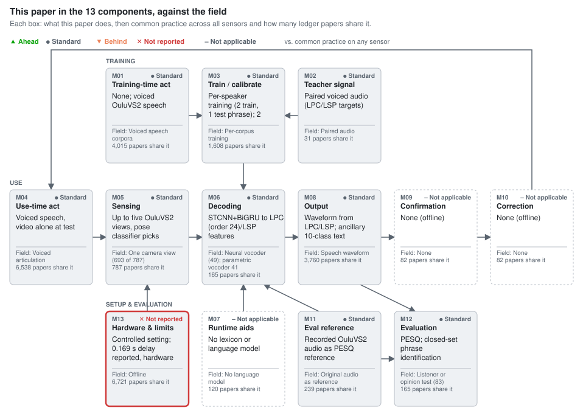

# Lipper: Synthesizing Thy Speech using Multi-View Lipreading

Yaman Kumar, Rohit Jain, Khwaja Mohd. Salik, Rajiv Ratn Shah, Yifang Yin, Roger Zimmermann. Proceedings of the AAAI Conference on Artificial Intelligence 33 (AAAI-19), pp. 2588–2595, 2019. [doi:10.1609/aaai.v33i01.33012588](https://doi.org/10.1609/aaai.v33i01.33012588) · [arXiv:1907.01367](https://arxiv.org/abs/1907.01367)

**Section:** [Lip & face video](../../README.md#lip--face-video)

## Figures

### This paper in the 13 components, against the field

<picture><source media="(prefers-color-scheme: dark)" srcset="figures/components-dark.svg"></picture>

Verdicts compare the paper's choice for each component with common practice across 8,995 ledger entries on any sensor (silent speech, brain-to-text, lip reading).

Data

| Component | This paper | Common practice | Papers with this practice | Verdict |
| --- | --- | --- | --- | --- |
| M01 Training-time act | None; voiced OuluVS2 speech | Voiced speech corpora | 4,015 of 8,995 | ● Standard (Inherited.) |
| M02 Teacher signal | Paired voiced audio (LPC/LSP targets) | Paired audio | 31 of 8,995 | ● Standard (Inherited (Vid2speech lineage).) |
| M03 Train / calibrate | Per-speaker training (2 train, 1 test phrase); 2 held-out speakers | Per-corpus training | 1,608 of 8,995 | ● Standard (No validation set or seeds stated.) |
| M04 Use-time act | Voiced speech, video alone at test | Voiced articulation | 6,538 of 8,995 | ● Standard (Inherited.) |
| M05 Sensing | Up to five OuluVS2 views, pose classifier picks the combination | One camera view (693 of 787) | 787 of 8,995 | ● Standard (Same design in [@kumar2018harnessing] [concurrent]; gain without repeats, not clearly best on held-out speakers.) |
| M06 Decoding | STCNN+BiGRU to LPC (order 24)/LSP features | Neural vocoder (49); parametric vocoder 41 | 165 of 8,995 | ● Standard (Parametric route of Vid2speech.) |
| M07 Runtime aids | No lexicon or language model | No language model | 120 of 8,995 | – Not applicable (Audio output; language independence shown only by demos.) |
| M08 Output | Waveform from LPC/LSP; ancillary 10-class text | Speech waveform | 3,760 of 8,995 | ● Standard (Inherited.) |
| M09 Confirmation | None (offline) | None | 82 of 8,995 | – Not applicable (Offline study.) |
| M10 Correction | None (offline) | None | 82 of 8,995 | – Not applicable (Offline study.) |
| M11 Eval reference | Recorded OuluVS2 audio as PESQ reference | Original audio as reference | 239 of 8,995 | ● Standard (Pairing not spelled out.) |
| M12 Evaluation | PESQ; closed-set phrase identification (audio 80.25%, audio-visual 81.25%); 2 unseen speakers | Listener or opinion test (83) | 165 of 8,995 | ● Standard (No STOI/ESTOI, ASR WER or open transcription; two prior works have them.) |
| M13 Hardware & limits | Controlled setting; 0.169 s delay reported, hardware and timing end points unstated | Offline | 6,721 of 8,995 | ✕ Not reported (Timing hardware and boundaries not stated.) |

## Verdict

The paper [[1]](#ref-1) changes the camera input (M05), up to five OuluVS2 views chosen by a pose classifier, and the regressor (M06), a spatio-temporal CNN with BiGRU predicting LPC/LSP features. Both are standard: the view gain is shown without repeats, the same design appears in the authors' 2018 system [[2]](#ref-2) [concurrent], and the LPC/LSP target is the Vid2speech route [[3]](#ref-3). The evaluation (M12) is standard but thin: PESQ and closed-set phrase identification, with no STOI/ESTOI, ASR WER or open transcription. The best view combination is chosen on the test results it is reported on, and on two held-out speakers the three-view gain over frontal falls from +15.6% to +2.1% and +5.7% PESQ (Tables 4, 6, 10; inference). Speaker independence rests on two speakers, and real time is not established: hardware and timing end points are unstated (Table 11).

## Against the field, component by component

### M05 Sensors: number and placement of camera views

**Usual approach:** One camera: 693 of 787 unique lip-reading and video-to-speech studies name no multi-view input (pattern match, Appendix); of 165 video-to-speech studies, 20 name multi-view input. The paper credits multi-view reconstruction to the authors' 2018 work [[2]](#ref-2); multi-view lip reading to text found frontal plus profile best [[4]](#ref-4).

**State of the art:** This paper (2019) holds the highest multi-view PESQ on OuluVS2 in the topic table, 2.315 for 0°+45°+60° against 2.002 frontal, speaker-dependent (Tables 4, 6). Hush-Hush Speak [[5]](#ref-5) [later] reaches 1.964 with the same views against 1.920 frontal, +2.3% (inference), on digits and phrases with an 85:10:5 split of undescribed speaker separation: not the same protocol.

The chosen triple is not clearly best on held-out speakers 38 and 39: 0°+45° gives 2.03 and 1.85, the triple 1.94 and 1.86, all five views 1.91 and 1.83 (Table 10). The deciding prior ran 10 repetitions with significance tests [[4]](#ref-4); this paper reports no repeats (Tables 4–10). Verdict: standard.

### M06 Processing: regression to LPC/LSP features

**Usual approach:** Of 165 video-to-speech studies (pattern match, Appendix), 49 name a neural vocoder and 41 a parametric vocoder. The paper keeps the parametric route, LPC order 24 with LSP encoding, framing regression against text lip reading (Abstract) and comparing with Vid2speech [[3]](#ref-3) in Table 4.

**State of the art:** On GRID with four seen speakers, a later comparison table gives the lowest ASR WER, 4.07% at PESQ 1.76, to an end-to-end WGAN (2022) generating raw waveform [[6]](#ref-6) [later]. The paper reports no WER, so the gap is unknown. Verdict: standard for 2019.

### M12 Evaluation: quality metric and closed-set listening

**Usual approach:** 83 of 165 video-to-speech studies name a listener or opinion test, 51 an unseen-speaker test, 38 ASR WER on the output (pattern match, Appendix). The paper's listener tests are phrase-level: four options, chance 25%, 80.25% audio-only; ten classes with video, chance 10%, 81.25% (Table 12). The authors found PESQ scored some noisy samples high [[1]](#ref-1).

**State of the art:** On 33 unseen GRID speakers, the same table gives 16.05% WER to a 2022 WGAN [[6]](#ref-6) [later]; the paper tests two unseen speakers (Table 10).

Vid2speech also used closed-set listener tests [[3]](#ref-3). Two earlier systems used measures the paper lacks (Tables 4–12): listener transcription with 1–5 naturalness ratings [[7]](#ref-7) and STOI/ESTOI [[8]](#ref-8); ASR WER on the output is also absent. Two is short of the three a behind verdict needs (Appendix). Verdict: standard.

## The 13 components

| Component | This paper | Usual approach (count) | State of the art | Verdict |
|---|---|---|---|---|
| M01 Training-time action | None; voiced OuluVS2 speech | Voiced speech corpora (slot-filled 4,015) | – | standard |
| M02 Training-only supervision | Paired voiced audio (LPC/LSP targets) | Paired audio (slot-filled 31) | – | standard |
| M03 Training and adaptation | Per-speaker training (2 train, 1 test phrase); 2 held-out speakers | Per-corpus training (slot-filled 1,608) | – | standard |
| M04 Use-time action | Voiced speech, video alone at test | Voiced articulation (slot-filled 6,538) | – | standard |
| M05 Sensors | Up to five OuluVS2 views, pose classifier picks the combination | One camera view (693 of 787) (pattern match 787) | 0°+45°+60°: 2.315 PESQ, speaker-dependent (this paper); 1.964 held-out [[5]](#ref-5) | standard |
| M06 Processing and decoding | STCNN+BiGRU to LPC (order 24)/LSP features | Neural vocoder (49); parametric vocoder 41 (pattern match 165) | 4.07% WER, GRID seen speakers (2022 WGAN row) [[6]](#ref-6) | standard |
| M07 Lexicon and LM | No lexicon or language model | No language model (slot-filled 120) | – | not applicable |
| M08 Output | Waveform from LPC/LSP; ancillary 10-class text | Speech waveform (slot-filled 3,760) | – | standard |
| M09 Confirmation | None (offline) | None (slot-filled 82) | – | not applicable |
| M10 Correction | None (offline) | None (slot-filled 82) | – | not applicable |
| M11 Reference construction | Recorded OuluVS2 audio as PESQ reference | Original audio as reference (slot-filled 239) | – | standard |
| M12 Evaluation | PESQ; closed-set phrase identification (audio 80.25%, audio-visual 81.25%); 2 unseen speakers | Listener or opinion test (83) (pattern match 165) | 16.05% WER, GRID unseen speakers (2022 WGAN row) [[6]](#ref-6) | standard |
| M13 Device and cost | Controlled setting; 0.169 s delay reported, hardware and timing end points unstated | Offline (slot-filled 6,721) | – | not reported |

## Where the claims outrun the evidence

- **Selection on the test set.** No validation set is named; the decision logic picks view combinations from the speaker-dependent results, reused for OOV and held-out tests [[1]](#ref-1). The 2.315 is optimistic (inference).
- **Speaker independence.** Claimed in the conclusion, conceded as weak in future work [[1]](#ref-1); two speakers, one per gender, cannot separate speaker from gender (Table 10).
- **Real time.** Table 11 gives 0.169 s for all ten phrases, against 0.94–1.95 s for a phrase classifier [[4]](#ref-4) whose delay grows with phrase length. Constant delay fits streaming or per-window timing (inference); with hardware and end points unstated, real time is not established.
- **Text accuracy.** 97.0% against 95.6% uses a random split across speakers; the speaker split gives 78.5% (Table 2), as the authors concede.
- **Language independence.** Only speaker-dependent demos in Hindi, English and Chinese [[1]](#ref-1).

## What the field needs next

- M05: view combinations chosen on a validation split, tested on held-out speakers.
- M12: ASR WER, STOI/ESTOI and open listener transcription on a speaker-disjoint OuluVS2 split.
- M06: the same front end with a neural vocoder.

## Questions for the authors

- Which phrases form the speaker-dependent split?
- Was the Ephrat and Peleg baseline in Table 4 retrained on your split?
- What hardware and end points define the 0.169 s delay?
- How many judgments make up the user study, and how was variance computed?

## Appendix: literature search

- **M05, multi-view camera input.** Inclusion rule: video-based speech decoding (lip reading, VSR, video-to-speech) with an optical camera in the ledger; full-text counts of multi-view input, non-frontal pose and OuluVS2 use (upper bound, related-work mentions included); talking-head and biometric studies excluded; versions counted once. Slot-filled 7,329 unique studies; pattern match 787 unique studies. Usual design: one camera view, 693 (pattern match); multi-view input 94, non-frontal pose 128, OuluVS2 74. Within the 165-study video-to-speech population: multi-view input 20; multi-view PESQ on OuluVS2 2. Read in full: [[1]](#ref-1), [[2]](#ref-2), [[4]](#ref-4), [[5]](#ref-5). Known-item recall 7 of 7.
- **M06, video-to-speech synthesis.** Inclusion rule: studies that synthesize a speech waveform from talking-face or lip video and report the acoustic representation and waveform generation; audio-visual enhancement with noisy audio at test, talking-head generation and video-to-text-to-TTS excluded; versions counted once. Slot-filled 7,345; pattern match 165 unique studies. Usual design: neural vocoder, 49 (pattern match); parametric vocoder 41, Griffin-Lim 16, auditory spectrogram 3. Read in full: [[3]](#ref-3), [[6]](#ref-6). Known-item recall 1.0 (3 of 3 table seeds); 4 of 7 for the target's seeds, the three missed being text lip-reading papers.
- **M12, video-to-speech output evaluation.** Inclusion rule: the M06 population, classified by evaluation protocol: listener or opinion tests, ASR WER on the output, unseen-speaker tests (upper bound, related-work mentions included). Slot-filled 6,960; pattern match 165 unique studies. Usual design: listener or opinion test, 83 (pattern match); unseen-speaker test 51, ASR WER on output 38. Read in full: [[3]](#ref-3), [[7]](#ref-7), [[8]](#ref-8), [[9]](#ref-9), [[6]](#ref-6). Earlier works with a protocol the target lacks (STOI/ESTOI, ASR WER on output, or listener transcription), quoted: 2 ([[7]](#ref-7), [[8]](#ref-8)); [[9]](#ref-9) reports listener word accuracy with the response format unquoted. Known-item recall 1.0 (3 of 3 table seeds); 4 of 7 for the target's seeds, the three missed being text lip-reading papers.

## References

Numbered by first citation. BibTeX in the same order and keys: [refs.bib](refs.bib).

1. Kumar, Y., Jain, R., Salik, K. M., Shah, R. R., Yin, Y., Zimmermann, R. “Lipper: Synthesizing Thy Speech using Multi-View Lipreading.” *Proceedings of the AAAI Conference on Artificial Intelligence*, 2019, 33, 2588-2595. doi:[10.1609/aaai.v33i01.33012588](https://doi.org/10.1609/aaai.v33i01.33012588). arXiv:[1907.01367](https://arxiv.org/abs/1907.01367). Target. Read as arXiv:1907.01367 v1 (AAAI-19 text, copyright line on the first page); volume and pages from the AAAI proceedings record. [review](https://github.com/supernaiter/silent-speech-review/tree/main/reviews/lipper-synthesizing-thy-speech-using-multi-view-lipreading) [wiki: arxiv-1907.01367](https://github.com/supernaiter/deep-research-wiki-for-silent-speech/blob/main/papers/arxiv-1907.01367/article.md)
2. Kumar, Y., Aggarwal, M., Nawal, P., Satoh, S., Shah, R. R., Zimmermann, R. “Harnessing AI for Speech Reconstruction using Multi-view Silent Video Feed.” *Proceedings of the 26th ACM International Conference on Multimedia (MM '18)*, 2018, 1976-1983. doi:[10.1145/3240508.3241911](https://doi.org/10.1145/3240508.3241911). arXiv:[1807.00619](https://arxiv.org/abs/1807.00619). [concurrent] [review](https://github.com/supernaiter/silent-speech-review/tree/main/reviews/harnessing-ai-for-speech-reconstruction-using-multi-view-silent-video-feed) [wiki: arxiv-1807.00619](https://github.com/supernaiter/deep-research-wiki-for-silent-speech/blob/main/papers/arxiv-1807.00619/article.md)
3. Ephrat, A., Peleg, S. “Vid2speech: Speech Reconstruction from Silent Video.” *2017 IEEE International Conference on Acoustics, Speech and Signal Processing (ICASSP)*, 2017, 5095-5099. doi:[10.1109/ICASSP.2017.7953127](https://doi.org/10.1109/ICASSP.2017.7953127). arXiv:[1701.00495](https://arxiv.org/abs/1701.00495). [review](https://github.com/supernaiter/silent-speech-review/tree/main/reviews/vid2speech-speech-reconstruction-from-silent-video) [wiki: arxiv-1701.00495](https://github.com/supernaiter/deep-research-wiki-for-silent-speech/blob/main/papers/arxiv-1701.00495/article.md)
4. Petridis, S., Wang, Y., Li, Z., Pantic, M. “End-to-End Multi-View Lipreading.” *Proceedings of the British Machine Vision Conference (BMVC)*, 2017. doi:[10.5244/C.31.161](https://doi.org/10.5244/C.31.161). arXiv:[1709.00443](https://arxiv.org/abs/1709.00443). [wiki: arxiv-1709.00443](https://github.com/supernaiter/deep-research-wiki-for-silent-speech/blob/main/papers/arxiv-1709.00443/article.md)
5. Uttam, S., Kumar, Y., Sahrawat, D., Aggarwal, M., Shah, R. R., Mahata, D., et al. “Hush-Hush Speak: Speech Reconstruction Using Silent Videos.” *Interspeech 2019*, 2019, 136-140. doi:[10.21437/Interspeech.2019-3269](https://doi.org/10.21437/Interspeech.2019-3269). [later] [wiki: isca-uttam19-hushhush](https://github.com/supernaiter/deep-research-wiki-for-silent-speech/blob/main/papers/isca-uttam19-hushhush/article.md) [wiki: isca-uttam19_interspeech](https://github.com/supernaiter/deep-research-wiki-for-silent-speech/blob/main/papers/isca-uttam19_interspeech/article.md)
6. Kefalas, T., Panagakis, Y., Pantic, M. “Large-scale unsupervised audio pre-training for video-to-speech synthesis.” *IEEE/ACM Transactions on Audio, Speech, and Language Processing*, 2024, 32, 2255-2268. doi:[10.1109/TASLP.2024.3382500](https://doi.org/10.1109/TASLP.2024.3382500). arXiv:[2306.15464](https://arxiv.org/abs/2306.15464). Read as arXiv v1 (2023); Tables IV (GRID seen speakers) and VII (GRID unseen speakers). [later] [review](https://github.com/supernaiter/silent-speech-review/tree/main/reviews/large-scale-unsupervised-audio-pre-training-for-video-to-speech-synthesis) [wiki: arxiv-2306.15464-v2apretrain](https://github.com/supernaiter/deep-research-wiki-for-silent-speech/blob/main/papers/arxiv-2306.15464-v2apretrain/article.md)
7. Akbari, H., Arora, H., Cao, L., Mesgarani, N. “Lip2AudSpec: Speech Reconstruction from Silent Lip Movements Video.” *2018 IEEE International Conference on Acoustics, Speech and Signal Processing (ICASSP)*, 2018, 2516-2520. doi:[10.1109/ICASSP.2018.8461856](https://doi.org/10.1109/ICASSP.2018.8461856). arXiv:[1710.09798](https://arxiv.org/abs/1710.09798). [review](https://github.com/supernaiter/silent-speech-review/tree/main/reviews/lip2audspec-speech-reconstruction-from-silent-lip-movements-video) [wiki: arxiv-1710.09798](https://github.com/supernaiter/deep-research-wiki-for-silent-speech/blob/main/papers/arxiv-1710.09798/article.md)
8. Ephrat, A., Halperin, T., Peleg, S. “Improved Speech Reconstruction from Silent Video.” *2017 IEEE International Conference on Computer Vision Workshops (ICCVW)*, 2017, 455-462. doi:[10.1109/ICCVW.2017.61](https://doi.org/10.1109/ICCVW.2017.61). arXiv:[1708.01204](https://arxiv.org/abs/1708.01204). [review](https://github.com/supernaiter/silent-speech-review/tree/main/reviews/improved-speech-reconstruction-from-silent-video) [wiki: arxiv-1708.01204](https://github.com/supernaiter/deep-research-wiki-for-silent-speech/blob/main/papers/arxiv-1708.01204/article.md)
9. Le Cornu, T., Milner, B. “Generating Intelligible Audio Speech From Visual Speech.” *IEEE/ACM Transactions on Audio, Speech, and Language Processing*, 2017, 25(9), 1751-1761. doi:[10.1109/TASLP.2017.2716178](https://doi.org/10.1109/TASLP.2017.2716178). [wiki: doi-10.1109-taslp.2017.2716178](https://github.com/supernaiter/deep-research-wiki-for-silent-speech/blob/main/papers/doi-10.1109-taslp.2017.2716178/article.md)

## Materials

Data behind this review. Full texts of the papers are not included.

- [`review.md`](review.md): the review text (source)
- [`refs.bib`](refs.bib): references (BibTeX)
- [`slots.json`](slots.json): for each of the 13 components: this paper's choice, field practice, number of matching papers, verdict
- [`figures.json`](figures.json): figure definitions
- [`evaluation.md`](evaluation.md): independent evaluation by a second reviewer
- [`triage.md`](triage.md): how each evaluation finding was checked against the sources and resolved
- [`process/log.json`](process/log.json): process record: each step, who did it (reader, script, writer, evaluator), when, the checks run and the input versions
- [`process/notes.json`](process/notes.json): reading notes on the target and comparator papers: claims, numbers, conditions and what is not stated, with locations
- [`process/plan.json`](process/plan.json): plan: which components the paper changes and the topics it is compared on
- [`process/draft.md`](process/draft.md): the review as first written, before the independent evaluation
- [`process/claims-draft.md`](process/claims-draft.md): claim table of the draft: every claim mapped to a note or a count
- [`process/claims.md`](process/claims.md): claim table of the published review
- [`components/M05/multi-view-camera-input.csv`](../../components/M05/multi-view-camera-input.csv): M05 topic "multi-view-camera-input", every candidate paper with its decision (7329 slot-filled, 787 pattern match, usual design in 693, 4 read in full)
- [`components/M06/video-to-speech-synthesis.csv`](../../components/M06/video-to-speech-synthesis.csv): M06 topic "video-to-speech-synthesis", every candidate paper with its decision (7345 slot-filled, 165 pattern match, usual design in 49, 3 read in full)
- [`components/M12/video-to-speech-output-evaluation.csv`](../../components/M12/video-to-speech-output-evaluation.csv): M12 topic "video-to-speech-output-evaluation", every candidate paper with its decision (6960 slot-filled, 165 pattern match, usual design in 83, 5 read in full)

## More reviews in Lip & face video

- [Video-Driven Speech Reconstruction using Generative Adversarial Networks](../video-driven-speech-reconstruction-using-generative-adversarial-networks/) (2019). Direct-waveform GAN (M06) and speech-encoder perceptual loss (M02) are early but standard; the perceptual loss carries the words. Unseen-speaker WER 40.5% (successor 16%); no listener test.
- [Speech Prediction in Silent Videos using Variational Autoencoders](../speech-prediction-in-silent-videos-using-variational-autoencoders/) (2020). Variational autoencoder model for speech synthesis from silent lip video that models one-to-many ambiguity; on GRID reports STOI 0.724, ESTOI 0.540 and PESQ 1.932, leading Lip2Wav on ESTOI and PESQ.
- [Vocoder-Based Speech Synthesis from Silent Videos](../vocoder-based-speech-synthesis-from-silent-videos/) (2020). WORLD features (M06) beat the 2019 GAN on seen GRID speakers; on unseen ones PESQ ties and ESTOI is higher. The CTC text loss (M02) adds under 0.015 ESTOI; the WER is the text head's.
- [Deep Audio-Visual Speech Recognition](../deep-audio-visual-speech-recognition/) (2018). LRS2-BBC outlasts the models: the CTC vs seq2seq comparison is confounded, the 22-point gain is not attributable to the new architecture, and test speaker overlap is unreported.
- [Harnessing AI for Speech Reconstruction using Multi-view Silent Video Feed](../harnessing-ai-for-speech-reconstruction-using-multi-view-silent-video-feed/) (2018). Multi-view input (M05) is new for video-to-speech but standard on its evidence: 2 speakers, gains overstated (11.4% in Table 1, 26% in text); PESQ only, no listener test (M12).
- [Lip2AudSpec: Speech Reconstruction from Silent Lip Movements Video](../lip2audspec-speech-reconstruction-from-silent-lip-movements-video/) (2018). Bottleneck target (M02) and auditory-spectrogram route (M06) are standard; gains rest on one speaker, a re-implemented baseline and a vocabulary-cued test on four seen GRID speakers.

---

Part of the [Silent Speech Interface Review](https://github.com/supernaiter/silent-speech-review). Found an error? [Open an issue](https://github.com/supernaiter/silent-speech-review/issues/new?template=correction.yml).
