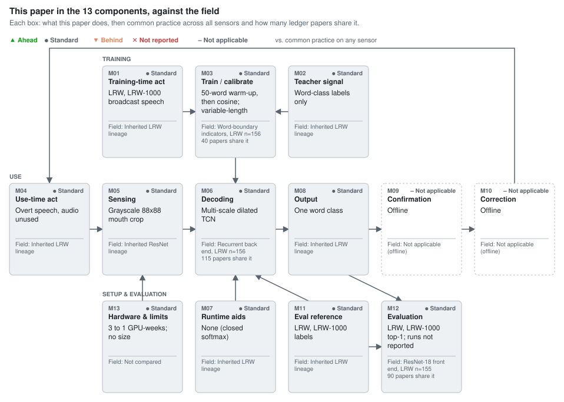

# Lipreading Using Temporal Convolutional Networks

Brais Martinez, Pingchuan Ma, Stavros Petridis, Maja Pantic. arXiv preprint, 2020. [arXiv:2001.08702](https://arxiv.org/abs/2001.08702)

**Section:** [Other sensors](../../README.md#other-sensors)

## Figures

### This paper in the 13 components, against the field

<picture><source media="(prefers-color-scheme: dark)" srcset="figures/components-dark.svg"></picture>

Verdicts compare the paper's choice for each component with common practice across 8,995 ledger entries on any sensor (silent speech, brain-to-text, lip reading).

Data

| Component | This paper | Common practice | Papers with this practice | Verdict |
| --- | --- | --- | --- | --- |
| M01 Training-time act | LRW, LRW-1000 broadcast speech | Inherited LRW lineage |  | ● Standard (Inherited.) |
| M02 Teacher signal | Word-class labels only | Inherited LRW lineage |  | ● Standard (Inherited.) |
| M03 Train / calibrate | 50-word warm-up, then cosine; variable-length crop | Word-boundary indicators, LRW n=156 | 40 of 156 | ● Standard (Crop has no prior hit; one dataset, run count not reported.) |
| M04 Use-time act | Overt speech, audio unused | Inherited LRW lineage |  | ● Standard (Inherited.) |
| M05 Sensing | Grayscale 88x88 mouth crop | Inherited ResNet lineage |  | ● Standard (Inherited (ResNet + LSTM lineage).) |
| M06 Decoding | Multi-scale dilated TCN | Recurrent back end, LRW n=156 | 115 of 156 | ● Standard (Head and augmentation not separated.) |
| M07 Runtime aids | None (closed softmax) | Inherited LRW lineage |  | ● Standard (No language model.) |
| M08 Output | One word class | Inherited LRW lineage |  | ● Standard (Inherited.) |
| M09 Confirmation | Offline | Not applicable (offline) |  | – Not applicable (Offline study.) |
| M10 Correction | Offline | Not applicable (offline) |  | – Not applicable (Offline study.) |
| M11 Eval reference | LRW, LRW-1000 labels | Inherited LRW lineage |  | ● Standard (Splits not named.) |
| M12 Evaluation | LRW, LRW-1000 top-1; runs not reported | ResNet-18 front end, LRW n=155 | 90 of 155 | ● Standard (No seeds or spread.) |
| M13 Hardware & limits | 3 to 1 GPU-weeks; no size | Not compared |  | ● Standard (No parameters or FLOPs.) |

## Verdict

The paper [[1]](#ref-1) changes the temporal back end (M06), a multi-scale dilated TCN in place of a BGRU, and the training recipe (M03), a cosine schedule after a 50-word warm-up, with variable-length temporal cropping. Both are standard. With both heads trained on variable-length clips the TCN leads the BGRU 85.30% to 82.40% (Table 2), but there is no fixed-length TCN row, no run count and no dispersion, so head and augmentation are not separated; a [later] matched-recipe test with word boundaries and a four-layer, 1024-unit BGRU gives 90.0% against 89.7% [[2]](#ref-2). As the authors themselves report (§5.3), frame-drop robustness comes from the cropping: the TCN reaches the same robustness as the BGRU trained the same way (Table 2). The 1.2-point LRW and 3.2-point LRW-1000 gains are against literature numbers from other recipes. Today it sits 7.9 points below SyncVSR [[3]](#ref-3) (inference), trained on LRW video with quantized audio-token targets.

## Against the field, component by component

### M06 Processing: temporal back end

**Usual approach:** a recurrent back end (LSTM or GRU) after a 3D-conv + ResNet front end; 115 of 156 unique word-level LRW / LRW-1000 studies name one (pattern match, Appendix), and 24 of the 26 prior studies do. The paper replaces the BGRU of its baseline [[4]](#ref-4).

**State of the art:** at the time, 84.1% on LRW from a Kinetics-pretrained two-stream I3D with a Bi-LSTM [[5]](#ref-5), 1.2 points below the paper. Today, SyncVSR [[3]](#ref-3) [later] (2024) reaches 93.2% on LRW without word boundaries (mean of three runs) and 58.2% on CAS-VSR-W1K, against 85.3% and 41.4% here.

Temporal convolution on LRW is older: 7 prior studies (6 by pattern match plus [[5]](#ref-5), Appendix), and the three read found it weaker than a Bi-LSTM on a matched front end: 74.6% against 78.4% [[6]](#ref-6), 22.51% against 17.01% error [[7]](#ref-7), and 70.85% against 78.77% [[5]](#ref-5). Depth is not new either: a 15-layer residual temporal convolution stack was used for sentences [[8]](#ref-8). What the searched pattern finds new is the multi-scale branching: 0 prior hits, 2 [concurrent] (the target and [[9]](#ref-9)) and 38 [later] (Appendix). The paper's own evidence is a 2.9-point lead over a BGRU with the same augmentation (inference), run count not reported. Under one [later] recipe (word boundaries, variable-length cropping, a four-layer 1024-unit BGRU) the gap shrinks to 0.3 points [[2]](#ref-2) (inference). Verdict: standard.

### M03 Training: warm-up schedule and variable-length cropping

**Usual approach:** word-boundary indicators are the temporal handling named most often (40 of 156, pattern match), and time masking the common augmentation today (27, all [concurrent] or [later]); prior systems trained in stages [[6]](#ref-6). The paper warms up on the 50 hardest words, then trains all classes with a cosine schedule, cropping each clip at random points around the word (§4.2, §4.3).

**State of the art:** [[2]](#ref-2) [later] (2022) reaches 92.8% from scratch on LRW with a self-distilled single model (93.4% as an ensemble), adding mixup, time masking and word boundaries to the target's own variable-length cropping (Table 2), against 85.3% here.

No prior study names variable-length cropping (0 prior, 2 [concurrent], 7 [later], pattern match, Appendix); the closest prior removes frames outside known word boundaries [[7]](#ref-7). With five frames removed, the fixed-length BGRU falls from 84.60% to 32.94% and the variable-length one from 82.40% to 68.74% (Table 2), at a full-clip cost the authors concede (§5.3). One dataset, one self-designed perturbation and no reported run count do not meet the repetition rule for ahead (Table 2). The Abstract's "one single stage" also overstates the simplification: §4.2 adopts the 50-hardest-word pretraining before full training. Verdict: standard.

### M12 Evaluation: LRW top-1 accuracy

**Usual approach:** top-1 accuracy on the LRW test set; 90 of 155 LRW studies name the ResNet-18 front end the paper also uses (pattern match). The paper adds LRW-1000.

**State of the art:** SyncVSR [[3]](#ref-3) [later] (2024), 93.2% without word boundaries and 95.0% with them, reported as a mean of three runs.

With no seeds, run count or dispersion (§5.1), the 1.2-point margin over [[5]](#ref-5) and the 2.9-point margin over its own BGRU cannot be set against run-to-run variance (inference). Verdict: standard.

## The 13 components

| Component | This paper | Usual approach (count) | State of the art | Verdict |
|---|---|---|---|---|
| M01 Training-time action | LRW, LRW-1000 broadcast speech | Inherited LRW lineage | – | standard |
| M02 Training-only supervision | Word-class labels only | Inherited LRW lineage | – | standard |
| M03 Training and adaptation | 50-word warm-up, then cosine; variable-length crop | Word-boundary indicators, LRW n=156 (pattern match 40) | [[2]](#ref-2) (2022): 92.8% LRW (WB) | standard |
| M04 Use-time action | Overt speech, audio unused | Inherited LRW lineage | – | standard |
| M05 Sensors | Grayscale 88x88 mouth crop | Inherited ResNet lineage | – | standard |
| M06 Processing and decoding | Multi-scale dilated TCN | Recurrent back end, LRW n=156 (pattern match 115) | [[3]](#ref-3) (2024): 93.2% LRW | standard |
| M07 Lexicon and LM | None (closed softmax) | Inherited LRW lineage | – | standard |
| M08 Output | One word class | Inherited LRW lineage | – | standard |
| M09 Confirmation | Offline | Not applicable (offline) | – | not applicable |
| M10 Correction | Offline | Not applicable (offline) | – | not applicable |
| M11 Reference construction | LRW, LRW-1000 labels | Inherited LRW lineage | – | standard |
| M12 Evaluation | LRW, LRW-1000 top-1; runs not reported | ResNet-18 front end, LRW n=155 (pattern match 90) | [[3]](#ref-3) (2024): 95.0% LRW (WB) | standard |
| M13 Device and cost | 3 to 1 GPU-weeks; no size | Not compared | – | standard |

## Where the claims outrun the evidence

- The LRW-1000 result (41.4% vs 38.23% for ResNet + LSTM in [[10]](#ref-10)) has no own BGRU baseline, so back end and recipe are confounded (Table 1).
- Table 2 has no fixed-length TCN, so the 0.7-point lead over the fixed-length BGRU mixes back end and augmentation (inference).
- The babble-noise result (6.53% vs 26.21% error at -5 dB, §5.4) names no corpus, split, sample count or noise source (Fig. 2).
- The 3-to-1 GPU-week saving (§1) names no hardware; no parameters or FLOPs are given (§5.2).

## What the field needs next

- M06: compare temporal heads under one recipe on LRW and LRW-1000 with several seeds, which [[2]](#ref-2) does not report.
- M03: test variable-length cropping against time masking and word-boundary indicators on naturally segmented speech.
- M12: report run-to-run spread, as [[3]](#ref-3) does.

## Questions for the authors

- Which test partitions produced Table 1, and which split selected the checkpoint?
- How were the 50 hardest words taken from [[6]](#ref-6) chosen, and were test-set errors used?
- What do a fixed-length TCN, and a BGRU on LRW-1000 with your recipe, score?
- What corpus, split and babble source does Fig. 2 use, and how many runs stand behind each Table 2 value?

## Appendix: literature search

- **M06, topic word-lipreading-temporal-backend.** Inclusion rule: studies whose ledger names English LRW or Mandarin LRW-1000 / CAS-VSR-W1K (word-level lip reading), classified by the temporal back end their full text names (recurrent, temporal convolution, Transformer, Conformer); related-work mentions counted (upper bound); versions once. Ledger counts: slot-filled 7,345 unique studies; pattern match 156 unique studies. Usual design: recurrent back end, 115 (pattern match); Transformer 79, temporal convolution 76, Conformer 34. Dated (prior before 2019-07; [concurrent] to 2020-07): population prior 26, [concurrent] 14, [later] 106, date unresolved 14; recurrent prior 24; temporal convolution prior 6 studies by pattern, 7 with the read [[5]](#ref-5) that the pattern misses; multi-scale TCN (pattern "multi-scale temporal" or MS-TCN only; depth and dilation not searched) prior 0, [concurrent] 2 including the target, [later] 38. Read in full: [[6]](#ref-6), [[7]](#ref-7), [[5]](#ref-5), [[8]](#ref-8) (sentence level, outside the population), [[2]](#ref-2), [[3]](#ref-3). Known-item recall 1.0 (8 seeds).
- **M03, topic word-lipreading-temporal-augmentation.** Inclusion rule: the same 156-study population, classified by named training-time data handling (variable-length cropping, time masking, frame dropping or jitter, mixup, word-boundary indicators, crop and flip, multi-stage training). Ledger counts: slot-filled 1,526 unique studies; pattern match 156 unique studies. Usual design: word-boundary indicators, 40 (pattern match); time masking 27, mixup 25, frame dropping or jitter 13, variable-length cropping 9. Variable-length cropping prior 0, [concurrent] 2 including the target, [later] 7; frame dropping or jitter prior 1 ([[7]](#ref-7)); time masking prior 0; multi-stage training prior 4. Read in full: [[6]](#ref-6), [[7]](#ref-7), [[2]](#ref-2). Known-item recall 1.0 (4 seeds).
- **M12, topic lrw-word-accuracy** (reused published table, appended). Inclusion rule: visual-only word-level lip reading on English LRW with top-1 test accuracy; LRW-1000 excluded; versions once. Ledger counts: slot-filled 6,960 unique studies; pattern match 155 unique studies. Usual design: ResNet-18 front end with a temporal model, 90 (pattern match). Read in full: [[3]](#ref-3). Known-item recall 0.75 in the published table; 1.0 (4 of 4 seeds) in this run.

## References

Numbered by first citation. BibTeX in the same order and keys: [refs.bib](refs.bib).

1. Martinez, B., Ma, P., Petridis, S., Pantic, M. “Lipreading using Temporal Convolutional Networks.” *arXiv preprint*, 2020. doi:[10.48550/arXiv.2001.08702](https://doi.org/10.48550/arXiv.2001.08702). arXiv:[2001.08702](https://arxiv.org/abs/2001.08702). Target. Read as arXiv v1. [wiki: arxiv-2001.08702](https://github.com/supernaiter/deep-research-wiki-for-silent-speech/blob/main/papers/arxiv-2001.08702/article.md)
2. Ma, P., Wang, Y., Petridis, S., Shen, J., Pantic, M. “Training Strategies for Improved Lip-reading.” *arXiv preprint*, 2022. doi:[10.48550/arXiv.2209.01383](https://doi.org/10.48550/arXiv.2209.01383). arXiv:[2209.01383](https://arxiv.org/abs/2209.01383). [later]; same-recipe comparison of temporal heads. [later] [wiki: arxiv-2209.01383](https://github.com/supernaiter/deep-research-wiki-for-silent-speech/blob/main/papers/arxiv-2209.01383/article.md)
3. Ahn, Y. J., Park, J., Park, S., Choi, J., Kim, K. “SyncVSR: Data-Efficient Visual Speech Recognition with End-to-End Crossmodal Audio Token Synchronization.” *Proc. Interspeech 2024*, 2024. doi:[10.21437/Interspeech.2024-432](https://doi.org/10.21437/Interspeech.2024-432). arXiv:[2406.12233](https://arxiv.org/abs/2406.12233). [later]; state of the art on LRW and CAS-VSR-W1K. [later] [wiki: arxiv-2406.12233](https://github.com/supernaiter/deep-research-wiki-for-silent-speech/blob/main/papers/arxiv-2406.12233/article.md) [wiki: in24-syncvsr](https://github.com/supernaiter/deep-research-wiki-for-silent-speech/blob/main/papers/in24-syncvsr/article.md)
4. Petridis, S., Stafylakis, T., Ma, P., Cai, F., Tzimiropoulos, G., Pantic, M. “End-to-End Audiovisual Speech Recognition.” *Proc. IEEE ICASSP 2018*, 2018. arXiv:[1802.06424](https://arxiv.org/abs/1802.06424). Prior; the target's baseline [15]. [review](https://github.com/supernaiter/silent-speech-review/tree/main/reviews/end-to-end-audiovisual-speech-recognition) [wiki: arxiv-1802.06424](https://github.com/supernaiter/deep-research-wiki-for-silent-speech/blob/main/papers/arxiv-1802.06424/article.md)
5. Weng, X., Kitani, K. “Learning Spatio-Temporal Features with Two-Stream Deep 3D CNNs for Lipreading.” *British Machine Vision Conference (BMVC)*, 2019. arXiv:[1905.02540](https://arxiv.org/abs/1905.02540). Prior; best prior LRW result in the target's Table 1 (reference [16]). [wiki: arxiv-1905.02540](https://github.com/supernaiter/deep-research-wiki-for-silent-speech/blob/main/papers/arxiv-1905.02540/article.md)
6. Stafylakis, T., Tzimiropoulos, G. “Combining Residual Networks with LSTMs for Lipreading.” *Proc. Interspeech 2017*, 2017. doi:[10.21437/Interspeech.2017-85](https://doi.org/10.21437/Interspeech.2017-85). arXiv:[1703.04105](https://arxiv.org/abs/1703.04105). Prior; deciding prior for M06 (temporal-convolution vs BiLSTM back end on LRW); reference [10] of the target. [wiki: arxiv-1703.04105](https://github.com/supernaiter/deep-research-wiki-for-silent-speech/blob/main/papers/arxiv-1703.04105/article.md) [wiki: isca-stafylakis17_lipread](https://github.com/supernaiter/deep-research-wiki-for-silent-speech/blob/main/papers/isca-stafylakis17_lipread/article.md)
7. Stafylakis, T., Khan, M. H., Tzimiropoulos, G. “Pushing the boundaries of audiovisual word recognition using Residual Networks and LSTMs.” *Computer Vision and Image Understanding*, 2018. arXiv:[1811.01194](https://arxiv.org/abs/1811.01194). Prior; deciding prior for M06 and M03. [wiki: arxiv-1811.01194](https://github.com/supernaiter/deep-research-wiki-for-silent-speech/blob/main/papers/arxiv-1811.01194/article.md)
8. Afouras, T., Chung, J. S., Zisserman, A. “Deep Lip Reading: a comparison of models and an online application.” *arXiv preprint*, 2018. doi:[10.48550/arXiv.1806.06053](https://doi.org/10.48550/arXiv.1806.06053). arXiv:[1806.06053](https://arxiv.org/abs/1806.06053). Prior; deep fully convolutional temporal back end (sentence level, LRS2). [wiki: arxiv-1806.06053](https://github.com/supernaiter/deep-research-wiki-for-silent-speech/blob/main/papers/arxiv-1806.06053/article.md)
9. Ma, P., Martinez, B., Petridis, S., Pantic, M. “Towards Practical Lipreading with Distilled and Efficient Models.” *Proc. IEEE ICASSP 2021*, 2021. arXiv:[2007.06504](https://arxiv.org/abs/2007.06504). [concurrent]; same group. [concurrent] [wiki: arxiv-2007.06504](https://github.com/supernaiter/deep-research-wiki-for-silent-speech/blob/main/papers/arxiv-2007.06504/article.md)
10. Yang, S., Zhang, Y., Feng, D., Yang, M., Wang, C., Xiao, J., et al. “LRW-1000: A Naturally-Distributed Large-Scale Benchmark for Lip Reading in the Wild.” *IEEE International Conference on Automatic Face and Gesture Recognition (FG)*, 2019. arXiv:[1810.06990](https://arxiv.org/abs/1810.06990). Prior; source of the LRW-1000 baseline in the target's Table 1 (reference [18]). [wiki: arxiv-1810.06990](https://github.com/supernaiter/deep-research-wiki-for-silent-speech/blob/main/papers/arxiv-1810.06990/article.md)

## Materials

Data behind this review. Full texts of the papers are not included.

- [`review.md`](review.md): the review text (source)
- [`refs.bib`](refs.bib): references (BibTeX)
- [`slots.json`](slots.json): for each of the 13 components: this paper's choice, field practice, number of matching papers, verdict
- [`figures.json`](figures.json): figure definitions
- [`evaluation.md`](evaluation.md): independent evaluation by a second reviewer
- [`triage.md`](triage.md): how each evaluation finding was checked against the sources and resolved
- [`process/log.json`](process/log.json): process record: each step, who did it (reader, script, writer, evaluator), when, the checks run and the input versions
- [`process/notes.json`](process/notes.json): reading notes on the target and comparator papers: claims, numbers, conditions and what is not stated, with locations
- [`process/plan.json`](process/plan.json): plan: which components the paper changes and the topics it is compared on
- [`process/draft.md`](process/draft.md): the review as first written, before the independent evaluation
- [`process/claims-draft.md`](process/claims-draft.md): claim table of the draft: every claim mapped to a note or a count
- [`process/claims.md`](process/claims.md): claim table of the published review
- [`components/M03/word-lipreading-temporal-augmentation.csv`](../../components/M03/word-lipreading-temporal-augmentation.csv): M03 topic "word-lipreading-temporal-augmentation", every candidate paper with its decision (1526 slot-filled, 156 pattern match, usual design in 40, 3 read in full)
- [`components/M06/word-lipreading-temporal-backend.csv`](../../components/M06/word-lipreading-temporal-backend.csv): M06 topic "word-lipreading-temporal-backend", every candidate paper with its decision (7345 slot-filled, 156 pattern match, usual design in 115, 6 read in full)
- [`components/M12/lrw-word-accuracy.csv`](../../components/M12/lrw-word-accuracy.csv): M12 topic "lrw-word-accuracy", every candidate paper with its decision (6960 slot-filled, 155 pattern match, usual design in 90, 2 read in full)

## More reviews in Other sensors

- [ASR is all you need: cross-modal distillation for lip reading](../asr-is-all-you-need-cross-modal-distillation-for-lip-reading/) (2020). ASR-teacher labels (M02) replaced transcribed-data alignment targets; standard: LRS2 parity holds, but effects differ across datasets, one WER each, and distillation is not isolated.
- [Machine translation of cortical activity to text with an encoder-decoder framework](../machine-translation-of-cortical-activity-to-text-with-an-encoder-decoder-framework/) (2020). Word-level ECoG encoder-decoder; all changed components standard. 3% WER is on repeats of 50 sentences; unseen sentences and participants were never tested.
- [End-to-End Audio-Visual Speech Recognition with Conformers](../end-to-end-audio-visual-speech-recognition-with-conformers/) (2021). Conformer back-end on raw inputs (M06) and Transformer LM (M07) are standard: raw-input AVSR predates it, and the Conformer gain is one unrepeated step confounded with a decoder swap.
- [Real-time synthesis of imagined speech processes from minimally invasive recordings of neural activity](../real-time-synthesis-of-imagined-speech-processes-from-minimally-invasive-recordings-of-neural-activi/) (2021). Closed-loop sEEG word synthesis (M06) and audible-to-imagined transfer (M04) are standard; one participant; imagined output gets no word-content test (M12 behind Martin 2014).
- [Real-time decoding of question-and-answer speech dialogue using human cortical activity](../real-time-decoding-of-question-and-answer-speech-dialogue-using-human-cortical-activity/) (2019). Context prior from the decoded question (M07) is ahead, gaining in 3 of 3 participants; HMM decoder (M06) is standard; no online accuracy or latency backs the real-time claim.
- [Recurrent Neural Network Transducer for Audio-Visual Speech Recognition](../recurrent-neural-network-transducer-for-audio-visual-speech-recognition/) (2019). First neural transducer for audio-visual speech in the ledger, but the LRS3 gain mixes 31k h of data, external-LM baselines and the decoder; one run, one test set: all changes standard.

---

Part of the [Silent Speech Interface Review](https://github.com/supernaiter/silent-speech-review). Found an error? [Open an issue](https://github.com/supernaiter/silent-speech-review/issues/new?template=correction.yml).
