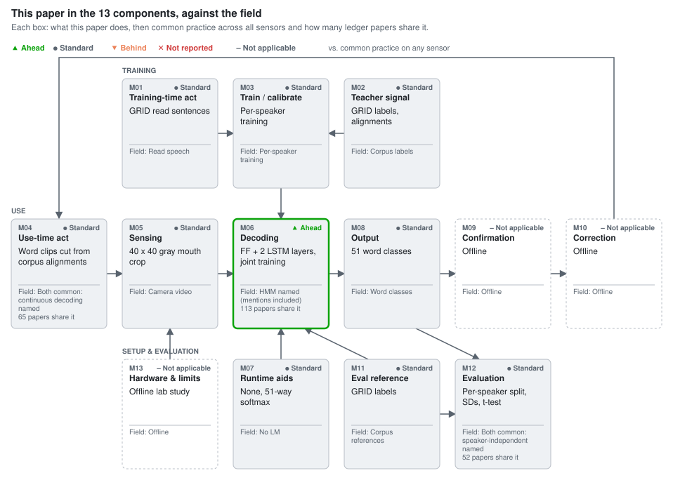

# Lipreading with Long Short-Term Memory

Wand, M., Koutník, J., Schmidhuber, J. · ICASSP 2016 · 2016 · [DOI:10.1109/ICASSP.2016.7472852](https://doi.org/10.1109/ICASSP.2016.7472852) · [arXiv:1601.08188](https://arxiv.org/abs/1601.08188)

**Section:** [Other sensors](../../README.md#other-sensors)

## Figures

### This paper in the 13 components, against the field

<picture><source media="(prefers-color-scheme: dark)" srcset="figures/components-dark.svg"></picture>

Verdicts compare the paper's choice for each component with common practice across 8,995 ledger entries on any sensor (silent speech, brain-to-text, lip reading).

Data

| Component | This paper | Common practice | Papers with this practice | Verdict |
| --- | --- | --- | --- | --- |
| M01 Training-time act | GRID read sentences | Read speech |  | ● Standard (Inherited.) |
| M02 Teacher signal | GRID labels, alignments | Corpus labels |  | ● Standard (Inherited.) |
| M03 Train / calibrate | Per-speaker training | Per-speaker training |  | ● Standard (No seeds stated.) |
| M04 Use-time act | Word clips cut from corpus alignments | Both common: continuous decoding named | 65 of 159 | ● Standard (Isolated input named in 41 of 159 (mentions).) |
| M05 Sensing | 40 x 40 gray mouth crop | Camera video |  | ● Standard (Inherited.) |
| M06 Decoding | FF + 2 LSTM layers, joint training | HMM named (mentions included) | 113 of 159 | ▲ Ahead (Joint recurrent + pixel front end not in read priors; pixel-input MS-TDNN 1994.) |
| M07 Runtime aids | None, 51-way softmax | No LM |  | ● Standard (No grammar at test.) |
| M08 Output | 51 word classes | Word classes |  | ● Standard (Inherited.) |
| M09 Confirmation | Offline | Offline |  | – Not applicable (Offline.) |
| M10 Correction | Offline | Offline |  | – Not applicable (Offline.) |
| M11 Eval reference | GRID labels | Corpus references |  | ● Standard (Inherited.) |
| M12 Evaluation | Per-speaker split, SDs, t-test | Both common: speaker-independent named | 52 of 159 | ● Standard (Speaker-dependent named in 37 of 159 (mentions).) |
| M13 Hardware & limits | Offline lab study | Offline |  | – Not applicable (Offline.) |

## Verdict

The paper changes decoding (M06): a feed-forward layer and two LSTM layers trained jointly on mouth crops replace hand-crafted features and a separate classifier [[1]](#ref-1). Joint training of a gated recurrent model with a pixel-input front end is ahead of its field: of 159 lip-reading studies first public before 2015-07, 113 name an HMM and 2 a recurrent network (pattern match, mentions included, Appendix), and no read prior trains its recurrent model with the front end. Neither pixel input nor recurrent word models are new: a 1994 time-delay network learned from gray-level lip pixels [[2]](#ref-2), and diffusion networks modelled whole words over lip-contour features [[3]](#ref-3). The gain holds across the 10 evaluation speakers of one corpus with no seeds, and it is a gain over linear SVMs on a six-frame vector, not over the HMM pipeline of the time, so it shows a new design, not a better one. Pre-cut word clips (M04) and per-speaker splits (M12) are standard, since both alternatives were in common use. The 11.6% gain is relative, 8.3 points absolute (inference).

## Against the field, component by component

### M06 Decoding: recurrent network trained jointly on mouth pixels

**Usual approach:** Of 159 lip-reading studies first public before 2015-07 (pattern match, mentions included, Appendix), 113 name an HMM, 98 hand-crafted features, 4 learned deep features and 2 a recurrent network. The paper uses one network on 40 × 40 mouth crops (Sec. 3, Sec. 5.1).

**State of the art:** SyncVSR (2024) reaches 93.2% top-1 accuracy on the 500-word, speaker-independent LRW test, mean of three runs [[4]](#ref-4); the speaker-dependent GRID word task has no current counterpart. Recurrent networks are named in 417 of 662 [later] studies (Appendix).

The two recurrent priors train on pre-extracted features: one diffusion network per word over lip-contour PCA features [[3]](#ref-3), and Jordan and Elman networks for frame tasks, with HMMs for words [[5]](#ref-5). The two read deep-feature priors train features apart from the classifier: autoencoders feeding a linear SVM [[6]](#ref-6), and per-speaker CNNs feeding GMM-HMMs [[7]](#ref-7). The [concurrent] Petridis and Pantic feed pixel-derived bottleneck features to an LSTM trained separately, per frame [[8]](#ref-8). The closest prior, missing from the reference list, is the MS-TDNN of Duchnowski et al., trained by back-propagation on 384 gray-level pixel values per lip frame, with delays and DTW for time, on one speaker's spelled letters in an audio-visual system that grew from the group's 1993 work [[2]](#ref-2); "Manual feature extraction is no longer required" (Sec. 1) restates that capability. On the 10 evaluation speakers the LSTM reaches 79.6% against 71.3% for HOG + SVM (Table 1); speakers 1–9 tuned the parameters. Verdict: ahead.

### M04 Use-time input: word clips cut from corpus alignments

**Usual approach:** Both designs were common: of the 159 prior studies (pattern match, mentions included, Appendix), 65 name continuous or sentence-level decoding and 41 isolated or pre-segmented word input. The paper classifies clips cut with GRID's frame-level alignments (Sec. 3), so word boundaries are given, not found.

**State of the art:** On the paper's own GRID split, Chung et al. (2016) decode whole sentences without alignments at 3.0% WER, after pre-training on LRS, and list this paper at 20.4% WER [[9]](#ref-9).

Pre-cut clips were common, e.g. hand-cut CUAVE digits [[10]](#ref-10). Verdict: standard.

### M12 Evaluation: per-speaker splits with speaker variability

**Usual approach:** Both designs were common: of the 159 prior studies (pattern match, mentions included, Appendix), 52 name speaker-independent and 37 speaker-dependent evaluation, and 76 a standard deviation, confidence interval or significance test. The paper trains and tests within each speaker, as the authors state (Sec. 3).

**State of the art:** Chung et al. (2016) adopt this split as "the standard protocol" and reach 3.0% sentence WER on it [[9]](#ref-9).

Examples: within-speaker [[7]](#ref-7), [[10]](#ref-10), held-out speakers [[3]](#ref-3), [[6]](#ref-6). Speaker SDs (Table 1) are a strength; five random test videos per word (Sec. 3), no seeds and no session allocation are not. Verdict: standard.

## The 13 components

| Component | This paper | Usual approach (count) | State of the art | Verdict |
|---|---|---|---|---|
| M01 Training-time action | GRID read sentences | Read speech | – | standard |
| M02 Training-only supervision | GRID labels, alignments | Corpus labels | – | standard |
| M03 Training and adaptation | Per-speaker training | Per-speaker training | – | standard |
| M04 Use-time action | Word clips cut from corpus alignments | Both common: continuous decoding named (pattern match 65) | [[9]](#ref-9) (2016): GRID sentence WER 3.0%, same split | standard |
| M05 Sensors | 40 x 40 gray mouth crop | Camera video | – | standard |
| M06 Processing and decoding | FF + 2 LSTM layers, joint training | HMM named (mentions included) (pattern match 113) | [[4]](#ref-4) (2024): LRW top-1 93.2% | ahead |
| M07 Lexicon and LM | None, 51-way softmax | No LM | – | standard |
| M08 Output | 51 word classes | Word classes | – | standard |
| M09 Confirmation | Offline | Offline | – | not applicable |
| M10 Correction | Offline | Offline | – | not applicable |
| M11 Reference construction | GRID labels | Corpus references | – | standard |
| M12 Evaluation | Per-speaker split, SDs, t-test | Both common: speaker-independent named (pattern match 52) | [[9]](#ref-9) (2016): GRID WER 3.0% on this split | standard |
| M13 Device and cost | Offline lab study | Offline | – | not applicable |

## Where the claims outrun the evidence

- **Baselines.** Both are linear SVMs on a six-frame vector (Sec. 5.1); no HMM or time-delay baseline is run, although HMMs are named in 113 of 159 prior studies (Appendix). The authors' view that an HMM would not help (Sec. 5.1) is untested.
- **Speakers.** The abstract reports 79.6% "on held-out evaluation speakers"; they were held out from tuning only, and all experiments are speaker-dependent (Sec. 3).
- **Gain.** "Improves the accuracy by 11.6%" (Sec. 5.2) is relative.
- **Significance.** The one-tailed t-test "with p = 0.05" (Sec. 5.2) has no sample unit, pairing or statistic.
- **Preprocessing.** Standardization over "the complete dataset" (Sec. 3) shares only pooled statistics with test clips, a small leak (inference); Duchnowski et al. fitted PCA and LDA on training data only [[2]](#ref-2).
- **CNN layers.** That they did not help (Sec. 6) rests on unreported experiments.

## What the field needs next

- M06: an HMM and a time-delay network on the same 40 × 40 crops and splits.
- M12: held-out-speaker GRID evaluation with repeated seeds, which the authors list as future work (Sec. 6).
- M04: decoding whole 75-frame sentences without corpus alignments.

## Questions for the authors

- Did all three systems share the same random splits, and how many seeds or repeats were run?
- Is the t-test over speakers or clips, is it paired, and is 0.05 the observed p-value or the threshold?

## Appendix: literature search

Population for all three topics: ledgers that name optical-camera input and lip reading, visual speech recognition or audio-visual speech recognition (1,359 folders, 975 unique studies, pattern match). Studies whose full text names no automatic recognizer or classifier are excluded (54 prior, 60 [later]); versions count once. Dating against the target's first public month 2016-01: prior before 2015-07 (159 studies), [concurrent] (9 studies), [later] after 2016-07 (662 studies), 13 date unresolved; months from arXiv ids, ICASSP (March) and ISCA 2015–2016 venues (September). arxiv-1710.01073 is the same paper as the ICIP 2014 folder and counts as prior. Design counts are full-text pattern matches with reference lists removed; related-work mentions count, so they are upper bounds.

**M06, lipreading-temporal-model-and-feature-learning.** Inclusion rule: automatic lip-reading, VSR or AVSR studies with optical-camera input, classified by the visual model their full text names (recurrent network, time-delay network, learned deep features, hand-crafted features, HMM, SVM). Slot-filled M06: 7,345 unique studies. Prior (159): HMM 113, hand-crafted features 98, SVM 16, time-delay network 10, learned deep features 4, recurrent network 2. [Concurrent] (9): recurrent 1 [[8]](#ref-8), learned deep features 3, including [[11]](#ref-11). [Later] (662): recurrent 417, learned deep features 445, hand-crafted 191, HMM 226. Usual design at the time: HMM classifier, 113 of 159 (pattern match). Whole-wiki full-text check: every folder dated 2015 or earlier with source text (723 of 1,844 folders), recurrent or time-delay network terms together with visual-speech terms, 34 matching studies; none trains a recurrent network jointly with its visual front end. Read in full: [[2]](#ref-2), [[3]](#ref-3), [[5]](#ref-5), [[6]](#ref-6), [[7]](#ref-7); state of the art [[4]](#ref-4). Known-item recall 1.0 (9 of 9).

**M04, lipreading-word-segmentation-at-test.** Inclusion rule: the same population, classified by whether the full text names isolated or pre-segmented word input or continuous, connected or sentence-level decoding; corpus-derived boundaries at test count as pre-segmented. Slot-filled M04: 5,595 unique studies. Prior (159): continuous decoding 65, isolated word input 41. [Later] (662): continuous 335, isolated 113. Usual design at the time: both in common use (65 and 41 of 159, pattern match). Read in full: [[10]](#ref-10); state of the art [[9]](#ref-9). Known-item recall 1.0 (8 of 8).

**M12, lipreading-speaker-dependence-protocol.** Inclusion rule: the same population, classified by the evaluation partition the full text names (speaker-dependent or seen speakers, speaker-independent or held-out speakers) and by whether it reports a standard deviation, confidence interval or significance test. Slot-filled M12: 6,960 unique studies. Prior (159): speaker-independent 52, speaker-dependent 37, variability or significance 76. [Later] (662): speaker-independent 214, speaker-dependent 142, variability or significance 267. Usual design at the time: both in common use (52 and 37 of 159, pattern match). State of the art [[9]](#ref-9). Known-item recall 1.0 (8 of 8).

## References

Numbered by first citation. BibTeX in the same order and keys: [refs.bib](refs.bib).

1. Wand, M., Koutník, J., Schmidhuber, J. “Lipreading with Long Short-Term Memory.” *2016 IEEE International Conference on Acoustics, Speech and Signal Processing (ICASSP)*, 2016, 6115-6119. doi:[10.1109/ICASSP.2016.7472852](https://doi.org/10.1109/ICASSP.2016.7472852). arXiv:[1601.08188](https://arxiv.org/abs/1601.08188). Target. Read as arXiv v1 (29 Jan 2016). [wiki: doi-10.1109-icassp.2016.7472852](https://github.com/supernaiter/deep-research-wiki-for-silent-speech/blob/main/papers/doi-10.1109-icassp.2016.7472852/article.md) [wiki: arxiv-1601.08188](https://github.com/supernaiter/deep-research-wiki-for-silent-speech/blob/main/papers/arxiv-1601.08188/article.md)
2. Duchnowski, P., Meier, U., Waibel, A. “See Me, Hear Me: Integrating Automatic Speech Recognition and Lip-reading.” *Proc. 3rd International Conference on Spoken Language Processing (ICSLP 94)*, 1994. <https://www.isca-archive.org/icslp_1994/duchnowski94_icslp.html> Prior; deciding prior for M06 (MS-TDNN on gray-level lip pixels). [wiki: isca-duchnowski94_icslp](https://github.com/supernaiter/deep-research-wiki-for-silent-speech/blob/main/papers/isca-duchnowski94_icslp/article.md)
3. Movellan, J. R., Mineiro, P. “A Diffusion Network Approach to Visual Speech Recognition.” *Proc. Auditory-Visual Speech Processing (AVSP 1999)*, 1999. <https://www.isca-archive.org/avsp_1999/movellan99_avsp.html> Prior; deciding prior for M06 (stochastic recurrent network on lip-contour features). Same paper also held as wiki folder avsp99-movellan99_avsp. [wiki: isca-movellan99_avsp](https://github.com/supernaiter/deep-research-wiki-for-silent-speech/blob/main/papers/isca-movellan99_avsp/article.md)
4. Ahn, Y. J., Park, J., Park, S., Choi, J., Kim, K. “SyncVSR: Data-Efficient Visual Speech Recognition with End-to-End Crossmodal Audio Token Synchronization.” *Interspeech 2024*, 2024. arXiv:[2406.12233](https://arxiv.org/abs/2406.12233). State of the art for M06 and M04 (LRW word accuracy). [later] [wiki: arxiv-2406.12233](https://github.com/supernaiter/deep-research-wiki-for-silent-speech/blob/main/papers/arxiv-2406.12233/article.md)
5. Wojdeł, J. C. “Automatic Lipreading in the Dutch Language.” *PhD thesis, Technische Universiteit Delft*, 2003. <https://openalex.org/W1607796654> Prior; deciding prior for M06 (Jordan and Elman networks for frame tasks, HMM word recognizer). [wiki: oa-W1607796654](https://github.com/supernaiter/deep-research-wiki-for-silent-speech/blob/main/papers/oa-W1607796654/article.md)
6. Ngiam, J., Khosla, A., Kim, M., Nam, J., Lee, H., Ng, A. Y. “Multimodal Deep Learning.” *Proceedings of the 28th International Conference on Machine Learning (ICML 2011)*, 2011. doi:[10.5555/3104482.3104569](https://doi.org/10.5555/3104482.3104569). Prior; deep-feature prior for M06. [wiki: w2076462394-ngiamavsr](https://github.com/supernaiter/deep-research-wiki-for-silent-speech/blob/main/papers/w2076462394-ngiamavsr/article.md)
7. Noda, K., Yamaguchi, Y., Nakadai, K., Okuno, H. G., Ogata, T. “Lipreading using Convolutional Neural Network.” *Interspeech 2014*, 2014. doi:[10.21437/Interspeech.2014-293](https://doi.org/10.21437/Interspeech.2014-293). Prior; cited by the target; deep-feature prior for M06. Same paper also held as wiki folder isca-noda14_interspeech. [wiki: isca-noda14-cnnlip](https://github.com/supernaiter/deep-research-wiki-for-silent-speech/blob/main/papers/isca-noda14-cnnlip/article.md)
8. Petridis, S., Pantic, M. “Deep Complementary Bottleneck Features for Visual Speech Recognition.” *2016 IEEE International Conference on Acoustics, Speech and Signal Processing (ICASSP)*, 2016, 2304-2308. doi:[10.1109/ICASSP.2016.7472088](https://doi.org/10.1109/ICASSP.2016.7472088). Concurrent; pixel-derived bottleneck features with a separately trained LSTM. [concurrent] [wiki: doi-10.1109-icassp.2016.7472088](https://github.com/supernaiter/deep-research-wiki-for-silent-speech/blob/main/papers/doi-10.1109-icassp.2016.7472088/article.md)
9. Chung, J. S., Senior, A., Vinyals, O., Zisserman, A. “Lip Reading Sentences in the Wild.” *2017 IEEE Conference on Computer Vision and Pattern Recognition (CVPR)*, 2017. doi:[10.1109/CVPR.2017.367](https://doi.org/10.1109/CVPR.2017.367). arXiv:[1611.05358](https://arxiv.org/abs/1611.05358). State of the art for M04 and M12 on the target's own GRID split (sentence WER). [later] [review](https://github.com/supernaiter/silent-speech-review/tree/main/reviews/lip-reading-sentences-in-the-wild) [wiki: arxiv-1611.05358](https://github.com/supernaiter/deep-research-wiki-for-silent-speech/blob/main/papers/arxiv-1611.05358/article.md)
10. Kumaravel, S. S. “Visual Speech Recognition using Histogram of Oriented Displacements.” *MS thesis, Clemson University*, 2015. <https://tigerprints.clemson.edu/all_theses/2112/> Prior; isolated-word, speaker-dependent example for M04 and M12. [wiki: oa-W650851844](https://github.com/supernaiter/deep-research-wiki-for-silent-speech/blob/main/papers/oa-W650851844/article.md)
11. Ninomiya, H., Kitaoka, N., Tamura, S., Iribe, Y., Takeda, K. “Integration of Deep Bottleneck Features for Audio-Visual Speech Recognition.” *Interspeech 2015*, 2015. <https://www.isca-archive.org/interspeech_2015/ninomiya15_interspeech.html> Concurrent; deep bottleneck features with multi-stream HMMs. Same paper also held as wiki folder isca-ninomiya15_interspeech. [concurrent] [wiki: isca-ninomiya15-dbnf](https://github.com/supernaiter/deep-research-wiki-for-silent-speech/blob/main/papers/isca-ninomiya15-dbnf/article.md)

## Materials

Data behind this review. Full texts of the papers are not included.

- [`review.md`](review.md): the review text (source)
- [`refs.bib`](refs.bib): references (BibTeX)
- [`slots.json`](slots.json): for each of the 13 components: this paper's choice, field practice, number of matching papers, verdict
- [`figures.json`](figures.json): figure definitions
- [`evaluation.md`](evaluation.md): independent evaluation by a second reviewer
- [`triage.md`](triage.md): how each evaluation finding was checked against the sources and resolved
- [`process/log.json`](process/log.json): process record: each step, who did it (reader, script, writer, evaluator), when, the checks run and the input versions
- [`process/notes.json`](process/notes.json): reading notes on the target and comparator papers: claims, numbers, conditions and what is not stated, with locations
- [`process/plan.json`](process/plan.json): plan: which components the paper changes and the topics it is compared on
- [`process/draft.md`](process/draft.md): the review as first written, before the independent evaluation
- [`process/claims-draft.md`](process/claims-draft.md): claim table of the draft: every claim mapped to a note or a count
- [`process/claims.md`](process/claims.md): claim table of the published review
- [`components/M04/lipreading-word-segmentation-at-test.csv`](../../components/M04/lipreading-word-segmentation-at-test.csv): M04 topic "lipreading-word-segmentation-at-test", every candidate paper with its decision (5595 slot-filled, 975 pattern match, usual design in 65, 2 read in full)
- [`components/M06/lipreading-temporal-model-and-feature-learning.csv`](../../components/M06/lipreading-temporal-model-and-feature-learning.csv): M06 topic "lipreading-temporal-model-and-feature-learning", every candidate paper with its decision (7345 slot-filled, 975 pattern match, usual design in 113, 6 read in full)
- [`components/M12/lipreading-speaker-dependence-protocol.csv`](../../components/M12/lipreading-speaker-dependence-protocol.csv): M12 topic "lipreading-speaker-dependence-protocol", every candidate paper with its decision (6960 slot-filled, 975 pattern match, usual design in 52, 1 read in full)

## More reviews in Other sensors

- [Fully Implanted Brain-Computer Interface in a Locked-In Patient with ALS](../fully-implanted-brain-computer-interface-in-a-locked-in-patient-with-als/) (2016). Skin-closed ECoG implant used at home without investigators (M13): standard, one user, skin-closed telemetry predates it; main-text 89% spelling accuracy pools inactive steps, no chance level.
- [Combining Residual Networks with LSTMs for Lipreading](../combining-residual-networks-with-lstms-for-lipreading/) (2017). 3D-conv + ResNet + Bi-LSTM (M06), which became the field default, and per-step training (M03) are standard only for lack of run counts; 83.0% trails audio-supervised 93.2% today.
- [High performance communication by people with paralysis using an intracortical brain-computer interface](../high-performance-communication-by-people-with-paralysis-using-an-intracortical-brain-computer-interf/) (2017). ReFIT-KF + HMM click (M06) and ccpm/bitrate protocol (M12) are standard for 2017; 1.4-4.2x record gains are cross-study and the HMM is never isolated; later decoders reach 110 chars/min.
- [Brain-to-text: decoding spoken phrases from phone representations in the brain](../brain-to-text-decoding-spoken-phrases-from-phone-representations-in-the-brain/) (2015). Phone-model decoder (M06) is the EMG recognizer moved to ECoG: standard. 25% WER uses per-phrase dictionaries holding the spoken words (M07); the time-shift null (M12) is sound.
- [End-to-End Audiovisual Speech Recognition](../end-to-end-audiovisual-speech-recognition/) (2018). Raw-waveform front end and BGRU fusion (M06) depart from the usual approach but are standard: they tie MFCC in clean LRW audio (97.7%); noise gains lack repeated runs and use matched babble.
- [Decoding spectrotemporal features of overt and covert speech from the human cortex](../decoding-spectrotemporal-features-of-overt-and-covert-speech-from-the-human-cortex/) (2014). Overt-trained ECoG decoding of covert reading (M04), spectral outputs (M08) and the overt-recording covert reference (M11) are standard; DTW-aligned rest reaches r 0.30 vs covert 0.34.

---

Part of the [Silent Speech Interface Review](https://github.com/supernaiter/silent-speech-review). Found an error? [Open an issue](https://github.com/supernaiter/silent-speech-review/issues/new?template=correction.yml).
