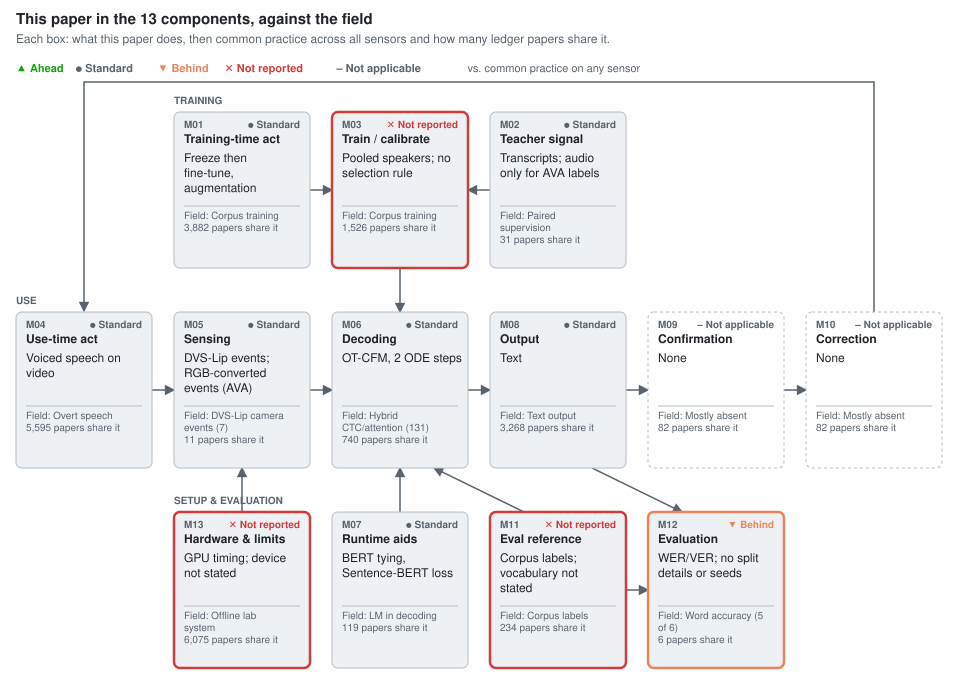

# A First Exploration of Neuromorphic OT-CFM for Multi-Speaker VSR

Lin Chen, Jingping Fang, Hairui Liu, Chenyang Xu, Junhao Chen, Xiaorui Li, Weidong Cai, Xiaoming Chen. ECCV 2026. [doi:10.1007/978-3-032-37281-9_8](https://doi.org/10.1007/978-3-032-37281-9_8) · [arXiv:2606.31225](https://arxiv.org/abs/2606.31225)

**Section:** [Lip & face video](../../README.md#lip--face-video)

## Figures

### This paper in the 13 components, against the field

<picture><source media="(prefers-color-scheme: dark)" srcset="figures/components-dark.svg"></picture>

Verdicts compare the paper's choice for each component with common practice across 8,995 ledger entries on any sensor (silent speech, brain-to-text, lip reading).

Data

| Component | This paper | Common practice | Papers with this practice | Verdict |
| --- | --- | --- | --- | --- |
| M01 Training-time act | Freeze then fine-tune, augmentation | Corpus training | 3,882 of 8,995 | ● Standard (Inherited; one run, no seeds (Sec. 5.1).) |
| M02 Teacher signal | Transcripts; audio only for AVA labels | Paired supervision | 31 of 8,995 | ● Standard (No acoustic input at test.) |
| M03 Train / calibrate | Pooled speakers; no selection rule | Corpus training | 1,526 of 8,995 | ✕ Not reported (Selection data not stated.) |
| M04 Use-time act | Voiced speech on video | Overt speech | 5,595 of 8,995 | ● Standard (Scenes cut into single-speaker clips by tracking (Abstract).) |
| M05 Sensing | DVS-Lip events; RGB-converted events (AVA) | DVS-Lip camera events (7) | 11 of 8,995 | ● Standard (AVA robustness rests on converted, not sensed, events.) |
| M06 Decoding | OT-CFM, 2 ODE steps | Hybrid CTC/attention (131) | 740 of 8,995 | ● Standard (Gain over the diffusion variant is 0.2 WER points, one run, no seeds.) |
| M07 Runtime aids | BERT tying, Sentence-BERT loss | LM in decoding | 119 of 8,995 | ● Standard (Homophene claim not measured.) |
| M08 Output | Text | Text output | 3,268 of 8,995 | ● Standard (Inherited.) |
| M09 Confirmation | None | Mostly absent | 82 of 8,995 | – Not applicable (Offline benchmark study.) |
| M10 Correction | None | Mostly absent | 82 of 8,995 | – Not applicable (Offline benchmark study.) |
| M11 Eval reference | Corpus labels; vocabulary not stated | Corpus labels | 234 of 8,995 | ✕ Not reported (AVA subset construction not given.) |
| M12 Evaluation | WER/VER; no split details or seeds | Word accuracy (5 of 6) | 6 of 8,995 | ▼ Behind (Yardstick: the practice of earlier DVS-Lip studies (word accuracy).) |
| M13 Hardware & limits | GPU timing; device not stated | Offline lab system | 6,075 of 8,995 | ✕ Not reported (Latency claims lack a timing protocol.) |

## Verdict

The paper [[1]](#ref-1) changes two components: event-stream input (M05, standard: DVS-Lip already supplies camera events) and a two-step OT-CFM text decoder (M06, standard: 0.2 WER points over its own diffusion variant, one run). Its evaluation (M12) is behind the field: DVS-Lip is a 100-word isolated-word set with one speaker per clip, scored by word accuracy on a speaker-disjoint split [[2]](#ref-2); the paper cites that protocol (Sec. 5.1) but calls the set multi-speaker and reports WER and VER with no split details, seeds or intervals. The baseline tables do not hold together: Table 2 sets AVA "Clean" equal to the Table 1 DVS-Lip results for six methods, MSTP is listed 2.6 WER points worse than its published accuracy implies (inference), and the SynthVSR row carries the timing of the authors' own 50-step diffusion decoder, so the headline speed claim compares the paper with its own ablation. The low-light claim rests on events converted from the same RGB frames and shows no event-sensor advantage.

## Against the field, component by component

### M05 Sensors: event-stream input

**Usual approach:** DVS-Lip camera events (7 of 11 ledger studies mention DVS-Lip, pattern match; 6 report a DVS-Lip result, M12) since MSTP [[2]](#ref-2); video-to-event conversion appears in 2.

**State of the art:** TVTA [[3]](#ref-3) [concurrent] reaches 77.49% word accuracy on DVS-Lip (2026); the best prior values read are 75.3% [[4]](#ref-4) and 75.08% [[5]](#ref-5). If the paper's 22.3 WER is word error on these isolated words, it equals 77.7% accuracy (inference), level with TVTA and 2.4 points above the prior best (inference).

The low-light result (Table 2: +0.6 WER, 2.7% relative, against +23.7, 83% relative, for Auto-AVSR (inference)) is offered as an event-sensing benefit (Sec. 5.3), but on AVA the events are generated from the RGB video (Sec. 5.1; Table 2 caption) and add no dynamic range. Verdict: standard.

### M06 Decoding: OT-CFM text decoder

**Usual approach:** lip reading decodes with hybrid CTC/attention (131 of 740 ledger studies, pattern match), then LLM (98) and attention encoder-decoders (52). Of 11 studies matching diffusion or flow wording near decoding (pattern match), two generate text: this paper and DLLM-VSR [[6]](#ref-6) [concurrent]; the other nine do not (Appendix).

**State of the art:** among generative text decoders, DLLM-VSR [concurrent] (masked denoising) reaches 19.4% visual-only WER on LRS3 (2026); the paper has no LRS3 result.

OT-CFM at two steps gives 22.3 WER against 22.5 for 50-step diffusion and 24.5 for the autoregressive decoder (Tables 3–4): 0.2 and 2.2 points, 0.9% and 9.0% relative (inference). Each is one run with no seeds or intervals (Sec. 5.1), so the 0.2-point gap is not shown to exceed run-to-run variation; the speed gain holds inside the paper. Verdict: standard.

### M12 Evaluation: DVS-Lip protocol

**Usual approach:** of the 6 DVS-Lip ledger studies (pattern match), the 5 besides this paper report word accuracy; the dataset defines a 30-speaker train and 10-speaker test split with no speaker overlap [[2]](#ref-2).

**State of the art:** 77.49% accuracy [[3]](#ref-3) [concurrent] (2026), on the official split.

The paper says it follows the official DVS-Lip protocol (Sec. 5.1) but reports WER/VER instead of the protocol's word accuracy with no test speakers or sample counts. It lists MSTP at 30.5 WER, whereas MSTP reports 72.10% accuracy, a 27.9% word error (inference); with the published figure the claimed 8.2-point margin over MSTP (Sec. 5.2) shrinks to 5.6 points (inference). Verdict: behind (yardstick: typical practice of the five earlier studies).

## The 13 components

| Component | This paper | Usual approach (count) | State of the art | Verdict |
|---|---|---|---|---|
| M01 Training-time action | Freeze then fine-tune, augmentation | Corpus training (slot-filled 3,882) | – | standard |
| M02 Training-only supervision | Transcripts; audio only for AVA labels | Paired supervision (slot-filled 31) | – | standard |
| M03 Training and adaptation | Pooled speakers; no selection rule | Corpus training (slot-filled 1,526) | – | not reported |
| M04 Use-time action | Voiced speech on video | Overt speech (slot-filled 5,595) | – | standard |
| M05 Sensors | DVS-Lip events; RGB-converted events (AVA) | DVS-Lip camera events (7) (pattern match 11) | 77.49% accuracy [[3]](#ref-3) | standard |
| M06 Processing and decoding | OT-CFM, 2 ODE steps | Hybrid CTC/attention (131) (pattern match 740) | 19.4% WER, LRS3, generative decoder [[6]](#ref-6) | standard |
| M07 Lexicon and LM | BERT tying, Sentence-BERT loss | LM in decoding (slot-filled 119) | – | standard |
| M08 Output | Text | Text output (slot-filled 3,268) | – | standard |
| M09 Confirmation | None | Mostly absent (slot-filled 82) | – | not applicable |
| M10 Correction | None | Mostly absent (slot-filled 82) | – | not applicable |
| M11 Reference construction | Corpus labels; vocabulary not stated | Corpus labels (slot-filled 234) | – | not reported |
| M12 Evaluation | WER/VER; no split details or seeds | Word accuracy (5 of 6) (pattern match 6) | 77.49% accuracy [[3]](#ref-3) | behind |
| M13 Device and cost | GPU timing; device not stated | Offline lab system (slot-filled 6,075) | – | not reported |

## Where the claims outrun the evidence

- "Multi-speaker" (Sec. 5.2): DVS-Lip has 40 speakers recorded one at a time [[2]](#ref-2); the paper cuts scenes into single-speaker clips (Abstract; Sec. 3.1); overlapping speech is never tested.
- Table 2 says its "Clean Set aligns with the main results in Tab. 1": all six Clean WERs equal the DVS-Lip WERs (28.4, 26.1, 25.1, 23.9, 30.5, 22.3), though AVA and DVS-Lip differ in content and input.
- The 26× acceleration (Sec. 5.2) is the RTF ratio 4.80/0.18; Table 4 gives 25.0×, the latency ratio. SynthVSR's RTF, 6000 ms and 185.6 M parameters equal the paper's diffusion variant (Tables 3–4), and Sec. 5.2 quotes SynthVSR at the diffusion WER, 22.5, not its Table 1 value of 25.1. SynthVSR is a Conformer CTC/attention recognizer whose synthetic video serves only training [[7]](#ref-7).
- Two ODE steps are called optimal (Sec. 5.4), but 10 steps give 22.0 WER in Table 4.
- Sentence-BERT supervision targets sentences, but DVS-Lip clips are single words (Sec. 3.4); the homophene claim is never tested.

## What the field needs next

- M12: report DVS-Lip word accuracy on the official speaker-disjoint split with several seeds, beside the 75.3–77.49% range.
- M05: test low-light robustness with a physical event camera recording, not events converted from RGB.
- M06: compare OT-CFM with hybrid CTC/attention on LRS3, beside [[6]](#ref-6).
- M13: time all systems on one stated device and input length.

## Questions for the authors

- Which test speakers and sample counts produce Tables 1 and 3–5, and how is WER defined for one-word clips?
- Were baselines re-run or copied, and why do AVA "Clean" and DVS-Lip values coincide?
- How was SynthVSR timed at 6000 ms, and which ratio does 26× refer to?
- How many seeds or runs stand behind each table entry?

## Appendix: literature search

- M05, event-camera-lip-reading. Inclusion rule: lip reading or visual/audio-visual speech recognition whose visual input is an event stream, recorded or converted from RGB; non-speech event tasks excluded. Ledger: 11 unique studies (pattern match; 7,329 slot-filled for M05). Usual design: DVS-Lip mentioned in full text, 7 (pattern match; 6 report a DVS-Lip result, see M12); video-to-event conversion 2; spiking networks 7. Read in full: [[2]](#ref-2), [[4]](#ref-4), [[5]](#ref-5), [[3]](#ref-3). Known-item recall 1.0.
- M06, generative-text-decoder-vsr. Inclusion rule: visual or audio-visual speech recognition with text output; the design compared is the text decoder; diffusion or flow models that generate speech or training video are excluded. Ledger: 740 unique studies (pattern match). Usual design: hybrid CTC/attention 131; LLM decoder 98; attention encoder-decoder 52; diffusion or flow wording near decoding 11, of which 2 decode text (this paper, [[6]](#ref-6)); the other nine: speech synthesis (LipVoicer, LipSody, XMask, Watch Your Speech, From Faces to Voices), talking-face video (SyncLipMAE, two ledger records), cipher diffusion (a chaotic-encryption hearing aid) and a cited title only (low-resource lip reading by Kim et al.). Read in full: [[6]](#ref-6), [[7]](#ref-7). Known-item recall 1.0.
- M12, dvs-lip-benchmark. Inclusion rule: studies reporting a recognition result on DVS-Lip; other event datasets excluded. Ledger: 6 unique studies (pattern match; 6,960 slot-filled for M12). Usual design: word accuracy, 5 of the 6 (the accuracy pattern also matches this paper, which reports WER); speaker-disjoint split stated 2. Read in full: [[2]](#ref-2), [[4]](#ref-4), [[5]](#ref-5), [[3]](#ref-3). Known-item recall 1.0.

## References

Numbered by first citation. BibTeX in the same order and keys: [refs.bib](refs.bib).

1. Chen, L., Fang, J., Liu, H., Xu, C., Chen, J., Li, X., et al. “A First Exploration of Neuromorphic OT-CFM for Multi-Speaker VSR.” *Computer Vision – ECCV 2026, Lecture Notes in Computer Science*, 2026, 133–151. doi:[10.1007/978-3-032-37281-9_8](https://doi.org/10.1007/978-3-032-37281-9_8). arXiv:[2606.31225](https://arxiv.org/abs/2606.31225). arXiv v2 (1 Jul 2026) read; ECCV 2026 proceedings record in Crossref (checked 2026-11-21) [review](https://github.com/supernaiter/silent-speech-review/tree/main/reviews/lipsflow-a-first-exploration-of-neuromorphic-ot-cfm-for-multi-speaker-vsr) [wiki: arxiv-2606-31225-otcfm](https://github.com/supernaiter/deep-research-wiki-for-silent-speech/blob/main/papers/arxiv-2606-31225-otcfm/article.md) [wiki: arxiv-2606.31225](https://github.com/supernaiter/deep-research-wiki-for-silent-speech/blob/main/papers/arxiv-2606.31225/article.md)
2. Tan, G., Wang, Y., Han, H., Cao, Y., Wu, F., Zha, Z. “Multi-grained Spatio-Temporal Features Perceived Network for Event-based Lip-Reading.” *Proc. IEEE/CVF Conference on Computer Vision and Pattern Recognition (CVPR)*, 2022, 20094–20103. <https://openaccess.thecvf.com/content/CVPR2022/papers/Tan_Multi-Grained_Spatio-Temporal_Features_Perceived_Network_for_Event-Based_Lip-Reading_CVPR_2022_paper.pdf> [wiki: cvf-tan22-dvs-lip-mstp](https://github.com/supernaiter/deep-research-wiki-for-silent-speech/blob/main/papers/cvf-tan22-dvs-lip-mstp/article.md) [wiki: cvf22-tan_eventlip](https://github.com/supernaiter/deep-research-wiki-for-silent-speech/blob/main/papers/cvf22-tan_eventlip/article.md)
3. Zheng, J., Ren, H., Wu, X. “TVTA: Trajectory-Aware Viseme-Guided Temporal Aggregation for Event-Based Lip Reading.” *arXiv preprint*, 2026. arXiv:[2607.08236](https://arxiv.org/abs/2607.08236). [concurrent] [wiki: arxiv-2607.08236](https://github.com/supernaiter/deep-research-wiki-for-silent-speech/blob/main/papers/arxiv-2607.08236/article.md) [wiki: arxiv-2607-08236-tvta](https://github.com/supernaiter/deep-research-wiki-for-silent-speech/blob/main/papers/arxiv-2607-08236-tvta/article.md) [wiki: arxiv-2607.08236-tvta](https://github.com/supernaiter/deep-research-wiki-for-silent-speech/blob/main/papers/arxiv-2607.08236-tvta/article.md)
4. Dampfhoffer, M., Mesquida, T. “Neuromorphic Lip-reading with signed spiking gated recurrent units.” *Proc. IEEE/CVF Conference on Computer Vision and Pattern Recognition Workshops (CVPRW)*, 2024. <https://cea.hal.science/cea-04613773> [wiki: cea-4613773-sgrulip](https://github.com/supernaiter/deep-research-wiki-for-silent-speech/blob/main/papers/cea-4613773-sgrulip/article.md)
5. Zhang, W., Wang, J., Luo, Y., Yu, L., Yu, W., He, Z., et al. “MTGA: Multi-View Temporal Granularity Aligned Aggregation for Event-Based Lip-Reading.” *arXiv preprint*, 2024. arXiv:[2404.11979](https://arxiv.org/abs/2404.11979). [wiki: arxiv-2404.11979](https://github.com/supernaiter/deep-research-wiki-for-silent-speech/blob/main/papers/arxiv-2404.11979/article.md)
6. Yeo, J. H., Kim, C. W., Rha, H., Ro, Y. M. “Diffusion Large Language Models for Visual Speech Recognition.” *arXiv preprint*, 2026. arXiv:[2605.28456](https://arxiv.org/abs/2605.28456). [concurrent] [wiki: arxiv-2605.28456](https://github.com/supernaiter/deep-research-wiki-for-silent-speech/blob/main/papers/arxiv-2605.28456/article.md) [wiki: arxiv-2605-28456-dllmvsr](https://github.com/supernaiter/deep-research-wiki-for-silent-speech/blob/main/papers/arxiv-2605-28456-dllmvsr/article.md) [wiki: arxiv-2605.28456-dllmvsr](https://github.com/supernaiter/deep-research-wiki-for-silent-speech/blob/main/papers/arxiv-2605.28456-dllmvsr/article.md)
7. Liu, X., Lakomkin, E., Vougioukas, K., Ma, P., Chen, H., Xie, R., et al. “SynthVSR: Scaling Up Visual Speech Recognition With Synthetic Supervision.” *Proc. IEEE/CVF Conference on Computer Vision and Pattern Recognition (CVPR)*, 2023. arXiv:[2303.17200](https://arxiv.org/abs/2303.17200). [wiki: arxiv-2303.17200](https://github.com/supernaiter/deep-research-wiki-for-silent-speech/blob/main/papers/arxiv-2303.17200/article.md) [wiki: cvf23-liu_synthvsr](https://github.com/supernaiter/deep-research-wiki-for-silent-speech/blob/main/papers/cvf23-liu_synthvsr/article.md)

## Materials

Data behind this review. Full texts of the papers are not included.

- [`review.md`](review.md): the review text (source)
- [`refs.bib`](refs.bib): references (BibTeX)
- [`slots.json`](slots.json): for each of the 13 components: this paper's choice, field practice, number of matching papers, verdict
- [`figures.json`](figures.json): figure definitions
- [`evaluation.md`](evaluation.md): independent evaluation by a second reviewer
- [`triage.md`](triage.md): how each evaluation finding was checked against the sources and resolved
- [`components/M05/event-camera-lip-reading.csv`](../../components/M05/event-camera-lip-reading.csv): M05 topic "event-camera-lip-reading", every candidate paper with its decision (7329 slot-filled, 11 pattern match, usual design in 7, 4 read in full)
- [`components/M06/generative-text-decoder-vsr.csv`](../../components/M06/generative-text-decoder-vsr.csv): M06 topic "generative-text-decoder-vsr", every candidate paper with its decision (7345 slot-filled, 740 pattern match, usual design in 131, 2 read in full)
- [`components/M12/dvs-lip-benchmark.csv`](../../components/M12/dvs-lip-benchmark.csv): M12 topic "dvs-lip-benchmark", every candidate paper with its decision (6960 slot-filled, 6 pattern match, usual design in 6, 4 read in full)

## More reviews in Lip & face video

- [AVSRBench: A Multi-Condition AVSR Benchmark](../avsrbench-a-multi-condition-avsr-benchmark/) (2026). Zero-shot cross-corpus AVSR testing (M12) and a video-call test set (M11) are standard after WildVSR; each condition mixes several shifts, without repeated runs.
- [LipSody: Lip-to-Speech Synthesis with Enhanced Prosody Consistency](../lipsody-lip-to-speech-synthesis-with-enhanced-prosody-consistency/) (2026). Pitch and energy predicted from lips, face and emotion (M06) is standard: Faces-to-Voices did it in 2025. Prosody metrics improve, WER does not; normalization change unablated.
- [SLD-L2S: Hierarchical Subspace Latent Diffusion for High-Fidelity Lip to Speech Synthesis](../sld-l2s-hierarchical-subspace-latent-diffusion-for-high-fidelity-lip-to-speech-synthesis/) (2026). Codec-latent flow decoder (M06) is standard: quality lead rests on predictors that rate output above ground truth; WER trails V2SFlow; speaker similarity uses reference audio.
- [Landmark Guided Visual Feature Extractor for Visual Speech Recognition with Limited Resource](../landmark-guided-visual-feature-extractor-for-visual-speech-recognition-with-limited-resource/) (2025). Lip-landmark graph plus pixel fusion is a standard design (2020 precedent); the 0.90-point low-data gain comes from one unseeded run, and LRW 91.69% stays below 95.0%.
- [LipDiffuser: Lip-to-Speech Generation with Conditional Diffusion Models](../lipdiffuser-lip-to-speech-generation-with-conditional-diffusion-models/) (2025). Diffusion decoder with per-frame MP-FiLM (M06) and audio-only pretraining (M02) are standard; quality and speaker-similarity leads rest on enhanced targets and a clean-reference enrollment.
- [LTA-L2S: Lexical Tone-Aware Lip-to-Speech Synthesis for Mandarin with Cross-Lingual Transfer Learning](../lta-l2s-lexical-tone-aware-lip-to-speech-synthesis-for-mandarin-with-cross-lingual-transfer-lear/) (2025). LTA-L2S synthesizes Mandarin speech from lip video using English pretraining and tone-aware generation, reducing character and tone errors versus baselines, but CER remains 61.2%.

---

Part of the [Silent Speech Interface Review](https://github.com/supernaiter/silent-speech-review). Found an error? [Open an issue](https://github.com/supernaiter/silent-speech-review/issues/new?template=correction.yml).
