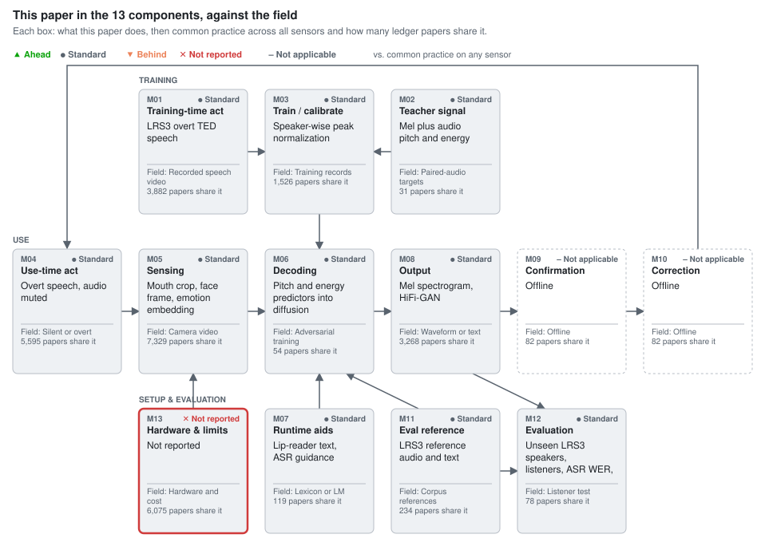

# LipSody: Lip-to-Speech Synthesis with Enhanced Prosody Consistency

Lee, J., Oh, Y., Lee, K. · arXiv preprint, accepted to ICASSP 2026 · 2026 · [arXiv:2602.01908](https://arxiv.org/abs/2602.01908)

**Section:** [Lip & face video](../../README.md#lip--face-video)

## Figures

### This paper in the 13 components, against the field

<picture><source media="(prefers-color-scheme: dark)" srcset="figures/components-dark.svg"></picture>

Verdicts compare the paper's choice for each component with common practice across 8,995 ledger entries on any sensor (silent speech, brain-to-text, lip reading).

Data

| Component | This paper | Common practice | Papers with this practice | Verdict |
| --- | --- | --- | --- | --- |
| M01 Training-time act | LRS3 overt TED speech | Recorded speech video | 3,882 of 8,995 | ● Standard (Inherited.) |
| M02 Teacher signal | Mel plus audio pitch and energy | Paired-audio targets | 31 of 8,995 | ● Standard (Variance-adaptor lineage.) |
| M03 Train / calibrate | Speaker-wise peak normalization | Training records | 1,526 of 8,995 | ● Standard (No normalization-only control.) |
| M04 Use-time act | Overt speech, audio muted | Silent or overt | 5,595 of 8,995 | ● Standard (Inherited.) |
| M05 Sensing | Mouth crop, face frame, emotion embedding | Camera video | 7,329 of 8,995 | ● Standard (Cues as in [@kim2025faces].) |
| M06 Decoding | Pitch and energy predictors into diffusion | Adversarial training | 54 of 8,995 | ● Standard (8 prior predictor studies.) |
| M07 Runtime aids | Lip-reader text, ASR guidance | Lexicon or LM | 119 of 8,995 | ● Standard (LipVoicer lineage.) |
| M08 Output | Mel spectrogram, HiFi-GAN | Waveform or text | 3,268 of 8,995 | ● Standard (Inherited.) |
| M09 Confirmation | Offline | Offline | 82 of 8,995 | – Not applicable (Offline.) |
| M10 Correction | Offline | Offline | 82 of 8,995 | – Not applicable (Offline.) |
| M11 Eval reference | LRS3 reference audio and text | Corpus references | 234 of 8,995 | ● Standard (Inherited.) |
| M12 Evaluation | Unseen LRS3 speakers, listeners, ASR WER, F0 error | Listener test | 78 of 8,995 | ● Standard (No repeated runs.) |
| M13 Hardware & limits | Not reported | Hardware and cost | 6,075 of 8,995 | ✕ Not reported (No runtime for 400-step diffusion.) |

## Verdict

LipSody [[1]](#ref-1) changes the decoder (M06): pitch and energy predicted from lip content, face identity and a face-video emotion embedding condition a LipVoicer-style diffusion model [[2]](#ref-2). Within video-to-speech the design is standard, not new: 8 earlier studies name a pitch, energy or prosody predictor (pattern match, Appendix), and Faces-to-Voices already predicts pitch and energy from facial expressions next to lips and face identity [[3]](#ref-3); the paper cites neither it nor ImaginTalk [[4]](#ref-4). The prosody gain over the reimplemented baseline holds on the paper's own metrics (global F0 deviation 28.87 to 25.15, Table 2), while WER stays at 22.5% against 22.1% (Table 1). The strongest confound is the switch to speaker-wise waveform normalization (§3.2), which changes the energy targets: the baseline keeps LipVoicer's default training settings (§4.2) and no normalization-only control exists; removing the emotion embedding keeps 93% of the energy-consistency gain (Table 4), so that gain comes from the predictors, the normalization or both (inference). The evaluation (M12) is standard, but the claim of state-of-the-art intelligibility (§1) rests on LipVoicer alone, one ASR scorer and no repeated runs (§4.3).

## Against the field, component by component

### M06 Decoder: pitch and energy predictors from video

**Usual approach:** Of 165 video-to-speech studies (pattern match), 54 handle the one-to-many mapping with adversarial training and 22 with a diffusion decoder; 15 name a pitch, energy or prosody predictor, 8 of them prior video-to-speech studies, from the pitch predictor of VCVTS [[5]](#ref-5) to pitch and energy predictors trained against ground-truth contours [[6]](#ref-6). LipSody departs from its lineage, not from the field.

**State of the art:** The lowest LRS3 WER the paper cites is LipVoicer's 21.9% (§4.2) [[2]](#ref-2), which LipSody does not improve. The best prosody-scored design is Faces-to-Voices (2025), with F0 RMSE 39.013 and 30.45% WER on LRS3-TED (Table 2), WER from another ASR model (§4.4) [[3]](#ref-3). LipSody scores WER with its own ASR (§4.4.1) and pitch as an L1 deviation, so the two cannot be ranked.

Of 5 studies routing a face-derived emotion or expression cue into prosody (pattern match, Appendix), two are prior: Faces-to-Voices [[3]](#ref-3) and ImaginTalk, which aligns speech with semantic content, facial identity and emotional expression from face video (Fig. 1) [[4]](#ref-4); two are [concurrent] [[7]](#ref-7) [[8]](#ref-8); the fifth is LipSody. The claimed novel three-cue prosody estimator (§1) therefore is not new in video-to-speech; what LipSody adds is an ablation: the emotion embedding accounts for 1.96 of the 3.72-point GF0 gain, but only 0.20 of 4.20 for LF0 and 0.026 of 0.353 for energy consistency; removing it lowers WER to 22.0% (Table 4) (inference). Verdict: standard.

### M12 Evaluation: prosody metrics on unseen LRS3 speakers

**Usual approach:** Of 165 video-to-speech studies (pattern match), 78 name a listener test, 65 ASR WER on the output and 52 a held-out-speaker test; LipSody uses all three (§4.1, §4.4.3).

**State of the art:** Among F0-scored systems, V2SFlow (2024) reaches 28.5% WER on unseen LRS3 speakers with a video-derived speaker embedding (Table I), transcribed by a conformer ASR, and scores pitch as the mean absolute error of normalized F0 (§III-B) [[9]](#ref-9). LipSody excludes V2SFlow for its higher WER (§4.2), though it scores WER with a different ASR (§4.4.1).

An F0 or energy error metric appears in 10 of the 165 studies (pattern match, Appendix), so scoring prosody is not new; GF0 and LF0 are L1 pitch errors and EC an L2 log-mel energy error (§4.4.2), but Tables 2 and 4 give no units, which blocks comparison with [[3]](#ref-3) and [[9]](#ref-9). Listener effects are small: naturalness 3.47 against 3.36, not significant (§5.3), and ABX preference 54.22% against 45.78% (Table 3), which the authors report as significant and above chance (p < 0.05, §5.3), yet 4.22 points over 50% (inference). Repeated runs appear in 2 of the 165 studies; LipSody states no seeds or repeats (§4.3). Verdict: standard.

## The 13 components

| Component | This paper | Usual approach (count) | State of the art | Verdict |
|---|---|---|---|---|
| M01 Training-time action | LRS3 overt TED speech | Recorded speech video (slot-filled 3,882) | – | standard |
| M02 Training-only supervision | Mel plus audio pitch and energy | Paired-audio targets (slot-filled 31) | – | standard |
| M03 Training and adaptation | Speaker-wise peak normalization | Training records (slot-filled 1,526) | – | standard |
| M04 Use-time action | Overt speech, audio muted | Silent or overt (slot-filled 5,595) | – | standard |
| M05 Sensors | Mouth crop, face frame, emotion embedding | Camera video (slot-filled 7,329) | – | standard |
| M06 Processing and decoding | Pitch and energy predictors into diffusion | Adversarial training (pattern match 54) | [[3]](#ref-3) (2025): closest design; 30.45% WER, another ASR. Lowest cited WER: LipVoicer 21.9% | standard |
| M07 Lexicon and LM | Lip-reader text, ASR guidance | Lexicon or LM (slot-filled 119) | – | standard |
| M08 Output | Mel spectrogram, HiFi-GAN | Waveform or text (slot-filled 3,268) | – | standard |
| M09 Confirmation | Offline | Offline (slot-filled 82) | – | not applicable |
| M10 Correction | Offline | Offline (slot-filled 82) | – | not applicable |
| M11 Reference construction | LRS3 reference audio and text | Corpus references (slot-filled 234) | – | standard |
| M12 Evaluation | Unseen LRS3 speakers, listeners, ASR WER, F0 error | Listener test (pattern match 78) | [[9]](#ref-9) (2024): 28.5% WER and F0 error, LRS3 unseen speakers | standard |
| M13 Device and cost | Not reported | Hardware and cost (slot-filled 6,075) | – | not reported |

## Where the claims outrun the evidence

- "Maintaining state-of-the-art intelligibility" (§1): WER is 22.5% against 22.1% for the reimplemented and 21.9% for the official LipVoicer (Table 1); the authors find no significant difference (§5.1), and other systems are excluded on WERs measured with other ASR models (§4.2).
- Speaker-wise normalization (§3.2) has no normalization-only control.
- The oracle row (21.0% WER, Table 4) uses audio pitch and energy at inference; it bounds what better prosody could give, not what video gives.
- Results with other pitch extractors are omitted (§5.2), and the paired tests give no exact p-values, pairing unit or correction for multiple comparisons.

## What the field needs next

- M06: LipSody against Faces-to-Voices [[3]](#ref-3) on one LRS3 split, one ASR model, F0 error in Hz.
- M03 and M06: clip-wise against speaker-wise normalization, with and without the predictors.
- M12: repeated runs and per-speaker prosody errors.

## Questions for the authors

- How many test utterances and speakers were used?
- Was the reimplemented LipVoicer trained with clip-wise or speaker-wise normalization, and how were test waveforms normalized?
- What are the units and ranges of GF0, LF0 and EC?
- Is the ABX result aggregated over items or listeners?

## Appendix: literature search

- M06, video-to-speech-one-to-many-decoder (published table, reused). Inclusion rule: video-to-speech studies (speech synthesized from talking-face or lip video, audio muted at test), classified from full text by how the decoder handles the one-to-many mapping; enhancement with noisy audio at test, talking-head generation and video-to-text-to-speech pipelines excluded; a study counts under every design it names; versions count once. Ledger: 7,345 unique studies slot-filled for M06; 165 unique studies pattern match. Usual design: adversarial training 54; speech-unit conditioning 44, diffusion decoder 22, flow decoder 19 (pattern match, published counts). Added for this review: pitch, energy or prosody predictor 15, of which 8 prior video-to-speech studies; face-derived emotion or expression cue for prosody 5, of which 2 prior, 2 [concurrent] and the target (pattern match). Read in full: [[5]](#ref-5), [[6]](#ref-6), [[3]](#ref-3), [[4]](#ref-4). Known-item recall 1.0.
- M12, video-to-speech-speaker-held-out-test (published table, reused). Inclusion rule: video-to-speech studies, counting the evaluation protocols their full text names; enhancement with noisy audio at test, talking-head generation and video-to-text-to-speech pipelines excluded; versions count once. Ledger: 6,960 unique studies slot-filled for M12; 165 unique studies pattern match. Protocols: listener or opinion test 78, ASR WER on output 65, held-out speakers 52, repeated runs 2 (published counts); added F0 or energy error metric 10 (pattern match). Read in full: [[9]](#ref-9), [[3]](#ref-3). Known-item recall 1.0.

## References

Numbered by first citation. BibTeX in the same order and keys: [refs.bib](refs.bib).

1. Lee, J., Oh, Y., Lee, K. “LipSody: Lip-to-Speech Synthesis with Enhanced Prosody Consistency.” *arXiv preprint (accepted to ICASSP 2026)*, 2026. doi:[10.48550/arXiv.2602.01908](https://doi.org/10.48550/arXiv.2602.01908). arXiv:[2602.01908](https://arxiv.org/abs/2602.01908). Target. Read as arXiv v1. [review](https://github.com/supernaiter/silent-speech-review/tree/main/reviews/lipsody-lip-to-speech-synthesis-with-enhanced-prosody-consistency) [wiki: arxiv-2602.01908](https://github.com/supernaiter/deep-research-wiki-for-silent-speech/blob/main/papers/arxiv-2602.01908/article.md)
2. Yemini, Y., Shamsian, A., Bracha, L., Gannot, S., Fetaya, E. “LipVoicer: Generating Speech from Silent Videos Guided by Lip Reading.” *International Conference on Learning Representations (ICLR)*, 2024. arXiv:[2306.03258](https://arxiv.org/abs/2306.03258). Prior; baseline lineage of the target. [review](https://github.com/supernaiter/silent-speech-review/tree/main/reviews/lipvoicer-generating-speech-from-silent-videos-guided-by-lip-reading) [wiki: arxiv-2306.03258](https://github.com/supernaiter/deep-research-wiki-for-silent-speech/blob/main/papers/arxiv-2306.03258/article.md)
3. Kim, J., Choi, J., Kim, J., Jung, C., Chung, J. S. “From Faces to Voices: Learning Hierarchical Representations for High-quality Video-to-Speech.” *Proceedings of the IEEE/CVF Conference on Computer Vision and Pattern Recognition (CVPR)*, 2025, 15874-15884. arXiv:[2503.16956](https://arxiv.org/abs/2503.16956). Prior; deciding prior and state of the art for M06. Read as arXiv v1. [wiki: arxiv-2503.16956](https://github.com/supernaiter/deep-research-wiki-for-silent-speech/blob/main/papers/arxiv-2503.16956/article.md)
4. Ye, J., Shan, H. “Shushing! Let's Imagine an Authentic Speech from the Silent Video.” *arXiv preprint*, 2025. arXiv:[2503.14928](https://arxiv.org/abs/2503.14928). Prior; deciding prior for M06 (ImaginTalk). Read as arXiv v1. [wiki: arxiv-2503.14928](https://github.com/supernaiter/deep-research-wiki-for-silent-speech/blob/main/papers/arxiv-2503.14928/article.md)
5. Wang, D., Yang, S., Su, D., Liu, X., Yu, D., Meng, H. “VCVTS: Multi-Speaker Video-to-Speech Synthesis via Cross-Modal Knowledge Transfer from Voice Conversion.” *ICASSP 2022 - IEEE International Conference on Acoustics, Speech and Signal Processing*, 2022, 7252-7256. doi:[10.1109/ICASSP43922.2022.9747427](https://doi.org/10.1109/ICASSP43922.2022.9747427). arXiv:[2202.09081](https://arxiv.org/abs/2202.09081). Prior; deciding prior for M06. Read as arXiv v1. [review](https://github.com/supernaiter/silent-speech-review/tree/main/reviews/vcvts-multi-speaker-video-to-speech-synthesis-via-cross-modal-knowledge-transfer-from-voice-conversion) [wiki: arxiv-2202.09081-vcvts](https://github.com/supernaiter/deep-research-wiki-for-silent-speech/blob/main/papers/arxiv-2202.09081-vcvts/article.md)
6. Kim, J., Kim, J., Chung, J. S. “Let There Be Sound: Reconstructing High Quality Speech from Silent Videos.” *Proceedings of the AAAI Conference on Artificial Intelligence (AAAI-24)*, 2024. arXiv:[2308.15256](https://arxiv.org/abs/2308.15256). Prior; deciding prior for M06. Read as arXiv v2. [review](https://github.com/supernaiter/silent-speech-review/tree/main/reviews/let-there-be-sound-reconstructing-high-quality-speech-from-silent-videos) [wiki: arxiv-2308.15256](https://github.com/supernaiter/deep-research-wiki-for-silent-speech/blob/main/papers/arxiv-2308.15256/article.md)
7. Nguyen, N., Tran, T. V. T., Choi, J., Huynh-Nguyen, H., Hy, T., Nguyen, V. “DiFlowDubber: Discrete Flow Matching for Automated Video Dubbing via Cross-Modal Alignment and Synchronization.” *arXiv preprint*, 2026. arXiv:[2603.14267](https://arxiv.org/abs/2603.14267). [concurrent]; face-derived emotion cue for prosody (pattern match, M06). Named only. [concurrent] [wiki: arxiv-2603.14267](https://github.com/supernaiter/deep-research-wiki-for-silent-speech/blob/main/papers/arxiv-2603.14267/article.md)
8. Ye, J., Cong, G., Wang, C., Wen, X., Li, Z., Cao, B., et al. “Hierarchical Codec Diffusion for Video-to-Speech Generation.” *arXiv preprint*, 2026. arXiv:[2604.15923](https://arxiv.org/abs/2604.15923). [concurrent]; face-derived emotion cue for prosody (pattern match, M06). Named only. [concurrent] [wiki: arxiv-2604.15923](https://github.com/supernaiter/deep-research-wiki-for-silent-speech/blob/main/papers/arxiv-2604.15923/article.md)
9. Choi, J., Kim, J., Li, J., Chung, J. S., Liu, S. “V2SFlow: Video-to-Speech Generation with Speech Decomposition and Rectified Flow.” *ICASSP 2025 - IEEE International Conference on Acoustics, Speech and Signal Processing*, 2025. arXiv:[2411.19486](https://arxiv.org/abs/2411.19486). Prior; state of the art for M12. Read as arXiv v2; venue from the target's reference list [6]. [wiki: arxiv-2411.19486](https://github.com/supernaiter/deep-research-wiki-for-silent-speech/blob/main/papers/arxiv-2411.19486/article.md)

## Materials

Data behind this review. Full texts of the papers are not included.

- [`review.md`](review.md): the review text (source)
- [`refs.bib`](refs.bib): references (BibTeX)
- [`slots.json`](slots.json): for each of the 13 components: this paper's choice, field practice, number of matching papers, verdict
- [`figures.json`](figures.json): figure definitions
- [`evaluation.md`](evaluation.md): independent evaluation by a second reviewer
- [`triage.md`](triage.md): how each evaluation finding was checked against the sources and resolved
- [`components/M06/video-to-speech-one-to-many-decoder.csv`](../../components/M06/video-to-speech-one-to-many-decoder.csv): M06 topic "video-to-speech-one-to-many-decoder", every candidate paper with its decision (7345 slot-filled, 165 pattern match, usual design in 54, 4 read in full)
- [`components/M12/video-to-speech-speaker-held-out-test.csv`](../../components/M12/video-to-speech-speaker-held-out-test.csv): M12 topic "video-to-speech-speaker-held-out-test", every candidate paper with its decision (6960 slot-filled, 165 pattern match, usual design in 78, 5 read in full)

## More reviews in Lip & face video

- [A First Exploration of Neuromorphic OT-CFM for Multi-Speaker VSR](../lipsflow-a-first-exploration-of-neuromorphic-ot-cfm-for-multi-speaker-vsr/) (2026). Event input and a two-step OT-CFM decoder are standard; the DVS-Lip evaluation is behind: WER on an isolated-word set with no split details or seeds, and baselines that do not match their sources.
- [AVSRBench: A Multi-Condition AVSR Benchmark](../avsrbench-a-multi-condition-avsr-benchmark/) (2026). Zero-shot cross-corpus AVSR testing (M12) and a video-call test set (M11) are standard after WildVSR; each condition mixes several shifts, without repeated runs.
- [SLD-L2S: Hierarchical Subspace Latent Diffusion for High-Fidelity Lip to Speech Synthesis](../sld-l2s-hierarchical-subspace-latent-diffusion-for-high-fidelity-lip-to-speech-synthesis/) (2026). Codec-latent flow decoder (M06) is standard: quality lead rests on predictors that rate output above ground truth; WER trails V2SFlow; speaker similarity uses reference audio.
- [Landmark Guided Visual Feature Extractor for Visual Speech Recognition with Limited Resource](../landmark-guided-visual-feature-extractor-for-visual-speech-recognition-with-limited-resource/) (2025). Lip-landmark graph plus pixel fusion is a standard design (2020 precedent); the 0.90-point low-data gain comes from one unseeded run, and LRW 91.69% stays below 95.0%.
- [LipDiffuser: Lip-to-Speech Generation with Conditional Diffusion Models](../lipdiffuser-lip-to-speech-generation-with-conditional-diffusion-models/) (2025). Diffusion decoder with per-frame MP-FiLM (M06) and audio-only pretraining (M02) are standard; quality and speaker-similarity leads rest on enhanced targets and a clean-reference enrollment.
- [LTA-L2S: Lexical Tone-Aware Lip-to-Speech Synthesis for Mandarin with Cross-Lingual Transfer Learning](../lta-l2s-lexical-tone-aware-lip-to-speech-synthesis-for-mandarin-with-cross-lingual-transfer-lear/) (2025). LTA-L2S synthesizes Mandarin speech from lip video using English pretraining and tone-aware generation, reducing character and tone errors versus baselines, but CER remains 61.2%.

---

Part of the [Silent Speech Interface Review](https://github.com/supernaiter/silent-speech-review). Found an error? [Open an issue](https://github.com/supernaiter/silent-speech-review/issues/new?template=correction.yml).
