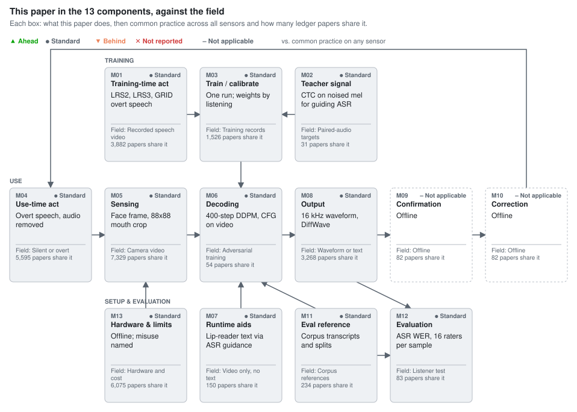

# LipVoicer: Generating Speech from Silent Videos Guided by Lip Reading

Yemini, Y., Shamsian, A., Bracha, L., Gannot, S., Fetaya, E. · ICLR 2024 · 2024 · [arXiv:2306.03258](https://arxiv.org/abs/2306.03258)

**Section:** [Lip & face video](../../README.md#lip--face-video)

## Figures

### This paper in the 13 components, against the field

<picture><source media="(prefers-color-scheme: dark)" srcset="figures/components-dark.svg"></picture>

Verdicts compare the paper's choice for each component with common practice across 8,995 ledger entries on any sensor (silent speech, brain-to-text, lip reading).

Data

| Component | This paper | Common practice | Papers with this practice | Verdict |
| --- | --- | --- | --- | --- |
| M01 Training-time act | LRS2, LRS3, GRID overt speech | Recorded speech video | 3,882 of 8,995 | ● Standard (Inherited.) |
| M02 Teacher signal | CTC on noised mel for guiding ASR | Paired-audio targets | 31 of 8,995 | ● Standard (Follows Guided-TTS; Table 11 shows ASR sensitivity.) |
| M03 Train / calibrate | One run; weights by listening | Training records | 1,526 of 8,995 | ● Standard (Selection data and seeds not stated.) |
| M04 Use-time act | Overt speech, audio removed | Silent or overt | 5,595 of 8,995 | ● Standard (Inherited.) |
| M05 Sensing | Face frame, 88x88 mouth crop | Camera video | 7,329 of 8,995 | ● Standard (Inherited.) |
| M06 Decoding | 400-step DDPM, CFG on video | Adversarial training | 54 of 8,995 | ● Standard (Alone 86.2% WER (Table 6).) |
| M07 Runtime aids | Lip-reader text via ASR guidance | Video only, no text | 150 of 8,995 | ● Standard (Design new; no gain over lip-to-text plus TTS shown.) |
| M08 Output | 16 kHz waveform, DiffWave | Waveform or text | 3,268 of 8,995 | ● Standard (HiFi-GAN gives 21.9% WER (Table 15).) |
| M09 Confirmation | Offline | Offline | 82 of 8,995 | – Not applicable (Offline study.) |
| M10 Correction | Offline | Offline | 82 of 8,995 | – Not applicable (Offline study.) |
| M11 Eval reference | Corpus transcripts and splits | Corpus references | 234 of 8,995 | ● Standard (Speaker overlap not stated.) |
| M12 Evaluation | ASR WER, 16 raters per sample | Listener test | 83 of 8,995 | ● Standard (No listener transcription; ± undefined.) |
| M13 Hardware & limits | Offline; misuse named | Hardware and cost | 6,075 of 8,995 | ● Standard (Mitigation left out of scope (Sec. 6).) |

## Verdict

LipVoicer [[1]](#ref-1) changes three components: lip-reader text steers synthesis at use time (M07), a CTC recognizer trained on noised mel-spectrograms carries all text supervision (M02), and a video-conditioned diffusion model generates the mel-spectrogram (M06). The authors' claim (Sec. 1) to be the first to condition a video-to-speech synthesizer on lip-reader text holds against 165 ledger studies (Appendix), with [[2]](#ref-2) [concurrent]. M07 is still standard: lip-to-text plus TTS already used such text [[3]](#ref-3), and no gain over it is shown. The words come from the lip reader, not the synthesizer: on LRS3 output WER is 21.4% against the lip reader's 19.1%, 5.4% with ground-truth text, and 86.2% without guidance, worse than the Lip2Speech baseline at 57.4% (Tables 4, 6, 7). No baseline received that text, so "state-of-the-art results" (Sec. 1) pit a 2023 lip reader against text-free synthesizers. M02, M06 and M12 are standard; the main tables score words with an ASR from the same work as the lip reader.

## Against the field, component by component

### M07 Lexicon and auxiliary information: lip-reader text guidance

**Usual approach:** Of 165 video-to-speech studies (pattern match, Appendix), 15 name predicted or lip-read text and 7 classifier or ASR guidance; earlier hits use text as a training loss or scoring transcript, or run lip-to-text plus TTS as a baseline [[3]](#ref-3).

**State of the art:** LipVoicer itself (2023): with AUTO-AVSR it is lowest in two [later] LRS3 tables: 20.62% against 27.55% to 30.22% [[4]](#ref-4), and 22.24% against 23.73% for Watch Your Speech [[5]](#ref-5). LipAdapter's 21.2% (Whisper-Large) sits beside LipVoicer's self-reported 21.4%, a cross-evaluator gap (inference) [[6]](#ref-6).

Output WER tracks the lip reader: 19.1% to 21.4% with Ma et al. (2023), 32.3% to 38.1% with Ma et al. (2022), 0% to 5.4% with ground truth (Table 7); the synthesizer adds 2.3 to 5.8 points (inference). Lip2Speech ([concurrent]) uses text only in training losses [[7]](#ref-7); Hegde et al. condition a visual TTS on noisy lip-to-text output and report only the lip reader's WER (Table 3) [[2]](#ref-2). Verdict: standard; the gain over a cascade fed the same text is not measured.

### M02 Training-only supervision: noise-conditioned CTC recognizer

**Usual approach:** Paired-audio targets (31 of 64 slot-filled studies with an M03 supervision record); 13 of 165 name a CTC loss and 10 an ASR or text loss on the generator (pattern match), as in Lip2Speech [[7]](#ref-7). LipVoicer keeps MelGen text-free and fine-tunes a time-step-aware ASR by CTC on noised mel-spectrograms (App. A.4).

**State of the art:** No later design beats it on LRS3 WER; Watch Your Speech (2026, [later]) trains on ground-truth text without guidance: 23.73% against 22.24% [[5]](#ref-5).

Two of 165 name a noise-conditioned recognizer (pattern match, Appendix), LipVoicer among them; the scheme follows Guided-TTS [[8]](#ref-8) (Sec. 4). Output hinges on the guiding ASR: the same ASR early-stopped at 6.1% instead of 3.6% WER raises output WER from 21.4% to 76.3% (Table 11). Verdict: standard.

### M06 Decoder: video-conditioned diffusion

**Usual approach:** Of 165 studies (pattern match, published counts), 54 name adversarial training, 22 a diffusion decoder. MelGen is a 400-step DDPM with classifier-free guidance on face and mouth video (App. A.3).

**State of the art:** V2SFlow (2024, [later]), 28.5% LRS3 WER without text [[9]](#ref-9); DiffV2S is the [concurrent] diffusion design [[10]](#ref-10).

MelGen alone (w2 = 0) scores 86.2% WER at STOI-Net 0.93 and DNSMOS 3.16, against 0.92 and 3.11 guided (Table 6). Verdict: standard.

### M12 Evaluation: ASR WER and opinion scores

**Usual approach:** Of 165 studies (pattern match, published counts), 83 name a listener test, 51 unseen speakers and 38 ASR WER on the output. LipVoicer has a listener test and ASR WER, with 16 annotators per sample (Sec. 5.1, Appendix G)

**State of the art:** No later study tests LipVoicer by listener transcription; SLD-L2S (2026, [later]) re-scores it at 20.62% LRS3 WER with AUTO-AVSR [[4]](#ref-4).

The evaluation ASR and the lip reader are both Ma et al. (2023) (Sec. 5), so their errors may correlate (inference). Listener intelligibility is a rating (3.44 against 4.38 for ground truth, Table 2), not transcription. Verdict: standard.

## The 13 components

| Component | This paper | Usual approach (count) | State of the art | Verdict |
|---|---|---|---|---|
| M01 Training-time action | LRS2, LRS3, GRID overt speech | Recorded speech video (slot-filled 3,882) | – | standard |
| M02 Training-only supervision | CTC on noised mel for guiding ASR | Paired-audio targets (slot-filled 31) | [[5]](#ref-5) (2026): LRS3 WER 23.73% (LipVoicer 22.24%) | standard |
| M03 Training and adaptation | One run; weights by listening | Training records (slot-filled 1,526) | – | standard |
| M04 Use-time action | Overt speech, audio removed | Silent or overt (slot-filled 5,595) | – | standard |
| M05 Sensors | Face frame, 88x88 mouth crop | Camera video (slot-filled 7,329) | – | standard |
| M06 Processing and decoding | 400-step DDPM, CFG on video | Adversarial training (pattern match 54) | [[9]](#ref-9) (2024): LRS3 WER 28.5% | standard |
| M07 Lexicon and LM | Lip-reader text via ASR guidance | Video only, no text (pattern match 150) | [[4]](#ref-4) (2026): LipVoicer re-scored 20.62% | standard |
| M08 Output | 16 kHz waveform, DiffWave | Waveform or text (slot-filled 3,268) | – | standard |
| M09 Confirmation | Offline | Offline (slot-filled 82) | – | not applicable |
| M10 Correction | Offline | Offline (slot-filled 82) | – | not applicable |
| M11 Reference construction | Corpus transcripts and splits | Corpus references (slot-filled 234) | – | standard |
| M12 Evaluation | ASR WER, 16 raters per sample | Listener test (pattern match 83) | [[4]](#ref-4) (2026): LipVoicer re-scored 20.62% | standard |
| M13 Device and cost | Offline; misuse named | Hardware and cost (slot-filled 6,075) | – | standard |

## Where the claims outrun the evidence

- "State-of-the-art results" (Sec. 1): no baseline gets the lip reader's text, and the lip-to-text plus TTS control of [[3]](#ref-3) is not run.
- "More natural and synchronized" (Abstract): MelGen without guidance is sometimes more natural, and wrong text causes synchronization lapses (Appendix E.5).
- ReVISE: 33.2% against 33.9% is not evidence either way; the authors themselves measure the ReVISE ASR at 6.4% instead of its reported 5.6% (Sec. 5).
- Guidance weights come from grid search and listening tests on unstated data (Appendix C).

## What the field needs next

- M07: the same lip-reader text into a duration-controlled TTS, scored by listener transcription.
- M07/M12: WER against the lip-reader text and the ground truth, by an ASR unrelated to the lip reader.
- M02: guiding ASRs of graded accuracy, with and without noise tuning.

## Questions for the authors

- Which data and listeners selected w1, w2 and t_ASR (App. C)?
- What do the ± values denote, and how many seeds lie behind each table?
- Do LRS2 or LRS3 test speakers appear in any training set?

## Appendix: literature search

- M07, lip-reader-text-guidance-for-video-to-speech (new). Inclusion rule: the 165-study video-to-speech population (population of the published M06 one-to-many decoder table), classified from the full text (reference list removed) by use of text predicted from the video at inference, classifier or ASR guidance of a sampler, and a named lip-reader-to-TTS cascade; every named design counts (upper bound, related-work mentions included); text used only as a training loss or scoring transcript is not use-time text. Ledger: 119 unique studies slot-filled for M07; 165 unique studies pattern match. Lip-reader-to-TTS cascade named 20, predicted or lip-read text 15, classifier or ASR guidance 7 (pattern match); at least 150 name no use-time text (165 minus 15, inference); every text-use hit before 2023-06 is a training loss, a WER transcript or a cascade baseline. Read in full: [[3]](#ref-3), [[7]](#ref-7), [[2]](#ref-2), [[6]](#ref-6), [[4]](#ref-4), [[5]](#ref-5). Known-item recall 1.0 (4 seeds).
- M02, text-supervision-in-video-to-speech-training (new). Inclusion rule: the same 165 studies, classified by training-only text supervision: a CTC or ASR/text loss on the generator or its features, and a recognizer trained on noised or time-step-conditioned spectrograms to guide sampling; text at inference is M07; full-text pattern counts, upper bound. Ledger: 64 unique studies with an M03 supervision record, paired audio 31 (slot-filled); CTC loss 13, ASR or text loss 10, noise-conditioned recognizer 2 (pattern match). Read in full: [[7]](#ref-7), [[5]](#ref-5). Known-item recall 1.0 (3 seeds).
- M06, video-to-speech-one-to-many-decoder (published table, reused). Inclusion rule: studies that synthesize a speech waveform from talking-face or lip video, audio muted at test, classified from the full text by how the acoustic decoder handles the one-to-many mapping; enhancement with noisy audio at test, talking-head generation and video-to-text-to-TTS pipelines excluded; every named design counts (upper bound); versions once. Ledger: 7,345 unique studies slot-filled for M06; 165 unique studies pattern match. Adversarial training 54, speech-unit conditioning 44, diffusion decoder 22, flow decoder 19, pitch or energy predictor 9 (pattern match, published counts). Read in full: [[9]](#ref-9), [[10]](#ref-10). Known-item recall 1.0.
- M12, video-to-speech-output-evaluation (published table, reused). Inclusion rule: the same video-to-speech population, counting the evaluation protocols its full text names (upper bound; versions once). Ledger: 6,960 unique studies slot-filled for M12; 165 unique studies pattern match. Listener test 83, unseen speakers 51, ASR WER on output 38 (pattern match, published counts). Read in full: [[4]](#ref-4), [[9]](#ref-9). Known-item recall 1.0.

## References

Numbered by first citation. BibTeX in the same order and keys: [refs.bib](refs.bib).

1. Yemini, Y., Shamsian, A., Bracha, L., Gannot, S., Fetaya, E. “LipVoicer: Generating Speech from Silent Videos Guided by Lip Reading.” *The Twelfth International Conference on Learning Representations (ICLR 2024)*, 2024. arXiv:[2306.03258](https://arxiv.org/abs/2306.03258). Target. Read as arXiv v2 (28 Mar 2024), the ICLR 2024 version. [review](https://github.com/supernaiter/silent-speech-review/tree/main/reviews/lipvoicer-generating-speech-from-silent-videos-guided-by-lip-reading) [wiki: arxiv-2306.03258](https://github.com/supernaiter/deep-research-wiki-for-silent-speech/blob/main/papers/arxiv-2306.03258/article.md)
2. Hegde, S., Mukhopadhyay, R., Jawahar, C. V., Namboodiri, V. “Towards Accurate Lip-to-Speech Synthesis in-the-Wild.” *Proceedings of the 31st ACM International Conference on Multimedia (MM '23)*, 2023. doi:[10.1145/3581783.3611787](https://doi.org/10.1145/3581783.3611787). arXiv:[2403.01087](https://arxiv.org/abs/2403.01087). conditions synthesis on noisy lip-to-text output and the lip video. [concurrent] [wiki: arxiv-2403.01087](https://github.com/supernaiter/deep-research-wiki-for-silent-speech/blob/main/papers/arxiv-2403.01087/article.md)
3. Hegde, S. B., Prajwal, K. R., Mukhopadhyay, R., Namboodiri, V. P., Jawahar, C. V. “Lip-to-Speech Synthesis for Arbitrary Speakers in the Wild.” *Proceedings of the 30th ACM International Conference on Multimedia (MM '22)*, 2022. arXiv:[2209.00642](https://arxiv.org/abs/2209.00642). Prior; deciding prior for M07 (lip-to-text plus TTS named as an alternative, not used to guide synthesis). [review](https://github.com/supernaiter/silent-speech-review/tree/main/reviews/lip-to-speech-synthesis-for-arbitrary-speakers-in-the-wild) [wiki: arxiv-2209.00642](https://github.com/supernaiter/deep-research-wiki-for-silent-speech/blob/main/papers/arxiv-2209.00642/article.md)
4. Liang, Y., Li, A., Yang, K., Yu, G., Liu, F., Dai, L., et al. “SLD-L2S: Hierarchical Subspace Latent Diffusion for High-Fidelity Lip to Speech Synthesis.” *arXiv preprint (AAAI 2026 copyright line)*, 2026. doi:[10.48550/arXiv.2602.11477](https://doi.org/10.48550/arXiv.2602.11477). arXiv:[2602.11477](https://arxiv.org/abs/2602.11477). re-scores the target with AUTO-AVSR. [later] [review](https://github.com/supernaiter/silent-speech-review/tree/main/reviews/sld-l2s-hierarchical-subspace-latent-diffusion-for-high-fidelity-lip-to-speech-synthesis) [wiki: arxiv-2602.11477](https://github.com/supernaiter/deep-research-wiki-for-silent-speech/blob/main/papers/arxiv-2602.11477/article.md) [wiki: arxiv-2602.11477-sldl2s](https://github.com/supernaiter/deep-research-wiki-for-silent-speech/blob/main/papers/arxiv-2602.11477-sldl2s/article.md)
5. Lee, G., Oh, Y., Han, Y. “Watch Your Speech: Text-aware Video-to-Speech Synthesis with Textual Conditioning.” *arXiv preprint*, 2026. arXiv:[2610.01012](https://arxiv.org/abs/2610.01012). text conditioning from training onward, no classifier guidance. [later] [wiki: arxiv-2610.01012-wys](https://github.com/supernaiter/deep-research-wiki-for-silent-speech/blob/main/papers/arxiv-2610.01012-wys/article.md) [wiki: arxiv-2610.01012](https://github.com/supernaiter/deep-research-wiki-for-silent-speech/blob/main/papers/arxiv-2610.01012/article.md)
6. Ghosh, S., Jawahar, C. V., Namboodiri, V. “LipAdapter: Text-to-Video Alignment is All You Need for Lip-to-Speech.” *Proc. Interspeech 2026*, 2026, 3548. doi:[10.21437/Interspeech.2026-518](https://doi.org/10.21437/Interspeech.2026-518). predicted text aligned to video into a pretrained TTS; state of the art for M07. [later] [wiki: isca-ghosh26b-lipadapt](https://github.com/supernaiter/deep-research-wiki-for-silent-speech/blob/main/papers/isca-ghosh26b-lipadapt/article.md) [wiki: isca-ghosh26b_interspeech](https://github.com/supernaiter/deep-research-wiki-for-silent-speech/blob/main/papers/isca-ghosh26b_interspeech/article.md)
7. Kim, M., Hong, J., Ro, Y. M. “Lip-to-Speech Synthesis in the Wild with Multi-task Learning.” *2023 IEEE International Conference on Acoustics, Speech and Signal Processing (ICASSP)*, 2023. arXiv:[2302.08841](https://arxiv.org/abs/2302.08841). baseline of the target; text used as a training loss only. [concurrent] [wiki: arxiv-2302.08841](https://github.com/supernaiter/deep-research-wiki-for-silent-speech/blob/main/papers/arxiv-2302.08841/article.md)
8. Kim, H., Kim, S., Yoon, S. “Guided-TTS: A Diffusion Model for Text-to-Speech via Classifier Guidance.” *Proceedings of the 39th International Conference on Machine Learning (ICML)*, 2022. arXiv:[2111.11755](https://arxiv.org/abs/2111.11755). Prior; cited by the target as the source of its guidance scheme; not in the wiki (text-to-speech).
9. Choi, J., Kim, J., Li, J., Chung, J. S., Liu, S. “V2SFlow: Video-to-Speech Generation with Speech Decomposition and Rectified Flow.” *arXiv preprint*, 2024. arXiv:[2411.19486](https://arxiv.org/abs/2411.19486). best text-free LRS3 WER in the reused tables. [later] [wiki: arxiv-2411.19486](https://github.com/supernaiter/deep-research-wiki-for-silent-speech/blob/main/papers/arxiv-2411.19486/article.md)
10. Choi, J., Hong, J., Ro, Y. M. “DiffV2S: Diffusion-based Video-to-Speech Synthesis with Vision-guided Speaker Embedding.” *2023 IEEE/CVF International Conference on Computer Vision (ICCV)*, 2023, 6692-6701. doi:[10.1109/ICCV51070.2023.00618](https://doi.org/10.1109/ICCV51070.2023.00618). arXiv:[2308.07787](https://arxiv.org/abs/2308.07787). Diffusion video-to-speech. [concurrent] [wiki: arxiv-2308.07787-diffv2s](https://github.com/supernaiter/deep-research-wiki-for-silent-speech/blob/main/papers/arxiv-2308.07787-diffv2s/article.md) [wiki: cvf23-choi_diffv2s](https://github.com/supernaiter/deep-research-wiki-for-silent-speech/blob/main/papers/cvf23-choi_diffv2s/article.md)

## Materials

Data behind this review. Full texts of the papers are not included.

- [`review.md`](review.md): the review text (source)
- [`refs.bib`](refs.bib): references (BibTeX)
- [`slots.json`](slots.json): for each of the 13 components: this paper's choice, field practice, number of matching papers, verdict
- [`figures.json`](figures.json): figure definitions
- [`evaluation.md`](evaluation.md): independent evaluation by a second reviewer
- [`triage.md`](triage.md): how each evaluation finding was checked against the sources and resolved
- [`process/log.json`](process/log.json): process record: each step, who did it (reader, script, writer, evaluator), when, the checks run and the input versions
- [`process/notes.json`](process/notes.json): reading notes on the target and comparator papers: claims, numbers, conditions and what is not stated, with locations
- [`process/plan.json`](process/plan.json): plan: which components the paper changes and the topics it is compared on
- [`process/draft.md`](process/draft.md): the review as first written, before the independent evaluation
- [`process/claims-draft.md`](process/claims-draft.md): claim table of the draft: every claim mapped to a note or a count
- [`process/claims.md`](process/claims.md): claim table of the published review
- [`components/M02/text-supervision-in-video-to-speech-training.csv`](../../components/M02/text-supervision-in-video-to-speech-training.csv): M02 topic "text-supervision-in-video-to-speech-training", every candidate paper with its decision (31 slot-filled, 165 pattern match, usual design in 31, 4 read in full)
- [`components/M06/video-to-speech-one-to-many-decoder.csv`](../../components/M06/video-to-speech-one-to-many-decoder.csv): M06 topic "video-to-speech-one-to-many-decoder", every candidate paper with its decision (7345 slot-filled, 165 pattern match, usual design in 54, 4 read in full)
- [`components/M07/lip-reader-text-guidance-for-video-to-speech.csv`](../../components/M07/lip-reader-text-guidance-for-video-to-speech.csv): M07 topic "lip-reader-text-guidance-for-video-to-speech", every candidate paper with its decision (119 slot-filled, 165 pattern match, usual design in 150, 7 read in full)
- [`components/M12/video-to-speech-output-evaluation.csv`](../../components/M12/video-to-speech-output-evaluation.csv): M12 topic "video-to-speech-output-evaluation", every candidate paper with its decision (6960 slot-filled, 165 pattern match, usual design in 83, 5 read in full)

## More reviews in Lip & face video

- [Advancing NAM-to-Speech Conversion with Novel Methods and the MultiNAM Dataset](../advancing-nam-to-speech-conversion-with-novel-methods-and-the-multinam-dataset/) (2024). Compares ways to create target speech for converting non-audible murmur (NAM) to speech and releases the 7.96-hour MultiNAM dataset. Diff-NAM gives final WER 32.39%/38.94% for two speakers, below Lipvoicer but behind MFA-TTS (26.38%/32.61%).
- [AKVSR: Audio Knowledge Empowered Visual Speech Recognition by Compressing Audio Knowledge of a Pretrained Model](../akvsr-audio-knowledge-empowered-visual-speech-recognition-by-compressing-audio-knowledge-of-a-pretrained-model/) (2024). The quantized audio memory (M02) is a standard memory-recall design; its gains repeat over a no-memory baseline, but the LRS3 state-of-the-art claim and the edge over distillation do not hold.
- [Let There Be Sound: Reconstructing High Quality Speech from Silent Videos](../let-there-be-sound-reconstructing-high-quality-speech-from-silent-videos/) (2024). HuBERT-unit, pitch and energy targets (M02) and flow post-net (M06) are standard, after ReVISE and VCVTS; GRID WER 17.07% vs 17.62%; seen-speaker tests only (M12 behind).
- [Landmark Guided Visual Feature Extractor for Visual Speech Recognition with Limited Resource](../landmark-guided-visual-feature-extractor-for-visual-speech-recognition-with-limited-resource/) (2025). Lip-landmark graph plus pixel fusion is a standard design (2020 precedent); the 0.90-point low-data gain comes from one unseeded run, and LRW 91.69% stays below 95.0%.
- [LipDiffuser: Lip-to-Speech Generation with Conditional Diffusion Models](../lipdiffuser-lip-to-speech-generation-with-conditional-diffusion-models/) (2025). Diffusion decoder with per-frame MP-FiLM (M06) and audio-only pretraining (M02) are standard; quality and speaker-similarity leads rest on enhanced targets and a clean-reference enrollment.
- [LTA-L2S: Lexical Tone-Aware Lip-to-Speech Synthesis for Mandarin with Cross-Lingual Transfer Learning](../lta-l2s-lexical-tone-aware-lip-to-speech-synthesis-for-mandarin-with-cross-lingual-transfer-lear/) (2025). Mandarin lip-to-speech whose gain over Intelligible matches its English-initialization ablation; the tone components move CER little with no repeats reported, and pitch removal leaves TER at 40.9%.

---

Part of the [Silent Speech Interface Review](https://github.com/supernaiter/silent-speech-review). Found an error? [Open an issue](https://github.com/supernaiter/silent-speech-review/issues/new?template=correction.yml).
