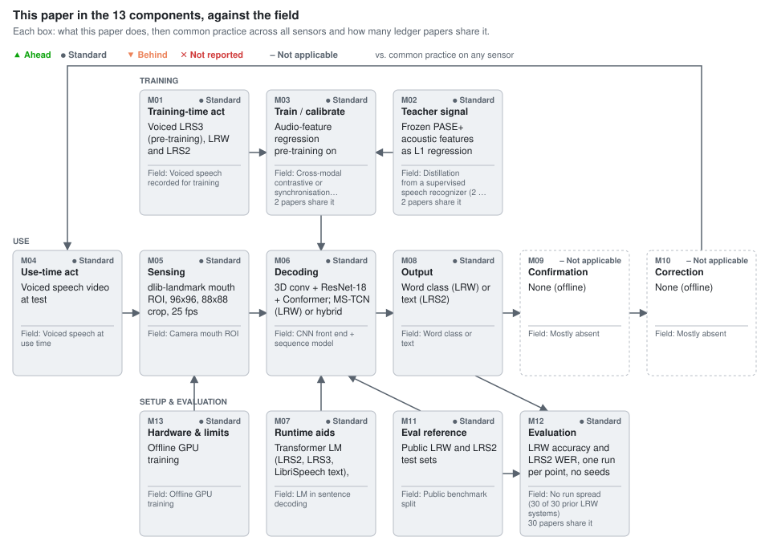

# LiRA: Learning Visual Speech Representations from Audio through Self-supervision

Pingchuan Ma, Rodrigo Mira, Stavros Petridis, Björn W. Schuller, Maja Pantic. Interspeech 2021. [doi:10.21437/Interspeech.2021-1360](https://doi.org/10.21437/Interspeech.2021-1360) · [arXiv:2106.09171](https://arxiv.org/abs/2106.09171)

**Section:** [Other sensors](../../README.md#other-sensors)

## Figures

### This paper in the 13 components, against the field

<picture><source media="(prefers-color-scheme: dark)" srcset="figures/components-dark.svg"></picture>

Verdicts compare the paper's choice for each component with common practice across 8,995 ledger entries on any sensor (silent speech, brain-to-text, lip reading).

Data

| Component | This paper | Common practice | Papers with this practice | Verdict |
| --- | --- | --- | --- | --- |
| M01 Training-time act | Voiced LRS3 (pre-training), LRW and LRS2 talking-face video | Voiced speech recorded for training |  | ● Standard (Inherited from public broadcast and TED corpora.) |
| M02 Teacher signal | Frozen PASE+ acoustic features as L1 regression target | Distillation from a supervised speech recognizer (2 of 3 prior) | 2 of 3 | ● Standard (No transcripts in pre-training; target type not compared in the paper; LipSound (2019) uncited.) |
| M03 Train / calibrate | Audio-feature regression pre-training on LRS3, then frozen or fine-tuned encoder | Cross-modal contrastive or synchronisation pre-training (2 of 3 prior) | 2 of 3 | ● Standard (+0.7 LRW and +0.3 LRS2 over the same encoder from scratch; LRW-initialised 37.9% (concurrent, own) omitted from Table 2.) |
| M04 Use-time act | Voiced speech video at test | Voiced speech at use time |  | ● Standard (Inherited.) |
| M05 Sensing | dlib-landmark mouth ROI, 96x96, 88x88 crop, 25 fps | Camera mouth ROI |  | ● Standard (Inherited from the authors' LRW pipeline.) |
| M06 Decoding | 3D conv + ResNet-18 + Conformer; MS-TCN (LRW) or hybrid CTC/attention (LRS2) | CNN front end + sequence model |  | ● Standard (Follows the authors' Conformer recipe.) |
| M07 Runtime aids | Transformer LM (LRS2, LRS3, LibriSpeech text), beam 20 | LM in sentence decoding |  | ● Standard (LM weights and text partitions not stated.) |
| M08 Output | Word class (LRW) or text (LRS2) | Word class or text |  | ● Standard (Inherited.) |
| M09 Confirmation | None (offline) | Mostly absent |  | – Not applicable (Offline benchmark study.) |
| M10 Correction | None (offline) | Mostly absent |  | – Not applicable (Offline benchmark study.) |
| M11 Eval reference | Public LRW and LRS2 test sets | Public benchmark split |  | ● Standard (LRS3 pre-training partitions not stated.) |
| M12 Evaluation | LRW accuracy and LRS2 WER, one run per point, no seeds | No run spread (30 of 30 prior LRW systems) | 30 of 30 | ● Standard (Prose gain 0.8 points against 0.7 in Table 1; no test behind 'significantly'.) |
| M13 Hardware & limits | Offline GPU training | Offline GPU training |  | ● Standard (Inherited.) |

## Verdict

LiRA [[1]](#ref-1) changes the training-only supervision (M02), regressing frozen PASE+ features instead of distilling a recognizer, and the pre-training objective (M03), regression instead of contrastive learning; both stay standard. Pre-training helps strongly at 1% of LRW labels (24.5% against 3.6%, Sec. 4.1), but with all labels adds 0.7 points on LRW (Table 1) and 0.3 on LRS2 (Table 2), one run each. The same encoder from scratch already beats every other self-supervised method in Table 1, and the LRS2 state-of-the-art claim holds only under the authors' "no external labelled datasets" qualifier: their [concurrent] Conformer paper reaches 37.9% with an LRW-initialised front end [[2]](#ref-2), below LiRA's 38.8%, and Table 2 omits that row. LipSound [[3]](#ref-3), which regressed mel spectrograms from lip video in 2019, is not cited.

## Against the field, component by component

### M02 Training-only supervision: audio-derived target

**Usual approach:** 2 of the 3 prior studies that feed audio into a video-only lip reader (pattern match, screened, Appendix) distil a supervised recognizer: LIBS [[4]](#ref-4), with ground-truth sentences in the loop, and Afouras et al. [[5]](#ref-5). LipSound [[3]](#ref-3) regresses mel spectrograms without transcripts. LiRA's teacher is a self-supervised acoustic encoder.

**State of the art:** SyncVSR (2024) [[6]](#ref-6) [later] isolates the step on one Transformer: audio-token targets give 93.2% on LRW against 93.1% for ASR-transcription targets, a difference its authors call "trivial" (Table 1), while the audio loss lowers LRS2 WER from 43.2% to 30.7% (Table 4).

The authors credit Afouras et al. and name what they avoid, an ASR "trained on large amounts of labelled data" (Sec. 1). The effect of that departure is not measured here: no row compares PASE+ with recognizer or spectrogram targets on one encoder, and MFCC is dismissed without a number (Sec. 2.1). Table 2 labels Afouras et al.'s 51.3% "KD-seq2seq, Unsupervised", but it is a CTC model fine-tuned with full ground truth [[5]](#ref-5) (Sec. 5), with another network and a 6-gram LM. Of 4 [concurrent] studies, 2 distil, 1 recalls audio memory and LipSound2 [[7]](#ref-7) pre-trains video-to-mel. Standard: the target is new among the 3 priors (Appendix), and later work finds the target type matters little.

### M03 Training: pre-training objective and transfer

**Usual approach:** Of 3 prior visual-speech pre-training studies (pattern match, screened, Appendix), 2 learn contrastive or synchronisation embeddings [[8]](#ref-8) [[9]](#ref-9) and 1 distils an ASR teacher [[5]](#ref-5).

**State of the art:** RAVEn Base (2023) [[10]](#ref-10) [later] reaches 32.1% LRS2 WER with the same 433 h unlabelled and 223 h labelled, no LM, 6.7 points below LiRA's 38.8% with an LM (inference); Large with 1,759 h reaches 23.2%.

LiRA-Supervised, with no pre-training, reaches 87.4%, above AV-PPC's 84.8% [concurrent], the best other self-supervised row (Table 1), so "significantly outperforms other self-supervised methods" holds for the system, not the objective. LiRA-Frozen's 83.1% is the best of the layers in Fig. 3, with no stated selection split. The authors call the LRS2 gain over curriculum learning "a small improvement" (Sec. 4.2), and the 9.5 points over TM-seq2seq repeat the 9.2 (48.3% to 39.1%) of the followed recipe [[2]](#ref-2) (inference). The authors state the benefit is greatest for small labelled sets (Sec. 1). Under a stronger later recipe the full-label gain is 0.2 points (inference), 92.1% to 92.3% with word boundaries as listed in [[6]](#ref-6). Standard: confounded by the backbone, one run per point.

### M12 Evaluation: single-run benchmark claims

**Usual approach:** None of the 30 prior LRW systems with full text reports a run spread (pattern match, 8 hits inspected, Appendix); LiRA follows this.

**State of the art:** SyncVSR (2024) [[6]](#ref-6) [later] reports 93.2% ± 0.1 over three seeds.

The 0.7-point LRW gain, a 5.6% relative error reduction (inference), has no seed or interval, and the prose states 0.8 points (Sec. 4.1). The LM, per the followed recipe, uses LRS3 and LibriSpeech training transcripts [[2]](#ref-2), external labelled text that weakens "no external labelled datasets". Standard.

## The 13 components

| Component | This paper | Usual approach (count) | State of the art | Verdict |
|---|---|---|---|---|
| M01 Training-time action | Voiced LRS3 (pre-training), LRW and LRS2 talking-face video | Voiced speech recorded for training | – | standard |
| M02 Training-only supervision | Frozen PASE+ acoustic features as L1 regression target | Distillation from a supervised speech recognizer (2 of 3 prior) (pattern match 2) | [[6]](#ref-6) audio-token vs transcription targets, LRW 93.2% vs 93.1% (one Transformer) | standard |
| M03 Training and adaptation | Audio-feature regression pre-training on LRS3, then frozen or fine-tuned encoder | Cross-modal contrastive or synchronisation pre-training (2 of 3 prior) (pattern match 2) | [[10]](#ref-10) RAVEn Base LRS2 32.1% (same 433 h, no LM); Large 23.2% (1,759 h) | standard |
| M04 Use-time action | Voiced speech video at test | Voiced speech at use time | – | standard |
| M05 Sensors | dlib-landmark mouth ROI, 96x96, 88x88 crop, 25 fps | Camera mouth ROI | – | standard |
| M06 Processing and decoding | 3D conv + ResNet-18 + Conformer; MS-TCN (LRW) or hybrid CTC/attention (LRS2) | CNN front end + sequence model | – | standard |
| M07 Lexicon and LM | Transformer LM (LRS2, LRS3, LibriSpeech text), beam 20 | LM in sentence decoding | – | standard |
| M08 Output | Word class (LRW) or text (LRS2) | Word class or text | – | standard |
| M09 Confirmation | None (offline) | Mostly absent | – | not applicable |
| M10 Correction | None (offline) | Mostly absent | – | not applicable |
| M11 Reference construction | Public LRW and LRS2 test sets | Public benchmark split | – | standard |
| M12 Evaluation | LRW accuracy and LRS2 WER, one run per point, no seeds | No run spread (30 of 30 prior LRW systems) (pattern match 30) | [[6]](#ref-6) LRW 93.2% ± 0.1 (three seeds) | standard |
| M13 Device and cost | Offline GPU training | Offline GPU training | – | standard |

## Where the claims outrun the evidence

- "Significantly" (Abstract) rests on no test or spread in Table 1 or Table 2.
- The 18-fold claim (76 h against 1,362 h, Sec. 4.2) is made against TM-seq2seq, not against LiRA-Supervised at 76 h as a number.
- The authors note LiRA-Supervised is "hard to optimise" beyond 18% of LRS2 labels (Sec. 4.2), so the Fig. 4b gap partly measures optimisation failure.

## What the field needs next

- M02: PASE+ and mel targets against audio tokens [[6]](#ref-6) on one encoder at 1% to 100% of LRW labels.
- M03: contrastive priors rerun on the same encoder.
- M12: three or more seeds per point, with the LM fixed or removed.

## Questions for the authors

- Which LRS3 partitions were used for pre-training (Sec. 3.1)?
- What do LiRA-Supervised and LiRA-FineTuned give at 76 h, and MFCC targets?
- Which LM and CTC weights and which checkpoint-selection split were used?

## Appendix: literature search

- M02, audio-knowledge-transfer-to-video. Inclusion rule: lip-reading and video-to-speech studies with video-only input at test that use paired audio or a speech model in training to enrich the visual model (published rule kept); video-to-speech systems whose audio is the output, self-distillation without audio and AVSR without transfer removed. Ledger counts: 31 unique studies slot-filled for M02; 54 unique studies pattern match (all years). Prior means first public before 2020-12, [concurrent] 2020-12 to 2021-12. Screened prior studies: 2 in the ledger pattern (distillation from a supervised recognizer 2) plus 1 from the full-text step (mel regression, [[3]](#ref-3)); regression of a self-supervised audio encoder's features 0; 4 [concurrent] (distillation 2, audio memory 1, mel regression 1). Full-text pattern (audio-feature, mel, PASE, wav2vec or HuBERT regression in lip-reading or video-to-speech text): 75 full-text-only folders; recall sample of 30, of which 1 earlier study has the same family of design [[3]](#ref-3). Read in full: [[4]](#ref-4) (prior), [[5]](#ref-5) (prior), [[3]](#ref-3) (prior), [[6]](#ref-6) (state of the art). Known-item recall 1.0 on the published seed set; 0.83 on this review's seeds (SyncVSR missed by the pattern).
- M03, self-supervised-pretraining. Inclusion rule: self-supervised or teacher-generated pre-training on unlabelled non-audio-only input before supervised fine-tuning for speech or text decoding (published rule kept), screened to visual-speech decoders evaluated on lip reading. Ledger counts: 1,526 unique studies slot-filled for M03; 123 unique studies pattern match (all years). Screened prior studies: 3 (contrastive or synchronisation 2, teacher distillation 1, audio-feature regression 0); 3 [concurrent] (AV-PPC, named through the target's Table 1, contrastive; arXiv 2104.05418, contrastive; mel regression [[7]](#ref-7)). Read in full: [[8]](#ref-8) (prior), [[5]](#ref-5) (prior), [[10]](#ref-10) (state of the art). Known-item recall 1.0.
- M12, lrw-word-accuracy. Inclusion rule: visual-only top-1 accuracy on the English LRW test set (published rule kept); for the run-spread count, LRW word-level systems first public before 2020-12 with full text, datasets, keyword spotting, enhancement, separation, face generation, lip-to-speech and surveys removed. Ledger counts: 6,960 unique studies slot-filled for M12; 155 unique studies pattern match (all years). Prior systems after screening: 30; spread-pattern hits 8, all augmentation ranges, normalisation or timing averages, none a run spread. Read in full: [[6]](#ref-6) (state of the art). Known-item recall 0.75.

## References

Numbered by first citation. BibTeX in the same order and keys: [refs.bib](refs.bib).

1. Ma, P., Mira, R., Petridis, S., Schuller, B. W., Pantic, M. “LiRA: Learning Visual Speech Representations from Audio through Self-supervision.” *Interspeech*, 2021. doi:[10.21437/Interspeech.2021-1360](https://doi.org/10.21437/Interspeech.2021-1360). arXiv:[2106.09171](https://arxiv.org/abs/2106.09171). [wiki: isca-ma21c-lira](https://github.com/supernaiter/deep-research-wiki-for-silent-speech/blob/main/papers/isca-ma21c-lira/article.md) [wiki: arxiv-2106.09171](https://github.com/supernaiter/deep-research-wiki-for-silent-speech/blob/main/papers/arxiv-2106.09171/article.md) [wiki: isca-ma21c_interspeech](https://github.com/supernaiter/deep-research-wiki-for-silent-speech/blob/main/papers/isca-ma21c_interspeech/article.md)
2. Ma, P., Petridis, S., Pantic, M. “End-to-End Audio-Visual Speech Recognition with Conformers.” *IEEE International Conference on Acoustics, Speech and Signal Processing (ICASSP)*, 2021. doi:[10.1109/ICASSP39728.2021.9414567](https://doi.org/10.1109/ICASSP39728.2021.9414567). arXiv:[2102.06657](https://arxiv.org/abs/2102.06657). [concurrent] [review](https://github.com/supernaiter/silent-speech-review/tree/main/reviews/end-to-end-audio-visual-speech-recognition-with-conformers) [wiki: arxiv-2102.06657](https://github.com/supernaiter/deep-research-wiki-for-silent-speech/blob/main/papers/arxiv-2102.06657/article.md)
3. Qu, L., Weber, C., Wermter, S. “LipSound: Neural Mel-spectrogram Reconstruction for Lip Reading.” *Interspeech*, 2019. doi:[10.21437/Interspeech.2019-1393](https://doi.org/10.21437/Interspeech.2019-1393). [wiki: isca-qu19-lipsound](https://github.com/supernaiter/deep-research-wiki-for-silent-speech/blob/main/papers/isca-qu19-lipsound/article.md) [wiki: isca-qu19_interspeech](https://github.com/supernaiter/deep-research-wiki-for-silent-speech/blob/main/papers/isca-qu19_interspeech/article.md)
4. Zhao, Y., Xu, R., Wang, X., Hou, P., Tang, H., Song, M. “Hearing Lips: Improving Lip Reading by Distilling Speech Recognizers.” *AAAI Conference on Artificial Intelligence*, 2020. doi:[10.1609/aaai.v34i04.6174](https://doi.org/10.1609/aaai.v34i04.6174). arXiv:[1911.11502](https://arxiv.org/abs/1911.11502). [wiki: arxiv-1911.11502](https://github.com/supernaiter/deep-research-wiki-for-silent-speech/blob/main/papers/arxiv-1911.11502/article.md) [wiki: doi-10.1609-aaai.v34i04.6174](https://github.com/supernaiter/deep-research-wiki-for-silent-speech/blob/main/papers/doi-10.1609-aaai.v34i04.6174/article.md)
5. Afouras, T., Chung, J. S., Zisserman, A. “ASR is all you need: cross-modal distillation for lip reading.” *IEEE International Conference on Acoustics, Speech and Signal Processing (ICASSP)*, 2020. doi:[10.1109/ICASSP40776.2020.9054253](https://doi.org/10.1109/ICASSP40776.2020.9054253). arXiv:[1911.12747](https://arxiv.org/abs/1911.12747). [review](https://github.com/supernaiter/silent-speech-review/tree/main/reviews/asr-is-all-you-need-cross-modal-distillation-for-lip-reading) [wiki: arxiv-1911.12747](https://github.com/supernaiter/deep-research-wiki-for-silent-speech/blob/main/papers/arxiv-1911.12747/article.md)
6. Ahn, Y. J., Park, J., Park, S., Choi, J., Kim, K. “SyncVSR: Data-Efficient Visual Speech Recognition with End-to-End Crossmodal Audio Token Synchronization.” *Interspeech*, 2024. arXiv:[2406.12233](https://arxiv.org/abs/2406.12233). [later] [wiki: arxiv-2406.12233](https://github.com/supernaiter/deep-research-wiki-for-silent-speech/blob/main/papers/arxiv-2406.12233/article.md) [wiki: isca-ahn24-syncvsr](https://github.com/supernaiter/deep-research-wiki-for-silent-speech/blob/main/papers/isca-ahn24-syncvsr/article.md) [wiki: isca-ahn24_interspeech](https://github.com/supernaiter/deep-research-wiki-for-silent-speech/blob/main/papers/isca-ahn24_interspeech/article.md) [wiki: in24-syncvsr](https://github.com/supernaiter/deep-research-wiki-for-silent-speech/blob/main/papers/in24-syncvsr/article.md)
7. Qu, L., Weber, C., Wermter, S. “LipSound2: Self-Supervised Pre-Training for Lip-to-Speech Reconstruction and Lip Reading.” *IEEE Transactions on Neural Networks and Learning Systems*, 2022. doi:[10.1109/TNNLS.2022.3191677](https://doi.org/10.1109/TNNLS.2022.3191677). arXiv:[2112.04748](https://arxiv.org/abs/2112.04748). [concurrent] [wiki: arxiv-2112.04748](https://github.com/supernaiter/deep-research-wiki-for-silent-speech/blob/main/papers/arxiv-2112.04748/article.md) [wiki: doi-10.1109-tnnls.2022.3191677](https://github.com/supernaiter/deep-research-wiki-for-silent-speech/blob/main/papers/doi-10.1109-tnnls.2022.3191677/article.md)
8. Chung, S., Chung, J. S., Kang, H. “Perfect Match: Improved Cross-modal Embeddings for Audio-visual Synchronisation.” *IEEE International Conference on Acoustics, Speech and Signal Processing (ICASSP)*, 2019. arXiv:[1809.08001](https://arxiv.org/abs/1809.08001). [wiki: arxiv-1809.08001](https://github.com/supernaiter/deep-research-wiki-for-silent-speech/blob/main/papers/arxiv-1809.08001/article.md)
9. Chung, S., Kang, H., Chung, J. S. “Seeing voices and hearing voices: learning discriminative embeddings using cross-modal self-supervision.” *Interspeech*, 2020. arXiv:[2004.14326](https://arxiv.org/abs/2004.14326). [wiki: arxiv-2004.14326](https://github.com/supernaiter/deep-research-wiki-for-silent-speech/blob/main/papers/arxiv-2004.14326/article.md)
10. Haliassos, A., Ma, P., Mira, R., Petridis, S., Pantic, M. “Jointly Learning Visual and Auditory Speech Representations from Raw Data.” *International Conference on Learning Representations (ICLR)*, 2023. arXiv:[2212.06246](https://arxiv.org/abs/2212.06246). [later] [review](https://github.com/supernaiter/silent-speech-review/tree/main/reviews/jointly-learning-visual-and-auditory-speech-representations-from-raw-data) [wiki: arxiv-2212.06246](https://github.com/supernaiter/deep-research-wiki-for-silent-speech/blob/main/papers/arxiv-2212.06246/article.md)

## Materials

Data behind this review. Full texts of the papers are not included.

- [`review.md`](review.md): the review text (source)
- [`refs.bib`](refs.bib): references (BibTeX)
- [`slots.json`](slots.json): for each of the 13 components: this paper's choice, field practice, number of matching papers, verdict
- [`figures.json`](figures.json): figure definitions
- [`evaluation.md`](evaluation.md): independent evaluation by a second reviewer
- [`triage.md`](triage.md): how each evaluation finding was checked against the sources and resolved
- [`process/log.json`](process/log.json): process record: each step, who did it (reader, script, writer, evaluator), when, the checks run and the input versions
- [`process/notes.json`](process/notes.json): reading notes on the target and comparator papers: claims, numbers, conditions and what is not stated, with locations
- [`process/plan.json`](process/plan.json): plan: which components the paper changes and the topics it is compared on
- [`process/draft.md`](process/draft.md): the review as first written, before the independent evaluation
- [`process/claims-draft.md`](process/claims-draft.md): claim table of the draft: every claim mapped to a note or a count
- [`process/claims.md`](process/claims.md): claim table of the published review
- [`components/M02/audio-knowledge-transfer-to-video.csv`](../../components/M02/audio-knowledge-transfer-to-video.csv): M02 topic "audio-knowledge-transfer-to-video", every candidate paper with its decision (31 slot-filled, 54 pattern match, usual design in 40, 8 read in full)
- [`components/M03/self-supervised-pretraining.csv`](../../components/M03/self-supervised-pretraining.csv): M03 topic "self-supervised-pretraining", every candidate paper with its decision (1526 slot-filled, 123 pattern match, usual design in 31, 3 read in full)
- [`components/M12/lrw-word-accuracy.csv`](../../components/M12/lrw-word-accuracy.csv): M12 topic "lrw-word-accuracy", every candidate paper with its decision (6960 slot-filled, 155 pattern match, usual design in 90, 2 read in full)

## More reviews in Other sensors

- [End-to-End Audio-Visual Speech Recognition with Conformers](../end-to-end-audio-visual-speech-recognition-with-conformers/) (2021). Conformer back-end on raw inputs (M06) and Transformer LM (M07) are standard: raw-input AVSR predates it, and the Conformer gain is one unrepeated step confounded with a decoder swap.
- [Learning from the Master: Distilling Cross-modal Advanced Knowledge for Lip Reading](../learning-from-the-master-distilling-cross-modal-advanced-knowledge-for-lip-reading/) (2021). Look-ahead audio-visual master (M02) is new for lip reading but shown on one LRS2 run; confidence curriculum (M03) adds 0.1-1.1 WER points; SOTA claim fails on LRW and LRS3.
- [Real-time synthesis of imagined speech processes from minimally invasive recordings of neural activity](../real-time-synthesis-of-imagined-speech-processes-from-minimally-invasive-recordings-of-neural-activi/) (2021). Closed-loop sEEG word synthesis (M06) and audible-to-imagined transfer (M04) are standard; one participant; imagined output gets no word-content test (M12 behind Martin 2014).
- [Distinguishing Homophenes Using Multi-Head Visual-Audio Memory for Lip Reading](../distinguishing-homophenes-using-multi-head-visual-audio-memory-for-lip-reading/) (2022). Audio memory (M02) and multi-head, multi-depth addressing (M06) are standard: the memory is the same group's ICCV design, head and depth gains are single LRW runs, and the LRW SOTA margin is 0.1.
- [Generalizable spelling using a speech neuroprosthesis in an individual with severe limb and vocal paralysis](../generalizable-spelling-using-a-speech-neuroprosthesis-in-an-individual-with-severe-limb-and-vocal-pa/) (2022). Silent NATO code-word spelling (M04), closed-lexicon beam search (M07) and a hand-squeeze stop (M09) are standard; one participant, and >9,000 words only offline.
- [Imagined speech can be decoded from low- and cross-frequency intracranial EEG features](../imagined-speech-can-be-decoded-from-low-and-cross-frequency-intracranial-eeg-features/) (2022). Adds low-frequency power (precedent: Pei 2011, Ikeda 2014) and phase-amplitude coupling (new) to imagined-speech ECoG decoding (M06); CFC effect unshown: 12 of 144 uncorrected tests.

---

Part of the [Silent Speech Interface Review](https://github.com/supernaiter/silent-speech-review). Found an error? [Open an issue](https://github.com/supernaiter/silent-speech-review/issues/new?template=correction.yml).
