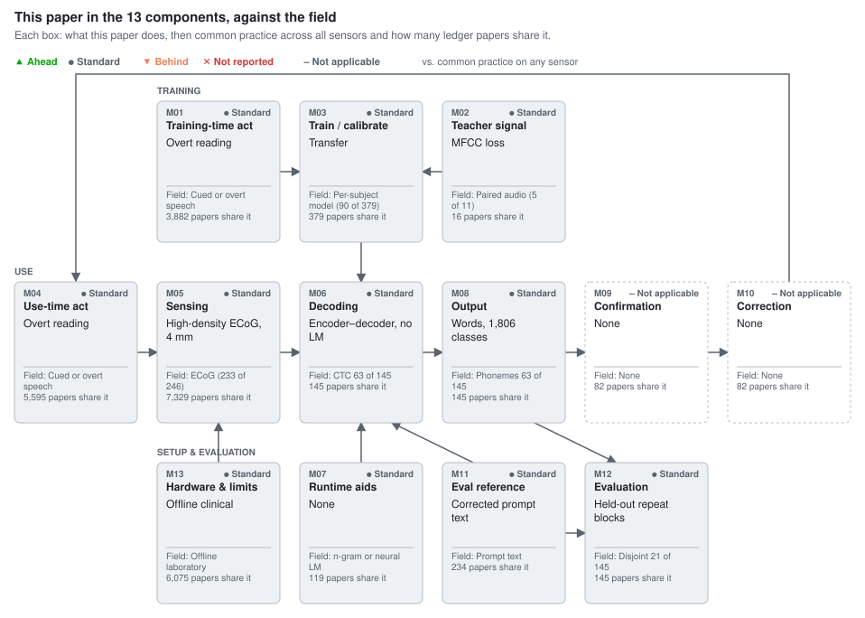

# Machine translation of cortical activity to text with an encoder–decoder framework

Makin, Moses, Chang. Nature Neuroscience 23(4), 575–582 (2020). [doi:10.1038/s41593-020-0608-8](https://doi.org/10.1038/s41593-020-0608-8)

**Section:** [Other sensors](../../README.md#other-sensors)

## Figures

### This paper in the 13 components, against the field

<picture><source media="(prefers-color-scheme: dark)" srcset="figures/components-dark.svg"></picture>

Verdicts compare the paper's choice for each component with common practice across 8,995 ledger entries on any sensor (silent speech, brain-to-text, lip reading).

Data

| Component | This paper | Common practice | Papers with this practice | Verdict |
| --- | --- | --- | --- | --- |
| M01 Training-time act | Overt reading | Cued or overt speech | 3,882 of 8,995 | ● Standard (Inherited.) |
| M02 Teacher signal | MFCC loss | Paired audio (5 of 11) | 16 of 8,995 | ● Standard ([concurrent] [@sun2020].) |
| M03 Train / calibrate | Transfer | Per-subject model (90 of 379) | 379 of 8,995 | ● Standard (No held-out participant.) |
| M04 Use-time act | Overt reading | Cued or overt speech | 5,595 of 8,995 | ● Standard (Inherited.) |
| M05 Sensing | High-density ECoG, 4 mm | ECoG (233 of 246) | 7,329 of 8,995 | ● Standard (Inherited.) |
| M06 Decoding | Encoder–decoder, no LM | CTC 63 of 145 | 145 of 8,995 | ● Standard (Prior design [@krishna2019].) |
| M07 Runtime aids | None | n-gram or neural LM | 119 of 8,995 | ● Standard (Decoder is the prior.) |
| M08 Output | Words, 1,806 classes | Phonemes 63 of 145 | 145 of 8,995 | ● Standard (Closed vocabulary.) |
| M09 Confirmation | None | None | 82 of 8,995 | – Not applicable (Offline.) |
| M10 Correction | None | None | 82 of 8,995 | – Not applicable (Offline.) |
| M11 Eval reference | Corrected prompt text | Prompt text | 234 of 8,995 | ● Standard (Inherited.) |
| M12 Evaluation | Held-out repeat blocks | Disjoint 21 of 145 | 145 of 8,995 | ● Standard (Not behind.) |
| M13 Hardware & limits | Offline clinical | Offline laboratory | 6,075 of 8,995 | ● Standard (Inherited.) |

## Verdict

Makin et al. [[1]](#ref-1) changed the decoder (M06, encoder–decoder), output unit (M08, words), training-only targets (M02, MFCC) and training data (M03, transfer); all four are standard, none ahead: Krishna et al. [[2]](#ref-2) trained an attention encoder–decoder on EEG seven months earlier, and Brain2Char [[3]](#ref-3) [concurrent], from the same lab, used the same MFCC loss. The protocol is strong: 30 models per condition paired on random held-out blocks, corrected tests, a noise control. The headline 3% WER comes from held-out repeats of the same 50 sentences; the cited 60% [[4]](#ref-4) came from held-out phrases, so the gap compares unlike tests. Unseen sentences and participants were never tested; on sentences never duplicated in training the reference is 23.8% WER with 125,000 words [[5]](#ref-5).

## Against the field, component by component

### M06 Decoding: autoregressive encoder–decoder

**Usual approach:** Of 145 neural text-decoding studies (pattern match, unique studies), 63 name CTC, 46 an encoder–decoder, 43 HMM or Viterbi; of 29 up to 2019, 1, 0 and 7 (Appendix). Makin et al. leave the 2020 default, decoding greedily without a language model.

**State of the art:** 2.5% online WER over the final five sessions on predetermined evaluation blocks (train-test sentence overlap unstated), a phoneme every 80 ms, 125,000-word vocabulary from day two (2024) [[6]](#ref-6) [later].

Krishna et al. [[2]](#ref-2) (arXiv 2019-08; the target gives no received date) trained an attention encoder–decoder on EEG: 70% WER on 9 sentences from electrodes T7 and T8 (Sec. 7). So ahead fails, though the gain over HMM is real: about 33% for a phoneme-HMM sentence classifier against about 3% (Fig. 2a), 91% relative (inference). Verdict: standard.

### M08 Output: whole words

**Usual approach:** Of the 145 studies, 63 name phonemes, 49 characters, 25 words or sentence classes; up to 2019, 4, 0 and 3 of 29 (pattern match, Appendix). Makin et al. use a 1,806-word softmax (Methods).

**State of the art:** phonemes combined into words by a language model, 2.5% WER (2024) [[6]](#ref-6) [later], test as in M06.

The softmax covers only the 1,806-word MOCHA-TIMIT vocabulary, and errors often substitute whole training sentences (Discussion). Verdict: standard for a 250-word closed task. Without a language model (M07), the decoder is the sentence prior; the M07 count is no matched comparison, so M07 is standard.

### M02 Training-only targets: MFCC regression

**Usual approach:** 16 studies match auxiliary acoustic or articulatory losses (pattern match, unique studies), 5 dated up to 2019; paired audio in 5 of 11 slot-filled records (Appendix).

**State of the art:** grapheme-to-phoneme labels, no audio, same lab: 25.5% WER from ECoG on 249 untrained sentences, 1,024 words (2023) [[7]](#ref-7) [later].

Brain2Char [[3]](#ref-3) [concurrent] adds the same MFCC loss to CTC. Without MFCCs, errors are "several times greater" (Results). Verdict: standard; it needs overt speech, which a prosthesis user may lack (Discussion).

### M03 Training data: transfer

**Usual approach:** Of 379 studies (pattern match, unique studies; 79 up to 2019), the most frequent design is a per-participant model (90), then leave-one-subject-out tests (75) and subject-specific layers (34).

**State of the art:** a sEEG sequence-to-sequence phoneme decoder (25-patient cohort) transferred to a held-out subject: PER 57% within-subject, 49% after transfer, 45% with four sources (2025) [[8]](#ref-8) [later].

For participant a, task transfer cut WER by 31% and participant transfer by about 17% (Fig. 3a); dual transfer (36%) did not beat task transfer significantly, and neither picture-description participant gained. Verdict: standard.

### M12 Evaluation: repeats, not unseen sentences

**Usual approach:** Of the 145 studies, 21 describe a sentence-disjoint test, 10 repeated sentences (pattern match, upper bounds); none of 29 up to 2019 matches either (Appendix). Makin et al. hold out random repeat blocks, about 10% of data.

**State of the art:** 23.8% online WER on sentences never duplicated in training, 125,000 words (2023) [[5]](#ref-5) [later]; from ECoG, 25.5% on 249 untrained sentences [[7]](#ref-7) [later].

That majority is later work; behind needs 3 earlier comparable studies, and only Herff et al. [[4]](#ref-4) (held-out phrases) is known. Verdict: standard, not behind; by today's practice the repeat-only test is the main limit.

## The 13 components

| Component | This paper | Usual approach (count) | State of the art | Verdict |
|---|---|---|---|---|
| M01 Training-time action | Overt reading | Cued or overt speech (slot-filled 3,882) | – | standard |
| M02 Training-only supervision | MFCC loss | Paired audio (5 of 11) (pattern match 16) | No audio target [[7]](#ref-7) | standard |
| M03 Training and adaptation | Transfer | Per-subject model (90 of 379) (pattern match 379) | Group transfer, 45% PER [[8]](#ref-8) | standard |
| M04 Use-time action | Overt reading | Cued or overt speech (slot-filled 5,595) | – | standard |
| M05 Sensors | High-density ECoG, 4 mm | ECoG (233 of 246) (slot-filled 7,329) | 253-electrode ECoG [[7]](#ref-7) | standard |
| M06 Processing and decoding | Encoder–decoder, no LM | CTC 63 of 145 (pattern match 145) | 2.5% WER [[6]](#ref-6) | standard |
| M07 Lexicon and LM | None | n-gram or neural LM (slot-filled 119) | – | standard |
| M08 Output | Words, 1,806 classes | Phonemes 63 of 145 (pattern match 145) | Phonemes, 2.5% WER [[6]](#ref-6) | standard |
| M09 Confirmation | None | None (slot-filled 82) | – | not applicable |
| M10 Correction | None | None (slot-filled 82) | – | not applicable |
| M11 Reference construction | Corrected prompt text | Prompt text (slot-filled 234) | – | standard |
| M12 Evaluation | Held-out repeat blocks | Disjoint 21 of 145 (pattern match 145) | 23.8% unseen [[5]](#ref-5) | standard |
| M13 Device and cost | Offline clinical | Offline laboratory (slot-filled 6,075) | – | standard |

## Where the claims outrun the evidence

- The cited 60% (ref. 9, [[4]](#ref-4)) is a 100-word result on held-out phrases; Herff's 25% needs a 10-word dictionary. Against 3% on repeats of 250 words, vocabulary favours Herff, the test favours Makin et al.
- The 3% and the fourfold (64 of 256 channels) and eightfold (no convolution) ablations are for one example participant (Fig. 2a); the other three are "quite similar" (Supplementary Fig. 1). Participant a (about four minutes of MOCHA-1) starts at about 53% (Fig. 3a).
- New-sentence generalization is inferred from transfer gains (Fig. 3); every test stays on MOCHA-1.
- The tuning block was not excluded from the final tests (Methods), no seeds are given, and the public training code shuffles without a seed (sequence_networks.py, line 1904).

## What the field needs next

- M12 and M06: encoder–decoder against phoneme CTC plus language model on the same ECoG data, sentence-disjoint.
- M02: MFCC against text-derived phone targets in the same participants.

## Questions for the authors

- Is the 30-s z-scoring window causal, and does it cross blocks?
- Does the decoder emit words outside the MOCHA-1 vocabulary?

## Appendix: literature search

- M06 neural-encoder-decoder-text-decoding. Inclusion rule: same population as the M08 output-unit topic; the design compared is the sequence decoder (autoregressive encoder–decoder, CTC, or HMM/Viterbi); a paper counts under every decoder its full text names. Ledger counts: 7,345 slot-filled; 145 pattern match (unique studies). Usual design: CTC 63, encoder–decoder 46, HMM or Viterbi 43 (pattern match, upper bounds); 2023 onward (82 studies): encoder–decoder 30, CTC 45, HMM or Viterbi 22. Studies dated up to 2019 (29): HMM or Viterbi 7, CTC 1, encoder–decoder 0; [[2]](#ref-2) (arXiv 2019-08) is indexed under 2020. Read in full: [[2]](#ref-2), [[4]](#ref-4) (deciding priors), [[6]](#ref-6) (state of the art), [[8]](#ref-8). Known-item recall 0.6 (5 seeds).
- M08 neural-text-output-unit (reused topic table). Inclusion rule as published: neural decoders that output text and report WER, CER or PER; the design compared is the unit emitted before any lexicon or language model. Ledger counts: 3,268 slot-filled; 145 pattern match (unique studies). Usual design: phonemes 63, characters 49, words or sentence classes 25 (pattern match, upper bounds); up to 2019 (29 studies): phonemes 4, words 3, characters 0. Read in full: [[6]](#ref-6) (state of the art), [[7]](#ref-7), [[5]](#ref-5). Known-item recall 0.8 (as published).
- M02 auxiliary-speech-feature-regression (reused topic table). Inclusion rule as published: non-acoustic text or speech-unit decoders whose training adds a loss regressing acoustic or articulatory features of the paired speech, discarded at use time. Ledger counts: 31 slot-filled (sparse slot); 16 pattern match (unique studies), 5 dated up to 2019. Usual design from M03 supervision kind: paired audio, 5 of 11 (slot-filled). Read in full: [[3]](#ref-3) (deciding prior), [[7]](#ref-7) (state of the art). Known-item recall 0.0 (as published).
- M03 cross-subject-pooled-training (reused topic table). Inclusion rule as published: speech or language decoders from neural or other biosignals trained on data pooled across participants; transfer by fine-tuning from another participant counts. Ledger counts: 1,526 slot-filled; 370 pattern match in the ledger, 379 with full-text hits (unique studies). Usual design: per-subject model 90, leave-one-subject-out 75, subject-specific layer 34 (pattern match, of 379); 79 studies dated up to 2019. Read in full: [[8]](#ref-8) (state of the art for this review). Known-item recall 1.0 (as published).
- M12 neural-text-unseen-sentence-test (reused topic table). Inclusion rule as published: same population as M08; the design compared is whether WER is measured on sentences absent from training or on repeats. Ledger counts: 6,960 slot-filled; 145 pattern match (unique studies). Usual design: sentence-disjoint test 21, repeated training sentences 10 (pattern match, upper bounds); up to 2019 (29 studies): 0 and 0. Read in full: [[5]](#ref-5) (state of the art), [[7]](#ref-7), [[4]](#ref-4), [[2]](#ref-2). Known-item recall 0.8 (as published).

## References

Numbered by first citation. BibTeX in the same order and keys: [refs.bib](refs.bib).

1. Makin, J. G., Moses, D. A., Chang, E. F. “Machine translation of cortical activity to text with an encoder-decoder framework.” *Nature Neuroscience*, 2020, 23, 575–582. doi:[10.1038/s41593-020-0608-8](https://doi.org/10.1038/s41593-020-0608-8). [wiki: doi-10.1038-s41593-020-0608-8](https://github.com/supernaiter/deep-research-wiki-for-silent-speech/blob/main/papers/doi-10.1038-s41593-020-0608-8/article.md) [wiki: pmc-10560395-makin](https://github.com/supernaiter/deep-research-wiki-for-silent-speech/blob/main/papers/pmc-10560395-makin/article.md)
2. Krishna, G., Han, Y., Tran, C., Carnahan, M., Tewfik, A. H. “State-of-the-art speech recognition using EEG and towards decoding of speech spectrum from EEG.” *arXiv*, 2019. arXiv:[1908.05743](https://arxiv.org/abs/1908.05743). [wiki: arxiv-1908.05743-eegasr](https://github.com/supernaiter/deep-research-wiki-for-silent-speech/blob/main/papers/arxiv-1908.05743-eegasr/article.md)
3. Sun, P., Anumanchipalli, G. K., Chang, E. F. “Brain2Char: a deep architecture for decoding text from brain recordings.” *Journal of Neural Engineering*, 2020, 17(6), 066015. doi:[10.1088/1741-2552/abc742](https://doi.org/10.1088/1741-2552/abc742). arXiv:[1909.01401](https://arxiv.org/abs/1909.01401). [concurrent] [review](https://github.com/supernaiter/silent-speech-review/tree/main/reviews/brain2char-a-deep-architecture-for-decoding-text-from-brain-recordings) [wiki: doi-10.1088-1741-2552-abc742](https://github.com/supernaiter/deep-research-wiki-for-silent-speech/blob/main/papers/doi-10.1088-1741-2552-abc742/article.md) [wiki: pmc-9591243-brain2char](https://github.com/supernaiter/deep-research-wiki-for-silent-speech/blob/main/papers/pmc-9591243-brain2char/article.md)
4. Herff, C., Heger, D., de Pesters, A., Telaar, D., Brunner, P., Schalk, G., et al. “Brain-to-text: decoding spoken phrases from phone representations in the brain.” *Frontiers in Neuroscience*, 2015, 9, 217. doi:[10.3389/fnins.2015.00217](https://doi.org/10.3389/fnins.2015.00217). [review](https://github.com/supernaiter/silent-speech-review/tree/main/reviews/brain-to-text-decoding-spoken-phrases-from-phone-representations-in-the-brain) [wiki: doi-10.3389-fnins.2015.00217](https://github.com/supernaiter/deep-research-wiki-for-silent-speech/blob/main/papers/doi-10.3389-fnins.2015.00217/article.md)
5. Willett, F. R., Kunz, E. M., Fan, C., Avansino, D. T., Wilson, G. H., Choi, E. Y., et al. “A high-performance speech neuroprosthesis.” *Nature*, 2023, 620, 1031–1036. doi:[10.1038/s41586-023-06377-x](https://doi.org/10.1038/s41586-023-06377-x). [later] [review](https://github.com/supernaiter/silent-speech-review/tree/main/reviews/a-high-performance-speech-neuroprosthesis) [wiki: doi-10.1038-s41586-023-06377-x](https://github.com/supernaiter/deep-research-wiki-for-silent-speech/blob/main/papers/doi-10.1038-s41586-023-06377-x/article.md) [wiki: pmc-10468393-neuroprosthesis](https://github.com/supernaiter/deep-research-wiki-for-silent-speech/blob/main/papers/pmc-10468393-neuroprosthesis/article.md)
6. Card, N. S., Wairagkar, M., Iacobacci, C., Hou, X., Singer-Clark, T., Willett, F. R., et al. “An accurate and rapidly calibrating speech neuroprosthesis.” *New England Journal of Medicine*, 2024, 391(7), 609–618. doi:[10.1056/NEJMoa2314132](https://doi.org/10.1056/NEJMoa2314132). [later] [review](https://github.com/supernaiter/silent-speech-review/tree/main/reviews/an-accurate-and-rapidly-calibrating-speech-neuroprosthesis) [wiki: doi-10.1056-nejmoa2314132](https://github.com/supernaiter/deep-research-wiki-for-silent-speech/blob/main/papers/doi-10.1056-nejmoa2314132/article.md) [wiki: doi-10.1056-NEJMoa2314132](https://github.com/supernaiter/deep-research-wiki-for-silent-speech/blob/main/papers/doi-10.1056-NEJMoa2314132/article.md) [wiki: pmc-11328962-rapidcal](https://github.com/supernaiter/deep-research-wiki-for-silent-speech/blob/main/papers/pmc-11328962-rapidcal/article.md)
7. Metzger, S. L., Littlejohn, K. T., Silva, A. B., Moses, D. A., Seaton, M. P., Wang, R., et al. “A high-performance neuroprosthesis for speech decoding and avatar control.” *Nature*, 2023, 620, 1037–1046. doi:[10.1038/s41586-023-06443-4](https://doi.org/10.1038/s41586-023-06443-4). [later] [review](https://github.com/supernaiter/silent-speech-review/tree/main/reviews/a-high-performance-neuroprosthesis-for-speech-decoding-and-avatar-control) [wiki: doi-10.1038-s41586-023-06443-4](https://github.com/supernaiter/deep-research-wiki-for-silent-speech/blob/main/papers/doi-10.1038-s41586-023-06443-4/article.md) [wiki: pmc-10826467-avatarnp](https://github.com/supernaiter/deep-research-wiki-for-silent-speech/blob/main/papers/pmc-10826467-avatarnp/article.md)
8. Singh, A., Thomas, T., Li, J., Hickok, G., Pitkow, X., Tandon, N. “Transfer learning via distributed brain recordings enables reliable speech decoding.” *Nature Communications*, 2025, 16, 8749. doi:[10.1038/s41467-025-63825-0](https://doi.org/10.1038/s41467-025-63825-0). [later] [wiki: doi-10.1038-s41467-025-63825-0](https://github.com/supernaiter/deep-research-wiki-for-silent-speech/blob/main/papers/doi-10.1038-s41467-025-63825-0/article.md)

## Materials

Data behind this review. Full texts of the papers are not included.

- [`review.md`](review.md): the review text (source)
- [`refs.bib`](refs.bib): references (BibTeX)
- [`slots.json`](slots.json): for each of the 13 components: this paper's choice, field practice, number of matching papers, verdict
- [`figures.json`](figures.json): figure definitions
- [`evaluation.md`](evaluation.md): independent evaluation by a second reviewer
- [`triage.md`](triage.md): how each evaluation finding was checked against the sources and resolved
- [`process/log.json`](process/log.json): process record: each step, who did it (reader, script, writer, evaluator), when, the checks run and the input versions
- [`process/notes.json`](process/notes.json): reading notes on the target and comparator papers: claims, numbers, conditions and what is not stated, with locations
- [`process/plan.json`](process/plan.json): plan: which components the paper changes and the topics it is compared on
- [`process/draft.md`](process/draft.md): the review as first written, before the independent evaluation
- [`process/claims-draft.md`](process/claims-draft.md): claim table of the draft: every claim mapped to a note or a count
- [`process/claims.md`](process/claims.md): claim table of the published review
- [`components/M02/auxiliary-speech-feature-regression.csv`](../../components/M02/auxiliary-speech-feature-regression.csv): M02 topic "auxiliary-speech-feature-regression", every candidate paper with its decision (31 slot-filled, 16 pattern match, usual design in 5, 3 read in full)
- [`components/M03/cross-subject-pooled-training.csv`](../../components/M03/cross-subject-pooled-training.csv): M03 topic "cross-subject-pooled-training", every candidate paper with its decision (1526 slot-filled, 370 pattern match, usual design in 90, 4 read in full)
- [`components/M06/neural-encoder-decoder-text-decoding.csv`](../../components/M06/neural-encoder-decoder-text-decoding.csv): M06 topic "neural-encoder-decoder-text-decoding", every candidate paper with its decision (7345 slot-filled, 145 pattern match, usual design in 63, 4 read in full)
- [`components/M08/neural-text-output-unit.csv`](../../components/M08/neural-text-output-unit.csv): M08 topic "neural-text-output-unit", every candidate paper with its decision (3268 slot-filled, 145 pattern match, usual design in 63, 5 read in full)
- [`components/M12/neural-text-unseen-sentence-test.csv`](../../components/M12/neural-text-unseen-sentence-test.csv): M12 topic "neural-text-unseen-sentence-test", every candidate paper with its decision (6960 slot-filled, 145 pattern match, usual design in 21, 4 read in full)

## More reviews in Other sensors

- [ASR is all you need: cross-modal distillation for lip reading](../asr-is-all-you-need-cross-modal-distillation-for-lip-reading/) (2020). ASR-teacher labels (M02) replaced transcribed-data alignment targets; standard: LRS2 parity holds, but effects differ across datasets, one WER each, and distillation is not isolated.
- [Decoding Imagined and Spoken Phrases From Non-invasive Neural (MEG) Signals](../decoding-imagined-and-spoken-phrases-from-non-invasive-neural-meg-signals/) (2020). Scalogram CNNs (M06) and ImageNet weights (M03) were new for imagined speech but standard: effects not isolated; 93% imagination sits on a 43.77% pre-stimulus floor (Table 1).
- [Lipreading using Temporal Convolutional Networks](../lipreading-using-temporal-convolutional-networks/) (2020). Multi-scale TCN (M06) and variable-length cropping (M03) are standard: head and augmentation are not separated, no run counts, robustness comes from the cropping; 85.3% LRW trails 93.2% today.
- [End-to-End Audio-Visual Speech Recognition with Conformers](../end-to-end-audio-visual-speech-recognition-with-conformers/) (2021). Conformer back-end on raw inputs (M06) and Transformer LM (M07) are standard: raw-input AVSR predates it, and the Conformer gain is one unrepeated step confounded with a decoder swap.
- [Real-time synthesis of imagined speech processes from minimally invasive recordings of neural activity](../real-time-synthesis-of-imagined-speech-processes-from-minimally-invasive-recordings-of-neural-activi/) (2021). Closed-loop sEEG word synthesis (M06) and audible-to-imagined transfer (M04) are standard; one participant; imagined output gets no word-content test (M12 behind Martin 2014).
- [Generating Natural, Intelligible Speech From Brain Activity in Motor, Premotor, and Inferior Frontal Cortices](../generating-natural-intelligible-speech-from-brain-activity-in-motor-premotor-and-inferior-frontal-co/) (2019). Unit selection (M06) and own-voice concatenation (M08) are standard: an EMG design new to ECoG, never compared on its folds; 4-choice test (M12) on 30 best words; naturalness unmeasured.

---

Part of the [Silent Speech Interface Review](https://github.com/supernaiter/silent-speech-review). Found an error? [Open an issue](https://github.com/supernaiter/silent-speech-review/issues/new?template=correction.yml).
