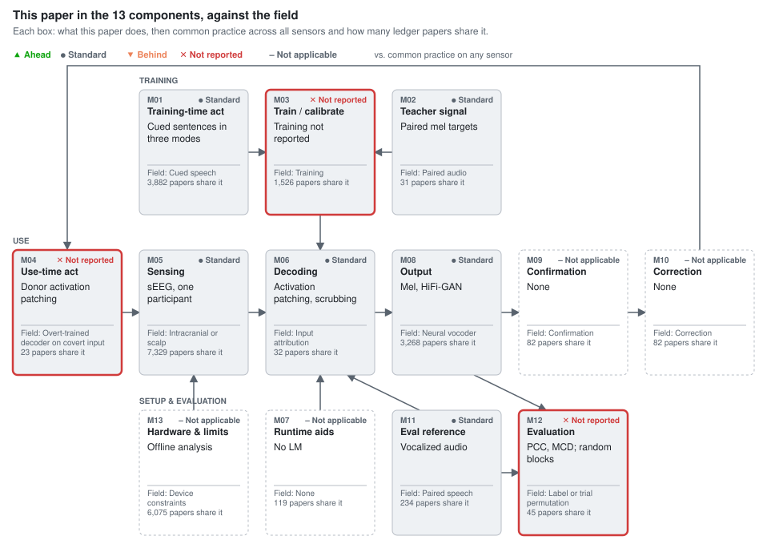

# Mechanistic Interpretability of Brain-to-Speech Models Across Speech Modes

Maghsoudi, Mishra. arXiv preprint, 2026. [arXiv:2602.01247](https://arxiv.org/abs/2602.01247)

**Section:** [Brain signals (EEG, MEG, intracortical)](../../README.md#brain-signals-eeg-meg-intracortical)

## Figures

### This paper in the 13 components, against the field

<picture><source media="(prefers-color-scheme: dark)" srcset="figures/components-dark.svg"></picture>

Verdicts compare the paper's choice for each component with common practice across 8,995 ledger entries on any sensor (silent speech, brain-to-text, lip reading).

Data

| Component | This paper | Common practice | Papers with this practice | Verdict |
| --- | --- | --- | --- | --- |
| M01 Training-time act | Cued sentences in three modes | Cued speech | 3,882 of 8,995 | ● Standard (Inherited.) |
| M02 Teacher signal | Paired mel targets | Paired audio | 31 of 8,995 | ● Standard (Inherited.) |
| M03 Train / calibrate | Training not reported | Training | 1,526 of 8,995 | ✕ Not reported (No recipe or seeds.) |
| M04 Use-time act | Donor activation patching | Overt-trained decoder on covert input | 23 of 8,995 | ✕ Not reported (No overt-trained test.) |
| M05 Sensing | sEEG, one participant | Intracranial or scalp | 7,329 of 8,995 | ● Standard (Inherited.) |
| M06 Decoding | Activation patching, scrubbing | Input attribution | 32 of 8,995 | ● Standard (No repetition.) |
| M07 Runtime aids | No LM | None | 119 of 8,995 | – Not applicable (Acoustic output.) |
| M08 Output | Mel, HiFi-GAN | Neural vocoder | 3,268 of 8,995 | ● Standard (Inherited.) |
| M09 Confirmation | None | Confirmation | 82 of 8,995 | – Not applicable (Offline.) |
| M10 Correction | None | Correction | 82 of 8,995 | – Not applicable (Offline.) |
| M11 Eval reference | Vocalized audio | Paired speech | 234 of 8,995 | ● Standard (Inherited.) |
| M12 Evaluation | PCC, MCD; random blocks | Label or trial permutation | 45 of 8,995 | ✕ Not reported (No null or held-out split.) |
| M13 Hardware & limits | Offline analysis | Device constraints | 6,075 of 8,995 | – Not applicable (Offline.) |

## Verdict

The paper [[1]](#ref-1) changes one component: it explains an sEEG Conv1D-BiGRU decoder (Sec. 4.2) by patching activations between vocalized, mimed and imagined speech (M06). Intervening on internal activations is rare (2 of 38 studies, pattern match, Appendix), but one participant and one architecture give no repetition, so by the verdict rules it is standard, not ahead. The central claim, vocalized-to-imagined transfer through a compact subspace, holds only against random blocks: the kept convolutional subspace beats a matched random block (PCC 0.666 against 0.564) but not the unpatched imagined decoder (0.725; Tables 1 and 3). Full patching gives the same PCC 0.954 and MCD 1.63 for imagined and mimed recipients, above the donor's 0.752 (Table 3), so it reflects the donor, not transfer (inference). The field's own transfer test, an overt-trained decoder applied to covert input (M04), is not reported, and no null model backs any effect (M12).

## Against the field, component by component

### M06 Processing: causal interventions on decoder internals

**Usual approach:** Of 38 ledger studies that explain a trained speech decoder (pattern match, unique studies; Appendix), 32 use input attribution and 6 probe hidden layers (categories overlap), e.g. viseme probes over audio-visual recognizer layers [concurrent] [[2]](#ref-2). Only the target and its [later] version intervene on internal activations (2 of 38, pattern match, Appendix).

**State of the art:** The [later] version of this study (2026) [[3]](#ref-3) patches decoders trained on the target mode, scores held-out samples in six-fold cross-validation and tests neuron overlap against a permutation null (Sec. 2). The target mentions folds (Fig. 5) but describes no split, no held-out selection and no null (Sec. 5.5, Table 2).

Interventions test what a decoder uses, but the subspaces are selected and scored on the same data (Sec. 5.5). Verdict: standard; one participant (Sec. 4.1) and one architecture give no repetition, which ahead requires; the authors call for more subjects and architectures (Sec. 7).

### M04 Use-time action: what counts as transfer

**Usual approach:** 23 of 33 ledger studies on overt-to-silent transfer apply a decoder trained on overt speech to silent or covert input without retraining (confirmed; Appendix), e.g. covert ECoG spectrotemporal reconstruction from an overt-trained model [[4]](#ref-4) and an overt-trained ECoG Transformer decoding covert sentences at 46.3% token error rate against 46.6% covert-trained, in 16 participants [[5]](#ref-5). The paper instead injects activations from a paired vocalized recording of the sentence (Sec. 5), which a covert-only user lacks (inference).

**State of the art:** On the same VocalMind recordings, a [concurrent] study by the first author (2026) [[6]](#ref-6) retrains the VocalMind convolutional-recurrent decoder per condition, tests across conditions and beats a circular-shift null (Secs. 2.3, 3.4).

Vocalized representations that "can be causally transferred to imagined inputs to recover decoding quality" (Sec. 6.1) do not show transfer in this sense. Verdict: not reported.

### M12 Evaluation: null models

**Usual approach:** 45 of 132 ledger studies that build empirical nulls permute labels or trials (pattern match, unique studies; Appendix); the [concurrent] same-data study [[6]](#ref-6) instead circularly shifts the target spectrograms (Sec. 3.4).

**State of the art:** A [concurrent] MEG study (2026) [[7]](#ref-7) trains its null identically on mismatched imagined-listened trial pairs and scores model and null leave-one-subject-out (Sec. 2.3); the target has neither.

Matched random blocks (Table 1) control region size, not chance; no significance test is given (Sec. 6). Verdict: not reported.

## The 13 components

| Component | This paper | Usual approach (count) | State of the art | Verdict |
|---|---|---|---|---|
| M01 Training-time action | Cued sentences in three modes | Cued speech (slot-filled 3,882) | – | standard |
| M02 Training-only supervision | Paired mel targets | Paired audio (slot-filled 31) | – | standard |
| M03 Training and adaptation | Training not reported | Training (slot-filled 1,526) | – | not reported |
| M04 Use-time action | Donor activation patching | Overt-trained decoder on covert input (confirmed 23) | Above null across conditions [concurrent] [[6]](#ref-6) | not reported |
| M05 Sensors | sEEG, one participant | Intracranial or scalp (slot-filled 7,329) | – | standard |
| M06 Processing and decoding | Activation patching, scrubbing | Input attribution (pattern match 32) | Held-out patching, permutation null [later] [[3]](#ref-3) | standard |
| M07 Lexicon and LM | No LM | None (slot-filled 119) | – | not applicable |
| M08 Output | Mel, HiFi-GAN | Neural vocoder (slot-filled 3,268) | – | standard |
| M09 Confirmation | None | Confirmation (slot-filled 82) | – | not applicable |
| M10 Correction | None | Correction (slot-filled 82) | – | not applicable |
| M11 Reference construction | Vocalized audio | Paired speech (slot-filled 234) | – | standard |
| M12 Evaluation | PCC, MCD; random blocks | Label or trial permutation (pattern match 45) | Pairing-shuffle null, leave-one-subject-out [concurrent] [[7]](#ref-7) | not reported |
| M13 Device and cost | Offline analysis | Device constraints (slot-filled 6,075) | – | not applicable |

## Where the claims outrun the evidence

- Kept regions do not carry transfer (inference): imagined from vocalized, KEEP-Conv 0.666 beats RAND-Conv 0.564 (+0.102, +18%) but falls below the unpatched 0.725 (-0.059, -8%), and KEEP-RNN 0.462 is 36% below it (Tables 1 and 3). In the necessity test (vocalized recipient, imagined donor), KEEP-Conv and RAND-Conv tie at 0.575 (Table 1).
- Full patching gives 0.954 and MCD 1.63 for both vocalized-to-imagined and vocalized-to-mimed (Table 3). In "the same fixed model" (Sec. 5.4) full patching would reproduce the vocalized baseline 0.752, so the checkpoints differ (inference); the [later] version uses per-target-mode decoders [[3]](#ref-3).
- The convolutional site has 64 channels (Sec. 4.2), yet Table 5 counts 96 to 120 distinct convolutional winner neurons among 200 sentences; channel-level winners cannot exceed 64 (inference).
- The "shared continuous causal manifold" (Sec. 6.1) has no tabulated values; a continuous decoder interpolates smoothly by construction (inference).
- The claim that the gap is "mainly due to how the decoder organizes information, not differences in input signal quality" (Sec. 7) has no input-quality control.

## What the field needs next

- M04: the overt-trained decoder on imagined and mimed input beside each patching result.
- M12: held-out selection of channels, windows and neurons, and a trial-shuffle null.
- M06: a second participant and a second architecture (Sec. 7).

## Questions for the authors

- Were all patches run in one decoder, or in decoders trained per mode?
- Which data selected group g2, window 21-84 and the top-k neurons, and which scored them?
- What split, folds and seeds lie behind Tables 1 to 5?

## Appendix: literature search

Ledger at wiki commit 730b0b4: 7,388 unique studies.

**M06, decoder-internal-interpretability.** Inclusion rule: studies that analyse what a trained speech decoder (neural, EMG, articulatory, video or audio input) relies on, by input attribution, hidden-layer probing or interventions on internal activations; architecture ablations that retrain variants and brain mapping without a trained decoder are excluded. Ledger counts: M06 slot filled in 7,345 unique studies; 38 pattern match (unique studies). Usual design (full-text pattern match over the 38; categories overlap): input attribution 32, hidden-layer probing 6, internal activation intervention 2 (the target and [[3]](#ref-3)). Read in full: [[3]](#ref-3) (state of the art).

**M04, overt-to-silent-transfer** (published topic table, reused). Inclusion rule: studies that apply a decoder trained only on overt speech to silent, mimed or imagined speech without retraining; alignment-only use, whisper transfer and perception-to-imagery transfer are excluded. Ledger counts: M04 slot filled in 5,595 unique studies; 33 pattern match (unique studies); 23 confirmed. Usual design: overt-trained decoder applied to silent or covert input, 23 (confirmed). Read: [[6]](#ref-6) (state of the art), [[5]](#ref-5). Known-item recall: 1.0.

**M12, null-model-construction-neural-decoding** (published topic table, reused). Inclusion rule: neural decoding studies that test against an empirical null built by shuffling or permuting labels, trials, time or channels; theoretical chance only is excluded. Ledger counts: M12 slot filled in 6,960 unique studies; 132 pattern match (unique studies). Usual design: label or trial permutation, 45 (pattern match). Read: [[7]](#ref-7) (state of the art).

**Inherited slots (M01-M03, M05, M07-M11, M13).** Table counts are slot-filled ledger values at the same commit.

## References

Numbered by first citation. BibTeX in the same order and keys: [refs.bib](refs.bib).

1. Maghsoudi, M., Mishra, A. “Mechanistic Interpretability of Brain-to-Speech Models Across Speech Modes.” *arXiv preprint*, 2026. arXiv:[2602.01247](https://arxiv.org/abs/2602.01247). arXiv v1 [review](https://github.com/supernaiter/silent-speech-review/tree/main/reviews/mechanistic-interpretability-of-brain-to-speech-models-across-speech-modes) [wiki: arxiv-2602-01247-mechint](https://github.com/supernaiter/deep-research-wiki-for-silent-speech/blob/main/papers/arxiv-2602-01247-mechint/article.md) [wiki: arxiv-2602.01247](https://github.com/supernaiter/deep-research-wiki-for-silent-speech/blob/main/papers/arxiv-2602.01247/article.md) [wiki: arxiv-2602.01247-mib2s](https://github.com/supernaiter/deep-research-wiki-for-silent-speech/blob/main/papers/arxiv-2602.01247-mib2s/article.md)
2. Papadopoulos, A., Harte, N. “Interpreting the Role of Visemes in Audio-Visual Speech Recognition.” *arXiv preprint*, 2025. arXiv:[2509.16023](https://arxiv.org/abs/2509.16023). [concurrent] [wiki: arxiv-2509-16023-visemes](https://github.com/supernaiter/deep-research-wiki-for-silent-speech/blob/main/papers/arxiv-2509-16023-visemes/article.md)
3. Maghsoudi, M., Mishra, A., Dutta, S. “Mechanistic Interpretability Reveals Shared Causal Subspaces in Brain-to-Speech Decoders.” *arXiv preprint*, 2026. arXiv:[2609.31992](https://arxiv.org/abs/2609.31992). arXiv v1 [later] [wiki: arxiv-2609-31992-mechinterp](https://github.com/supernaiter/deep-research-wiki-for-silent-speech/blob/main/papers/arxiv-2609-31992-mechinterp/article.md) [wiki: arxiv-2609.31992](https://github.com/supernaiter/deep-research-wiki-for-silent-speech/blob/main/papers/arxiv-2609.31992/article.md)
4. Martin, S., Brunner, P., Holdgraf, C., Heinze, H., Crone, N. E., Rieger, J., et al. “Decoding spectrotemporal features of overt and covert speech from the human cortex.” *Frontiers in Neuroengineering*, 2014, 7, 14. doi:[10.3389/fneng.2014.00014](https://doi.org/10.3389/fneng.2014.00014). [wiki: doi-10.3389-fneng.2014.00014](https://github.com/supernaiter/deep-research-wiki-for-silent-speech/blob/main/papers/doi-10.3389-fneng.2014.00014/article.md) [wiki: pmc-4034498-overtcovert](https://github.com/supernaiter/deep-research-wiki-for-silent-speech/blob/main/papers/pmc-4034498-overtcovert/article.md)
5. Komeiji, S., Mitsuhashi, T., Iimura, Y., Suzuki, H., Sugano, H., Shinoda, K., et al. “Feasibility of decoding covert speech in ECoG with a Transformer trained on overt speech.” *Scientific Reports*, 2024, 14, 11491. doi:[10.1038/s41598-024-62230-9](https://doi.org/10.1038/s41598-024-62230-9). [wiki: pmc-11106343-ecogtransformer](https://github.com/supernaiter/deep-research-wiki-for-silent-speech/blob/main/papers/pmc-11106343-ecogtransformer/article.md) [wiki: doi-10.1038-s41598-024-62230-9](https://github.com/supernaiter/deep-research-wiki-for-silent-speech/blob/main/papers/doi-10.1038-s41598-024-62230-9/article.md) [wiki: doi-10.1101-2024.02.05.578911](https://github.com/supernaiter/deep-research-wiki-for-silent-speech/blob/main/papers/doi-10.1101-2024.02.05.578911/article.md) [wiki: doi-10.21203-rs.3.rs-3927907-v1](https://github.com/supernaiter/deep-research-wiki-for-silent-speech/blob/main/papers/doi-10.21203-rs.3.rs-3927907-v1/article.md)
6. Maghsoudi, M., Chillale, R., Shamma, S. A. “Relating the Neural Representations of Vocalized, Mimed, and Imagined Speech.” *arXiv preprint*, 2026. arXiv:[2602.22597](https://arxiv.org/abs/2602.22597). [concurrent] [review](https://github.com/supernaiter/silent-speech-review/tree/main/reviews/relating-the-neural-representations-of-vocalized-mimed-and-imagined-speech) [wiki: arxiv-2602-22597-vmi](https://github.com/supernaiter/deep-research-wiki-for-silent-speech/blob/main/papers/arxiv-2602-22597-vmi/article.md) [wiki: arxiv-2602.22597](https://github.com/supernaiter/deep-research-wiki-for-silent-speech/blob/main/papers/arxiv-2602.22597/article.md) [wiki: arxiv-2602.22597-vmi](https://github.com/supernaiter/deep-research-wiki-for-silent-speech/blob/main/papers/arxiv-2602.22597-vmi/article.md) [wiki: isca-maghsoudi26_interspeech](https://github.com/supernaiter/deep-research-wiki-for-silent-speech/blob/main/papers/isca-maghsoudi26_interspeech/article.md)
7. Maghsoudi, M., Shamma, S. “Zero-Shot Imagined Speech Decoding via Imagined-to-Listened MEG Mapping.” *arXiv preprint*, 2026. arXiv:[2605.08075](https://arxiv.org/abs/2605.08075). [concurrent] [review](https://github.com/supernaiter/silent-speech-review/tree/main/reviews/zero-shot-imagined-speech-decoding-via-imagined-to-listened-meg-mapping) [wiki: arxiv-2605.08075](https://github.com/supernaiter/deep-research-wiki-for-silent-speech/blob/main/papers/arxiv-2605.08075/article.md) [wiki: arxiv-2605-08075-zeromeg](https://github.com/supernaiter/deep-research-wiki-for-silent-speech/blob/main/papers/arxiv-2605-08075-zeromeg/article.md)

## Materials

Data behind this review. Full texts of the papers are not included.

- [`review.md`](review.md): the review text (source)
- [`refs.bib`](refs.bib): references (BibTeX)
- [`slots.json`](slots.json): for each of the 13 components: this paper's choice, field practice, number of matching papers, verdict
- [`figures.json`](figures.json): figure definitions
- [`evaluation.md`](evaluation.md): independent evaluation by a second reviewer
- [`triage.md`](triage.md): how each evaluation finding was checked against the sources and resolved
- [`components/M04/overt-to-silent-transfer.csv`](../../components/M04/overt-to-silent-transfer.csv): M04 topic "overt-to-silent-transfer", every candidate paper with its decision (23 confirmed, 104 candidates read, 0 unread)
- [`components/M06/decoder-internal-interpretability.csv`](../../components/M06/decoder-internal-interpretability.csv): M06 topic "decoder-internal-interpretability", every candidate paper with its decision (7345 slot-filled, 38 pattern match, usual design in 32, 1 read in full)
- [`components/M12/null-model-construction-neural-decoding.csv`](../../components/M12/null-model-construction-neural-decoding.csv): M12 topic "null-model-construction-neural-decoding", every candidate paper with its decision (6960 slot-filled, 132 pattern match, usual design in 45, 2 read in full)

## More reviews in Brain signals (EEG, MEG, intracortical)

- [A cross-species neural foundation model for end-to-end speech decoding](../a-cross-species-neural-foundation-model-for-end-to-end-speech-decoding/) (2026). Cascaded decoding with the pretrained encoder is a strong standard result; the end-to-end audio-LLM path beats the prior end-to-end entry but trails RNN cascades, and the cross-species gain is small.
- [Brain-to-Speech: Prosody Feature Engineering and Transformer-Based Reconstruction](../brain-to-speech-prosody-feature-engineering-and-transformer-based-reconstruction/) (2026). Same three parts and same Table 1 values as MiSTR (2025, same first two authors), not cited. Features (M06) and phase vocoder (M08) standard, unablated; no listener test (M12, behind).
- [Brain2Speech-Net: Fast and Intelligible Brain-to-Speech Synthesis Without Text Decoding](../brain2speech-net-intelligible-real-time-brain-to-speech-synthesis-without-text-decoding/) (2026). Text-free synthesis is shown, but its real time is throughput, not causal synthesis, unseen-sentence WER is 2.3 times the cascade, and intelligibility rests on ratings and ASR.
- [Do EEG Foundation Models Transfer to Speech? A Benchmark on Overt and Imagined Speech Decoding](../do-eeg-foundation-models-transfer-to-speech-a-benchmark-on-overt-and-imagined-speech-decoding/) (2026). Benchmark of EEG foundation models versus conventional models for overt and imagined speech decoding on two datasets; general EEG pretraining shows no consistent advantage and word decoding stays near chance.
- [EEG-Based Imagined Speech Decoding Using a Hybrid CNN-SNN Architecture](../eeg-based-imagined-speech-decoding-using-a-hybrid-cnn-snn-architecture/) (2026). Hybrid CNN-SNN classifier for five-class EEG imagined speech; reports 80.13% accuracy and 80.14% F1 in offline subject-dependent evaluation, about 98 ms GPU prediction time per trial.
- [iPhoneme: Brain-to-Text Communication for ALS Using ConformerXL Decoding](../iphoneme-brain-to-text-communication-for-als-using-conformerxl-decoding/) (2026). ConformerXL-based intracortical brain-to-text decoding for ALS with a proposed gaze-confirmation interface; WFST decoding reaches 7.86% phoneme error rate retrospectively in one participant.

---

Part of the [Silent Speech Interface Review](https://github.com/supernaiter/silent-speech-review). Found an error? [Open an issue](https://github.com/supernaiter/silent-speech-review/issues/new?template=correction.yml).
