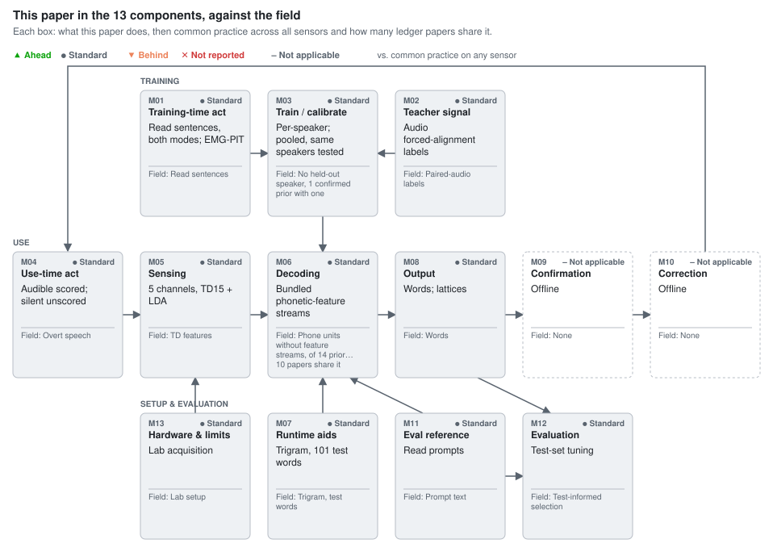

# Modeling Coarticulation in EMG-based Continuous Speech Recognition

Schultz, Wand. Speech Communication 52(4), 2010. [doi:10.1016/j.specom.2009.12.002](https://doi.org/10.1016/j.specom.2009.12.002)

**Section:** [Other sensors](../../README.md#other-sensors)

## Figures

### This paper in the 13 components, against the field

<picture><source media="(prefers-color-scheme: dark)" srcset="figures/components-dark.svg"></picture>

Verdicts compare the paper's choice for each component with common practice across 8,995 ledger entries on any sensor (silent speech, brain-to-text, lip reading).

Data

| Component | This paper | Common practice | Papers with this practice | Verdict |
| --- | --- | --- | --- | --- |
| M01 Training-time act | Read sentences, both modes; EMG-PIT | Read sentences |  | ● Standard (Corpus contribution.) |
| M02 Teacher signal | Audio forced-alignment labels | Paired-audio labels |  | ● Standard (As in [@jou2006].) |
| M03 Train / calibrate | Per-speaker; pooled, same speakers tested | No held-out speaker, 1 confirmed prior with one |  | ● Standard (No held-out speaker.) |
| M04 Use-time act | Audible scored; silent unscored | Overt speech |  | ● Standard (Silent claim untested.) |
| M05 Sensing | 5 channels, TD15 + LDA | TD features |  | ● Standard (Group lineage.) |
| M06 Decoding | Bundled phonetic-feature streams | Phone units without feature streams, of 14 prior studies | 10 of 14 | ● Standard (Transfer from acoustic ASR; 0 of 14 bundle (Appendix).) |
| M07 Runtime aids | Trigram, 101 test words | Trigram, test words |  | ● Standard (Lattice-tuned weights.) |
| M08 Output | Words; lattices | Words |  | ● Standard (Lattice is oracle.) |
| M09 Confirmation | Offline | None |  | – Not applicable (Offline study.) |
| M10 Correction | Offline | None |  | – Not applicable (Offline study.) |
| M11 Eval reference | Read prompts | Prompt text |  | ● Standard (Planned speech.) |
| M12 Evaluation | Test-set tuning | Test-informed selection |  | ● Standard (Below [@jou2007continuous].) |
| M13 Hardware & limits | Lab acquisition | Lab setup |  | ● Standard (No deployment.) |

## Verdict

The paper [[1]](#ref-1) changes the EMG acoustic model (M06): nine phonetic-feature streams whose models are bundled by decision trees, beside a phone stream. None of the 14 prior non-acoustic-signal recognizers bundles features (Appendix), but streams, tree clustering and a one-stream form of bundling come from acoustic ASR, as the authors state (§3.1–3.4): a transfer to EMG, standard. One bundled stream at a Gaussian count comparable to the phone system gains 10.6% relative (§3.4). The full gain, 47.15% to 31.49% WER, is optimistic: as the authors state (§3.3), weights and tree size were tuned on the test set. The "speaker-independent" result (M03) trains on the speakers it tests (§4). Usefulness for silent speech (§5) rests on audible scores, while the group's [concurrent] silent test with the same features gave above 80% WER for most of the 14 pilot speakers [[2]](#ref-2).

## Against the field, component by component

### M06 Processing: phonetic-feature streams and their bundling

**Usual approach:** At the target's time, 10 of 14 prior non-acoustic-signal recognizers (pattern match, unique studies; Appendix) name no feature stream; [[3]](#ref-3) uses monophones; feature streams match 4, confirmed only in [[4]](#ref-4), and bundling matches none. In EMG the group had tried the ingredients separately: feature streams beside phones, 33.9% to 29.9% WER on one speaker, streams chosen on halves of the test set [[4]](#ref-4); tree-clustered triphones pooled with the test speaker, 68.92% to 60.97% [[5]](#ref-5); clustered units in [[6]](#ref-6). From acoustic ASR the target takes feature streams (Kirchhoff 1999; Metze and Waibel 2002), the clustering (Bahl et al. 1991) and names Yu and Schultz (2003) as similar to one bundled stream (§3.1–3.4, §4). The departure is several bundled streams over EMG: one stream gives 42.16% WER, nine 31.49% (§3.4).

**State of the art:** In 2024 [later], 3.7% WER on vocal and 12.2% on silent EMG, open vocabulary, single-speaker benchmark, with an LLM-rescored ensemble of neural models [[7]](#ref-7), against the target's 31.49% on audible EMG with 101 test words and a trigram LM. That gain comes from the decoder, not the units.

Bundling beats context alone, 35.78% against 41.99% (Table 3). Under pooled training, bundled streams beat context-dependent phones, 45.24% against 56.55%, and adding a context-dependent phone stream gives 44.95%, not significant (Table 4). The remaining confound is model size, 290 against 2,489 Gaussians (Table 2): it is matched only at one stream, and speaker-dependent context-dependent phones cannot be trained on this corpus (§4). Repetition is averages over 28 sessions with paired t-tests; the pooled condition reuses those sessions. Verdict: standard (transfer of an acoustic-ASR design; ahead only within non-acoustic recognizers).

### M03 Training: pooled multi-speaker models

**Usual approach:** Before 2009-06 one study in the published table tests a held-out speaker (confirmed; Appendix): the group's own, for context-independent models with MLLR [[5]](#ref-5). Its triphone experiment, like the target's §4, pools the test speaker into training and calls this speaker-independent.

**State of the art:** In 2024 [later], a cross-speaker sEMG-to-speech synthesis model fine-tuned on one session of a left-out speaker beats training from scratch (p < 0.01, 4 speakers) [[8]](#ref-8); a synthesis yardstick.

The "about 28%" reduction claimed for the speaker-independent system (§5) is pooled (62.15% to 44.95% WER, Table 4). Verdict: standard; one confirmed prior does not meet the three-paper rule for behind.

### M12 Evaluation: selection on the test set

**Usual approach:** Three of four read priors pick settings from reported WER curves and describe no development set [[9]](#ref-9), [[6]](#ref-6), [[5]](#ref-5); [[4]](#ref-4) selects streams on one half of the test set and scores the other. The target tunes weights and the 70-leaf size on the test set (§3.3) and does not name the data for the 220-leaf choice (§4).

**State of the art:** The 2024 open-vocabulary test of [[7]](#ref-7) [later]. Verdict: standard, typical of the lineage.

## The 13 components

| Component | This paper | Usual approach (count) | State of the art | Verdict |
|---|---|---|---|---|
| M01 Training-time action | Read sentences, both modes; EMG-PIT | Read sentences | – | standard |
| M02 Training-only supervision | Audio forced-alignment labels | Paired-audio labels | – | standard |
| M03 Training and adaptation | Per-speaker; pooled, same speakers tested | No held-out speaker, 1 confirmed prior with one | Left-out-speaker adaptation, synthesis [[8]](#ref-8) | standard |
| M04 Use-time action | Audible scored; silent unscored | Overt speech | – | standard |
| M05 Sensors | 5 channels, TD15 + LDA | TD features | – | standard |
| M06 Processing and decoding | Bundled phonetic-feature streams | Phone units without feature streams, of 14 prior studies (pattern match 10) | 3.7% vocal, 12.2% silent WER, open vocabulary [[7]](#ref-7) | standard |
| M07 Lexicon and LM | Trigram, 101 test words | Trigram, test words | – | standard |
| M08 Output | Words; lattices | Words | – | standard |
| M09 Confirmation | Offline | None | – | not applicable |
| M10 Correction | Offline | None | – | not applicable |
| M11 Reference construction | Read prompts | Prompt text | – | standard |
| M12 Evaluation | Test-set tuning | Test-informed selection | Open-vocabulary test [[7]](#ref-7) | standard |
| M13 Device and cost | Lab acquisition | Lab setup | – | standard |

## Where the claims outrun the evidence

- **Silent speech.** §5 places 31.49% WER "within useful range for silent speech applications" with no silent score. In the [concurrent] 108-word silent test most pilot speakers exceed 80% WER, two are "in a reasonable range", and 30.10% is an extra, silent-experienced speaker [[2]](#ref-2).
- **Bundling gain.** Table 3 credits bundling with 14.8% against the context-dependent feature row it is not built on; against context-independent features it is 21.4% (inference), and §3.3 gives 24.1% against the baseline.
- **Priority.** §4 claims priority for context-dependent phones on EMG [[5]](#ref-5), after [[6]](#ref-6) had trained them.
- **Significance.** α = 0.7% (§3.2) against α ≤ 0.07% (Table 3) for the same comparison.
- **Lattice.** Table 3 lists the 18.76% lattice WER as a system row, though it is an oracle bound (inference).

## What the field needs next

- M06: bundled features against a context-dependent phone system of matched Gaussian count on the 64 main-collection speakers, tuned on held-out sessions.
- M04 and M12: a silent-mode test on the EMG-PIT silent recordings.
- M03: leave-one-speaker-out tests.
- M06: bundled features as an auxiliary target of a neural EMG encoder on the benchmark of [[7]](#ref-7).

## Questions for the authors

- On which data was the 220-leaf size chosen?
- What do the bundled systems score with weights fixed on another session?
- How does multi-stream bundling differ from the clustering of Yu and Schultz (2003)?
- What is the best system's silent-mode WER?
- Which result of [[4]](#ref-4) is the "up to 10%" of §3.2, given its 11.8%?

## Appendix: literature search

- **M06 articulatory-recognizer-unit-and-context-modeling** (new topic). Inclusion rule: recognizers of phones, words or sentences from non-acoustic speech-production signals, classified by unit design (context-independent units; context-dependent or tree-clustered units; phonetic-feature streams beside phone models; data-driven bundling of features); acoustic-input and lip-video-only recognizers, feature prediction without a recognizer, perception studies and reviews excluded; versions once. Setting boundary: acoustic ASR is outside the counts; its precedents named by the target (Kirchhoff 1999; Metze and Waibel 2002; Bahl et al. 1991; Yu and Schultz 2003) decide the verdict. Ledger: 7,345 slot-filled; 118 pattern match (unique studies). Dated population, 14 prior unique studies (published M06 table plus Hueber et al. 2007 and 2008): no feature stream 10, feature streams 4 (1 confirmed), context-dependent units 7, bundled features 0 (pattern match). A full-text pattern for feature bundling over the whole wiki (13 full-text-only folders) returns the target, papers and surveys citing it, the [concurrent] [[2]](#ref-2), and one neuroscience paper; none is prior. All years: context-dependent 36, feature streams 26, bundled features 21 (pattern match). Read in full: [[9]](#ref-9), [[6]](#ref-6), [[4]](#ref-4), [[5]](#ref-5), [[3]](#ref-3) (prior), [[2]](#ref-2) ([concurrent]), [[7]](#ref-7) (state of the art). Known-item recall 0.75 (4 seeds).
- **M03 emg-cross-speaker-training-and-calibration** (published table, reused). Inclusion rule: surface-EMG decoders trained on several speakers and tested on a speaker held out of training, with or without adaptation; pooled training with speaker-mixed tests excluded; versions once. Ledger: 1,526 slot-filled; 64 pattern match (unique studies); 4 confirmed, 1 first public before 2009-06 [[5]](#ref-5). The target is listed and excluded. Usual design, all years: held-out-speaker test of a pooled model 40 (pattern match), later practice. State of the art: [[8]](#ref-8), a synthesis model. Known-item recall 1.0.

## References

Numbered by first citation. BibTeX in the same order and keys: [refs.bib](refs.bib).

1. Schultz, T., Wand, M. “Modeling Coarticulation in EMG-based Continuous Speech Recognition.” *Speech Communication*, 2010, 52(4), 341. doi:[10.1016/j.specom.2009.12.002](https://doi.org/10.1016/j.specom.2009.12.002). Target. Read as the accepted manuscript (HAL hal-00616230v1). [wiki: doi-10.1016-j.specom.2009.12.002](https://github.com/supernaiter/deep-research-wiki-for-silent-speech/blob/main/papers/doi-10.1016-j.specom.2009.12.002/article.md)
2. Wand, M., Jou, S. S., Toth, A. R., Schultz, T. “Impact of Different Speaking Modes on EMG-based Speech Recognition.” *Proc. Interspeech 2009*, 2009. doi:[10.21437/Interspeech.2009-228](https://doi.org/10.21437/Interspeech.2009-228). Concurrent; same group and corpus; uses the target's bundled phonetic features and cites the target. [concurrent] [wiki: isca-wand09_interspeech](https://github.com/supernaiter/deep-research-wiki-for-silent-speech/blob/main/papers/isca-wand09_interspeech/article.md)
3. Hueber, T., Chollet, G., Denby, B., Dreyfus, G., Stone, M. “Phone Recognition from Ultrasound and Optical Video Sequences for a Silent Speech Interface.” *Proc. Interspeech 2008*, 2008. doi:[10.21437/Interspeech.2008-528](https://doi.org/10.21437/Interspeech.2008-528). Prior; ultrasound and lip-video HMM phone recognizer in the M06 dated population. [wiki: isca-hueber08b_phonerec](https://github.com/supernaiter/deep-research-wiki-for-silent-speech/blob/main/papers/isca-hueber08b_phonerec/article.md) [wiki: isca-hueber08b-usphone](https://github.com/supernaiter/deep-research-wiki-for-silent-speech/blob/main/papers/isca-hueber08b-usphone/article.md)
4. Jou, S. S., Schultz, T., Waibel, A. “Continuous Electromyographic Speech Recognition with a Multi-Stream Decoding Architecture.” *Proc. IEEE ICASSP 2007*, 2007, 401-404. doi:[10.1109/ICASSP.2007.366934](https://doi.org/10.1109/ICASSP.2007.366934). Prior; same group; deciding prior for M06 and M12. [wiki: doi-10.1109-icassp.2007.366934](https://github.com/supernaiter/deep-research-wiki-for-silent-speech/blob/main/papers/doi-10.1109-icassp.2007.366934/article.md)
5. Wand, M., Schultz, T. “Towards Speaker-Adaptive Speech Recognition Based on Surface Electromyography.” *Proc. BIOSIGNALS 2009, Porto*, 2009, 155-162. doi:[10.5220/0001549601550162](https://doi.org/10.5220/0001549601550162). Prior; same group; deciding prior for M06 and M03. Venue and year as cited by the target (Wand and Schultz 2009b). [wiki: doi-10.5220-0001549601550162](https://github.com/supernaiter/deep-research-wiki-for-silent-speech/blob/main/papers/doi-10.5220-0001549601550162/article.md)
6. Walliczek, M., Kraft, F., Jou, S., Schultz, T., Waibel, A. “Sub-Word Unit based Non-Audible Speech Recognition using Surface Electromyography.” *Proc. Interspeech 2006*, 2006. doi:[10.21437/Interspeech.2006-425](https://doi.org/10.21437/Interspeech.2006-425). Prior; same group; deciding prior for M06. [wiki: isca-walliczek06_interspeech](https://github.com/supernaiter/deep-research-wiki-for-silent-speech/blob/main/papers/isca-walliczek06_interspeech/article.md)
7. Benster, T., Wilson, G., Elisha, R., Willett, F. R., Druckmann, S. “A Cross-Modal Approach to Silent Speech with LLM-Enhanced Recognition.” *arXiv preprint*, 2024. doi:[10.48550/arXiv.2403.05583](https://doi.org/10.48550/arXiv.2403.05583). arXiv:[2403.05583](https://arxiv.org/abs/2403.05583). Later; state of the art for M06 and M12 (vocal 3.7%, silent 12.2% WER). [later] [wiki: arxiv-2403.05583](https://github.com/supernaiter/deep-research-wiki-for-silent-speech/blob/main/papers/arxiv-2403.05583/article.md)
8. Scheck, K. “Personalizing Myoelectric Silent Speech Interfaces via Cross-Speaker Training and Voice Timbre Control.” *University of Bremen (dissertation)*, 2026. doi:[10.26092/elib/5498](https://doi.org/10.26092/elib/5498). Later; dissertation reprinting Scheck et al. 2024 (EMBC); cross-speaker sEMG-to-speech synthesis, M03 state of the art in the published table. [later] [wiki: doi-10.26092-elib.5498](https://github.com/supernaiter/deep-research-wiki-for-silent-speech/blob/main/papers/doi-10.26092-elib.5498/article.md)
9. Jou, S., Schultz, T., Walliczek, M., Kraft, F., Waibel, A. “Towards Continuous Speech Recognition Using Surface Electromyography.” *Proc. Interspeech 2006 - ICSLP*, 2006. doi:[10.21437/Interspeech.2006-212](https://doi.org/10.21437/Interspeech.2006-212). Prior; same group; deciding prior for M06. [wiki: isca-jou06_interspeech](https://github.com/supernaiter/deep-research-wiki-for-silent-speech/blob/main/papers/isca-jou06_interspeech/article.md)

## Materials

Data behind this review. Full texts of the papers are not included.

- [`review.md`](review.md): the review text (source)
- [`refs.bib`](refs.bib): references (BibTeX)
- [`slots.json`](slots.json): for each of the 13 components: this paper's choice, field practice, number of matching papers, verdict
- [`figures.json`](figures.json): figure definitions
- [`evaluation.md`](evaluation.md): independent evaluation by a second reviewer
- [`triage.md`](triage.md): how each evaluation finding was checked against the sources and resolved
- [`process/log.json`](process/log.json): process record: each step, who did it (reader, script, writer, evaluator), when, the checks run and the input versions
- [`process/notes.json`](process/notes.json): reading notes on the target and comparator papers: claims, numbers, conditions and what is not stated, with locations
- [`process/plan.json`](process/plan.json): plan: which components the paper changes and the topics it is compared on
- [`process/draft.md`](process/draft.md): the review as first written, before the independent evaluation
- [`process/claims-draft.md`](process/claims-draft.md): claim table of the draft: every claim mapped to a note or a count
- [`process/claims.md`](process/claims.md): claim table of the published review
- [`components/M03/emg-cross-speaker-training-and-calibration.csv`](../../components/M03/emg-cross-speaker-training-and-calibration.csv): M03 topic "emg-cross-speaker-training-and-calibration", every candidate paper with its decision (1526 slot-filled, 64 pattern match, usual design in 40, 3 read in full)
- [`components/M06/articulatory-recognizer-unit-and-context-modeling.csv`](../../components/M06/articulatory-recognizer-unit-and-context-modeling.csv): M06 topic "articulatory-recognizer-unit-and-context-modeling", every candidate paper with its decision (7345 slot-filled, 118 pattern match, usual design in 10, 6 read in full)

## More reviews in Other sensors

- [Decoding spoken words using local field potentials recorded from the cortical surface](../decoding-spoken-words-using-local-field-potentials-recorded-from-the-cortical-surface/) (2010). Micro-ECoG closed-set word decoding (M05, M06) departs from 2009 intracortical formant decoding and clinical grids but stays standard: one patient, one split, selection on test data.
- [Classification of intended phoneme production from chronic intracortical microelectrode recordings in speech-motor cortex](../classification-of-intended-phoneme-production-from-chronic-intracortical-microelectrode-recordings-i/) (2011). 38-phoneme intracortical classification (M06) is standard: isolated-phoneme sets preceded it in EMG, one participant, no repetition; bins, not trials, were split into folds.
- [Decoding Vowels and Consonants in Spoken and Imagined Words Using Electrocorticographic Signals in Humans](../decoding-vowels-and-consonants-in-spoken-and-imagined-words-using-electrocorticographic-signals-in-h/) (2011). Paired covert/overt vowel and consonant-class decoding on ECoG (M04) is ahead as a 2011 protocol; best-of-47–64-electrode selection and prompt-only covert labels make its gains upper bounds.
- [Using the electrocorticographic speech network to control a brain-computer interface in humans](../using-the-electrocorticographic-speech-network-to-control-a-brain-computer-interface-in-humans/) (2011). Speech-task ECoG cursor control (M04) and 1-mm microgrid control (M05) are standard: closed-loop speech-cortex and word-task ECoG BCIs preceded it; imagined vowel pairs were never tested.
- [A Wireless Brain-Machine Interface for Real-Time Speech Synthesis](../a-wireless-brain-machine-interface-for-real-time-speech-synthesis/) (2009). Closed-loop formant decoding (M06) and F1/F2 output (M08) are standard: gesture-driven formant synthesis came first; one user learns vowels; hit rate lacks a chance level; no speech measured.
- [Reconstructing Speech from Human Auditory Cortex](../reconstructing-speech-from-human-auditory-cortex/) (2012). M06 ahead for 2012: earliest heard-speech spectrogram reconstruction from human ECoG in the ledger, above zero in all 15 patients; modulation result is a group effect; word readout uses one patient.

---

Part of the [Silent Speech Interface Review](https://github.com/supernaiter/silent-speech-review). Found an error? [Open an issue](https://github.com/supernaiter/silent-speech-review/issues/new?template=correction.yml).
